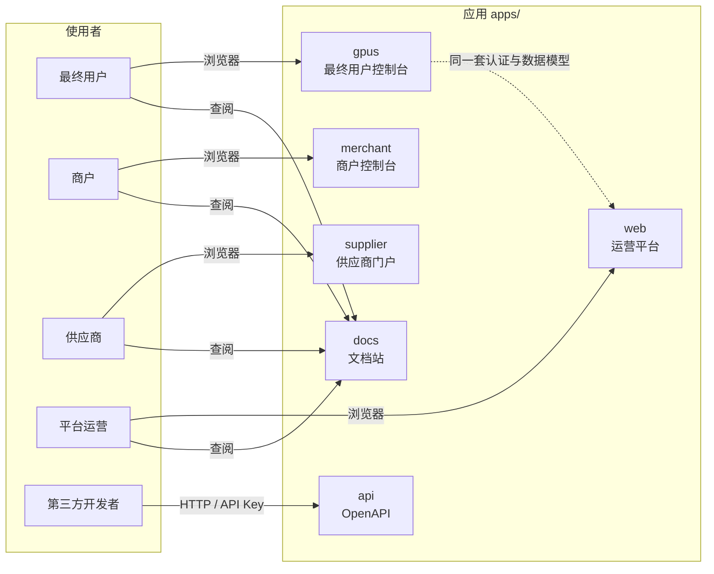
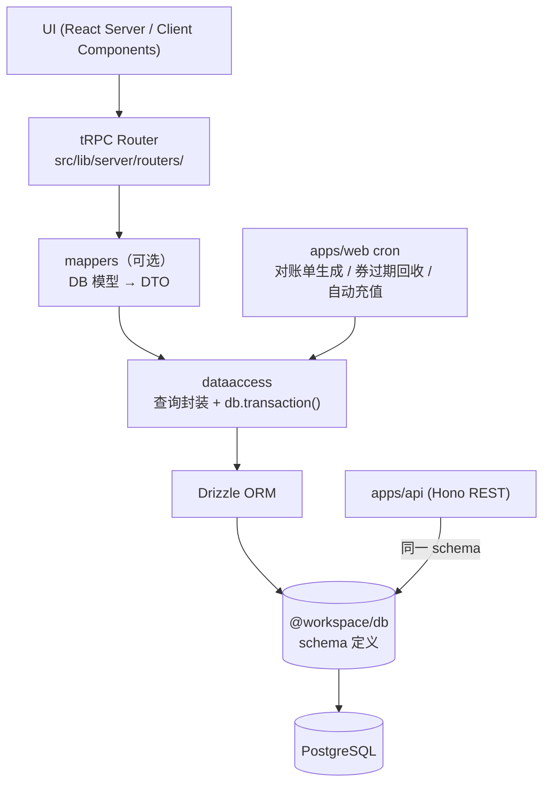
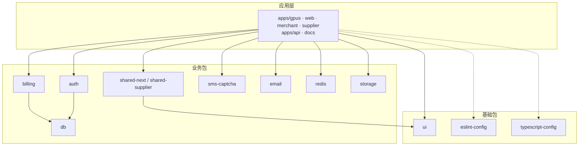
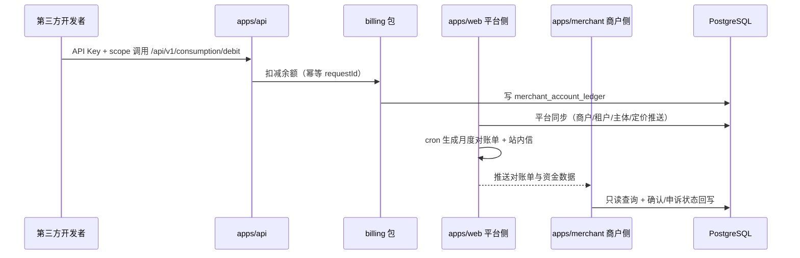

# GPURun Cloud

GPU 云服务平台 monorepo，包含最终用户控制台、运营平台、商户平台、供应商门户和 OpenAPI。

基于 Turborepo + pnpm workspace。

## 架构概览

```
apps/
  gpus/        最终用户控制台 (Next.js 16) — 实例/裸金属/沙箱的购买、计费与运维   :40031
  web/         运营平台 (Next.js 16) — CRM、商户/供应商管理、财务、大盘、平台定价  :40041
  merchant/    商户控制台 (Next.js 16) — 资金、账单、结算、对账、主体与租户管理     :40022
  supplier/    供应商门户 (Next.js 16) — 数据中心、设备、合同、发票与退役           :40011
  api/         OpenAPI (Hono 4 + @hono/zod-openapi，Scalar UI) — 对外 REST 与扣费入口 :8080
  docs/        Fumadocs 文档站点                                                   :6969

packages/
  db/                Drizzle ORM schema 定义与迁移（唯一的数据模型来源）
  auth/              Better Auth 认证配置与 schema 生成
  billing/           共享计费服务（充值、余额、支付网关、商户资金/定价/券）
  ui/                shadcn/ui 共享组件库与全局样式
  shared-next/       共享 Next.js 工具（资源、分析、联盟营销等）
  shared-supplier/   供应商侧共享通知（入驻/退役/账单）
  email/             邮件服务
  sms-captcha/       短信验证码
  redis/             统一 Redis 连接（本地 ioredis / 云端 Upstash）
  storage/           统一对象存储（阿里云 OSS / 本地磁盘）
  eslint-config/     共享 ESLint 9 预设
  typescript-config/ 共享 TypeScript 预设
```

每个模块的定位、功能、运行与部署见各自的 `README.md`（索引见[模块协作关系](#模块协作关系)）。

## 模块协作关系

### 1. 角色与应用



### 2. 统一数据访问分层

`apps/web`、`apps/gpus`、`apps/merchant`、`apps/supplier` 走同一条链路，`apps/api` 以
REST 形式提供同一份数据的对外入口：



> 列表必须使用数据库级分页（`count` + `limit/offset`），禁止前端 `slice` 分页，详见 `AGENTS.md`。

### 3. 包依赖方向



依赖只允许自上而下：`db` 不引用任何 workspace 包，`ui`/`shared-next`/`email` 不引用 `apps/*`。

### 4. 关键业务协作



### 5. 协作要点

| 协作关系 | 说明 |
| --- | --- |
| `web` → `merchant` | **商户平台的出账与数据均由 `apps/web` 提供并推送**；`apps/merchant` 只做展示与确认（对账单生成、站内信、调账发起都在 `apps/web`） |
| `api` ↔ `web`/`merchant` | `apps/api` 对外暴露 OpenAPI（含 `account`/`vouchers`/`subjects`/`recon` 等只读端点），与两个控制台共用 `@workspace/db` 和 `@workspace/auth` |
| `billing` → 各 app | 充值、余额、支付网关、商户资金模型（预付/佣金）、定价与券规则只实现一份，由 `apps/web`、`apps/merchant`、`apps/api` 共同调用 |
| `cron` | 对账单生成、算力券过期回收、自动充值扫描注册在 `apps/web`，统一走 `/api/internal/cron/*` + `CRON_SECRET` |
| `@workspace/db` | 全仓唯一的数据模型来源；schema 变更后 `db:generate` 产出迁移，不要手改 `drizzle/` 下的生成文件 |
| `docs` | 面向用户的文档站，与应用解耦，仅共享 `ui` |

### 6. 模块 README 索引

| 模块 | 定位 |
| --- | --- |
| [apps/gpus](apps/gpus/README.md) | 最终用户控制台 |
| [apps/web](apps/web/README.md) | 运营平台 |
| [apps/merchant](apps/merchant/README.md) | 商户控制台 |
| [apps/supplier](apps/supplier/README.md) | 供应商门户 |
| [apps/api](apps/api/README.md) | OpenAPI 对外接口 |
| [apps/docs](apps/docs/README.md) | 文档站 |
| [packages/db](packages/db/README.md) | 数据模型与迁移 |
| [packages/auth](packages/auth/README.md) | 认证配置 |
| [packages/billing](packages/billing/README.md) | 共享计费服务 |
| [packages/ui](packages/ui/README.md) | 共享 UI 组件库 |
| [packages/shared-next](packages/shared-next/README.md) | 共享 Next.js 工具 |
| [packages/shared-supplier](packages/shared-supplier/README.md) | 供应商共享通知 |
| [packages/email](packages/email/README.md) | 邮件服务 |
| [packages/sms-captcha](packages/sms-captcha/README.md) | 短信验证码 |
| [packages/redis](packages/redis/README.md) | 统一 Redis 连接 |
| [packages/storage](packages/storage/README.md) | 统一对象存储 |
| [packages/eslint-config](packages/eslint-config/README.md) | 共享 ESLint 预设 |
| [packages/typescript-config](packages/typescript-config/README.md) | 共享 TS 预设 |

### 7. 文档目录索引

设计 / 操作手册 / 商业方案统一按三类存放，**跨模块内容上提 `docs/`，模块内容就地放在 `<app>/content/`**：

```text
docs/                        # 跨模块 + 全仓总索引
├── README.md                # ★ 唯一入口
├── design/                  # 跨模块设计（INDEX.md、audit/、cloud/、gpus/、k8s/）
├── guide/                   # 跨模块操作手册（INDEX.md）
├── business/                # 商业方案唯一集中地（INDEX.md）
└── archive/                 # 历史归档

apps/web/content/            # 模块内文档，同样三分类
├── design/                  # 设计（含 sla/、reports/、audit/）
├── guide/                   # 操作手册
├── business/                # 商业方案
├── legal/                   # 对外合规，原位保留
└── pages/ + release/        # 站点内容（.mdx）

apps/merchant/content/  design/ | guide/ | business/
apps/docs/content/      docs/（站点源，会发布） | guide/（内部运维手册）
```

| 查找什么 | 去哪里 |
| --- | --- |
| 全仓文档总入口 | [docs/README.md](docs/README.md) |
| 设计文档 | [docs/design/INDEX.md](docs/design/INDEX.md)、`apps/web/content/design/`、`apps/merchant/content/design/` |
| 操作手册 | [docs/guide/INDEX.md](docs/guide/INDEX.md)、`apps/*/content/guide/` |
| 商业方案 | [docs/business/INDEX.md](docs/business/INDEX.md)、`apps/*/content/business/` |
| 算力平台架构 | [docs/design/cloud/INDEX.md](docs/design/cloud/INDEX.md) |

不参与三分类（原位保留）：`AGENTS.md`、各模块 `README.md`、`apps/docs/content/docs/**`（fumadocs 站点源）、`apps/web/content/legal|pages|release/**`、`goes/docs/`、应用路由树内的 `.md`。

## 技术栈

| 层 | 技术 |
|---|---|
| 前端框架 | Next.js 16 + App Router (Server Components 优先) |
| UI 组件 | shadcn/ui (Radix + @base-ui/react) @ `@workspace/ui` |
| 后端 RPC | tRPC (apps/web、apps/merchant、apps/supplier) |
| REST API | Hono 4 + @hono/zod-openapi (apps/api) |
| ORM | Drizzle ORM (PostgreSQL) |
| 认证 | better-auth (apps/web 与 apps/api 共享) |
| 构建 | Turborepo，pnpm workspace |

## 前置要求

- Node.js >= 20
- [pnpm](https://pnpm.io) 10.33+
- [Docker](https://www.docker.com) (本地 Postgres)

## 快速开始

```bash
# 安装依赖
pnpm install

# 复制并填充环境变量
cp .env.example .env

# 启动 Postgres
docker compose up -d

# 运行数据库迁移
pnpm --filter @workspace/db db:migrate

# 启动全部应用
pnpm dev
```

单独启动某个应用：

```bash
pnpm --filter gpus dev       # 最终用户前端
pnpm --filter web dev        # 运营平台
pnpm --filter merchant dev   # 商户平台
pnpm --filter supplier dev   # 供应商门户
pnpm --filter api dev        # OpenAPI
pnpm --filter docs dev       # 文档站点
```

| App | URL |
| --- | --- |
| API (Scalar UI) | `http://localhost:8080` → `/docs` |
| gpus | `http://localhost:40031` |
| web | `http://localhost:40041` |
| merchant | `http://localhost:40022` |
| supplier | `http://localhost:40011` |
| docs | `http://localhost:6969` |

## 常用命令

```bash
# 开发
pnpm dev              # 启动全部应用
pnpm build            # 构建全部
pnpm lint             # 全部包 lint
pnpm typecheck        # 全部包类型检查
pnpm format           # 全部包格式化

# 数据库
pnpm --filter @workspace/db db:generate   # 生成迁移 (drizzle-kit)
pnpm --filter @workspace/db db:migrate    # 应用迁移
pnpm --filter @workspace/db db:push       # 推 schema (无迁移)
pnpm --filter @workspace/db db:check      # 校验迁移与 schema 一致性
pnpm --filter @workspace/db db:studio     # Drizzle Studio

# 种子数据
pnpm --filter @workspace/db db:seed:metal     # 金属机/硬件清单
pnpm --filter @workspace/db db:seed:admin     # 管理员账号
pnpm --filter @workspace/db db:seed:images    # 镜像

# 认证 schema
pnpm --filter @workspace/auth auth:generate

# 邮件开发
pnpm --filter @workspace/email email:dev

# UI 组件
pnpm --filter @workspace/ui dlx shadcn@latest add <component>
```

## 添加 UI 组件

```bash
pnpm --filter @workspace/ui dlx shadcn@latest add button
```

然后在任意应用中使用：

```tsx
import { Button } from "@workspace/ui/components/button"
```

## 数据访问模式

`apps/web`、`apps/gpus`、`apps/merchant` 遵循统一分层：

```
UI (React Components)
  ↓ tRPC (routers 定义在 src/lib/server/routers/)
  mappers (可选，src/lib/server/mappers/)
  dataaccess (src/lib/server/dataaccess/ — 事务在此层处理)
    ↓ Drizzle ORM
  @workspace/db (packages/db/src/ — schema 定义)
    ↓
  PostgreSQL
```

列表分页必须使用数据库级分页（count + limit/offset），禁止前端 `slice` 分页。详见 `AGENTS.md`。

## Docker 部署

```bash
pnpm docker:build:web       # 构建 web 镜像
pnpm docker:build:gpus      # 构建 gpus 镜像 (apps/gpus/Dockerfile)
pnpm docker:build:api       # 构建 api 镜像
pnpm docker:build:docs      # 构建 docs 镜像
pnpm docker:compose:build   # docker/docker-compose.build.yml 批量构建
```

## 分支说明

- `develop`：主开发分支
- `develop-cloud`：云上运行版本
- `develop-gpus`：最终用户前端 (gpus) 开发分支
- `develop-db-usage-merchant`：商户管理实现，对应线上版本
- `develop-db-usage-sla`：机房 SLA 实现
- `develop-db-usage-sla-chat`：SLA + 聊天实现