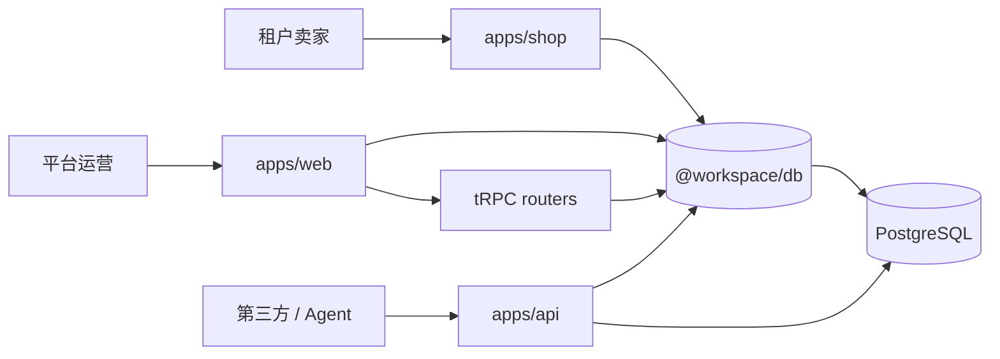

# Open Shop

多租户跨境电商运营数据中枢 monorepo：租户端运营台、平台运营后台、OpenAPI 与文档站。

MVP 聚焦 **Daraz 斯里兰卡（LK）**：店铺连接、选品候选、待审队列、商品/刊登、订单、库存、到仓成本与财务粗览。

## 模块

```text
apps/
  shop/    租户端（Next.js 16）— 营销页、登录注册、/console 运营工作台
  web/     平台运营后台（Next.js 16 + tRPC）— 跨租户审核、同步健康、待审抽检
  api/     OpenAPI（Hono 4 + @hono/zod-openapi）— 健康检查，认证端点占位，跨境资源接口待实现
  docs/    文档站（Fumadocs + Next.js 16）

packages/
  db/                Drizzle schema 与迁移（auth / commerce / feishu）
  auth/              better-auth 认证配置
  marketplace/       平台连接器（Daraz / Lazada / TikTok OAuth、签名、同步）
  ui/                shadcn/ui 共享组件与全局样式
  shared-next/       共享 Next.js 工具
  email/             邮件服务
  sms-captcha/       短信验证码
  redis/             统一 Redis 连接
  storage/           统一对象存储
  eslint-config/     共享 ESLint 预设
  typescript-config/ 共享 TypeScript 预设
```

| 应用 | 使用者 | 职责 |
| --- | --- | --- |
| `apps/shop` | 卖家（租户） | 本组织下的店铺连接、选品、待审、商品/刊登、订单、库存、成本、财务 |
| `apps/web` | 平台运营 | 跨租户审核、全局连接健康、待审动作抽检、平台级配置 |
| `apps/api` | 第三方 / Agent | REST OpenAPI 与 MCP（设计已定，待实现） |
| `apps/docs` | 用户 / 开发者 | 产品与接入文档 |

## 架构



- 租户与平台共享 Better Auth 用户 / 组织模型，业务表强制 `organization_id`。
- 跨境域 schema 位于 `packages/db/src/commerce-schema.ts`。
- `apps/shop` 当前以 mock 数据跑通控制台；`apps/web` 已接入 tRPC 基础路由。
- 平台端跨租户操作只读或受限；写操作走待审队列。

## 技术栈

| 层 | 技术 |
| --- | --- |
| 前端框架 | Next.js 16 + App Router |
| UI | shadcn/ui + `@workspace/ui` + Tailwind CSS v4 |
| RPC / API | tRPC（`apps/web`）、Hono 4 + zod-openapi（`apps/api`） |
| ORM | Drizzle ORM + PostgreSQL |
| 认证 | better-auth |
| 构建 | Turborepo + pnpm workspace |

## 快速开始

```bash
pnpm install
cp .env.example .env          # 填充 DATABASE_URL / BETTER_AUTH_SECRET 等
docker compose up -d          # 本地 Postgres
pnpm --filter @workspace/db db:migrate

pnpm dev                      # 启动全部应用
# 或单独启动
pnpm --filter shop dev
pnpm --filter web dev
pnpm --filter api dev
pnpm --filter doc dev
```

`apps/docs` 固定使用 6969 端口；其余端口以各应用 `.env` 的 `PORT` 为准。

## 常用命令

```bash
pnpm dev / build / lint / typecheck / format

pnpm --filter @workspace/db db:generate   # 生成迁移
pnpm --filter @workspace/db db:migrate    # 应用迁移
pnpm --filter @workspace/db db:studio     # Drizzle Studio
```

## 文档

- 文档总入口：[docs/README.md](docs/README.md)
- 设计文档清单：[docs/design/INDEX.md](docs/design/INDEX.md)
- 租户端 UED：[apps/shop/content/design/crossborder-shop-ued-product-design.md](apps/shop/content/design/crossborder-shop-ued-product-design.md)
- 开发约定：[AGENTS.md](AGENTS.md)

## 数据访问约定

新功能统一走：

```text
UI → tRPC → mappers（可选）→ dataaccess（事务在此层）→ Drizzle → @workspace/db → PostgreSQL
```

列表必须使用数据库级分页（`count` + `limit/offset`），禁止前端 `slice` 分页。
