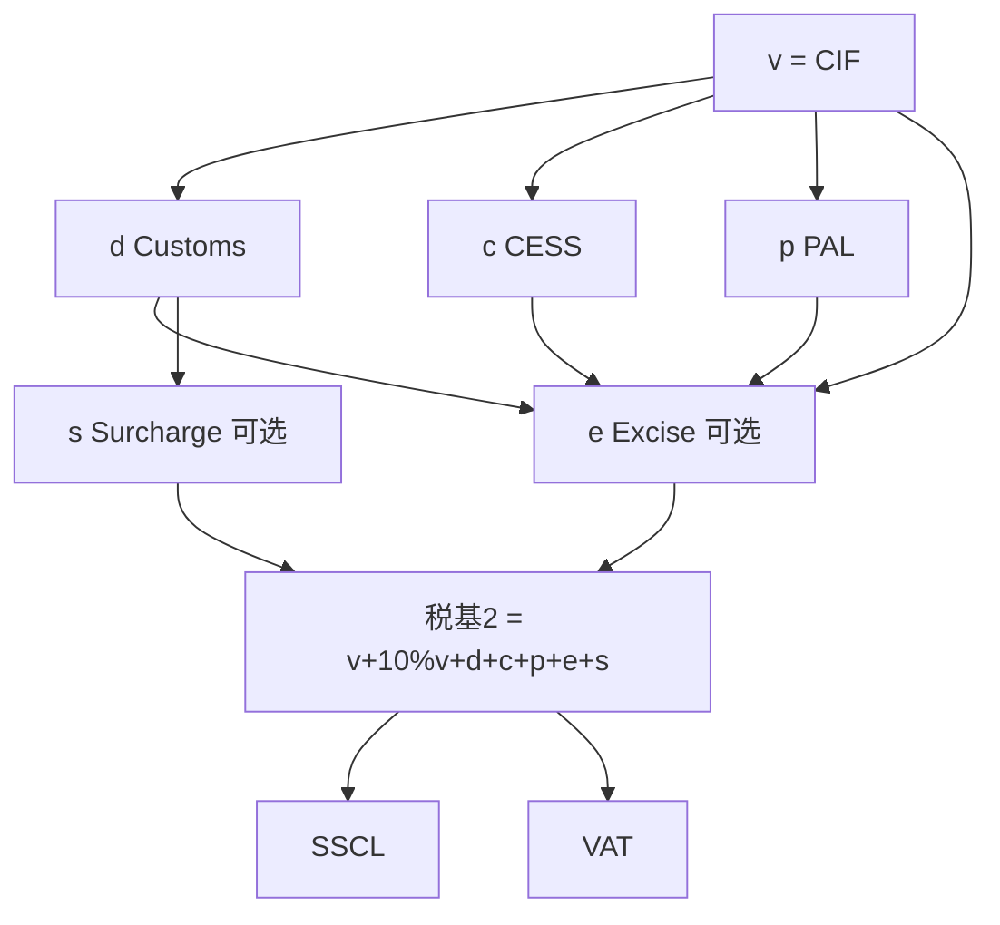

# 成本计算实现方案 · 斯里兰卡到仓落地成本（含 UED）

| 项 | 内容 |
|----|------|
| 文档范围 | `apps/shop` 跨境运营台 · 到仓成本 / LK 税叠加 / 空运 DDP·LCL·FCL / 建议售价与净利率 |
| 受众 | 产品、UED、前端、运营、报关对接 |
| 版本 | **v1.2** |
| 日期 | 2026-10-21（Asia/Shanghai） |
| 仓库 | `openroute-ai/open-shop` |
| 关联 | `crossborder-shop-ued-product-design.md`（§5.7 成本页总览；本文为深化专篇）、[`crossborder-database-design.md`](../../../../docs/design/crossborder-database-design.md)（`cost_components`）、[`crossborder-mvp-overview.md`](../../../../docs/design/crossborder-mvp-overview.md) |
| 实现现状 | 控制台 mock：`/console/costs`、`/console/costs/[sku]`；先实现可交互 UED，用户确认后再接业务 tRPC |
| 门禁 | 设计稿；先交付可交互 UED 并确认用户习惯，再接业务 API/tRPC 和持久化 |

### 修订记录

| 版本 | 日期 | 变更摘要 |
|------|------|----------|
| v1.0 | 2026-10-21 | 初稿：LK 税叠加工式、LCL/FCL、建议售价、UED 工作台、分阶段与验收 |
| v1.1 | 2026-10-25 | 关联文档迁至 `docs/design/`；移除历史业务成本口径的交叉引用 |
| v1.2 | 2026-10-28 | 明确先做可交互 UED、用户确认后再接 tRPC；三种运输方案纳入工作台；统一成本名称、证据/报价状态、示例数据标记和可复用快照目标 |

---

## 1. 背景与目标

### 1.1 背景

Open Shop 租户端是多租户跨境运营数据中枢（Daraz / Lazada / Shopee / TikTok；**MVP 仅 Daraz → 斯里兰卡**）。选品与刊登前必须能快速估算「FOB → 到仓」全成本，并在目标净利率下给出建议售价。现有 `/console/costs` 已有列表与 SKU 详情 mock（采购 / 头程 / Customs / PAL / CESS / VAT / SSCL 列 + 海运方案表），但**缺少可交互计算器、分摊规则、税基说明与版本化配置模型**。主 UED 文档 §5.7 仅给区块级规格，故本文作为**独立专篇**深化成本计算。

### 1.2 目标

1. 给出可落地的**领域模型与计算流水线**（公式清晰、可 mock、可配置化）。
2. 明确**斯里兰卡进口税叠加顺序与税基**（标注需报关/法务复核；无官方实时税率 API 承诺）。
3. 支持 **空运 DDP / 海运 LCL / 海运 FCL** 情景测算与对比。
4. 支持**目标净利率 → 建议售价**及成本结构瀑布。
5. 产出可执行的 **UED**（IA、关键路径、工作台线框、与现有列表/详情关系）。
6. 分阶段：**阶段一可交互 UED → 用户确认 → 阶段二 tRPC/持久化/真实数据接入**；阶段一不接业务 tRPC。
7. AI 所用研究输入（竞品、评论、供应商报价、包装、HS/法规、物流报价）须记录来源、时间、状态和版本；派生建议可追溯且可复用。

---

## 2. 范围与非目标

### 2.1 范围（In）

| 能力 | 说明 |
|------|------|
| 到仓成本 | FOB/采购、头程、海运（拼柜分摊 / 整柜）、关税税费、清关杂费 → **到仓落地成本/件** |
| LK 税项 | Customs Duty、PAL、CESS、VAT、SSCL（及文档级提及 Excise / Surcharge / SCL，MVP UI 可折叠） |
| 运输模式 | **空运 DDP、海运 LCL、海运 FCL** 三种方案均进入 UED 和情景对比；各按实际承运商/货代报价规则计算 |
| 定价 | 平台佣金、支付费、尾程/本地物流、可选广告费；目标净利率 → 建议售价 |
| 数据版本 | 税率表版本、运价表、汇率日；计算结果可追溯 |
| UED | `/console/costs` 列表 + 详情 + **计算器工作台**（可同页 Sheet / 右侧结果栏） |
| 入口 | 选品候选、商品详情、「打开计算器」 |

### 2.2 非目标（Out）

- 阶段一不接 tRPC / dataaccess / OpenAPI / MCP；用户确认 UED 后，阶段二接入业务 API 和持久化。
- 不实现官方 Customs 实时查税 API、不爬取 `customs.gov.lk` 作为生产依赖。
- 不自动报关、不生成正式报关单、不做合规担保。
- 不覆盖历史业务月度成本。
- 不强制引入 Open Mercato AppShell / Sales Tax 模块；Mercato 仅作可选展示层灵感（见 §12）。
- 不在本文改 `cost_components` 表结构（扩展用 `note` / 后续 jsonb 另案）。

---

## 3. 用户角色与场景

| 角色 | 场景 | 成功标准 |
|------|------|----------|
| 选品运营 | 候选 SKU 估到仓成本与建议售价，决定是否继续验证/进入候选池 | 5 分钟内能比较空运 DDP/LCL/FCL 情景并看见费用边界、数据缺口和证据状态；风险项标「待复核」 |
| 报价 / 采购 | 按箱规、柜型、FOB 报价给内部或供应商对比 | 可导出/复制成本瀑布（P1+）；同 HS 可复用税率版本 |
| 到仓复盘 | 货到仓后用真实清关账单 vs 测算值 | 可录入实际税费、看差异；状态「已复盘」 |
| 负责人 | 扫列表净利率 / 异常 SKU | 列表一眼看到合计与建议价；下钻详情 |

### 关键路径（Happy path）

```text
选品 / 商品详情 →「成本测算」
  → 计算器工作台预填 SKU / FOB / 箱规（若有）
  → 选 HS 档位或粘贴示例税率（mock）
  → 选择空运 DDP / LCL / FCL，查看分摊、费用包含范围与可比性
  → 设目标净利率 → 得建议售价
  →（阶段二）保存历史快照/关联候选；高影响动作进入待审 B；阶段一明确仅 Demo 状态
```

---

## 4. 领域模型与计算流水线

### 4.1 核心概念（展示 / 计算层；英文 id 稳定）

| 概念 | id / 字段 | 说明 |
|------|-----------|------|
| 货值 | `fob_unit` / `fob_total` | 采购 FOB；币种默认 USD，可兑 LKR |
| 保险 | `insurance` | 可选；常按货值 %；计入 CIF |
| 国际运费分摊 | `freight_allocated` | air_ddp / LCL / FCL 各自保存计费规则与报价快照 |
| 头程（国内段） | `first_mile` | 工厂→起运港；可并入 freight 或单独 |
| CIF | `cif` | 通常 `FOB + Insurance + Ocean`（到港）；**税基 v** |
| 税项 | `customs` / `pal` / `cess` / `vat` / `sscl` | 见 §5 |
| 清关杂费 | `clearance_misc` | 代理、文件、港杂等（非税） |
| 进口税费 | `tax_total` | 仅对未被 DDP 货代报价包含的税项另计；重复税费必须避免 |
| 到仓成本/件（经营口径） | `landed_unit` | 采购 + 国际物流 + 进口税费 + 明确列出的清关/派送等费用；缺项时标为部分成本 |
| 经营总成本 | `total_cost_unit` | 到仓成本 + 平台/支付/广告/退货等费用；用于净利测算 |
| 售价侧 | `platform_commission_pct`、`payment_fee_pct`、`last_mile_unit`、`ads_unit`（可选） | |
| 目标净利率 | `target_net_margin_pct` | → `suggest_price` |
| 版本 | `tariff_table_version`、`freight_rate_version`、`fx_rate_date` | |

### 4.2 与现有 schema 对齐

`cost_components`（已有）：`component ∈ purchase | freight | duty | other`，`amount`，`currency`，`note`，`effective_from`。

| 计算项 | 建议落库 component | note 约定（P0/P1） |
|--------|-------------------|-------------------|
| FOB/采购 | `purchase` | `FOB` |
| 头程 + 海运分摊 | `freight` | `first_mile` / `LCL` / `FCL20` / `FCL40` |
| Customs Duty | `duty` | `customs` |
| PAL / CESS / VAT / SSCL / 杂费 | `other` | 对应英文税码或 `clearance_misc` |

列表层可继续用扁平字段（与现 mock 一致）：`purchase, freight, customs, pal, cess, vat, sscl`。**不在本文改表**；P2 若税项频繁查询再议 jsonb / 子表。

### 4.3 计算流水线（端到端）


**逐步公式（每件，展示币种；内部可先 LKR 再兑回）：**

1. **箱体积 / 计费重**  
   - `cbm_per_ctn = L × W × H`（m）  
   - `cbm_total = cbm_per_ctn × cartons`  
    - 空运按该报价规定的实重/材积重/最低收费规则；不得使用无来源通用系数。LCL 按报价规定的 CBM/计费吨/最低收费规则。FCL 按柜型和装载分摊。

2. **国际物流分摊** → 空运 DDP / 海运 LCL / 海运 FCL 之一；报价说明、币种、时效、有效期和含/不含项目均随情景保留

3. **CIF（税基 v）**  
   \[
    v = \mathrm{customs\ CIF} = fob\_total + insurance + \mathrm{customs\_included\_freight}
   \]
    （海关计税基础按适用法规和报关口径核实；货代报价中的 DDP/含税费用不重复进入税基。业务界面显示法规来源与复核状态，不把模型示例当法定口径。）

4. **LK 税** → 合计 `tax_total`（§5）；DDP 中已包含税不得重复加收

5. **到仓成本/件（经营口径）**  
   \[
    landed\_unit = \frac{采购 + 国际物流 + 未包含在运价内的进口税费 + 清关/派送等约定费用}{units}
   \]

6. **建议售价**（§7）；若平台费、营销、退货等费用缺失，标注“按已知费用估算”，不得承诺实际净利。

---

## 5. 斯里兰卡税叠加顺序（Customs / PAL / CESS / VAT / SSCL）

> **重要声明**  
> - 下列公式整理自 Sri Lanka Customs 公开材料 *Computation of Import Levies* / *National Imports Tariff Guide*（如 2026 年版 preamble）。  
> - **税率、豁免、优惠协定、是否适用 Excise / SCL / Surcharge 均按 HS Code 与现行 Gazette 变化。**  
> - 产品内所有计算结果须标 **「估算 · 需报关/法务复核」**；**不提供、不假装已有官方实时税率 API**。  
> - MVP mock 使用**示例税率表**（可版本化 JSON）；P1 由运营维护配置，非法务结论。

### 5.1 符号

| 符号 | 含义 |
|------|------|
| \(v\) | CIF Value（通常为 LKR） |
| \(d\) | Customs Duty |
| \(c\) | EDB CESS |
| \(p\) | PAL（Port and Airport Development Levy） |
| \(e\) | Excise (Special Provisions) Duty（可选） |
| \(s\) | Surcharge on Customs Duty（可选） |
| \(t\) | VAT |
| \(\mathrm{SSCL}\) | Social Security Contribution Levy |
| \(\mathrm{SCL}\) | Special Commodity Levy（按量；部分品类**替代**常规税叠，见开放问题） |

### 5.2 官方计算顺序（摘要）

对一般进口（非 SCL 替代路径）：

| 步骤 | 税项 | 公式（官方口径） | 税基要点 |
|------|------|------------------|----------|
| 1 | Customs Duty \(d\) | \(d = v \times r_d\) 或 从量 | **CIF \(v\)** |
| 2 | CESS \(c\) | \(c = v \times r_c\) 或 从量 | **CIF \(v\)** |
| 3 | PAL \(p\) | \(p = v \times r_p\) | **CIF \(v\)** |
| 4 | Excise \(e\)（若适用） | \(e = (v + 0.15v + d + c + p) \times r_e\) | CIF + **15% CIF** + d+c+p |
| 5 | Surcharge \(s\)（若适用） | \(s = d \times r_s\) | **Duty 额** |
| 6 | SSCL | \(\mathrm{SSCL} = (v + 0.10v + d + c + p + e + s) \times r_{\mathrm{sscl}}\) | CIF + **10% CIF** + 前述税 |
| 7 | VAT \(t\) | \(t = (v + 0.10v + d + c + p + e + s) \times r_{\mathrm{vat}}\) | **与 SSCL 同税基**（不含 SSCL 本身） |



### 5.3 与 CIF / 货值 / HS 的关系

- **HS Code** 决定 \(r_d, r_c, r_p, r_e, r_{\mathrm{vat}}, r_{\mathrm{sscl}}\) 及是否走 **SCL**。  
- **CIF** 是多数从价税的共同起点；VAT/SSCL 另加 **10% of CIF** uplift；Excise 加 **15% of CIF** uplift（官方公式）。  
- 优惠关税 / 暂缓完税时，\(d\) 取**实付**或**应付**口径（官方 footnote）；产品用枚举 `duty_basis: paid | payable`，默认 `payable` 做保守估算。  
- **汇率**：CIF 常需 LKR；UI 展示结算币（USD）时，税在 LKR 算完再按 `fx_rate_date` 兑回，并展示所用汇率。

### 5.4 MVP 简化策略

| 项 | MVP 行为 |
|----|----------|
| Excise / Surcharge / SCL | 默认关闭；高级区可填；开启后按上表 |
| 税率来源 | mock `tariff_profiles[]`：按 HS 前缀或「示例档：服装/3C/家居」 |
| 校验 | 缺 HS 或税率 → 结果区 Badge **待复核**；仍可出「仅运费+FOB」粗算 |
| AI | HS/税率提示 = **C**；写入成本影响在售价 = **B**（待审） |

### 5.5 示例数字（示意 · 非法务结论）

假设单票 100 件 TEE，FOB 合计 420 USD，保险 0，海运分摊 110 USD → CIF = 530 USD；汇率 1 USD = 300 LKR → \(v = 159{,}000\) LKR。  
示例档：\(r_d=15\%, r_c=10\%, r_p=10\%, r_{\mathrm{sscl}}=2.5\%, r_{\mathrm{vat}}=18\%\)；无 Excise/Surcharge。

| 步骤 | 计算 | 结果（LKR，示意） |
|------|------|-------------------|
| \(d\) | \(159000 \times 0.15\) | 23,850 |
| \(c\) | \(159000 \times 0.10\) | 15,900 |
| \(p\) | \(159000 \times 0.10\) | 15,900 |
| 税基2 | \(v + 0.1v + d + c + p\) | 215,550 |
| SSCL | \(215550 \times 0.025\) | 5,388.75 |
| VAT | \(215550 \times 0.18\) | 38,799 |
| 税合计 | | ≈ 99,838 LKR ≈ **332.8 USD** |
| 税/件 | | ≈ **3.33 USD** |

（与现 mock TEE-001 税项量级不同属正常：mock 为占位；流水线上线后以配置表为准。）

---

## 6. 到仓成本项与 LCL / FCL

### 6.1 成本项清单

| 项 | 字段 | 计入 CIF？ | 计入 landed？ |
|----|------|------------|---------------|
| FOB/采购 | `fob_*` | 是 | 是 |
| 保险 | `insurance` | 是 | 是 |
| 头程 | `first_mile` | 默认否 | 是 |
| 海运（分摊后） | `ocean_freight_allocated` | 是 | 是 |
| 关税税费 | `tax_total` | — | 是 |
| 清关杂费 | `clearance_misc` | 否 | 是 |
| **到仓成本/件（经营口径）** | `landed_unit` | — | 采购 + 国际物流 + 未含税费 + 明确约定的清关/派送；缺项需显示 |

### 6.2 输入（计算器）

| 输入 | 说明 |
|------|------|
| 箱规 L×W×H (cm)、每箱件数 `units_per_ctn`、箱数 `cartons` | → CBM、总件数 |
| 单件或总毛重 | → 重量分摊备选 |
| 柜型 | `20GP` / `40GP` / `40HQ`（mock 容积与柜费） |
| 空运 DDP 报价 | 按货代规则录每 kg、材积系数/最低收费、附加费、含税/清关/派送范围和有效期；无报价时只显示演示数 |
| LCL 单价 | `/CBM` 和/或 `/计费吨`；按报价规则取值并考虑最低收费、附加费、税费及目的港/派送包含范围 |
| FCL 柜总价 | 含或不含 THC、清关/派送（逐项说明）；按柜容与混装分摊 |
| 生产周期、船期缓冲、补货提前期 | 展示用，不进金额（与 §5.7 一致） |

### 6.3 分摊规则

**LCL**

\[
ocean\_freight\_allocated = \max(cbm\_total \times rate\_{cbm},\; chargeable\_ton \times rate\_{ton}) + lcl\_surcharges
\]

再按件数或按 CBM 占比分到 SKU（混装柜时用 CBM 权重）。

费用需再加入报价明确的最低收费/附加费；每个报价保存来源、时间、有效期、币种和含/不含范围。不得把该示例 max 规则推广到所有货代报价。

**空运 DDP**

按货代提供的计费重规则计算（如实重与材积重取高、最低收费或附加费）。材积系数必须来自该报价；DDP 已含的税、清关或派送不得重复计算。报价未拆分税项时，应显示“含税打包报价，税项未拆分”。

**FCL**

\[
ocean\_freight\_allocated = \frac{container\_rate + thc + other\_fcl}{units}
\]
（若一柜多 SKU，按 CBM 或件数权重分摊，UI 选 `alloc_basis: units | cbm`。）

### 6.4 临界点对比表（示例数字）

假设：单件体积 0.008 CBM，件重 0.4 kg；LCL = 120 USD/CBM；FCL 20GP = 1,800 USD/柜（可装约 28 CBM 实用，示意）。下表**只是 LCL/FCL 运费的数学演示**，不是完整到仓成本对比或真实市场报价，不包含 DDP 方案；用户界面需明确标“示例”。

| 件数 | 总 CBM | LCL 运费 | FCL 20' 运费摊到本批* | 仅按该假设运费 |
|------|--------|----------|----------------------|------|
| 500 | 4.0 | 480 | （不满柜，按整柜 1800）1800 | **LCL** |
| 1,500 | 12.0 | 1,440 | 1,800 | **LCL** |
| 2,500 | 20.0 | 2,400 | 1,800 | **FCL** |
| 3,500 | 28.0 | 3,360 | 1,800 | **FCL** |

\*「本批独享一柜」简化；合柜时 FCL 侧按权重下降。该示例不能直接成为产品推荐门槛；UI 只有在报价范围和费用口径可比时，才可给出成本更低提示，并应显示“按当前输入估算”。

时效示意需来自货代报价并带来源/有效期；LCL/FCL/空运 DDP 均可在 UED 比较。未经核实的时效仅作演示，三种方案均不设默认推荐。

---

## 7. 建议售价与净利率

### 7.1 售价侧成本

| 项 | 字段 | 口径 |
|----|------|------|
| 到仓成本（经营口径） | `landed_unit` | 采购 + 所选国际物流 + 未被报价包含的进口税费 + 明确列出的清关/派送等费用；缺项标“部分成本” |
| 平台佣金 | `platform_commission_pct` | 占成交价 %（Daraz 类目示意） |
| 支付费 | `payment_fee_pct` | 占成交价 % |
| 尾程/本地物流 | `last_mile_unit` | 固定/件 |
| 广告（可选） | `ads_unit` 或 `ads_pct` | 默认 0；开关 |

对售价 \(P\)：

\[
\begin{aligned}
fee\_var(P) &= P \times (commission\_pct + payment\_pct + ads\_pct) \\
cost\_at\_P &= landed\_unit + last\_mile\_unit + fee\_var(P) \\
net\_profit &= P - cost\_at\_P \\
net\_margin &= net\_profit / P
\end{aligned}
\]

### 7.2 目标净利率 → 建议售价

设目标净利率 \(m = target\_net\_margin\_pct / 100\)，可变费率合计 \(f = commission + payment + ads\_pct\)：

\[
P^{*} = \frac{landed\_unit + last\_mile\_unit}{1 - f - m}
\]

（分母 ≤ 0 时阻断并提示目标过高。）

现详情页「测算毛利率」为旧 mock 公式 \((suggestPrice - landed) / suggestPrice\)，**未扣佣金**；UED 需明确只作旧数据兼容说明，不得作为净利润口径：

 - **毛利率（落地）**：相对到仓成本（兼容旧 mock 展示，标注「未扣平台费」）。  
- **经营净利率**：按经营总成本（到仓成本 + 平台/支付/尾程/营销/退货等已计费用）计算；未提供的费用显示为缺项，不默认视为 0。

### 7.3 成本结构瀑布（结果区）

```text
FOB/件
+ 头程/件
+ 空运 DDP / 海运 LCL / 海运 FCL 国际物流分摊/件（展示报价包含项）
+ 未包含在 DDP 报价中的进口税费（展示税种）
+ 清关/派送等未含费用/件
= 到仓成本 landed_unit（缺项显示“部分成本”）
+ 尾程
+ 平台佣金（按 P*）
+ 支付费（按 P*）
+ 广告（若开启）
= 全成本
→ 建议售价 P* · 净利率 m
```

---

## 8. 数据来源与版本化

| 数据 | P0 | P1 | 备注 |
|------|----|----|------|
| 税率 / HS 档 | 代码内 mock JSON | 租户可编辑「税率表版本」 | 每条计算结果打 `tariff_table_version` |
| 空运 DDP / LCL / FCL 运价 | 明确标记的示例报价 | 有效报价/规则版本 + 来源/有效期 | 各方案计费依据与包含/排除项目 |
| 汇率 | 固定示意 | 按日手工/导入 | `fx_rate_date` + `fx_usd_lkr` |
| 平台费率 | mock 按类目 | 配置 | 与财务中心后期对齐 |
| 实际清关账单 | — | 复盘录入 | 差异报告，不自动改税率真理 |

阶段二每次「保存测算」生成不可变快照：输入 + 来源/报价/税率/汇率/公式版本 + 输出，便于审计与复用。阶段一仅前端 state/session，必须明示“尚未写入业务数据库”。

---

## 9. UED

### 9.1 信息架构

```text
/console/costs                 列表：SKU 成本总览
/console/costs/[sku]           详情：KPI + 税项 + cost_components + 海运表
/console/costs?calc=1          或详情内 Sheet：计算器工作台（推荐）
  └ 也可 /console/costs/calculator  （若要独立路由，P0 可选；默认 Sheet 减少导航膨胀）
```

侧栏仍为「成本计算」单入口（见主 UED §3）；**不**新增一级导航。

### 9.2 与现有页面关系

| 页面 | 职责变化 |
|------|----------|
| 列表 `/console/costs` | 保留表列；增加「打开计算器」、筛选、「待复核」Badge；行点击仍进详情 |
| 详情 `/console/costs/[sku]` | 保留 KPI / 税项网格 / components / 海运表；主 CTA「重新测算」打开工作台并预填 |
| 工作台 | **左输入 / 右结果**（宽屏）或 **上输入 / 下结果**（窄屏）；可用 Sheet 盖在列表或详情上 |

### 9.3 计算器工作台 · 线框级

```text
┌─────────────────────────────────────────────────────────────────────────┐
│ 成本计算器 · TEE-001                       [空运DDP|海运LCL|海运FCL] │
│ 示例参数 · 报价/税率未核实 · Demo 保存不进入业务数据库                     │
├──────────────────────────────┬──────────────────────────────────────────┤
│ 左：输入                     │ 右：结果                                 │
│ • SKU / 候选选择器           │ KPI: 到仓/件 | 建议售价 | 净利率 | 模式  │
│ • FOB、币种、保险%、头程     │ 瀑布列表（可展开税项）                   │
│ • 箱规、件数、重量           │ 空运/LCL/FCL 单件+整批比较               │
│ • HS / 税率档（示例下拉）    │ 费用包含/排除、计费规则、报价有效期       │
│ • 清关杂费                   │ [复制摘要] [应用到候选 P1]               │
│ • 目标净利率、佣金、支付、尾程│ 数据状态、来源及「暂不可比较」原因         │
│ • 高级: Excise/SCL/首程入CIF │                                          │
└──────────────────────────────┴──────────────────────────────────────────┘
```

组件：`@workspace/ui` Form / Input / Select / Tabs / Table / Badge / Sheet / Card；**禁止**独立 AppShell。

### 9.4 空态 / 错误 / 待复核

| 状态 | 表现 |
|------|------|
| 空态（无成本行） | 插画/文案：「还没有成本记录」→「从选品带入」/「打开计算器」 |
| 缺税率 | 结果可出运费+FOB；Badge **待复核 · 缺税率** |
| 分母非法（目标利率过高） | Inline error，禁用「采纳建议价」 |
| 汇率缺失 | 阻断税计算或回退「仅 USD 粗算（不计税）」并标风险 |
| 复盘差异大（P1） | warning：实际税 vs 估算 Δ% |

### 9.5 跨页入口

| 来源 | 行为 |
|------|------|
| `/console/candidates/[id]` | 「成本测算」→ 工作台预填标题/建议采购价 |
| `/console/products/[sku]` | 「查看成本」→ 详情；「重新测算」→ 工作台 |
| 仪表盘待办 | 已有「复核本周成本定价」链到详情 |

### 9.6 AI A/B/C（成本域）

| 级别 | 行为 |
|------|------|
| C | Copilot / 页内：HS 猜测、税率档建议、空运 DDP/LCL/FCL 情景解读（只读；显示数据状态与来源） |
| B | 「应用建议售价到刊登/候选」进待审 |
| A | 不自动改在售价；不自动报关 |

---

## 10. 分阶段

| 阶段 | 交付 | 不做 |
|------|------|------|
| **阶段一：UED 验证** | 可操作计算器工作台；示例公式/数据；空运 DDP、海运 LCL、海运 FCL 三情景；明确错误、缺失字段、数据状态、来源/包含费用；用户试用与修改 | 不接业务 tRPC，不声称持久化；不把示例运价/税率当默认生产规则 |
| **阶段二：业务功能** | 用户确认后实现服务端计算、有效费率/税率维护与导入、货代报价和汇率来源、组织隔离的测算快照、历史复用/比较；由选品/刊登消费方按权限关联；高影响动作走 pending **B** | 不承诺真报关 API；没有有效来源的数据不可静默使用 |
| **后续扩展** | 实际到仓复盘、混装多 SKU 分摊优化、财务引用历史 landed、更多平台/国家 | 需确认业务口径与数据来源后排期 |

**阶段一暂不接 tRPC。** 用户确认 UED 流程和口径后进入阶段二：服务端可复算计算、组织隔离持久化、历史快照、来源/费率/公式版本，以及 AI/候选消费方适配。阶段一仅可交互演示，保存需明确说明只保留在 Demo 状态。

---

## 11. 验收标准

- [ ] 文档覆盖：税叠顺序、CIF 关系、空运 DDP/LCL/FCL、建议售价、UED、版本化、分阶段。  
- [ ] 主文档 `crossborder-shop-ued-product-design.md` 有指向本文的版本指针。  
- [ ] 明确标注「需报关/法务复核」且**无**「实时官方税率 API」承诺。  
- [ ] 与现 mock 字段 / `cost_components` 映射表清晰。  
- [ ] 阶段一可仅前端实现，不依赖新后端，且 UI 明确保存不等于数据库持久化。
- [ ] UED 可分别操作空运 DDP、LCL、FCL；显示其计费量、报价来源/有效期、费用包含/排除、税费边界与时效。  
- [ ] 示例/估算/假设/已核实状态可区分；缺少输入或报价时不输出确定的“最优方案”。  
- [ ] 单件与整批完整成本分开；“到仓成本”“总成本”“经营净利率”定义一致，费用包含/未含项可见。  
- [ ] UED 阶段保存提示明确为 Demo；阶段二快照可复用，修改输入生成新版本并保留来源/公式/税率/汇率版本。  
- [ ] Open Mercato 对照仅一段，且不声称其具备 SL 海关能力。

---

## 12. Open Mercato 对照结论

检索本地 `open-mercato`：**无** Sri Lanka customs / PAL / SSCL / CESS / LCL / FCL / landed-cost 计算器。Mercato 具备通用 **catalog prices / price kinds** 与 Sales 模块 **tax class（价内/价外 %）**——仅适合作为「价格字段展示、净/毛价成对存储」的软参考，**不能**替代到仓成本或 LK 税叠流水线。本方案**不**引入 Mercato AppShell，**不**复用其 Sales Tax 作为海关税引擎。

---

## 13. 开放问题

1. **SCL 品类**：若候选命中 Special Commodity Levy，是否隐藏常规税叠、仅显示从量 SCL？（需报关顾问确认品类清单。）  
2. **头程是否计入 CIF**：默认否；部分货代报价把国内段打进「运费」——租户级默认值？  
3. **VAT 可抵扣**：经营净利率是否按「VAT 可抵」拆应税成本？（财务口径，P1 再定。）  
4. **多币种展示**：列表固定 USD 还是店铺结算币（LKR）？  
5. **合柜多 SKU**：UED 阶段是否需要演示多 SKU 分摊？阶段二需根据实际用户场景和分摊数据结构确定。
6. **税率维护责任**：运营 vs 外部报关行导入；审计谁签字「可上架」？  
7. **与财务中心**：landed 是否回写结算成本，或财务仅用平台结算（避免双真源）？

---

## 附录 A · 参考链接（外部 · 非正式集成）

- Sri Lanka Customs · Import Tariff / Tariff Guide（含 Computation of Import Levies）  
- 实施时以现行 Gazette 与报关行意见为准；链接仅便于人工查阅。

---

**文档版本 v1.2 · 设计稿。** 先通过可交互 UED 确认用户习惯，再实现业务持久化与集成。
