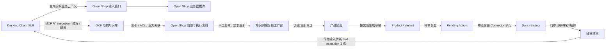

# Open Shop · apps/shop 租户端 UED 与产品功能设计

| 项 | 内容 |
|----|------|
| 文档范围 | `apps/shop` 租户端运营工作台（跨境电商数据中枢）的信息架构、布局规范与逐页产品/UED 设计 |
| 受众 | 产品、UED、前端工程（Next.js + `@workspace/ui`） |
| 版本 | **v2.1** |
| 日期 | 2026-10-27（Asia/Shanghai） |
| 仓库 | `openroute-ai/open-shop`（私有） |
| 关联 | [`crossborder-mvp-overview.md`](../../../../docs/design/crossborder-mvp-overview.md)、[`crossborder-database-design.md`](../../../../docs/design/crossborder-database-design.md)、**`cost-calculator-sl-landed-ued.md`（成本计算器专篇）**；HTML MVP Demo（好时运 AI·ERP，**仅功能/IA 参考**） |
| **门禁** | v2.0 的 UED 基础上，v2.1 调整为动态 Skill execution + OKF 知识库：不固定研究步骤；Open Shop 展示知识对象/执行/复核状态索引，详情正文从 OKF 读取。业务输入和运营事实仍来自 Open Shop DB。具体实现按确认后的 API/权限/dataaccess 阶段推进，不将 mock 视为生产接入。壳层仍用 Next.js App Router 嵌套 `layout.tsx`；**禁止**独立 AppShell 组件。**成本计算器专篇** → `cost-calculator-sl-landed-ued.md`。 |

### 修订记录

| 版本 | 日期 | 变更摘要 |
|------|------|----------|
| v1.0 | 2026-10-20 | 初稿：IA、AppShell、逐页规格、迁移表与待确认问题 |
| **v1.1** | **2026-10-20** | 锁定 §9 六项决议；选品路由改为 `/console/candidates`；移除独立 AI 助手页，改为全局 CopilotKit 右侧面板；视觉明确以现有 `@workspace/ui`/shadcn 为准；Open Mercato 立场改为分阶段「布局借壳 + 数据模型/i18n enrichment」 |
| **v1.2** | **2026-10-20** | **A)** 清除 HTML Demo **视觉**内容（色值/hex、暗侧栏/Element 风表述、附录 A 视觉 token 对照表、Demo-as-visual-reference）；Demo **仅**功能/IA 参考；视觉一律跟随 `@workspace/ui` / shadcn theme。**B)** **禁止**独立 AppShell 布局组件；壳层改为 Next.js App Router 嵌套 `layout.tsx`：`(console)/layout.tsx`（Sidebar+Topbar+CopilotKit）、`(console)/settings/layout.tsx`、`(console)/profile/layout.tsx`；保留 lean 侧栏 / Settings SectionPage **模式**，经 route group layouts 实现而非 Mercato 式 AppShell 包装。门禁：设计已更新；实现进行中于 `feat/shop-console-ui-shell`。 |
| **v1.3** | **2026-10-21** | **详情页 IA（Phase 2 enrichment · mock）**：列表 → 富详情路由落地：`/console/products/[sku]`、`/console/orders/[id]`、`/console/inventory/[sku]`、`/console/candidates/[id]`、`/console/costs/[sku]`、`/console/finance/[platform]`、`/console/settings/shops/[id]`。模式借鉴 Open Mercato catalog/products、sales/orders(documents)、wms/sku 详情（页头+字段组+Tabs/Sections+相关表+状态时间线+KPI），适配跨境多店字段；仍禁止 AppShell；mock-only，无业务 tRPC。 |
| **v1.4** | **2026-10-21** | **UX polish**：① AI 助手从右下角 FAB/overlay 改为 `(console)/layout` **右侧布局列**（~380px），Topbar Sparkles 开关；关闭时主区恢复全宽。② 商品详情 `/console/products/[sku]` 去掉 Tabs，基础信息 / 多店刊登 / AI 信号改为纵向堆叠。③ 仪表盘增加近 7 天订单/营收趋势图（recharts + `@workspace/ui` Chart）。④ 移除「Demo · 未接 tRPC」横幅组件及全部引用。 |
| **v1.5** | **2026-10-21** | **成本计算器方案已出**：新增专篇 `cost-calculator-sl-landed-ued.md`（LK 税叠 Customs/PAL/CESS/VAT/SSCL、LCL/FCL、建议售价与净利率、UED 工作台）；§5.7 增加深化指针。 |
| **v1.6** | **2026-10-25** | 文档随 Open Shop 定位收敛：移除历史业务表述；关联文档迁至 `docs/design/` 与 `apps/shop/content/design/`；营销页暂保持现状。 |
| **v2.0** | **2026-10-27** | 历史版本：曾提出跨境研究项目/固定七步 UED；已由 v2.1 修订为动态 Skill execution + OKF，不作为现行流程或数据库要求。 |
| **v2.1** | **2026-10-27** | 按知识架构调整研究 UED：移除固定七步导航/状态依赖，改为 Skill/策略动态执行记录；过程与知识正文进入 LLM Wiki / OKF，Open Shop 只展示索引、时间线、复核状态和业务关联，保留业务运营数据和审批真相在 SQL。 |

---

## 1. 文档信息与使用方式

本文档是 `apps/shop` 从「历史控制台壳 + `/crossborder` P0 Demo」演进为「跨境租户运营工作台」的**可执行设计基线**。工程师实现时应：

1. 以第 3 节 IA 与路由推荐为准搭壳；
2. 以第 4 节 **嵌套 `layout.tsx` 壳层** / 组件模式对齐 `@workspace/ui` Sidebar + 顶栏（**视觉以现有主题为准**；**禁止**独立 AppShell）；
3. 以第 5 节逐页规格填区块与字段（示例数字仅作示意，标「示例」）；
4. 以第 6 节全局 CopilotKit 与跨页能力补齐壳层；
5. 以第 8 节迁移表从现有 `/crossborder/*` 平滑切到目标路由。

基础运营数据模型已在 commerce schema 中设计（`shops`、`products`、`listings`、`orders`、`inventory_*`、`cost_components`、`settlements`、`pending_actions`、`product_candidates`）。Skill execution/OKF 知识索引模型见 `docs/design/crossborder-database-design.md`；本文定义动态执行/知识对象索引、人工复核和运营闭环，不固定 Skill 流程，也不替代 schema 文档。

---

## 2. 设计输入与边界

### 2.1 HTML Demo 采纳 / 丢弃

产品名在 Demo 中为「好时运 AI·ERP / 跨境电商智能管理系统」。Open Shop 租户端对外可用中性名（如「Open Shop 运营台」），本文不绑定客户品牌文案。

**重要：** HTML Demo **仅作功能与信息架构参考**，**不是**视觉 / 主题 / 组件风格的 source of truth。生产 UI 一律使用现有 `@workspace/ui` + shadcn theme。

| Demo 模块 | 处理 |
|-----------|------|
| 运营仪表盘 | **采纳** → 主侧栏首页 |
| AI 智能选品 | **采纳** → 选品列表 + 分析抽屉（路由 `/console/candidates`） |
| 成本计算 | **采纳并加深** → 斯里兰卡税项明细工作台 |
| 订单管理 | **采纳** → KPI + 多店订单表 |
| 库存预警 | **采纳** → 紧急补货 / 库龄 / 闪购建议 |
| 财务中心 | **采纳** → 与成本页拆分（Demo 已是独立页） |
| AI 助手（独立页） | **不采纳为独立路由** → 改为全局 **CopilotKit** 右侧面板（见 §5.9 / §6） |
| 需求总览 | **丢弃出导航**；仅作文案/背景上下文 |
| 实施路线图 | **丢弃出导航**；不进生产 IA |
| Element UI / Demo 视觉语言（主色、暗侧栏、硬编码色等） | **不采用**；禁止引用 Demo 视觉；只用现有 design tokens |

业务语境（写入产品边界，非导航项）：

- 市场：东南亚 Daraz / Lazada / Shopee / TikTok Shop；**MVP 仅 Daraz LK（斯里兰卡）**。
- 团队：小团队运营；产品是**薄数据中枢**，不是通用进销存 ERP。
- AI 三级：**A 全自动** / **B 人工复核（HITL）** / **C 决策辅助**（C 主要落在 CopilotKit + 页内分析面板）。

### 2.2 从 Open Mercato 采纳的原则（分阶段 enrichment，非硬禁止）

Open Mercato 是**布局参考 + 后续数据/交互 enrichment 来源**，不是「原样 fork 进侧栏」的业务模块清单。立场分两阶段：

#### Phase 1（近期 · 首要）

先保证 HTML Demo **功能**在 `apps/shop` 落地：仪表盘、选品（candidates）、订单、库存、成本、财务、待审、设置/店铺连接——使用 open-shop 技术栈与**现有** `@workspace/ui` / shadcn 主题。侧栏只挂跨境业务模块，不把 Mercato 的 Customers / Catalog / Sales 等模块名原样贴进 shop 导航。

#### Phase 2（enrichment）

在 Phase 1 功能齐备后，可**有选择地**借鉴 Open Mercato **已有的 ERP 数据模型概念与 i18n 支持**，加深 Demo 的数据展示与功能深度，例如：

- 目录 / 商品结构化思路 → 映射到 open-shop commerce schema 的 `products` / `listings`；
- 订单 / 销售状态建模模式 → 适配我们的订单状态与 FilterBar；
- 多币种 / i18n 模式 → 落到 next-intl 与展示层；
- 可复用的列表 / 筛选 / 空态约定 → 统一到我们的 DataTable 与质量态。

以上均为**适配进 open-shop**，而非把 Mercato 业务模块整包搬进导航。

#### 持续推荐的布局原则（来自 Mercato 壳层实践 · **模式借鉴，非 AppShell 组件**）

保留 lean 侧栏与 Settings / Profile **SectionPage 交互模式**，但在 open-shop 中用 **Next.js App Router 嵌套 `layout.tsx`** 实现（见 §4），**禁止**引入独立 AppShell / Mercato 式布局包装组件。

1. **主侧栏保持 lean**：只放日常业务模块；设置不塞进主业务列表中部 → 由 `(console)/layout.tsx` 挂载。
2. **Settings 钉在侧栏底部** + Topbar 齿轮 → 进入 Settings；分区内用**垂直 Tab**（Apple iPad Settings / Attio 模式）；进入 Settings 后**主侧栏被 Settings 内导航替换** → 由 `(console)/settings/layout.tsx` 实现。
3. **Profile 仅从 Topbar 头像下拉进入**；深链到 Profile 分区页，复用同一套垂直 Tab 模式 → 由 `(console)/profile/layout.tsx` 实现。
4. **Topbar**：主题、组织切换、设置齿轮、头像、通知（可选搜索）→ 在 `(console)/layout.tsx` 与 Sidebar 组合，非 AppShell。
5. **列表页**：FilterBar + DataTable + Pagination。
6. **详情页**：页头 + Tabs / Sections。
7. **创建/编辑**：表单页或 Dialog。
8. **质量态**：loading / empty / error / success 四种必须可表达。

### 2.3 与 `apps/web` 职责切分

| 应用 | 角色 | 职责 |
|------|------|------|
| `apps/shop` | 租户 / merchant 运营 | 本组织下的选品、待审、商品/刊登、订单、库存、成本、财务粗览、店铺连接；全局 CopilotKit 决策辅助 |
| `apps/web` | platform 运营后台 | 跨租户审核、全局连接健康、抽检 pending、平台级仪表盘 |

本文**只覆盖 `apps/shop`**。

### 2.4 非目标

- 自营结账 / 自建商城收银台。
- MVP 同期上线四平台（Lazada / Shopee / TikTok）齐开；导航与筛选可预留 platform 维度，数据通道仅 Daraz。
- 通用进销存（采购单、仓库 WMS、多仓调拨全流程）。
- 首批实现（进行中于 `feat/shop-console-ui-shell`）仅 UI 壳 + 导航 + mock；仍不接业务 tRPC / 真连接器（除非另行说明）。**禁止**引入独立 AppShell 布局组件。
- **历史业务导航替换（已确认）**：跨境主壳**替换**现有 `/console` 下的历史业务导航组；营销站 `(marketing)` 暂保持现状，旧 console URL **过渡期隐藏导航、URL 暂留**。默认登录后进入跨境工作台。

---

## 3. 信息架构 (IA)

### 3.1 路由前缀（已确认）

**已确认：统一挂在 `/console/...`，用跨境 IA 替换历史 `CONSOLE_NAV_GROUPS`。**

理由：

- 现有 `@workspace/ui` `Sidebar`（`collapsible="offcanvas"`）+ 顶栏组件已存在；用 **`(console)/layout.tsx`** 组合即可，无需独立 AppShell。
- 避免再引入第三套前缀（`/ops`、`/crossborder` 长期并存）加剧产品切换器心智负担。
- P0 Demo 的 `/crossborder/*` 作为临时路由组，确认设计后按第 8 节映射迁移并最终删除独立 Demo 壳。

**locale**：`next-intl` `localePrefix: as-needed`，默认 `zh`；下文路径均省略 locale。

### 3.2 主侧栏（lean）

| 顺序 | 显示名 | 建议路由 | 图标建议（lucide） | 说明 |
|------|--------|----------|-------------------|------|
| 1 | 运营仪表盘 | `/console/dashboard` | `LayoutDashboard` | 默认落地页；**`/console` redirect → `/console/dashboard`**（已确认） |
| 2 | AI 选品 | `/console/candidates` | `Sparkles` / `PackageSearch` | 列表；详情/分析用抽屉。旧 `/crossborder/candidates` redirect 至此（已确认命名） |
| 3 | 知识与执行 | `/console/knowledge` | `Brain` | Skill 执行索引、OKF 知识对象、待复核记录与业务关联；不假设固定步骤 |
| 4 | 待审队列 | `/console/pending` | `ClipboardList` | AI-B HITL；角标可显示 pending 数 |
| 5 | 商品与刊登 | `/console/products` | `Package` | 本地商品 + listing 状态 |
| 6 | 订单 | `/console/orders` | `ShoppingCart` | 多店订单 |
| 7 | 库存预警 | `/console/inventory` | `Warehouse` | 预警优先，非完整 WMS |
| 8 | 成本计算 | `/console/costs` | `Calculator` | 到仓成本 / 税项 / 定价 |
| 9 | 财务中心 | `/console/finance` | `Wallet` | 营收成本利润粗览；与成本页分离 |
| — | ─── divider ─── | | | |
| 底 | 设置 | `/console/settings`（及子路径） | `Settings` | **pinned footer**；同时 Topbar 齿轮进入 |

**不要**放进主侧栏：需求总览、实施路线图、Profile、独立 AI 助手页、历史部署类入口（过渡期隐藏导航、URL 暂留）。

**AI 对话入口不在主侧栏**：由 Topbar Sparkles 开关触发，打开后在 `(console)/layout.tsx` 右侧插入布局列（见 §4.2 / §5.9）。

### 3.3 Settings 分区页（侧栏替换）

进入 Settings 后，主业务侧栏替换为垂直 Tab：

| Tab | 路由建议 | 内容 |
|-----|----------|------|
| 店铺连接 | `/console/settings/shops` | 店铺列表、平台、区域、连接状态、最近同步、错误信息 |
| 平台凭证 | `/console/settings/credentials` | OAuth / API Key 状态（不明文展示密钥）；续期 / 重连 |
| 通知 / 钉钉 | `/console/settings/notifications` | Webhook、钉钉机器人、告警开关 |
| 组织成员 | `/console/settings/members` | Better Auth org 成员与角色（只读+邀请，深度权限可后置） |
| 偏好 | `/console/settings/preferences` | 默认店铺、默认时区/币种展示、表格密度等 |

Settings 页头提供「← 返回工作台」回到上一业务路由（或 dashboard）。

### 3.4 Profile 分区

仅从 Topbar 头像下拉：「账号设置」→ `/console/profile`。

| Tab | 内容 |
|-----|------|
| 账号 | 姓名、邮箱、头像 |
| 偏好 | 主题跟随、语言（zh/en） |

不在主侧栏出现 Profile。

### 3.5 Topbar 元素

从左到右（示意）：

1. SidebarTrigger（窄屏 / 折叠）
2. 当前页标题（可含面包屑短路径）
3. 弹性空白 / 可选全局搜索（P2）
4. **组织切换器**（Better Auth `activeOrganizationId`）
5. 主题切换
6. 通知铃铛（可选；MVP 可占位）
7. 设置齿轮 → Settings
8. 头像下拉 → Profile / 退出登录

**不在左栏放独立 Bot 导航项**；Copilot 由 **Topbar Sparkles** 开关唤起（非 FAB overlay）。

### 3.6 IA 示意

```
apps/shop/app/.../（示意 · App Router）
├── (marketing)/…                    # 暂留；导航隐藏，URL 暂留
└── (console)/
    ├── layout.tsx                   # 主壳：Sidebar + Topbar + CopilotKit Provider
    │                                # 包裹全部 /console/*；禁止独立 AppShell 组件
    ├── page.tsx                     # /console → redirect → /console/dashboard
    ├── dashboard/page.tsx
     ├── candidates/page.tsx          # 勿用 /selection
     │   └── [id]/page.tsx           # 选品 Go/No-Go 详情
    ├── knowledge/
    │   ├── page.tsx                  # Skill 执行/知识对象索引；筛选 skill/平台/运行人/状态
    │   ├── executions/[id]/page.tsx  # 一次执行的过程 timeline + OKF 内容链接 + 输入/业务关联
    │   ├── objects/[id]/page.tsx     # OKF document/node 摘要、revision、来源和复核状态
    │   └── reviews/page.tsx          # 待复核索引；详情内容由 OKF provider 读取
    ├── pending/page.tsx
    ├── products/page.tsx
    │   └── [sku]/page.tsx          # 商品/刊登详情（多店 listing）
    ├── orders/page.tsx
    │   └── [id]/page.tsx           # 订单详情（行项目 + 状态时间线）
    ├── inventory/page.tsx
    │   └── [sku]/page.tsx          # 库存/SKU 详情（多店余额 + 告警）
    ├── costs/page.tsx
    │   └── [sku]/page.tsx          # 到仓成本详情
    ├── finance/page.tsx
    │   └── [platform]/page.tsx     # 平台财务/结算详情
    ├── settings/
    │   ├── layout.tsx               # Settings 垂直 Tab；替换主侧栏
    │   ├── page.tsx                 # → redirect 默认 Tab（如 shops）
    │   ├── shops/page.tsx
    │   │   └── [id]/page.tsx       # 店铺连接 + 凭证概览（脱敏）
    │   ├── credentials/page.tsx
    │   ├── notifications/page.tsx
    │   ├── members/page.tsx
    │   └── preferences/page.tsx
    └── profile/
        ├── layout.tsx               # Profile 垂直 Tab
        ├── page.tsx
        └── …/page.tsx
（无 /console/assistant；AI = 全局 CopilotKit，Provider 可挂在 (console)/layout.tsx）
```

---

## 4. 布局与视觉规范 (UED)

> **禁止引用 Demo 视觉；只用现有 design tokens。** 视觉一律跟随 `@workspace/ui` / shadcn theme。HTML Demo 仅作功能与信息架构参考。
>
> **禁止引入独立 AppShell 布局组件。** 壳层 = Next.js App Router **route group 嵌套 `layout.tsx`** + 现有 `@workspace/ui` **Sidebar / 顶栏**组合（非 Mercato 式 AppShell 包装）。

### 4.1 路由组嵌套 layout 架构（替代 AppShell）

业务页本身只写 `page.tsx`；chrome 由上层 `layout.tsx` 提供。

| 文件 | 职责 |
|------|------|
| `(console)/layout.tsx` | **主壳**：组合 Sidebar（lean 业务导航 + 底栏设置）+ Topbar；包裹全部 `/console/*` 业务页；挂载 **CopilotKit Provider**；打开助手时在 flex 行末追加 **右侧布局列**（非浮动 overlay） |
| `(console)/settings/layout.tsx` | **Settings 分区**：进入后**替换**主侧栏为垂直 Tab 内导航；右侧为当前 Tab 的 `page.tsx` |
| `(console)/profile/layout.tsx` | **Profile 分区**：同上，垂直 Tab；仅从 Topbar 头像进入 |
| 各业务 `…/page.tsx` | 只负责页面内容（KPI / FilterBar / DataTable 等），不各自再包一层壳 |

**硬性约束：**

- **禁止**引入名为 `AppShell`（或等价）的独立布局包装组件。
- **禁止**把 Settings / Profile 的垂直 Tab 做成「AppShell 内嵌 SectionPage 组件」的唯一实现路径；优先用 **嵌套 `layout.tsx`** 表达分区 chrome。
- Sidebar / Topbar 继续来自现有 `@workspace/ui`（或薄封装），在 `(console)/layout.tsx` 内组装。
- lean 侧栏 + Settings / Profile SectionPage **交互模式**仍参考 Mercato / iPad Settings，但**实现机制是 Next.js layouts**，不是 fork Mercato AppShell。

### 4.2 壳层线框（ASCII · chrome 来自 layouts）

**默认态（`(console)/layout.tsx` · Copilot 折叠 · 右下角图标）：**

```
┌──────────────┬─────────────────────────────────────────────────────────┐
│ Brand / Org  │  [☰]  页面标题                    [Org▾] [Theme] [🔔] [⚙] [Avatar▾]
│              ├───────────────────────────────────────────┬─────────────┤
│ 运营仪表盘   │                                           │             │
│ AI 选品      │   children = 当前 page.tsx                 │             │
│ 待审队列 (3) │   - KPI / FilterBar / DataTable 等         │             │
│ 商品与刊登   │                                           │             │
│ 订单         │                                           │             │
│ 库存预警     │                                           │             │
│ 成本计算     │                                           │             │
│ 财务中心     │                                           │             │
│ ───────────  │                                           │             │
│ ⚙ 设置       │                                      [✦]  │  ← 右下角   │
└──────────────┴───────────────────────────────────────────┴─────────────┘
  ~220px desktop；collapsible="offcanvas" 窄屏抽屉
  [✦] = Topbar Sparkles 开关；打开后右侧布局列；Provider 挂在 (console)/layout.tsx
```

**Copilot 展开态（右侧面板 · 推荐默认）：**

```
┌──────────────┬──────────────────────────────────┬──────────────────────┐
│ Brand / Org  │  [☰]  页面标题   [Org▾][Theme]…  │  Copilot          [×]│
│              ├──────────────────────────────────┤  你好，需要什么帮助？ │
│ 运营仪表盘   │                                  │  ─ 快捷：日报 / 库存  │
│ AI 选品      │   Content（主区被挤压变窄）        │  [输入框…………] [发送] │
│ 待审队列 (3) │                                  │                      │
│ …            │                                  │  AI-C 决策辅助主落点  │
│ ⚙ 设置       │                                  │                      │
└──────────────┴──────────────────────────────────┴──────────────────────┘
  右栏约 360–400px；全局可用，非独立路由
```

**推荐交互（已写入默认）：** Topbar **Sparkles** → 展开 **右侧布局列 Copilot**（参与 flex，关闭后主区全宽）。不与左栏底部「设置」争夺位置；左栏不放 Bot 入口；**禁止** FAB / fixed overlay。

**进入 Settings 后（`(console)/settings/layout.tsx` 替换主侧栏）：**

```
┌──────────────┬─────────────────────────────────────────────────────────┐
│ ← 工作台     │  设置 · 店铺连接                                         │
│ 店铺连接  ●  │  （右侧 = settings/.../page.tsx）                        │
│ 平台凭证     │                                                         │
│ 通知/钉钉    │                                                         │
│ 组织成员     │                                                         │
│ 偏好         │                                                         │
└──────────────┴─────────────────────────────────────────────────────────┘
  Profile 同理：profile/layout.tsx + 垂直 Tab + page.tsx
  Settings / Profile 内仍可保留右下角 Copilot（可选；若干扰表单可隐藏）
```

### 4.3 Sidebar / Topbar / Content 行为

| 行为 | 规范 |
|------|------|
| 宽度 | Desktop 约 220px；折叠用 shadcn Sidebar 内置模式 |
| Active | `pathname` 精确或前缀匹配；`bg-sidebar-accent` 等现有 token |
| 角标 | 待审数、库存紧急数用 `Badge`；上限显示 `99+` |
| Settings 进入 | 由 `settings/layout.tsx` 整侧栏切换为 Settings nav；Topbar 标题变为「设置」 |
| Profile 进入 | 由 `profile/layout.tsx` 提供垂直 Tab；不经主业务侧栏 |
| Copilot | Provider 挂在 `(console)/layout.tsx`；Topbar 开关展开右侧布局列；MVP mock 回复即可 |
| Demo 标记 | P0 可用 `DemoAlert`；**上线前移除**；Mock 数据页脚可注「示例数据」 |
| 桌面优先 | 主要交互按 ≥1280px 设计；窄屏侧栏 offcanvas |

### 4.4 组件模式

| 模式 | 用途 | 要点 |
|------|------|------|
| KPI 行 | 仪表盘 / 订单 / 财务 | 4 卡一排（可响应式 2×2）；标题 + 主数值 + 环比辅文；示例环比须标「示例」 |
| FilterBar + Table | 列表页 | 左：店铺/状态/时间；右：搜索、导出（P2） |
| 状态 Tag | 订单/刊登/连接 | `ship`→warning，`done`→success，`cancel`→danger；映射到 shadcn Badge variant |
| 空态 | 无数据 | 插画或简文 + 主 CTA（如「连接店铺」「导入候选」） |
| 错误态 | 同步失败 | Alert + 重试；Settings 店铺页展示 `last_error` |
| 双栏 / 抽屉 | 选品分析等页内 | 右抽屉 `Sheet` 或页面内 6+4 栅格（与全局 Copilot 面板并存时注意 z-index） |
| Copilot 面板 | 全局 AI-C | CopilotKit UI；消息列表 + 输入 + 快捷指令；MVP mock |

### 4.5 色板与 tokens

**禁止引用 Demo 视觉；只用现有 design tokens。** 视觉一律跟随 `@workspace/ui` / shadcn theme（`--primary`、`--sidebar`、`--card`、`--border`、`--background` 等 CSS variables）。不从 HTML Demo 映射主色、侧栏色或页面底色；业务组件禁止硬编码 Demo 色值。

优先复用 `@workspace/ui` 已有 `Sidebar*`、`Button`、`Card`、`Table`、`Badge`、`Sheet`、`Dialog`、`Tabs`、`Input`、`Select`。

### 4.6 列表 / 详情 / 表单约定

- **列表**：服务端分页字段预留（`page`/`pageSize`/`total`）；P0 Demo 可用前端 mock 分页。
- **详情**：Demo 已提供独立详情路由（见 §3.6 / v1.3）：页头（返回列表）+ KPI + 字段组 + Tabs/Sections + 相关表 +（订单）状态时间线；多店上下文必显。Sheet 抽屉仍可作为后续轻量替代，不互相排斥。
- **创建/编辑**：店铺连接、凭证以 Settings 内表单/向导为主；选品「接受」走 pending_actions。

---

## 5. 逐页产品功能设计

> 下列「示例」数值均来自 HTML Demo，**仅作 UI 填充示意，不构成业务 KPI 口径或验收指标。**

### 5.1 运营仪表盘 `/console/dashboard`

| 项 | 内容 |
|----|------|
| 目标用户 | 店长 / 运营负责人（每日首屏） |
| 页面目标 | 一眼看到经营健康度、跨店汇总、今日预警与待办 |
| 主要区块 | ① KPI 行：GMV / 订单数 / 净利润 / 在售 SKU（近 7 天可切换）② 平台订单占比 ③ 各店铺销售 ④ 今日预警 ⑤ 待办列表 |
| 关键交互 | 时间范围切换；预警/待办点击跳转订单、库存、待审；店铺筛选 |
| 字段 | KPI：`value`、`deltaLabel`（示例）；平台 mix：`platform`、`orders`、`share`；店铺：`shopName`、`orders`、`gmv`；预警：`type`、`message`；待办：`title`、`href` |
| 空态 / 异常 | 无店铺 → CTA「去连接店铺」；同步失败 → 顶部 Alert |
| AI A/B/C | **C**：预警文案可来自规则 / Copilot 摘要；**A**：后台拉数；本页无直接 B |
| 与 Demo 差异 | 增加「待审待办」入口；平台占比在 MVP 可仅 Daraz 一栏真实，其它灰显「未开通」 |

### 5.2 AI 智能选品 `/console/candidates`

| 项 | 内容 |
|----|------|
| 目标用户 | 选品运营 |
| 页面目标 | 浏览 Skill/OKF 结果关联的候选、查看复核状态、接受/拒绝并进入商品流 |
| 主要区块 | FilterBar；候选表；右侧/抽屉「AI 选品分析面板」 |
| 关键交互 | 行选中 → 打开分析；「接受」→ 可选创建 `pending_actions`（listing/sourcing）；「拒绝」更新 candidate status；「分析」仅 C 级展示 |
| 表列 | 产品、类目、到仓成本、建议售价、净利率、潜力评分、风险、操作（对齐 Demo） |
| 分析面板字段 | 市场潜力、建议售价与净利率说明、竞争程度、风险提示、推荐操作（示例文案） |
| 空态 | 无候选 →「从知识/执行结果生成候选」或「由 OpenWork Desktop 提交」；显示集成是否可用 |
| AI A/B/C | **C** 页内分析面板（可与全局 Copilot 并存）；接受上架类动作进 **B** 待审；自动刷候选属 pipeline **A/C** 边界，由 OpenWork 侧定义 |
| 与 Demo 差异 | 增加 OKF 知识对象/执行引用、人工复核状态和转换 lineage；接受候选不等于已刊登。强制与 `/console/knowledge`、`/console/pending`、`product_candidates` 对齐。**路由名为 `candidates`（已确认），不是 `selection`**；旧 `/crossborder/candidates` redirect 至此 |

### 5.2A Skill 执行与知识索引 `/console/knowledge`

| 项 | 内容 |
|----|------|
| 目标用户 | 选品负责人、研究员、运营与审批人 |
| 页面目标 | 查看 desktop Skills 运行、OKF 知识对象索引、待复核状态及其关联的业务实体；不要求所有 Skill 使用相同流程 |
| 列表列 | 执行/知识标题、Skill 与版本、平台/站点、店铺、发起人、结果摘要、执行状态、OKF 同步状态、复核状态、关联候选、更新时间 |
| 筛选 | Skill/版本、国家/平台、店铺、发起人、执行状态、复核状态、同步状态、时间；搜索标题/执行 ID/知识对象 ID/候选 ID |
| 主操作 | 从 Desktop 继续/打开（用户主动）；查看执行记录；打开 OKF 知识内容；创建业务候选（角色授权时）；无连接时显示真实连接状态 |
| 空态 | 说明如何从 OpenWork Desktop 运行已授权 Skill；当前没有执行/知识索引。可创建组织知识空间（如产品提供该能力） |
| 权限 | 按组织角色与 OKF ACL 同时授权；Viewer 只读；研究贡献者可提交结果/过程；Approver 可复核；管理员管理成员/连接。Shop 索引权限不能绕过 OKF 文档权限 |

### 5.2B Skill 执行详情 `/console/knowledge/executions/[id]`

**首屏执行摘要**：执行标题、Skill/策略版本、发起人、组织/店铺范围、输入数据时间点、开始/结束时间、执行状态、OKF 持久化状态、结果摘要和业务关联。Skill 输出是建议/知识，不等于人工决策或平台事实。

**页面结构：**

1. `执行信息`：request/trace ID、Skill/strategy 版本、输入业务资源引用/字段范围、调用权限范围、开始/结束/耗时和安全错误摘要。
2. `过程时间线`：按 MCP 写入的 event sequence 显示运行开始、输入快照引用、工具调用摘要、证据/知识节点创建、复核状态变化、结果写入；事件类型由 Skill 动态提供，不构成固定步骤模板。
3. `结果索引`：OKF space/document/node/revision 链接、格式版本、hash、同步状态、知识对象标题/短摘要；正文从 OKF 按访问权限读取，不从 SQL 重建。
4. `人工复核`：显示待复核/通过/退回/拒绝、目标 OKF revision、审核人、时间和摘要；详细批注/逐项内容由 OKF 提供，Shop 只持有任务索引。
5. `业务关联`：candidate/product/listing/order/inventory 等现有业务实体和真实状态；各实体从 Open Shop SQL/domain 读取。
6. `操作审计`：MCP/Shop UI/API/worker 调用主体、动作、结果、幂等 ID 与可安全展示的摘要。

### 5.2C OKF 知识对象详情与人工复核 `/console/knowledge/objects/[id]`

页面从 OKF adapter 按 revision 读取内容，并支持动态节点结构。UI 不写死“市场/竞品/PPS/利润”步骤树，只按 OKF 内容节点类型和元数据渲染通用结构；未知节点类型降级为安全的 JSON/Markdown/附件视图，并保留可复核来源。

| 区域 | 展示与交互 |
|---|---|
| 对象头 | OKF 对象类型、标题、space/document/node ID、revision、格式版本、Skill 来源、创建人/时间、ACL 状态 |
| 内容区 | 按 OKF 文档/节点渲染 Markdown、结构化字段、表格、图谱关系或附件；展示/隐藏字段遵循 OKF ACL |
| 来源与关系 | 来源 URI/类型/观察时间、关联对象、知识关系；完整内容直接由 OKF 读取 |
| 版本区 | revision 历史、内容 hash、变更摘要、父/新版本关系；可对比任意两版 |
| 人工复核 | 绑定确切 revision；按 OKF 节点结构提供通用批注/标记；Shop 存任务/状态索引，复核正文写入 OKF |
| 缺口/下一步 | OKF 中由 Skill 生成的任务/建议节点；可“在 Desktop 中继续”并带 execution/object 引用 |
| 关联业务 | candidate、product、listing 等 Open Shop 实体及状态；可创建候选/业务动作，但需权限和审核 |
| 操作栏 | 打开知识库、复核、要求更新、创建候选；由角色、OKF ACL 和业务 policy 联合决定 |

**复核规则**：复核绑定 `okf_revision_id`；OKF 新版本发布后，旧 review 保留历史，新版本需按策略重新复核。证据状态/节点 schema 由 Skill/OKF 定义；Shop 不在 SQL 中固定“假设/已核验”结构，但可以读取 OKF 暴露的摘要字段用于列表过滤，缺少字段时显示“未提供”。

### 5.2D 知识版本与执行历史

- 执行列表按 execution 时间、Skill/strategy 版本、触发人、输入范围和结果对象展示；同一知识对象可由多次 execution 更新。
- revision 列表由 OKF 返回；显示版本号、提交者、时间、hash、变更摘要、复核状态和来源 execution。
- 版本比较由 OKF diff API 提供；Shop 不自行解析/拼接不同版本正文。
- 旧版只读；“以此为上下文继续”启动新的 Desktop execution/new revision，不覆盖已审核内容。
- 导出复核包由 OKF 生成内容，Shop 可附上业务实体状态快照；按组织权限脱敏，不导出密钥或买家 PII。

### 5.2E 候选详情增强 `/console/candidates/[id]`

- 页头同时显示候选状态、来源 OKF 知识对象/执行、人工复核状态和 Skill 提出的建议；状态标签不得混用。
- 关键指标（评分、到仓成本、建议售价、利润率）仍由候选业务字段提供；依据链接至 OKF 结果/计算节点，查看参数和公式版本。
- 「研究依据」从 OKF 动态读取来源、关键支持/反对证据和未解决风险；不链接固定研究步骤。
- 人工操作：接受/拒绝/退回补证，记录理由；接受候选后以事务创建/关联 product 草稿，不等于发布 listing。
- 详情页审计时间线呈现 Desktop 提交、人工修改、复核决定、product 转换及后续 listing 同步状态。

### 5.3 待审队列 `/console/pending`

| 项 | 内容 |
|----|------|
| 目标用户 | 有确认权限的运营 |
| 页面目标 | AI-B HITL：确认或拒绝拟执行动作 |
| 主要区块 | 状态 Tab（pending / confirmed / executing / failed…）；表格；复核详情页/Sheet（payload / field_diff / 来源研究证据） |
| 关键交互 | **确认** / **拒绝** / **要求补充**；高风险动作逐项确认，批量确认后置；过期展示 `expired` |
| 字段 | `kind`、`title`、`shop`、`status`、发起人/来源（Desktop/用户/系统）、关联 OKF 执行/候选、变更差异、风险、`expires_at` |
| 空态 | 「暂无待审，去喝杯咖啡」+ 链到选品/商品 |
| AI A/B/C | 本页即 **B** 主战场 |
| 与 Demo 差异 | HTML Demo **无此页**；详情必须能复核 Agent 建议所引用的项目版本/证据，以及预期影响和失败恢复方式 |

### 5.4 商品与刊登 `/console/products`

| 项 | 内容 |
|----|------|
| 目标用户 | 运营 / 上架同学 |
| 页面目标 | 管理本地商品与各店 listing 状态 |
| 主要区块 | FilterBar（店铺、listing 状态）；商品表；可选详情 Tabs（基础信息 / 刊登 / 成本摘要） |
| 关键交互 | 查看；提交刊登（多走 pending）；下架/归档（P1+） |
| 表列 | SKU、标题、店铺、listing 状态、价格、更新时间 |
| 空态 | 无商品 → 从选品接受或手动创建（手动 P2） |
| AI A/B/C | 刊登提交 **B**；文案建议可 **C**（Copilot 或页内） |
| 与 Demo 差异 | Demo 无独立商品页；由现有 P0 products Demo 扩展 |

### 5.5 订单管理 `/console/orders`

| 项 | 内容 |
|----|------|
| 目标用户 | 客服 / 履约运营 |
| 页面目标 | 多店订单统一查看与异常发现 |
| 主要区块 | KPI（已同步店铺、近 7 天订单、待发货、异常）；FilterBar；订单表 |
| 关键交互 | 状态筛选；行打开详情 Sheet；异常订单高亮 |
| 表列 | 订单号、店铺、商品、金额、状态、客户（脱敏）、城市（对齐 Demo） |
| 状态映射 | `paid`/`ready_to_ship`→待发货(warning)；`shipped`/`delivered`→成功；`cancelled`→危险 |
| 空态 / 异常 | 无订单；连接断开时 KPI「店铺连通」变红并链到 Settings |
| AI A/B/C | 异常检测摘要 **C**（Copilot / 页内）；拉单同步 **A** |
| 与 Demo 差异 | Demo 强调 7 店连通文案；MVP 以实际已连接店铺数为准，不写死 7 |

### 5.6 库存预警 `/console/inventory`

| 项 | 内容 |
|----|------|
| 目标用户 | 备货 / 运营 |
| 页面目标 | 优先暴露紧急库存与库龄问题，给出补货/闪购**建议**（非自动下单采购） |
| 主要区块 | 紧急补货列表；库龄黄/红统计；补货建议参数卡；闪购建议卡；明细表 |
| 关键交互 | 筛选 SKU/店铺；「生成补货待审」（P1，kind 可扩展）或仅复制建议 |
| 字段 | `on_hand`、`threshold`、库龄天数、建议补货量、运输方式（拼柜/整柜） |
| 空态 | 无预警 → 正向空态「库存健康」 |
| AI A/B/C | 建议文案 **C**；自动推库存到平台属 **A**（需另议）；改价闪购走 **B** |
| 与 Demo 差异 | 保留 Demo 四块结构；补货阈值数字为示例，口径进 P1 配置 |

### 5.7 成本计算工作台 `/console/costs`

> **深化专篇（v1.2）**：公式、LK 税叠加顺序、空运 DDP/LCL/FCL 对比、建议售价、计算器 UED 与分阶段见 **[`cost-calculator-sl-landed-ued.md`](./cost-calculator-sl-landed-ued.md)**。交付顺序为先做可交互 UED、用户确认后再接 tRPC/持久化；实现以专篇为准。

| 项 | 内容 |
|----|------|
| 目标用户 | 选品 / 财务运营 |
| 页面目标 | 算清到仓成本、斯里兰卡税项、海运方案与建议售价 |
| 主要区块 | SKU/候选选择器；到仓成本构成卡；海运方案对比；定价建议；HS 编码参考 |
| 关键交互 | 切换 SKU；编辑采购/运费输入（可先本地 state）；「应用到候选/商品」P1 |
| 税项字段（LK 示例结构） | 采购成本、头程运费、**customs**、**PAL**、**CESS**、**VAT**、**SSCL**、合计到仓成本 |
| 物流 | 空运 DDP / LCL / FCL 报价与时效、生产周期、船期缓冲、补货提前期；标明示例/估算/已核实状态及报价费用边界 |
| 定价 | 平台佣金、支付费、仓库费、建议售价、目标毛利率阈值 |
| 空态 | 无成本组件 → 引导录入或从选品带入 |
| AI A/B/C | 税率/HS 提示 **C**；写入成本 **B**（若影响在售价） |
| 与 Demo 差异 | 与财务中心拆分；结构化对齐 `cost_components`（purchase/freight/duty/other），税项可落在 `note` 或 jsonb 扩展，**不在本文改表** |

### 5.8 财务中心 `/console/finance`

| 项 | 内容 |
|----|------|
| 目标用户 | 负责人 / 财务对接人 |
| 页面目标 | 多平台（MVP 单平台）营收/成本/利润粗览与结算导入入口预留 |
| 主要区块 | KPI：总营收、总成本、净利润、平台费用；平台维度利润表；（P2）万里汇对账区占位 |
| 表列 | 平台、营收、成本、利润、利润率 |
| 关键交互 | 账期选择；导出 P2 |
| 空态 | 无结算数据 → 说明依赖平台结算同步 |
| AI A/B/C | 异常费用解读 **C** |
| 与 Demo 差异 | MVP 仅 Daraz 行有数；其它平台行可隐藏或「未接入」 |

### 5.9 全局 CopilotKit（非独立路由）

| 项 | 内容 |
|----|------|
| 目标用户 | 全角色 |
| 入口 | **Topbar Sparkles** → 展开 **右侧布局列**（~360–420px）；关闭则无右列、主区全宽；全 `/console/*` 可用；Provider 挂在 `(console)/layout.tsx` |
| 页面目标 | 自然语言经营问答与快捷指令（AI-C 主落点）；不替代页内选品分析抽屉 |
| 主要区块 | 聊天区（历史 + 输入）；快捷指令 chips；可选能力说明 |
| 快捷指令（示例） | 生成日报、库存分析、利润分析、选品建议 |
| 关键交互 | 发送消息；点击指令填入并发送；MVP **mock 固定回复**即可，**不要求 tRPC** |
| 空态 | 欢迎语 + 指令 chips |
| AI A/B/C | 对话为 **C**；若 Copilot 建议「请确认上架」应深链到 `/console/pending`（**B**），Copilot 本身不直接写生产 |
| 与 Demo 差异 | Demo 独立「AI 助手」页**不进入主侧栏**；不绑定 TokenHub/hy3 品牌；实现可接任意 LLM 网关，接口可替换。离线规则引擎作 P2 兜底 |
| MVP | CopilotKit UI 壳 + mock；与首批 UI 壳同批即可实现，仍不接业务 tRPC |

### 5.10 Settings · 店铺与连接健康 `/console/settings/shops`

| 项 | 内容 |
|----|------|
| 目标用户 | 管理员 / 技术对接 |
| 页面目标 | 管理店铺连接生命周期与健康度 |
| 主要区块 | 店铺表；「添加店铺」向导；行内健康：`status`、`sync_status`、最近同步时间、`last_error` |
| 字段 | platform、name、region、currency、external_shop_id、status |
| 关键交互 | 连接 / 重连 / 禁用；查看 integration_logs（P1 Sheet） |
| 空态 | CTA「连接首家 Daraz 店铺」 |
| AI A/B/C | 同步任务 **A**；无 B |
| 与 Demo 差异 | Demo 无设置页；本页为生产必备 |

（其余 Settings Tab 见 §3.3，表单为主，此处不展开字段级 API。）

---

## 6. 跨页通用能力

| 能力 | 范围 | MVP |
|------|------|-----|
| **CopilotKit 全局助手** | 全 `/console/*`（Topbar → 右侧布局列） | **P0 UI 壳 + mock**；不接 tRPC |
| 店铺筛选器 | 订单、库存、商品、仪表盘、财务 | **P0 UI**；选项来自 mock / 后续 shops |
| 时间范围 | 仪表盘、订单、财务 | 近 7 天 / 30 天 / 自定义（自定义可 P1） |
| 平台筛选 | 预留 | MVP 默认 Daraz，控件可隐藏 |
| 导出 | 订单/财务/选品 | **P2** |
| 通知入口 | Topbar 铃铛 | MVP 占位；真通知接钉钉在 Settings |
| DemoAlert | 各业务页顶 | 仅 Demo 阶段；上线前开关关闭 |
| 组织上下文 | 全站 | `activeOrganizationId`；无组织时引导创建/加入 |

---

## 7. MVP 范围 vs 后续

### 7.1 MVP（首批代码变更 · 进行中于 `feat/shop-console-ui-shell`）

| 做 | 不做（本批） |
|----|--------------|
| 用跨境 IA 替换 `/console` 主侧栏；**(console)/layout.tsx** 组合 Sidebar + Topbar（**禁止 AppShell 组件**） | 业务 tRPC / dataaccess 接线（除非用户另说） |
| 各业务页静态/mock `page.tsx`（可迁并现有 `/crossborder` mock） | Daraz 真连接器、Worker |
| **settings/layout.tsx**、**profile/layout.tsx** 垂直 Tab + 店铺列表等 UI | 完整成员权限矩阵、账单 |
| **CopilotKit Provider + mock**（挂在 `(console)/layout.tsx`；Topbar 开关 + 右侧布局列） | 真 LLM 网关强绑定；独立 `/console/assistant` 路由；FAB/overlay |
| 路由迁移与 redirect（含 `/crossborder/candidates` → `/console/candidates`） | 删除营销站；四平台齐开；删除历史业务 URL |

数据阶段建议：

1. **阶段 M0**：纯 mock（现有 `mock-data.ts` 扩展）+ Copilot mock。
2. **阶段 M1**：只读 tRPC + DB（用户另行确认后）。
3. **阶段 M2**：Daraz sync + pending 执行。

### 7.2 后续（P1+）

- 真 pending 执行器与幂等；
- LLM Wiki / OKF adapter、MCP execution/knowledge 索引写入和组织 ACL；
- 成本税率配置化与 HS 表（详见 `cost-calculator-sl-landed-ued.md` P1）；
- 财务结算导入与对账；
- 通知 / 钉钉；
- 导出与全局搜索；
- OpenWork 选品 Skill 端到端；
- Phase 2：按需借鉴 Mercato 数据模型概念与 i18n 加深展示（见 §2.2）。

---

## 8. 与现有 P0 Demo 路由对照迁移表

| 现有 P0 | 目标（已确认） | 迁移动作 |
|---------|----------------|----------|
| `/crossborder` | `/console/dashboard` | 内容升级为仪表盘；旧入口 redirect |
| `/crossborder/candidates` | `/console/candidates` | 换壳 + 分析抽屉；**redirect 旧路径**（勿迁到 `/selection`） |
| `/crossborder/pending` | `/console/pending` | 保留能力，换壳 |
| `/crossborder/products` | `/console/products` | 换壳 |
| `/crossborder/orders` | `/console/orders` | 换壳 + KPI |
| `/crossborder/inventory` | `/console/inventory` | 换壳 + 预警分区 |
| `/crossborder/costs` | `/console/costs` | 换壳 + LK 税项 UI；结算粗览迁出 |
| （无） | `/console/finance` | **新建** |
| （无独立助手页） | 全局 CopilotKit（无路由） | **新建壳层能力**；不建 `/console/assistant` |
| （无） | `/console/settings/*` | **新建** `settings/layout.tsx` + 各 Tab `page.tsx`（垂直 Tab 模式） |
| （无） | `/console/profile` | **新建** `profile/layout.tsx` + Tab `page.tsx` |
| `/console/server/*` 等历史业务导航 | 移出默认侧栏 | **已确认**：隐藏导航、URL 暂留 |

实现顺序建议：先落地 `(console)/layout.tsx`（Sidebar + Topbar + CopilotKit）与 nav/redirect，再补 `settings/layout.tsx` / `profile/layout.tsx`，逐页迁并 `(crossborder)` mock 为 `page.tsx`，最后删除 `CrossborderSidebar` 专用壳。**禁止**引入独立 AppShell。实现进行中：分支 `feat/shop-console-ui-shell`。

---

## 9. 已确认决议

下列事项已由用户确认，实现时按此执行（无未决阻塞项；Copilot 停靠位采用下文默认推荐）。

| # | 议题 | 决议 |
|---|------|------|
| 1 | 路由前缀 | **`/console/*` 替换历史导航** |
| 2 | 视觉主题 | **仅用现有 `@workspace/ui` / shadcn theme**；HTML Demo 仅功能/IA 参考；**禁止引用 Demo 视觉** |
| 3 | 仪表盘路径 | **`/console/dashboard` + `/console` redirect** |
| 4 | 选品路由名 | **`/console/candidates`**（不用 `/console/selection`）；旧 `/crossborder/candidates` redirect 至此 |
| 5 | 首批代码范围 | **仅 UI 壳 + 导航 + mock，不接 tRPC**；设计 v1.2 已定稿；**实现进行中**于分支 `feat/shop-console-ui-shell` |
| 6 | 历史营销/旧 console | **隐藏导航，URL 暂留；营销页暂不动** |
| 7 | AI 助手形态 | **移除独立 `/console/assistant`**；采用 **CopilotKit 全局右侧布局列**，由 **Topbar Sparkles** 展开/收起；Provider 挂在 `(console)/layout.tsx`；**非** FAB overlay |
| 8 | Open Mercato | **分阶段**：Phase 1 先落 Demo 功能；Phase 2 可借鉴其 ERP 数据模型概念与 i18n 做 enrichment；**布局模式**（lean 侧栏 / Settings SectionPage）持续参考，但用 **Next.js 嵌套 layouts** 实现；**不把 Mercato 模块名原样贴进侧栏**；**不引入 Mercato 式 AppShell 组件** |
| 9 | 壳层实现机制 | **禁止独立 AppShell 布局组件**；壳层 = `(console)/layout.tsx`（Sidebar+Topbar+CopilotKit）+ `(console)/settings/layout.tsx` + `(console)/profile/layout.tsx`；业务页仅为各目录下 `page.tsx` |

---

## 附录 A · 视觉

视觉一律跟随 `@workspace/ui` / shadcn theme（不以 HTML Demo 为视觉参考）。

## 附录 B · AI 三级在页面上的落点速查

| 级别 | 含义 | 落点 |
|------|------|------|
| A 全自动 | 系统执行，事后可审计 | 订单/库存同步、定时任务（Settings 健康可见） |
| B 人工复核 | 必须确认才执行 | **待审队列**；选品接受上架；敏感改价/闪购 |
| C 决策辅助 | 只读建议与对话 | **全局 CopilotKit（主）** + 选品页内分析面板、仪表盘预警文案、成本/财务解读 |

---

## 附录 C · Desktop × Open Shop 完整商业闭环 UED

### C.1 闭环与页面归属



Skill 过程/结果与 Open Shop 运营结果分区呈现：知识内容回答“Skill 输出了什么、引用了什么输入/来源、由谁复核”；业务数据回答“候选是否接受、商品是否生成、listing 是否在线、实际订单/库存/结算如何”。两者用 execution/OKF object/candidate/product/listing ID 建立 lineage。不得将 AI 建议值显示成平台实际值；Shop 不固定 Skill 的步骤、章节、顺序或策略。

| 数据类别 | 示例 | 页面展示 | 人工复核 |
|---|---|---|---|
| 业务输入 | 店铺、商品、刊登、订单、库存、成本、结算 | Open Shop DB/API 的业务数据及同步时间；execution 保存资源引用/版本 | 按业务角色查看；不能读取越权字段 |
| 知识过程 | 来源、采集记录、过程事件、计算/策略输出 | OKF 对象/节点时间线；SQL 只保存 ID、时间、hash、状态等索引 | 打开 OKF 内容并按对象 ACL 批注/复核 |
| Skill 结果 | 自定义摘要、建议、风险、结构化结果 | execution result 与 OKF revision，标注 Skill/策略版本 | 批注、要求更新；不能标成平台事实 |
| 人工复核/业务决策 | OKF revision review、候选接受、listing 审批 | 知识复核状态与业务 pending action 分开显示 | 依组织角色审批并留审计 |
| 运营结果 | candidate/product/listing/order/inventory/settlement | Open Shop 业务实体状态、平台来源和最近同步时间 | 可发起复盘或受控业务动作 |

### C.2 Desktop execution 与知识库绑定流程

1. 用户在 Desktop 通过 Open Shop 授权连接，选择 organization；Open Shop 按会话身份获取角色，不信任客户端指定租户作为授权证明。
2. Skill 通过 MCP 按授权读取所需业务输入；输入范围可为店铺、产品、刊登、订单、库存、成本等，由工具 scope 限制。
3. MCP 创建 `skill_execution` 索引记录，返回 execution ID、组织知识空间/OKF 引用、允许的读写工具和主动打开链接；幂等键防止不确定重试产生重复执行索引。
4. Skill/策略自由定义过程内容与结果结构，运行过程、来源、结论和可持久化产物按 Open Knowledge Format 写入 LLM Wiki 电商知识库。
5. Open Shop PostgreSQL 写入执行/事件/文档索引、权限范围、版本/hash/同步状态和业务关联；不保存知识正文或固定步骤数据。
6. 内容持久化到 OKF 成功后才报告“已保存”；失败时返回明确的待同步/失败状态和 request ID，支持幂等重试/补偿。
7. 用户可在 Open Shop `/console/knowledge` 查看索引并主动打开知识内容/回到 Desktop；不自动抢焦点。

### C.3 动态过程时间线与知识对象复核

执行列表按 MCP event sequence 展示（如工具调用摘要、证据/知识节点写入、复核请求、结果发布），事件 key/type 由 Skill 提供，不构成固定流程。未上报的事件类型采用通用展示，未知内容只按安全 schema 渲染。

```text
Daraz LK 候选分析 · run 8F2                     [在 Desktop 继续] [打开知识库]
Skill / strategy 版本 · 发起人 · 输入数据同步时间
执行状态：已完成                         OKF 持久化：已同步 · revision r4

执行过程（按时间）
10:31 读取店铺/刊登输入（12 条，字段范围：公开商品字段）
10:32 写入知识节点：竞品观察（OKF node …）
10:34 保存结果 revision r4（hash …）
10:35 请求人工复核（Reviewer …）

知识对象索引
┌ 标题/类型 ───────── revision ── 来源 execution ── 复核 ── 操作 ┐
│ 竞品观察摘要          r4          run 8F2         待复核   打开 │
│ 供应商报价记录        r2          run 7C1         已通过   打开 │
└──────────────────────────────────────────────────────────────┘
```

- 正文由 OKF adapter 按对象 ACL 获取；SQL 仅提供索引信息和待办状态。
- 可按 OKF 通用 node/source 元数据复核；复核绑定 `okf_revision_id`，新 revision 不继承旧版通过状态。
- 逐条复核批注和版本 diff 写入 OKF；Open Shop 的 review 索引只服务于责任人、状态、待办和筛选。
- 页面不能假设知识一定包含 PPS、法规、税率或利润节点；若 OKF 返回相应结构化 renderer/schema，再提供专属展示，否则用通用内容视图。

### C.4 候选与运营闭环

1. 组织策略可配置创建候选的条件（如要求特定 OKF 元数据或人工复核），但不得依赖固定七步完成状态。
2. Desktop/MCP 创建候选时，Open Shop 保存业务列表字段与 `source_execution_id`/OKF space/document/node/revision 引用；候选结论正文留在 OKF。
3. Reviewer 在候选详情查看结构化字段、来源知识引用和复核状态；接受后事务创建/关联 `products`/`product_variants` 草稿，保留 lineage。
4. 创建 listing 时由 Open Shop 按店铺和平台校验必填字段；发布、改价、推库存等操作经过 `pending_actions` 与组织角色确认。
5. Connector 回执决定 listing 是否成功/在线；实际订单、库存、结算继续由 Open Shop 业务表承载。
6. 复盘时 Skill 通过 Open Shop 输入接口读取限定时间窗的真实业务数据，产生新的 execution/OKF revision；不覆盖旧知识结论，也不复制交易明细进入知识索引表。

### C.5 状态、权限与异常

| 情况 | UI 表达 | 恢复路径 |
|---|---|---|
| Desktop 未连接/授权过期 | 显示连接状态；Shop 原有业务数据仍可用 | 按组织授权重新连接 |
| 无组织或 OKF 文档权限 | 不泄露标题/正文，显示访问受限状态 | 请求组织角色/知识 ACL 授权 |
| Skill execution 完成但 OKF 写入失败 | 区分 execution 结果与知识持久化状态，不显示“已保存” | 按 request/idempotency 查询并重试/补偿 |
| OKF 暂不可用 | 索引标记 pending/failed；不把 SQL 正文缓存当作知识库 | 恢复后由 outbox 幂等投递 |
| 未知 Skill/节点格式 | 通用安全视图，保留原始 OKF 引用 | 使用兼容的 knowledge adapter/renderer |
| 新 revision 导致旧复核过期 | 明确显示已复核的 revision 与当前 revision | 对新 revision 重新复核 |
| 业务输入同步过期/缺字段 | 显示来源同步时间和缺口 | 补同步或由用户导入；不伪造零值 |
| MCP 写入结果不确定 | request ID、处理中/状态未知 | 先查询 idempotency 状态再重试 |
| Marketplace 同步失败 | listing 错误摘要和最近尝试时间 | 查看集成日志；按 connector 策略重试 |
| 案例 Demo | 显示案例日期、示例/待复核标记 | 不与真实组织数据混用 |

组织角色决定是否能读取业务输入、写执行/知识、审核知识、提交候选和确认业务动作；OKF ACL 进一步限制知识正文。两套权限均须通过服务端执行，不能只依赖隐藏 UI。

### C.6 高速吹风机 Daraz LK Demo

- 示例分析内容存为 OKF demo knowledge space/document，并在 PostgreSQL 建 organization-scoped 索引；历史输入显示“2026-07-18 案例样本、需复核”。
- 附件中的分析章节可作为该 Skill 当时的内容，不成为 UI 或 schema 的固定研究模板。
- “前 20 商品未见高速款”限定为样本观察；“干发慢 PPS”在内容元数据中保持假设状态；税率、物流、成本和汇率不作为系统默认值。
- Demo 组织隔离于真实租户；用户复核/修改通过 OKF 新 revision 保留原版本。

### C.7 交付与 UX 验收

1. UI 不依赖固定七步；Skill/策略更新不会要求数据库迁移才能增加/调整过程节点。
2. PostgreSQL 只存 Skill execution/OKF object 的定位、租户、权限索引、状态、时间、版本/hash、业务关联和必要列表摘要，不保存知识正文/完整过程。
3. OKF 正文可按 organization ACL 读取；没有知识库权限时，即使拥有 SQL 索引访问也看不到内容。
4. 过程时间线、知识版本、人工复核和业务运营状态可区分；复核绑定确切 OKF revision。
5. 候选 lineage 可从 `execution/OKF object → product_candidate → product → listing → platform result` 回溯。
6. MCP 写入具备幂等、同步状态、失败恢复和审计；不出现“已保存”但 OKF 未持久化的假成功。
7. 所有业务输入仍受组织角色/scope 限制；listing/价格/库存等高影响动作进入现有 pending action 审批。
8. UI 支持未知 Skill/OKF schema 的通用展示和版本兼容；不能因新策略增加内容类型而阻断旧数据读取。
9. 高速吹风机 Demo 显示历史日期、证据状态和组织隔离。
10. 页面使用 `@workspace/ui` 和现有 shadcn tokens；真实 UI 流程需浏览器验证及截图/端到端证据。

---

**文档结束（v2.1）。跨境业务与 execution/OKF 索引模型见 `docs/design/crossborder-database-design.md`；成本计算器见 `cost-calculator-sl-landed-ued.md`。壳层按 §4 / §7.1 / §8：嵌套 `layout.tsx` + CopilotKit；禁止独立 AppShell。OKF adapter、MCP 和权限闭环需按实现阶段落地；本文 UED 不代表 mock 已接入生产数据。**

## 附录：评论查看（租户端 UED）

> 详细线框图与交互见：[comment-review-ued.md](comment-review-ued.md)  
> 抓取方案见：[docs/design/comment-scraping-and-report-design.md](../../../../docs/design/comment-scraping-and-report-design.md)

- 路由：`/console/reviews`（列表）/`/console/reviews/[itemId]`（详情）
- 原则：后台抓取，前台只读；展示评论数据、分析摘要、HTML 报告入口
- 组件：沿用 `@workspace/ui`、`ConsoleFilterBar`、`Table`、`Card`、`Badge`
