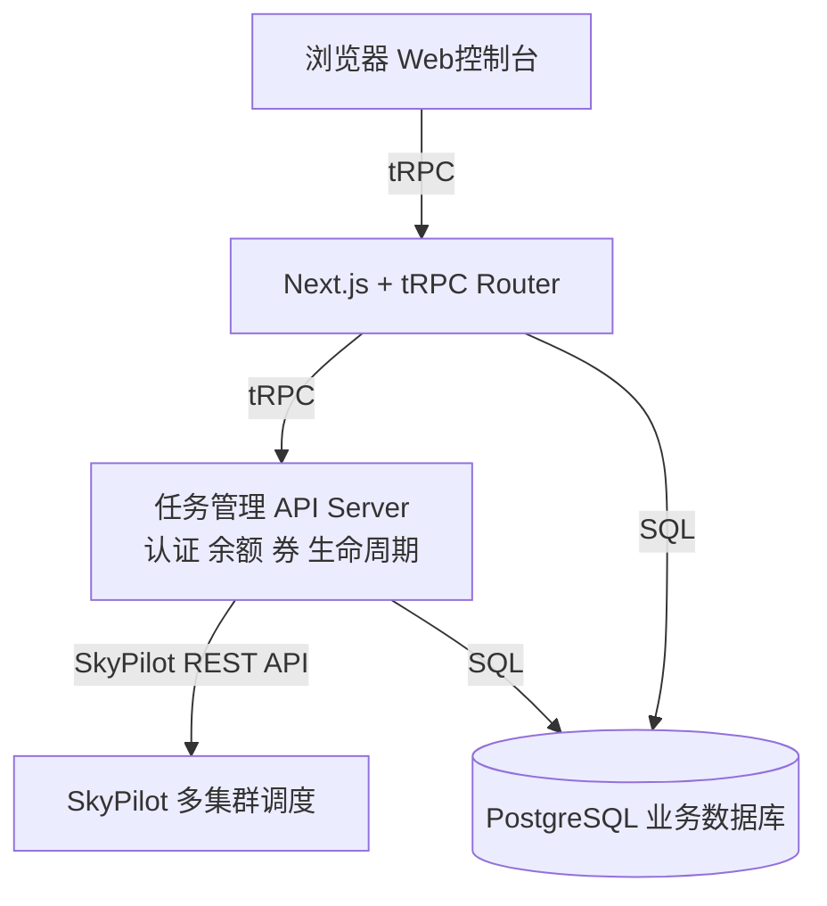
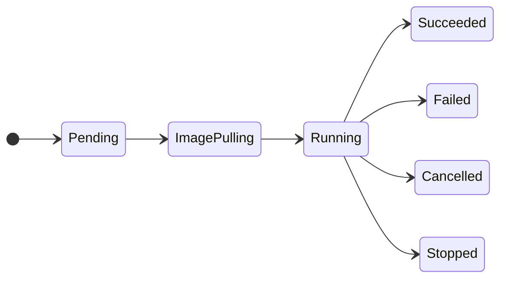
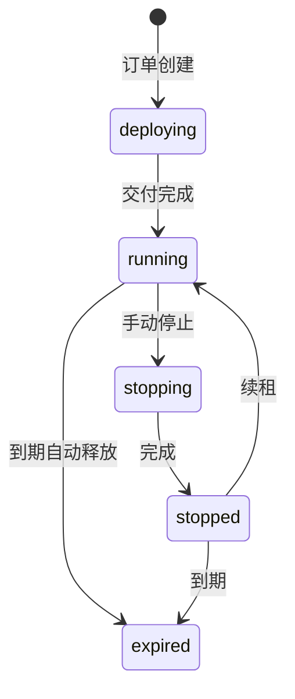

# apps/gpus 数据库表与 SkyPilot 交互设计

> 本文分两部分：
> 1. apps/gpus 消费者域涉及的数据库表（从已有 schema 和前端类型提取）
> 2. Next.js 与 SkyPilot 的交互流程和 API 设计

---

## 第一部分：apps/gpus 消费者域数据库表

### 1.1 前端类型 → 后端表总映射

| apps/gpus 前端类型 | 所在文件 | 对应 DB 表 | 状态 |
|-------------------|---------|-----------|------|
| `Gpu` / `GpuTier` | gpu-data.ts | `gpu_card_type` | 已实现 |
| `Region` | gpu-data.ts | `data_center` | 已实现 |
| `Template` (GPU 配置模板) | gpu-data.ts | — | 待实现 |
| `MarketOffering` (云服务器产品) | server-market-data.ts | 聚合: `gpu_card_type` + `platform_card_price_record` + `supplier_datacenter_sell_price` | 已实现 |
| `MetalDevice` (裸金属设备) | metal-market-data.ts | 聚合: `supplier_device` + `gpu_card_type` + `supplier_datacenter_infrastructure` | 已实现 |
| `AggregatedMetalOffering` | metal-market-data.ts | 聚合: `gpu_card_type` × `data_center` | 已实现 |
| `MetalPricing` | metal-market-data.ts | `platform_card_price_record` / `supplier_datacenter_sell_price` | 已实现 |
| `ServerInstance` (云服务器实例) | console-store.tsx | `compute_task` + `bare_metal_order` | 待实现 |
| `MetalInstance` (裸金属实例) | console-store.tsx | `bare_metal_order` + `bare_metal_order_device` | 待实现 |
| `Instance` (通用实例) | console-store.tsx | `compute_task` | 待实现 |
| `Task` (批处理任务) | tasks-data.ts | `compute_task` | 待实现 |
| `PreloadTask` (预加载镜像) | preloaded-data.ts | — | 待实现 |
| `ComputeVoucher` (算力券) | server-market-data.ts | `discount_template` + `coupon` | 待实现 |
| `BillingCreditSummary` (余额) | billing-data.ts | `tenant_balance`（available+reserved，含 organization_id） | 见 tenant-balance-unification |
| `BillingVoucher` / `BillingCoupon` | billing-data.ts | `coupon` | 待实现 |
| `MonthlyBill` (月账单) | billing-data.ts | `tenant_bill` | 待实现 |
| `RechargeTransaction` (充值) | recharge-data.ts | `recharge` | 待实现 |
| `Volume` (存储卷) | console-store.tsx | — | 待实现 |
| `ApplicationTemplate` (应用模板) | apps-data.ts | — | 待实现 |
| `SandboxTemplate` / `SandboxQuotaItem` | sandbox-*.ts | — | 待实现 |

### 1.2 核心表定义

#### gpu_card_type — GPU 卡型

```sql
-- 字典表，定义所有 GPU 卡型
CREATE TABLE gpu_card_type (
    id              TEXT PRIMARY KEY,                     -- UUID
    code            VARCHAR(64) NOT NULL UNIQUE,          -- 卡型编码, e.g. "A100-80G"
    name            VARCHAR(128) NOT NULL UNIQUE,         -- 展示名称
    manufacturer    VARCHAR(32) NOT NULL,                 -- NVIDIA / AMD / Intel / Huawei / Other
    memory_gb       INTEGER,                             -- 显存 (GB)
    tdp_watts       INTEGER,                             -- 功耗 (W)
    compute_capability VARCHAR(64),                      -- 计算能力
    device_role     VARCHAR(16) NOT NULL DEFAULT 'compute', -- compute=算力 / infra=管控
    status          VARCHAR(32) NOT NULL,                 -- active / disabled
    created_at      TIMESTAMP NOT NULL DEFAULT NOW(),
    updated_at      TIMESTAMP NOT NULL DEFAULT NOW()
);
```

**apps/gpus 消费**: GPU 型号筛选、规格展示、定价依据
**API**: `GET /api/gpu-card-types` — 返回可用卡型列表

#### data_center — 数据中心/区域

```sql
CREATE TABLE data_center (
    id              TEXT PRIMARY KEY,
    supplier_id     TEXT NOT NULL REFERENCES supplier(id),
    code            VARCHAR(64) NOT NULL,
    name            VARCHAR(255) NOT NULL,                -- 展示名称
    location        VARCHAR(128),                         -- 位置描述
    region_tags     TEXT[] NOT NULL DEFAULT '{}',         -- 区域标签（调度用）
    status          VARCHAR(32) NOT NULL,
    cooperation_status VARCHAR(32) NOT NULL DEFAULT 'active',
    container_instance_region VARCHAR(128),              -- 容器实例区域标签
    bare_metal_region VARCHAR(128),                      -- 裸金属区域标签
    scale           VARCHAR(64),                         -- 规模描述
    UNIQUE (supplier_id, code)
);
```

**apps/gpus 消费**: 区域选择器、区域标签展示
**API**: `GET /api/regions` — 返回用户可见的区域列表（仅 `cooperation_status=active` 的机房）

#### supplier_device — 物理设备

```sql
CREATE TABLE supplier_device (
    id              TEXT PRIMARY KEY,
    supplier_id     TEXT NOT NULL REFERENCES supplier(id),
    data_center_id  TEXT REFERENCES data_center(id),
    gpu_card_type_id TEXT NOT NULL REFERENCES gpu_card_type(id),
    external_device_id VARCHAR(128),
    asset_no        VARCHAR(64) UNIQUE,
    sn              VARCHAR(64) NOT NULL UNIQUE,
    idc_code        VARCHAR(64) NOT NULL,
    idc_region      VARCHAR(64),
    gpu_count       INTEGER NOT NULL,
    external_ip     VARCHAR(45),
    internal_ip     VARCHAR(45),
    ops_status      VARCHAR(64) NOT NULL DEFAULT '预留闲置中',
    lifecycle_status VARCHAR(32) NOT NULL,
    -- lifecycle_status 值域: 'pending_onboarding' | 'onboarding' | 'online' | 'listed' | 'maintenance' | 'allocated' | 'retired'
    listing_disabled BOOLEAN NOT NULL DEFAULT false,
    cooperation_type VARCHAR(32) NOT NULL DEFAULT 'idle_time',  -- idle_time / whole_rent
    device_spec     TEXT,                                -- CPU/内存/磁盘规格文本
    device_purpose  VARCHAR(255),
    in_maintenance  BOOLEAN NOT NULL DEFAULT false,
    login_username  VARCHAR(128),
    login_password  TEXT
);
```

**apps/gpus 消费**: 裸金属列表、裸金属详情页展示设备规格
**API**: `GET /api/metal-devices?region=&gpu=&network=` — 裸金属可售设备列表

#### supplier_gpu_inventory — GPU 库存

```sql
CREATE TABLE supplier_gpu_inventory (
    id              TEXT PRIMARY KEY,
    supplier_id     TEXT NOT NULL REFERENCES supplier(id),
    data_center_id  TEXT NOT NULL REFERENCES data_center(id),
    gpu_card_type_id TEXT NOT NULL REFERENCES gpu_card_type(id),
    quantity        INTEGER NOT NULL DEFAULT 0,           -- 总库存
    online_quantity INTEGER NOT NULL DEFAULT 0,           -- 在线可用
    status          VARCHAR(32) NOT NULL,
    is_internal_test BOOLEAN NOT NULL DEFAULT false,
    card_time_cost_per_hour NUMERIC(15,4),
    revenue_share_cost_per_hour NUMERIC(15,4),
    UNIQUE (supplier_id, data_center_id, gpu_card_type_id)
);
```

**apps/gpus 消费**: 选购时展示各区域可用 GPU 数量
**API**: `GET /api/gpu-inventory?region=&gpu=` — 实时库存查询

#### supplier_datacenter_infrastructure — 机房基础设施

```sql
CREATE TABLE supplier_datacenter_infrastructure (
    id              TEXT PRIMARY KEY,
    data_center_id  TEXT NOT NULL REFERENCES data_center(id) UNIQUE,
    bandwidth_config JSONB,                              -- 带宽配置
    network_config  JSONB,                               -- 网络配置
    storage_config  JSONB,                               -- 存储配置
    updated_by_staff_id TEXT
);
```

**apps/gpus 消费**: 裸金属部署时展示带宽/网络配置选项
**API**: `GET /api/datacenter-infrastructure/:id`

#### supplier_datacenter_card_type_spec — 机房×卡型设备规格

```sql
CREATE TABLE supplier_datacenter_card_type_spec (
    id              TEXT PRIMARY KEY,
    data_center_id  TEXT NOT NULL REFERENCES data_center(id),
    gpu_card_type_id TEXT NOT NULL REFERENCES gpu_card_type(id),
    device_spec     TEXT,                                -- 设备规格 (CPU/内存/磁盘/网卡)
    remark          TEXT,
    UNIQUE (data_center_id, gpu_card_type_id)
);
```

**apps/gpus 消费**: 用户部署时获取该机房该卡型的默认配置模板

#### platform_card_price_record — 平台当前价

```sql
CREATE TABLE platform_card_price_record (
    id              TEXT PRIMARY KEY,
    gpu_card_type_id TEXT NOT NULL REFERENCES gpu_card_type(id),
    product_line    VARCHAR(32) NOT NULL,                 -- cloud_vm / serverless / inference / job / bare_metal（见 ../../business/product-line-taxonomy.md）
    billing_unit    VARCHAR(16) NOT NULL,                 -- hour / day / week / month
    sell_price      NUMERIC(15,4) NOT NULL,               -- 销售单价
    status          VARCHAR(16) NOT NULL DEFAULT 'active', -- draft / active / archived
    effective_from  TIMESTAMP NOT NULL,
    effective_to    TIMESTAMP,
    list_price_id   TEXT REFERENCES platform_card_list_price(id),
    remark          TEXT,
    UNIQUE (gpu_card_type_id, product_line, billing_unit, effective_from)
);
```

**apps/gpus 消费**: GPU 云服务器、裸金属、Spot 的价格计算
**API**: `GET /api/prices?cardType=&productLine=&billingUnit=&region=`

#### supplier_datacenter_sell_price — 机房销售价

```sql
CREATE TABLE supplier_datacenter_sell_price (
    id              TEXT PRIMARY KEY,
    data_center_id  TEXT NOT NULL REFERENCES data_center(id),
    gpu_card_type_id TEXT NOT NULL REFERENCES gpu_card_type(id),
    product_line    VARCHAR(32) NOT NULL,
    billing_unit    VARCHAR(16) NOT NULL,
    sell_price      NUMERIC(15,4) NOT NULL,
    platform_price_record_id TEXT REFERENCES platform_card_price_record(id),
    status          VARCHAR(16) NOT NULL,
    effective_from  TIMESTAMP NOT NULL,
    effective_to    TIMESTAMP,
    remark          TEXT,
    UNIQUE (data_center_id, gpu_card_type_id, product_line, billing_unit, effective_from)
);
```

**apps/gpus 消费**: 机房级别个性化定价（覆盖平台价），用户最终价格
**API**: 与平台价合并返回 `GET /api/prices`

#### billing_tenant — 计费租户

```sql
CREATE TABLE tenant (
    id              TEXT PRIMARY KEY,
    customer_id     TEXT NOT NULL REFERENCES customer(id),
    merchant_id     VARCHAR(32),                         -- 所属商户
    platform_tenant_id VARCHAR(32) UNIQUE,               -- 平台租户 ID
    name            VARCHAR(255) NOT NULL,
    type            VARCHAR(16) NOT NULL,                 -- internal / external
    status          VARCHAR(16) NOT NULL,                 -- active / inactive / suspended
    balance         NUMERIC(15,4) NOT NULL DEFAULT 0,     -- 当前余额
    credit_limit    NUMERIC(15,4),                        -- 授信额度
    overdue_at      TIMESTAMP,
    is_default      BOOLEAN NOT NULL DEFAULT false,
    UNIQUE (customer_id, is_default)  -- partial index: only when is_default=true
);
```

**apps/gpus 消费**: 钱包余额展示、充值、扣款
**API**: `GET /api/account/balance` | `POST /api/account/recharge`

#### compute_task — 算力任务

```sql
CREATE TABLE compute_task (
    id              TEXT PRIMARY KEY,
    tenant_id       TEXT NOT NULL REFERENCES tenant(id),
    task_type       VARCHAR(16) NOT NULL,                 -- job / serve / instance
    status          VARCHAR(16) NOT NULL,                 -- pending / running / succeeded / failed / stopped
    resource_spec   JSONB,                               -- {"cpu":4, "memory_gb":16, "gpu":"A100:1"}
    image           VARCHAR(512),
    command         TEXT,
    sky_job_id      VARCHAR(256),                        -- SkyPilot 返回的 job ID
    started_at      TIMESTAMP,
    finished_at     TIMESTAMP,
    total_cost      NUMERIC(15,4),
    created_at      TIMESTAMP NOT NULL DEFAULT NOW()
);
```

**apps/gpus 消费**: 实例列表、任务列表、实例详情

#### bare_metal_order — 裸金属订单

```sql
CREATE TABLE bare_metal_order (
    id              TEXT PRIMARY KEY,
    tenant_id       TEXT NOT NULL REFERENCES tenant(id),
    data_center_id  TEXT REFERENCES data_center(id),
    status          VARCHAR(32) NOT NULL,                 -- pending / running / stopped / expired
    billing_unit    VARCHAR(16) NOT NULL,                 -- hour / day / week / month
    device_count    INTEGER NOT NULL DEFAULT 0,
    gpu_count       INTEGER NOT NULL DEFAULT 0,
    order_amount    NUMERIC(15,4),
    balance_amount  NUMERIC(15,4) NOT NULL DEFAULT 0,
    coupon_amount   NUMERIC(15,4) NOT NULL DEFAULT 0,
    rent_starts_at  TIMESTAMP,
    rent_ends_at    TIMESTAMP,
    ordered_at      TIMESTAMP NOT NULL
);
```

**apps/gpus 消费**: 裸金属实例列表、详情、续租

#### bare_metal_order_device — 裸金属订单设备明细

```sql
CREATE TABLE bare_metal_order_device (
    id              TEXT PRIMARY KEY,
    bare_metal_order_id TEXT NOT NULL REFERENCES bare_metal_order(id),
    gpu_card_type_id TEXT REFERENCES gpu_card_type(id),
    allocation_status VARCHAR(32) NOT NULL DEFAULT 'planned',
    supplier_device_id TEXT REFERENCES supplier_device(id),
    sn              VARCHAR(64),
    asset_no        VARCHAR(64),
    external_ip     VARCHAR(45),
    internal_ip     VARCHAR(45),
    ssh_port        INTEGER,
    ssh_user        VARCHAR(128),
    unit_price_per_card_hour NUMERIC(15,4),
    rent_starts_at  TIMESTAMP,
    rent_ends_at    TIMESTAMP
);
```

**apps/gpus 消费**: 裸金属实例 SSH 连接信息、到期时间

#### tenant_bill — 租户月账单

```sql
CREATE TABLE tenant_bill (
    id              TEXT PRIMARY KEY,
    tenant_id       TEXT NOT NULL REFERENCES tenant(id),
    bill_month      VARCHAR(7) NOT NULL,                  -- yyyy-MM
    amount          NUMERIC(15,4) NOT NULL,
    status          VARCHAR(16) NOT NULL,                 -- upcoming / paid / unpaid
    paid_at         TIMESTAMP,
    UNIQUE (tenant_id, bill_month)
);
```

**apps/gpus 消费**: 月账单列表、查看详情

#### recharge — 充值记录

```sql
CREATE TABLE recharge (
    id              TEXT PRIMARY KEY,
    tenant_id       TEXT NOT NULL REFERENCES tenant(id),
    amount          NUMERIC(15,4) NOT NULL,
    method          VARCHAR(16) NOT NULL,                 -- alipay / wechat / bank_transfer
    status          VARCHAR(16) NOT NULL,                 -- completed / pending / failed
    external_trade_no VARCHAR(128),
    remark          TEXT
);
```

**apps/gpus 消费**: 充值记录列表、充值状态

#### coupon — 算力券实例

```sql
CREATE TABLE coupon (
    id              TEXT PRIMARY KEY,
    template_id     TEXT NOT NULL REFERENCES discount_template(id),
    tenant_id       TEXT NOT NULL REFERENCES tenant(id),
    code            VARCHAR(64),
    status          VARCHAR(16) NOT NULL,                 -- available / used / expired
    original_value  NUMERIC(15,4) NOT NULL,
    remaining_value NUMERIC(15,4) NOT NULL,
    granted_at      TIMESTAMP,
    expired_at      TIMESTAMP
);
```

**apps/gpus 消费**: 券列表、部署时选择抵扣

#### discount_template — 券模板

```sql
CREATE TABLE discount_template (
    id              TEXT PRIMARY KEY,
    name            VARCHAR(255) NOT NULL,
    type            VARCHAR(16) NOT NULL,                 -- fixed / discount / resource_pack
    value           NUMERIC(15,4),
    discount_percent NUMERIC(7,4),
    applicable_product_lines JSONB,
    cost_bearer     VARCHAR(16) DEFAULT 'platform',       -- platform / idc
    budget_limit    NUMERIC(15,4)
);
```

---

### 1.3 聚合查询定义

以下为 apps/gpus 高频使用的聚合查询：

#### 云服务器市场列表 `GET /api/server-market`

```sql
-- 聚合逻辑：可用卡型 × 已激活机房 × 有效定价
SELECT
    gc.id AS card_type_id,
    gc.code AS gpu_model,
    gc.name AS gpu_name,
    gc.memory_gb,
    dc.id AS region_id,
    dc.name AS region_name,
    dc.location,
    ppr.sell_price AS price_hourly,
    ppr.billing_unit,
    sdcsp.sell_price AS dc_price,  -- 若有机房个性化定价则覆盖
    sgi.online_quantity AS available_count
FROM gpu_card_type gc
CROSS JOIN data_center dc
JOIN platform_card_price_record ppr
    ON ppr.gpu_card_type_id = gc.id
    AND ppr.product_line = 'cloud_vm'
    AND ppr.status = 'active'
    AND (ppr.effective_to IS NULL OR ppr.effective_to > NOW())
LEFT JOIN supplier_datacenter_sell_price sdcsp
    ON sdcsp.data_center_id = dc.id
    AND sdcsp.gpu_card_type_id = gc.id
    AND sdcsp.product_line = 'cloud_vm'
    AND sdcsp.status = 'active'
    AND (sdcsp.effective_to IS NULL OR sdcsp.effective_to > NOW())
LEFT JOIN supplier_gpu_inventory sgi
    ON sgi.data_center_id = dc.id
    AND sgi.gpu_card_type_id = gc.id
    AND sgi.status = 'active'
WHERE dc.cooperation_status = 'active'
    AND dc.status = 'active'
    AND gc.status = 'active'
    AND gc.device_role = 'compute'
    AND (sgi.online_quantity IS NULL OR sgi.online_quantity > 0);
```

#### 裸金属市场列表 `GET /api/metal-market`

```sql
-- 聚合逻辑：可用物理设备 × 网络模式分组
SELECT
    sd.id AS device_id,
    sd.external_ip,
    sd.internal_ip,
    sd.gpu_count,
    gc.code AS gpu_model,
    gc.name AS gpu_name,
    dc.name AS region_name,
    sd.ops_status,
    sd.cooperation_type,
    sd.device_spec,
    ppr.sell_price AS price_per_hour,
    -- 网络模式由机房基础设施配置决定
    sdi.network_config->>'networkMode' AS network_mode
FROM supplier_device sd
JOIN gpu_card_type gc ON gc.id = sd.gpu_card_type_id
JOIN data_center dc ON dc.id = sd.data_center_id
LEFT JOIN platform_card_price_record ppr
    ON ppr.gpu_card_type_id = gc.id
    AND ppr.product_line = 'bare_metal'
    AND ppr.status = 'active'
    AND (ppr.effective_to IS NULL OR ppr.effective_to > NOW())
LEFT JOIN supplier_datacenter_infrastructure sdi
    ON sdi.data_center_id = dc.id
WHERE sd.lifecycle_status = 'online'
    AND sd.in_maintenance = false
    AND sd.cooperation_type = 'idle_time';
```

---

## 第二部分：Next.js 与 SkyPilot 交互设计

### 2.1 架构定位



**组件分工**:
- **Next.js**: 用户界面渲染 + 代理 API 路由
- **任务管理 API Server**: 核心业务逻辑 —— 认证校验、余额管控、券抵扣、任务生命周期、与 SkyPilot/Traefik/OpenMeter 交互
- **SkyPilot**: 多集群 GPU 资源调度引擎，提供 REST API

> 部署上 Next.js 与任务管理 API Server 可以合并为同一进程，也可分离部署。分离时 Next.js 通过服务端 API Route 透传至 API Server。

### 2.2 部署流程详解

#### 2.2.1 GPU 云服务器部署

```
┌─────────┐     ┌──────────┐     ┌──────────────┐     ┌──────────┐     ┌────────┐
│  Browser │     │ Next.js  │     │ Task API     │     │ SkyPilot │     │ DB     │
│          │     │ (WebUI)  │     │ Server       │     │ REST API │     │        │
└────┬─────┘     └────┬─────┘     └──────┬───────┘     └────┬─────┘     └───┬────┘
     │                │                  │                  │               │
     │ 1. 浏览市场     │                  │                  │               │
     │◄───────────────►│                  │                  │               │
     │                 │                  │                  │               │
     │ 2. 选择配置      │                  │                  │               │
     │ GPU/计费/镜像/券 │                  │                  │               │
     │───► POST /api/deploy/instance─────►│                  │               │
     │                 │                  │                  │               │
     │                 │    3. 余额检查    │                  │               │
     │                 │     & 冻结        │─────────────────►               │
     │                 │    BEGIN TX       │─── SELECT ... FOR UPDATE ───────►│
     │                 │                  │─── UPDATE balance ───────────────►│
     │                 │                  │   COMMIT TX       │               │
     │                 │                  │                  │               │
     │                 │    4. 创建实例     │                  │               │
     │                 │                  │─── INSERT compute_task ──────────►│
     │                 │                  │   (status=image_pulling)          │
     │                 │                  │                  │               │
     │                 │    5. 镜像预拉取   │                  │               │
     │                 │                  │  向候选节点 Agent 发送 pull 指令   │
     │                 │                  │  (异步, 各节点回调 /api/node/callback) │
     │                 │                  │                  │               │
     │                 │    6. 等待镜像就绪 │                  │               │
     │                 │                  │◄─── 节点回调 image_ready ────────│
     │                 │                  │                  │               │
     │                 │    7. 调用SkyPilot│                  │               │
     │                 │                  │─── POST /sky/api/job ────────────►│
     │                 │                  │   {               │               │
     │                 │                  │     "resources": {"gpu":"A100:1"}│
     │                 │                  │     "image": "pytorch:2.0",      │
     │                 │                  │     "node_affinity": "node-5",   │
     │                 │                  │     "command": "..."             │
     │                 │                  │   }               │               │
     │                 │                  │                  │               │
     │                 │                  │◄─── 200 {job_id, cluster} ──────│
     │                 │                  │                  │               │
     │                 │    8. 更新实例     │                  │               │
     │                 │                  │─── UPDATE compute_task ──────────►│
     │                 │                  │   (status=running,                │
     │                 │                  │    sky_job_id=xxx,                │
     │                 │                  │    billing_started_at=NOW())     │
     │                 │                  │                  │               │
     │◄─── 200 {id, status}──────────────│                  │               │
     │                 │                  │                  │               │
     │ 9. 轮询状态      │                  │                  │               │
     │───► GET /api/instances/:id ───────►│                  │               │
     │◄─── {status, cost...}─────────────│                  │               │
```

#### 2.2.2 裸金属租赁

```
┌─────────┐     ┌──────────┐     ┌──────────────┐     ┌──────────┐     ┌────────┐
│  Browser │     │ Next.js  │     │ Task API     │     │ SkyPilot │     │ DB     │
└────┬─────┘     └────┬─────┘     └──────┬───────┘     └────┬─────┘     └───┬────┘
     │                │                  │                  │               │
     │ 1. 浏览裸金属市场 │                  │                  │               │
     │───► GET /api/metal-market─────────►│                  │               │
     │◄─── [{device, price, spec}]───────│                  │               │
     │                │                  │                  │               │
     │ 2. 提交租赁      │                  │                  │               │
     │───► POST /api/metal/deploy────────►│                  │               │
     │   {device_id,   │                  │                  │               │
     │    billing,     │                  │                  │               │
     │    duration,    │    3. 余额检查    │                  │               │
     │    voucher}     │     & 冻结        │─── SELECT ... FOR UPDATE ───────►│
     │                │                  │─── UPDATE balance ───────────────►│
     │                │                  │                  │               │
     │                │    4. 创建裸金属订单 │                  │               │
     │                │                  │─── INSERT bare_metal_order ──────►│
     │                │                  │─── INSERT bare_metal_order_device ►│
     │                │                  │   (status=running)│               │
     │                │                  │                  │               │
     │                │    5. 下发 SSH 信息│                  │               │
     │◄─── 200 {order_id, ssh_host,      │                  │               │
     │         ssh_port, ssh_user,        │                  │               │
     │         rent_ends_at}             │                  │               │
     │                │                  │                  │               │
     │ 6. 定时查询到期   │                  │                  │               │
     │───► GET /api/metal/instances──────►│─── SELECT bare_metal_order ─────►│
```

**关键差异**: 裸金属不经过 SkyPilot 调度（已分配物理设备），直接写订单 → 返回 SSH 连接信息。

#### 2.2.3 批处理任务 (Job) 提交

```
┌─────────┐     ┌──────────┐     ┌──────────────┐     ┌──────────┐
│  Browser │     │ Next.js  │     │ Task API     │     │ SkyPilot │
└────┬─────┘     └────┬─────┘     └──────┬───────┘     └────┬─────┘
     │                │                  │                  │
     │ 1. 提交 Job     │                  │                  │
     │───► POST /api/jobs ──────────────►│                  │
     │   {image,       │                  │                  │
     │    command,     │                  │                  │
     │    resources,   │    2. 余额冻结    │                  │
     │    env_vars}    │                  │─── 冻结预估费用 ──│
     │                │                  │                  │
     │                │    3. 镜像预拉取   │                  │
     │                │                  │─── 节点 Agent 拉取│
     │                │                  │                  │
     │                │    4. 调用 SkyPilot                 │
     │                │                  │─── POST /sky/api/job ────────────►│
     │                │                  │   {               │
     │                │                  │     "task": "job",│
     │                │                  │     "resources": {"gpu":"A100:2"},│
     │                │                  │     "image": "train:latest",     │
     │                │                  │     "run": "python train.py"     │
     │                │                  │   }               │               │
     │                │                  │                  │               │
     │                │                  │◄─── {job_id} ────────────────────│
     │                │                  │                  │               │
     │                │    5. 写入 DB     │                  │               │
     │                │                  │─── INSERT compute_task ──────────│
     │◄─── {job_id}───│                  │                  │               │
     │                │                  │                  │               │
     │ 6. 查询 Job 状态 │                  │                  │               │
     │───► GET /api/jobs/:id ───────────►│                  │               │
     │                │                  │─── GET /sky/api/job/{job_id} ────►│
     │                │                  │◄─── {status, resources} ─────────│
     │◄─── {status, cost}───────────────│                  │               │
```

### 2.3 API 列表

#### 2.3.1 面向浏览器的 Next.js API Route

| 方法 | 路径 | 功能 | 认证 | 对应 DB 操作 |
|------|------|------|------|-------------|
| `GET` | `/api/gpu-card-types` | GPU 卡型列表 | Y | SELECT gpu_card_type |
| `GET` | `/api/regions` | 区域列表 | Y | SELECT data_center |
| `GET` | `/api/server-market` | 云服务器市场 | Y | 聚合查询（见 1.3） |
| `GET` | `/api/metal-market` | 裸金属市场 | Y | 聚合查询（见 1.3） |
| `GET` | `/api/prices` | 价格查询 | Y | platform_card_price_record + dc_sell_price |
| `GET` | `/api/gpu-inventory` | 库存查询 | Y | supplier_gpu_inventory |
| `POST` | `/api/deploy/instance` | 部署云服务器 | Y | 余额冻结 + compute_task INSERT |
| `POST` | `/api/metal/deploy` | 租赁裸金属 | Y | 余额冻结 + bare_metal_order INSERT |
| `POST` | `/api/jobs` | 提交批处理任务 | Y | 余额冻结 + compute_task INSERT |
| `GET` | `/api/instances` | 实例列表 | Y | SELECT compute_task / bare_metal_order |
| `GET` | `/api/instances/:id` | 实例详情 | Y | SELECT + SkyPilot 状态 |
| `POST` | `/api/instances/:id/stop` | 停止实例 | Y | UPDATE + SkyPilot cancel |
| `POST` | `/api/instances/:id/start` | 启动实例 | Y | UPDATE + SkyPilot resume |
| `DELETE` | `/api/instances/:id` | 释放实例 | Y | 最终结算 + DELETE |
| `GET` | `/api/jobs` | 任务列表 | Y | SELECT compute_task |
| `GET` | `/api/jobs/:id` | 任务详情 | Y | SELECT + SkyPilot 状态 |
| `GET` | `/api/account/balance` | 余额查询 | Y | SELECT tenant_balance WHERE tenant_id |
| `POST` | `/api/account/recharge` | 充值 | Y | INSERT recharge + UPDATE balance |
| `GET` | `/api/bills` | 月账单列表 | Y | SELECT tenant_bill |
| `GET` | `/api/bills/daily` | 日账单列表 | Y | SELECT tenant_bill_daily |
| `GET` | `/api/coupons` | 券列表 | Y | SELECT coupon WHERE tenant_id |
| `GET` | `/api/preload-tasks` | 预加载任务列表 | Y | SELECT preload_task |
| `POST` | `/api/preload-tasks` | 创建预加载任务 | Y | INSERT preload_task |
| `DELETE` | `/api/preload-tasks/:id` | 删除预加载任务 | Y | DELETE preload_task |
| `GET` | `/api/recharge/transactions` | 充值记录 | Y | SELECT recharge |

#### 2.3.2 节点 Agent 回调 API（无认证，来源 IP 白名单）

| 方法 | 路径 | 功能 |
|------|------|------|
| `POST` | `/api/node/callback/image-ready` | 节点镜像拉取完成回调 |
| `POST` | `/api/node/callback/usage` | 节点上报资源使用事件 |

#### 2.3.3 SkyPilot REST API 调用

任务管理 API Server 调用 SkyPilot 的 REST API：

| 方法 | SkyPilot 端点 | 用途 | 请求体关键字段 |
|------|--------------|------|--------------|
| `POST` | `/sky/api/job` | 提交任务 | `{resources, image, run, node_affinity}` |
| `GET` | `/sky/api/job/{job_id}` | 查询任务状态 | — |
| `POST` | `/sky/api/job/{job_id}/cancel` | 取消任务 | — |
| `POST` | `/sky/api/serve` | 创建推理服务 | `{name, resources, image, min_replicas, ...}` |
| `GET` | `/sky/api/serve/{serve_id}` | 查询推理服务 | — |
| `DELETE` | `/sky/api/serve/{serve_id}` | 删除推理服务 | — |
| `GET` | `/sky/api/clusters` | 集群列表 | — |
| `GET` | `/sky/api/clusters/{name}/nodes` | 集群节点列表 | — |
| `GET` | `/sky/api/status` | SkyPilot 状态 | — |

**SkyPilot 任务提交请求体示例**:

```json
{
  "name": "train-job-001",
  "resources": {
    "gpu": "A100:1",
    "cpu": 8,
    "memory_gb": 32,
    "disk_size_gb": 100,
    "node_affinity": {
      "node_name": "gpu-node-5",
      "cluster": "idc-1-cluster"
    }
  },
  "image": "pytorch:2.0-cuda12.1",
  "entrypoint": "bash -c 'python train.py --epochs 100'",
  "envs": {
    "WANDB_API_KEY": "xxx",
    "NCCL_DEBUG": "INFO"
  },
  "storage": {
    "mounts": [
      {
        "source": "s3://bucket/data",
        "mount_path": "/data",
        "read_only": true
      }
    ]
  },
  "retry": 0,
  "timeout": 86400
}
```

**SkyPilot 任务状态响应体示例**:

```json
{
  "job_id": "sky-abc123",
  "status": "RUNNING",
  "cluster": "idc-1-cluster",
  "resources_info": {
    "gpu": "A100:1",
    "cpu": 8,
    "memory_gb": 32
  },
  "start_time": "2026-07-16T10:00:00Z",
  "end_time": null,
  "endpoint": null,
  "failure_reason": null,
  "run_timestamp": 1721120000
}
```

### 2.4 关键业务流程

#### 2.4.1 余额控制（三层防超额）

```
Layer 1 — 提交时（预冻结）
  1. 根据资源规格估算每小时最大费用
  2. 检查 available_balance - reserved_balance >= 最小预留金
  3. 原子操作: reserved_balance += 估算金额
                 available_balance -= 估算金额
  4. 不足则拒绝

Layer 2 — 每 5 分钟（定时扣款）
  1. 查询 OpenMeter 获取增量用量
  2. 计算实际费用
  3. 算力券先抵扣（见券抵扣流程）
  4. 实付金额从 available_balance 扣除
  5. 释放旧预留金，按新预估冻结
  6. 余额 <= 0 → 通知 API Server 批量停机

Layer 3 — 结束时（最终结算）
  1. 查询 OpenMeter 获取最终增量
  2. 最终扣款
  3. 释放全部预留金
```

**余额操作事务模板**:

```sql
-- 提交时余额检查与冻结（权威：tenant-balance-unification.md）
BEGIN;
SELECT available_balance, reserved_balance, organization_id
FROM tenant_balance
WHERE tenant_id = ? FOR UPDATE;

-- 校验 available_balance >= freeze_amt
UPDATE tenant_balance
SET
    reserved_balance = reserved_balance + ?,
    available_balance = available_balance - ?,
    updated_at = NOW()
WHERE tenant_id = ?;
-- INSERT balance_transaction (... organization_id, available_*, reserved_*, type=freeze)
COMMIT;
```

#### 2.4.2 算力券抵扣

```
计费服务计算原始费用
    │
    ▼
查询租户所有 available 且未过期的券
    │ (按过期时间优先)
    ▼
对每张券计算可抵扣金额
    ├── fixed: min(remaining_value, 剩余应付)
    ├── discount: min(原始费用 × discount_percent, 剩余应付)
    └── resource_pack: min(内部换算价值, 剩余应付)
    │
    ▼
更新 coupon.remaining_value
    │
    ▼
生成 coupon_usages 记录
    │ (含 original_cost, coupon_deduction, actual_payment)
    ▼
生成 marketing_cost_allocations 记录
    (根据模板 cost_bearer 区分 platform / idc)
    │
    ▼
实付金额 = 原价 - 总抵扣
    ├── 实付 > 0 → 扣减余额
    └── 实付 = 0 → 不扣余额
```

#### 2.4.3 镜像预拉取

```
1. 用户提交任务 → API Server 创建 compute_task(status=image_pulling)
2. API Server 查询候选节点（同区域、资源充足）
3. 向候选节点 Agent 发送 POST /agent/pull-image
   {
     "image": "pytorch:2.0",
     "task_id": "task-xxx",
     "registry_credentials": { ... }  // 如需要
   }
4. 节点 Agent 异步执行 docker pull
5. 拉取完成后，节点回调 API Server:
   POST /api/node/callback/image-ready
   {
     "task_id": "task-xxx",
     "node_name": "gpu-node-5",
     "node_ip": "10.0.0.5",
     "image_digest": "sha256:abc123",
     "result": "success"
   }
6. API Server 从已就绪节点中选择一个 → 调用 SkyPilot 调度
   （节点亲和性绑定到已拉取镜像的节点）
7. 镜像拉取期间不计费（billable=false）
```

### 2.5 计费数据流

```
资源采集器（容器内 sidecar / 节点 Agent）
    │  每 60 秒发送标准化事件
    ▼
OpenMeter (事件接收 + 实时聚合)
    │
    ├── Meter: cpu_usage (core_second)
    ├── Meter: memory_usage (gb_second)
    ├── Meter: gpu_usage (gpu_second, 按型号分类)
    └── Meter: storage_usage (gb_second)
    │
    ▼
定时计费服务 (每 5 分钟)
    │
    ├── 1. 查询各租户增量用量: GET /api/v1/meters/{slug}/query
    ├── 2. 匹配零售价（含 spot_price_multiplier / off_peak_price_multiplier；按秒：÷3600×seconds）
    ├── 3. 算力券抵扣
    └── 4. 余额扣款
```

### 2.6 状态机

#### 云服务器/推理实例状态

```
                  ┌─────────────────┐
                  │    deploying     │ (SkyPilot 任务创建中)
                  └────────┬────────┘
                           │
                           ▼
                  ┌─────────────────┐
         ┌───────│     running      │◄────────┐
         │       └────────┬────────┘         │
         │                │                   │
         │                ▼                   │
         │       ┌─────────────────┐          │
         │       │    stopping     │──────────┘  (stop → start)
         │       └────────┬────────┘
         │                │
         │                ▼
         │       ┌─────────────────┐
         │       │     stopped     │────────────  (release → 删除)
         │       └─────────────────┘
         │
         │ 余额不足 / 手动停止
         ▼
  ┌─────────────────┐
  │  terminated      │ (计费结束，清理资源)
  └─────────────────┘
```

#### 批处理任务状态





---

## 附录：API 路由文件组织结构

```
apps/gpus/src/app/api/
├── gpu-card-types/route.ts         # GET /api/gpu-card-types
├── regions/route.ts                # GET /api/regions
├── server-market/route.ts          # GET /api/server-market
├── metal-market/route.ts           # GET /api/metal-market
├── prices/route.ts                 # GET /api/prices
├── gpu-inventory/route.ts          # GET /api/gpu-inventory
├── deploy/
│   ├── instance/route.ts           # POST /api/deploy/instance
│   └── metal/route.ts              # POST /api/metal/deploy
├── instances/
│   ├── route.ts                    # GET /api/instances
│   └── [id]/
│       ├── route.ts                # GET /api/instances/:id
│       ├── stop/route.ts           # POST /api/instances/:id/stop
│       ├── start/route.ts          # POST /api/instances/:id/start
│       └── route.ts (DELETE)       # DELETE /api/instances/:id
├── jobs/
│   ├── route.ts                    # GET /api/jobs, POST /api/jobs
│   └── [id]/route.ts              # GET /api/jobs/:id
├── account/
│   ├── balance/route.ts            # GET /api/account/balance
│   └── recharge/route.ts           # POST /api/account/recharge
├── bills/
│   ├── route.ts                    # GET /api/bills
│   └── daily/route.ts              # GET /api/bills/daily
├── coupons/route.ts                # GET /api/coupons
├── preload-tasks/
│   ├── route.ts                    # GET, POST /api/preload-tasks
│   └── [id]/route.ts              # DELETE /api/preload-tasks/:id
├── recharge/
│   └── transactions/route.ts       # GET /api/recharge/transactions
└── node/
    └── callback/
        ├── image-ready/route.ts    # POST /api/node/callback/image-ready
        └── usage/route.ts          # POST /api/node/callback/usage
```
