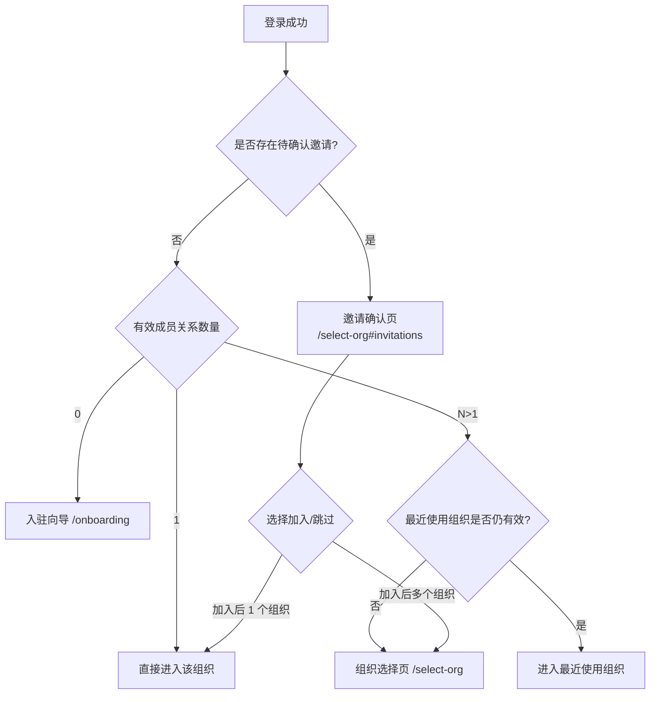
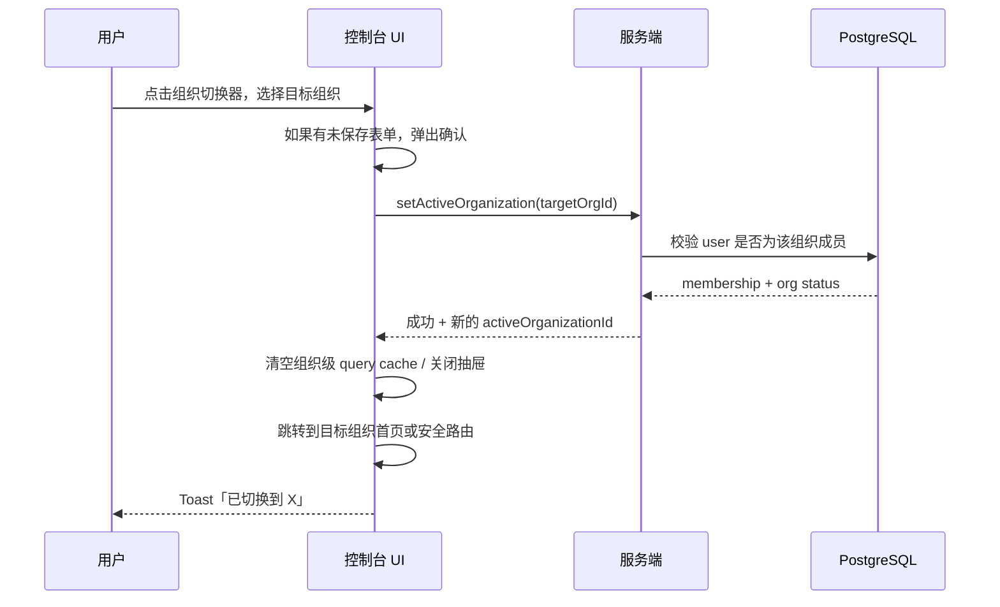

# 多组织身份与组织切换 UED 设计

> 状态：**已确认并完成 P0 实现（2026-11-11）**
> 范围：`apps/shop` 登录、入驻、控制台/设置入口、顶部栏、成员邀请、组织上下文解析
> 结论：Q1/Q2/Q3/Q5/Q8 已确认；Q4/Q6/Q7 按推荐方案随 P0 一并实现。

---

## 1. 背景

一个自然人/运营人员同时属于多个企业（组织）是常态：老板同时经营多家公司、代运营服务商服务多个卖家、财务/客服同时对接多个租户。当前 `apps/shop` 的身份模型已经支持这种关系，但 UED 和入口决策仍是「单组织假设」。

### 1.1 当前实现事实

| 事实 | 证据 |
| --- | --- |
| 一个手机号唯一对应一个 `users` 记录 | `packages/db/src/auth-columns.ts:32`，`phone_number` 唯一 |
| 一个邮箱也唯一对应一个 `users` 记录 | `packages/db/src/auth-columns.ts:31`，`email` 唯一 |
| `member` 是用户与组织的多对多关系，数据库未限制一个用户只能有一个组织 | `packages/db/src/auth-columns.ts:164` |
| 入驻流程只取用户的第一个 tenant 组织，不会创建第二个 | `apps/shop/src/lib/server/dataaccess/onboarding.ts:164` |
| 手机号 OTP 验证后会接受该号码下**所有** pending 邀请 | `apps/shop/src/lib/server/dataaccess/members.ts:323` |
| 顶部栏组织切换器目前是禁用占位按钮 | `apps/shop/src/components/console/console-topbar.tsx:60` |
| 上下文解析在 `activeOrganizationId` 无效时会静默回退到第一个 tenant 成员关系 | `apps/shop/src/lib/server/context.ts:50` |
| 入驻门槛按「能查到的第一个 tenant 组织」判断，而不是严格按当前组织判断 | `apps/shop/src/lib/server/auth-utils.ts:21`、`dataaccess/onboarding.ts:97` |
| 多组织切换 / 成员邀请在产品文档中仍被列为 P2 | `apps/shop/content/design/tenant-onboarding-and-store-binding.md:30` |

### 1.2 现状问题

1. **入口不可预测**：多组织用户登录后可能被静默带到「第一个组织」，用户不知道当前数据属于谁。
2. **无法切换**：顶部栏有组织入口但禁用，用户只能重新登录或改 session，无法自助切换。
3. **邀请副作用**：手机号被多个组织邀请时，一次 OTP 登录会把所有邀请全部接受，用户没有确认机会。
4. **入驻判断错位**：A 组织已入驻、B 组织未入驻时，当前实现可能用 A 的状态放行 B 的页面。
5. **身份重复风险**：同一自然人可能先用手机号注册、后又用邮箱被邀请；若不做联系方式绑定，可能产生两个 `users` 记录或触发手机号唯一冲突。
6. **数据隔离风险**：任何「取第一个组织」的兜底都在多组织场景下放大为串租户风险。

---

## 2. 设计目标

### 2.1 目标

1. 明确区分 **账号身份**（user）与 **组织成员关系**（membership）：一个账号可以属于 0 / 1 / N 个组织。
2. 登录后入口可预测：0 个组织去入驻，1 个组织直接进入，多个组织让用户选择或回到最近使用的组织。
3. 控制台顶部栏提供常驻的组织切换器，展示当前组织、角色和状态。
4. 切换组织时清理组织级缓存，避免跨组织数据串页。
5. 入驻、邀请、成员管理都按「当前组织」工作，不再使用全局第一个组织兜底。
6. 对「待加入邀请」「审核中」「未完成入驻」「已暂停」等状态给出明确出口。

### 2.2 非目标

- 跨组织汇总报表、跨组织批量操作。
- 组织层级 / 经销商 / 供应商体系的完整权限设计（仅复用现有 `orgType`）。
- 在 URL 中引入组织前缀（如 `/o/:orgId/console`）；本期用 session 的 `activeOrganizationId`。
- 组织转让、组织注销、成员离职流程（可放 P1/P2）。

---

## 3. 核心原则

| # | 原则 | 说明 |
| --- | --- | --- |
| P1 | 身份与成员关系分离 | 手机号/邮箱只决定「你是谁」，不决定「你属于哪个组织」。 |
| P2 | 当前组织必须显式 | 页面标题/顶部栏始终能看到当前组织；禁止静默换组织。 |
| P3 | 服务端权威 | 客户端传的 `organizationId` 一律不可信，必须校验 membership。 |
| P4 | 切换即重置 | 切换组织后清空组织级 query cache、关闭抽屉/弹窗，避免残留数据。 |
| P5 | 邀请不静默批量接受 | 多邀请场景必须让用户确认；至少要让用户知道加入了哪些组织。 |
| P6 | 按组织判断入驻状态 | 入驻门槛只针对当前组织，不能用其他组织的通过状态放行。 |
| P7 | 不泄露跨组织关系 | 组织 A 的成员列表/邀请提示不能暴露该联系方式还属于组织 B。 |

---

## 4. 用户状态与入口决策

### 4.1 成员关系状态

| 状态 | 含义 | 入口行为 |
| --- | --- | --- |
| `approved` | 入驻已通过 | 可进入完整工作台 |
| `submitted` | 入驻审核中 | 可进入受限工作台 + 显示审核中提示（沿用当前能力） |
| `draft` / `rejected` | 未提交 / 被驳回 | 继续入驻 / 重新提交 |
| `suspended` | 组织被暂停 | 只读或阻断，展示原因与联系入口 |
| `invited` | 邀请未接受 | 不进入工作台，先展示「待加入」 |
| `none` | 无任何成员关系 | 进入入驻向导 |

### 4.2 登录后入口状态机



**建议默认策略：**

1. **优先最近使用组织**：读取服务端可验证的 `lastOrganizationId`（cookie 或 session 附加字段）。只有该组织仍是当前用户的有效成员时才直接进入。
2. **没有最近使用记录时**：
   - 只有 1 个可用组织：直接进入，减少一次点击。
   - 多个可用组织：进入 `/select-org`，不要默认选第一个。
3. **待确认邀请优先于组织选择**：避免用户先进入组织 A，之后才发现组织 B 的邀请。
4. **`callbackUrl` 不能绕过组织选择**：深链只记录目标页面，组织确定后再跳转；跨组织无权限时回退到该组织首页。

### 4.3 入口路由约定

| 路由 | 访问条件 | 用途 |
| --- | --- | --- |
| `/select-org` | 已登录 | 组织选择、邀请确认 |
| `/onboarding` | 已登录且当前组织未完成入驻 | 当前组织的入驻向导 |
| `/console/*` | 已登录且当前组织 `submitted`/`approved` | 工作台 |
| `/settings/*` | 同上 | 当前组织的设置 |

> `/select-org` 和 `/onboarding` 必须对「已登录但尚未入驻」的用户开放，避免被 `requireOnboardedAuth` 拦回死循环。

---

## 5. 组织选择页 `/select-org`

### 5.1 页面目标

让多组织用户在一次操作内看清：待加入邀请、我属于哪些组织、每个组织当前能不能进入、我上次用的是哪个组织。

### 5.2 线框

```text
┌──────────────────────────────────────────────────────────────┐
│  好市云                              当前账号：138****8000  │
│                                                              │
│  选择要进入的企业                                            │
│  你同时属于多个组织，请选择本次要操作的企业。                │
│                                                              │
│  ┌─ 待加入邀请 ──────────────────────────────────────────┐  │
│  │ 斯里兰卡旗舰店   邀请你加入 · 运营   [加入] [忽略]    │  │
│  │ 科伦坡分销商     邀请你加入 · 财务   [加入] [忽略]    │  │
│  └───────────────────────────────────────────────────────┘  │
│                                                              │
│  ┌────────────────────┐  ┌────────────────────┐              │
│  │ 好市云科技          │  │ 兰卡供应链          │              │
│  │ 所有者 · 已通过     │  │ 运营 · 审核中       │              │
│  │ 最近使用            │  │ 2026-11-10 加入     │              │
│  │ [进入工作台]        │  │ [查看审核进度]      │              │
│  └────────────────────┘  └────────────────────┘              │
│                                                              │
│  ┌─ 未完成入驻 ──────────────────────────────────────────┐  │
│  │ 新注册企业（草稿）             [继续入驻]              │  │
│  └───────────────────────────────────────────────────────┘  │
│                                                              │
│  [查看待加入邀请]                        [退出登录]          │
└──────────────────────────────────────────────────────────────┘
```

> 本期不提供「创建新企业」入口；更多组织只能通过邀请加入（见 §8.2）。

### 5.3 组织卡片信息

| 字段 | 说明 |
| --- | --- |
| 组织名称 | 主标题；名称重复时追加组织 ID 后 4 位或国家/地区 |
| 角色 | 所有者 / 运营 / 财务 / 只读等，来自当前组织的 member role |
| 组织类型 | tenant 为主；未来 supplier/merchant 可显示标签 |
| 入驻状态 | 已通过 / 审核中 / 草稿 / 已驳回 / 已暂停 |
| 最近使用 | 最近一次进入该组织的时间，用于帮助选择 |
| 主操作 | 进入工作台 / 查看审核进度 / 继续入驻 / 查看暂停原因 |
| 次操作 | 复制组织 ID（便于客服排障）、查看组织信息 |

### 5.4 空态

| 场景 | 文案与操作 |
| --- | --- |
| 无组织、无邀请 | 「你还没有加入任何企业」→ [开始入驻] |
| 只有待加入邀请 | 只展示邀请列表；接受后进入组织选择或直接进入唯一组织 |
| 全部组织被暂停 | 展示暂停原因；提供联系平台运营入口；禁止进入业务页 |
| 加载失败 | 保持页面骨架，提供重试；不要自动跳转到第一个组织 |

---

## 6. 顶部栏组织切换器

### 6.1 位置与形态

沿用现有设计：Topbar 右侧、主题切换之前。替换当前禁用的「组织」按钮。

```text
┌────────────────────────────────────────────────────────────┐
│ ☰  运营仪表盘                        好市云科技 ▾  🌙  🔔  │
└────────────────────────────────────────────────────────────┘
```

- 触发器显示：**当前组织名称 + 下拉箭头**；空间不足时截断，但保留组织名首字。
- 当前角色以 badge 形式出现在下拉面板顶部，而不是挤在触发器里。
- 移动端只显示组织名首字/图标，展开为全宽 Sheet。

### 6.2 下拉面板结构

```text
┌──────────────────────────────────────┐
│ 当前组织                             │
│ 好市云科技                            │
│ 所有者 · 已通过                       │
├──────────────────────────────────────┤
│ 🔍 搜索组织                           │
├──────────────────────────────────────┤
│ ✓ 好市云科技        所有者 · 已通过   │
│   兰卡供应链        运营 · 审核中     │
│   科伦坡分销商      财务 · 草稿       │
├──────────────────────────────────────┤
│ 管理组织成员 / 组织设置               │
│ 查看待加入邀请                         │
└──────────────────────────────────────┘
```

### 6.3 显示规则

| 成员关系数量 | 行为 |
| --- | --- |
| 0 | 不显示切换器；显示「开始入驻」入口 |
| 1 | 仍显示当前组织名；下拉中提供「查看待加入邀请」，不再只有一串组织 |
| 2+ | 显示搜索、组织列表、状态 badge、最近使用标记 |
| 当前组织被暂停 | 触发器显示「已暂停」badge；业务页显示阻断态 |

### 6.4 组织列表排序

建议顺序：

1. 当前组织固定置顶。
2. 待加入邀请（单独区块）。
3. 最近使用时间倒序。
4. 同名组织按创建时间倒序。

---

## 7. 切换组织交互

### 7.1 标准流程



### 7.2 切换后的路由策略

| 当前页面 | 切换后 |
| --- | --- |
| `/console/dashboard` | 留在 dashboard，重新取数 |
| 组织级业务详情（订单、商品、店铺等） | 回该组织 `/console/dashboard`，避免 ID 不存在或串数据 |
| `/settings/*` | 留在同一设置页；若该页只对 owner 开放而新组织角色不足，回 `/settings` |
| `/console/profile/*` | 可停留（账号级页面），仅刷新组织上下文 |
| 有未保存表单 | 先确认「切换后将丢失未保存内容」 |

### 7.3 多标签页同步

`activeOrganizationId` 存在 session 中，多个标签页共享同一会话。建议：

- 切换成功后写入 `localStorage` 并通过 `BroadcastChannel` 广播 `organization-changed`。
- 其他标签页收到事件后：显示「组织已在其他标签页切换」提示，刷新页面或重新拉取组织上下文。
- 禁止在用户无感知的情况下让另一个标签页继续用旧组织数据写入。

### 7.4 失败处理

| 场景 | 处理 |
| --- | --- |
| 目标组织成员关系已被移除 | 刷新组织列表，提示「你已不再属于该组织」 |
| 目标组织已暂停 | 允许切换但进入阻断页，或直接禁止切换并说明原因 |
| 网络失败 | 保持当前组织不变，Toast 可重试 |
| 会话过期 | 跳登录，`callbackUrl` 记录原页面 |

---

## 8. 入驻与多组织

### 8.1 入驻必须绑定到具体组织

当前 `onboarding.start` 会取用户的第一个 tenant 组织。多组织下需要改为：

- 显式携带 `organizationId`，或使用当前 `activeOrganizationId`。
- `/onboarding` 页面顶部显示「正在为：X 企业提交入驻」。
- 如果当前组织已完成入驻，不允许再次进入向导；引导去 `/select-org` 或工作台。
- 如果用户属于多个组织，组织选择页按组织展示入驻状态；未完成入驻且有权限的组织提供「继续入驻」。

### 8.2 新增组织：本期仅支持邀请加入

**已确认（2026-11-11）：暂不支持一个账号自助创建多个 tenant 企业。**

1. 首次入驻仍由 `onboarding.start` 创建该账号的 1 个 tenant 组织（`tenant_owner`）。
2. 需要加入更多组织时，由目标组织的 owner/admin 在成员页邀请手机号或邮箱，用户在登录后确认加入。
3. `/select-org` 与 Topbar 不提供「创建新企业」入口。
4. 邀请加入多组织不受限制，仍按 §9 的邀请确认流程处理。
5. 若未来开放自助创建多企业，需另立评审：创建权限、数量上限、审核与风控；本期不做。

### 8.3 入驻门槛修正

`requireOnboardedAuth` 必须：

1. 先解析当前组织的 membership。
2. 只读取**当前组织**的入驻申请状态。
3. 当前组织 `draft/rejected` → `/onboarding`；`submitted/approved` → 放行；`suspended` → 阻断页。
4. 当前组织无 membership → `/select-org`，禁止回退到其他组织。

---

## 9. 邀请与加入组织

### 9.1 邀请匹配规则

| 邀请方式 | 匹配依据 | 建议行为 |
| --- | --- | --- |
| 手机号邀请 | 已验证手机号 | 登录后展示「待加入邀请」，用户确认后加入 |
| 邮箱邀请链接 | 邀请 ID + 邮箱 | 打开链接 → 登录/注册 → 只接受该邀请 |
| 邮箱邀请但用户已登录 | 邮箱匹配 | 展示待加入邀请，确认后加入 |
| 同手机号多个邀请 | 手机号 | 一次性展示全部，支持全选/逐个加入，禁止静默全部加入 |

### 9.2 邀请确认页

- 入口：登录后的 `/select-org#invitations`，或 Topbar「查看待加入邀请」。
- 每条邀请展示：组织名、邀请人、角色、邀请时间、过期时间。
- 操作：加入 / 忽略 / 查看组织信息。
- 接受后：
  - 如果用户当前没有组织：进入该组织。
  - 如果用户已在其他组织：提示「已加入 X，是否切换过去？」由用户决定，不强制切走。
- 过期邀请自动标记 expired，不占用主流程。

### 9.3 当前实现需要调整的点

1. `acceptPendingInvitationsForPhone` 不再批量接受所有邀请，改为返回「可加入邀请列表」。
2. 邮箱邀请接受时只处理当前 `invitationId`，不要顺带接受同手机号的其他邀请。
3. 创建邀请时，同组织内重复手机号/邮箱仍拒绝；跨组织重复允许。
4. 邀请接受成功后再写 member，避免「邀请展示成功但成员关系没建立」。

---

## 10. 身份与联系方式绑定

多组织场景会把「同一个人用手机号和邮箱分别被邀请」放大成身份问题。

### 10.1 建议规则

1. 一个 `users` 记录尽量同时绑定已验证手机号和已验证邮箱。
2. 邀请匹配时，**手机号和邮箱任一已验证联系方式命中**即可关联到同一用户。
3. 如果邀请中的手机号/邮箱已属于另一个用户：
   - 不自动合并、不覆盖。
   - 展示「该联系方式已绑定其他账号，请使用原账号登录或联系管理员」。
4. 邮箱邀请创建用户时，如果手机号已被占用，必须先走绑定/验证流程，不能直接插入触发唯一约束冲突。

### 10.2 UED 提示

- 登录页/邀请页明确说明：手机号和邮箱是同一账号的两种登录方式。
- Profile 账号页展示「已绑定手机号 / 已绑定邮箱」，未绑定项提供绑定入口。
- 邀请失败时给可操作文案，而不是数据库唯一约束错误。

---

## 11. 成员管理与组织内文案

- `/settings/members` 继续只展示**当前组织**成员，页头增加组织名。
- 邀请弹窗标题改为「邀请加入：X 企业」，避免多组织下用户不知道邀请进入哪个组织。
- 成员角色、业务角色均按当前组织读取。
- 不允许在 A 组织的成员列表中看到该用户是否属于 B 组织。
- 当前组织 owner 被移除/退出时，要求先转移 owner，避免组织无主。

---

## 12. 服务端契约建议

> 以下为设计建议，确认后再实现。

### 12.1 组织上下文

建议把 `TRPCContext` 从单一 `organizationId` 扩展为：

```ts
type OrganizationContext = {
  memberships: Array<{
    organizationId: string
    organizationName: string
    organizationType: 'tenant' | 'merchant' | 'supplier' | 'platform'
    role: string
    onboardingStatus: string
    lastUsedAt: string | null
  }>
  activeOrganizationId: string | null
  activeMembership: Membership | null
  entryState: 'no_org' | 'single_org' | 'multiple_orgs' | 'needs_onboarding' | 'suspended'
}
```

要求：

- `activeOrganizationId` 必须命中 `memberships`，否则视为 null，不再回退 `memberships[0]`。
- 业务 procedure 继续要求 `activeOrganizationId`，缺失时返回明确错误码，由前端跳 `/select-org`。
- `getOnboardingState` 不再在传入 `organizationId` 无效时回退到其他组织。

### 12.2 建议接口

| 接口 | 用途 |
| --- | --- |
| `organization.listMine` | 返回当前用户全部 membership + 组织状态 + 最近使用 |
| `organization.setActive` | 校验 membership 后写 session 的 `activeOrganizationId` |
| `invitation.listMine` | 返回当前用户待加入邀请（手机号/邮箱匹配） |
| `invitation.accept` | 接受单个邀请；返回组织与是否需要切换 |
| `invitation.decline` | 忽略邀请 |
| `onboarding.getState` | 只读取当前组织的入驻状态 |

### 12.3 前端客户端

`apps/shop/src/lib/auth-client.ts` 目前未启用 organization client。建议增加 `organizationClient()`（若使用 better-auth 原生组织接口），或统一封装到 tRPC，避免两套写入路径。

### 12.4 缓存与失效

- 切换组织后 `queryClient.clear()` 或按组织 key 失效全部业务 query。
- 组织级 key 建议统一带 `organizationId`，避免不同组织共用缓存。
- 退出登录、成员被移除、组织被暂停时同样清理缓存。

---

## 13. 边界与风险

| 风险 | 建议 |
| --- | --- |
| 多标签页组织不一致 | BroadcastChannel + 重新拉取；必要时提示刷新 |
| 切换后旧页面数据残留 | 切换即清 cache，业务详情页回 dashboard |
| 邀请静默批量加入 | 改为显式确认或至少明确告知 |
| 同人多账号（手机号/邮箱） | 联系方式绑定 + 冲突提示；不自动合并 |
| 同名组织 | 卡片展示组织 ID 后 4 位/国家，避免误选 |
| 审核中组织 | 显示受限提示，禁止同步类操作 |
| 组织被暂停 | 阻断页说明原因，保留只读数据入口 |
| 未保存表单 | 切换/退出前确认 |
| 用户无任何组织 | 进入入驻，不展示空白工作台 |

---

## 14. 验收标准

### 14.1 登录与入口

- [ ] 0 个组织登录后进入 `/onboarding`，不出现空白 console。
- [ ] 1 个组织登录后直接进入该组织工作台。
- [ ] 多个组织且无最近记录时进入 `/select-org`，不默认进入第一个组织。
- [ ] 多个组织且有有效最近记录时进入最近组织，并可在 Topbar 切换。
- [ ] 带 `callbackUrl` 的登录在多组织下仍先经过组织确定。

### 14.2 组织选择与切换

- [ ] `/select-org` 能展示组织名、角色、状态、最近使用、待加入邀请。
- [ ] Topbar 切换器可搜索、切换、显示当前组织与状态。
- [ ] 切换后旧组织的 query cache 被清理，详情页回 dashboard。
- [ ] 切换失败时保持原组织，并给出可重试提示。
- [ ] 已暂停组织进入后显示阻断页或只读标识。

### 14.3 入驻

- [ ] 入驻向导明确显示当前组织名称。
- [ ] A 组织已通过、B 组织草稿时，进入 B 不会被 A 的状态放行。
- [ ] `/select-org`、`/onboarding` 对已登录未入驻用户可访问，无重定向死循环。

### 14.4 邀请

- [ ] 手机号存在多个 pending 邀请时，不静默全部加入。
- [ ] 邀请确认页可逐个加入/忽略，接受后成员关系正确建立。
- [ ] 同一组织重复邀请被拒绝；不同组织邀请同一手机号/邮箱允许。
- [ ] 邀请联系方式属于其他账号时有明确提示，不抛唯一约束错误。

### 14.5 数据隔离

- [ ] 所有业务 procedure 都基于当前组织校验 membership。
- [ ] 无效 `activeOrganizationId` 不会回退到其他组织。
- [ ] 组织 A 的成员/邀请列表不暴露组织 B 的关系。

---

## 15. 分期建议

### P0（先解决多组织可用性）

1. 组织上下文：`listMine`、有效 active org、去除静默回退。
2. `/select-org` 组织选择页 + 登录入口决策。
3. Topbar 组织切换器可用。
4. 入驻门槛按当前组织判断。
5. 邀请改为单个/显式接受，至少取消「静默全部加入」。

> P0 状态：已完成（2026-11-11）。代码入口：`src/lib/server/context.ts`、`src/lib/server/auth-utils.ts`、`src/lib/server/dataaccess/organization-context.ts`、`src/app/[locale]/select-org/`、`src/components/console/console-topbar.tsx`。

### P1（体验完善）

1. 待加入邀请中心 / 忽略邀请 / 过期提醒。
2. 切换组织多标签页同步。
3. 组织暂停、审核中的完整阻断态。
4. 成员页组织上下文强化、owner 转让/退出保护。

### P2（可选）

1. 组织搜索/收藏/排序自定义。
2. 最近访问记录与快捷切换快捷键。
3. URL 级组织作用域（如 `/o/:orgId/...`）以支持分享和审计。
4. 自助创建多个 tenant 企业（需重新评审并单独立项）。

---

## 16. 决策记录与待确认事项

### 16.1 已确认（2026-11-11）

| # | 问题 | 结论 |
| --- | --- | --- |
| Q1 | 是否允许一个账号自建多个 tenant 企业？ | **暂不支持**；首次入驻创建 1 个 tenant 组织，更多组织只能通过邀请加入 |
| Q2 | 多组织登录后默认进入最近使用组织，还是每次都让用户选择？ | **优先最近使用组织**；无有效记录时，单组织直接进入，多组织进入选择页 |
| Q3 | 手机号被多个组织邀请时，是否继续自动全部加入？ | **不再自动全部加入**；展示邀请确认页，用户逐个/全选确认 |
| Q5 | 审核中（`submitted`）组织是否允许进入工作台？ | **允许**进入，但全局显示「审核中，仅部分功能可用」 |
| Q8 | 是否本期就做「创建新企业」入口？ | **不做**；随 Q1 关闭，本期仅支持被邀请加入多组织 |

### 16.2 按推荐实现

| # | 问题 | 采用方案 |
| --- | --- | --- |
| Q4 | 邮箱邀请接受时是否顺带接受同手机号的其他邀请？ | **只接受当前邀请**，其余进入邀请中心 |
| Q6 | 切换组织后默认跳哪里？ | 业务详情页回 `/console/dashboard`；账号级页面可停留 |
| Q7 | 手机号/邮箱分属两个账号时是否支持自动合并？ | **不自动合并**；先做联系方式绑定，冲突时人工处理 |

---

## 17. 确认后的代码落点（预告，不在本文实施）

| 区域 | 预计改动 |
| --- | --- |
| `apps/shop/src/lib/server/context.ts` | 返回 memberships，active org 严格校验，去静默回退 |
| `apps/shop/src/lib/server/auth-utils.ts` | 按当前组织判断入驻门槛 |
| `apps/shop/src/lib/server/dataaccess/onboarding.ts` | `startOnboarding` / `getOnboardingState` 按 organizationId 工作 |
| `apps/shop/src/lib/server/dataaccess/members.ts` | 邀请列表、单个邀请接受、取消批量接受 |
| `apps/shop/src/lib/server/routers/organization.ts` | `listMine` / `setActive` |
| `apps/shop/src/app/[locale]/select-org/*` | 新增组织选择页 |
| `apps/shop/src/components/console/console-topbar.tsx` | 启用组织切换器 |
| `apps/shop/src/lib/auth-client.ts` | 视方案接入 organization client |
| 数据库 | 本期无需改表；可增加「最近使用组织」字段/表或使用 cookie |

---

## 18. 确认方式

Q1/Q2/Q3/Q5/Q8 已确认，Q4/Q6/Q7 已按推荐方案随 P0 实现；后续变更继续同步更新本文。
