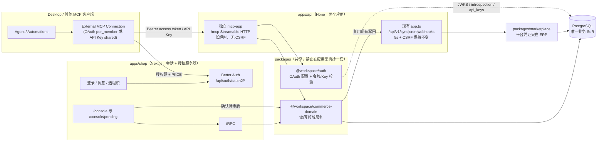
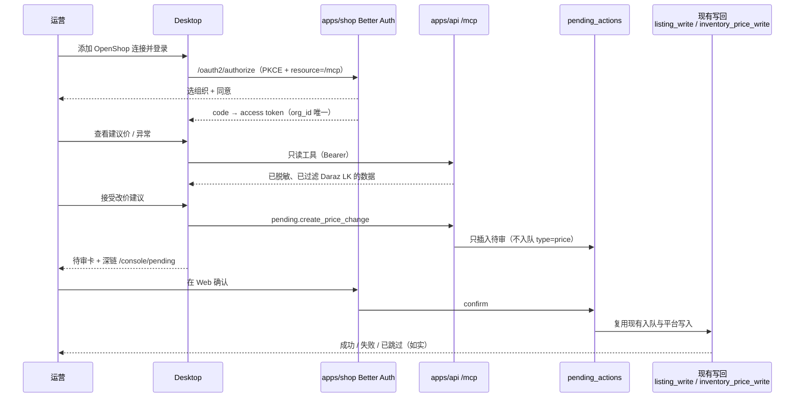

# open-shop × Desktop MCP 改造升级方案

- 日期：2026-11-12（Asia/Shanghai）
- 文档类型：open-shop 改造升级设计（架构 + 鉴权 + MCP 契约 + 分期 + 线框）
- 状态：**设计稿（本轮只落文档，不实现业务代码）**
- 基线：`origin/develop` `20b38243463405928bbbb696876dd473347b04ef`（店铺策略库存推送 / 改价回写已合入）
- 对照方案：openmcp-buddy `explore shop/open-shop-desktop-integration-plan.md` v1.1（`0bc3d730`，2026-11-12）及对该方案的代码评审修正
- 相关既有文档：`docs/design/crossborder-api-mcp-design.md`（旧 MCP 设计稿，已被本文替代为升级计划）、`apps/shop/content/design/openwork-desktop-workbench-plan.md`（2026-10-25，已过时，勿再当现状）

---

## 1. 结论先行

1. **ERP 仍是事实与审批的权威**；Desktop 只做推理、自动化与决策视图。不合并数据库，不把平台凭证存进 Desktop，不重做 `/console`。
2. **OAuth 放在 open-shop**：由现有 Better Auth 实例担任授权服务器（Authorization Server）；MCP / 未来 OpenAPI 担任资源服务器（Resource Server）。OAuth **不**放在 Desktop / Den。
3. **可复用能力进 `packages/`，不在各应用里复制一套 Better Auth**：
   - 鉴权与令牌校验扩进已有 **`@workspace/auth`**（不新建 `@workspace/oauth`，理由见 §6.1）。
   - 业务读写抽到新建 **`@workspace/commerce-domain`**，供 `apps/shop` tRPC、`apps/api` OpenAPI 与 MCP 共用，禁止再开第三条写路径。
4. **写路径双轨（必须遵守）**：控制台维持今天已接通的刊登发布、店铺策略库存推送与改价回写；MCP 写工具只创建或补全 `pending_actions`；最终确认只在 `/console/pending`。确认后复用现有同步写回，不新写一套平台写入。
5. **Access token 必须绑定且只绑定一个 `organization_id`**。同意页让用户选择组织。Web Topbar 切换组织**不会**改写已发出的 Desktop token；换组织需重新授权或另建连接。模型不得传入 `organization_id`。生产环境不得设置 `SHOP_DEV_ORGANIZATION_ID`。
6. **MCP 不挂在当前 `apps/api` 的 `app.ts` 全局 5 秒超时和 CSRF 上**。授权端点留在 `apps/shop`；MCP 在 `apps/api` 内用**独立 Hono 应用**挂在 `/mcp`。
7. **Desktop 第一期只开放 Daraz LK 工具范围**；ERP 本身保持多平台（Daraz + Lazada 共用 Lazop、TikTok 刊登写、多站点税公式）。官方费率同步、TikTok/Shopee 价库写、JSB 官方交运、PK/BD/NP/MM 独立税栈继续如实 `unsupported`。
8. 本仓库对应的启用开关是环境变量 `OPENSHOP_MCP_ENABLED`（默认关闭）+ 组织级「允许工作台接入」。Desktop 侧 Feature Flag `crossborderWorkbench` 由对方控制面负责。

---

## 2. 背景、目标、非目标

### 2.1 背景

Desktop（OpenMCP Station / OpenWork）希望把 open-shop 当作跨境运营工作台的数据与审批后端，通过租户级 Streamable HTTP MCP 接入。buddy 仓库已有 v1.1 集成方案，方向正确，但对 open-shop 现状有过时描述，且「所有写入都走 `pending_actions`」与已经接通的控制台写回冲突。本文是 **open-shop 仓库的改造合同**：写清本仓库改什么、按什么顺序改、为什么这样改。

已拍板（本轮用户确认，不再讨论）：

| 项 | 决定 |
|----|------|
| OAuth 位置 | 在 open-shop，不在 Desktop / Den |
| 实现基础 | Better Auth 作为 OAuth 授权服务器 + 资源服务器校验 |
| 复用方式 | `packages/` 中提供可复用包，`apps/shop` 与 `apps/api` 共用 |

### 2.2 目标

- 让 Desktop 及后续 MCP 客户端用 **PKCE 授权码流**完成「一人一次授权」，令牌绑定单一组织。
- 提供租户级 MCP（默认只读；写入只进待审），工具契约对齐现有 tRPC / 表结构。
- 把领域读写抽到共享包，避免 MCP 复制 `dataaccess`。
- 服务账号走新建的租户 `api_keys`，不复用 `INTERNAL_SYNC_API_KEY`。
- 在不削弱现有控制台能力的前提下，给 Agent 加上审批门禁。

### 2.3 非目标（本改造明确不做）

- 不实现 Desktop / Plugin / Skills / Dashboard 本身（那是 buddy / 控制面的工作）。
- 不把 OKF 知识库作为本期交付依赖（不早于对方 P4）。
- 不在本期把控制台的刊登发布、库存推送、改价回写改成必须先过待审。
- 不把建议零售价自动写回刊登或平台（计算器逻辑保持现状）。
- 不重做组织级 RBAC 阶段 C（可在文中如实说明：Web 确认目前对组织成员开放）。
- 不向平台假装官方费率已同步；不把 Lazada / TikTok 从 ERP 里拿掉。
- 不把 `apps/web` 平台后台职责交给 Desktop。
- 本期不开放 `pending.confirm` / `pending.reject` 给 Agent。

### 2.4 与 buddy 方案的关系

**保留：** 独立 ERP + 租户 MCP（集成 A）+ 密表格深链回 `/console`（D）；不共享数据库；首版不把最终确认交给 Agent；OAuth 为主、API Key 为辅；Desktop 第一期聚焦 Daraz LK 闭环；OKF 后置；金额分币种、时间带时区。

**纠正（以本文为准）：**

| buddy v1.1 的表述 | 本文纠正 |
|-------------------|----------|
| `apps/api` 主要是 health/hello/auth 占位 | 已有 cron / webhooks / 同步，且已接通 `listing_write`、`inventory_price_write`；缺的是 MCP、对外资源 API、租户 OAuth/API Key |
| 所有写入走 `pending_actions` | 仅约束 MCP；控制台写回按店铺策略继续直连 |
| Better Auth「直接提供」OAuth 已可配置 | 当前 1.7.6 **尚未启用**授权服务器插件，需新增 `@better-auth/oauth-provider` 并对齐版本 |
| MCP URL 笼统写成 `https://<shop-host>/api/v1/mcp` | 授权在 shop，MCP 在 api 的 `/mcp`，且不能走现有 5s/CSRF 中间件 |
| `freight_estimates` 像已有表 | 线上是费用模板 + 海运柜次 + 运价卡三源 UNION；独立快照表仍是设计稿 |
| Lazada「本期不实现 / API 准入待确认」 | ERP 已把 Daraz/Lazada 当同一套 Lazop；Desktop 只是**工具范围**先开放 Daraz LK |
| 文件路径 `shop/open-shop-desktop-integration-plan.md` | 实际在 buddy 的 `explore shop/` |

---

## 3. 当前现状（相对 `20b3824`，禁止写成已完成）

| 层 | 事实 |
|----|------|
| `apps/shop` | Next.js 16 + tRPC + Drizzle + Better Auth。模块 1–16 主路径已接 PostgreSQL。另有定价计算器三期、全局税则/默认费用模板的租户副本、「从平台目录补齐」、店铺策略 `/settings/shop-policy`。多组织切换（`/select-org`、Topbar、`session.activeOrganizationId`）已交付。 |
| `apps/web` | 平台后台：入驻审核、店铺/用户管理、待审抽检、数据初始化（含全局税则库与默认费用模板）。Desktop 不承担这些职责。`apiKeysRouter.list` 仍返回 `[]`。 |
| `apps/api` | Hono。**不是空壳**：`/api/v1/sync`、`/cron`、`/webhooks` 已跑；`listing_write`、`inventory_price_write` 已接通 Daraz/Lazada。Better Auth handler 仍是 **501**。全局 `timeout(5000)`，且 `/api/v1/*` 挂了 CSRF。 |
| 鉴权 | shop 使用 better-auth **1.7.6**（声明 `^1.6.23`），插件为 email/password、emailOTP、phoneNumber、organization、openAPI、nextCookies。**未启用** `oauthProvider` / 已废弃的 `oidcProvider`。已安装包内无 OIDC 授权服务器插件。 |
| 内部密钥 | `INTERNAL_SYNC_API_KEY` 只用于 shop → api 的服务间同步，**不是**租户 MCP Key。 |
| 店铺策略写回 | `shops.inventory_push_enabled` / `price_writeback_enabled` **默认打开**。打开时，控制台入队的库存/价格同步会写回 Daraz/Lazada；TikTok / Shopee 如实 unsupported。WMS 出入库**不会**自动推库存。 |
| 刊登写 | `listings.publish` / 下架走 `listing_write`，**不经**待审。`submitForReview` 才创建 `listing_submit`；待审确认后仍要人再点「发布到平台」。已有 `item_id` 的刊登改售价会直接入队 `type=price`。 |
| 定价计算器 | 「填入建议价」只改本地草稿，不写 `listings.price_amount`，不调平台。 |
| 待审 | 表 `pending_actions` 已有，幂等键已有，`expectedUpdatedAt` 乐观锁**尚未**作为通用字段。种类枚举为 `sourcing_upsert` / `listing_submit` / `price_change` / `inventory_push` / `settlement_post`；创建候选时代码还写入未入枚举的 `candidate_review`（抽取领域层时一并纠正）。确认/拒绝已在 `trpc.pending`，页面为 `/console/pending`。 |
| RBAC | 阶段 A+B 已落地：角色管理、邀请、费用模板发布、结算确认等敏感写走 `requirePermission`。刊登发布、待审确认、同步入队、定价等多数业务仍是 `tenantProcedure`，**组织成员默认可做**。阶段 C 未做。 |
| 开发旁路 | `SHOP_DEV_ORGANIZATION_ID` 可在开发态无登录读写租户过程。生产必须未设置。 |
| 领域代码 | 业务读写在 `apps/shop/src/lib/server/dataaccess/`；api 另有 `apps/api/src/lib/marketplace/*`。**没有**共享 domain 包。 |
| 许可证 | LGPL-2.1。与 Desktop 只走网络边界，不复制代码进对方仓库。 |

---

## 4. 目标架构

两个进程必须写清楚：

- **`apps/shop`（租户 Web）**：登录、同意、组织选择、控制台、tRPC、Better Auth 授权服务器（`/api/auth/*` 与 well-known）。
- **`apps/api`（接口进程）**：现有同步 / cron / webhook 保持不变；**另外**挂独立 MCP 应用。MCP 用 `@workspace/auth` 校验 shop 签发的令牌或租户 API Key，再调用 `@workspace/commerce-domain`。



约束：

- Desktop **不直连** PostgreSQL，**不保存**平台 OAuth 凭证。
- 模型不得指定 `organization_id`；租户只来自校验后的凭证声明。
- 平台连接器与凭证只在 ERP。

---

## 5. 写路径双轨（关键）

这是本方案与 buddy 原文差异最大、也最容易实现错的一点。

```text
【控制台，维持现状】
  刊登发布 / 下架     → listings.publish / setShelf → listing_write
  已上架刊登改售价     → 入队 type=price（受 price_writeback 开关约束）
  同步页入队库存/价格  → 入队 type=inventory|price（受对应开关约束）
  填入建议零售价       → 只改本地草稿，不写刊登价、不调平台

【MCP / Agent，必须走待审】
  任何改价、库存推送、刊登提交建议 → 只创建或补全 pending_actions
  最终确认                       → 运营在 /console/pending 点击确认
  确认之后                       → 复用上面的现有入队与 listing_write / inventory_price_write
```

硬性禁止（MCP 领域服务必须在实现里挡住，而不是只靠 Desktop tool policy）：

| 禁止调用 | 原因 |
|----------|------|
| `listings.publish` / 直接下架 | 会立刻走 `listing_write` |
| 直接修改已有 `externalItemId` 的刊登售价 | 会立刻入队 `type=price` |
| `sync.enqueue` 且类型为 `inventory` / `price` / `publish`（发布刊登） | 会绕过待审写平台 |
| 向 Agent 暴露 `pending.confirm` / `pending.reject` | 已拍板：确认只在 Web |

允许的 MCP 写（均只动待审或草稿，不直接碰平台）：

- 创建 / 更新选品候选（纠正为合法 `kind`，见 §10）。
- 接受候选 → 创建 SPU 草稿 + `listing_submit` 待审（不发布）。
- 补全 `listing_submit` 必填字段（对应现有 `trpc.pending.complete`）。
- 创建刊登草稿、`submitForReview`（只建待审）。
- 创建 `price_change` / `inventory_push` 待审（带目标 listing、差异、证据）。
- `sync.request` **仅限读同步**：订单、刊登拉取、结算、物流轨迹、评论等。退货同步若仍未接线，继续如实失败，禁止假成功。

待审确认之后的执行必须调用现有 `enqueueOrRetrySyncTask` / `publishListing`，由店铺策略开关和平台能力决定写回或 `skipped` / `unsupported`。**不要**在 MCP 包里再写一套 connector 调用。

v1 在 `pending_actions` 上为 MCP 创建的记录增加可选乐观锁（`expectedUpdatedAt` 或 payload 内版本），避免补全与确认之间互相覆盖。现有幂等键继续用。

---

## 6. OAuth / Better Auth（已定：放在 open-shop）

### 6.1 包怎么放：扩展 `@workspace/auth`，不新建 `@workspace/oauth`

现有 `@workspace/auth` 已经承载 `createAuth` / `sharedAuthOptions`、organization 插件、RBAC 与权限语句，shop 的 `betterAuth()` 也是在这套选项上叠加 OTP 等插件。OAuth 授权服务器必须进入**同一个** `betterAuth()` 实例，否则会出现两套密钥、两套客户端表、两套会话。

因此：

- **不新建** `@workspace/oauth`，避免应用各自再拼插件。
- 在 `@workspace/auth` 增加模块，例如：`oauth-provider.ts`（插件与选项工厂）、`oauth-scopes.ts`、`access-token.ts`（校验 / 解析 org / scope）、`api-keys.ts`（哈希校验辅助，表定义仍在 `@workspace/db`）。
- `apps/shop` 负责：把工厂接入现有 `auth`、提供登录/同意/选组织页、签发令牌、暴露 discovery。
- `apps/api` 的 MCP 进程**不**再起一套 Better Auth 会话服务，只调用 `@workspace/auth` 的校验辅助（本地 JWKS 验 JWT，必要时 introspection；API Key 查库）。

### 6.2 现状与必须新增的依赖（不要写成已经有）

当前锁定的是 **better-auth 1.7.6**。官方授权服务器已从核心里的旧 `oidcProvider` 迁出：该插件已废弃并移除，现由独立包 **`@better-auth/oauth-provider`** 的 `oauthProvider()` 提供（文档：https://better-auth.com/docs/plugins/oauth-provider）。截至 2026-11-11，npm 上该包的 1.7 线有 **1.7.21**。

实施时必须：

1. 将 `better-auth` 与 `@better-auth/oauth-provider` **对齐到同一条 1.7.x 补丁**（建议升到当时最新的 1.7 稳定补丁并做回归；**默认不跟 1.8 beta**）。
2. 同时启用内置 `jwt()` 插件，并按官方要求关闭会话 JWT 干扰：`disabledPaths: ["/token"]`，`jwt({ disableSettingJwtHeader: true })`。资源指示的 access token 使用 RFC 9068 JWT；未带 `resource` 时官方默认为不透明 token。本方案要求 Desktop / MCP **必须带 `resource`**，从而拿到 JWT。
3. 跑 Better Auth / Drizzle 迁移，落入 OAuth 客户端、授权码、consent、access/refresh token、JWKS 等插件表。
4. 在 shop 增加 well-known 路由（多数框架只把 `/api/auth/*` 交给 `auth.handler`，RFC 8414 根路径要单独挂）：
   - `/.well-known/oauth-authorization-server`
   - `/.well-known/openid-configuration`
   - 资源元数据 `/.well-known/oauth-protected-resource`（以及带资源路径的别名），`resource` 标识为 MCP URL。
5. 登录页、同意页引入 `oauthProviderClient()`，用官方的 signed `oauth_query` 续接授权，避免在前端手写 redirect。

**为什么不用 `@better-auth/mcp` 的 `mcp()` 替代 `oauthProvider()`：** 官方写明 `mcp()` 就是 OAuth provider，**不能与 `oauthProvider()` 同时注册**。`mcp()` 面向 MCP 2026-07-28 的无状态 POST 配置文件，文档示例甚至要求路由只导出 POST。我们还要给未来 OpenAPI 发同一套令牌，Desktop / Den 走的是**预注册客户端 + PKCE**（不是必须上 CIMD）。因此本方案以 `oauthProvider()` + `jwt()` 为授权服务器，MCP 用资源服务器校验辅助保护 `/mcp`。若日后只服务纯 MCP 客户端，再评估迁移，本期不双注册。

**v1 关闭动态客户端注册（DCR）。** 客户端由组织管理员在 `/settings/mcp-access` 创建。Desktop 若是公共客户端，使用 `token_endpoint_auth_method=none` + 强制 PKCE（S256）；若 Den 能保管 secret，则用机密客户端 + PKCE（默认仍要求 PKCE，不为 Desktop 关闭）。

### 6.3 授权流与组织绑定

授权端点（shop）：

```text
https://<shop-host>/api/auth/oauth2/authorize
  ?response_type=code
  &client_id=...
  &redirect_uri=<Den oauthCallbackUrl，精确匹配>
  &scope=openid profile email offline_access openshop:read openshop:write.pending
  &state=...
  &code_challenge=...
  &code_challenge_method=S256
  &resource=https://<api-host>/mcp
```

换票：`POST https://<shop-host>/api/auth/oauth2/token`（授权码 + `code_verifier`，refresh 用 `offline_access`，旋转刷新令牌）。

组织绑定（对齐官方 `postLogin` + `consentReferenceId`，见同意屏文档）：

```ts
// 示意：实施时写入 @workspace/auth 工厂，不是现在就改代码
oauthProvider({
  loginPage: "/sign-in",          // 复用现有登录（带 locale 的实际路径在实现时对齐）
  consentPage: "/oauth/consent",
  postLogin: {
    page: "/oauth/select-org",
    shouldRedirect: async ({ session, isContinuation, headers }) => {
      // 无有效 activeOrganizationId，或用户有多个组织且这是新的授权请求，必须进入选择页
    },
    consentReferenceId: ({ session }) => {
      const orgId = session.activeOrganizationId
      if (!orgId) throw new APIError("BAD_REQUEST", { message: "请选择要授权的组织" })
      return orgId
    },
  },
  customAccessTokenClaims: ({ referenceId, scopes }) => ({
    org_id: referenceId, // 再另加 namespaced claim 亦可
  }),
})
```

规则：

- 同意按「用户 + 客户端 + 组织」分别存储。未选出组织不得发码。
- Access token / introspection 必须带且只带**这一个** `org_id`。MCP 只信校验结果里的 org，忽略工具参数或 Header 里的组织。
- 用户在 shop Topbar 切换 `activeOrganizationId`，**已发出的 access/refresh 不变**。要换组织：撤销后重新授权，或为另一组织建一条 Desktop 连接。
- 官方说明：删除 consent **不会**自动作废已发出的 token；JWT 声明在过期前也不会因客户端停用而变化。因此 MCP 在校验时应对停用客户端 / 撤销密钥做 **introspection 或撤销列表**（见 §11），不能只做本地 JWT 验签。
- 成员失去该组织 membership 后，refresh 必须失败；未过期的 access token 依赖短寿命 + introspection。
- 生产不得用 `SHOP_DEV_ORGANIZATION_ID` 给 MCP 指定租户。开发旁路若保留，仅限非生产且不得签发正式 OAuth token。

### 6.4 Scopes（v1 默认清单）

| Scope | 含义 | 首版是否发放 |
|-------|------|----------------|
| `openid` `profile` `email` `offline_access` | 标准 OIDC / 刷新令牌 | 是（普通用户） |
| `openshop:read` | 只读工具（Dashboard、商品、订单脱敏、库存、财务、定价建议、店铺策略、待审列表、同步健康） | 是 |
| `openshop:write.pending` | 创建/补全待审、候选、刊登草稿、提交审核、读同步请求 | 按需（运营）；老板默认可只发 read |
| `openshop:write.confirm` | 确认/拒绝待审 | **不发放**；即使请求也拒绝。为将来预留名字 |

服务账号 API Key 只用 `openshop:read`，或显式勾选的最小写 scope，默认只读。

### 6.5 令牌形态与校验

- Access token：短寿命（默认 **15 分钟**），JWT，`aud` = `https://<api-host>/mcp`。
- Refresh token：旋转，默认数小时至数天（实施时按安全评审微调），绑定同一 `org_id` 与 scope。
- shop 提供 introspection（RFC 7662）与 revocation（RFC 7009）。
- `@workspace/auth` 对 MCP 暴露统一函数，例如 `verifyOpenShopCredential({ authorizationHeader, resource })`，返回 `{ kind: "oauth" \| "api_key", userId?, serviceName?, organizationId, scopes, clientId?, tokenId }`。失败则 401，并带资源挑战（WWW-Authenticate）。

---

## 7. 租户 API Key（服务账号 / 共享只读 / 自动化）

新建表（名称默认 `api_keys`，放在 commerce / auth 邻近 schema，由迁移落地），**禁止**复用 `INTERNAL_SYNC_API_KEY`。

建议字段：

```text
id, organization_id, name, service_name,
key_prefix, key_hash, scopes[],
created_by, last_used_at, expires_at,
revoked_at, disabled_at,
created_at, updated_at
```

规则：

- 创建时只展示一次明文；库中只存哈希与前缀。
- Key → 恰好一个 `organization_id`；模型不得改 org。
- 每次 MCP 调用检查 scope、过期、撤销、组织「允许工作台接入」。
- 撤销 / 停用立即生效（哈希查库，不依赖 JWT 过期）。
- 限流按 key / org / tool；写审计。
- UI 在 `/settings/mcp-access`，权限走 `settings.configure`（`tenantAdminProcedure`），不跟普通业务一样对全体成员开放。
- 普通运营 / 老板 **不发**个人 API Key（与 buddy 已拍板一致）。

---

## 8. 共享领域包 `@workspace/commerce-domain`

### 8.1 为什么要新包

OAuth 属于身份，应留在 `@workspace/auth`。业务读写今天散落在 `apps/shop/.../dataaccess/` 与 `apps/api/src/lib/marketplace/`。若 MCP 直接抄一份，就会出现第三条写路径。因此新建 **`@workspace/commerce-domain`**：

- 被 shop tRPC、api 同步编排、MCP tools 共同调用。
- 第一期以**搬迁 + 门面**为主，不借机重写业务规则。
- MCP 专用策略（「禁止直接 publish」）作为该包的 `actor.channel = "mcp"` 策略层，而不是另写 marketplace 客户端。

### 8.2 第一期抽取切片（只这些，避免大爆炸）

| 切片 | 读 | 写（MCP 通道） | 写（console 通道） |
|------|----|----------------|--------------------|
| Dashboard / 财务只读 | kpis、trends、todos、alerts、overview、settlements、profits、sku_costs、运费三源视图 | 无 | 无（本切片） |
| 商品 / 刊登只读 | SPU（`products`）、内部 SKU（`product_variants`）、listings | 无 | 现有 tRPC 暂可继续调用原 dataaccess，逐步切门面 |
| 定价 | `pricing.suggest`、建议草稿列表 | 保存建议草稿（不写刊登售价） | 同现有计算器 |
| 店铺策略 | 各店 `inventory_push_enabled` / `price_writeback_enabled` 及售后相关只读 | **v1 不提供 MCP 改开关** | 仍在 `/settings/shop-policy` |
| 待审 | list / get | create / complete（及候选接受产生的 listing_submit） | confirm / reject 仅 console |
| 同步 | tasks / 健康 | 仅读同步 request | 现有 enqueue（含写回类型） |

售后、LGS/JSB、G8 绑店冲突、成员邀请等 **P2+** 再抽。

shop 的 `dataaccess` 在过渡期可变成对 domain 包的薄封装，不必第一周删除全部文件。

---

## 9. MCP 服务器放置与启用方式

### 9.1 不要挂在现有 `app.ts` 上

现有 `apps/api/src/app.ts` 对全部路由 `timeout(5000)`，并对 `/api/v1/*` 使用 CSRF。Streamable HTTP / SSE 会被 5 秒超时打断，Bearer 客户端也会被 CSRF 误伤。

**默认方案（已选）：同一 `apps/api` 进程、独立 Hono 应用。**

- 新文件例如 `apps/api/src/mcp-app.ts`，在 `index.ts` 里与现有 `app` 一起挂载：MCP 走前缀 `/mcp`，**不**经过 5 秒超时和 CSRF。
- MCP 超时单独配置（建议至少 10 分钟，或对 GET/SSE 取消超时）。
- CORS 按 Desktop / Den 回调源显式放行，带 Authorization。
- 现有 `/api/v1/sync|cron|webhooks` 行为不变，内部同步密钥也不变。

备选（仅当独立进程运维更简单时再拆）：`apps/mcp` 单独进程。本期不作为默认，以免多一套部署。

**不把 MCP 放在 `apps/shop` 的 Route Handler 里**作为主路径：Next.js 请求时限、serverless 形态和与同步 worker 同进程的需求都不合适。授权服务器必须留在 shop，是因为登录会话和同意 UI 已在那里。

### 9.2 URL 形态

| 用途 | URL |
|------|-----|
| 授权 | `https://<shop-host>/api/auth/oauth2/authorize` |
| 换票 / 刷新 / 吊销 / introspection | `https://<shop-host>/api/auth/oauth2/token` 等 |
| Discovery | `https://<shop-host>/.well-known/oauth-authorization-server` |
| MCP 资源标识与入口 | `https://<api-host>/mcp`（Streamable HTTP） |
| 资源元数据 | `https://<api-host>/.well-known/oauth-protected-resource`（及路径插入别名） |

buddy 文档里的 `/api/v1/mcp` **不再使用**，以免和带 CSRF 的 `/api/v1` 树混在一起。

### 9.3 启用开关

- 环境变量 `OPENSHOP_MCP_ENABLED`，默认 `false`。关闭时：`/mcp` 返回 404、不注册工具、设置页提示未启用。
- 组织级开关「允许工作台接入」（存 `organization_settings` 或等价字段），默认关闭，由具备 `settings.configure` 的成员打开。
- 两者都打开，且客户端未停用，才接受该组织的 MCP 调用。
- Desktop 的 `crossborderWorkbench` 由对方控制面灰度，本仓库不实现那个 Feature Flag。

---

## 10. MCP 工具契约（按现有 tRPC / 表名校正）

原则：少而稳定，不把全部 tRPC 暴露给模型。命名以实现时的 schema 为准，下表是 v1 合同。

统一返回：`content` + `structuredContent`；金额带 `currency`、`currencyMode`（`single` / `mixed` / `empty`），禁止跨币种求和；时间带 `asOf`、`dateFrom`、`dateTo`、`timeZone`（默认 `Asia/Shanghai`）；工具 annotations 声明 `readOnlyHint` 等。

**v1 数据范围：** 服务端强制过滤 `platform = daraz` 且站点 / 国家为 **LK**。查询其他平台时返回明确错误：「本期工作台仅开放 Daraz 斯里兰卡，ERP 中其他店铺仍可在 Web 使用。」不要靠模型自觉过滤。

### 10.1 只读工具

| 域 | 工具 | 对到的现有能力 | 注意 |
|----|------|----------------|------|
| Dashboard | `openshop.dashboard.kpis` / `.trends` / `.todos` / `.alerts` | `trpc.dashboard.*`（已有 currencyMode） | 原样对齐分币种口径 |
| 商品 | `openshop.products.search` / `.get` | SPU=`products`（`spuCode`），内部 SKU=`product_variants`（`skuCode`） | 不要用含混的 “variants” 对外文案 |
| 候选 | `openshop.candidates.list` / `.get` / `.stats` | `trpc.candidates` | |
| 刊登 | `openshop.listings.list` / `.get` / `.stats` | `trpc.listings` | |
| 订单 | `openshop.orders.list` / `.get` / `.exceptions` | `trpc.order` 等 | **必须脱敏**，见 §11 |
| 库存 | `openshop.inventory.list` / `.alerts` | 库存余额 / 预警 | |
| 财务 | `openshop.finance.overview` / `.settlements` / `.profits` / `.sku_costs` | `trpc.finance`、`sku_costs` | |
| 运费 | `openshop.finance.freight` | 现有 `listFreightEstimates`：费用模板 ∪ 海运柜次 ∪ `commerce_freight_rate_cards` | **不要假设**已有 `freight_estimates` 表 |
| 定价 | `openshop.pricing.suggest` / `.drafts` | `trpc.pricing.suggest`、定价建议草稿 | 只读建议与草稿；不写刊登售价 |
| 店铺策略 | `openshop.settings.shop_policy` | 各店库存推送 / 改价回写开关（及只读售后策略） | 让 Agent 能解释「为什么没推送」；v1 不能改开关 |
| 报表 | `openshop.reports.sell_through` / `.stock_risk` / `.attribution` | `trpc.reports` | |
| 待审 | `openshop.pending.list` / `.get` | `trpc.pending` | 审批卡只读 + Web 深链 |
| 同步 | `openshop.sync.tasks` | `trpc.sync` | 展示失败 / 已跳过，空数据不当 0 |

### 10.2 写工具（审批门禁）

| 工具 | 行为 | 首版 |
|------|------|------|
| `openshop.candidates.create` / `.update` | 写候选；待审 kind 纠正为 `sourcing_upsert`（或经迁移后的正式 kind），不再写未入枚举的 `candidate_review` | 开放 |
| `openshop.candidates.accept` / `.reject` | 接受 → SPU 草稿 + `listing_submit`，不发布 | 开放 |
| `openshop.pending.complete_listing_submit` | 补全必填，不确认 | 开放 |
| `openshop.listings.create_draft` / `.submit_for_review` | 草稿 / 提交审核 | 开放 |
| `openshop.pending.create_price_change` / `.create_inventory_push` | 只建待审 | 开放 |
| `openshop.sync.request` | **仅读同步类型** | 开放 |
| `openshop.pricing.save_draft` | 保存建议草稿，不改刊登价 | 开放 |
| `openshop.pending.confirm` / `.reject` | — | **不开放**，工具不注册 |

### 10.3 明确延期或如实 unsupported

| 能力 | 说明 |
|------|------|
| 售后、LGS/JSB、G8 绑店冲突 | P2+ 再开放工具 |
| 官方费率同步 | 各已接平台均为 `unsupported`，费用以本组织已发布模板为准 |
| TikTok / Shopee 价库写回 | 即使店铺开关打开，也如实提示无写入接口 |
| JSB 官方交运 | 仅本地记录，无官方接口 |
| PK / BD / NP / MM 计税 | 无独立税栈，计算器标缺项，不套用斯里兰卡公式 |
| 向平台回写建议价 | 不做 |

---

## 11. 安全

- 默认只读；写工具另要 `openshop:write.pending`。
- **PII 脱敏（必须做在 domain / MCP 层，不能把控制台订单 tRPC 原样转给模型）：** 买家姓名、电话、详细地址、邮箱不得进入 MCP `structuredContent` / 文本。需要排查时可给掩码或「仅 Web 可见」深链。商品标题、买家备注视为不可信输入，防提示词注入。
- 平台凭证、DB URL、API Key、内部同步密钥不得写入日志、报错原文或知识库。
- 客户端与 API Key 可软停用（`disabled_at`）；停用后 introspection 为 inactive，MCP 立即 401。
- 审计：所有 MCP 写（含创建待审）记录 `actorId`（用户或服务账号）、`clientId`、`orgId`、`requestId`、before/after，写入现有 `audit_events`（或等价表）。
- 幂等键 + 待审补全时的乐观锁。
- 限流按 org / token / tool。
- Web 管理 OAuth 客户端与 API Key：仅 `settings.configure`。
- **如实记录 RBAC 现状：** `/console/pending` 确认在 v1 仍对组织成员开放，不是细粒度角色门禁。本改造不把阶段 C 纳入范围；设置页的客户端管理除外。

---

## 12. 分期路线图（本仓库工作包）

对方 Desktop 的 P0–P5 仍由 buddy 方案约束。下面只列 **open-shop 必须交付的工作包**。每阶段都有退出条件。

| 阶段 | 周期（约） | 本仓库工作包 | 退出条件 |
|------|------------|--------------|----------|
| **S0 契约与脚手架** | 1 周 | 本文评审通过；`@workspace/auth` 模块骨架与 scope 常量；`@workspace/commerce-domain` 包壳；对齐 better-auth 1.7.x + 引入 `@better-auth/oauth-provider` 的依赖变更（可先合依赖、不开入口） | 类型检查通过；生产行为不变 |
| **S1 授权服务器** | 2–3 周 | 启用 `jwt()` + `oauthProvider()`；迁移插件表；well-known；登录续接；`/oauth/select-org`、`/oauth/consent`；token 绑定单一 org；introspection / revocation | 用测试客户端走完 PKCE 授权码流，JWT 中有且仅有一个 `org_id`；Topbar 切换组织不改变已发 token |
| **S2 租户 API Key 与设置页** | 1–2 周 | `api_keys` 迁移；`/settings/mcp-access`（OAuth 客户端 + Key，软停用）；组织级启用开关；`OPENSHOP_MCP_ENABLED` | 管理员能创建/停用客户端和 Key；普通成员看不到写入口 |
| **S3 MCP 宿主 + 只读工具** | 2–3 周 | 独立 `mcp-app` 挂 `/mcp`；校验 OAuth 与 API Key；抽取 Dashboard/财务/商品/刊登/订单脱敏/库存/运费三源/定价建议/店铺策略/待审/同步健康只读；强制 Daraz LK 过滤 | Agent（或 curl）能回答「今日订单 / 低库存 / 待审 / 建议价」，混合币种不乱加总；5s CSRF 的 `/api/v1` 不受影响 |
| **S4 待审写工具 + 领域门禁** | 2–3 周 | MCP 写只进 `pending_actions`；禁止 publish / 直接改已上架价 / 写同步入队；确认后复用现有写回；纠正候选 kind；审计 | 「候选或改价建议 → 待审 → Web 确认 → 现有 listing_write / inventory_price_write」闭环；关店铺开关时任务为已跳过而非假成功 |
| **S5 加固与只读开放** | 持续 | 限流、PII 回归测试、密钥轮转、观测（MCP 延迟/错误率/鉴权失败）；视需要拆独立进程 | 生产可灰度：两开关均开才对指定组织放行 |

门禁：S1 未通过租户隔离与 org 绑定测试，不得接真实经营数据；S4 未通过「MCP 无法直接写平台」测试，不得对外部打开写 scope。

---

## 13. 线框（设计稿，不是导航大改）

设置入口放在现有「企业」分组、`/settings/marketplace-apps` 附近，新开 **`/settings/mcp-access`**（标题建议：工作台接入）。**不要**放进 `/settings/shop-policy`（那是店铺功能开关：库存推送、改价回写、售后占库等）。不要使用已删除的 `/settings/aftersale-policy`。

### 13.a 授权同意 + 选择组织

```text
┌─────────────────────────────────────────────────────────┐
│  Open Shop  授权                                        │
│  https://<shop-host>/oauth/select-org                   │
├─────────────────────────────────────────────────────────┤
│  应用「OpenWork Desktop」请求访问你的组织。             │
│                                                         │
│  选择要授权的组织（必选，只能选一个）：                 │
│  ┌─────────────────────────────────────────────────┐    │
│  │ ● 好时运贸易（当前）                             │    │
│  │ ○ 其他主体 B                                    │    │
│  └─────────────────────────────────────────────────┘    │
│                                                         │
│  将允许：                                               │
│  ☑ 读取经营数据（openshop:read）                        │
│  ☑ 创建待审建议（openshop:write.pending）               │
│  ☐ 确认待审（不开放）                                   │
│                                                         │
│  说明：在网页里切换组织，不会改变这次授权。             │
│        若要换组织，请回来重新授权。                     │
│                                                         │
│            [取消]            [授权并继续]               │
└─────────────────────────────────────────────────────────┘
```

同意页 `/oauth/consent` 再次展示客户端名称、组织名称、scope 与资源 `https://<api-host>/mcp`，按钮为「拒绝 / 同意」。已登录用户若只有一个组织，选择页可跳过，但仍要把该 org 写入 consent reference。

### 13.b 设置页：OAuth 客户端与 API Key

```text
设置 · 工作台接入          /settings/mcp-access
┌─────────────────────────────────────────────────────────┐
│ 允许本组织使用桌面工作台 / MCP    [ 开 / 关 ]            │
│ 环境未启用 OPENSHOP_MCP_ENABLED 时，此处显示「部署未打开」│
├─────────────────────────────────────────────────────────┤
│ OAuth 客户端                                            │
│  ┌──────────────┬──────────┬──────────┬──────────────┐  │
│  │ 名称         │ 类型     │ 状态     │ 操作         │  │
│  │ OpenWork     │ 公共客户端│ 启用     │ 停用  轮转   │  │
│  └──────────────┴──────────┴──────────┴──────────────┘  │
│  [新建客户端]  回调 URL、scope、resource 必填            │
│  新建后 client_secret（若有）只显示一次                  │
├─────────────────────────────────────────────────────────┤
│ 服务账号 API Key（不发给普通用户）                      │
│  ┌──────────────┬──────────┬──────────┬──────────────┐  │
│  │ 名称         │ 前缀     │ 范围     │ 操作         │  │
│  │ 晨报只读     │ os_sk_ab │ 只读     │ 停用  删除   │  │
│  └──────────────┴──────────┴──────────┴──────────────┘  │
│  [新建 Key]  明文只显示一次                              │
└─────────────────────────────────────────────────────────┘
```

### 13.c `/console/pending` 确认 Agent 创建的待审

```text
待审队列 · 详情                         /console/pending/[id]
┌─────────────────────────────────────────────────────────┐
│ 改价建议  ·  待确认                                     │
│ 来源：Desktop Agent（client=OpenWork，actor=张三）      │
│ 组织：好时运贸易    店铺：Daraz LK / 某店               │
│ 店铺策略：改价回写 = 开                                 │
├─────────────────────────────────────────────────────────┤
│ 影响                                                    │
│   刊登  SKU HSY000001001   item_id 123                  │
│   售价  LKR 1,250  →  LKR 1,390                         │
│   不自动发布；确认后按现有改价回写入队                  │
│                                                         │
│ 证据    建议来自定价计算器草稿 #…，汇率 asOf …          │
│ 深链    [打开刊登]  [打开定价建议]                      │
├─────────────────────────────────────────────────────────┤
│         [拒绝]                      [确认并执行]        │
│ 确认后复用 inventory_price_write / 店铺开关；           │
│ 不在此页让 Agent 代点。                                 │
└─────────────────────────────────────────────────────────┘
```

库存推送、刊登提交待审沿用同一布局，字段换成数量或刊登必填项。若开关为关，确认后任务应为「已跳过」并写明原因。

### 13.d 主路径时序



---

## 14. 默认决策与仅剩的开放问题

下列已在本文选定，实施时按此执行，不再等待：

| 议题 | 默认 |
|------|------|
| OAuth 代码放哪 | 扩展 `@workspace/auth`，不新建 `@workspace/oauth` |
| 领域共享包 | 新建 `@workspace/commerce-domain` |
| 授权服务器插件 | `@better-auth/oauth-provider` 的 `oauthProvider()` + `jwt()`；对齐 1.7.x 稳定补丁，不跟 1.8 beta；不用已移除的 `oidcProvider`；本期不用 `mcp()` 替换授权服务器 |
| 授权跑在哪 | `apps/shop` 现有 Better Auth |
| MCP 跑在哪 | `apps/api` 独立 Hono 应用，`/mcp` |
| 动态注册 | v1 关闭，仅管理员预注册 |
| 写路径 | 双轨，见 §5 |
| 第一期平台范围 | 工具强制 Daraz LK；ERP 多平台保留 |
| 确认入口 | 仅 `/console/pending` |
| 设置页 | `/settings/mcp-access` |
| RBAC | v1 不收口业务确认权限；客户端与 Key 的管理要收口 |
| 官方费率 / JSB / 部分国税栈 | 继续如实 unsupported 或标缺项 |

仅在实现时需要核对、但不阻塞方案的事项：

1. 锁定 better-auth 与 `@better-auth/oauth-provider` 的**具体补丁号**（以开始编码当周 npm 1.7 稳定版为准，并做登录 / OTP / 组织切换回归）。
2. Desktop / Den 是公共客户端还是机密客户端（两者都支持，设置页按实际选择；PKCE 都要开）。
3. 短寿命 JWT 之外，introspection 是每次 MCP 调用都做，还是写操作 / 停用后才做（默认：**每次调用都做轻量 introspection 或至少查撤销/停用**，避免已停用客户端在 15 分钟内仍能写待审）。

---

## 15. 关键文件与将要新增的落点（供实施索引）

**现有（只读参考）：**

- `apps/shop/src/lib/auth.ts`、`packages/auth/src/options.ts`、`packages/auth/src/server.ts`
- `apps/shop/src/lib/server/dataaccess/`、`apps/shop/src/lib/server/routers/`
- `apps/shop/src/lib/server/trpc.ts`（`SHOP_DEV_ORGANIZATION_ID`、`tenantProcedure`）
- `apps/api/src/app.ts`、`apps/api/src/lib/auth.ts`（501）、`apps/api/src/lib/marketplace/listing-write.ts`、`inventory-price-write.ts`
- `packages/db/src/commerce-schema.ts`（`pending_actions`、`shops` 写回开关、`products` / `product_variants`、`sku_costs`）
- `/settings/shop-policy`、`/console/pending`

**计划新增或扩展（实现阶段再改代码）：**

- `@workspace/auth`：OAuth 工厂、scope、令牌与 API Key 校验
- `@workspace/commerce-domain`：第一期切片门面
- `packages/db`：OAuth 插件表迁移、`api_keys`、组织启用开关、待审乐观锁（如需要）
- `apps/shop`：well-known、`/oauth/consent`、`/oauth/select-org`、`/settings/mcp-access`
- `apps/api/src/mcp-app.ts` 与 `index.ts` 挂载

---

## 16. 一句话

> open-shop 继续做事实、写回与审批的权威；用扩展后的 `@workspace/auth` 在本仓库签发「绑定单一组织」的 OAuth 令牌；用 `@workspace/commerce-domain` 让 MCP 与控制台共用读写；MCP 只创建待审，确认仍在 `/console/pending`，确认后再走已经接通的平台写回。
