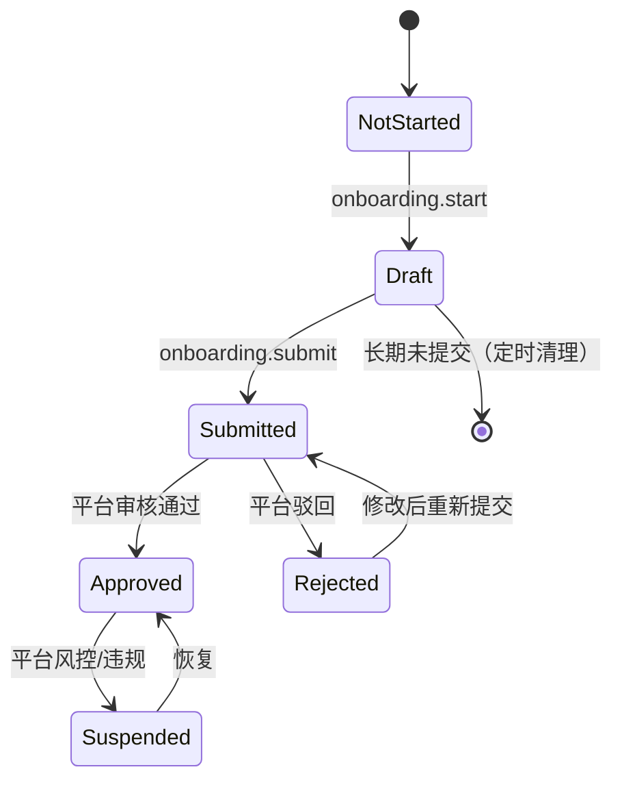
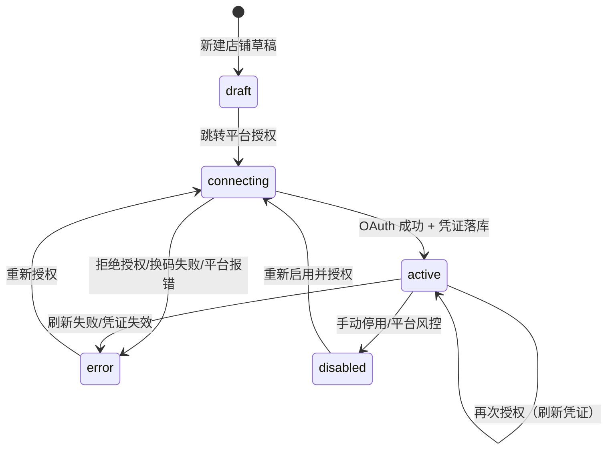
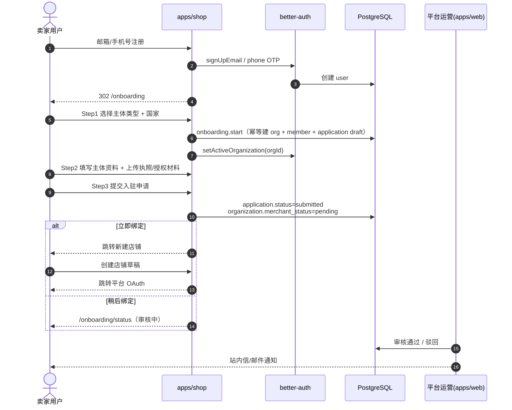
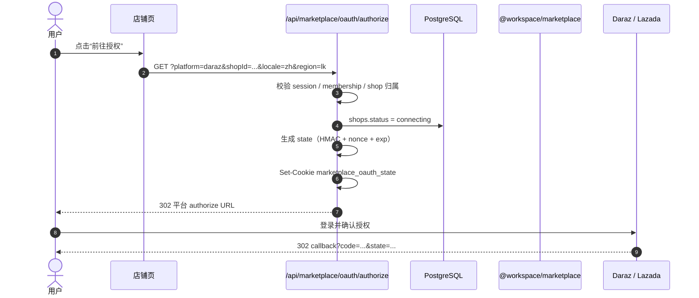
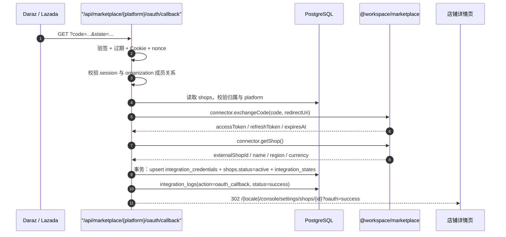

# 租户入驻、店铺创建与 Daraz/Lazada OAuth 绑定

> 状态：设计稿（待评审）
> 范围：`apps/shop` 租户入驻、组织创建、首店/多店创建、Daraz + Lazada OAuth 绑定与重新授权
> 参考实现：`openroute-cloud/apps/merchant` 的 onboarding（主体类型 → 认证资料 → 创建 organization + member + setActiveOrganization）
> 关联文档：[crossborder-mvp-overview.md](../../../../docs/design/crossborder-mvp-overview.md)、[marketplace-connectors.md](../../../../docs/design/marketplace-connectors.md)、[crossborder-database-design.md](../../../../docs/design/crossborder-database-design.md)
> 代码落点：`apps/shop`、`packages/db`、`packages/auth`、`packages/marketplace`、`apps/web`

---

## 1. 目标与范围

### 1.1 目标

1. 新用户在 `apps/shop` 完成注册后，进入**入驻向导**，提交卖家主体资料并创建租户组织。
2. 入驻提交成功后，用户可**立即绑定**或**稍后再绑定** Daraz / Lazada 店铺。
3. 已入驻用户可在 `设置 → 店铺连接` **随时新增多个店铺**，每个店铺独立走一次 OAuth。
4. 同一租户可绑定多个平台、多个站点、多个卖家账号的店铺；店铺数据始终归属当前 `organization_id`。
5. 支持授权过期/失效后的**重新授权**，不丢失店铺历史数据。
6. 企业入驻支持法定代表人本人办理或授权经办人办理；授权办理只需上传《企业授权书》和授权人身份证，表单提供授权书模板下载。
7. 平台运营在 `apps/web` 审核入驻申请；审核只控制业务同步能力，不阻断技术授权。

### 1.2 非目标

| 项 | 说明 |
| --- | --- |
| TikTok Shop / Shopee | MVP 不接入；保留 `shops.platform` 扩展位 |
| 平台侧自动开店 | 只做 OAuth 绑定已有平台店铺，不代注册平台账号 |
| 自营结算 / 收款 | 不在本文范围 |
| 组织成员邀请与多组织切换 | P2；本文只创建 `tenant_owner` 单成员组织 |
| 平台 App 审核 / App Key 申请 | 运维前置配置，不在产品流程内 |

### 1.3 术语

| 术语 | 含义 |
| --- | --- |
| 入驻申请 | 卖家主体资料 + 审核状态，一条记录对应一个租户组织 |
| 租户组织 | `organization.orgType = 'tenant'`，卖家数据隔离边界 |
| 店铺草稿 | 先落 `shops` 行、`external_shop_id` 为空，等待 OAuth 回填 |
| 绑定 | OAuth 成功后将加密凭证写入 `integration_credentials`，店铺置 `active` |
| 重新授权 | 对已存在店铺再次走 OAuth，更新凭证并恢复 `active` |
| 审核通过 | `entryApproved = true`，允许同步、选品、刊登等业务动作 |

---

## 2. 现状与差距

### 2.1 已有能力

| 能力 | 证据 |
| --- | --- |
| 租户/组织表、成员表、session.activeOrganizationId | `packages/db/src/auth-schema.ts`、`packages/db/src/auth-columns.ts` |
| 店铺、凭证、同步状态、同步日志表 | `packages/db/src/commerce-schema.ts`（`shops` / `integration_credentials` / `integration_states` / `integration_logs`） |
| Daraz / Lazada OAuth 连接器 | `packages/marketplace/src/oauth/lazop.ts`、`adapters/{daraz,lazada,lazop-base}.ts` |
| OAuth 发起与回调 | `apps/shop/src/app/api/marketplace/oauth/{authorize,callback}/route.ts` |
| 凭证 AES-256-GCM 加密 | `packages/marketplace/src/crypto/credentials.ts` |
| 控制台店铺连接页（原型） | `apps/shop/src/app/[locale]/console/settings/shops/page.tsx` |
| 登录 / 注册 / 找回密码 | `apps/shop/src/app/[locale]/(auth)`、`components/auth/*` |
| 平台运营租户列表（mock） | `apps/web/src/app/[locale]/(protected)/crossborder/tenants/page.tsx` |

### 2.2 当前差距

| # | 差距 | 影响 | 处理 |
| --- | --- | --- | --- |
| G1 | `apps/shop` 的 better-auth **未启用 organization 插件** | `session.activeOrganizationId` 不会由插件维护，注册后没有组织 | P0：启用插件并复用 `packages/auth` 的 `ac/roles` |
| G2 | 注册成功后 `Routes.Onboarding = '/console'`，没有真实入驻页 | 用户直接进入空控制台 | P0：新增 `/[locale]/onboarding`，注册后跳转 |
| G3 | 没有入驻申请数据表/状态 | 无法提交、审核、驳回、重提 | P0：新增 `tenant_onboarding_applications` |
| G4 | 店铺页是 localStorage 原型，不读写 `shops` | 与真实 OAuth 完全脱节 | P0：新增 `shops` tRPC + DB 读写，替换原型主路径 |
| G5 | OAuth 回调只校验签名 state，未重新校验会话与组织归属 | 存在越权/错误绑定风险 | P0：回调增加 session + membership + shop 归属校验 |
| G6 | 授权入口没有 UI 串联（店铺草稿 → OAuth → 详情） | 用户无法完成绑定 | P0：店铺列表/新建/详情接真实 API |
| G7 | 平台运营审核为 mock | 入驻状态无人推进 | P1：`apps/web` 增加审核队列与通过/驳回 |
| G8 | 平台账号重复绑定无策略 | 违反唯一索引或跨租户串店 | P0：定义同租户合并、跨租户冲突策略 |

---

## 3. 关键决策

| # | 决策 | 说明 |
| --- | --- | --- |
| D1 | 卖家组织使用 `orgType = 'tenant'` | `merchant` 保留给经销商体系；卖家成员角色用 `tenant_owner` |
| D2 | 注册只创建 user，**首次进入入驻向导时幂等创建草稿 organization** | 避免注册即产生空组织；`onboarding.start` 建 org + owner membership + draft 申请，提交后置 `pending` |
| D3 | 店铺绑定入口在**入驻提交后**开放 | 满足“入驻成功之后再绑定”；是否必须审核通过由配置控制 |
| D4 | 审核通过只控制**业务同步**，不控制技术授权 | `entryApproved=false` 时允许 OAuth，禁止订单/库存/商品同步 |
| D5 | 先建店铺草稿，再 OAuth 回填平台店铺 ID | OAuth state 必须携带 `shopId`；`externalShopId` 在回调中由 `getShop()` 获取 |
| D6 | 每个店铺独立 OAuth，一次授权一个店铺 | 多店铺 = 多次授权；不假设一次授权返回多店 |
| D7 | 唯一性：`(organization_id, platform, external_shop_id)` | 复用现有唯一索引；草稿期 `external_shop_id` 为 NULL 可多条 |
| D8 | 同租户重复绑定 → 复用已存在店铺并刷新凭证 | 新草稿标记为重复并跳转已有店铺，避免产生僵尸店 |
| D9 | 跨租户重复绑定 → 拒绝并转平台运营处理 | 不自动转移归属，保护租户数据隔离 |
| D10 | 凭证只在服务端解密使用 | 前端只看到 `····last4` 掩码与到期时间 |
| D11 | 默认 `SHOP_BINDING_REQUIRES_APPROVAL=false` | 如需“审核通过后才能绑定”，改为 `true` 即可，无需改流程 |
| D12 | MVP 只开放 Daraz、Lazada | TikTok/Shopee 在枚举中保留但 UI 隐藏 |
| D13 | 企业入驻支持“法定代表人本人办理”与“授权经办人办理”两种方式 | 选择授权办理时，必须上传《企业授权书》及授权人身份证正反面，**无需上传法定代表人身份证** |
| D14 | 入驻表单内置授权书模板下载 | 提供 PDF 与 DOCX 两个版本，模板包含企业信息、授权人信息、授权范围、有效期、盖章/签字位 |

---

## 4. 角色与权限

| 操作 | `tenant_owner` | `tenant_engineer` | `tenant_viewer` | `platform_admin/operator` |
| --- | --- | --- | --- | --- |
| 提交/修改入驻申请 | ✅ | ❌ | ❌ | ❌ |
| 查看入驻状态 | ✅ | ✅ | ✅ | ✅（跨租户） |
| 新增店铺草稿 | ✅ | ✅ | ❌ | ❌ |
| 发起 OAuth / 重新授权 | ✅ | ✅ | ❌ | ❌ |
| 暂停/恢复同步 | ✅ | ✅ | ❌ | ❌ |
| 停用店铺 | ✅ | ❌ | ❌ | ✅（风控） |
| 查看凭证掩码 | ✅ | ✅ | ❌ | ✅（脱敏） |
| 审核入驻 / 驳回 | ❌ | ❌ | ❌ | ✅ |
| 处理跨租户绑定冲突 | ❌ | ❌ | ❌ | ✅ |

实现约定：

- 所有租户过程走 `tenantProcedure`，并在需要写权限的过程追加 `requireTenantRole(['tenant_owner','tenant_engineer'])`。
- `apps/web` 平台过程使用 `web_auth` 库与平台角色，不跨库读取租户密码等敏感字段。

---

## 5. 状态机

### 5.1 入驻状态



| 业务状态 | `tenant_onboarding_applications.status` | `organization.merchant_status` | `organization.entry_approved` | `identity_status` |
| --- | --- | --- | --- | --- |
| 未开始 | 无记录 | `pending` | `false` | `unverified` |
| 草稿 | `draft` | `pending` | `false` | `unverified` |
| 待审核 | `submitted` | `pending` | `false` | `pending` |
| 已通过 | `approved` | `approved` | `true` | `enterprise_verified` / `individual_verified` |
| 已驳回 | `rejected` | `pending` | `false` | `rejected` |
| 已暂停 | `approved` | `suspended` | `false` | 保留 |

### 5.2 店铺状态



| `shops.status` | UI 文案 | 同步 | 说明 |
| --- | --- | --- | --- |
| `draft` | 待授权 | 暂停 | 已建档，未绑定平台店铺 |
| `connecting` | 连接中 | 暂停 | 已跳转/等待回调 |
| `active` | 已授权 | 审核通过后开启 | 凭证有效 |
| `error` | 授权失效 | 暂停 | 换码/刷新失败，需重新授权 |
| `disabled` | 已停用 | 暂停 | 人工停用，保留数据 |

---

## 6. 数据模型

### 6.1 复用的现有表

| 表 | 用途 | 关键约束 |
| --- | --- | --- |
| `organization` | 租户主体；`org_type='tenant'`、审核状态字段 | `id`、`slug`、`metadata` |
| `member` | 用户与租户关系；角色 `tenant_owner` | `(organization_id, user_id)` |
| `session` | `active_organization_id` 指向当前组织 | better-auth organization 插件维护 |
| `shops` | 店铺主档 | `UNIQUE (organization_id, platform, external_shop_id)` |
| `integration_credentials` | OAuth 凭证密文 | `kind='oauth'`，按 `shop_id` 唯一语义 |
| `integration_states` | 同步游标与健康状态 | `shop_id` 唯一 |
| `integration_logs` | 授权/同步审计 | 记录 `action=oauth_authorize / oauth_callback` |

### 6.2 新增表：`tenant_onboarding_applications`

```text
tenant_onboarding_applications
├─ id                    text PK (cuid)
├─ organization_id       text NOT NULL UNIQUE → organization.id
├─ applicant_user_id     text NOT NULL → users.id
├─ subject_type          varchar(16) NOT NULL   -- enterprise | individual
├─ company_name          text NOT NULL
├─ registration_no       varchar(64)            -- 企业统一社会信用代码/商业登记号
├─ country_code          varchar(8) NOT NULL    -- LK / CN / SG ...
├─ handler_type          varchar(16) NOT NULL   -- legal_rep | authorized_agent
├─ legal_representative  text                    -- 法定代表人姓名
├─ legal_rep_id_no       varchar(64)             -- 本人办理时必填
├─ legal_rep_id_front_key text                   -- 本人办理：法人身份证正面
├─ legal_rep_id_back_key  text                   -- 本人办理：法人身份证反面
├─ authorization_file_key text                   -- 授权办理：《企业授权书》对象存储 key
├─ agent_name            text                    -- 授权办理：授权经办人姓名
├─ agent_id_no           varchar(64)             -- 授权办理：授权人身份证号
├─ agent_id_front_key    text                    -- 授权办理：授权人身份证正面
├─ agent_id_back_key     text                    -- 授权办理：授权人身份证反面
├─ contact_name          text NOT NULL
├─ contact_phone         varchar(32) NOT NULL
├─ contact_email         text
├─ license_file_key      text                    -- 营业执照对象存储 key，不存 data URL
├─ license_file_name     text
├─ status                varchar(16) NOT NULL DEFAULT 'draft'
├─ version               integer NOT NULL DEFAULT 1
├─ submitted_at          timestamptz
├─ reviewed_at           timestamptz
├─ reviewed_by           text
├─ review_note           text
├─ metadata              jsonb NOT NULL DEFAULT '{}'
├─ created_at / updated_at timestamptz
```

索引与约束：

- `UNIQUE (organization_id)`：一个租户只有一条当前申请；驳回重提时 `version + 1` 并覆盖资料。
- `INDEX (status, submitted_at)`：平台运营按待审时间分页。
- `UNIQUE (country_code, registration_no) WHERE status IN ('submitted','approved')`：防止同一主体重复入驻；个体户无登记号时不参与。
- 附件走 `@workspace/storage`，数据库只存 key；禁止把营业执照、身份证、授权书 base64 写入 `metadata`。
- 办理方式分支约束（应用层 + 数据库 CHECK）：
  - `handler_type='legal_rep'`：`legal_rep_id_no`、`legal_rep_id_front_key`、`legal_rep_id_back_key` 必填；`authorization_file_key`、`agent_*` 可为空。
  - `handler_type='authorized_agent'`：`authorization_file_key`、`agent_name`、`agent_id_no`、`agent_id_front_key`、`agent_id_back_key` 必填；`legal_rep_id_no`、`legal_rep_id_front_key`、`legal_rep_id_back_key` 允许为空。
- 证件与授权书文件仅平台审核角色可读取，下载使用 5 分钟短时签名 URL。

### 6.3 店铺字段约定

| 字段 | 来源 | 说明 |
| --- | --- | --- |
| `platform` | 用户选择 | `daraz` / `lazada` |
| `region` | 用户选择 | Daraz: `lk/pk/bd/np/mm`；Lazada: `my/sg/th/vn/ph/id` |
| `name` | 用户输入，默认取平台店铺名 | OAuth 后可回填平台名 |
| `external_shop_id` | OAuth `getShop()` | 平台店铺 ID；绑定前为 NULL |
| `seller_id` | 用户可选 / 平台返回 | 卖家账号标识，与店铺 ID 分开 |
| `shop_group` | 默认按平台生成 | 如 `Lazada 五国`、`Daraz` |
| `fulfillment_mode` | 默认 `fbm` | `fbm / fbp / hybrid` |
| `currency` | 按站点默认 | Daraz LK → `LKR`；Lazada MY → `MYR` |
| `status` | 流程驱动 | 见 §5.2 |
| `auth_expires_at` | token `expiresAt` | 用于 UI 提示即将过期 |
| `meta` | 服务端写入 | `oauthBoundAt`、`boundByUserId`、平台 `raw` 摘要 |

---

## 7. 入驻流程

### 7.1 总览



### 7.2 页面步骤

| 步骤 | 页面 | 动作 | 落库 |
| --- | --- | --- | --- |
| 0 | `/signup` | 注册账号 | `users` |
| 1 | `/onboarding?step=1` | 选择主体类型、国家/地区 | `onboarding.start`（首次） |
| 2 | `/onboarding?step=2` | 企业/个人资料、办理方式、联系人、执照/授权书 | `onboarding.saveStep` |
| 3 | `/onboarding?step=3` | 确认信息、勾选协议、提交 | `onboarding.submit` |
| 4 | `/onboarding/status` | 审核中/驳回/通过；提供“添加店铺” | 只读 |
| 5 | `/console/settings/shops/new` | 创建店铺草稿并授权 | `shops.createDraft` |
| 6 | `/api/marketplace/oauth/authorize` | 跳转 Daraz/Lazada | `shops.status=connecting` |
| 7 | `/api/marketplace/{platform}/oauth/callback` | 换码、拉店铺、落凭证 | `integration_credentials`、`shops.status=active` |

### 7.3 表单字段

**企业（enterprise）**

| 字段 | 必填 | 校验 |
| --- | --- | --- |
| 企业全称 `companyName` | ✅ | 2–120 字符 |
| 注册号 `registrationNo` | ✅ | 8–32 位字母数字；按国家提示格式 |
| 注册国家/地区 `countryCode` | ✅ | ISO 3166-1 alpha-2 |
| 法定代表人 `legalRepresentative` | ✅ | 2–60 字符 |
| 办理方式 `handlerType` | ✅ | `legal_rep`（本人办理） / `authorized_agent`（授权经办人办理） |
| 营业执照 `licenseFileKey` | ✅ | jpg/png/pdf ≤ 10MB，服务端签名上传 |
| 联系人 `contactName` | ✅ | 2–60 字符 |
| 联系电话 `contactPhone` | ✅ | 含国家码，复用 `normalizeContactPhone` |
| 联系邮箱 `contactEmail` | 否 | 邮箱格式 |

**本人办理（`handler_type = legal_rep`）**

| 字段 | 必填 | 校验 |
| --- | --- | --- |
| 法定代表人身份证号 `legalRepIdNo` | ✅ | 4–32 位字母数字 |
| 法定代表人身份证正面 `legalRepIdFrontKey` | ✅ | jpg/png ≤ 10MB |
| 法定代表人身份证反面 `legalRepIdBackKey` | ✅ | jpg/png ≤ 10MB |

**授权经办人办理（`handler_type = authorized_agent`）**

| 字段 | 必填 | 校验 |
| --- | --- | --- |
| 《企业授权书》模板下载 | — | 提供 PDF / DOCX，表单内提供下载按钮 |
| 《企业授权书》`authorizationFileKey` | ✅ | jpg/png/pdf ≤ 10MB，需加盖企业公章/法人签字 |
| 授权人姓名 `agentName` | ✅ | 2–60 字符 |
| 授权人身份证号 `agentIdNo` | ✅ | 4–32 位字母数字 |
| 授权人身份证正面 `agentIdFrontKey` | ✅ | jpg/png ≤ 10MB |
| 授权人身份证反面 `agentIdBackKey` | ✅ | jpg/png ≤ 10MB |

> 授权办理时**不再要求法定代表人身份证号与身份证照片**；平台审核以《企业授权书》+ 授权人身份证为准。

**个人/个体（individual）**

| 字段 | 必填 | 校验 |
| --- | --- | --- |
| 姓名 `companyName` | ✅ | 2–60 字符 |
| 证件号 `registrationNo` | ✅ | 4–32 位字母数字 |
| 证件国家 `countryCode` | ✅ | ISO 3166-1 alpha-2 |
| 联系电话 | ✅ | 同上 |
| 证件照片 | ✅ | jpg/png ≤ 10MB |

### 7.4 提交校验

1. 当前用户无 `tenant_owner` 组织，或组织申请为 `draft/rejected`。
2. `country_code + registration_no` 未被其他 `submitted/approved` 租户占用。
3. 企业入驻必须上传营业执照。
4. 企业办理方式校验：
   - `legal_rep`：必须填写法定代表人身份证号，并上传身份证正反面。
   - `authorized_agent`：必须上传《企业授权书》，填写授权人姓名、身份证号，并上传授权人身份证正反面；**不要求法定代表人身份证**。
5. 个人/个体入驻至少上传一份证件照片。
6. 勾选《卖家服务协议》与《隐私政策》。
7. 提交后 `application.status=submitted`、`organization.merchant_status=pending`，写审计日志。

### 7.5 路由守卫

| 场景 | 行为 |
| --- | --- |
| 未登录访问 `/onboarding` 或 `/console/*` | 302 `/signin?callbackUrl=...` |
| 已登录、无组织 | 302 `/onboarding` |
| 组织申请为 `draft` | 302 `/onboarding` |
| 申请 `submitted` | 允许 `/onboarding/status` 与 `/console`（只读/仅店铺设置） |
| 申请 `rejected` | 302 `/onboarding/status`，仅可修改重提 |
| 申请 `approved` | 正常进入 `/console/dashboard` |

> `proxy.ts` 的 `PROTECTED_PREFIXES` 增加 `/onboarding`；组织/申请状态判断放在 `console/layout.tsx` 与 `onboarding/layout.tsx` 服务端完成。

---

## 8. 店铺创建

### 8.1 创建规则

1. 前置：入驻申请状态为 `submitted` 或 `approved`；若 `SHOP_BINDING_REQUIRES_APPROVAL=true`，仅 `approved`。
2. 一个租户可创建任意数量店铺；每个店铺一条 `shops` 记录。
3. 草稿阶段不要求 `external_shop_id`；平台回调成功后写入。
4. 同一平台 + 站点 + 卖家账号重复授权时，按 §9.6 处理。
5. 店铺归属由服务端从 session/membership 解析，**不接受客户端传 `organizationId`**。

### 8.2 字段默认值

| 平台 | 站点 | 默认币种 | 默认分组 | 授权域名 |
| --- | --- | --- | --- | --- |
| Daraz | `lk`（默认） | `LKR` | `Daraz` | `https://api.daraz.lk` |
| Daraz | `pk/bd/np/mm` | 按站点 | `Daraz` | 区域 API host |
| Lazada | `my/sg/th/vn/ph/id` | 按站点 | `Lazada 五国` | `https://auth.lazada.com` |

### 8.3 多店铺

- 列表按 `organization_id` 隔离；支持平台/站点/授权状态筛选与 DB 级分页。
- 同一平台可绑定多个店铺（不同 `external_shop_id`）。
- Lazada 多国需要逐国授权，每个国家生成独立店铺记录，可用 `shop_group` 聚合。
- 删除策略：MVP 只允许“停用”，不物理删除已有订单/凭证引用；解绑删除凭证为 P1。

---

## 9. OAuth 授权与回调

### 9.1 前置条件

| 条件 | 校验位置 |
| --- | --- |
| 已登录 | authorize / callback |
| 用户属于 state 中的 organization | callback |
| 店铺属于该 organization 且平台一致 | authorize / callback |
| 入驻已提交 | authorize |
| 平台 App Key/Secret/Callback 已配置 | authorize / callback |
| state 未过期且 nonce 未使用 | callback |

### 9.2 发起授权



### 9.3 state 契约

```ts
type OAuthStatePayload = {
  nonce: string      // 16 bytes hex，Redis 一次性消费
  platform: 'daraz' | 'lazada'
  shopId: string
  organizationId: string
  locale: 'zh' | 'en'
  region?: string
  mode?: 'bind' | 'reauth'
  exp: number        // 15 分钟
}
```

要求：

1. `state = base64url(payload).HMAC-SHA256(payload, MARKETPLACE_CREDENTIALS_KEY || BETTER_AUTH_SECRET)`。
2. `state` 同时写入 HttpOnly / SameSite=Lax / Secure(prod) / Path=/ 的 Cookie。
3. 回调必须 **同时** 校验签名、`exp`、Cookie 一致性、nonce 未消费。
4. nonce 写入 Redis `SET NX EX 900`，成功消费后删除；Redis 不可用时降级为 Cookie 单次校验并记录告警。
5. `locale` 只允许 `zh|en`，防止开放重定向。

### 9.4 回调处理



回调失败统一 302 回店铺详情并带 `?oauth=error&reason=...`，**不把平台原始错误或 token 返回给浏览器**。

### 9.5 授权模式

| 模式 | 入口 | 行为 |
| --- | --- | --- |
| `bind` | 店铺列表“前往授权” | 草稿店铺换码成功 → `active` |
| `reauth` | 店铺详情“重新授权” | 保留 `shopId` 与业务数据，仅更新凭证、清空错误 |
| `duplicate` | 回调检测到同租户已绑定 | 复用已有店铺，刷新凭证，草稿标记 `duplicate` |
| `conflict` | 回调检测到跨租户已绑定 | 拒绝绑定，`shops.status=error`，提示联系平台运营 |

### 9.6 重复绑定策略

**同租户重复**

```text
平台回调返回 externalShopId = X
  查询 (organization_id, platform, externalShopId=X)
    ├─ 命中且 shopId == 当前草稿：正常刷新
    ├─ 命中且 shopId != 当前草稿：
    │    - 事务内更新命中店铺的凭证/到期时间/状态
    │    - 当前草稿 status=disabled，meta.duplicateOf=<已有店铺ID>
    │    - 302 到已有店铺详情 ?oauth=duplicate
    └─ 未命中：当前草稿回填 externalShopId 并置 active
```

**跨租户重复**

- 不修改其他租户数据，不泄露对方租户名称。
- 当前草稿置 `error`，`integration_states.last_error='shop_already_bound_other_org'`。
- 页面提示：`该平台店铺已被其他账号绑定，请联系平台运营核实`。
- `apps/web` 增加冲突处理入口，仅平台运营可解绑/转移（P1）。

### 9.7 重新授权

1. 店铺详情点击“重新授权”→ `GET /api/marketplace/oauth/authorize?mode=reauth&shopId=...`。
2. state 使用同一 `shopId`，`mode=reauth`；authorize 不新建店铺。
3. 回调成功更新 `integration_credentials`、`shops.status=active`、`auth_expires_at`、清空 `last_error`。
4. 回调失败保持 `error`，不覆盖旧凭证（保留最后一次可用 token，便于排障）。

### 9.8 停用与解绑

| 动作 | MVP | 行为 |
| --- | --- | --- |
| 暂停同步 | ✅ | `integration_states.health='paused'`，不发平台写请求 |
| 停用店铺 | ✅ | `shops.status=disabled`，保留凭证与历史数据 |
| 解绑（删凭证） | P1 | 删除 `integration_credentials`，`external_shop_id` 保留，状态回 `draft` |

### 9.9 刷新失败

- token manager 刷新返回 401/`InvalidAccessToken` 时：
  - `shops.status='error'`
  - `integration_states.health='error'`，写 `last_error`
  - 自动同步停止，站内信提示“店铺授权失效，请重新授权”
- 用户重新授权成功后恢复 `active`。

### 9.10 错误码

| 场景 | UI 文案 | 处理 |
| --- | --- | --- |
| 未登录 | 请先登录后授权 | 302 `/signin?callbackUrl=...` |
| 无组织 | 请先完成入驻 | 302 `/onboarding` |
| 入驻未提交 | 请先提交入驻申请 | 302 `/onboarding` |
| 店铺不存在/不属于当前组织 | 无法授权该店铺 | 404，记录审计 |
| `app_not_configured` | 平台授权暂未开通，请联系管理员 | 500，不跳平台 |
| 用户拒绝授权 | 已取消授权 | `?oauth=error&reason=access_denied` |
| state 无效/过期 | 授权链接已失效，请重新发起 | `?oauth=error&reason=invalid_state` |
| 换码失败 | 授权失败，请重试或联系客服 | `?oauth=error&reason=token_exchange_failed` |
| 同租户重复 | 该店铺已绑定，已跳转到现有记录 | `?oauth=duplicate` |
| 跨租户冲突 | 该店铺已被其他账号绑定，请联系平台运营 | `?oauth=conflict` |
| 刷新失败 | 授权失效，请重新授权 | 店铺详情红色告警 |

---

## 10. 页面与路由

### 10.1 路由清单

| 路由 | 状态 | 说明 |
| --- | --- | --- |
| `/[locale]/signup` | 现有 | 注册后跳 `/onboarding`（替换当前 `Routes.Onboarding`） |
| `/[locale]/onboarding` | 新增 | 入驻向导（步骤 1–3） |
| `/[locale]/onboarding/status` | 新增 | 审核中/驳回/通过状态页 |
| `/[locale]/console/settings/shops` | 现有改造 | 真实店铺列表、筛选、分页、新增 |
| `/[locale]/console/settings/shops/new` | 新增 | 新建店铺表单（也保留弹窗入口） |
| `/[locale]/console/settings/shops/[id]` | 现有改造 | 详情、授权状态、重新授权、暂停同步 |
| `/api/marketplace/oauth/authorize` | 现有加固 | 增加入驻/成员/归属校验 |
| `/api/marketplace/{platform}/oauth/callback` | 现有加固 | 增加 session/membership/重复绑定处理 |
| `/templates/enterprise-authorization-letter.pdf` | 新增静态资源 | 企业授权书模板 PDF 下载 |
| `/templates/enterprise-authorization-letter.docx` | 新增静态资源 | 企业授权书模板 DOCX 下载 |
| `apps/web` `/[locale]/(protected)/crossborder/onboarding` | 新增（P1） | 平台运营审核队列 |
| `apps/web` `/[locale]/(protected)/crossborder/onboarding/[id]` | 新增（P1） | 审核详情与通过/驳回 |

### 10.2 导航入口

- 入驻完成页：`去添加店铺` / `稍后再说`。
- `设置 → 店铺连接`：新增店铺、重新授权、暂停同步。
- 控制台顶栏：入驻待审时显示黄色条幅“资料审核中，审核通过后开启自动同步”，链接到 `/onboarding/status`。

---

## 11. 线框图

### 11.1 入驻入口与步骤条

```text
┌────────────────────────────────────────────────────────────────────┐
│  Open Shop                                            [中文 ▾] [?] │
├────────────────────────────────────────────────────────────────────┤
│                                                                    │
│                     完成入驻，开启跨境运营                         │
│              提交主体资料后即可绑定 Daraz / Lazada 店铺            │
│                                                                    │
│         (1)主体类型 ─── (2)主体资料 ─── (3)确认提交                │
│            ●                ○                ○                      │
│                                                                    │
│  ┌──────────────────────────────┐  ┌─────────────────────────────┐ │
│  │  企业卖家                    │  │  个人 / 个体卖家            │ │
│  │  有营业执照/注册号           │  │  以个人证件入驻             │ │
│  │                              │  │                             │ │
│  │  [ 选择企业 ]                │  │  [ 选择个人 ]               │ │
│  └──────────────────────────────┘  └─────────────────────────────┘ │
│                                                                    │
│  注册国家 / 地区   [ 斯里兰卡 (LK) ▾ ]                             │
│                                                                    │
│                                            [ 下一步：填写资料 → ]  │
└────────────────────────────────────────────────────────────────────┘
```

### 11.2 第 2 步：主体资料

```text
┌────────────────────────────────────────────────────────────────────┐
│  ← 返回        主体资料                             步骤 2 / 3     │
├────────────────────────────────────────────────────────────────────┤
│  企业信息                                                          │
│  ┌─────────────────────────────┬─────────────────────────────────┐ │
│  │ 企业全称 *                  │ 注册号 / 税号 *                 │ │
│  │ [________________________]  │ [___________________________]   │ │
│  ├─────────────────────────────┼─────────────────────────────────┤ │
│  │ 法定代表人 *                │ 注册国家 / 地区 *               │ │
│  │ [________________________]  │ [ 斯里兰卡 (LK) ▾ ]             │ │
│  └─────────────────────────────┴─────────────────────────────────┘ │
│                                                                    │
│  办理方式 *                                                        │
│  (●) 法定代表人本人办理        ( ) 授权经办人办理                  │
│                                                                    │
│  ┌─ 本人办理 ───────────────────────────────────────────────────┐  │
│  │ 法定代表人身份证号 *  [__________________________________]   │  │
│  │ 身份证正面 *          [ 上传 ]   身份证反面 *  [ 上传 ]      │  │
│  └──────────────────────────────────────────────────────────────┘  │
│                                                                    │
│  ┌─ 授权经办人办理 ─────────────────────────────────────────────┐  │
│  │ 授权书模板   [ 下载 PDF ]  [ 下载 DOCX ]                      │  │
│  │ 企业授权书 *  [ 上传，需加盖公章/法人签字 ]                   │  │
│  │ 授权人姓名 *  [__________________]                            │  │
│  │ 授权人身份证号 *  [__________________________________]       │  │
│  │ 授权人身份证正面 * [ 上传 ]   反面 * [ 上传 ]                │  │
│  │ 提示：授权办理无需上传法定代表人身份证。                      │  │
│  └──────────────────────────────────────────────────────────────┘  │
│                                                                    │
│  联系人                                                            │
│  ┌─────────────────────────────┬─────────────────────────────────┐ │
│  │ 联系人姓名 *                │ 联系电话 *                      │ │
│  │ [________________________]  │ [+94 ______________________]    │ │
│  ├─────────────────────────────┼─────────────────────────────────┤ │
│  │ 联系邮箱                    │                                 │ │
│  │ [________________________]  │                                 │ │
│  └─────────────────────────────┴─────────────────────────────────┘ │
│                                                                    │
│  营业执照 *                                                        │
│  ┌──────────────────────────────────────────────────────────────┐  │
│  │  拖拽或点击上传  JPG / PNG / PDF，≤ 10MB                      │  │
│  │  已上传：business-license.pdf   [预览] [删除]                 │  │
│  └──────────────────────────────────────────────────────────────┘  │
│                                                                    │
│                                [ 保存草稿 ]  [ 下一步：确认 → ]    │
└────────────────────────────────────────────────────────────────────┘
```

### 11.3 第 3 步：确认并提交

```text
┌────────────────────────────────────────────────────────────────────┐
│  ← 返回        确认入驻信息                          步骤 3 / 3    │
├────────────────────────────────────────────────────────────────────┤
│  主体类型      企业卖家                               [修改]       │
│  企业名称      Colombo Trading (Pvt) Ltd               [修改]       │
│  注册号        PV-2024-001234                          [修改]       │
│  办理方式      授权经办人办理                          [修改]       │
│  法定代表人    Nimal Perera                                        │
│  授权人        Kasun Silva · 199012345678              [查看证件]   │
│  企业授权书    authorization-letter.pdf                [查看]       │
│  联系人        Kasun Silva · +94 77 123 4567           [修改]       │
│  营业执照      business-license.pdf                    [查看]       │
│                                                                    │
│  ┌──────────────────────────────────────────────────────────────┐  │
│  │ 提交后进入平台审核，审核期间可先绑定店铺，但不会同步订单。    │  │
│  └──────────────────────────────────────────────────────────────┘  │
│                                                                    │
│  ☑ 我已阅读并同意《卖家服务协议》和《隐私政策》                    │
│                                                                    │
│  ○ 提交后立即绑定店铺     ● 提交后稍后绑定                         │
│                                                                    │
│                                      [ 提交入驻申请 ]              │
└────────────────────────────────────────────────────────────────────┘
```

### 11.4 入驻状态页

```text
┌────────────────────────────────────────────────────────────────────┐
│  入驻状态                                                          │
├────────────────────────────────────────────────────────────────────┤
│                                                                    │
│                        ┌─────────────────┐                         │
│                        │   审核中  ⏳     │                         │
│                        └─────────────────┘                         │
│                                                                    │
│   入驻申请已提交（2026-11-06 14:30）                               │
│   预计 1–2 个工作日内完成审核。                                    │
│                                                                    │
│   ┌────────────────────────────────────────────────────────────┐   │
│   │ 审核期间你可以先绑定店铺：                                 │   │
│   │   • Daraz Sri Lanka                                        │   │
│   │   • Lazada Malaysia                                        │   │
│   │ 授权成功后不会立即同步订单，审核通过后自动开启。           │   │
│   │                                                            │   │
│   │            [ 添加店铺 ]      [ 返回控制台 ]                │   │
│   └────────────────────────────────────────────────────────────┘   │
│                                                                    │
│   审核结果将通过站内信和邮件通知。                                 │
└────────────────────────────────────────────────────────────────────┘
```

驳回状态：

```text
┌────────────────────────────────────────────────────────────────────┐
│  入驻状态                                                          │
├────────────────────────────────────────────────────────────────────┤
│   ┌────────────────────────────────────────────────────────────┐   │
│   │  审核未通过                                                │   │
│   │  原因：营业执照信息不清晰，请重新上传。                    │   │
│   │  审核时间：2026-11-07 10:12                                │   │
│   └────────────────────────────────────────────────────────────┘   │
│                                                                    │
│                       [ 修改资料并重新提交 ]                       │
└────────────────────────────────────────────────────────────────────┘
```

### 11.5 店铺连接列表（多店铺）

```text
┌────────────────────────────────────────────────────────────────────┐
│  设置 / 店铺连接                          [ + 新增店铺 ]           │
├────────────────────────────────────────────────────────────────────┤
│  店铺数 3   已授权 2   待授权/连接中 1   授权失效 0   同步暂停 0   │
├────────────────────────────────────────────────────────────────────┤
│  搜索店铺、卖家 ID、平台店铺 ID...      平台 [全部▾] 状态 [全部▾] │
├──────────────┬────────┬──────┬────────────┬──────────┬────────────┤
│ 店铺         │ 平台   │ 站点 │ 卖家 ID    │ 授权     │ 最近同步   │
├──────────────┼────────┼──────┼────────────┼──────────┼────────────┤
│ Colombo Home │ Daraz  │ LK   │ seller-001 │ ● 已授权 │ 11-06 14:20│
│ KL Beauty    │ Lazada │ MY   │ seller-002 │ ● 已授权 │ 11-06 14:10│
│ New Shop     │ Lazada │ SG   │ —          │ ○ 待授权 │ —          │
└──────────────┴────────┴──────┴────────────┴──────────┴────────────┘
                                                        [详情] [授权]
```

### 11.6 新增店铺

```text
┌────────────────────────────────────────────────────────────────────┐
│  新增店铺                                                    [×]  │
├────────────────────────────────────────────────────────────────────┤
│  平台 *        (●) Daraz        ( ) Lazada                         │
│                                                                    │
│  站点 *        [ 斯里兰卡 (LK) ▾ ]                                 │
│                提示：不同站点需要分别授权，可创建多个店铺。        │
│                                                                    │
│  店铺名称 *    [ Colombo Home                    ]                 │
│  卖家 ID       [ seller-001                      ]  (可选)         │
│  店铺分组      [ Daraz                           ▾ ]               │
│  履约模式      [ 自营仓发货                       ▾ ]               │
│  默认币种      [ LKR                            ▾ ]               │
│                                                                    │
│  ┌──────────────────────────────────────────────────────────────┐  │
│  │ 创建后将跳转 Daraz 授权页。授权成功会自动回填平台店铺 ID。   │  │
│  └──────────────────────────────────────────────────────────────┘  │
│                                                                    │
│                            [ 取消 ]   [ 创建并前往授权 → ]        │
└────────────────────────────────────────────────────────────────────┘
```

### 11.7 授权跳转与回调结果

```text
┌────────────────────────────────────────────────────────────────────┐
│                                                                    │
│              正在前往 Daraz 授权 …                                 │
│              ████████████████░░░░  60%                             │
│                                                                    │
│   即将打开 Daraz 卖家中心，请使用你的卖家账号登录并确认授权。      │
│   授权完成后会自动返回本页。                                       │
│                                                                    │
│                                    [ 取消并返回 ]                   │
└────────────────────────────────────────────────────────────────────┘
```

```text
┌────────────────────────────────────────────────────────────────────┐
│  Colombo Home                                      [重新授权]      │
├────────────────────────────────────────────────────────────────────┤
│  ┌──────────────────────────────────────────────────────────────┐  │
│  │  [成功] 店铺授权成功，平台店铺 ID 已回填：LK-889102          │  │
│  │  审核通过后将自动开启订单与库存同步。                        │  │
│  └──────────────────────────────────────────────────────────────┘  │
│                                                                    │
│  平台 Daraz    站点 LK    卖家 ID seller-001                       │
│  授权状态 ● 已授权        授权到期 2027-05-04 14:20                │
│  健康状态 ● 正常          最近同步 2026-11-06 14:20                │
│  凭证 ····A1B2            履约模式 自营仓发货                      │
│                                                                    │
│  快捷操作：[暂停同步] [重新授权] [同步任务]                        │
└────────────────────────────────────────────────────────────────────┘
```

授权失败：

```text
┌────────────────────────────────────────────────────────────────────┐
│  ┌──────────────────────────────────────────────────────────────┐  │
│  │  [失败] 授权未完成：该店铺已被其他账号绑定。                 │  │
│  │  请联系平台运营核实后再试。                                  │  │
│  └──────────────────────────────────────────────────────────────┘  │
│  [ 重新授权 ]   [ 返回店铺列表 ]                                   │
└────────────────────────────────────────────────────────────────────┘
```

### 11.8 平台运营审核（apps/web，P1）

```text
┌────────────────────────────────────────────────────────────────────┐
│  跨境运营 / 入驻审核                                               │
├────────────────────────────────────────────────────────────────────┤
│  待审核 12   今日通过 5   今日驳回 1                               │
├────────────────────────────────────────────────────────────────────┤
│  搜索企业名称/注册号...                      国家 [全部▾]          │
├──────────────┬────────────┬────────┬────────────┬──────────────────┤
│ 企业         │ 国家       │ 类型   │ 提交时间   │ 操作             │
├──────────────┼────────────┼────────┼────────────┼──────────────────┤
│ Colombo Trd  │ LK         │ 企业   │ 11-06 14:3 │ [查看] [通过]    │
│ Nimal Store  │ LK         │ 个人   │ 11-06 12:1 │ [查看] [通过]    │
└──────────────┴────────────┴────────┴────────────┴──────────────────┘
```

审核详情抽屉：

```text
┌──────────────────────────────────────────────┐
│  入驻审核 · Colombo Trading (Pvt) Ltd    [×] │
├──────────────────────────────────────────────┤
│  主体类型   企业                             │
│  注册号     PV-2024-001234                   │
│  国家       LK                               │
│  办理方式   授权经办人办理                   │
│  法定代表人 Nimal Perera                     │
│  授权人     Kasun Silva · 199012345678       │
│  授权书     authorization-letter.pdf [预览]  │
│  授权人证件 正面 [预览]  反面 [预览]         │
│  联系人     Kasun Silva · +94 77 123 4567    │
│  执照       business-license.pdf  [预览]     │
│  关联店铺   1 家（Daraz LK · 已授权）        │
│                                              │
│  审核意见  [____________________________]    │
│                                              │
│              [ 驳回 ]      [ 通过并启用 ]    │
└──────────────────────────────────────────────┘
```

---

## 12. 接口设计

### 12.1 tRPC：`onboarding`

| 过程 | 类型 | 输入 | 输出 | 说明 |
| --- | --- | --- | --- | --- |
| `onboarding.getState` | query | — | `{ status, application, organizationId, canEdit }` | 页面初始化 |
| `onboarding.start` | mutation | `{ subjectType, countryCode }` | `{ organizationId }` | 幂等创建 org + member + draft application，并 `setActiveOrganization` |
| `onboarding.saveStep` | mutation | 企业/个人字段 | `{ version }` | 仅 `draft/rejected` 可写 |
| `onboarding.submit` | mutation | `{ agreement: true }` | `{ status: 'submitted' }` | 校验并转待审 |
| `onboarding.resubmit` | mutation | 同 saveStep + agreement | `{ status: 'submitted', version }` | `rejected` → `submitted` |

### 12.2 tRPC：`shops`

| 过程 | 类型 | 输入 | 输出 | 说明 |
| --- | --- | --- | --- | --- |
| `shops.list` | query | `{ page, pageSize, platform?, status?, keyword? }` | `PaginatedResult<ShopDto>` | DB 级分页 |
| `shops.get` | query | `{ id }` | `ShopDto` | 含凭证掩码、健康状态 |
| `shops.createDraft` | mutation | `{ platform, region, name, sellerId?, shopGroup?, fulfillmentMode?, currency? }` | `{ id }` | 校验入驻状态，创建草稿 |
| `shops.updateDraft` | mutation | `{ id, ... }` | `ShopDto` | 仅 `draft/error` 可改 |
| `shops.beginAuthorization` | mutation | `{ id, mode? }` | `{ url }` | 可选：返回 authorize URL，前端跳转 |
| `shops.setSyncPaused` | mutation | `{ id, paused }` | `ShopDto` | 暂停/恢复同步 |
| `shops.disable` | mutation | `{ id }` | `ShopDto` | `tenant_owner` 或平台运营 |
| `shops.removeCredential` | mutation | `{ id }` | `ShopDto` | P1 解绑 |

`ShopDto` 不含明文 token：

```ts
type ShopDto = {
  id: string
  name: string
  platform: 'daraz' | 'lazada'
  region: string
  externalShopId: string | null
  sellerId: string | null
  shopGroup: string | null
  fulfillmentMode: 'fbm' | 'fbp' | 'hybrid'
  currency: string
  status: 'draft' | 'connecting' | 'active' | 'error' | 'disabled'
  authStatusLabel: string
  credentialMask: string | null
  authExpiresAt: string | null
  health: 'idle' | 'running' | 'success' | 'error' | 'paused'
  lastSyncAt: string | null
  lastError: string | null
}
```

### 12.3 tRPC：`platformOnboarding`（apps/web，P1）

| 过程 | 类型 | 说明 |
| --- | --- | --- |
| `list` | query | 按状态/国家/时间分页 |
| `get` | query | 申请详情 + 关联店铺 + 执照签名 URL |
| `approve` | mutation | 写 organization 审核字段 + 站内信 |
| `reject` | mutation | 写 `review_note`，状态回 `rejected` |
| `resolveShopConflict` | mutation | 处理跨租户重复绑定 |

### 12.4 REST：OAuth

| 路由 | 方法 | Query | 说明 |
| --- | --- | --- | --- |
| `/api/marketplace/oauth/authorize` | GET | `platform, shopId, locale, region?, mode?` | 302 到平台；未登录 401/302 |
| `/api/marketplace/{platform}/oauth/callback` | GET | `code, state, error?` | 302 回店铺详情；错误带 `oauth`/`reason` |

### 12.5 错误码约定

| code | HTTP | 场景 |
| --- | --- | --- |
| `UNAUTHORIZED` | 401 | 未登录 |
| `ONBOARDING_REQUIRED` | 403 | 未提交入驻申请 |
| `ONBOARDING_PENDING_APPROVAL` | 403 | 开启“审核后才可绑定”时 |
| `FORBIDDEN_ROLE` | 403 | 角色不足 |
| `SHOP_NOT_FOUND` | 404 | 店铺不存在或不属于当前组织 |
| `PLATFORM_MISMATCH` | 400 | 店铺平台与授权平台不一致 |
| `SHOP_ALREADY_BOUND` | 409 | 同租户重复（内部转复用） |
| `SHOP_BOUND_OTHER_ORG` | 409 | 跨租户冲突 |
| `APP_NOT_CONFIGURED` | 503 | 平台 App Key 缺失 |
| `OAUTH_STATE_INVALID` | 400 | state 验签/过期/nonce 失败 |
| `OAUTH_EXCHANGE_FAILED` | 502 | 换码/拉店铺失败 |

---

## 13. 安全与合规

1. **组织隔离**：所有店铺查询/写入强制 `organization_id = ctx.organizationId`；客户端不得传 org。
2. **state 防伪**：HMAC-SHA256 + 15 分钟过期 + Cookie 双提交 + Redis nonce 一次性。
3. **回调再鉴权**：即使 state 合法，也必须校验当前 session 用户属于 `state.organizationId`（防止分享回调链接）。
4. **凭证加密**：复用 `encryptCredentialPayload`；日志、错误、前端 DTO 禁止出现明文 token。
5. **最小展示**：只展示 `····last4`、到期时间、健康状态。
6. **开放重定向**：locale 白名单；回调地址只允许配置的 `*_CALLBACK_URL` 或同源默认地址。
7. **审计**：授权发起、回调成功/失败、重复绑定、跨租户冲突写 `integration_logs`。
8. **文件上传**：对象存储签名上传，限制 MIME/大小，下载使用短时签名 URL。
9. **证件最小化**：授权办理只采集授权人身份证，不采集法定代表人身份证；执照、身份证、授权书仅平台审核角色可读。
10. **授权书模板**：模板为公开静态文件，不包含任何租户数据；上传件必须加盖公章/法人签字，审核时人工核验。
11. **速率限制**：`onboarding.start/submit` 与授权发起按用户/组织限流，防止刷单。
12. **账号注销/停用**：停用组织时同步 `shops.status=disabled` 并停止同步 worker。

---

## 14. 实施计划

### P0（可完成端到端入驻 + 首店/多店授权）

| 项 | 文件/范围 |
| --- | --- |
| 启用 organization 插件 | `apps/shop/src/lib/auth.ts`、复用 `packages/auth/src/options.ts` 的 `ac/roles` |
| 新增申请表与迁移 | `packages/db/src/commerce-schema.ts`（或 auth 域）、`pnpm --filter @workspace/db db:generate` |
| 入驻向导 | `apps/shop/src/app/[locale]/onboarding/*`、`components/onboarding/*` |
| 授权书模板 | `apps/shop/public/templates/enterprise-authorization-letter.{pdf,docx}` |
| 注册跳转 | `apps/shop/src/components/auth/register-form.tsx`、`lib/config/routes.ts` |
| 路由守卫 | `apps/shop/src/proxy.ts`、`console/layout.tsx`、`onboarding/layout.tsx` |
| onboarding tRPC | `apps/shop/src/lib/server/routers/onboarding.ts` + dataaccess |
| 店铺 tRPC | `apps/shop/src/lib/server/routers/shops.ts` + dataaccess |
| 店铺列表/新建/详情接库 | `console/settings/shops/*` |
| OAuth 加固 | `api/marketplace/oauth/{authorize,callback}/route.ts`、`lib/marketplace/oauth-state.ts` |
| 重复绑定事务 | `lib/marketplace/persist-credentials.ts` |
| 审计日志 | `integration_logs` 写入 |

### P1（平台审核 + 冲突处理）

| 项 | 范围 |
| --- | --- |
| 审核队列/详情 | `apps/web` `crossborder/onboarding/*` + tRPC |
| 通过/驳回 + 通知 | organization 状态、站内信、邮件 |
| 跨租户冲突处理 | 平台运营解绑/转移 |
| 解绑/重新启用 | `shops.removeCredential`、`disable` |
| Token 刷新失败告警 | worker + 站内信 |

### P2（体验与规模）

- 多组织切换、成员邀请、角色管理。
- OAuth 授权结果页轮询/自动刷新。
- 平台 App 配置管理后台。
- TikTok / Shopee 接入。

---

## 15. 验收标准

### 15.1 入驻

- [ ] 新用户注册后自动进入 `/onboarding`，未登录访问会跳登录。
- [ ] 企业/个人两种主体均可提交，必填校验、执照上传、协议勾选生效。
- [ ] 企业可选择“法定代表人本人办理”或“授权经办人办理”。
- [ ] 授权办理时必须上传《企业授权书》+ 授权人身份证正反面，且**不要求**法定代表人身份证。
- [ ] 本人办理时必须填写法定代表人身份证号并上传身份证正反面。
- [ ] 表单内可下载授权书 PDF / DOCX 模板，模板内容完整可用。
- [ ] 提交后生成 `organization(org_type='tenant')`、`member(tenant_owner)`、`session.active_organization_id`。
- [ ] 重复 `country_code + registration_no` 提交被拒绝并提示。
- [ ] 提交后状态页显示“审核中”，可继续添加店铺。
- [ ] 驳回后可修改资料重提，版本号递增。
- [ ] 审核通过后 `entryApproved=true`，同步能力开启。

### 15.2 店铺与 OAuth

- [ ] 入驻提交后可创建 Daraz LK 店铺并完成 OAuth，`external_shop_id` 正确回填。
- [ ] 入驻提交后可创建 Lazada MY 店铺并完成 OAuth。
- [ ] 同一租户可创建第二个、第三个店铺，列表按组织隔离。
- [ ] 授权成功后 `shops.status='active'`，凭证加密落库，前端只见掩码。
- [ ] 回调 state 被篡改/过期时拒绝并提示重新授权。
- [ ] 回调时用户不属于 state 组织时拒绝。
- [ ] 同租户重复绑定不产生重复店铺，跳转已有店铺。
- [ ] 跨租户重复绑定被拒绝，平台运营可处理。
- [ ] 授权失效后“重新授权”恢复 `active`，历史数据不丢。
- [ ] 暂停同步后 worker 不再拉取/写入该店。

### 15.3 权限与审计

- [ ] `tenant_viewer` 不能创建店铺或发起授权。
- [ ] 平台运营可审核入驻、查看授权书与授权人证件、查看脱敏店铺与冲突。
- [ ] 非审核角色无法读取营业执照、身份证、授权书文件。
- [ ] 所有授权成功/失败/重复绑定均有 `integration_logs`。
- [ ] 日志与 API 响应中无明文 token。

---

## 16. 测试计划

| 层级 | 用例 |
| --- | --- |
| 单元 | state 编解码/过期/篡改；注册号校验；办理方式分支校验；店铺唯一性判定；DTO 脱敏 |
| 集成 | `onboarding.start/submit` 创建 org+member+active org；重复主体拒绝；审核状态流转 |
| 集成 | 授权办理仅落授权人证件字段、本人办理仅落法人证件字段；模板下载可达 |
| 集成 | `shops.createDraft` 权限与入驻 gate；多店铺列表分页与组织隔离 |
| 集成 | OAuth callback：成功、拒绝、换码失败、state 过期、session 丢失、跨租户冲突 |
| 集成 | 同租户重复绑定复用已有店铺并刷新凭证 |
| E2E | 注册 → 入驻 → 稍后绑定 → 设置新增店铺 → Daraz 授权 → 详情成功 |
| E2E | 企业入驻选择授权经办人 → 下载模板 → 上传授权书+授权人证件 → 提交 → 平台审核通过 |
| E2E | 入驻 → 立即绑定 → Lazada 授权 → 审核通过 → 同步开启 |
| E2E | 授权失效 → 重新授权 → 恢复同步 |

---

## 17. 待确认项

| # | 议题 | 默认建议 |
| --- | --- | --- |
| Q1 | 是否要求审核通过后才能绑定店铺？ | 否（`SHOP_BINDING_REQUIRES_APPROVAL=false`），审核只控制同步 |
| Q2 | 企业注册号是否跨租户唯一？ | 是，按 `country_code + registration_no` 唯一 |
| Q3 | 个人卖家是否允许？ | 允许，`subject_type='individual'` |
| Q4 | 同一平台账号跨租户冲突如何裁决？ | 平台运营人工核实后转移/解绑 |
| Q5 | Lazada 五国是否合并为一个店铺组？ | 每个国家独立店铺，`shop_group` 聚合展示 |
| Q6 | 停用店铺是否保留凭证？ | MVP 保留，仅停止同步；P1 提供解绑 |
| Q7 | 入驻申请是否需要短信/邮箱验证？ | MVP 复用已登录账号，不额外验证；P1 可加联系人验证 |
| Q8 | 附件存储桶与保留期？ | 使用 `@workspace/storage`，保留至组织注销后 180 天 |

---

## 附录 A：与参考实现 `apps/merchant` 的映射

| 参考实现 | 本文设计 | 差异 |
| --- | --- | --- |
| `app/[locale]/(auth)/onboarding/page.tsx` + `page-client.tsx` | `apps/shop/app/[locale]/onboarding/*` | 保留步骤条、主体类型卡片、返回上一步；去掉资金模式（prepay/commission） |
| `components/onboarding/onboarding-steps.tsx` | 复用/复制为 `components/onboarding/onboarding-steps.tsx` | 组件可直接复用 |
| `lib/server/routers/onboard.ts` `createMerchant` | `routers/onboarding.ts` `start/saveStep/submit` | 参考实现只在提交时一次性建 org；本文为草稿可恢复，拆成幂等 start + 提交 |
| 参考实现 `organization` + `member` + `setActiveOrganization` | 相同 | 角色改 `tenant_owner`，组织类型改 `tenant` |
| 参考实现企业/个人认证表单 | Step 2 表单 | 增加国家/地区、联系人、对象存储附件；企业支持授权经办人 + 授权书模板下载 |
| 参考实现企业认证采集法人身份证 | 授权办理分支 | 上传授权书后改采授权人身份证，不再采集法人身份证 |
| 参考实现无店铺 OAuth | 新增 `shops` + OAuth | 本文核心增量 |
| `apps/merchant` 的审核在 `apps/web` 对应后台 | `apps/web` 入驻审核（P1） | 参考实现已有 merchant 审核字段，本文复用 organization 状态字段 |

## 附录 B：涉及文件清单

| 层 | 文件 |
| --- | --- |
| Auth | `apps/shop/src/lib/auth.ts`、`packages/auth/src/options.ts`、`packages/auth/src/permissions.ts` |
| DB | `packages/db/src/commerce-schema.ts`、`packages/db/src/auth-schema.ts`、`packages/db/drizzle/*` |
| Onboarding UI | `apps/shop/src/app/[locale]/onboarding/*`、`apps/shop/src/components/onboarding/*` |
| 授权书模板 | `apps/shop/public/templates/enterprise-authorization-letter.{pdf,docx}` |
| Shops UI | `apps/shop/src/app/[locale]/console/settings/shops/*` |
| tRPC | `apps/shop/src/lib/server/routers/{onboarding,shops}.ts` |
| Dataaccess | `apps/shop/src/lib/server/dataaccess/{onboarding,shops}.ts` |
| OAuth | `apps/shop/src/app/api/marketplace/oauth/*`、`apps/shop/src/lib/marketplace/*` |
| Marketplace | `packages/marketplace/src/{oauth,adapters,db,crypto}/*` |
| Admin | `apps/web/src/app/[locale]/(protected)/crossborder/onboarding/*`、`apps/web/src/lib/server/routers/onboarding.ts` |
