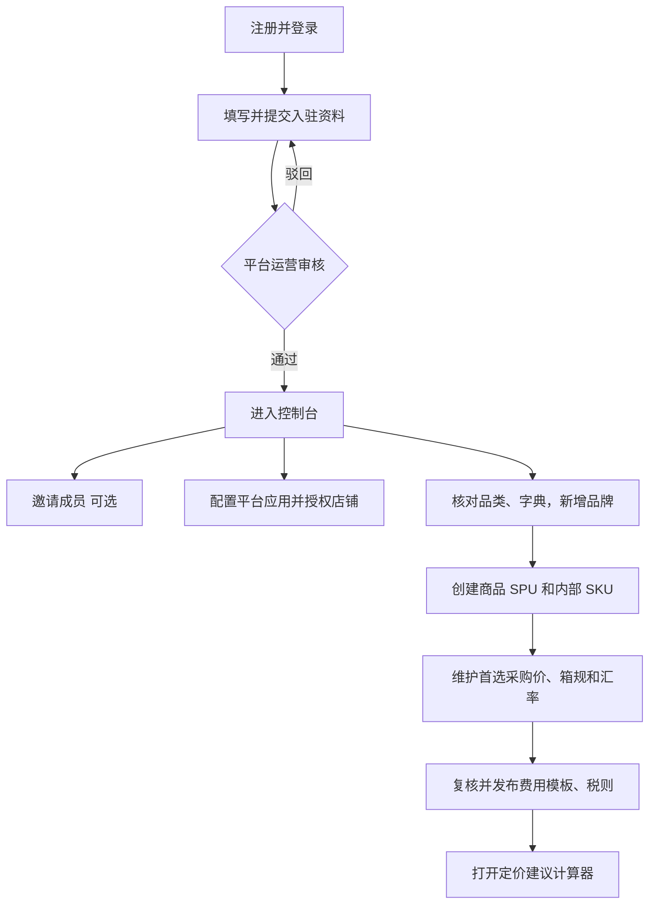

# 从入驻到定价测算：Open Shop 操作指南

本文说明组织从注册、入驻、邀请成员、连接店铺，到创建商品 / SKU 并完成定价测算的实际操作路径。内容依据当前 Open Shop 工作台界面整理，供商家和运营同事对照使用。

阅读对象是日常使用者，不是技术人员。文中的菜单名、按钮名和字段名，均与页面上的中文文案一致。

---

## 1. 注册并登录

1. 打开 Open Shop，在登录页点击「注册」，进入「创建账户」。
2. 填写姓名、邮箱、密码和确认密码。密码至少 8 位，需同时包含大写字母、小写字母和数字。
3. 点击「注册」。成功后会进入入驻向导。
4. 以后可使用邮箱和密码登录；也可以在登录页改用「手机号登录」。

如果您是被现有组织邀请的，不必再创建新组织：收到邀请邮件时，请打开邮件中的链接，在「接受邀请」页设置密码后重新登录；若是按手机号邀请，请先用该手机号登录，再在「选择组织」页的「待确认邀请」中点击「接受邀请」。接受后才会加入组织，不会自动加入。

---

## 2. 填写并提交入驻资料

新账号默认进入「完成主体认证，开始连接店铺」。向导分三步：选择主体 → 填写资料 → 确认提交。

### 2.1 选择主体

1. 选择「企业入驻」或「个人入驻」。
2. 选择国家 / 地区。当前可选：斯里兰卡（LK）、马来西亚（MY）、菲律宾（PH）、泰国（TH）、新加坡（SG）、越南（VN）、印度尼西亚（ID）。
3. 点击「开始填写」。系统会为您创建组织，您将成为组织所有者。

同一账号如果已经属于其他组织，需要先在「选择组织」中选好组织，再开始入驻，不能重复创建。

### 2.2 填写资料

按页面提示上传清晰的 JPG、PNG 或 PDF，单个文件不超过 10MB。

**企业入驻需要：**

- 企业名称、统一社会信用代码 / 注册号（8–32 位）
- 联系人姓名、联系人电话（联系人邮箱选填）
- 国家 / 地区、营业执照
- 法定代表人姓名
- 办理方式：「法定代表人本人办理」或「授权他人办理」
  - 本人办理：法人身份证号，以及法人身份证人像面、国徽面
  - 授权办理：授权人姓名和身份证号、授权书（可下载 PDF 或 DOCX 模板，加盖公章后上传）、授权人身份证正反面

**个人入驻需要：**

- 姓名、身份证号 / 证件号（4–32 位）
- 联系人姓名、联系人电话（邮箱选填）
- 国家 / 地区、证件照片

填写后点击「保存并继续」。资料可先保存为草稿，未提交前仍可回来修改。

### 2.3 确认并提交

1. 核对摘要信息。
2. 勾选「我已阅读并同意《卖家服务协议》和《隐私政策》，并确认所填信息真实有效。」
3. 选择提交后去向：「稍后绑定店铺，先查看审核状态」，或「立即添加并授权店铺」。
4. 由组织所有者点击「提交审核」。提交后资料不可再编辑。

提交成功后，状态变为「审核中」。此时可以进入控制台，也可以打开「入驻申请」状态页查看进度。

---

## 3. 等待平台运营审核

入驻申请不会自动通过，需要由平台运营在管理后台的「入驻审核」中处理。

- **已通过**：会收到「入驻审核已通过」通知，提示现在可以新增并授权店铺。请到「入驻申请」状态页确认。
- **已驳回**：状态页会显示「审核意见」。请按意见修改后，再次勾选协议并提交。
- **已暂停**：请联系平台运营。

审核通过时，系统会把平台已经维护好的基础资料复制到本组织，包括：品类、数据字典、平台基础资料、承运商、导入模板，以及税则和费用模板。其中税则和费用模板会以**草稿**形式复制，**不会自动发布**。之后测算要用它们，还需你们在本组织内复核并发布。

如果某项复制后仍是空的，说明平台目录里还没有可复制的内容。可以在对应页面点击「从平台目录补齐」，或自行新增，也可以联系平台运营先在后台维护目录。

建议等审核通过后再连接店铺、发布费用模板和税则，并开始正式建商品档。审核尚未通过时，部分复制资料可能还没有到位。

---

## 4. 邀请成员（可选）

路径：右上角或侧栏进入「设置」→「组织成员」。

1. 点击「邀请成员」。
2. 至少填写手机号或邮箱（姓名可选）。填写邮箱会发出邀请邮件，受邀人设置密码后需要重新登录。
3. 选择一个或多个业务角色，默认是「运营」。可选角色还包括「业务管理员」「采购」「财务」「只读」「IT」。
4. 点击「创建邀请」。待接受的邀请可以「撤销邀请」。

受邀人必须在「选择组织」的邀请中心确认接受，才会真正加入，不会自动成为成员。

邀请成员、以及下文中的新增店铺、配置平台应用，需要由组织所有者或具备相应管理权限的人员操作。加入组织后，成员一般可以使用大部分日常业务功能（例如创建商品）。页面上虽然可以分配业务角色，但请不要理解为每一项操作都已经按角色严格限制。

---

## 5. 创建店铺并完成平台授权

当前在工作台里新增并授权店铺，支持 **Daraz** 和 **Lazada**。请由组织所有者操作。

### 5.1 先配置平台应用

路径：「设置」→「平台应用配置」。

授权前，需要为对应平台和站点填写 App Key、App Secret。仅组织所有者可以新增、修改或禁用这些配置；Secret 保存后不能再次查看。

如果还没配置，新增店铺时会提示「当前平台与站点尚未配置应用」，可点击「前往配置」。

### 5.2 新增店铺并去授权

路径：「设置」→「店铺连接」，点击「新增店铺」。也可以从入驻状态页进入（当页面出现该按钮时）。

填写：

- 平台：Daraz 或 Lazada
- 站点：随平台变化。例如 Daraz 可选斯里兰卡（LK）、巴基斯坦（PK）、孟加拉国（BD）、尼泊尔（NP）、缅甸（MM）；Lazada 可选马来西亚、菲律宾、泰国、新加坡、越南、印度尼西亚
- 店铺名称（必填）
- 卖家 ID（可选）、店铺分组、履约模式（自营仓发货 / 平台仓 / 混合）
- 币种由站点自动带出，不可手改
- 平台店铺 ID 不必手填，授权成功后会自动写入

点击「创建并去授权」。系统会先保存店铺草稿，再跳转到平台登录授权页。请在平台完成授权并等待跳回。未完成授权前，不会保存平台凭证。

授权结果以店铺详情或列表提示为准，常见情况包括：

- 「授权成功，凭证已加密保存。」
- 「授权成功；该平台店铺已存在，已合并到已有店铺。」（同一组织内已有该平台店铺时）
- 「该平台店铺已被其他租户绑定，已标记异常，请联系平台运营处理。」
- 「授权失败：…」或「租户入驻尚未通过，不能完成店铺授权。」——若出现后一种提示，请等入驻审核通过后再试。

之后可在「店铺连接」中查看授权状态（已授权、待授权 / 连接中、授权失效等），需要时可「去授权」「重新授权」或「解绑授权」。解绑后店铺会保留为草稿，需重新授权才能同步。

最稳妥的做法是：等收到「入驻审核已通过」通知后，再新增并授权店铺。若平台允许在「审核中」绑定，状态页会出现「新增店铺」；具体以状态页为准。

说明：完成「创建商品 / SKU 并做定价测算」本身，并不强制已经授权成功。但要按真实店铺测算，建议先完成授权，并在计算器中选择对应店铺。

---

## 6. 准备主数据，创建商品和内部 SKU

路径在左侧「商品中心」。请按下面顺序准备，只做后续建档和测算真正需要的步骤。

### 6.1 核对品类和字典，新增品牌

1. **品类树**（「商品中心」→「品类树」）  
   审核通过后，通常会带入平台已有的品类。若列表为空，可点击「从平台目录补齐」，或「新增品类」（品类名称、品类编码为必填）。创建商品时必须选择「多级分类」，没有品类无法建 SPU。

2. **基础数据字典**（「设置」→「基础数据字典」）  
   创建 SPU 时必须从字典选择「款式 / 版型」和「材质」；创建内部 SKU 时需要「颜色」「尺码」「包装规格」。审核通过后一般会带入平台已有的字典值。若下拉是空的，请在这里为对应字典「新增标准值」，或联系平台运营补齐目录后再同步。

3. **品牌**（「商品中心」→「品牌」）  
   品牌需要本组织自行维护，不会随入驻自动生成。点击「新增品牌」，填写品牌名称（必填），品牌编码可留空由系统生成，封面可选。保存后请保持为启用状态。没有启用品牌，无法创建商品。

### 6.2 创建商品 SPU

路径：「商品中心」→「商品 SPU / SKU」，点击「新建 SPU」。

必填：内部商品名称、品牌、多级分类、款式 / 版型、材质、商品负责人。

选填：HS 编码、计划上市日期、商品描述。HS 编码建议在测算前补上——计算器按商品或 SKU 上的 HS 匹配税则；未填时不能按税则计税。若该 HS 属于强制认证且会阻断建档，请先保存商品并上传有效证书后再填写。

点击「创建 SPU」。编码由系统自动生成。新商品状态一般为「待确认」，可在详情右上角「编辑主信息」中继续维护。

### 6.3 生成内部 SKU

必须先有 SPU，再生成内部 SKU。可以从「商品 SPU / SKU」详情右上角点「添加 SKU」，也可以到「商品中心」→「内部SKU」点「生成 SKU」。同一款多个规格时，还可以在 SPU 详情使用「批量生成」。

生成时需要：所属 SPU、颜色、尺码、包装规格、净重（g）、状态。条码（EAN/UPC）可后补。长、宽、高和「默认箱规」建议一并填写或绑定——绑定箱规后，定价计算器才能自动计算件体积和单件毛重。

编号由系统按 SPU 加三位流水自动生成。点击「生成 SKU」完成。

### 6.4 为测算准备采购价、箱规和汇率

这三项不是创建 SPU / SKU 的门槛，但缺少时，计算器会把相应金额按 0 估算，并标出缺项。要得到可复核的建议价，请补齐：

1. **供应商和首选采购价**  
   先在「采购中心」→「供应商」点击「新增供应商」。再在「商品中心」→「供应商货号」点击「新增映射」，选择内部 SKU 和供应商，填写厂家款号、采购价、币种、最小起订量、交期、生效日期，并将「是否首选」设为「是」。计算器只使用首选供应商单价。

2. **箱规**  
   在「仓库中心」→「箱规管理」点击「新增箱规」，并在内部 SKU 上绑定「默认箱规」。请同时维护箱毛重，否则从量税可能算不出来。

3. **汇率**  
   路径：「设置」→「汇率配置」，点击添加。请维护测算会用到的币种对，例如采购币（常见为人民币）到销售币、以及美元到成本币。未配置有效汇率时，页面会提示「缺汇率」。

到这里，商品和内部 SKU 已经可以创建，并具备测算所需的主档基础。Seller SKU 映射和刊登不是完成本指南所必需的步骤，可在定价之后再维护。

---

## 7. 发布费用模板和税则，然后做定价测算

### 7.1 发布费用模板

路径：左侧「成本财务」→「费用模板」。

审核通过后，平台默认费用模板会以草稿形式出现。若列表不完整，可点「从平台目录补齐」（只补缺失，仍是草稿）。进入模板详情，核对后再点击「发布此版本」。也可以先「提交审核」，再发布。

**计算器只使用本组织已发布的费用模板，不会使用未发布的草稿，也不会把平台官方费率当成已经实时同步成功。** 页面上的「官方费率同步」会如实说明：若该平台暂无官方费率接口，仍使用本组织费用模板；即便有同步结果，也只会生成待审核草稿，必须发布后才会被计算器使用。

### 7.2 发布税则

在「定价建议计算器」中点击「维护 HS 税则」，进入「HS 税则」页。

审核通过后复制过来的税则也是草稿。可点击「从平台目录补齐」，核对后对相应行点击「发布」。已发布版本不能直接改，需要调整时请新建版本。

计算器只读取本组织已发布的税则。没有对应目的国和 HS 的已发布税则时，税金会按 0 估算，不能当作可上架依据。

### 7.3 打开定价建议计算器

可以从这些入口进入，按钮名称都是「定价建议」，或进入「定价建议计算器」：

- 商品 SPU 详情页右上角「定价建议」
- 内部 SKU 详情页右上角「定价建议」
- 「成本财务」→「成本计算」，再点击「定价建议计算器」

页面标题为「定价建议计算器」。从详情进入时，一般会自动带入该商品下已启用（或第一条）内部 SKU。也可以在页面上方搜索 SKU。

您可以确认或调整：

- SKU、平台（Daraz / Lazada）、站点、店铺（可选）
- 目标毛利 %（可改，默认可来自费用模板）
- 公式（按目的国提供；该目的国没有公式时，会提示「该目的国暂无计税公式」）
- 如需在没有海运柜次时估算运费，可勾选「无柜次时用运价卡估算海运」

打开后会立即计算。页面会显示「数据就绪」进度；若有缺项，会用中文标出，例如缺 HS 编码、缺采购价、缺箱规、缺毛重、缺海运分摊、缺税则、缺费用模板、缺汇率、缺计税公式等。可点击「去补全」。

测算结果通常包括：采购成本、海运分摊、税金合计、到仓成本，以及「建议零售价」「包邮建议价」「预计毛利率」「预计回款」。需要时可「复制建议价」「看明细」，或「保存为草稿」。保存草稿只留下历史记录，**不会改刊登售价，也不会发布到平台**。

若结果带有「估算」标记，或提示必填项未齐，请先补资料再作为上架前参考，并经业务复核。

---

## 开始测算前请确认

- [ ] 入驻已通过，或至少已提交且您已能进入控制台；店铺授权如需进行，已由组织所有者完成
- [ ] 已有启用中的品牌，品类和字典下拉有可选值
- [ ] 已创建商品 SPU 和至少一条内部 SKU，并已填写 HS 编码
- [ ] 该内部 SKU 已设置首选供应商采购价，并已绑定带毛重的默认箱规
- [ ] 「汇率配置」中已有测算所需的有效汇率
- [ ] 「费用模板」中，对应平台和站点的版本已经发布
- [ ] 「HS 税则」中，对应目的国和 HS 的版本已经发布
- [ ] 测算站点是已支持计税的国家（见下方说明）

---

## 目前请注意

- 定价建议是给上架前参考用的，不会自动改刊登售价，也不会自动写回平台。需要把建议价用到刊登时，请在刊登流程中人工确认。库存推送和改价回写是之后在「设置 → 店铺策略」里按店铺开关的功能，完成本指南不必先改这些开关；关闭后系统不会假装已经同步成功。
- 费用和税率以本组织已发布的费用模板、税则为准，不是平台实时官方费率。页面不会显示「已从平台实时同步」。
- 巴基斯坦、孟加拉、尼泊尔、缅甸目前没有完整计税公式。选择这些站点时，税金会按 0 估算，不会套用斯里兰卡税栈，结果只能作为不完整估算。
- 缺采购价、缺税则、缺费用模板或缺少海运分摊时，相应金额可能按 0 估算并标出缺项，这不是测算成功。请按「数据就绪」提示补全后再使用建议价。
- 当前在工作台新增并授权的店铺是 Daraz 与 Lazada。请使用组织自己的平台应用凭据完成真实授权，不要把未授权的草稿店铺当成已经连接成功。

如在入驻审核、店铺绑定或基础目录补齐方面遇到问题，请联系平台运营协助处理。
