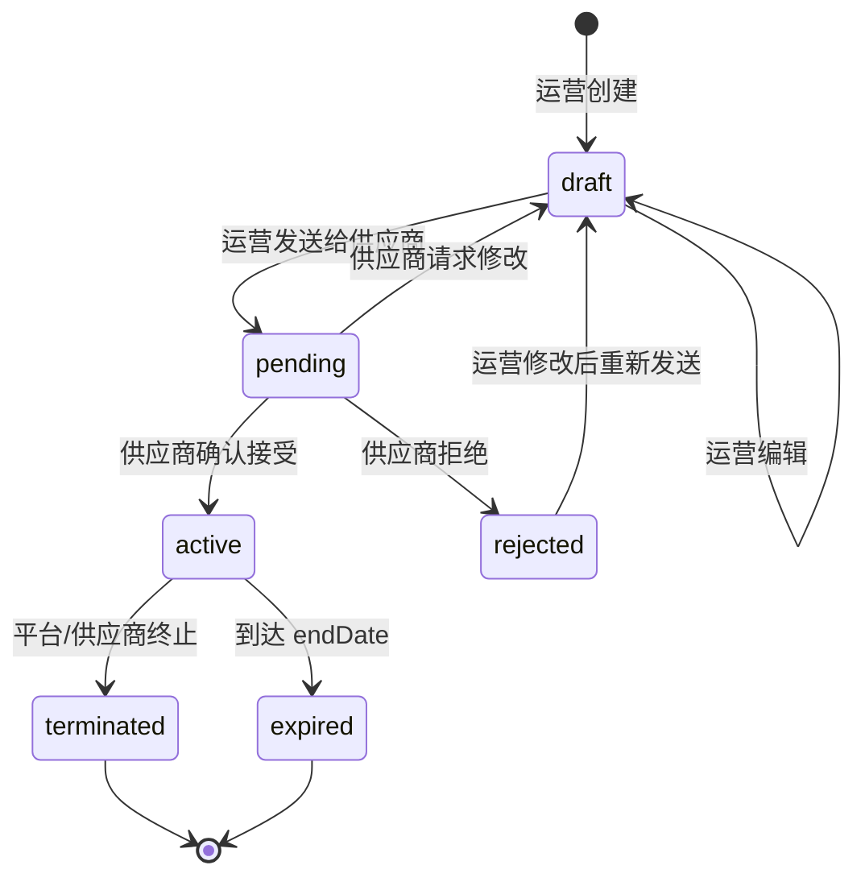
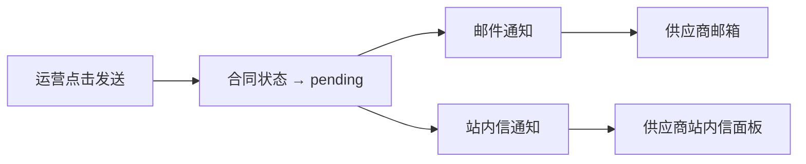
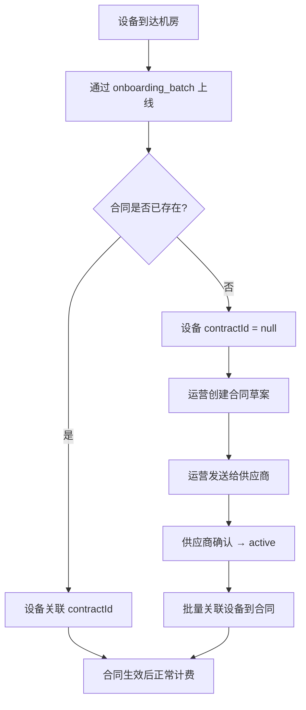

# 供应商合同管理系统 — 设计文档

> **版本**：v2.0  
> **日期**：2026-07-26  
> **状态**：设计阶段（**实现复核 2026-10-06**：`supplier/index.ts` 已存在 `contract` router 与 `supplierContract` 读写，下表缺口需按现网逐条复核后再引用）

**关联文档**：

- [supplier-database.md](../design/supplier-database.md)（供应商主数据 schema）
- [supplier-device-import-schema.md](../design/supplier-device-import-schema.md)（设备导入 schema）
- [supply-chain-leads-design.md](../design/supply-chain-leads-design.md)（供应链线索设计）
- [../../../../docs/business/bare-metal-order-commercialization.md](../../../../docs/business/bare-metal-order-commercialization.md)（裸金属商业化）

---

## 1. 背景与目标

### 1.1 业务背景

平台与 IDC 供应商签署合作协议，约定设备供给、机时定价、合作模式等商务条款。合同由**平台运营人员创建**，包含完整的产能订单（设备数量、卡型、配套费用），通过邮件和站内信通知供应商，供应商在 `apps/supplier` 中确认接受。

当前系统存在以下缺口：

| 现状 | 问题 |
|------|------|
| DB schema 已建 `supplier_contract` + `supplier_contract_capacity_line` | 无 create/update mutation，合同数据仅通过外部导入 |
| `apps/web` 仅有只读合同列表 | 无法创建、编辑合同 |
| `apps/supplier` 无合同页面 | 供应商无法确认/拒绝合同 |
| 合同 `endDate` NOT NULL | 无法表达无固定期限合同（闲时合作默认情形） |
| 设备 `contractId` nullable | 设备可先于合同存在，但无主动关联流程 |
| 无站内信发送 API | `supplier_site_message` 表仅有读操作，无法程序化创建消息 |
| 无合同通知邮件模板 | 邮件系统仅支持密码重置、邮箱验证等模板 |

### 1.2 核心设计原则

| # | 原则 | 说明 |
|---|------|------|
| P1 | **平台主导创建** | 合同由 `apps/web` 运营人员创建，包含产能行、定价、条款等完整信息 |
| P2 | **供应商确认制** | 供应商在 `apps/supplier` 查看合同内容，确认接受或拒绝 |
| P3 | **产能订单必填** | 每份合同必须包含至少一行产能明细（机房 + 卡型 + 设备数 + GPU 数 + 配套费用） |
| P4 | **多渠道通知** | 合同发送给供应商时，同时触发邮件通知 + 站内信通知 |
| P5 | **灵活期限** | 支持无固定期限合同；无 endDate 时默认闲时合作，移除设备需提前 24h 通知 |

### 1.3 目标

| # | 目标 | 说明 |
|---|------|------|
| G1 | **合同全生命周期** | 草稿 → 待确认 → 生效 → 过期/终止，支持状态流转 |
| G2 | **运营创建合同** | 运营在 `apps/web` 创建合同（含产能行、定价），发送给供应商 |
| G3 | **供应商确认** | 供应商在 `apps/supplier` 查看合同、确认接受或拒绝 |
| G4 | **通知触达** | 合同发送时自动触发邮件 + 站内信通知供应商 |
| G5 | **设备关联** | 合同关联的设备在合同详情可见；支持先上线设备后补签合同 |

### 1.4 非目标（本期）

- 不实现合同 PDF 在线签署（仅上传附件）
- 不与飞书审批流程集成
- 不实现合同条款模板管理（`terms` 字段自由文本）
- 不实现供应商自助创建合同（由平台运营创建）

---

## 2. 业务规则

### 2.1 合作模式

| 模式 | 代码 | 说明 |
|------|------|------|
| 整租合作 | `whole_rent` | 供应商按合同约定的设备数量收取固定租金（月租），无论设备是否被使用 |
| 闲时合作 | `idle_time` | 供应商按实际使用卡时计费；无固定期限合同时默认此模式 |

**规则**：
- 合同级 `cooperationMode` 为默认值，产能行可按 DC+卡型覆盖
- 无 endDate 的合同 → 强制 `cooperationMode = idle_time`，移除设备需提前 24h 通知
- 有 endDate 的合同 → 可选 `whole_rent` 或 `idle_time`

### 2.2 合同状态机



**状态含义**：

| 状态 | 代码 | 说明 | 谁操作 |
|------|------|------|--------|
| 草稿 | `draft` | 运营可编辑产能行、定价、条款 | 运营 |
| 待确认 | `pending` | 已发送给供应商，等待确认 | 供应商确认/拒绝 |
| 生效中 | `active` | 供应商已确认，合同生效 | — |
| 已拒绝 | `rejected` | 供应商拒绝了合同 | 可重新编辑后发送 |
| 已过期 | `expired` | 到达 endDate，自动过期 | 系统 |
| 已终止 | `terminated` | 手动终止 | 运营/供应商 |

**状态流转规则**：

| 当前状态 | 目标状态 | 触发动作 | 前置条件 |
|----------|----------|----------|----------|
| — | draft | 运营创建合同 | 选择供应商、填写产能行 |
| draft | pending | 运营点击「发送给供应商」 | 至少 1 行产能行 |
| pending | active | 供应商点击「确认接受」 | — |
| pending | draft | 供应商点击「请求修改」 | 填写修改意见 |
| pending | rejected | 供应商点击「拒绝」 | 填写拒绝原因 |
| rejected | draft | 运营编辑后重新发送 | 修订内容 |
| active | expired | 系统定时检查 | 到达 endDate |
| active | terminated | 运营/供应商终止 | 填写终止原因 |

### 2.3 产能订单（必填）

合同必须包含**至少一行产能明细**，每行定义一个机房+卡型的设备供给：

| 字段 | 说明 | 必填 |
|------|------|------|
| dataCenterId | 机房 | 是 |
| gpuCardTypeId | GPU 卡型 | 是 |
| cooperationType | 合作模式（整租/闲时） | 是 |
| deviceQuantity | 设备数量 | 是 |
| gpuQuantity | GPU 总卡数 | 是 |
| gpuCountPerDevice | 每设备 GPU 数 | 否（默认从卡型推导） |
| startDate | 产能开始日期 | 是 |
| endDate | 产能结束日期 | 是 |

**配套费用**（合同级 JSONB `infraPricing`）：

| 费用项 | 说明 |
|--------|------|
| bandwidth | 带宽费用（单价 × 总带宽） |
| publicIp | 公网 IP 费用（单价 × 总 IP 数） |
| storage | 存储费用（单价 × 总容量） |
| networkFee | 网络月租 |
| mgmtFee | 管控节点月租 |

### 2.4 通知机制

合同发送给供应商时，系统自动触发两种通知：



**邮件通知**：
- 触发时机：运营将合同状态从 `draft` 改为 `pending`
- 收件人：供应商组织的管理员邮箱
- 内容：合同编号、供应商名称、产能摘要、确认链接
- 模板：`contractForSupplierConfirmation`（新增）

**站内信通知**：
- 触发时机：同邮件
- 目标表：`supplier_site_message`
- 关联供应商组织：`supplierOrgId`
- category: `contract`
- links: 包含跳转到合同详情页的链接

### 2.5 预签设备流程



设备上线时：
1. 如果合同已存在且 `active`，`onboarding_batch` 创建时直接关联 `contractId`
2. 如果合同不存在或未生效，`contractId` 保持 null
3. 合同激活后，运营可手动或批量将设备关联到合同

---

## 3. Schema 变更

### 3.1 `supplier_contract` 表修改

```typescript
// packages/db/src/supply-schema.ts — supplierContract 表

// 变更 1: endDate 改为 nullable（支持无固定期限合同）
endDate: date("end_date"),  // 移除 .notNull()

// 变更 2: 新增供应商确认状态
supplierConfirmationStatus: varchar("supplier_confirmation_status", { length: 32 })
  .notNull().default("none"),
// none | pending | confirmed | rejected | modification_requested

// 变更 3: 新增供应商确认相关字段
confirmedBySupplierOrgId: text("confirmed_by_supplier_org_id")
  .references(() => organization.id, { onDelete: "set null" }),
confirmedAt: timestamp("confirmed_at", { withTimezone: true }),
rejectionReason: text("rejection_reason"),
modificationNote: text("modification_note"),
```

**状态字段映射**：

| status | supplierConfirmationStatus | 含义 |
|--------|---------------------------|------|
| draft | none | 运营创建的草稿，未发送 |
| pending | pending | 已发送给供应商，等待确认 |
| active | confirmed | 供应商已确认 |
| rejected | rejected | 供应商已拒绝 |
| expired | - | 自动过期 |
| terminated | - | 手动终止 |

### 3.2 `supplier_contract` 表新增 JSONB 配置

```typescript
infraPricing: jsonb("infra_pricing").$type<{
  bandwidth?: { pricePerMbps?: number; totalMbps?: number }
  publicIp?: { pricePerIp?: number; totalIps?: number }
  storage?: { pricePerGb?: number; totalGb?: number }
  networkFee?: number
  mgmtFee?: number
}>(),
```

### 3.3 无需新增表

| 需求 | 现有表 | 说明 |
|------|--------|------|
| 合同主表 | `supplier_contract` | 已有 contractNo, type, status, pricingMode, cooperationMode 等 |
| 产能明细 | `supplier_contract_capacity_line` | 已有 contractId, dataCenterId, gpuCardTypeId, deviceQuantity, gpuQuantity |
| 阶梯定价 | `supplier_pricing_tier` | 已有 contractId, tierOrder, dealUnitPricePerHour 等 |
| 接入条件 | `access_condition_sheet` | 已有 contractId, gpuNetworkCpuTerms JSONB |
| 设备关联 | `supplier_device.contractId` | 已有 nullable FK |
| 基础设施 | `supplier_datacenter_infrastructure` | 已有 bandwidthConfig, networkConfig, storageConfig |
| 供应商站内信 | `supplier_site_message` | 已有 supplierOrgId, title, content, category, links, read |

### 3.4 迁移步骤

```bash
pnpm --filter @workspace/db run db:generate
```

迁移文件会自动生成，**不要手动编辑**。

---

## 4. 后端设计

### 4.1 文件结构

#### apps/web（运营平台）

```text
apps/web/src/lib/server/
├── routers/supplier/
│   ├── contract-schemas.ts          # 新增：Zod input schemas
│   └── index.ts                     # 修改：新增 contract 子路由
├── dataaccess/supplier/
│   ├── contract.ts                  # 新增：合同 CRUD dataaccess
│   └── contract-notifications.ts    # 新增：通知发送（邮件+站内信）
└── mappers/supply.ts                # 修改：增强 mapSupplierContractRow
```

#### apps/supplier（供应商门户）

```text
apps/supplier/src/lib/server/
├── routers/
│   ├── contract.ts                  # 新增：合同确认路由
│   └── index.ts                     # 修改：注册 contract 路由
└── dataaccess/
    └── contract.ts                  # 新增：合同查询 + 确认 dataaccess
```

#### packages/email（邮件模板）

```text
packages/email/src/mail/templates/
└── contract-for-supplier-confirmation.tsx  # 新增
packages/email/src/mail/types.ts            # 修改：注册模板
```

### 4.2 邮件模板

```typescript
// packages/email/src/mail/templates/contract-for-supplier-confirmation.tsx

import { Text, Button, Section } from '@react-email/components'
import { EmailLayout } from '../components/email-layout'

interface ContractForSupplierConfirmationProps {
  supplierName: string
  contractNo: string
  contractUrl: string
  capacitySummary: string  // 如 "2 个机房，共 10 台设备，32 张 H100"
  totalAmount?: string     // 如 "¥120,000/月"（整租模式）
}

export default function ContractForSupplierConfirmation({
  supplierName, contractNo, contractUrl, capacitySummary, totalAmount,
}: ContractForSupplierConfirmationProps) {
  return (
    <EmailLayout preview={`新合同待确认 - ${contractNo}`}>
      <Section>
        <Text>尊敬的 {supplierName}：</Text>
        <Text>平台已创建一份新的合作协议（合同编号：{contractNo}），请您确认。</Text>
        <Text>产能摘要：{capacitySummary}</Text>
        {totalAmount && <Text>合同金额：{totalAmount}</Text>}
        <Button href={contractUrl} style={buttonStyle}>查看并确认合同</Button>
        <Text style={{ fontSize: 12, color: '#666' }}>如有任何疑问，请联系平台运营人员。</Text>
      </Section>
    </EmailLayout>
  )
}

const buttonStyle = {
  backgroundColor: '#0070f3', color: '#ffffff', padding: '12px 24px',
  borderRadius: '6px', textDecoration: 'none', fontWeight: 'bold' as const,
}
```

**模板注册**（`packages/email/src/mail/types.ts`）：

```typescript
contractForSupplierConfirmation: {
  component: ContractForSupplierConfirmation
  // props: ContractForSupplierConfirmationProps
}
```

### 4.3 站内信发送 + 邮件通知

```typescript
// apps/web/src/lib/server/dataaccess/supplier/contract-notifications.ts

import { db } from '@/lib/db'
import { supplierSiteMessage, supplier } from '@workspace/db/schema'
import { eq } from 'drizzle-orm'
import { sendEmail } from '@/lib/mail'
import ContractForSupplierConfirmation from '@workspace/email/mail/templates/contract-for-supplier-confirmation'

function newId() { return crypto.randomUUID() }

interface SendContractToSupplierParams {
  contractId: string
  contractNo: string
  supplierId: string
  capacitySummary: string
  totalAmount?: string
  contractUrl: string
  senderStaffId: string
}

export async function sendContractToSupplier(params: SendContractToSupplierParams) {
  // 1. 查询供应商信息
  const [supplierRow] = await db.select().from(supplier)
    .where(eq(supplier.id, params.supplierId)).limit(1)
  if (!supplierRow) throw new Error('供应商不存在')

  // 2. 获取供应商管理员邮箱
  const adminEmail = await getSupplierAdminEmail(params.supplierId)

  // 3. 发送邮件通知（fire-and-forget）
  if (adminEmail) {
    sendEmail({
      to: adminEmail,
      subject: `新合同待确认 - ${params.contractNo}`,
      template: ContractForSupplierConfirmation,
      props: {
        supplierName: supplierRow.shortName,
        contractNo: params.contractNo,
        contractUrl: params.contractUrl,
        capacitySummary: params.capacitySummary,
        totalAmount: params.totalAmount,
      },
    }).catch(err => console.error('Failed to send contract email:', err))
  }

  // 4. 创建站内信通知
  await db.insert(supplierSiteMessage).values({
    id: newId(),
    supplierOrgId: supplierRow.organizationId,
    title: `新合同待确认 - ${params.contractNo}`,
    summary: `平台已创建合作协议 ${params.contractNo}，包含 ${params.capacitySummary}，请确认。`,
    content: `## 新合同通知\n\n合同编号：**${params.contractNo}**\n\n产能摘要：${params.capacitySummary}\n${params.totalAmount ? `\n合同金额：${params.totalAmount}` : ''}\n\n请前往合同管理页面查看并确认。`,
    category: 'contract',
    links: [{ label: '查看合同', href: params.contractUrl }],
  })
}

async function getSupplierAdminEmail(supplierId: string): Promise<string | null> {
  const [row] = await db.select({ email: supplier.contactEmail })
    .from(supplier).where(eq(supplier.id, supplierId)).limit(1)
  return row?.email ?? null
}
```

### 4.4 tRPC 路由设计

#### apps/web — `supplier.contract` 子路由

**Schema 定义**（`contract-schemas.ts`）：

```typescript
import { z } from 'zod'

const capacityLineSchema = z.object({
  id: z.string().optional(),
  dataCenterId: z.string().min(1),
  gpuCardTypeId: z.string().min(1),
  cooperationType: z.enum(['idle_time', 'whole_rent']),
  deviceQuantity: z.number().int().min(1),
  gpuQuantity: z.number().int().min(1),
  gpuCountPerDevice: z.number().int().min(1).optional(),
  startDate: z.string().min(1),
  endDate: z.string().min(1),
  lineStatus: z.enum(['active', 'paused', 'terminated']).optional(),
})

export const contractCreateSchema = z.object({
  supplierId: z.string().min(1),
  type: z.enum(['cooperation', 'supplement', 'renewal']),
  pricingMode: z.enum(['card_time', 'revenue_share', 'tiered_card_time', 'tiered_revenue_share']),
  cooperationMode: z.enum(['idle_time', 'whole_rent']),
  startDate: z.string().min(1),
  endDate: z.string().optional(),
  terms: z.string().optional(),
  unitPricePerHour: z.string().optional(),
  revenueSharePercent: z.string().optional(),
  minCommitHours: z.string().optional(),
  settlementCycle: z.enum(['monthly', 'quarterly']).optional(),
  contractFileUri: z.string().url().optional(),
  signerName: z.string().optional(),
  infraPricing: z.object({
    bandwidth: z.object({ pricePerMbps: z.number(), totalMbps: z.number() }).optional(),
    publicIp: z.object({ pricePerIp: z.number(), totalIps: z.number() }).optional(),
    storage: z.object({ pricePerGb: z.number(), totalGb: z.number() }).optional(),
    networkFee: z.number().optional(),
    mgmtFee: z.number().optional(),
  }).optional(),
  capacityLines: z.array(capacityLineSchema).min(1, '合同必须包含至少一行产能明细'),
  pricingTiers: z.array(z.object({
    tierOrder: z.number().int().min(1),
    dealUnitPricePerHour: z.string().optional(),
    revenueSharePercent: z.string().optional(),
    dealToListRatioMin: z.string().optional(),
    dealToListRatioMax: z.string().optional(),
    remark: z.string().optional(),
  })).optional(),
})

export const contractUpdateSchema = contractCreateSchema.partial().extend({
  contractId: z.string().min(1),
  capacityLines: z.array(capacityLineSchema).min(1).optional(),
})

export const contractSendToSupplierSchema = z.object({ contractId: z.string().min(1) })
export const contractTerminateSchema = z.object({ contractId: z.string().min(1), reason: z.string().min(1) })
export const contractLinkDevicesSchema = z.object({ contractId: z.string().min(1), deviceIds: z.array(z.string().min(1)).min(1) })
export const contractListSchema = z.object({
  supplierId: z.string().optional(), status: z.string().optional(), type: z.string().optional(),
  search: z.string().optional(), page: z.number().int().min(1).default(1),
  pageSize: z.number().int().min(1).max(100).default(20),
})
export const capacityLineUpsertSchema = z.object({
  contractId: z.string().min(1),
  lines: z.array(capacityLineSchema).min(1, '至少保留一行产能明细'),
})
```

**路由结构**：

```typescript
contract: createTRPCRouter({
  list: supplyProcedure.input(contractListSchema).query(({ input }) => contractDataAccess.list(input)),
  getById: supplyProcedure.input(z.object({ contractId: z.string().min(1) }))
    .query(({ input }) => contractDataAccess.getById(input.contractId)),

  // 创建合同草案（capacityLines 必填）
  create: supplyProcedure.input(contractCreateSchema)
    .mutation(({ input, ctx }) => contractDataAccess.create({ ...input, createdByStaffId: ctx.user.id })),

  // 更新合同（仅 draft 状态可编辑）
  update: supplyProcedure.input(contractUpdateSchema)
    .mutation(({ input, ctx }) => contractDataAccess.update({ ...input, updatedByStaffId: ctx.user.id })),

  // 发送给供应商（draft → pending，触发邮件+站内信通知）
  sendToSupplier: supplyProcedure.input(contractSendToSupplierSchema)
    .mutation(({ input, ctx }) => contractDataAccess.sendToSupplier({ ...input, sentByStaffId: ctx.user.id })),

  // 终止合同
  terminate: supplyProcedure.input(contractTerminateSchema)
    .mutation(({ input, ctx }) => contractDataAccess.terminate({ ...input, terminatedByStaffId: ctx.user.id })),

  // 批量关联设备到合同
  linkDevices: supplyProcedure.input(contractLinkDevicesSchema)
    .mutation(({ input }) => contractDataAccess.linkDevices(input)),

  // 产能行 CRUD
  upsertCapacityLines: supplyProcedure.input(capacityLineUpsertSchema)
    .mutation(({ input }) => contractDataAccess.upsertCapacityLines(input)),

  // 获取合同关联设备列表
  listLinkedDevices: supplyProcedure.input(z.object({
    contractId: z.string().min(1), page: z.number().int().min(1).default(1),
    pageSize: z.number().int().min(1).max(100).default(20),
  })).query(({ input }) => contractDataAccess.listLinkedDevices(input)),
})
```

#### apps/supplier — `contract` 路由

```typescript
// apps/supplier/src/lib/server/routers/contract.ts

import { router, supplierProcedure } from '../trpc'
import { z } from 'zod'

export const contractRouter = router({
  // 供应商查看自己的合同列表
  list: supplierProcedure
    .input(z.object({ status: z.string().optional(), page: z.number().int().min(1).default(1), pageSize: z.number().int().min(1).max(100).default(20) }))
    .query(({ input, ctx }) => listSupplierContracts(ctx.supplierOrgId, input)),

  // 供应商查看合同详情（含产能行、定价、基础设施费用）
  getById: supplierProcedure
    .input(z.object({ contractId: z.string().min(1) }))
    .query(({ input, ctx }) => getSupplierContractDetail(ctx.supplierOrgId, input.contractId)),

  // 供应商确认合同（pending → active）
  confirm: supplierProcedure
    .input(z.object({ contractId: z.string().min(1) }))
    .mutation(({ input, ctx }) => confirmSupplierContract(ctx.supplierOrgId, input.contractId)),

  // 供应商请求修改（pending → draft）
  requestModification: supplierProcedure
    .input(z.object({ contractId: z.string().min(1), modificationNote: z.string().min(1, '请填写修改意见') }))
    .mutation(({ input, ctx }) => requestSupplierContractModification(ctx.supplierOrgId, input.contractId, input.modificationNote)),

  // 供应商拒绝合同（pending → rejected）
  reject: supplierProcedure
    .input(z.object({ contractId: z.string().min(1), rejectionReason: z.string().min(1, '请填写拒绝原因') }))
    .mutation(({ input, ctx }) => rejectSupplierContract(ctx.supplierOrgId, input.contractId, input.rejectionReason)),

  // 供应商上传合同附件
  uploadFile: supplierProcedure
    .input(z.object({ contractId: z.string().min(1), fileBase64: z.string().min(1), fileName: z.string().min(1) }))
    .mutation(({ input, ctx }) => uploadContractFile(ctx.supplierOrgId, input)),
})
```

### 4.5 dataaccess 层设计

#### apps/web — `contract.ts`

```typescript
// apps/web/src/lib/server/dataaccess/supplier/contract.ts

import { db } from '@/lib/db'
import {
  supplierContract, supplierContractCapacityLine, supplierPricingTier,
  accessConditionSheet, supplierDevice, supplier, dataCenter, gpuCardType,
} from '@workspace/db/schema'
import { and, eq, count, sql, inArray, or, ilike } from 'drizzle-orm'
import { sendContractToSupplier } from './contract-notifications'

function newId() { return crypto.randomUUID() }

function generateContractNo(): string {
  const now = new Date()
  const ts = [now.getFullYear(), String(now.getMonth()+1).padStart(2,'0'), String(now.getDate()).padStart(2,'0')].join('')
  const rand = Math.floor(Math.random() * 10000).toString().padStart(4, '0')
  return `SC${ts}${rand}`
}

function buildCapacitySummary(lines: any[]): string {
  const totalDevices = lines.reduce((s, l) => s + (l.deviceQuantity ?? 0), 0)
  const totalGpus = lines.reduce((s, l) => s + (l.gpuQuantity ?? 0), 0)
  const dcCount = new Set(lines.map(l => l.dataCenterId)).size
  return `${dcCount} 个机房，共 ${totalDevices} 台设备，${totalGpus} 张 GPU`
}

export const contractDataAccess = {
  async list(input) {
    const page = Math.max(1, input.page ?? 1)
    const pageSize = Math.min(100, Math.max(1, input.pageSize ?? 20))
    const conditions: any[] = []

    if (input.supplierId) conditions.push(eq(supplierContract.supplierId, input.supplierId))
    if (input.status) conditions.push(eq(supplierContract.status, input.status))
    if (input.type) conditions.push(eq(supplierContract.type, input.type))
    if (input.search) {
      const q = `%${input.search}%`
      conditions.push(or(ilike(supplierContract.contractNo, q), ilike(supplier.shortName, q))!)
    }

    const where = conditions.length ? and(...conditions) : undefined
    const offset = (page - 1) * pageSize

    const [totalRow] = await db.select({ total: count() }).from(supplierContract)
      .innerJoin(supplier, eq(supplierContract.supplierId, supplier.id)).where(where)

    const total = Number(totalRow?.total ?? 0)

    const rows = await db.select({
      contract: supplierContract, supplierName: supplier.shortName,
    }).from(supplierContract)
      .innerJoin(supplier, eq(supplierContract.supplierId, supplier.id))
      .where(where).orderBy(sql`${supplierContract.createdAt} DESC`)
      .limit(pageSize).offset(offset)

    const contractIds = rows.map(r => r.contract.id)
    const capacityCounts = contractIds.length === 0 ? [] : await db
      .select({ contractId: supplierContractCapacityLine.contractId, total: count() })
      .from(supplierContractCapacityLine)
      .where(inArray(supplierContractCapacityLine.contractId, contractIds))
      .groupBy(supplierContractCapacityLine.contractId)

    const countMap = new Map(capacityCounts.map(r => [r.contractId, Number(r.total)]))

    return {
      items: rows.map(r => ({
        ...r.contract,
        supplierName: r.supplierName,
        capacityLineCount: countMap.get(r.contract.id) ?? 0,
      })),
      total, page, pageSize,
    }
  },

  async getById(contractId: string) {
    const [row] = await db.select({ contract: supplierContract, supplierName: supplier.shortName })
      .from(supplierContract)
      .innerJoin(supplier, eq(supplierContract.supplierId, supplier.id))
      .where(eq(supplierContract.id, contractId)).limit(1)

    if (!row) return null

    const [capacityLines, pricingTiers, linkedDeviceCount, accessCondition] = await Promise.all([
      db.select().from(supplierContractCapacityLine).where(eq(supplierContractCapacityLine.contractId, contractId)).orderBy(supplierContractCapacityLine.startDate),
      db.select().from(supplierPricingTier).where(eq(supplierPricingTier.contractId, contractId)).orderBy(supplierPricingTier.tierOrder),
      db.select({ total: count() }).from(supplierDevice).where(eq(supplierDevice.contractId, contractId)),
      db.select().from(accessConditionSheet).where(and(eq(accessConditionSheet.contractId, contractId), eq(accessConditionSheet.isCurrent, true))).limit(1),
    ])

    return {
      ...row.contract, supplierName: row.supplierName,
      capacityLines, pricingTiers,
      linkedDeviceCount: Number(linkedDeviceCount[0]?.total ?? 0),
      accessCondition: accessCondition[0] ?? null,
    }
  },

  async create(input) {
    const id = newId()
    const contractNo = generateContractNo()

    return await db.transaction(async (tx) => {
      const [supplierRow] = await tx.select().from(supplier).where(eq(supplier.id, input.supplierId)).limit(1)
      if (!supplierRow) throw new Error('供应商不存在')

      const cooperationMode = !input.endDate ? 'idle_time' : input.cooperationMode

      await tx.insert(supplierContract).values({
        id, supplierId: input.supplierId, contractNo, type: input.type,
        status: 'draft', supplierConfirmationStatus: 'none',
        pricingMode: input.pricingMode, cooperationMode,
        unitPricePerHour: input.unitPricePerHour,
        revenueSharePercent: input.revenueSharePercent,
        minCommitHours: input.minCommitHours, settlementCycle: input.settlementCycle,
        startDate: input.startDate, endDate: input.endDate ?? input.startDate,
        terms: input.terms, contractFileUri: input.contractFileUri,
        signerName: input.signerName, infraPricing: input.infraPricing,
      })

      if (input.capacityLines?.length) {
        await tx.insert(supplierContractCapacityLine).values(
          input.capacityLines.map(line => ({
            id: newId(), contractId: id, dataCenterId: line.dataCenterId,
            gpuCardTypeId: line.gpuCardTypeId, cooperationType: line.cooperationType,
            deviceQuantity: line.deviceQuantity, gpuQuantity: line.gpuQuantity,
            gpuCountPerDevice: line.gpuCountPerDevice,
            startDate: line.startDate, endDate: line.endDate, lineStatus: 'active',
          }))
        )
      }

      if (input.pricingTiers?.length) {
        await tx.insert(supplierPricingTier).values(
          input.pricingTiers.map(tier => ({
            id: newId(), contractId: id, tierOrder: tier.tierOrder,
            dealUnitPricePerHour: tier.dealUnitPricePerHour,
            revenueSharePercent: tier.revenueSharePercent,
            dealToListRatioMin: tier.dealToListRatioMin,
            dealToListRatioMax: tier.dealToListRatioMax, remark: tier.remark,
          }))
        )
      }

      return { id, contractNo }
    })
  },

  async update(input) {
    const [existing] = await db.select().from(supplierContract)
      .where(eq(supplierContract.id, input.contractId)).limit(1)

    if (!existing) throw new Error('合同不存在')
    if (!['draft', 'rejected'].includes(existing.status)) {
      throw new Error('仅草稿或被驳回的合同可编辑')
    }

    await db.update(supplierContract).set({
      type: input.type ?? existing.type,
      pricingMode: input.pricingMode ?? existing.pricingMode,
      cooperationMode: input.cooperationMode ?? existing.cooperationMode,
      unitPricePerHour: input.unitPricePerHour ?? existing.unitPricePerHour,
      revenueSharePercent: input.revenueSharePercent ?? existing.revenueSharePercent,
      minCommitHours: input.minCommitHours ?? existing.minCommitHours,
      settlementCycle: input.settlementCycle ?? existing.settlementCycle,
      startDate: input.startDate ?? existing.startDate,
      endDate: input.endDate ?? existing.endDate,
      terms: input.terms ?? existing.terms,
      contractFileUri: input.contractFileUri ?? existing.contractFileUri,
      signerName: input.signerName ?? existing.signerName,
      infraPricing: input.infraPricing ?? existing.infraPricing,
      status: 'draft', supplierConfirmationStatus: 'none',
    }).where(eq(supplierContract.id, input.contractId))

    // 替换产能行
    if (input.capacityLines) {
      await db.delete(supplierContractCapacityLine)
        .where(eq(supplierContractCapacityLine.contractId, input.contractId))
      await db.insert(supplierContractCapacityLine).values(
        input.capacityLines.map(line => ({
          id: line.id ?? newId(), contractId: input.contractId,
          dataCenterId: line.dataCenterId, gpuCardTypeId: line.gpuCardTypeId,
          cooperationType: line.cooperationType, deviceQuantity: line.deviceQuantity,
          gpuQuantity: line.gpuQuantity, gpuCountPerDevice: line.gpuCountPerDevice,
          startDate: line.startDate, endDate: line.endDate, lineStatus: line.lineStatus ?? 'active',
        }))
      )
    }

    return { ok: true }
  },

  // 核心：发送给供应商（draft → pending + 通知）
  async sendToSupplier(input: { contractId: string; sentByStaffId: string }) {
    const [existing] = await db.select().from(supplierContract)
      .where(eq(supplierContract.id, input.contractId)).limit(1)

    if (!existing) throw new Error('合同不存在')
    if (!['draft', 'rejected'].includes(existing.status)) {
      throw new Error('仅草稿或被拒绝的合同可发送')
    }

    // 验证至少有一行产能明细
    const [lineCount] = await db.select({ total: count() })
      .from(supplierContractCapacityLine)
      .where(eq(supplierContractCapacityLine.contractId, input.contractId))
    if (Number(lineCount.total) === 0) throw new Error('合同必须包含至少一行产能明细')

    // 更新状态
    await db.update(supplierContract).set({
      status: 'pending', supplierConfirmationStatus: 'pending',
    }).where(eq(supplierContract.id, input.contractId))

    // 构建通知参数并发送
    const capacityLines = await db.select().from(supplierContractCapacityLine)
      .where(eq(supplierContractCapacityLine.contractId, input.contractId))

    const contractUrl = `${process.env.SUPPLIER_URL}/console/contracts/${input.contractId}`

    // fire-and-forget 通知
    sendContractToSupplier({
      contractId: input.contractId,
      contractNo: existing.contractNo,
      supplierId: existing.supplierId,
      capacitySummary: buildCapacitySummary(capacityLines),
      contractUrl,
      senderStaffId: input.sentByStaffId,
    }).catch(err => console.error('sendContractToSupplier failed:', err))

    return { ok: true }
  },

  async terminate(input) {
    const [existing] = await db.select().from(supplierContract)
      .where(eq(supplierContract.id, input.contractId)).limit(1)
    if (!existing) throw new Error('合同不存在')
    if (existing.status !== 'active') throw new Error('仅生效中的合同可终止')

    await db.transaction(async (tx) => {
      await tx.update(supplierContract).set({ status: 'terminated' })
        .where(eq(supplierContract.id, input.contractId))
      await tx.update(supplierContractCapacityLine).set({ lineStatus: 'terminated' })
        .where(eq(supplierContractCapacityLine.contractId, input.contractId))
    })

    return { ok: true }
  },

  async linkDevices(input) {
    const [existing] = await db.select().from(supplierContract)
      .where(eq(supplierContract.id, input.contractId)).limit(1)
    if (!existing) throw new Error('合同不存在')
    if (existing.status !== 'active') throw new Error('仅生效中的合同可关联设备')

    await db.update(supplierDevice).set({ contractId: input.contractId })
      .where(inArray(supplierDevice.id, input.deviceIds))

    return { ok: true, linked: input.deviceIds.length }
  },

  async upsertCapacityLines(input) {
    const [existing] = await db.select().from(supplierContract)
      .where(eq(supplierContract.id, input.contractId)).limit(1)
    if (!existing) throw new Error('合同不存在')
    if (!['draft', 'rejected'].includes(existing.status)) {
      throw new Error('仅草稿或被拒绝的合同可编辑产能行')
    }

    await db.transaction(async (tx) => {
      await tx.delete(supplierContractCapacityLine)
        .where(eq(supplierContractCapacityLine.contractId, input.contractId))
      await tx.insert(supplierContractCapacityLine).values(
        input.lines.map(line => ({
          id: line.id ?? newId(), contractId: input.contractId,
          dataCenterId: line.dataCenterId, gpuCardTypeId: line.gpuCardTypeId,
          cooperationType: line.cooperationType, deviceQuantity: line.deviceQuantity,
          gpuQuantity: line.gpuQuantity, gpuCountPerDevice: line.gpuCountPerDevice,
          startDate: line.startDate, endDate: line.endDate, lineStatus: line.lineStatus ?? 'active',
        }))
      )
    })

    return { ok: true }
  },

  async listLinkedDevices(input) {
    const page = Math.max(1, input.page ?? 1)
    const pageSize = Math.min(100, Math.max(1, input.pageSize ?? 20))
    const offset = (page - 1) * pageSize
    const where = eq(supplierDevice.contractId, input.contractId)

    const [totalRow] = await db.select({ total: count() }).from(supplierDevice).where(where)
    const total = Number(totalRow?.total ?? 0)

    const rows = await db.select({
      id: supplierDevice.id, sn: supplierDevice.sn,
      internalIp: supplierDevice.internalIp, externalIp: supplierDevice.externalIp,
      gpuCount: supplierDevice.gpuCount, cooperationType: supplierDevice.cooperationType,
      opsStatus: supplierDevice.opsStatus, lifecycleStatus: supplierDevice.lifecycleStatus,
      dataCenterName: dataCenter.name, cardTypeName: gpuCardType.name,
    }).from(supplierDevice)
      .leftJoin(dataCenter, eq(supplierDevice.dataCenterId, dataCenter.id))
      .leftJoin(gpuCardType, eq(supplierDevice.gpuCardTypeId, gpuCardType.id))
      .where(where).orderBy(sql`${supplierDevice.createdAt} DESC`)
      .limit(pageSize).offset(offset)

    return { items: rows, total, page, pageSize }
  },
}
```

#### apps/supplier — `contract.ts`

```typescript
// apps/supplier/src/lib/server/dataaccess/contract.ts

import { db } from '@/lib/db'
import {
  supplierContract, supplierContractCapacityLine, supplierPricingTier,
  supplierDevice, supplier, dataCenter, gpuCardType,
} from '@workspace/db/schema'
import { and, eq, count, sql } from 'drizzle-orm'

function newId() { return crypto.randomUUID() }

async function resolveSupplierId(orgId: string): Promise<string | null> {
  const [row] = await db.select({ id: supplier.id }).from(supplier)
    .where(eq(supplier.organizationId, orgId)).limit(1)
  return row?.id ?? null
}

export async function listSupplierContracts(orgId: string, input: { status?: string; page: number; pageSize: number }) {
  const supplierId = await resolveSupplierId(orgId)
  if (!supplierId) throw new Error('供应商不存在')

  const page = Math.max(1, input.page)
  const pageSize = Math.min(100, Math.max(1, input.pageSize))
  const offset = (page - 1) * pageSize
  const conditions = [eq(supplierContract.supplierId, supplierId)]
  if (input.status) conditions.push(eq(supplierContract.status, input.status))

  const where = and(...conditions)
  const [totalRow] = await db.select({ total: count() }).from(supplierContract).where(where)
  const total = Number(totalRow?.total ?? 0)

  const rows = await db.select().from(supplierContract).where(where)
    .orderBy(sql`${supplierContract.createdAt} DESC`).limit(pageSize).offset(offset)

  return { items: rows, total, page, pageSize }
}

export async function getSupplierContractDetail(orgId: string, contractId: string) {
  const supplierId = await resolveSupplierId(orgId)
  if (!supplierId) throw new Error('供应商不存在')

  const [row] = await db.select().from(supplierContract).where(and(
    eq(supplierContract.id, contractId), eq(supplierContract.supplierId, supplierId),
  )).limit(1)

  if (!row) throw new Error('合同不存在')

  const [capacityLines, pricingTiers, linkedDeviceCount] = await Promise.all([
    db.select().from(supplierContractCapacityLine).where(eq(supplierContractCapacityLine.contractId, contractId)).orderBy(supplierContractCapacityLine.startDate),
    db.select().from(supplierPricingTier).where(eq(supplierPricingTier.contractId, contractId)).orderBy(supplierPricingTier.tierOrder),
    db.select({ total: count() }).from(supplierDevice).where(eq(supplierDevice.contractId, contractId)),
  ])

  return { contract: row, capacityLines, pricingTiers, linkedDeviceCount: Number(linkedDeviceCount[0]?.total ?? 0) }
}

export async function confirmSupplierContract(orgId: string, contractId: string) {
  const supplierId = await resolveSupplierId(orgId)
  if (!supplierId) throw new Error('供应商不存在')

  const [existing] = await db.select().from(supplierContract).where(and(
    eq(supplierContract.id, contractId), eq(supplierContract.supplierId, supplierId),
  )).limit(1)

  if (!existing) throw new Error('合同不存在')
  if (existing.status !== 'pending') throw new Error('合同不在待确认状态')

  await db.update(supplierContract).set({
    status: 'active', supplierConfirmationStatus: 'confirmed',
    confirmedBySupplierOrgId: orgId, confirmedAt: new Date(),
  }).where(eq(supplierContract.id, contractId))

  return { ok: true }
}

export async function requestSupplierContractModification(orgId: string, contractId: string, modificationNote: string) {
  const supplierId = await resolveSupplierId(orgId)
  if (!supplierId) throw new Error('供应商不存在')

  const [existing] = await db.select().from(supplierContract).where(and(
    eq(supplierContract.id, contractId), eq(supplierContract.supplierId, supplierId),
  )).limit(1)

  if (!existing) throw new Error('合同不存在')
  if (existing.status !== 'pending') throw new Error('合同不在待确认状态')

  await db.update(supplierContract).set({
    status: 'draft', supplierConfirmationStatus: 'modification_requested',
    modificationNote,
  }).where(eq(supplierContract.id, contractId))

  return { ok: true }
}

export async function rejectSupplierContract(orgId: string, contractId: string, rejectionReason: string) {
  const supplierId = await resolveSupplierId(orgId)
  if (!supplierId) throw new Error('供应商不存在')

  const [existing] = await db.select().from(supplierContract).where(and(
    eq(supplierContract.id, contractId), eq(supplierContract.supplierId, supplierId),
  )).limit(1)

  if (!existing) throw new Error('合同不存在')
  if (existing.status !== 'pending') throw new Error('合同不在待确认状态')

  await db.update(supplierContract).set({
    status: 'rejected', supplierConfirmationStatus: 'rejected', rejectionReason,
  }).where(eq(supplierContract.id, contractId))

  return { ok: true }
}
```

### 4.6 定时任务：合同过期检查

```typescript
// apps/web/src/lib/server/dataaccess/supplier/contract-expiry-check.ts

export async function checkExpiredContracts() {
  const today = new Date().toISOString().split('T')[0]

  const expired = await db.select({ id: supplierContract.id }).from(supplierContract)
    .where(and(
      eq(supplierContract.status, 'active'),
      sql`${supplierContract.endDate} < ${today}`,
      sql`${supplierContract.endDate} IS NOT NULL`,
    ))

  if (expired.length === 0) return { expired: 0 }

  const ids = expired.map(r => r.id)
  await db.transaction(async (tx) => {
    await tx.update(supplierContract).set({ status: 'expired' }).where(inArray(supplierContract.id, ids))
    await tx.update(supplierContractCapacityLine).set({ lineStatus: 'terminated' })
      .where(inArray(supplierContractCapacityLine.contractId, ids))
  })

  return { expired: ids.length }
}
```

---

## 5. 前端设计

### 5.1 apps/web（运营平台）

#### 5.1.1 路由结构

```text
apps/web/src/app/[locale]/(protected)/supplier/
├── contracts/
│   ├── page.tsx                        # 合同列表页（重写）
│   └── [contractId]/
│       └── page.tsx                    # 合同详情页（新增）
├── components/
│   ├── contracts-content.tsx           # 合同列表组件（重写）
│   ├── contract-detail-content.tsx     # 合同详情组件（新增）
│   ├── contract-create-dialog.tsx      # 创建合同弹窗（新增）
│   ├── contract-capacity-lines.tsx     # 产能行管理（新增）
│   ├── contract-device-linker.tsx      # 设备关联弹窗（新增）
│   └── contract-send-dialog.tsx        # 发送确认弹窗（新增）
```

#### 5.1.2 合同列表页

| 操作 | 权限 | 前置条件 | 效果 |
|------|------|----------|------|
| 创建合同 | 运营 | — | 打开创建弹窗，填写产能行 |
| 发送给供应商 | 运营 | status=draft/rejected，至少 1 行产能行 | draft → pending + 通知 |
| 编辑合同 | 运营 | status=draft/rejected | 修改产能行、定价、条款 |
| 终止合同 | 运营 | status=active | active → terminated |
| 关联设备 | 运营 | status=active | 批量设置 contractId |

#### 5.1.3 合同详情页

```text
┌─────────────────────────────────────────────────────────┐
│  ← 返回    合同编号 SC202607260001    [待确认]  [合作协议] │
│  供应商: XXX公司                                         │
├───────────┬─────────────────────────────────────────────┤
│  计价方式  │  固定卡时价                                  │
│  核心条款  │  ¥1.2/小时                                 │
│  合同期限  │  2026-01-01 ~ 无固定期限                     │
├───────────┴─────────────────────────────────────────────┤
│  [编辑] [发送给供应商] [终止] [关联设备]                  │
├─────────────────────────────────────────────────────────┤
│  Tabs: 产能明细 | 合同信息 | 关联设备 | 阶梯定价          │
├─────────────────────────────────────────────────────────┤
│  Tab content...                                         │
└─────────────────────────────────────────────────────────┘
```

**产能明细 Tab**（核心）：

- 表格展示：机房 | 卡型 | 合作模式 | 设备数 | GPU 数 | 开始日期 | 结束日期 | 状态
- "新增产能行"按钮（合同 draft/rejected 时可用）
- 每行可编辑 inline 或弹窗编辑
- 底部显示汇总：共 N 台设备，M 张 GPU

**关联设备 Tab**：

- 表格展示：SN | 内网 IP | GPU 数 | 卡型 | 机房 | 合作模式 | 运维状态
- "关联设备"按钮 → 打开设备选择弹窗

#### 5.1.4 创建合同弹窗

**表单字段**：

| 字段 | 类型 | 必填 | 说明 |
|------|------|------|------|
| 供应商 | Select | 是 | 从供应商列表选择 |
| 合同类型 | Select | 是 | 合作/补充/续签 |
| 计价方式 | Select | 是 | 固定卡时/固定分成/阶梯 |
| 合作模式 | Select | 是 | 整租/闲时 |
| 开始日期 | Date | 是 | — |
| 结束日期 | Date | 否 | 空 = 无固定期限 |
| 卡时单价 | Number | 条件 | 计价方式=卡时 时必填 |
| 分成比例 | Number | 条件 | 计价方式=分成 时必填 |
| 结算周期 | Select | 否 | 月结/季结 |
| 最低承诺卡时 | Number | 否 | 小时/月 |
| 签署人 | Text | 否 | — |
| 合同附件 | File Upload | 否 | PDF/Word |
| 备注条款 | Textarea | 否 | — |

**产能行子表单**（在创建弹窗内，可动态增删行）：

| 字段 | 类型 | 必填 | 说明 |
|------|------|------|------|
| 机房 | Select | 是 | 从机房列表选择 |
| GPU 卡型 | Select | 是 | 从卡型列表选择 |
| 合作模式 | Select | 是 | 整租/闲时 |
| 设备数量 | Number | 是 | ≥ 1 |
| GPU 总卡数 | Number | 是 | ≥ 设备数量 |
| 每设备 GPU 数 | Number | 否 | 默认从卡型推导 |
| 产能开始日期 | Date | 是 | — |
| 产能结束日期 | Date | 是 | — |

### 5.2 apps/supplier（供应商门户）

#### 5.2.1 路由结构

```text
apps/supplier/src/app/[locale]/console/
├── contracts/
│   ├── page.tsx                      # 合同列表（新增）
│   └── [contractId]/
│       └── page.tsx                  # 合同详情 + 确认操作（新增）
```

#### 5.2.2 侧边栏导航

在 `console-sidebar.tsx` 的 `NAV_ITEMS` 中新增：

```typescript
{ key: 'contracts', icon: FileText, href: '/console/contracts' },
```

#### 5.2.3 合同列表页

```text
┌─────────────────────────────────────────────────────────┐
│  我的合同                                                │
├─────────────────────────────────────────────────────────┤
│  统计: 总数 | 生效中 | 待确认 | 已拒绝                     │
├─────────────────────────────────────────────────────────┤
│  [筛选: 状态 ▼]                                          │
├─────────────────────────────────────────────────────────┤
│  合同编号 | 类型 | 计价方式 | 产能摘要 | 期限 | 状态 | 操作  │
│  SC...    | 合作 | 卡时价  | 10台H100 | ...  | 待确认 | 确认 │
│  SC...    | 合作 | 分成    | 5台A100  | ...  | 生效中 | 查看 │
├─────────────────────────────────────────────────────────┤
│  分页: < 1 2 3 >                                        │
└─────────────────────────────────────────────────────────┘
```

**注意**：供应商**不能**创建合同，列表仅展示平台发送的合同。

| 状态 | 可用操作 |
|------|----------|
| pending | 查看、确认接受、请求修改、拒绝 |
| active | 查看、终止 |
| rejected | 查看（只读） |
| draft | 查看（只读，平台编辑中） |
| expired | 查看（只读） |

#### 5.2.4 合同详情页 + 确认操作

```text
┌─────────────────────────────────────────────────────────┐
│  ← 返回    合同编号 SC202607260001    [待确认]            │
│  供应商: 您的公司                                        │
├─────────────────────────────────────────────────────────┤
│  Tabs: 产能明细 | 合同信息 | 基础设施费用                  │
├─────────────────────────────────────────────────────────┤
│  产能明细:                                               │
│  机房A | H100 | 整租 | 10台 | 80张GPU | 2026-01~2026-12 │
│  机房B | A100 | 闲时 | 5台  | 40张GPU | 2026-01~2026-12 │
│  汇总: 共 15 台设备，120 张 GPU                           │
├─────────────────────────────────────────────────────────┤
│  基础设施费用:                                           │
│  带宽: ¥500/Mbps × 100Mbps = ¥50,000/月                │
│  公网IP: ¥500/个 × 20个 = ¥10,000/月                    │
│  网络月租: ¥20,000/月                                    │
├─────────────────────────────────────────────────────────┤
│  [确认接受]  [请求修改]  [拒绝]                           │
└─────────────────────────────────────────────────────────┘
```

**确认操作交互**：

| 操作 | 弹窗 | 说明 |
|------|------|------|
| 确认接受 | 二次确认弹窗："确认接受合同 SC...？" | pending → active |
| 请求修改 | 弹窗：填写修改意见（必填） | pending → draft |
| 拒绝 | 弹窗：填写拒绝原因（必填） | pending → rejected |

---

## 6. 类型定义扩展

### 6.1 `apps/web/src/lib/data/types.ts`

```typescript
export type SupplierContractConfirmationStatus = 'none' | 'pending' | 'confirmed' | 'rejected' | 'modification_requested'

export interface SupplierContract {
  // ... 现有字段 ...
  supplierConfirmationStatus: SupplierContractConfirmationStatus
  confirmedBySupplierOrgId?: string
  confirmedAt?: string
  rejectionReason?: string
  modificationNote?: string
  infraPricing?: {
    bandwidth?: { pricePerMbps?: number; totalMbps?: number }
    publicIp?: { pricePerIp?: number; totalIps?: number }
    storage?: { pricePerGb?: number; totalGb?: number }
    networkFee?: number
    mgmtFee?: number
  }
  linkedDeviceCount?: number
  capacityLineCount?: number
}

export interface ContractCapacityLine {
  id: string
  contractId: string
  dataCenterId: string
  dataCenterName?: string
  gpuCardTypeId: string
  gpuCardTypeName?: string
  cooperationType: 'idle_time' | 'whole_rent'
  deviceQuantity: number
  gpuQuantity: number
  gpuCountPerDevice?: number
  startDate: string
  endDate: string
  lineStatus: 'active' | 'paused' | 'terminated'
}
```

### 6.2 mapper 增强

```typescript
export function mapSupplierContractRow(row, supplierName, meta?) {
  return {
    // ... 现有映射 ...
    supplierConfirmationStatus: (row.supplierConfirmationStatus ?? 'none') as SupplierContractConfirmationStatus,
    rejectionReason: row.rejectionReason ?? undefined,
    modificationNote: row.modificationNote ?? undefined,
    confirmedAt: row.confirmedAt?.toISOString(),
    infraPricing: row.infraPricing,
    capacityLineCount: meta?.capacityLineCount,
    linkedDeviceCount: meta?.linkedDeviceCount,
  }
}
```

---

## 7. 实现分期

### Phase 1：Schema + 通知基础设施（1-2 天）

1. Schema migration（`endDate` nullable + 新增确认字段 + `infraPricing`）
2. 新增站内信发送 API（`contract-notifications.ts`）
3. 新增邮件模板（`contract-for-supplier-confirmation.tsx`）
4. 模板注册到 `EmailTemplates`

### Phase 2：运营平台 CRUD（2-3 天）

1. `contractDataAccess` CRUD（apps/web）
2. 合同列表页重写（tRPC 驱动 + 分页）
3. 合同详情页（含产能行展示）
4. 创建合同弹窗（含产能行子表单）
5. 发送给供应商 mutation + 通知触发

### Phase 3：供应商确认（2-3 天）

1. `apps/supplier` contract 路由 + dataaccess
2. 供应商合同列表页（只读 + 筛选）
3. 供应商合同详情页 + 确认/修改/拒绝操作
4. 侧边栏导航

### Phase 4：设备关联 + 定价（1-2 天）

1. 批量关联设备 UI
2. 合同详情关联设备 Tab
3. 基础设施定价 JSONB 管理
4. 合同过期定时检查

---

## 8. 注意事项

### 8.1 `endDate` NOT NULL 约束

当前 schema 中 `supplier_contract.endDate` 为 `date("end_date").notNull()`。需改为 nullable：

```typescript
// packages/db/src/supply-schema.ts
endDate: date("end_date"),  // 移除 .notNull()
```

### 8.2 合同编号唯一性

使用 `contract_no_uk` 唯一索引。生成规则：`SC` + `YYYYMMDD` + 4 位随机数。冲突时重试。

### 8.3 权限控制

| 角色 | apps/web | apps/supplier |
|------|----------|---------------|
| admin | 全部操作（创建、编辑、发送、终止、关联设备） | — |
| member | 查看 | — |
| supplier | — | 查看自己合同、确认/请求修改/拒绝、上传附件 |

### 8.4 与现有代码的兼容

- `listAllContracts` 保持向后兼容，仅新增分页版本
- 现有 `contracts-content.tsx` 客户端过滤逻辑迁移到服务端分页
- 原 `CreateSupplierContractDialog`（供应商创建）标记为 deprecated

### 8.5 站内信发送写操作

当前 `supplier_site_message` 表的 dataaccess 层仅有读操作（list/getById/markRead）。需要新增 `create()` 方法：

```typescript
// apps/web/src/lib/server/dataaccess/supplier/contract-notifications.ts
// 或提取为独立模块 apps/web/src/lib/server/dataaccess/supplier/site-messages-write.ts

export async function createSupplierSiteMessage(input: {
  supplierOrgId: string
  title: string
  summary: string
  content: string
  category?: string
  links?: { label: string; href: string; external?: boolean }[]
}) {
  await db.insert(supplierSiteMessage).values({
    id: crypto.randomUUID(),
    supplierOrgId: input.supplierOrgId,
    title: input.title,
    summary: input.summary,
    content: input.content,
    category: input.category,
    links: input.links ?? [],
  })
}
```

此方法可供后续其他通知场景复用（如合同到期提醒、合同终止通知等）。
