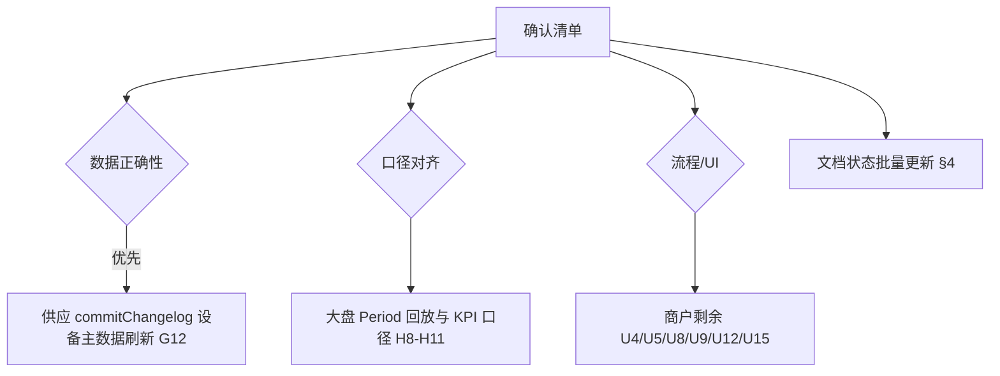

# 设计文档 vs 实现 — 审计清单

> **生成日期**：2026-07-07  
> **重组日期**：2026-07-08  
> **最近更新**：2026-07-14（商户归属 / 账单定时同步商户阶段 / §15 关闭项）  
> **范围**：`apps/web/content/design/` 下设计文档  
> **已部分失效（2026-10-06）**：大盘报表整体下线后，§H8 / §H10 / §H11 / §M22 涉及的 `global-dashboard-*`、`global-period.ts`、`compute-period-resource-composition.ts` 已删除，相关条目仅作历史记录。  
> **方法**：逐份对照 Schema（`packages/db`）、tRPC/DataAccess（`apps/web/src/lib/server`）、页面组件（`apps/web/src/app`）、Cron/Job；仅记录**可验证的具体偏差**，不含主观建议性重构。  
> **结构**：**第一部分**为仍不一致或待确认项；**第二部分**为已关闭、已对齐或与实现基本一致项。两部份之间以分隔线明确区分。

---

## 摘要

| 类别 | 数量（约） | 所在部分 |
|------|-----------|----------|
| **严重 / 高 — 未关闭** | 4 | 第一部分 §1 |
| **中 — 未关闭** | 4 | 第一部分 §2 |
| **低 — 未关闭** | 2 | 第一部分 §3 |
| **文档状态滞后（待更新）** | 10 | 第一部分 §4 |
| **严重 / 高 — 已关闭** | 10 | 第二部分 §1 |
| **中 — 已关闭** | 28 | 第二部分 §2 |
| **低 — 已关闭** | 12 | 第二部分 §3 |
| **文档状态 — 已同步** | 18 | 第二部分 §4 |
| **基本一致（抽样）** | ~20 | 第二部分 §5 |

**优先关注域**：全局大盘 Period 回放口径（H8、H10–H11）、商户剩余缺口（U4/U5/U8/U9/U12/U15）、供应变更表设备主数据刷新（设计 §9 G12，非 H1）。

---

# 第一部分：不一致清单（待处理）

> 以下条目设计 vs 实现**仍有可验证偏差**，或设计文档状态字段尚未同步，需改实现、改设计、接受现状或延期。

---

## 1. 严重 / 高优先级不一致（未关闭）

| # | 设计文档 | 设计要求 | 实际实现 | 关键代码位置 |
|---|----------|----------|----------|--------------|
| H8 | `global-dashboard-period-analytics.md` §2.5.2 | Period 生命周期吞吐由 `device_lifecycle_event` 驱动 | `global-period.ts` 的 `computeLifecycleThroughput()` 回放 `supplier_device_change_log` | `global-period.ts` L481–578 |
| H10 | `global-dashboard-period-composition-card-hours-design.md` | M1–M6 已落地；计划扇区读 `onboarding_batch_progress_event` / `replayPipelineGapAt` | Period 计划扇区仍用 `computePipelineGapsAt`（batch+link）；`replayPipelineGapAt` 无读路径引用 | `compute-period-resource-composition.ts` |
| H11 | `global-dashboard-period-composition-card-hours-design.md` §6.4 | 实体 Period **不再**用 `change_log` 回放 | 仅 `resourceComposition` 改读快照；KPI 趋势/期末仍 `loadChangeLogs` + `applyLogsUntil` | `global-period.ts` L570–609 |
| H14 | `supplier-device-masterdata-integration-api-design.md` §2–§4 | REST 集成 API `POST /api/integration/v1/...` | `apps/web/src/app/api` **无** `integration/v1` 路由 | 设计标注「已确认但暂缓」，M2 Cron 已替代 |

---

## 2. 中优先级不一致（未关闭）

### 2.1 CRM 与账单

（本节当前无未关闭项）

### 2.2 供应域与裸金属

| # | 设计文档 | 设计要求 | 实际实现 |
|---|----------|----------|----------|
| M14 | `datacenter-device-retire-design.md` §2.5.1 | 展示 `progress_flags_json` 多种 Badge | `onboarding-batch-detail-content.tsx` 仅渲染 `needs_review` |
| M17 | `merchant-management-design.md` §15 U4 | `merchant.create` 手工新建商户 | 列表「新建商户」仍 toast「待接入」；主数据依赖平台同步 |
| M19 | `merchant-management-design.md` §15 U9 | 区域 `used_gpu_count` 接 OpenAPI | `merchant-region.ts` 多处 `usedGpuCount: 0` 硬编码 |

### 2.3 全局大盘

| # | 设计文档 | 设计要求 | 实际实现 |
|---|----------|----------|----------|
| M22 | `global-dashboard-period-analytics.md` §5.3 | 「对比上周期」应嵌套上期响应 | 后端 `compare` 仅镜像当前 KPI 的 `netChangeLabel`；前端 **不读取** `compare` |
| M25 | `global-dashboard-resource-composition-chart-design.md` §14 | Snapshot pipeline 应用 `replayPipelineGapAt` | Snapshot 仍用 `aggregatePipelinePending` |
| M26 | `global-dashboard-period-composition-m2-masterdata-etl.md` D5 | MD-4 REST API 本期实施 | 有 MD-1/2 Cron + 导入 Hook；**无** REST API |

---

## 3. 低优先级不一致（未关闭）

| # | 设计文档 | 设计要求 | 实际实现 |
|---|----------|----------|----------|
| L8 | `supplier-planned-batches-hub-design.md` D8 | 列表不含 `internal_test_hold` | 列表已含 `internal_occupancy` 类型（§8.2 演进未回写 hub 文档） |
| L10 | `merchant-management-design.md` §15 U5/U8/U12 | `inheritFromL1`、`merchant_sync_issue`、CRM 租户详情关联商户 Tab | 均未实现 |

---

## 4. 文档状态滞后（待更新）

以下不属于「行为错误」，但设计文档状态字段**与代码不同步**，评审时易误判范围。

| 设计文档 | 文档标注 | 代码现状 | 建议 |
|----------|----------|----------|------|
| `entity-contacts-design.md` | 待确认 | `customer_contact`/`tenant_contact`/`merchant_contact` + UI + tRPC 已实现 | 更新状态为「已实施」 |
| `tenant-region-gpu-consumption-daily-monthly-design.md` | 仅文档，未实施 | Schema + tRPC + Excel 导入 **已实现** | 更新状态为「已实施」 |
| `supplier-internal-occupancy-batch-design.md` | 待实现 | `internal_occupancy` 批次创建、进度、UI 已实现 | 更新状态为「已实施」 |
| `device-platform-orphan-import-rules-design.md` | 待确认后实施 | Schema + dataaccess + `/supplier/device-platform-probe/import-rules` 已实现 | 更新状态为「已实施」 |
| `project-import-design.md` | 设计稿 — 确认后再实施 | `CrmProjectImportDialog` + API + dataaccess 已接入项目列表 | 更新状态或标注「已先行实施待确认」 |
| `opportunity-import-design.md` | 设计稿 — 待确认 | `CrmOpportunityImportDialog` + API 已接入 | 同上 |
| `platform-tenant-import-design.md` | 设计稿 — 待确认 | `CrmPlatformTenantImportDialog` + dataaccess 已接入 | 同上 |
| `supplier-import-design.md` | 设计稿 — 待确认 | `supplier-import-dialog.tsx` + dataaccess 已存在 | 同上 |
| `global-dashboard-period-composition-card-hours-design.md` 文首 | M1–M6 已落地 | M1 事件回放读路径、change_log 实体回放仍未切换（见 H10/H11） | 区分「表/ETL 已落地」与「读路径已切换」 |
| `datacenter-device-retire-design.md` | 评审已确认 | 设计已对齐 `commitChangelog` 现状（~~H1~~）；设备主数据刷新待 G12 | 保持「部分落地」 |

---

## 5. 按域汇总 — 建议确认顺序

---

## 6. 后续动作（待人工确认）

1. **逐项确认**：第一部分每一行标注「改实现 / 改设计 / 接受现状 / 延期」。
2. **严重项**：供应域 `commitChangelog` 设备主数据刷新（设计 §9 G12）仍待评审；~~H1~~ 已通过改设计关闭。
3. **文档同步**：§4 中滞后文档建议在确认后批量更新状态字段。
4. **本清单维护**：代码或设计变更后，将已关闭项移至第二部分，并更新摘要计数。

---

# ── 分隔线：以下为已对齐 / 基本一致 ──

# 第二部分：已对齐与基本一致

> 以下条目已通过改实现、改设计或文档同步**关闭偏差**，或审计未发现显著偏差。维护时：新发现的不一致应从第二部分移除并写入第一部分。

---

## 1. 严重 / 高优先级 — 已关闭

| # | 设计文档 | 设计要求 | 结论 |
|---|----------|----------|------|
| H2 | `commerce-order-bare-metal-merge.md` §3 | 租户账单导入应调用 `upsertPlatformBareMetalOrder` | **已确认不对齐设计**：租户账单导入不写裸金属；由 `bare-metal-order-sync` Cron 专门处理为正确行为 |
| H3 | `commerce-order-bare-metal-merge.md` §4 | 项目详情订单列表读 `bare_metal_order` | **已修复**（2026-07-07）：项目同步传入 `projectId`；UPDATE 不覆盖已有归因 |
| H4 | `bare-metal-order-schema-design.md` BM-15 | 平台 cron 不得覆盖已有 `project_id` | **已修复**（2026-07-07）：UPDATE 从 `headValues` 排除 `projectId` |
| H5 | `project-billing-scheduled-sync-design.md` §3 | 游标增量 vs 滑动窗口 | **已对齐 v1.2**：设计改为 `computeSlidingSyncWindow` |
| H6 | `project-billing-scheduled-sync-design.md` §3.2 | 日历安全窗口 | **已对齐 v1.2**：`BILLING_SYNC_WINDOW_DAYS` |
| H7 | `tenant-bill-daily-sync-design.md` §5.7 | 同步时间窗 | **已对齐 v1.2**：交叉引用滑动窗口 |
| H12 | `tenant-billing-import-design.md` §1.1 G2 | 四类 Tab 含裸金属订单 | **已对齐 v1.3**：裸金属移出弹窗；Tab 为月度/充值/每日用量/明细 |
| H1 | `datacenter-device-retire-design.md` §2.6 | `commitChangelog` 应 UPDATE `supplier_device` | **已对齐 v1.4**：设计改为仅 change_log + device_link + `refreshBatchProgress`（现状文档化） |
| H9 | `global-dashboard-kpi-caliber-spec.md` §4.3 | Period 与 Snapshot `device_online` 一致 | **已对齐 v1.4**：Period 用 `isOnlineState()` 排除维护中，设计已确认 |
| H13 | `merchant-management-design.md` §15 U1（旧） | 平台导入写 `tenant_merchant` | **已关闭**（2026-07-14）：设计 v1.6 废弃 `tenant_merchant`；实现写 `tenant.merchant_id` |

---

## 2. 中优先级 — 已关闭

### 2.1 CRM 与账单

| # | 设计文档 | 结论 |
|---|----------|------|
| M2 | `tenant-customer-reassignment-design.md` §4.3 | **已修复**：`CUSTOMER_ID_TABLES` 含 `tenant_bill_daily` |
| M1 | `tenant-bill-daily-sync-design.md` §8.1 | **已对齐 v1.3**：运营大盘统一读日表；已发布账期仅影响 `isPreview` 角标 |
| M10 | `project-tenant-daily-consumption-design.md` | **已对齐 v1.1**：P1 已实施；§6.3 机房×卡型为 P2 |
| M3 | `finance-single-period-income-design.md` §2.1 | **已对齐**：能力在 `/finance/[id]/income`；设计文档已更新 |
| M4 | `finance-create-billing-period-dialog-plan.md` D1 | **已对齐 v1.3**：成本计算成功 → `/finance/{id}/cost` |
| M5 | `finance-create-billing-period-dialog-plan.md` §3 | **已对齐 v1.3**：弹窗仅创建+成本；收入在详情页 |
| M6 | `finance-create-billing-period-dialog-plan.md` D4 | **已对齐 v1.3**：`/finance/create` 已移除 |
| M7 | `finance-personal-income-design.md` v1.2 §3.1 | **已对齐 v2.0**：四段汇总 |
| M8 | `finance-personal-income-design.md` §2.2 | **已对齐 v2.0**：裸金属选填 |
| M9 | `rbac-design.md` §11.1 | **已对齐**：员工/账号走 `/crm/staff`；设计文档已更新 |
| M18 | `merchant-management-design.md` §15 U6/U7 | **已关闭**（2026-07-14）：事实表已有 `merchant_id`；`merchant_bill*` 表 + 手动 rollup + 无表时实时聚合；`merchant_consumption_daily` 按设计可废弃；**无** cron 自动 rollup（设计 v1.8 接受） |
| M29 | `project-billing-scheduled-sync-design.md` §3.6 / merchant §7.7 U13 | **已关闭**（2026-07-14）：全量账单定时追加商户列表 + 各商户租户自动导入 + 同窗口导账单；项目路径不变 |
| M30 | `merchant-management-design.md` §15 U3/U14 | **已关闭**（2026-07-14）：平台租户导入 / 裸金属自动建档写 `tenant.merchant_id`；订单冗余 `merchant_id` |

### 2.2 供应域与裸金属

| # | 设计文档 | 结论 |
|---|----------|------|
| M11 | `bare-metal-order-schema-design.md` §5.1 | **已对齐 v1.5**：`commerce_order_id` 列已 DROP |
| M12 | `bare-metal-order-schema-design.md` BM-17 | **已修复**：partial unique + 应用层校验 |
| M13 | `bare-metal-order-schema-design.md` §7.2.5 | **已修复**：新租户 `directImport` 后同期 upsert 裸金属 |
| M16 | `feishu-work-order-module-category-design.md` §5.2 | **已对齐**：机房下架已接 `workOrderModule`；Legacy 供应商弹窗已移除 |
| M15 | `supplier-device-retire-design.md` §2.1 | **已对齐 v1.2 + 代码清理**：移除供应商详情入口与 Legacy tRPC/组件 |
| M21 | `global-dashboard-period-analytics.md` §5.7 | **已对齐 v1.4**：四卡片已接 API；Period 下 clusters/discrepancies/todos 仍 Snapshot 截面（文档化） |
| M23 | `global-dashboard-kpi-caliber-spec.md` §4.7 | **已对齐 v1.4**：`device_abnormal.gpuCount = faultDownGpu` |
| M24 | `global-dashboard-kpi-caliber-spec.md` §3 | **已修复**：Header 区域/卡型筛选传入 `getSnapshot` / `getPeriod` |

### 2.3 全局大盘

| # | 设计文档 | 结论 |
|---|----------|------|
| M20 | `global-dashboard-implementation-plan.md` §1.1 | **已对齐**：`globalOps` tRPC 已实现；设计文档已更新 |

### 2.4 供应链线索

| # | 设计文档 | 结论 |
|---|----------|------|
| M27 | `supply-chain-leads-design.md` 文首 | **已对齐**：设计文档已更新为已实施 |
| M28 | `supply-chain-leads-bitable-import-design.md` | **已实施 P1**：Bitable 同步与设备同步体验对齐 |

---

## 3. 低优先级 — 已关闭

| # | 设计文档 | 结论 |
|---|----------|------|
| L4 | `finance-create-billing-period-dialog-plan.md` D5 | **已对齐 v1.3**：create 页已移除；列表弹窗默认勾选 |
| L1 | `tenant-bill-daily-sync-design.md` §5.9 | **已对齐 v1.3**：日账单 Tab 不实施；走 stream + 设置页补同步 |
| L2 | `tenant-bill-daily-sync-design.md` §6 | **已对齐 v1.3**：scope 记 summary 前缀，不落库列 |
| L3 | `tenant-balance-snapshot-design.md` §12.2 | **已对齐**：`billing-tenants` 钩子 P2 暂缓；平台导入已写快照 |
| L5 | `rbac-design.md` §11.1 | **已修复**：`StaffUserService` 统一入口 |
| L6 | `bare-metal-order-discount-fields-sync-plan.md` §5.4 | **已修复**：供应域详情展示 `discountAmount` |
| L7 | `platform-metal-order-api-field-mapping.md` §7.4 | **已修复**：`/supplier/bare-metal-orders/sync-jobs/[id]` |
| L12 | `supply-chain-leads-design.md` §4.1 | **已对齐**：设计文档 §3.6 已补充 `paused` |
| L13 | `site-messages-design.md` §3.2 | **已修复**：Sheet 内全部/未读/已读 Tab |
| L9 | `feishu-bitable-automation-inbound-design.md` §7.3 | **已修复**：`FeishuBatchSyncCard` + `status_history` 时间线 |
| L11 | `global-dashboard-period-analytics.md` §5.3 / §10.1 | **已对齐 v2.x**：卡型筛选不入 URL，经 Header state 传 API |
| L14 | `project-monthly-cost-snapshot-design.md` | **已同步**：状态更新为「已实施」 |

---

## 4. 文档状态 — 已同步

| 设计文档 | 说明 |
|----------|------|
| `finance-personal-income-baremetal-source-v2-design.md` | 已更新为「已实施」 |
| `supply-chain-leads-design.md` | 已更新为已实施（含 Bitable P1） |
| `global-dashboard-implementation-plan.md` §1.1 | 已更新 `globalOps` 现状 |
| `tenant-billing-import-design.md` v1.3 | 裸金属移出弹窗；四类 Tab 与实现对齐 |
| `tenant-bill-daily-sync-design.md` v1.3 | §8.1 Dashboard 读日表；§5.9/L2 scope 策略 |
| `project-tenant-daily-consumption-design.md` v1.1 | P1 已实施 |
| `feishu-work-order-module-category-design.md` | Phase 2 供应商下架暂缓说明 |
| `tenant-balance-snapshot-design.md` | §12.2 `billing-tenants` 钩子 P2 暂缓 |
| `feishu-bitable-automation-inbound-design.md` | §7.3 UI 已实施 |
| `datacenter-device-retire-design.md` | v2.3+ §2.6 对齐 commitChangelog 现状（H1） |
| `supplier-device-retire-design.md` v1.2 | Legacy 入口已移除（M15） |
| `global-dashboard-kpi-caliber-spec.md` | §4.3 H9、§4.7 M23 已对齐 |
| `global-dashboard-period-analytics.md` | §1.2 / §5.7 M21、§10.1 L11 已对齐 |
| `project-monthly-cost-snapshot-design.md` | 已实施（L14） |
| `project-billing-scheduled-sync-design.md` v1.4 | 追加商户自动导入阶段（§3.6）；与实现对齐 |
| `merchant-management-design.md` v1.8 | §7.6–§7.8 / §15 对齐当前实现 |

---

## 5. 已核对、基本一致的设计（抽样）

以下文档的核心 Schema / API / UI 与实现**未发现显著偏差**（不含刻意标注为「待开发/二期」的条目）：

| 领域 | 文档 |
|------|------|
| 权限 | `role-menu-data-access-design.md`、`auth-closed-registration-password-policy.md` |
| CRM | `tenant-blacklist-management-design.md`、`tenant-customer-reassignment-design.md`、`project-revenue-department-design.md`（P1 CRM 部分）、`tenant-billing-import-design.md`、`tenant-bill-daily-sync-design.md`、`project-tenant-daily-consumption-design.md`（P1）、`project-billing-scheduled-sync-design.md`（含 v1.4 商户阶段） |
| 商户 | `merchant-management-design.md`（主体；剩余见第一部分 M17/M19/L10）、`merchant-am-data-access-design.md` |
| 财务 | `billing-period-import-design.md`、`finance-cost-regenerate-baremetal-source-design.md`、`platform-cost-commission-phase-derive-design.md`、`finance-create-billing-period-dialog-plan.md`、`finance-personal-income-design.md`、`finance-single-period-income-design.md` |
| 裸金属 | `platform-metal-order-api-field-mapping.md`（主链路）、`bare-metal-order-discount-fields-sync-plan.md`、`bare-metal-order-schema-design.md`、`commerce-order-bare-metal-merge.md` |
| 供应 | `supplier-device-ops-pool-masterdata-design.md`、`supplier-planned-batches-hub-design.md`、`supplier-device-platform-probe-design.md` |
| 线索 | `supply-chain-leads-design.md`、`supply-chain-leads-bitable-import-design.md` |
| 站内信 | `site-messages-design.md`（Phase 1 主体） |
| 飞书 | `feishu-work-order-module-category-design.md`（Phase 1）、`feishu-bitable-automation-inbound-design.md`（§7.3） |
| 余额 | `tenant-balance-snapshot-design.md`（Cron + 平台导入；手工路径 P2） |
| 参考 | `crm-database.md`、`supplier-database.md`、`crm-workbench-metrics-caliber.md`、`spot-sales-operations-sop.md` |

**标注为纯设计稿且代码确实未实现**（无「代码超前」问题）：

- `crm-sales-leads-design.md`
- `supplier-quote-management-design.md`
- `supplier-onboarding-plan-changelog-tracking-design.md`（v2.2 工单+变更表模型）
- `whole-rent-offline-delivery-device-import-design.md`
- `feishu-integration-design.md`（总设计待评审）
- `global-dashboard-period-composition-m7-dws-acceleration.md`（明确本期不做）

---

## 附录 A — 审计覆盖清单

### A.1 仍有偏差或待更新

| 文档 | 审计结论 |
|------|----------|
| merchant-management-design.md | ~~H13、M18、U13/U14~~ 已关闭；余 M17（U4）、M19（U9）、L10（U5/U8/U12）；U15 DROP 遗留表 |
| tenant-bill-daily-sync-design.md | ~~M1、L1–L2~~ 已关闭 |
| datacenter-device-retire-design.md | M14、§9 G12 待实现 |
| tenant-billing-import-design.md | ~~H12~~ 已关闭 |
| global-dashboard-resource-composition-chart-design.md | M25 |
| global-dashboard-period-analytics.md | H8、~~M21–M22~~ M22、~~L11~~ 已关闭 |
| project-tenant-daily-consumption-design.md | ~~M10~~ 已关闭 |
| supplier-device-masterdata-integration-api-design.md | H14、M26 |
| global-dashboard-period-composition-m2-masterdata-etl.md | M26 |
| global-dashboard-kpi-caliber-spec.md | ~~H9、M23–M24~~ 已关闭 |
| feishu-work-order-module-category-design.md | ~~M16~~ 已关闭；Phase 1 一致 |
| global-dashboard-period-composition-m1-progress-event.md | 读路径未切（同 H10） |
| global-dashboard-period-composition-card-hours-design.md | H10–H11、§4 待更新 |
| supplier-device-retire-design.md | ~~M15~~ 已关闭（Legacy 移除） |
| feishu-bitable-automation-inbound-design.md | ~~L9~~ 已关闭 |
| tenant-balance-snapshot-design.md | ~~L3~~ 已关闭 |
| supplier-planned-batches-hub-design.md | L8；其余基本一致 |
| entity-contacts-design.md | §4 待更新 |
| tenant-region-gpu-consumption-daily-monthly-design.md | §4 待更新 |
| supplier-internal-occupancy-batch-design.md | §4 待更新 |
| device-platform-orphan-import-rules-design.md | §4 待更新 |
| project-import-design.md | §4 待更新 |
| opportunity-import-design.md | §4 待更新 |
| platform-tenant-import-design.md | §4 待更新 |
| supplier-import-design.md | §4 待更新 |

### A.2 已关闭、基本一致或未实施（无代码超前）

| 文档 | 审计结论 |
|------|----------|
| tenant-billing-import-design.md | ~~H12~~ 已关闭 |
| tenant-bill-daily-sync-design.md | ~~M1、L1–L2~~ 已关闭；H7 已关闭 |
| project-tenant-daily-consumption-design.md | ~~M10~~ 已关闭 |
| project-billing-scheduled-sync-design.md | H5–H6 已关闭；**v1.4 / M29** 商户阶段已关闭 |
| merchant-management-design.md | H13、M18、M29、M30 已关闭；设计 v1.8 已同步 |
| feishu-bitable-automation-inbound-design.md | ~~L9~~ 已关闭 |
| tenant-balance-snapshot-design.md | ~~L3~~ 已关闭 |
| feishu-work-order-module-category-design.md | ~~M16~~ 已关闭 |
| finance-create-billing-period-dialog-plan.md | M4–M6、L4 已关闭 |
| finance-personal-income-baremetal-source-v2-design.md | 已同步 |
| crm-workbench-implementation-plan.md | 基本一致 |
| platform-metal-order-api-field-mapping.md | L7 已关闭；主链路一致 |
| tenant-blacklist-management-design.md | 一致 |
| finance-single-period-income-design.md | M3 已关闭 |
| supplier-device-ops-pool-masterdata-design.md | 一致 |
| bare-metal-order-discount-fields-sync-plan.md | L6 已关闭 |
| project-revenue-department-design.md | 一致（P1） |
| rbac-design.md | M9、L5 已关闭 |
| supplier-device-management-ops-panorama.md | 产品指南，无代码对照项 |
| spot-sales-operations-sop.md | 非技术 SOP |
| supplier-database.md | 参考文档 |
| supply-chain-leads-design.md | M27、L12 已关闭 |
| supplier-device-import-schema.md | 与 ops-pool 设计一致 |
| supplier-datacenter-import-design.md | 阶段一 Mock 一致 |
| finance-personal-income-design.md | M7–M8 已关闭 |
| platform-pricing-design.md | 逻辑设计，未逐项对照 |
| crm-database.md | 参考文档 |
| platform-cost-commission-phase-derive-design.md | 一致 |
| supplier-overview-scenarios-from-zero.md | 场景说明 |
| global-dashboard-implementation-plan.md | M20 已关闭 |
| crm-workbench-metrics-caliber.md | 口径规范 |
| supplier-quote-management-design.md | 未实施 |
| feishu-integration-design.md | 待评审 |
| billing-period-import-design.md | 一致 |
| auth-closed-registration-password-policy.md | 一致 |
| supplier-lifecycle-product-plan.md | 产品方案，大量 Mock |
| cost-compute-v3-redesign-with-examples.md | 方案设计 |
| supplier-device-data-cleanup-sql.md | 运维脚本 |
| supply-chain-leads-bitable-import-design.md | M28 已关闭 |
| merchant-am-data-access-design.md | 一致 |
| whole-rent-offline-delivery-device-import-design.md | 待评审 |
| crm-sales-leads-design.md | 未实施 |
| role-menu-data-access-design.md | 一致 |
| tenant-customer-reassignment-design.md | M2 已关闭 |
| bare-metal-order-schema-design.md | H4、M11–M13 已关闭 |
| supplier-onboarding-plan-changelog-tracking-design.md | 待实施 |
| supplier-device-platform-probe-design.md | 一致 |
| finance-cost-regenerate-baremetal-source-design.md | 一致 |
| site-messages-design.md | L13 已关闭；Phase 1 主体一致 |
| project-monthly-cost-snapshot-design.md | ~~L14~~ 已关闭 |
| datacenter-device-retire-design.md | ~~H1~~ 已关闭；M14 待办 |
| global-dashboard-kpi-caliber-spec.md | ~~H9、M23、M24~~ 已关闭 |
| global-dashboard-period-analytics.md | ~~M21、L11~~ 已关闭 |
| supplier-device-retire-design.md | ~~M15~~ 已关闭 |
| commerce-order-bare-metal-merge.md | H2–H3 已关闭 |
| global-dashboard-period-composition-m7-dws-acceleration.md | 明确不做 |

---

*文档版本：v1.5 | 2026-07-14 关闭 H13、M18、M29、M30；同步 project-billing-scheduled-sync v1.4、merchant-management v1.8*
