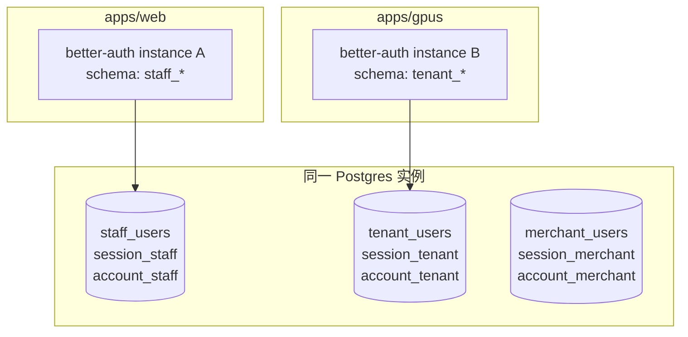
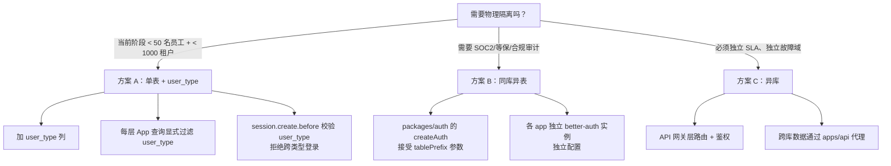

# 用户风险隔离分析

## 1. 当前现状

所有用户共享同一张 `users` 表，通过 `role` + `provisionedBy` 隐式区分：

| 用户类型 | role | provisionedBy | 所属 App |
|---------|------|--------------|---------|
| 平台运营（员工） | admin / user / member | ✅ 有值 | apps/web |
| 租户 | user（默认） | ❌ 空值 | apps/gpus |
| 商户 | 待定 | 待定 | apps/merchant |

**当前隐式判据脆弱**：`role = 'user' + provisionedBy = NULL` 是约定，非数据库强约束。未来商户接入后，3 类用户共享一张表，区分逻辑将更加模糊。

## 2. 风险矩阵

| 维度 | 风险描述 | 严重程度 |
|------|---------|---------|
| Session 泄漏 | 跨子域 cookie 配置失误，导致租户 session 被运营端接受 | **高** |
| 账号枚举 | 登录接口可通过 error 区分「不存在」「已禁用」「未开通」 | 中 |
| 查询越权 | Bug 导致 WHERE 语句遗漏角色过滤，暴露跨类型数据 | **高** |
| 性能干扰 | 租户大量登录请求耗竭连接池，影响运营端登录 | 低 |
| 合规审计 | 不同用户类型有不同的审计追溯需求 | 中 |
| 数据库变更 | 租户扩展字段的 migration 可能影响运营用户查询性能 | 低 |

**关键问题**：session 越权和查询越权是真实风险，但来源是**应用层隔离不够**而非存储层共享。

## 3. 四种隔离方案对比

### 方案 A：单表 + user_type 判别列（推荐）

在 `users` 表新增 `user_type` 枚举列做显式隔离，三端共享同一 better-auth 实例的同一张表。

```sql
ALTER TABLE "users" ADD COLUMN "user_type" text NOT NULL DEFAULT 'tenant'
  CHECK ("user_type" IN ('tenant', 'staff', 'merchant'));
```

```typescript
// packages/db/src/auth-schema.ts
export const user = pgTable("users", {
  // ... 现有字段
  userType: text('user_type').$type<'tenant' | 'staff' | 'merchant'>()
    .notNull().default('tenant'),
})
```

**收益**：
- 变更最小，better-auth 原样工作，无需拆分实例
- 所有查询可显式过滤 `user_type`，消灭隐式区分
- migration 成本极低（加一列即可）

**局限性**：
- 物理上仍在同一张表，DBA 层面无法隔离
- 复杂合规场景下难以证明「绝无交叉」
- better-auth admin plugin 的 listUsers API 会返回所有类型用户

### 方案 B：同库异表（适度物理隔离）

运营端和租户端各自一张 `users` 表（`staff_users` / `tenant_users`），各自跑独立的 better-auth 实例。



**收益**：
- better-auth 自身即隔离 —— `users.id` 不会有跨类型冲突（虽然 cuid 理论不冲突）
- 不同类型用户可设不同密码策略、不同的登录插件（如商户不需要 Google OAuth）
- 删除/迁移一类用户不影响另一类
- 更容易满足合规审计的「职责分离」要求

**代价**：
- 表数量翻倍：session、account、verification、organization、member、invitation 每类都需独立
- better-auth 配置重复维护 —— 但 `packages/auth` 的 `createAuth` 工厂可以封装：传入 `tablePrefix` 参数
- 跨类型操作（如运营人员以租户身份登录查看）需要 OAuth-like 的 token 交换机制
- 用户邮箱去重变为跨表问题（需 trigger 或应用层判断）

### 方案 C：异库（完整物理隔离）

运营端和租户端使用完全独立的 Postgres 实例，应用层通过 API 网关路由。

**收益**：
- 最大隔离度，独立扩缩容、独立备份、独立 SLA
- 一个数据库被攻击/损坏不影响另一个

**代价**：
- 跨库业务操作（如运营端查看租户数据）必须通过 API 调用而非 SQL JOIN
- 事务一致性变为分布式问题
- 运维复杂度 × 3（三套 pg 实例）
- 小团队不现实

### 方案 D：混合（单表 + 独立 schema）

```sql
CREATE SCHEMA staff;
CREATE SCHEMA tenant;

-- 同名表不同 schema
staff.users, staff.session, staff.account ...
tenant.users, tenant.session, tenant.account ...
```

better-auth 通过 drizzle adapter 的 `schema` 参数指定不同 schema 名称。

```typescript
// packages/auth/src/server.ts
export function createAuth(
  database: DrizzleDatabase,
  schema: Record<string, any>,  // 传入不同 schema 表集合
  options: CreateAuthOptions
) {
  return betterAuth({
    ...sharedAuthOptions,
    database: drizzleAdapter(database, {
      provider: "pg",
      schema,
    }),
  })
}
```

**收益**：
- 物理隔离粒度适中：同实例但不同 schema
- migration 可独立执行
- 连接池共享
- query 天然不会跨 schema

**代价**：
- 仍需三套 better-auth 表完整复制
- 跨 schema 查询仍比跨实例简单（可 schema-qualified name 查询）
- 比方案 A 多 2-3 倍表数量

## 4. 建议路径

### 选型决策树



### 推荐：当前阶段选方案 A，预设方案 B 的迁移路径

**选方案 A 的理由**：

1. **真实风险不在表共享，在应用层隔离**。只要 session cookie 域不同、路由权限校验正确、查询显式过滤 `user_type`，物理隔离并不能降低更多风险。
2. **团队阶段匹配**：当前员工数 < 50、租户 < 1000，单表性能无瓶颈。迁移窗口仍在。
3. **better-auth 原生不支持异表/异库多实例**。方案 A 不需改框架，方案 B 需自己实现 `tablePrefix` 抽象，成本前置。
4. **所有表的 CUID 前缀可区分** —— `users` 表的 `id` 本身无类型信息，`user_type` 补全了这一缺失。
5. **商户接入时仍可沿用**：`user_type = 'merchant'` + `merchant-schema` 表的 `merchant.organization_id` 关联。

**预设迁移条件（触发方案 B）**：

> 任一条件满足，启动同库异表拆分：
> 1. 租户数 > 10,000
> 2. 有 SOC2 / 等保合规审计需求
> 3. 运营员工数 > 200
> 4. 单次 P0 事故原因确认为用户类型过滤漏写

### 立即执行项

1. 在 `users` 表加 `user_type text NOT NULL DEFAULT 'tenant'` + CHECK 约束
2. `packages/db/src/auth-schema.ts` 更新类型定义
3. 所有 `apps/web` 的 query 增加 `eq(user.userType, 'staff')` 过滤（含 middleware、tRPC、后台 service）
4. 所有 `apps/gpus` 的 query 增加 `eq(user.userType, 'tenant')` 过滤
5. `session.create.before` hook 增加 `user_type` 校验：`apps/web` 的 session 只能由 `staff` 用户创建
6. `runWithProvisioningContext` 预开通时自动设为 `user_type = 'staff'`

### user_type 不做的

- 不在 `users` 表加 RLS（Row Level Security）—— 应用层通过 drizzle query 过滤足够，RLS 增加 Postgres 连接器复杂度且和连接池不兼容。
- 不在 `packages/auth` 层抽象 multi-instance —— 尚未到那个阶段，过早泛化只会让代码更难理解。
