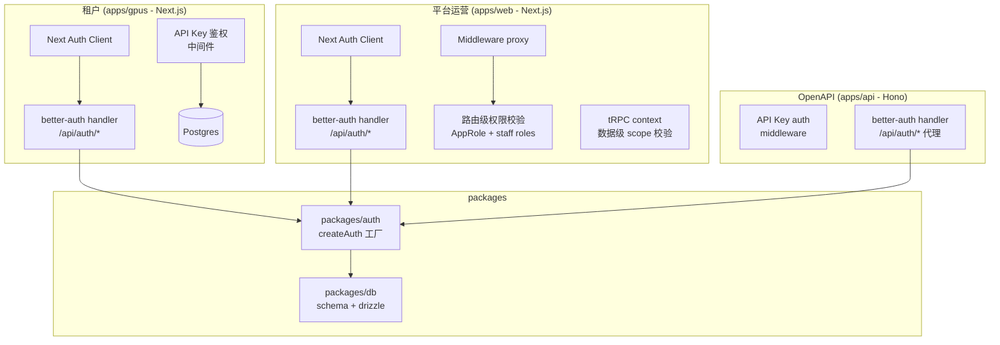
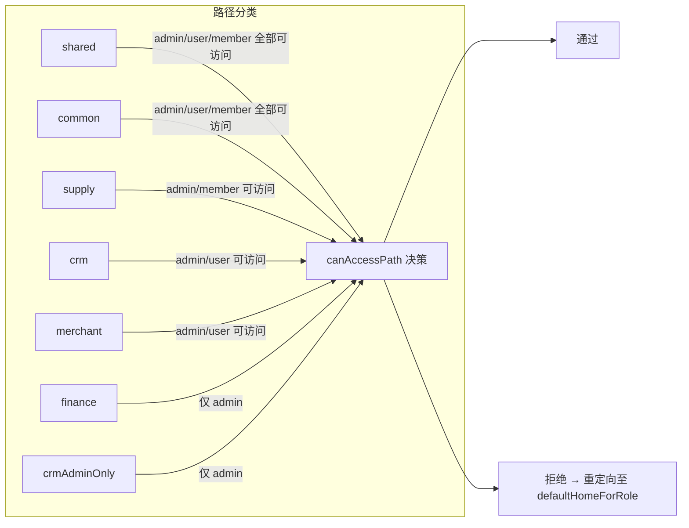
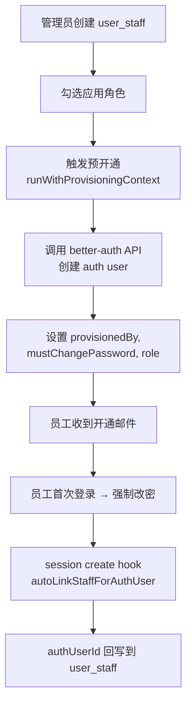
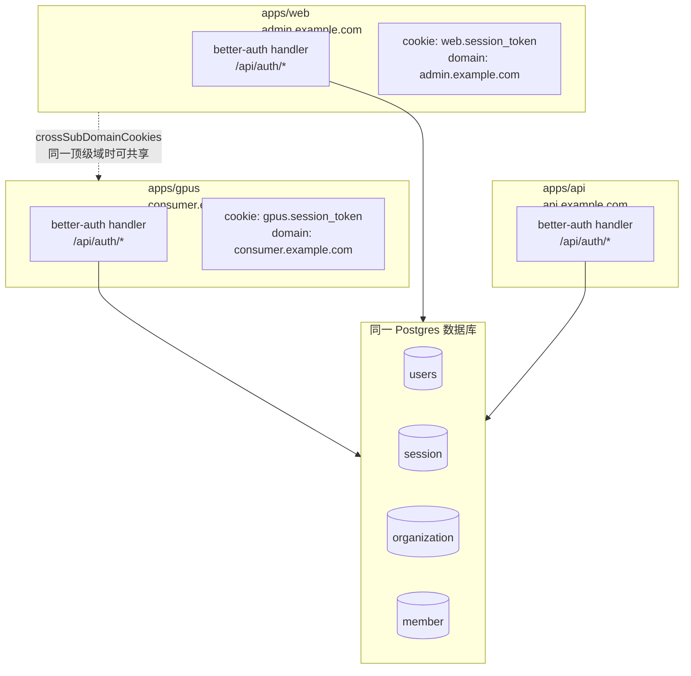
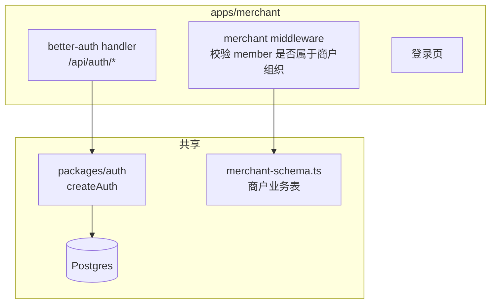

# 认证与权限系统设计方案

## 1. 目标与范围

### 1.1 系统角色

| 角色 | 模块 | 身份凭证 | 说明 |
|------|------|---------|------|
| **租户** | `apps/gpus` | better-auth session + API Key | 购买/使用算力的个人或企业 |
| **平台运营（员工）** | `apps/web` | better-auth session | 内部用户，含复杂 RBAC，现有 `user_staff` 主数据 + 部门/职位/角色 |
| **代理商户** | `apps/merchant`（待建） | better-auth session | 未来构建，见 §6 |
| **OpenAPI 调用方** | `apps/api`（Hono） | bearer token (API Key) | 为租户提供 OpenAPI |

### 1.2 认证层定位

`packages/auth` 做**统一出口**：持有 `better-auth` 配置 + drizzle schema + 密码策略 + 权限声明，各 app 通过 `createAuth(db, options)` 实例化。但**业务定制逻辑藏在各 app 的钩子里**（hooks/plugins/databaseHooks），不抽象进 shared 包——因为每个 app 的注册条件、预置角色、员工关联完全不同。

---

## 2. 认证流程

### 2.1 整体架构



### 2.2 认证方式

#### 2.2.1 租户端（apps/gpus）

- **邮箱 + 密码登录**：标准 better-auth emailAndPassword
- **手机号 + 验证码登录**：better-auth phoneNumber plugin
- **API Key 调用**：`apps/gpus` 内自定义中间件（见 §4.2）

**注册规则**：
- 允许公开注册（`allowPublicSignUp: true`）
- 注册后自动创建 `organization`
- 注册后 `role = 'user'`

#### 2.2.2 平台运营端（apps/web）

- **仅邮箱密码登录**
- **预开通制**：必须由管理员在 `user_staff` 中创建员工并勾选应用角色后，才能登录。登录校验走 `session.create.before` hook 中的 `assertUserMayLogin`（检查 `provisionedBy` 字段）。
- **手机号验证码仅作二次验证/找回密码**，不作为独立登录方式。
- **员工关联**：登录后 `session.create.after` hook 自动调用 `autoLinkStaffForAuthAuthUser`，将 `authUser.id` 回写到 `user_staff.auth_user_id`。

#### 2.2.3 OpenAPI（apps/api）

- `apps/api` 内 Hono app 通过 `auth.handler(c.req.raw)` 挂载 better-auth 路由（`/api/auth/*`），作为认证端点代理。
- 租户 OpenAPI 调用使用 **API Key 鉴权**，见 §4.2。

---

## 3. 权限模型

### 3.1 两层架构

```
AppRole（顶端路由层） → DataScope（数据可见性层）
```

### 3.2 AppRole（应用角色）

定义于 `apps/web/src/lib/auth/app-role.ts`：

```typescript
export const APP_ROLES = ['admin', 'user', 'member'] as const
```

| 角色 | 含义 | 对应业务 |
|------|------|---------|
| `admin` | 系统管理员 | 有所有权限，数据范围 `all` |
| `user` | 运营/CRM 用户 | 有 CRM/商户/Dashboard 权限，数据范围受绑定的员工角色限制 |
| `member` | 供应链成员 | 有供应商/供应链权限，无 CRM 数据权限 |

**数据源**：`users.role` 字段，由 `user_staff.roles`（JSONB 多选）通过 `resolveUserRoleFromStaffRoles` 优先序决议：`admin > member > user`。

### 3.3 路由访问控制

定义于 `apps/web/src/lib/auth/route-access.ts`：



### 3.4 数据级权限（CRM Data Scope）

定义于 `apps/web/src/lib/server/auth/crm-data-scope.ts`：

```
admin   → { type: 'all' } — 无数据限制
member  → { type: 'none' } — 无 CRM 数据
user    → { type: 'am_assigned', staffId } — 仅可见客户经理负责的客户数据
```

`user` 角色的数据范围由以下方式扩展：

1. **客户经理分配**（`account_manager_assignment`）：该员工被指派的客户
2. **项目四人组**（`project_staff_assignment`）：该员工以 pre_sales / account_manager / delivery_manager / project_manager 身份参与的项目
3. **通过项目关联的租户和客户**：间接可见

### 3.5 staff 主数据与角色绑定

`user_staff` 表是 RBAC 的**人肉基础**：

```typescript
// crm-schema.ts: userStaff
{
  id, employeeNo, displayName, mobile, email,
  status: 'active' | 'inactive',
  department,           // 部门（中台/运营中心/产品/研发/运维/销售/市场）
  position,             // 职位（经理/员工/高管）
  roles: string[],      // 应用角色多选（admin | user | member）
  authUserId,           // 关联 auth 用户（better-auth users.id）
  ...
}
```

**员工创建 → 登录开通流程**：



---

## 4. 模块间隔离

### 4.1 多工作域认证隔离

不同 App（`gpus` / `web` / `merchant`）共享同一套 better-auth 数据库，但通过 `trustedOrigins` 和 `crossSubDomainCookies` 配置，避免 session 交叉污染。



**关键配置（`apps/web/src/lib/auth.ts`）**：
```typescript
advanced: {
  cookiePrefix: websiteConfig.auth.cookiePrefix,  // e.g. "web"，按 App 隔离 cookie 名称
  ...(isProd && {
    crossSubDomainCookies: {
      enabled: true,
      domain: websiteConfig.auth.cookieDomain,  // e.g. ".example.com"
      additionalCookies: ['web.session_token'],
    },
  }),
},
```

### 4.2 OpenAPI 鉴权

**租户自主调用 OpenAPI**（`apps/api` 内的业务端点）：

1. 租户在 `apps/gpus` 的**控制台内创建 API Key**（存入数据库 `api_key` 表）。
2. API Key 关联到租户 `organization`（即租户身份）。
3. `apps/api` 的 Hono middleware 检查 `Authorization: Bearer <key>`：
   - 查询 DB 验证 key 的有效性。
   - 提取关联的 tenantId / organizationId 注入请求上下文。
4. 后续业务 handler 从 context 取租户身份做数据隔离。

**API Key 表设计**（待实现，`packages/db` 新增 schema）：

```typescript
export const apiKey = pgTable("api_key", {
  id: text("id").primaryKey(),
  name: text("name").notNull(),          // 租户自定义名称
  key: text("key").notNull().unique(),   // 明文前缀 hash 值，后 8 位明文
  keyPrefix: text("key_prefix").notNull(), // 明文前缀，用于识别
  hashedKey: text("hashed_key").notNull(), // bcrypt hash
  organizationId: text("organization_id")
    .notNull()
    .references(() => organization.id, { onDelete: "cascade" }),
  createdById: text("created_by_id")
    .notNull()
    .references(() => user.id),
  lastUsedAt: timestamp("last_used_at"),
  expiresAt: timestamp("expires_at"),
  revokedAt: timestamp("revoked_at"),
  ...timestamps,
})
```

### 4.3 apps/gpus 认证当前状态

`apps/gpus` **当前未接入 better-auth**。需要新增：

1. 在 `gpus` 中安装 `@workspace/auth`，调用 `createAuth(db, options)`。
2. 在 Next.js middleware 中挂载 better-auth handler。
3. 添加登录/注册页面组件（使用 `better-auth/client` client）。

---

## 5. 现有基础设施

### 5.1 packages/auth 组件

| 文件 | 职责 |
|------|------|
| `server.ts` | `createAuth(database, options)` 工厂函数，封装 drizzleAdapter |
| `options.ts` | 共享 better-auth 选项基础配置（emailAndPassword, openAPI plugin） |
| `permissions.ts` | `createAccessControl` 权限声明 + `organization` roles（owner/admin/member） |
| `password-policy.ts` | 密码复杂度校验 + zod schema + 中文本地化消息 |
| `generate.ts` | AI 辅助生成？命令行生成 DB schema |
| `constants.ts` | `AUTH_PATH = "/api/auth"` |

### 5.2 packages/db auth-schema 表

| 表 | 用途 |
|----|------|
| `users` | better-auth user，含 customerId、ban、provision、phoneNumber、role |
| `session` | better-auth session，含 activeOrganizationId、impersonatedBy |
| `account` | better-auth account（password hash、OAuth provider 存储） |
| `verification` | 验证码/验证令牌存储 |
| `organization` | 组织/租户，含 entryApproved、status |
| `member` | 组织成员关系 |
| `invitation` | 组织邀请 |
| `user_invitation_codes` | 用户邀请码 |
| `user_invitation_relations` | 用户邀请关系 |
| `user_site_message` | CRM 站内信 |

### 5.3 apps/web 已有认证路由/middleware

- `apps/web/src/proxy.ts`：Next.js middleware，负责：
  - i18n 路由本地化
  - `canAccessPath` 路由级权限校验
  - `defaultHomeForRole` 角色默认首页
  - 未登录重定向至 `/sign-in`（或 `/sign-in/phone`）
- `apps/web/src/lib/auth.ts`：better-auth 主配置（~500 行），含：
  - emailAndPassword + emailVerification
  - socialProviders（Google、GitHub）
  - user additionalFields（customerId、mustChangePassword、provisionedBy、provisionedAt）
  - databaseHooks（user.create.before/after，session.create.before/after）
  - plugins（organization、admin、phoneNumber、lastLoginMethod、nextCookies）
  - hooks（before hook 做 sign-in/sign-up/change-password 校验）
- `apps/web/src/lib/auth/route-access.ts`：路由权限 + 默认首页
- `apps/web/src/lib/auth/app-role.ts`：AppRole 类型 + 工具函数
- `apps/web/src/lib/auth-login-guard.ts`：登录守卫（校验 provisionedBy、banned、phoneVerified）
- `apps/web/src/lib/auth-provisioning.ts`：AsyncLocalStorage 预开通上下文
- `apps/web/src/lib/server/auth/`：数据级 scope 校验（CRM / Merchant）

---

## 6. 代理商户模块（apps/merchant）待办

### 6.1 认证需求

- 商户管理员**邮箱密码登录**。
- 商户运营人员由商户管理员创建子账号。
- session 与 `apps/web` 的运营管理 session **完全隔离**（不同子域名或路径）。
- 使用同一套 `users` 表，但通过 `organization` + `member.role` 区分商户组织。

### 6.2 认证接入方案



**商户 middleware 职责**：
1. 校验 session 中 `activeOrganizationId` 对应的 `organization` 是否关联了 `merchant` 表记录。
2. 校验当前 user 在该组织中的 `member.role` 是否符合商户操作权限。

### 6.3 商户业务表（已有 `merchant-schema.ts`）

`merchant` 表（见 `packages/db/src/merchant-schema.ts`）已完整定义，包含：

- `merchant`：商户主体
- `merchant_contact`：商户联系人
- `merchant_payment_node`：商户支付节点
- `merchant_recharge_record`：商户充值记录
- `merchant_activity`：商户活动
- `merchant_bill` / `merchant_bill_detail`：商户账单

关键：`tenant_merchant` 表（已 deprecated）与 `auth-schema.ts` 的 `organization` 表的映射关系需通过 `merchant.organization_id` 字段重构（设计文档 §5.2）。

---

## 7. 边界与约束

### 7.1 不会做的

- **细粒度操作级权限**（类似 Casbin/OPA）：本设计不做 `action:resource` 级别的鉴权矩阵。需要时在每个 tRPC procedure / route handler 内自行校验。
- **SSO / OIDC 集成**：当前不引入，未来可通过 better-auth socialProviders + 自定义 provider 扩展。
- **租户间数据 CDC**：多工作域的数据同步（如 `apps/gpus` 的消费数据同步至 `apps/web`）不是认证系统关心的问题。

### 7.2 安全约束

| 约束 | 实现方式 |
|------|---------|
| 密码复杂度 | `password-policy.ts` + better-auth `changePassword` hook 校验 |
| 注册关闭 | `databaseHooks.user.create.before` 检查 `allowPublicSignUp` |
| 预开通制 | `databaseHooks.session.create.before` 检查 `provisionedBy` |
| 账号禁用 | `databaseHooks.session.create.before` 检查 `banned` |
| API Key 轮转 | `apiKey.expiresAt` + `revokedAt`，无自动刷新 |
| Session 过期 | better-auth 默认 + 可配 `session.expiresIn` |
| CSRF | better-auth 内置 + Hono cors/csrf middleware |
| XSS | Next.js 默认 + Hono secureHeaders |

### 7.3 关键依赖

- **better-auth v1.5**：认证核心，提供 email/password、OAuth、phone、organization、admin 等插件。
- **drizzle-orm** + **PostgreSQL**：数据库层。
- **@better-fetch/fetch**：客户端 fetch 封装，用于 `apps/web` 的 better-auth client。
- **next-intl**：国际化路由，middleware 中与 auth 校验共存。

---

## 8. 迁移与演进

### 8.1 短期（Phase 1）

- [x] `packages/auth` 工厂函数 + 密码策略
- [x] `apps/web` 完整认证流程（预开通/登录/权限校验/员工关联）
- [ ] `apps/gpus` 接入 better-auth（login/register/forgot-password pages）
- [ ] `apps/api` 的 better-auth handler 补充租户关联

### 8.2 中期（Phase 2）

- [ ] API Key 表结构 + 创建/吊销 UI（`apps/gpus`）
- [ ] `apps/api` API Key 鉴权 middleware
- [ ] `apps/merchant` 子域名部署 + better-auth 接入

### 8.3 长期（Phase 3）

- [ ] Audit log（登录/权限变更日志）
- [ ] MFA/2FA
- [ ] 租户子账号管理（租户内的 RBAC）
