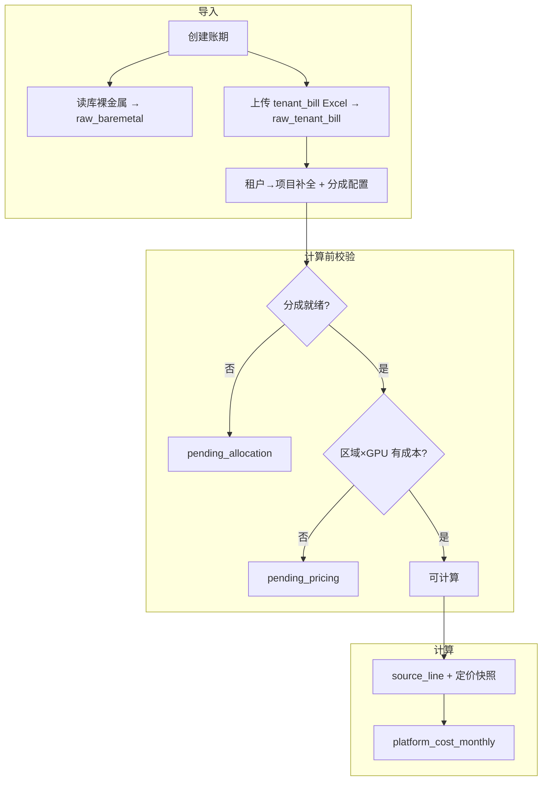

# 账期成本导入与经营核算

> 版本：v2.0  
> 日期：2026-06-23  
> 状态：**已实施（成本路径）**  
> 实现：`import.ts`、`baremetal-db-import.ts`、`compute-cost*.ts`  
> 关联：  
> - [finance-single-period-income-design.md](finance-single-period-income-design.md) — **企业收入**（CRM `tenant_bill`，非本文范围）  
> - [finance-personal-income-design.md](finance-personal-income-design.md) — **个人收入**  
> - [finance-cost-regenerate-baremetal-source-design.md](finance-cost-regenerate-baremetal-source-design.md) — 裸金属读库  
> - [cost-compute-v3-redesign-with-examples.md](cost-compute-v3-redesign-with-examples.md) — 成本 pipeline 逐步说明  

---

## 1. 范围

本文描述账期 **成本侧** Raw 导入、补全、计算与清理。各路径数据源如下：

| 路径 | 输入 | 输出 |
|------|------|------|
| **成本** | Excel 客户账单 + 读库裸金属 | `platform_cost_monthly`、`billing_period_cost_source_line` |
| **企业收入** | CRM `tenant_bill` + `tenant_bill_detail` | `platform_income_monthly`（见专篇） |
| **个人收入** | Excel 个人账单 + 读库裸金属 | `billing_period_personal_income_summary`（见专篇） |

**不用于账期收入**：`consumption_usage_daily` 等每日消耗表。

---

## 2. 目标与原则

| # | 目标 |
|---|------|
| G1 | 账期内导入 **客户账单详情 Excel** + **裸金属读库**，计算 B 端项目成本 |
| G2 | 按租户反查 CRM 项目 / AM，支持多项目 **成本分成** |
| G3 | 计算前阻断：未知租户、缺机房×卡型成本、待配置分成 |
| G4 | 支持重新生成：先 purge 再替换 Raw / 重算 |

**设计原则**

1. **Replace-in-Period**：同一账期、同一 `file_type` 仅一组有效 batch。  
2. **派生层全量重建**：`platform_cost_monthly` 等每次计算前 DELETE 本账期再 INSERT。  
3. **Excel 落盘**：库内仅存 `storage_path`，不存二进制（裸金属读库 batch 无磁盘文件）。  

---

## 3. 端到端流程（成本）



**账期状态（成本相关）**

| 状态 | 含义 |
|------|------|
| `draft` | 未就绪 |
| `imported` | `tenant_bill` + `baremetal_order` batch 均 `parse_status = ok` |
| `pending_allocation` | 多项目租户缺分成 |
| `pending_pricing` | 缺机房×卡型成本 |
| `computed` / `published` / `adjusted` | 已计算 / 已发布 / 已调账 |

`syncBillingPeriodImportStatus`：仅校验 **读库裸金属 batch** + **各 tenant_bill window** 是否解析成功。

---

## 4. 输入数据

### 4.1 裸金属（`baremetal_order`）— 读库

**不上传 Excel**。详见 [finance-cost-regenerate-baremetal-source-design.md](finance-cost-regenerate-baremetal-source-design.md)。

| 场景 | 账期筛选字段 |
|------|--------------|
| 添加账期 / 首次成本 | `ordered_at` |
| 成本重新生成 | `imported_at` |

写入 `billing_period_raw_baremetal_order`，`file_type = baremetal_order`。

### 4.2 客户账单详情（`tenant_bill`）— Excel

`importFile` slot `tenantBill`；`file_type = tenant_bill`。须指定 `windowId`（刊例价分段时多 window，或整月单 window）。

| 列名 | 必填 | 说明 |
|------|------|------|
| 租户ID | 是* | 平台租户 ID |
| 总消费 / 券消费 / 余额消费 | 是 | 成本侧用余额消费、余额卡时 |
| 总卡时 / 券卡时 / 余额卡时 | 余额卡时必填 | |
| GPU型号 / 区域 | 是** | 匹配机房与卡型 |

\* 总计行（`总计`/`合计`/`Total`）不写入 Raw。  
\** 总计行 GPU、区域可空。

**粒度**：一行 = 租户 × 区域 × GPU 型号。

### 4.3 列别名与清洗

金额去 `￥`、逗号；租户 ID trim；区域 lower；GPU 与 `gpu_card_type.code` **精确匹配**；区域与 `data_center.container_instance_region` **精确匹配**。

### 4.4 导入校验（摘要）

| 编号 | 校验 |
|------|------|
| V1 | 裸金属 batch + 全部 tenant_bill window 解析成功 |
| V5 | 明细行余额卡时、余额消费 ≥ 0 |
| V9 | 0 项目租户 → 不纳入成本清单 |
| V10 | 多项目无分成 → `pending_allocation`，阻断计算 |
| V14 | `(region_code, gpu_model)` 在 `period_end` 有有效成本 → 否则 `pending_pricing` |

跨文件校验（`validateCrossFileImports`）：tenant_bill 中的平台租户 ID 须在 CRM `billing_tenant` 存在。

### 4.5 错误 Excel

解析失败时生成标注 Excel（错误单元格标红 +「错误说明」列），路径存 `error_report_path`。`downloadImportErrorReport` 按 slot 下载。

---

## 5. 数据模型（成本 Raw）

```
billing_period_import_batch
  file_type ∈ { tenant_bill, baremetal_order, personal_tenant_bill, personal_baremetal_order }
  -- 成本路径主要用前两种；后两种见 personal-income 专篇

billing_period_raw_tenant_bill
  tenant_platform_id, balance_consumption, balance_card_hours,
  gpu_model, region_code, ...

billing_period_raw_baremetal_order
  order_id, tenant_platform_id, idc_name, device_model,
  purchase_qty_text, device_qty, final_amount, ordered_at, raw_json

billing_period_tenant_project_enrichment   -- 租户→项目→AM 补全
billing_tenant_cost_allocation             -- 本账期成本分成

billing_period_cost_source_line            -- Step 2 补全
billing_period_cost_pricing_snapshot       -- 定价快照
platform_cost_monthly                      -- 成本派生
```

---

## 6. 租户 → 项目 → 分成

导入 tenant_bill 后按 `platform_tenant_id` 反查 CRM 项目（`primary_tenant_id` / `project_tenant`）与项目 AM。

| 场景 | 行为 |
|------|------|
| 0 项目 | 不参与成本；列入报告 |
| 1 项目 | 自动 100% 分成 |
| ≥2 项目 | 须配置 `billing_tenant_cost_allocation` 或预置 `tenant_project_cost`，合计 100% |

拆分 Raw 行：`row_p.metric = row.metric × allocation_percent / 100`。

---

## 7. 成本计算

实现：`computeBillingPeriodCost`、`compute-cost-source-line.ts`。逐步示例见 [cost-compute-v3-redesign-with-examples.md](cost-compute-v3-redesign-with-examples.md)。

**要点**

- **flex**（弹性）：读 `billing_period_raw_tenant_bill` → `kind = flex` source_line。  
- **baremetal**：读 `billing_period_raw_baremetal_order` → `kind = baremetal` source_line。  
- 定价 as-of：flex 常用 `period_end`（或各 window 的 `window_end`）；baremetal 用订单 `ordered_at`。  
- 仅 **B 端、有项目、有 AM、有分成** 的租户进入成本汇总。

**重新生成成本**（`prepareRegenerateCost` + 对话框）：purge `derived_cost` 与 tenant_bill/baremetal batch；用户 **重新读库裸金属**（`imported_at`）+ **重传整月 tenant_bill**；`preserveIncomeDerived: true` 不清理企业收入。

---

## 8. Purge 与重新生成

`purgeBillingPeriodArtifacts(periodId, scope)`：

| scope | 删除对象 |
|-------|----------|
| `file_type` | 指定类型 batch + raw + 相关 enrichment；成本派生若需则一并清 |
| `derived_cost` | source_line、定价快照、`platform_cost_monthly` |
| `derived_income` | `platform_income_monthly`（企业收入重算时用） |
| `full` | 本账期全部 batch、raw、派生 |

`published` 账期须先 **撤回发布** 再改 Raw 或重算成本。

---

## 9. API 与页面（现网）

| 动作 | tRPC / 路由 |
|------|-------------|
| 创建账期 | `finance.periods.create` |
| 上传账单 Excel | `finance.periods.importFile`（`tenantBill` / `personalTenantBill`） |
| 裸金属读库 | `previewBaremetalFromDb` / `importBaremetalFromDb` |
| 个人裸金属读库 | `previewPersonalBaremetalFromDb` / `importPersonalBaremetalFromDb` |
| 校验 | `finance.periods.validate` |
| 计算成本 | `finance.periods.computeCost` / `regenerateCost` |
| 计算企业收入 | `computeSingleIncome`（读 CRM，无 Excel） |
| 计算个人收入 | `computePersonalIncome` |
| 成本页 | `/finance/[id]/cost` |
| 收入页 | `/finance/[id]/income` |
| 个人收入页 | `/finance/[id]/personal` |

主入口：**账期列表 → 添加账期弹窗**（`create-billing-period-dialog.tsx`）。

---

## 10. 变更记录

| 版本 | 说明 |
|------|------|
| v2.0 | 2026-06-23 | **现行**：仅保留成本导入与核算；收入/个人收入见专篇 |
