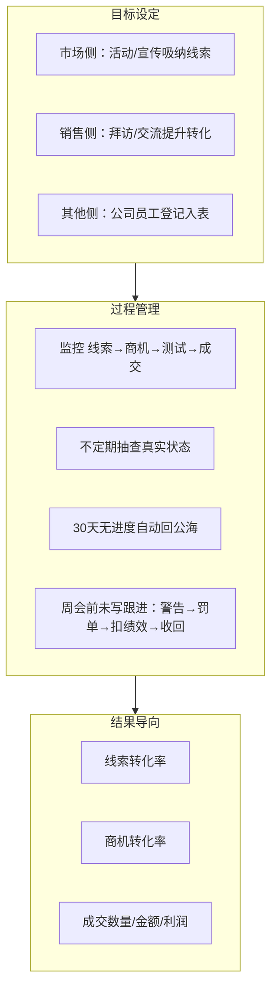
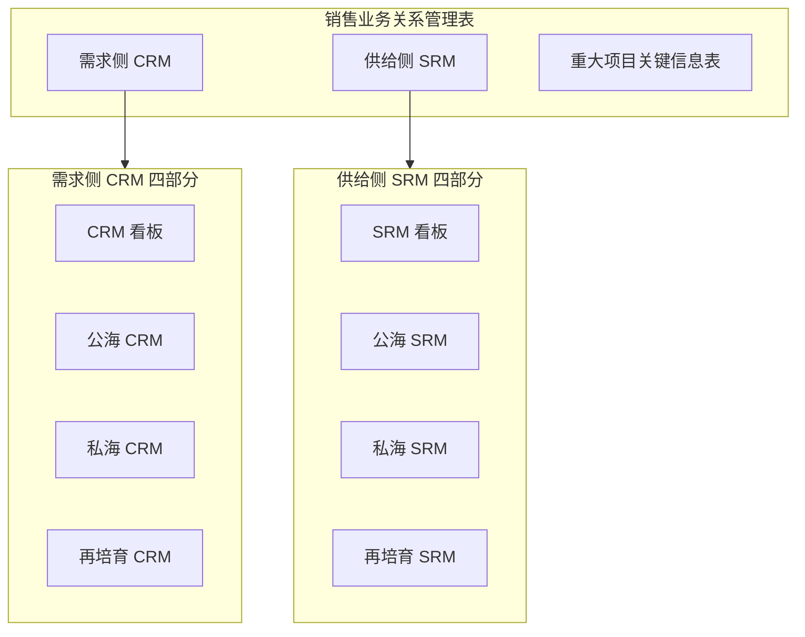
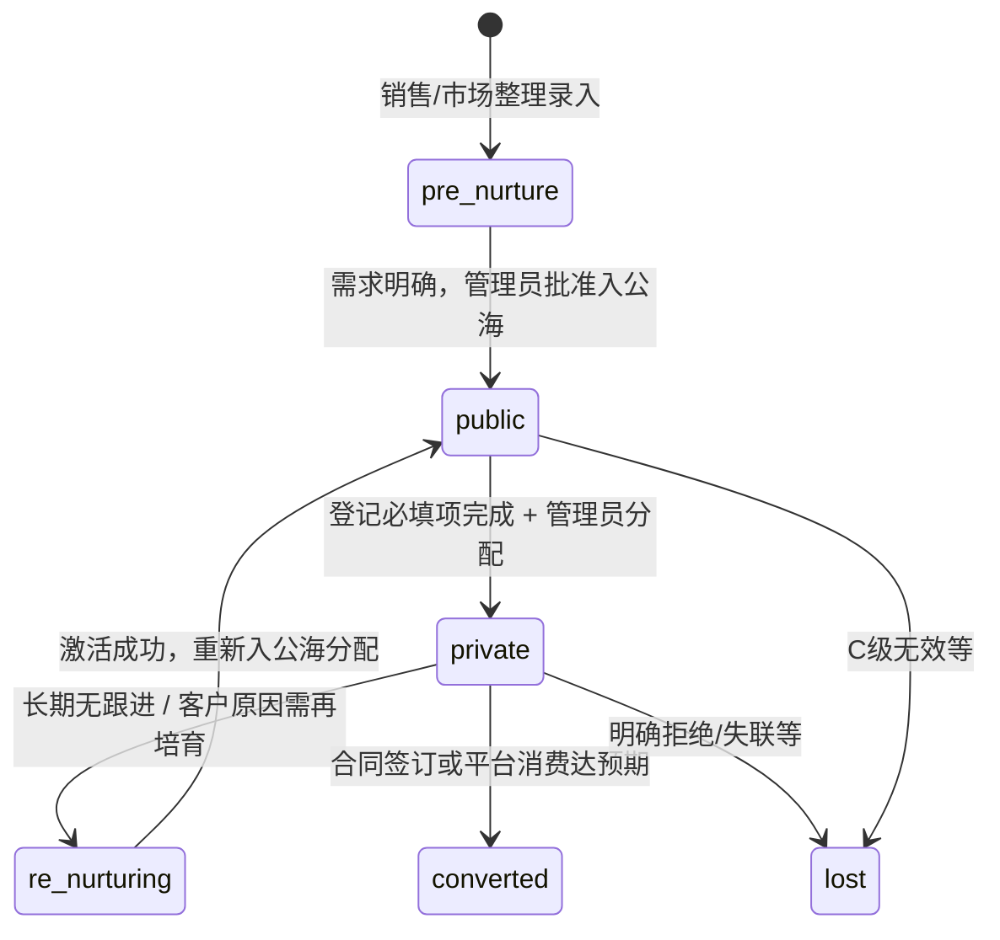
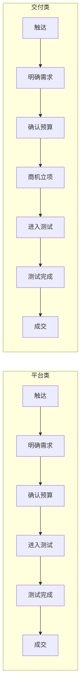

# 销售业务关系管理 — 数据库设计与飞书多维表格导入方案

> **版本**：v2.0（设计稿，对齐公司业务制度）  
> **日期**：2026-06-28  
> **状态**：设计稿 — **不修改代码**，供评审与排期  
> **页面入口（规划）**：`/crm/leads`（需求侧 CRM）、`/crm/srm/leads`（供给侧 SRM）、`/crm/major-projects`（重大项目）  
> **制度依据**：公司销售业务关系管理表相关规定（2026 业务大会）

**关联文档**：

- [crm-database.md](crm-database.md)（Customer / Project / Tenant、成交表）
- [feishu-integration-design.md](feishu-integration-design.md)（Bitable 同步、飞书提醒）
- [opportunity-import-design.md](opportunity-import-design.md)（宽表白名单、预览 → commit）
- [supply-chain-leads-design.md](supply-chain-leads-design.md)（供给侧 SRM 可关联 `supply_chain_lead`）

**文档性质**：本文是 **销售业务关系管理表** 的本地落库方案。**未填入本体系的线索商机不纳入考核**；一切设计围绕公司当前核心目标（稳定付费客户、月收入 200–300 万盈亏平衡）寻找最大梯度。

---

## 1. 业务目标与管理方法

### 1.1 三大目标

| 目标 | 说明 | 系统支撑 |
|------|------|----------|
| **服务公司年/季度目标** | 公司总目标拆解为线索/商机分目标；考核销售转化与市场部线索量 | `crm_lead_quota`、`crm_lead_kpi_snapshot` |
| **统一线索商机管理** | 全部线索统一入口，降低信息流失、减轻销售负担 | `crm_sales_lead` 主表 + 五池视图 + Bitable 同步 |
| **监督促进线索→测试→成交** | 监督转化率与全局指标；业务关系表与 **成交表** 关联互动 | 阶段机 + `tenant`/`project` 消费关联 + 考核报表 |

### 1.2 管理方法：目标设定 · 过程管理 · 结果导向



**过程管理硬规则（须系统可执行）**：

| 规则 | 触发条件 | 系统动作 |
|------|----------|----------|
| R-P1 无进度回收 | 私海线索分配后 **30 天** `last_progress_at` 无更新 | 流入 **再培育**（非直接公海）；飞书提醒销售 |
| R-P2 跟进缺失惩戒 | 销售周会前未填写跟进信息 | 第 1 次警告 → 第 2 次罚单 → 第 3 次扣绩效 → 第 4 次 **立即收回公海** |
| R-P3 收回前提醒 | 即将执行 R-P1 / R-P2-4 / 手动收回 | **收回公海前** 飞书提醒对应销售 |
| R-P4 禁止绕表测试 | 未登记线索直接拉交付/产研启动测试 | 创建测试/项目时校验 `crm_sales_lead_id` 或阻断 |
| R-P5 重大平台项目 | 平台类重大项目 | 每周销售周会前须上报进展（见 §4.4 重大项目表） |

### 1.3 考核指标（结果导向）

| 指标 | 定义 | 数据来源 |
|------|------|----------|
| 线索转化率 | 线索 → 商机的比例 | `lifecycle_phase` 由 `lead` 变为 `opportunity` |
| 商机转化率 | 商机 → 成交的比例 | `lifecycle_phase` 由 `opportunity` 变为 `deal` |
| 成交数量 | 考核期内推进成交的供给或客户数 | `crm_sales_lead_conversion` + SRM 匹配成交 |
| 销售金额 | 考核期内实际成交金额 | `tenant_bill` / `recharge` / `consumption_record` 关联线索 |
| 销售利润 | 考核期内实际销售利润 | 财务域 + 线索/项目归因 |

**分目标拆解**：年度/季度总目标 → 市场部线索量目标 + 销售部转化目标，写入 `crm_lead_quota`（见 §5.9）。

### 1.4 常规工作制度

- **周会制**：每周市场销售会；结论可维护进知识库（本期仅预留 `crm_weekly_meeting_note` 关联线索 ID，知识库域另建）。
- **再培育复盘**：低潜力线索每季度复盘；中潜力由市场部长期培育；高潜力优先激活分配。

---

## 2. 管理表总体架构

### 2.1 三大部分



| 部分 | 说明 | 物理实现 |
|------|------|----------|
| **需求侧 CRM** | 客户需求线索全生命周期，促进向成交转化 | `crm_sales_lead` WHERE `side=demand` |
| **供给侧 SRM** | 供给线索全生命周期；可关联 `supply_chain_lead` | `crm_sales_lead` WHERE `side=supply` |
| **重大项目** | 公司重大项目信息，确保进度可控 | `crm_major_project`（新建） |
| **公海前培育表** | 进入公海前的记录备忘，**不做跟进考核** | `pool_status=pre_nurture` |
| **CRM/SRM 看板** | 宏观可视化 | 读模型 / 物化视图，非独立业务表 |

> **统一主表**：需求侧与供给侧共用 `crm_sales_lead`，以 `side` 字段区分；公海/私海/再培育/公海前培育以 `pool_status` 区分。**看板**为聚合查询，不另存真值。

### 2.2 线索分类

**需求侧 CRM（`side=demand`）**

| `business_category` | 中文 | 说明 |
|---------------------|------|------|
| `product` | 产品类 | 官网弹性 / 裸金属 / 云主机可服务 |
| `delivery` | 交付类 | 需交付人员定制化交付 |
| `channel` | 渠道类 | 渠道开拓线索 |

**供给侧 SRM（`side=supply`）**

| `business_category` | 中文 | 说明 |
|---------------------|------|------|
| `spot_idle` | 闲时 | 闲时接入合作；需跟进 |
| `full_rent` | 整租 | 关键信息录入后 **仅记录**；有整租需求时匹配；匹配成功后供给+需求销售 **共分提成** |

### 2.3 池状态与表映射

| `pool_status` | 中文 | 对应管理表 | 是否纳入跟进考核 |
|---------------|------|-----------|----------------|
| `pre_nurture` | 公海前培育 | 公海前培育表（建议事项） | **否** |
| `public` | 公海 | 公海 CRM / 公海 SRM | 登记后待分配 |
| `private` | 私海 | 私海 CRM / 私海 SRM | **是** |
| `re_nurturing` | 再培育 | 再培育 CRM / 再培育 SRM | 按潜力分级 |
| `converted` | 已成交 | — | 归档 |
| `lost` | 已结束/丢失 | — | 归档 |

### 2.4 信息流转机制

**需求侧与供给侧流转规则相同**：



| 流转 | 触发机制 | 自动化 |
|------|----------|--------|
| 公海前培育 → 公海 | 需求明确；周会确认可入公海 | 管理员操作 |
| 公海 → 私海 | 登记人填完 **公海必填项**；管理员分配销售 | 分配后 **自动进私海** + **飞书提醒** 销售 |
| 私海 → 再培育 | ①30 天无进度（系统）② 有跟进但客户延期（人工） | 管理员选择进入再培育表时 **自动流入** |
| 再培育 → 公海 | 激活成功 | 管理员操作后 **自动流入公海** |
| 私海 → 公海（收回） | 惩戒/手动收回 | **收回前飞书提醒** |

**分配原则**：

| 来源 | 分配方式 |
|------|----------|
| 销售自拓 | 分配给对应销售 |
| 非销售自拓 | **抢占式**（销售群发布，先到先得）或 **直接分配式**（按业务特点分配给擅长销售） |

**再培育/公海跟进权**：

| 场景 | 原销售是否可激活/跟进 |
|------|----------------------|
| **强制收回** | **否** |
| 其他（客户延期等） | **是**（原销售继续激活） |
| 再培育 → 公海（强制收回） | 原销售 **不可** 跟进 |
| 再培育 → 公海（非强制） | **激活人** 继续跟进 |

---

## 3. 关键节点与阶段定义

### 3.1 线索 · 商机 · 成交

| 阶段 | `lifecycle_phase` | 进度区间 | 定义要点 | 标志性动作 |
|------|-------------------|----------|----------|-----------|
| **线索** | `lead` | 0%–25% | 触达、明确需求 | 公海必填项完成并 **分配** |
| **商机** | `opportunity` | 25%–90% | 需求具体且匹配；有预算/决策人/推进时间 | 客户有 **明确合作方案** |
| **成交** | `deal` | 100% | 合同签订完成 **或** 平台消费达预期 | 合同签订 & 消费记录 |

**商机三特征**（须同时满足方可 `lifecycle_phase=opportunity`）：

1. 需求具体且与我司算力产品/服务高度契合  
2. 具备购买或合作基础条件（预算/意向 + 决策流程与决策人）  
3. 有明确推进时间与意向（非无限期拖延）  

### 3.2 时间进度（`progress_percent`）

| 节点 | `follow_stage` | 进度 % | 所属生命周期 |
|------|----------------|--------|-------------|
| 建联 | `connect` | 0 | 线索 |
| 触达 | `reach` | 10 | 线索 |
| 明确需求 | `qualified` | 25 | 线索（**线索结束**） |
| 确认预算 | `budget_confirmed` | 40 | 商机 |
| 进入测试 | `trial_started` | 50 | 商机 |
| 测试对接 | `trial_docking` | 75 | 商机 |
| 测试完成 | `trial_completed` | 90 | 商机（**商机结束**） |
| 成交 | `deal_closed` | 100 | 成交 |

**平台类**阶段路径：公海 → 私海 → 触达 → 明确需求 → 确认预算 → 进入测试 → … → 成交  

**交付类**额外节点：在「确认预算」与「进入测试」之间增加 **商机立项**（`opportunity_project_init`）。



### 3.3 活跃强度（`activity_intensity`）

**评估周期**：线索 **分配后每两周** 动态评估（非静态字段）。

| 强度 | 含义 |
|------|------|
| 25% | 两周内联系 **一次**，强度弱 |
| 50% | 两周内客户有 **有效信息反馈** |
| 75% | 两周内 **不断深挖需求、匹配方案** |
| 100% | **持续沟通跟进**，较大可能推进到商机 |

系统：Cron 每两周根据 `crm_sales_lead_activity` 自动建议强度；销售可在周会前确认。索引列 `{阶段}-{公司}-{强度}` 中强度与此对齐。

### 3.4 线索质量分级（市场部）

| 级别 | `lead_grade` | 应用场景 | 公海规则 |
|------|--------------|----------|----------|
| S | `S` | 高成熟度 | 可分配 |
| A | `A` | 中成熟度 | 可分配 |
| B | `B` | 低成熟度，观望犹豫 | **不可分配**；即使写入公海也不分配，联系登记人删除 |
| C | `C` | 无效：拒绝/不回复/失联 | **不可分配** |

**分级依据**（非仅初始信息）：线索清洗（验证真实性）+ 行为追踪（后续互动）。系统字段支撑：

| 维度 | 字段 |
|------|------|
| 显卡型号/数量 | `crm_sales_lead_gpu_requirement` |
| 关键决策人/联系方式 | `crm_sales_lead_contact` |
| 详细需求 | `product_fit`、`expected_start_date`、`usage_frequency`、`session_duration` |
| 行为追踪 | `last_engagement_at`、`engagement_score`（可选，来自官网/推送打开率） |

### 3.5 必填项与「爆红」校验

- 公海 **新线索**：存在 `validation_errors`（必填未填）→ **不予分配**  
- 私海线索：存在爆红 → **不可在周会表填写**（UI 禁用提交）  
- 必填项规则按 `side` + `business_category` + `pool_status` 配置于 `crm_lead_field_rule`（见 §5.10）

### 3.6 再培育潜力与激活动作

| `re_nurture_potential` | 策略 | 负责方 |
|------------------------|------|--------|
| 高 | 优先激活；可重新入公海分配 | 原销售/激活人 |
| 中 | 不专门分配销售；市场部长期宣传培育 | 市场部 |
| 低 | 暂停激活；**每季度复盘** | 管理层 |

---

## 4. 飞书源表与管理表映射

### 4.1 源表一览

| 飞书表（现状） | `source_table_kind` | 映射管理表 | `side` 默认 |
|---------------|---------------------|-----------|-------------|
| 私海主线索 | `private_master` | 私海 CRM/SRM | 按「类型」列 |
| 线索登记/培育 | `nurturing` | 公海前培育 / 公海 | demand/supply |
| 销售跟进 | `sales_follow_up` | 私海 CRM/SRM | 同上 |
| 公海再培育 | `public_re_nurture` | 再培育 CRM/SRM | 同上 |
| 活动线索 | `campaign` | 公海前培育 → 公海 | demand |

### 4.2 索引列（跨表关联键）

| 表 | 索引列格式 | 示例 |
|----|-----------|------|
| 私海主线索 | `{公司名}-{活跃强度}` | `驭来智能-100%` |
| 销售跟进 | `{跟进阶段}-{公司名}-{活跃强度}` | `明确需求-影眸科技-25%` |
| 公海再培育 | `{公司名}-{活跃强度}` | `云梧-50%` |
| 活动线索 | `{公司名}-{类型}` | `自由量级-客户-需求` |

**归并键**：`company_name`（默认同公司一条线索）；`feishu_external_link` 绑定后优先按 `record_id` 更新。

### 4.3 字段映射（私海主线索 — 节选）

| 标准表头 | 映射 | 备注 |
|----------|------|------|
| 线索公司 | `company_name` | 归并键 |
| 类型 | `side` + `business_category` | 平台→demand+product；供给→supply |
| 线索级别 | `lead_grade` | S/A/B/C |
| 总体跟进节点 | `follow_node` + 推导 `progress_percent` | |
| 线索活跃强度 | `activity_intensity` | 25/50/75/100 |
| 线索/渠道来源 | `source_channel` | 销售自拓→自分配 |

完整白名单与 v1.0 一致，见 §4.3 扩展：`side`、`business_category`、`lifecycle_phase`、`progress_percent`。

### 4.4 重大项目关键信息表（飞书 / 本地）

| 字段 | 说明 |
|------|------|
| 项目名称 | `name` |
| 关联线索 | `lead_id` 可空 |
| 关联项目 | `project_id` 可空（转正后） |
| 项目类型 | 平台类重大 / 交付类重大 |
| 当前阶段 | 同 `follow_stage` |
| 周进展摘要 | 每周周会前必填 |
| 负责人 | `owner_staff_id` |
| 风险与阻塞 | `risk_notes` |

---

## 5. 数据库表结构设计

约定：主键 `text`（ULID）；金额 `numeric(15,4)`；时间 `timestamptz`；枚举 `varchar` + 应用校验。

### 5.1 `crm_sales_lead`（线索/商机主表 — 需求侧+供给侧统一）

在 v1.0 基础上 **新增/调整** 列：

| 列名 | 类型 | 说明 |
|------|------|------|
| `side` | varchar(16) NOT NULL | `demand`（CRM）\| `supply`（SRM） |
| `business_category` | varchar(32) NOT NULL | §2.2：`product` \| `delivery` \| `channel` \| `spot_idle` \| `full_rent` |
| `lifecycle_phase` | varchar(32) NOT NULL | `lead` \| `opportunity` \| `deal` |
| `progress_percent` | smallint | 0–100，§3.2 |
| `lead_grade` | varchar(8) | `S` \| `A` \| `B` \| `C` |
| `is_forced_reclaim` | boolean DEFAULT false | 是否强制收回（影响再培育激活权） |
| `assignment_mode` | varchar(32) | `self_sourced` \| `grab` \| `direct_assign` |
| `validation_errors` | jsonb | 必填项校验结果 `{ field, message }[]`；非空=爆红 |
| `last_engagement_at` | timestamptz | 行为追踪：最后互动时间 |
| `engagement_score` | smallint | 可选：市场部分数 |
| `match_demand_lead_id` | text FK | 整租供给匹配到的需求线索（SRM 分成用） |
| `match_supply_lead_id` | text FK | 需求侧关联供给线索 |
| `supply_commission_split` | jsonb | 整租匹配成功后供给/需求销售分成比例 |

**移除/替换 v1.0 歧义**：

- `lead_type` 拆为 `side` + `business_category`  
- `lead_grade` 仅 S/A/B/C（原 A级→`A`）  
- `pool_status` 增加 `pre_nurture`；去掉单独 `nurturing` 与「公海前培育」合并语义  

**索引补充**：

```sql
CREATE INDEX crm_sales_lead_side_pool_idx ON crm_sales_lead (side, pool_status, status);
CREATE INDEX crm_sales_lead_lifecycle_idx ON crm_sales_lead (lifecycle_phase, progress_percent);
CREATE INDEX crm_sales_lead_lead_grade_idx ON crm_sales_lead (lead_grade);
CREATE INDEX crm_sales_lead_assigned_at_idx ON crm_sales_lead (assigned_at) WHERE pool_status = 'private';
```

v1.0 其余列（联系人、GPU、预测、再培育字段等）**保留**，见 v1.0 §4.1。

### 5.2 `crm_major_project`（重大项目）

| 列名 | 类型 | 约束 | 说明 |
|------|------|------|------|
| `id` | text | PK | |
| `name` | varchar(255) | NOT NULL | |
| `lead_id` | text | FK → crm_sales_lead | 可空 |
| `project_id` | text | FK → project | 转正后 |
| `business_category` | varchar(32) | | product / delivery |
| `follow_stage` | varchar(64) | | |
| `progress_percent` | smallint | | |
| `owner_staff_id` | text | FK → user_staff | |
| `priority_quadrant` | varchar(32) | | |
| `risk_notes` | text | | |
| `last_weekly_report_at` | timestamptz | | 最近周会上报 |
| `status` | varchar(32) | NOT NULL | active / paused / completed |
| `created_at` / `updated_at` | timestamptz | | |

**`crm_major_project_weekly_report`**

| 列名 | 说明 |
|------|------|
| `id`, `major_project_id` | |
| `report_week` | char(7) 或 date（周起始日） |
| `summary` | text NOT NULL |
| `author_staff_id` | FK |
| `created_at` | |

### 5.3 `crm_sales_lead_compliance_event`（跟进惩戒审计）

| 列名 | 类型 | 说明 |
|------|------|------|
| `id` | text PK | |
| `lead_id` | text FK | |
| `owner_staff_id` | text FK | 当时跟进人 |
| `event_type` | varchar(32) | `warning` \| `fine` \| `performance_deduct` \| `forced_reclaim` |
| `occurrence_count` | smallint | 累计第几次 |
| `meeting_week` | date | 对应周会周 |
| `notes` | text | |
| `created_at` | timestamptz | |

### 5.4 `crm_sales_lead_pool_event`（扩展）

增加列：

| 列名 | 说明 |
|------|------|
| `trigger_type` | `manual` \| `auto_30d` \| `penalty_4th` \| `admin` |
| `forced_reclaim` | boolean |
| `feishu_notified_at` | 收回前提醒发送时间 |

### 5.5 子表（与 v1.0 一致，略）

- `crm_sales_lead_contact`  
- `crm_sales_lead_gpu_requirement`  
- `crm_sales_lead_activity`  
- `crm_sales_lead_assignment`  
- `crm_sales_lead_conversion`  
- `crm_sales_lead_import_batch` / `_item`  
- `crm_sales_lead_bitable_sync_config`  

### 5.6 成交表关联（业务关系表 ↔ 成交）

| 关联 | 说明 |
|------|------|
| `crm_sales_lead.converted_customer_id` | 转正客户 |
| `crm_sales_lead.converted_project_id` | 经营项目 |
| `project.primary_tenant_id` → `tenant` | 计费账户 |
| `recharge` / `consumption_record` / `tenant_bill` | **成交表**事实；通过 `project_id` 或 `tenant_id` 回连线索 |
| `crm_sales_lead_conversion.metadata` | 快照：转正时预测 vs 实际 |

**成交判定（双轨）**：

1. **合同轨**：`contract.status=active` 且关联 `project_id`  
2. **消费轨**：`tenant` 在转正后累计消费 ≥ 预期阈值（可配置）→ 自动 `lifecycle_phase=deal`、`progress_percent=100`  

### 5.7 `crm_sales_lead_conversion`（扩展）

| 新增列 | 说明 |
|--------|------|
| `deal_type` | `contract` \| `consumption` |
| `deal_amount` | 实际成交金额 |
| `deal_profit` | 实际利润（财务回填） |
| `demand_owner_staff_id` | 整租匹配：需求侧销售 |
| `supply_owner_staff_id` | 整租匹配：供给侧销售 |

### 5.8 整租供给匹配（SRM）

`business_category=full_rent` 的线索：

- 默认 **不进入跟进考核**（`follow_required=false` 标记或池内规则）  
- 需求侧出现整租需求时，按 GPU/地区/卡型 **匹配** `match_supply_lead_id`  
- 匹配成功创建 `crm_sales_lead_match` 记录，触发 **双销售提成** 规则（写入 `supply_commission_split`）

**`crm_sales_lead_match`**

| 列名 | 说明 |
|------|------|
| `id` | |
| `demand_lead_id` | FK |
| `supply_lead_id` | FK |
| `matched_at` | |
| `matched_by` | staff |
| `commission_rule` | jsonb |
| `status` | proposed / confirmed / deal_closed |

### 5.9 `crm_lead_quota`（目标拆解）

| 列名 | 说明 |
|------|------|
| `id` | |
| `period_type` | year / quarter |
| `period_key` | `2026` / `2026-Q2` |
| `department` | marketing / sales |
| `staff_id` | 可空（部门目标） |
| `metric` | lead_count / lead_to_opp_rate / opp_to_deal_rate / deal_amount / deal_profit |
| `target_value` | numeric |
| `created_at` | |

### 5.10 `crm_lead_field_rule`（必填项配置）

| 列名 | 说明 |
|------|------|
| `id` | |
| `side` | demand / supply |
| `business_category` | 可空=全部 |
| `pool_status` | public / private / … |
| `field_key` | 如 `company_name`, `gpu_requirement`, `contact_phone` |
| `required` | boolean |
| `error_message` | 爆红提示文案 |

Job：写入/同步前跑校验 → 更新 `validation_errors`。

### 5.11 `crm_lead_kpi_snapshot`（考核快照 — 物化/定期 Job）

按 `staff_id` + `period_key` 汇总：线索数、商机数、成交数、转化率、金额、利润；供报表与绩效。

---

## 6. 自动化 Job 规划

| Job | 周期 | 动作 |
|-----|------|------|
| `lead-30d-stale-check` | 日 | 私海 30 天无 `last_progress_at` → 再培育 + 飞书提醒 |
| `lead-weekly-follow-check` | 周会前 1 天 | 私海无本周 activity → 累计 compliance_event |
| `lead-intensity-suggest` | 每两周 | 根据 activity 建议 `activity_intensity` |
| `lead-grade-gate` | 实时 | B/C 级阻止分配 |
| `lead-deal-detect` | 日 | 消费达预期 → `lifecycle_phase=deal` |
| `major-project-weekly-remind` | 周会前 | 重大平台项目未填 weekly_report → 飞书提醒 |
| `bitable-sync-*` | 见 §7 | 五表增量同步 |

**飞书提醒模板**：

| 事件 | 接收人 | 内容 |
|------|--------|------|
| 公海→私海分配 | 被分配销售 | 线索公司、来源、级别、链接 |
| 收回公海前 | 当前 owner | 原因、截止动作 |
| 30 天无进度 | owner + 管理员 | 即将/已进入再培育 |
| 惩戒警告 | owner | 第 N 次未填跟进 |

---

## 7. 飞书多维表格自动导入（更新）

### 7.1 架构

与 v1.0 相同：复用 `bitable-client`、`feishu_integration_job_run`、preview → commit 两步流。

### 7.2 同步时新增逻辑

| 步骤 | 说明 |
|------|------|
| 解析 `side` | 类型=供给 → `supply`；平台/需求/客户-需求 → `demand` |
| 解析 `business_category` | 源表「类型」+ 业务场景启发式；活动线索默认 `product` |
| 映射 `follow_stage` → `progress_percent` + `lifecycle_phase` | §3.2 对照表 |
| 跑 `crm_lead_field_rule` | 写入 `validation_errors` |
| B/C 级 | `pool_status=public` 但 `assignable=false`（虚拟标记或 `validation_errors` 含 GRADE_BLOCK） |

### 7.3 五表优先级（不变）

销售跟进 > 私海主表 > 公海再培育 > 登记培育 > 活动线索

### 7.4 配置示例

| 配置 name | source_table_kind | pool 默认 |
|-----------|-------------------|-----------|
| 私海主线索 | `private_master` | private |
| 线索登记培育 | `nurturing` | pre_nurture / public |
| 销售跟进 | `sales_follow_up` | private |
| 公海再培育 | `public_re_nurture` | re_nurturing |
| 活动线索 | `campaign` | pre_nurture |

---

## 8. 转化与成交联动

### 8.1 线索 → 商机

**人工确认** 或 系统校验三特征后：

- `lifecycle_phase`: `lead` → `opportunity`  
- `follow_stage`: ≥ `budget_confirmed`  
- `progress_percent`: ≥ 40  
- 写 `crm_sales_lead_activity`（`type=stage_change`）

### 8.2 商机 → 测试 → 成交

| 节点 | 系统动作 |
|------|----------|
| 进入测试 | 校验已登记线索；创建/关联 `project`（`stage=testing`）；**禁止绕表** |
| 测试完成 90% | 更新 `follow_stage=trial_completed` |
| 成交 100% | 合同 **或** 消费达标；`pool_status=converted`；写 `crm_sales_lead_conversion` |

### 8.3 与 project.stage 映射

| follow_stage | project.stage | lifecycle_phase |
|--------------|---------------|-----------------|
| trial_started | testing | opportunity |
| trial_completed | testing | opportunity |
| deal_closed | converted | deal |

---

## 9. API 与页面（规划）

### 9.1 路由

| 路由 | 说明 |
|------|------|
| `/crm/leads` | 需求侧：看板 + 公海/私海/再培育 Tab |
| `/crm/leads/pre-nurture` | 公海前培育（无考核） |
| `/crm/srm/leads` | 供给侧：同上 + 整租匹配 |
| `/crm/major-projects` | 重大项目 + 周报 |
| `/crm/leads/kpi` | 转化率/金额/利润考核 |

### 9.2 核心 API

| 能力 | 说明 |
|------|------|
| 分配线索 | 校验 `validation_errors` 为空 + grade∈{S,A} → private + 飞书 |
| 收回/再培育/激活 | 写 pool_event + 权限规则 §2.4 |
| 抢占线索 | `assignment_mode=grab`，先到先得锁 |
| 周会跟进提交 | 校验私海无爆红 |
| 整租匹配 | POST match demand↔supply |
| KPI 报表 | 按 quota 对比实际 |

---

## 10. 样例解析（更新）

### 10.1 驭来智能（私海 · 平台类 · A级）

- `side=demand`, `business_category=product`, `pool_status=private`  
- `lifecycle_phase=lead`, `follow_stage=reach`, `progress_percent=10`（若节点=线索且已分配则为触达前后）  
- `lead_grade=A`, `activity_intensity=100`, `assignment_mode=self_sourced`  
- `source_channel=销售自拓` → 分配给苑雨川  

### 10.2 影眸科技（再培育 · 明确需求 25%）

- `follow_stage=qualified`, `progress_percent=25`, `lifecycle_phase=lead`（未达商机三特征）  
- `activity_intensity=25`, `in_re_nurture=true`, `re_nurture_potential=高`  
- `return_reason=客户需求延期`  

### 10.3 山东爱特云翔（供给 · 公海 · 高潜力）

- `side=supply`, `business_category=spot_idle`, `pool_status=public`  
- 详细信息含数据中心与卡型 → 同步 GPU requirement + 可选 `linked_supply_chain_lead_id`  

---

## 11. Rollout

| 阶段 | 内容 |
|------|------|
| P0 | DDL + 制度枚举 + 必填规则种子 + Bitable preview |
| P1 | 五表历史导入 + validation + grade 门禁 |
| P2 | 分配/收回/飞书提醒 + 30 天 Job |
| P3 | 成交关联 + KPI 快照 + 考核报表 |
| P4 | 重大项目周报 + 整租匹配 + 双销售提成 |
| P5 | 公海前培育表 + 周会 compliance 四档惩戒 |

---

## 12. 表清单速查

| 表名 | 中文 |
|------|------|
| `crm_sales_lead` | 线索/商机主表（CRM+SRM） |
| `crm_major_project` | 重大项目 |
| `crm_major_project_weekly_report` | 重大项目周报 |
| `crm_sales_lead_contact` | 联系人 |
| `crm_sales_lead_gpu_requirement` | 算力需求 |
| `crm_sales_lead_activity` | 跟进动态 |
| `crm_sales_lead_pool_event` | 池流转审计 |
| `crm_sales_lead_assignment` | 跟进人历史 |
| `crm_sales_lead_conversion` | 成交/转正审计 |
| `crm_sales_lead_compliance_event` | 跟进惩戒 |
| `crm_sales_lead_match` | 整租供需匹配 |
| `crm_lead_quota` | 目标拆解 |
| `crm_lead_field_rule` | 必填项规则 |
| `crm_lead_kpi_snapshot` | 考核快照 |
| `crm_sales_lead_import_batch` / `_item` | 导入批次 |
| `crm_sales_lead_bitable_sync_config` | Bitable 配置 |

---

## 13. 文档维护

- 公司制度变更时同步 §1–§3、§6 Job 规则  
- 飞书表头变更时同步 §4、§7  
- 实现后更新版本状态并链接 migration 号  
- **考核口径**：仅 `crm_sales_lead` 内且 `pool_status` 曾进入可考核池的线索计入绩效；`pre_nurture` 不计入  

---

## 附录 A：生命周期与进度对照（速查）

| follow_stage | progress | lifecycle_phase | 中文 |
|--------------|----------|-----------------|------|
| connect | 0 | lead | 建联 |
| reach | 10 | lead | 触达 |
| qualified | 25 | lead | 明确需求 |
| budget_confirmed | 40 | opportunity | 确认预算 |
| opportunity_project_init | 45 | opportunity | 商机立项（仅交付类） |
| trial_started | 50 | opportunity | 进入测试 |
| trial_docking | 75 | opportunity | 测试对接 |
| trial_completed | 90 | opportunity | 测试完成 |
| deal_closed | 100 | deal | 成交 |

## 附录 B：池状态 × 考核

| pool_status | 纳入线索量考核 | 纳入跟进考核 | 可分配 |
|-------------|---------------|-------------|--------|
| pre_nurture | 否 | 否 | 否 |
| public | 是（市场部） | 否 | S/A 级可 |
| private | 是 | **是** | — |
| re_nurturing | 是 | 按潜力 | 高潜力可 |
| converted | 是（成交） | 否 | — |
| lost | 否 | 否 | — |

## 附录 C：导入时序（同 v1.0）

见 v1.0 附录 A；commit 前增加 `validateLeadFields()` 与 `applyGradeGate()` 步骤。
