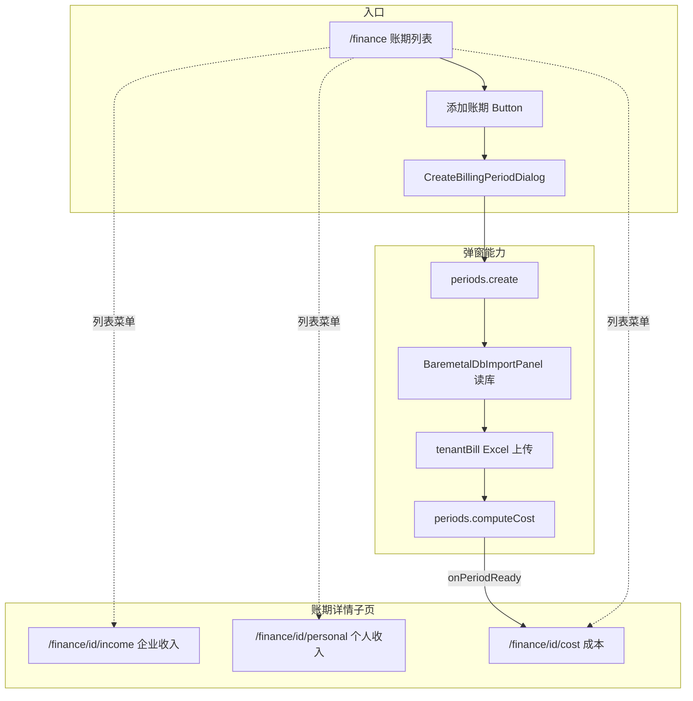

# 添加账期弹窗实现方案

> 版本：v1.3  
> 日期：2026-07-07  
> 状态：**已实施**  
> 入口：`/finance` 账期列表页「添加账期」按钮  
> 组件：`apps/web/src/app/[locale]/(protected)/finance/_components/create-billing-period-dialog.tsx`  
> 关联：  
> - [finance-single-period-income-design.md](finance-single-period-income-design.md)（企业收入 · 账期详情页 `/finance/[id]/income`）  
> - [finance-cost-regenerate-baremetal-source-design.md](finance-cost-regenerate-baremetal-source-design.md)（裸金属读库）  
> - [billing-period-import-design.md](billing-period-import-design.md) §0（现行口径）

---

## 1. 背景与已确认决策

### 1.1 业务目标

在账期列表页通过弹窗完成：

1. **创建账期**（元数据 + `ignoreListPriceWindows`）
2. **计算成本** — 裸金属读库（`ordered_at` 筛选）+ **客户账单详情 Excel**

**收入不在弹窗内处理**。企业收入在账期详情页 `/finance/{id}/income` 单独计算（读 CRM `tenant_bill` + `tenant_bill_detail`）；个人收入在 `/finance/{id}/personal`。

### 1.2 已确认产品决策

| # | 决策 | 说明 |
|---|------|------|
| D1 | 成本完成后跳转 | 成本计算成功 → **`/finance/{billingPeriodId}/cost`**（`onPeriodReady` 回调，弹窗自动关闭） |
| D2 | 收入交互 | **不在弹窗内**；文案提示「收入请在账期详情页单独处理」 |
| D3 | 刊例价分段 | 「忽略刊例价分段」选项（§3.4）；开启后按账期结束日当前有效刊例价整月计算；配置缺失则报错停止 |
| D4 | 旧页面 | **`/finance/create` 已移除**；账期列表弹窗为唯一创建入口 |
| D5 | 弹窗默认策略 | 本弹窗 **默认勾选**「忽略刊例价分段」 |

### 1.3 非目标

- 不在弹窗内实现 `validateSingleIncome` / `computeSingleIncome`
- 不在弹窗内实现「发布账期」
- 不在弹窗内编辑补充消费

---

## 2. 架构与代码边界



### 2.1 文件清单

| 文件 | 职责 |
|------|------|
| `finance/_components/create-billing-period-dialog.tsx` | 主弹窗：创建 + 裸金属读库 + 客户账单上传 + 计算成本 |
| `components/dashboard/finance-billing-periods-content.tsx` | 挂载弹窗；`onPeriodReady` → `/finance/{id}/cost` |
| `finance/_components/baremetal-db-import-panel.tsx` | 裸金属读库 UI |
| `finance/_components/billing-period-cost-pre-check-alerts.tsx` | 成本前置校验提示 |

---

## 3. 弹窗交互设计

### 3.1 阶段划分

| 阶段 | 标题 | 内容 |
|------|------|------|
| `create` | 添加账期 | 元数据 + **忽略刊例价分段** |
| `manage` | 账期 {code} | 裸金属读库 + 客户账单上传 + **计算成本** |

关闭弹窗时重置全部本地状态（含选项恢复默认勾选）。

支持 `initialPeriodId`：从列表「重新上传成本」等场景直接进入 `manage` 阶段。

### 3.2 Wireframe（create 阶段）

```
┌──────────────────────────────────────────────────────────────┐
│ 添加账期                                          [×]         │
│ 填写账期信息后创建；创建成功后导入裸金属并上传客户账单计算成本  │
│ 收入请在账期详情页单独处理                                    │
├──────────────────────────────────────────────────────────────┤
│ period_code    period_start    period_end                     │
│ [✓] 忽略刊例价分段                                            │
│                              [取消]  [创建账期]                │
└──────────────────────────────────────────────────────────────┘
```

### 3.3 Wireframe（manage 阶段）

```
┌──────────────────────────────────────────────────────────────┐
│ 账期 2026-05                                    [×]           │
│ 从 bare_metal_order 读库并上传客户账单详情                    │
├──────────────────────────────────────────────────────────────┤
│ ✓ 账期已创建  [2026-05]  [忽略刊例价分段 ✓]                   │
│ ⚠ 成本前置校验（缺刊例价 / 分成配置等）                        │
├──────────────────────────────────────────────────────────────┤
│ 上传并计算成本                                                │
│   BaremetalDbImportPanel（读库）                              │
│   客户账单详情 Excel（1 份或按 window 多份）                   │
│                                    [计算成本]                  │
├──────────────────────────────────────────────────────────────┤
│                                              [关闭]           │
└──────────────────────────────────────────────────────────────┘
```

成本计算成功后弹窗关闭并跳转 **`/finance/{id}/cost`**；manage 阶段无「完成并查看详情」按钮。

### 3.4 「忽略刊例价分段」选项

| 项 | 说明 |
|----|------|
| 字段 | `ignoreListPriceWindows: boolean` |
| 持久化 | `billing_period.ignore_list_price_windows`；创建后不可改 |
| 弹窗默认 | **勾选**（D5） |
| 开启时 | 整月 1 份客户账单；成本按 `period_end` 单点刊例价（§6.2） |
| 关闭时 | 按刊例价变动日切分多 window，每段各上传 1 份 Excel |

### 3.5 按钮与跳转

| 按钮 | 条件 | 行为 |
|------|------|------|
| 创建账期 | 表单合法 | `periods.create` → `manage` |
| 计算成本 | 裸金属读库就绪 + 各 window 账单解析 ok + `canComputeCost` | `computeCost` → `onPeriodReady` → `/finance/{id}/cost` |
| 关闭 | 任意 | 关闭弹窗 |

---

## 4. tRPC 接入明细

### 4.1 创建账期

```typescript
await createPeriod.mutateAsync({
  periodCode,
  periodStart,
  periodEnd,
  ignoreListPriceWindows,
})
```

创建成功后 `validate` 拉取 window 与 slot 状态。

### 4.2 计算成本

| `ignoreListPriceWindows` | 裸金属 | 客户账单详情 |
|--------------------------|--------|--------------|
| `true` | `BaremetalDbImportPanel` | **1 份** Excel（整月） |
| `false` | 同上 | **N 份** Excel（每 price window 各 1 份） |

```typescript
await computeCost({ billingPeriodId })
```

后端根据账期 persisted 的 `ignoreListPriceWindows` 选择定价策略；前端无需再传 flag。

### 4.3 完成后跳转

```typescript
// finance-billing-periods-content.tsx
onPeriodReady={async (period) => {
  await utils.finance.periods.list.invalidate()
  router.push(`/finance/${period.id}/cost`)
}}
```

---

## 5. 后端配套（`ignoreListPriceWindows`）

### 5.1 `ignoreListPriceWindows = true`

| 环节 | 行为 |
|------|------|
| **create** | 持久化 `ignore_list_price_windows = true` |
| **syncTenantBillWindows** | 强制 **仅 1 个** window：`period_start ~ period_end` |
| **validate.canComputeCost** | 1 个 tenantBill window + baremetal ok |
| **成本定价** | `period_end` 当日当前有效平台刊例价 |
| **缺失配置** | `UNPROCESSABLE` / `PRECONDITION_FAILED`，停止计算 |

### 5.2 `ignoreListPriceWindows = false`

与多 window 现网行为一致：分段上传、分段刊例价。

### 5.3 Schema

| 位置 | 字段 |
|------|------|
| `billing_period` | `ignore_list_price_windows boolean NOT NULL DEFAULT false` |
| `periodCreateSchema` | `ignoreListPriceWindows` |

---

## 6. 与企业 / 个人收入的关系

| 能力 | 入口 | 数据源 |
|------|------|--------|
| 企业收入 | `/finance/[id]/income` | CRM `tenant_bill` + `tenant_bill_detail` |
| 个人收入 | `/finance/[id]/personal` | 客户账单 Excel + 可选裸金属读库 |
| 成本 | 本弹窗 + `/finance/[id]/cost` | 裸金属读库 + 客户账单详情 Excel |

账期列表行操作菜单可分别进入 income / personal / cost，与弹窗职责分离。

---

## 变更记录

| 版本 | 日期 | 说明 |
|------|------|------|
| v1.1 | 2026-05-29 | 忽略刊例价分段选项 |
| v1.2 | 2026-06-23 | 已实施；裸金属改读库 |
| v1.3 | 2026-07-07 | **对齐现网**：弹窗仅创建+成本；移除 `/finance/create` 与弹窗内收入；完成后跳转 **cost** 页 |
