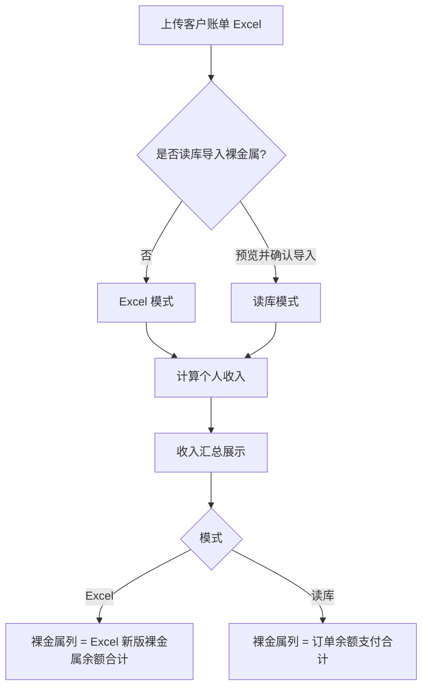

# 个人收入 · 裸金属双源口径方案

> 版本：v1.3  
> 日期：2026-07-07  
> 状态：**已实施**（规则 `v2.0`）  
> 页面：`apps/web/src/app/[locale]/(protected)/finance/[id]/personal/page.tsx`  
> 关联实现：`compute-personal-income.ts`、`import.ts`、`validate-personal-income.ts`、`baremetal-db-import.ts`  
> 关联文档：  
> - [finance-personal-income-design.md](finance-personal-income-design.md)（v1.2 现行实现）  
> - [finance-cost-regenerate-baremetal-source-design.md](finance-cost-regenerate-baremetal-source-design.md)（裸金属读库映射）

---

## 1. 背景与问题

### 1.1 基线（v1.2，已废止）

v1.2 个人收入计算简单相加 Excel 余额 + 读库裸金属，且裸金属**必填**、汇总仅 **2 行**（`non_project` + `blacklist`）。  
**v2.0 已落地**，本文档描述现行行为；概要见 [finance-personal-income-design.md](finance-personal-income-design.md) v2.0。

### 1.2 业务变化

平台导出的「客户账单详情」Excel 已包含裸金属明细，通过列 **「类型」=「新版裸金属」** 标识；该行上的 **「余额消费」** 即为裸金属的余额支付部分。

若仍按 v1.2 逻辑：Excel 余额消费（含新版裸金属行）+ 读库裸金属订单，会在 **总消费** 上对同一笔裸金属 **重复计量**。

### 1.3 目标

1. 识别 Excel 中 `类型 = 新版裸金属` 的行，与弹性/GPU 等行区分。  
2. **裸金属读库导入改为可选**；用户可仅依赖 Excel。  
3. **互斥汇总**：同一账期只选一种裸金属口径——读库 **或** Excel，不可叠加。  
4. 消除总消费重复；与企业收入「余额 / 裸金属分项」语义对齐。

---

## 2. 需求摘要

| # | 需求 | 说明 |
|---|------|------|
| R1 | Excel 含裸金属行 | 列「类型」，值「新版裸金属」；该行「余额消费」表示裸金属余额支付 |
| R2 | 裸金属读库可选 | 「裸金属消费订单」组件可导入，也可不导入 |
| R3a | 已读库导入时 | **线上裸金属消费** = 读库订单余额支付汇总；**忽略** Excel 中「新版裸金属」行的余额消费 |
| R3b | 未读库导入时 | **线上裸金属消费** = Excel 中「类型=新版裸金属」行的 **余额消费** 汇总 |
| R4 | 余额消费列 | 始终为 Excel 中 **非**「新版裸金属」行的余额消费合计（两种模式一致） |
| R5 | 总消费 | `余额消费 + 线上裸金属消费`（券消费仍仅对账，不计入） |
| R6 | 汇总行详情 | 各汇总行支持 **查看租户明细** 与 **Excel 导出**（§15） |
| R7 | 四段核算 | Excel **余额总消费**（全量确认收入）= **B 端 + 个人（非项目）+ 黑名单 + 内部租户** 四段之和（§16） |
| R8 | 收入汇总行 | 除既有「个人 / 黑名单」外，**新增「B 端（项目租户）」「内部租户」** 汇总行；四段 **互斥**，均参与加总 |

---

## 3. 裸金属来源模式（Baremetal Source Mode）

每个账期在计算时处于以下两种模式之一：

| 模式 | 代码 | 判定条件 |
|------|------|----------|
| **读库模式** | `db` | 存在 `file_type = personal_baremetal_order` 且 `parse_status = ok` 的 batch（含 **空批次**：用户确认导入但账期内无订单） |
| **Excel 模式** | `excel` | 不存在上述 batch |

> **判定依据是 batch 是否存在**，不是 `row_count > 0`。  
> 用户点击「确认导入」后即进入读库模式；未操作读库组件则为 Excel 模式。

### 3.1 模式切换规则

| 操作 | 结果 |
|------|------|
| 仅上传账单 Excel | Excel 模式 |
| 预览 + 确认导入裸金属（含 0 行） | 读库模式 |
| 重新生成（purge 全部个人数据） | 回到无 batch，Excel 模式 |
| 仅 purge 裸金属 batch（新增能力，见 §8） | 回退 Excel 模式，保留账单 Excel |

上传新的账单 Excel 时，若已有 summary，沿用现有逻辑：purge 个人派生或提示重算（与 v1.2 一致）。

---

## 4. Excel 输入扩展

### 4.1 列定义（个人账单 `personal_tenant_bill`）

平台现网导出为 **租户 × 产品线（类型）** 粒度，**无** GPU 型号 / 区域 / 卡时列（与成本路径 `tenant_bill` 不同）。个人路径须 **兼容两种模板**。

#### 4.1.1 现网模板（推荐，2026-07 样例）

| 列名 | 别名 | 必填 | 说明 |
|------|------|------|------|
| 租户ID | `tenant_id` | **是** | 平台租户 ID；同租户可多行（不同「类型」） |
| 类型 | `type`、`product_type`、`产品线` | **推荐** | `新版裸金属` / `Job批处理` / `弹性服务部署` / `云主机` 等 |
| 租户类型 | `tenant_type` | 否 | 如 `外部` / `内部`（**展示与对账**；分段仍以 CRM 内部租户口径为准，§6.1） |
| 客户类型 | `customer_type` | 否 | 如 `B端` / `C端`（**展示与对账**；B 端分段仍以 CRM 项目关联为准） |
| 客户名 | `customer_name` | 否 | 展示用 |
| 总消费 | `total_consumption` | 否 | 含券；对账可校验 `总消费 ≈ 券消费 + 余额消费` |
| 券消费 | `voucher_consumption` | 否 | 不计入确认收入 |
| 余额消费 | `balance_consumption` | **是** | **确认收入**列；新版裸金属行的余额消费即裸金属余额支付 |

**样例行（节选）**：

| 租户ID | 类型 | 租户类型 | 客户类型 | 余额消费 |
|--------|------|----------|----------|----------|
| 14102 | 新版裸金属 | 外部 | C端 | 15,052 |
| 16586 | Job批处理 | 外部 | C端 | 13,669.96 |
| 12848 | 弹性服务部署 | 外部 | B端 | 1,419.57 |
| 16456 | 新版裸金属 | 外部 | C端 | 2,156.48 |

> 同一 `租户ID` 多行（如 13715、15420）在计算前先 **按租户聚合**（§6.2），再划入四段之一。

#### 4.1.2  legacy 模板（成本同源）

仍支持：租户ID、总消费、券消费、余额消费、总卡时、券卡时、余额卡时、GPU型号、区域。  
无「类型」列时，裸金属仅能通过读库模式计入。

#### 4.1.3 金额解析

- 去除 `￥`、**千分位逗号**（如 `15,276` → `15276`）、首尾空白。  
- 缺失数值列按 `0` 处理并 warning（除租户ID、余额消费外）。

### 4.2 「新版裸金属」识别规则

```text
normalize(value) = trim + NFKC + 合并空白

isNewBareMetalRow(row) :=
  normalize(pickColumn(row, ['类型','type','product_type','产品线'])) === '新版裸金属'
```

- 大小写、全半角按 NFKC 规范化后 **精确匹配**（暂不支持别名，避免误归类）。  
- 未提供「类型」列时：所有行视为 **非裸金属**（兼容旧 Excel；裸金属仅能通过读库模式计入）。

### 4.3 Raw 落库

在 `billing_period_raw_tenant_bill` 增加可空列（推荐迁移）：

```sql
bill_line_type     varchar(64)  NULL   -- 「类型」原值
tenant_type_label  varchar(32)  NULL   -- Excel「租户类型」
customer_type_label varchar(16) NULL   -- Excel「客户类型」，如 B端/C端
customer_name      varchar(255) NULL   -- Excel「客户名」
```

GPU / 区域 / 卡时列在个人模板中可空字符串 / 0 默认值写入，以满足 NOT NULL 约束（或迁移改为 nullable，**推荐个人 batch 专用解析器** `mapPersonalTenantBillRows`）。

同时继续写入 `raw_json` 完整行，便于对账。

**成本路径** `tenant_bill` 可共用解析逻辑写入 `bill_line_type`，但 **不改变** 成本计算（成本裸金属仍来自 `baremetal_order` 读库）；个人路径单独消费该字段。

### 4.4 导入校验（个人账单）

| 编号 | 规则 | 级别 |
|------|------|------|
| P-V1 | 余额消费 ≥ 0 | error |
| P-V2 | Excel 模式且无「新版裸金属」行且无读库 batch | warning |
| P-V3 | 读库模式：Excel「新版裸金属」行不参与该租户 M_bare，但仍参与行级 B/V 与租户聚合 | info |
| P-V4 | `总消费` 与 `券消费+余额消费` 偏差 > ε | warning（有总消费列时） |
| P-V5 | Excel `客户类型=B端` 但 CRM 无项目关联（或反之） | warning，不阻断 |

---

## 5. 读库裸金属（可选）

### 5.1 行为变更

| 项 | v1.2 | v1.3（本方案） |
|----|------|----------------|
| 是否必填 | 必填 | **选填** |
| 空批次 | 允许（无订单） | 允许；空批次仍表示读库模式 |
| 汇总字段 | `final_amount` | 不变；语义为 **余额支付**（`resolveConfirmedRevenueAmount` → 优先 `balance_amount`） |

### 5.2 UI 文案

- `PERSONAL_BAREMETAL_HINT`：`选填 · 导入后线上裸金属消费以订单余额支付为准，Excel 中「新版裸金属」行将被忽略`  
- `BaremetalDbImportPanel` 标题旁增加 Badge：`选填`  
- 增加说明：「未导入时，将使用账单 Excel 中「类型=新版裸金属」的余额消费汇总」

### 5.3 可选：显式「不使用读库」

在读库 panel 增加 **「清除读库数据」**（调用 purge 仅 `personal_baremetal_order`），便于从读库模式切回 Excel 模式而无需「重新生成」整页数据。

---

## 6. 计算逻辑

### 6.1 符号与租户分类（四段互斥）

```text
T_all      = Excel 明细涉及的全部平台租户 ID（∪ 读库裸金属-only 租户）
T_internal = CRM 内部租户且账期自然日口径应排除出「经营收入」（filterPlatformIdsForPeriodIncome）
T_project  = CRM 已关联经营项目的租户（listProjectLinkedPlatformTenantIds）
T_blacklist = 当前封禁租户 ID 集合

对每个 t ∈ T_all，按 **优先级** 划入唯一 segment（互斥）：

  1. t ∈ T_internal           → segment = internal
  2. else t ∈ T_project       → segment = enterprise_project   （B 端）
  3. else t ∈ T_blacklist     → segment = blacklist
  4. else                     → segment = non_project            （个人·非项目，不含黑名单）

T_personal_for_income = { t : segment ∈ { non_project, blacklist } }
  -- 用于账期 personal_income 字段（non_project 汇总行 total，与 v1.2 口径衔接时可配置，见 §8.3）
```

Excel 列「租户类型」「客户类型」**不单独驱动分段**；写入 Raw 供详情展示，并与 CRM 分段做 P-V5 交叉 warning。

### 6.2 行级 → 租户级聚合

对每个租户 `t`，先汇总 Excel 全部明细行（及读库裸金属），再按 segment 写入汇总。

```text
B_non_bare(t)  -- 非「新版裸金属」行的余额消费之和
M_bare(t)      -- 裸金属确认收入（见下）
V_voucher(t)   -- 券消费之和
total(t)       = B_non_bare(t) + M_bare(t)
```

#### 6.2.1 账单 Excel 行

```text
for each raw row (tenant t):
  if isNewBareMetalRow(row):
    if baremetalSourceMode === 'excel':
      M_bare(t) += row.balance_consumption
    else:  // db 模式：行级忽略，裸金属改由读库计入
      pass
  else:
    B_non_bare(t) += row.balance_consumption
  V_voucher(t) += row.voucher_consumption
```

#### 6.2.2 读库裸金属（仅 `db` 模式）

```text
for each baremetal raw row (tenant t):
  M_bare(t) += row.final_amount
```

读库模式下，Excel 中该租户的「新版裸金属」行 **不** 再计入 `M_bare`（避免重复）。

#### 6.2.3 汇总行（四段）

`summary_kind` 扩展为四种（`billing_period_personal_income_summary` 每账期 **四行**）：

| summary_kind | UI 标签 | 租户集合 |
|--------------|---------|----------|
| `enterprise_project` | B 端（项目租户） | segment = enterprise_project |
| `non_project` | 个人收入（非项目租户） | segment = non_project |
| `blacklist` | 黑名单租户 | segment = blacklist |
| `internal` | 内部租户 | segment = internal |

各段聚合公式相同：

```text
balance_consumption      = Σ_{t ∈ 段} B_non_bare(t)
bare_metal_consumption   = Σ_{t ∈ 段} M_bare(t)
total_consumption        = balance_consumption + bare_metal_consumption
matched_tenant_count     = |{ t ∈ 段 : total(t) > 0 }|
```

**黑名单与个人（非项目）互斥**：同一租户 **仅** 进入其中一个汇总行；黑名单租户 **不再** 重复计入 `non_project` 汇总。

### 6.3 数值示例

租户 X（非项目、非黑名单、非内部），账期内 Excel 两行：

| 类型 | 余额消费 |
|------|----------|
| 弹性服务部署 | 100 |
| 新版裸金属 | 50 |

**Excel 模式**：`B_non_bare=100`，`M_bare=50`，`total=150` → 计入 `non_project` 段。

租户 Y（黑名单），仅新版裸金属 80 → 计入 **`blacklist` 段**，**不计入** `non_project`。

租户 Z（项目关联），余额 200 → 计入 **`enterprise_project` 段**。

### 6.4 与企业收入对齐

| 概念 | 企业收入（CRM） | 个人收入（本方案） |
|------|-----------------|-------------------|
| 非裸金属余额 | `tenant_bill_detail` 非 bare_metal 的 balance | Excel 非「新版裸金属」行 balance |
| 裸金属消费 | `detail.amount`（bare_metal） | 读库 `final_amount` **或** Excel 新版裸金属 balance |
| 互斥 | 明细层拆分 | 模式层互斥（db / excel） |

---

## 7. 校验与可计算条件

### 7.1 `canCompute`（变更）

```text
canCompute :=
  tenantBillReady
  AND tenantsInExcel > 0          // Excel 中至少 1 个租户
  AND period.status ∉ { void, published }
  // 不再要求 baremetalReady；不再要求 tenantsPersonal > 0（允许仅 B 端/内部段有数）
```

### 7.2 警告（不阻断）

| 场景 | 消息 |
|------|------|
| Excel 模式且无「新版裸金属」行 | 「未导入裸金属订单，且 Excel 中无「新版裸金属」行，线上裸金属消费将为 0」 |
| 读库模式但 Excel 含「新版裸金属」行 | 「已读库导入：Excel 中 N 行「新版裸金属」已忽略，裸金属以订单余额支付为准」 |
| 读库模式且 Excel 新版裸金属合计与读库合计偏差 > ε | 对账 report 记录 `bareMetalCrossCheck`（可选 v1.1） |

### 7.3 `assertPersonalImportsReady`（变更）

仅校验 `personal_tenant_bill` 解析成功；**不再**要求裸金属 batch。

---

## 8. 数据库与版本

### 8.1 Schema

| 变更 | 说明 |
|------|------|
| `billing_period_raw_tenant_bill.bill_line_type` | 新增 nullable varchar(64) |
| `billing_period_personal_income_summary` | `summary_kind` 扩展为四种：`enterprise_project` \| `non_project` \| `blacklist` \| `internal`（每账期 4 行） |
| **`billing_period_personal_income_tenant_line`**（新表） | 计算时落库租户级明细，供详情页 / Excel 导出（§15） |
| `billing_period_import_batch`（可选 JSON） | 存 Excel 总计行解析结果 `excel_declared_totals`（§16.2） |
| `PERSONAL_INCOME_RULE_VERSION` | 升级为 `v2.0` |

#### 8.1.1 `billing_period_personal_income_tenant_line`

每个账期、每个纳入租户 **一行**（计算时 DELETE 本账期旧行再 INSERT）：

| 列 | 类型 | 说明 |
|----|------|------|
| `id` | text PK | |
| `billing_period_id` | text FK | |
| `platform_tenant_id` | varchar(128) | 平台租户 ID |
| `segment` | varchar(32) | 四段之一：`enterprise_project` \| `non_project` \| `blacklist` \| `internal` |
| `customer_type_label` | varchar(16) | Excel 客户类型（可空） |
| `customer_name` | varchar(255) | Excel 客户名（可空） |
| `balance_consumption` | money | §6 之 `B_non_bare(t)` |
| `bare_metal_consumption` | money | §6 之 `M_bare(t)` |
| `total_consumption` | money | `balance + bare_metal` |
| `voucher_consumption` | money | 券消费（对账用） |
| `rule_version` | varchar(32) | |
| `last_computed_at` | timestamptz | |

索引：`(billing_period_id, segment)`、`(billing_period_id, platform_tenant_id)` UK。

> 每个租户 **恰好一行**，`segment` 与 §6.1 分类一致。

### 8.3 账期 `personal_income` 字段

`billing_period.personal_income`（refreshBillingPeriodPeriodTotals）建议取 **`non_project` 汇总行的 `total_consumption`**（不含 B 端 / 黑名单 / 内部），与企业 `enterprise_income` 相加得 `income_total`。  
若产品需「个人页四段之和 = income_total 增量」，在 Q7 确认（§14）。

### 8.2 Reconciliation Report 扩展

在 `reportJson.personalIncome` 中增加：

```json
{
  "ruleVersion": "v2.0",
  "baremetalSourceMode": "db | excel",
  "excelNewBareMetalRowCount": 0,
  "excelNewBareMetalBalanceIgnored": "0.0000",
  "baremetalDbRowCount": 0,
  "reconciliation": {
    "excelDeclaredBalanceTotal": "0.0000",
    "excelComputedBalanceTotal": "0.0000",
    "enterpriseProjectTotalConsumption": "0.0000",
    "personalNonProjectTotalConsumption": "0.0000",
    "blacklistTotalConsumption": "0.0000",
    "internalTotalConsumption": "0.0000",
    "fourSegmentSum": "0.0000",
    "fourSegmentMatchesExcel": true,
    "excelDeclaredMatchesComputed": true,
    "enterpriseCrossCheckDelta": "0.0000"
  },
  "issues": []
}
```

---

## 9. API / 模块变更清单

| 模块 | 变更 |
|------|------|
| `import.ts` → `mapPersonalTenantBillRows`（新） | 现网 Excel 列 + 千分位；legacy 模板回退 |
| `import.ts` → `mapTenantBillRows` | 成本路径；可共用 `bill_line_type` 解析 |
| `import.ts` | 个人账单 hint 更新；可选 P-V2 warning |
| `purge-personal.ts` → `assertPersonalImportsReady` | 去掉裸金属必填 |
| `validate-personal-income.ts` | `baremetalReady` 改为 informational；`canCompute` 条件调整；返回 `baremetalSourceMode` |
| `compute-personal-income.ts` | 按 §6 重写聚合；`ruleVersion v2.0` |
| `personal-income.ts` → `getPersonalBundle` | 暴露 `baremetalSourceMode`、validation 新字段 |
| `constants.ts` | `PERSONAL_INCOME_RULE_VERSION = 'v2.0'`；`PERSONAL_INCOME_SUMMARY_KINDS` 增加 `enterprise_project`、`internal` |
| `personal-income-labels.ts` | 四段 label；`PERSONAL_TENANT_BILL_HINT` 更新为现网列 |
| `personal/page.tsx` | 裸金属 panel 标选填；validation 展示模式说明 |
| `baremetal-db-import-panel.tsx` | 选填文案；可选「清除读库」 |
| `personal-income-summary-export.ts` | 可选增加脚注 sheet 说明口径模式 |
| **`personal-income-tenant-detail-export.ts`**（新） | 租户明细 Excel 导出（§15.4） |
| **`list-personal-income-tenant-lines.ts`**（新） | 按 segment / blacklist 筛选明细 |
| `compute-personal-income.ts` | 计算时写入 `tenant_line` + `reconciliation`（§15、§16） |
| `import.ts` | 可选解析 Excel **总计行** 写入 batch 元数据（§16.2） |

### 9.1 tRPC

| 过程 | 说明 |
|------|------|
| `getPersonalBundle` | 扩展 validation；可选内联 `reconciliation` 摘要 |
| **`listPersonalIncomeTenantLines`**（新） | `{ billingPeriodId, segment: SummaryKind }` → 租户明细行 |
| **`getPersonalIncomeReconciliation`**（新，可选） | 四段合计 + 与 Excel 全量比对结果 |

`getPersonalBundle.validation` 扩展字段：

```typescript
baremetalSourceMode: 'db' | 'excel'
baremetalOptional: true
baremetalImported: boolean
reconciliation?: PersonalIncomeReconciliationDto  // §16.3
```

---

## 10. UI 交互流程



**收入汇总表**固定 **四行**（§6.2.3），列：汇总类型 | 余额消费 | 线上裸金属消费 | 总消费 | 租户数 | 操作（详情 / 导出）。

Card 顶部 **余额总消费核算** 展示四段之和与 Excel 全量（§16.4）；与汇总表合并或紧邻展示。

---

## 11. 兼容与迁移

| 场景 | 处理 |
|------|------|
| 历史账期（v1.0 规则已算） | `rule_version` 仍为 v1.0；**不自动重算** |
| 撤回发布后重算 | 使用 v2.0 规则 |
| 无「类型」列旧 Excel | 全部进 `B_non_bare`；裸金属仅读库模式可提供 |
| 成本 `tenant_bill` 出现「类型」列 | 写入 `bill_line_type`，成本 rollup **忽略**该列（行为不变） |

---

## 12. 测试计划

| # | 用例 | 期望 |
|---|------|------|
| T1 | 仅 Excel，含新版裸金属 | 可计算；裸金属=Excel 行余额；无读库 batch |
| T2 | Excel + 读库导入 | 裸金属=读库；Excel 新版裸金属不计入 |
| T3 | 读库空批次 + Excel 含新版裸金属 | 裸金属=0；Excel 新版裸金属仍被忽略 |
| T4 | 仅 Excel，无新版裸金属行 | 可计算；裸金属=0；warning |
| T5 | 同一租户弹性+新版裸金属 | 余额/裸金属分列正确，总消费不重复 |
| T6 | 黑名单 vs 个人 | 互斥分段；同一租户不同时出现在两行 |
| T7 | purge 裸金属 batch 后重算 | 切回 Excel 模式 |
| T8 | 「类型」NFKC / 空格 | 仅精确「新版裸金属」匹配 |
| T9–T12 | 四段汇总详情 | 每段租户数、列合计与汇总行一致 |
| T13 | **四段对账** | B 端 + 个人 + 黑名单 + 内部 = Excel 余额总消费 |
| T14 | 样例 Excel（多行同租户、千分位） | 聚合与对账正确 |
| T15 | Excel 含总计行 | 声明值 vs 计算值偏差 > ε 时 warning |
| T16 | B 端 Excel vs CRM 企业收入 | 偏差 > ε 时 warning，不阻断 |
| T17 | 内部租户汇总行 | 单独一行；计入四段之和 |

---

## 13. 实施状态

v2.0 已于 2026-07-07 落地，对应模块见 §9。历史账期 `rule_version = v1.0` 不自动重算。

---

## 14. 已确认决策（产品）

| # | 决策 |
|---|------|
| Q1 | 「新版裸金属」首期仅精确匹配，不支持别名 |
| Q2 | 读库 vs Excel 裸金属交叉对账：v2.0 info/warning，不阻断 |
| Q3 | Excel 模式无「新版裸金属」行时允许计算，仅 warning |
| Q4 | B 端分段由 **CRM 项目关联** 驱动；Excel `客户类型` 仅交叉 warning |
| Q5 | 详情用抽屉 |
| Q6 | 四段互斥优先级：**内部 > B 端 > 黑名单 > 个人** |
| Q7 | `billing_period.personal_income` 取 **`non_project` 行 total** |

---

## 15. 收入汇总 · 租户明细与导出

### 15.1 汇总表四行

| summary_kind | UI 标签 | 明细 segment |
|--------------|---------|--------------|
| `enterprise_project` | B 端（项目租户） | `enterprise_project` |
| `non_project` | 个人收入（非项目租户） | `non_project` |
| `blacklist` | 黑名单租户 | `blacklist` |
| `internal` | 内部租户 | `internal` |

四段 **互斥**，各行 `total_consumption` 之和 = Excel 全量确认收入（§16.3）。

### 15.2 明细行字段（DTO / UI 列）

| 列 | 说明 |
|----|------|
| 平台租户 ID | |
| 客户类型 | Excel `客户类型`（B端/C端） |
| 客户名 | Excel `客户名` |
| 余额消费 | §6 `B_non_bare` |
| 线上裸金属消费 | §6 `M_bare` |
| 总消费 | 两列之和 |
| 券消费 | 可选列，默认折叠 |

可选二级展开：该租户 Raw **产品线明细**（类型 / 余额消费），便于核对样例型 Excel。

### 15.3 UI

```
收入汇总 Card
  [余额总消费核算条] Excel 全量 = 四段之和（§16.4）

  Table: 汇总类型 | 余额 | 裸金属 | 总消费 | 租户数 | 操作
  行: B 端（项目租户）           ... [详情] [导出]
  行: 个人收入（非项目租户）     ... [详情] [导出]
  行: 黑名单租户                 ... [详情] [导出]
  行: 内部租户                   ... [详情] [导出]

PersonalIncomeTenantDetailDrawer
  - title 随 summary_kind
  - 表格 + 合计行（= 对应汇总行）
  - 下载 Excel
```

`displaySummaries` 排序建议：`enterprise_project` → `non_project` → `blacklist` → `internal`。

### 15.4 Excel 导出

| 汇总行 | 文件名 |
|--------|--------|
| B 端 | `个人收入明细-B端项目租户-{periodCode}.xlsx` |
| 个人 | `个人收入明细-非项目租户-{periodCode}.xlsx` |
| 黑名单 | `个人收入明细-黑名单-{periodCode}.xlsx` |
| 内部 | `个人收入明细-内部租户-{periodCode}.xlsx` |

Sheet 列：`平台租户ID`、`客户类型`、`客户名`、`余额消费`、`线上裸金属消费`、`总消费`、`券消费`；末行合计。

汇总表「下载 Excel」导出 **四行汇总 + 核算行**（扩展 `personal-income-summary-export.ts`）。

### 15.5 汇总 ↔ 明细一致性（硬性）

```text
∀ summary_kind ∈ { enterprise_project, non_project, blacklist, internal }:
  summary.* = Σ tenant_line.* WHERE segment = summary_kind
```

不满足 → 计算失败。

---

## 16. Excel 余额总消费 · 四段核算与对账

### 16.1 术语

| 名称 | 定义 |
|------|------|
| **Excel 余额总消费（全量）** | 全部有效明细行按 §6 聚合后的 **`total(t)` 之和**；等价于各行 **确认收入** 之和（非「新版裸金属」行的 `余额消费` + 裸金属行的 `M_bare` / 读库 `M_bare`） |
| **B 端（项目租户）** | segment = `enterprise_project` |
| **个人收入（非项目租户）** | segment = `non_project`（**不含**黑名单、内部、B 端） |
| **黑名单租户** | segment = `blacklist`（**独立加总**，非个人子集） |
| **内部租户** | segment = `internal` |

**券消费**不参与余额总消费恒等式。

### 16.2 Excel 总计行（可选）

解析总计行写入 batch 元数据 `excelDeclaredTotals.balanceConsumption`，与 **Excel 余额总消费（全量）** 比对；偏差 > ε → warning。

无总计行时，可用 **各行余额消费之和** 作参考（若平台导出无单独总计；新版裸金属已在余额列中则与 §6 全量一致）。

### 16.3 核心恒等式（四段互斥、均参与加总）

```text
Excel余额总消费（全量）
  = EnterpriseProjectTotal
  + PersonalNonProjectTotal
  + BlacklistTotal
  + InternalTotal

其中每项 = 对应 summary_kind 行的 total_consumption
```

**约束**：

```text
∀ t ∈ T_all : t 恰好属于一个 segment
Σ_{四段} matched_tenant_count 可能 < |T_all|（零消费租户可不计入 matched）
四段 total 之和 MUST = Σ_{t ∈ T_all} total(t)
```

#### 数值示例

| 分段 | 总消费 |
|------|--------|
| Excel 全量 | 72,000 |
| B 端（项目租户） | 1,420 |
| 个人（非项目） | 65,000 |
| 黑名单 | 3,500 |
| 内部租户 | 2,080 |

校验：`1420 + 65000 + 3500 + 2080 = 72000` ✓

### 16.4 与企业收入（CRM）的交叉核对

| 指标 | 说明 |
|------|------|
| B 端 · Excel 分段 | `enterprise_project` 汇总行 |
| B 端 · CRM | 同租户 `platform_income_monthly.total_consumption` 之和 |
| 差额 | warning，不阻断 |

### 16.5 UI · 余额总消费核算

```
┌──────────────────────────────────────────────────────────────┐
│ Excel 余额总消费（全量）                    72,000.0000       │
│   = B 端（项目租户）         1,420.0000  [详情]              │
│   + 个人收入（非项目租户）  65,000.0000  [详情]              │
│   + 黑名单租户               3,500.0000  [详情]              │
│   + 内部租户                 2,080.0000  [详情]              │
│ 四段合计                                    72,000.0000  ✓    │
│ Excel 文件总计行（若有）                    72,000.0000  ✓    │
│ B 端 vs CRM 企业收入（参考）        1,420 vs 1,418  Δ2  ⚠   │
└──────────────────────────────────────────────────────────────┘
```

恒等式失败 → **阻断计算**；CRM 偏差 → warning。

### 16.6 与「已排除的项目关联租户」卡片

v1.2 页面底部「已排除的项目关联租户」列表 **保留**，用于展示 B 端租户 ID 与项目名；**金额**以汇总行「B 端（项目租户）」及详情为准，避免与四段核算重复维护两套数字。

---

## 变更记录

| 版本 | 日期 | 说明 |
|------|------|------|
| v1.0 | 2026-07-03 | 初稿：裸金属读库可选 + Excel「新版裸金属」互斥汇总 |
| v1.1 | 2026-07-03 | 汇总详情 + 导出；三分段对账（已废止） |
| v1.2 | 2026-07-03 | 四段互斥加总；现网 Excel 列样例 |
| v1.3 | 2026-07-07 | **已实施**；主文档合并至 [finance-personal-income-design.md](finance-personal-income-design.md) v2.0 |
