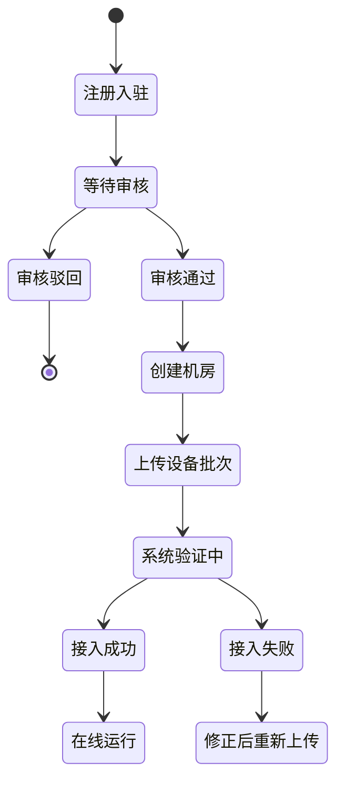
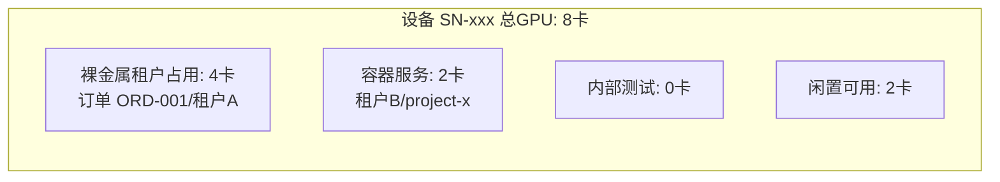
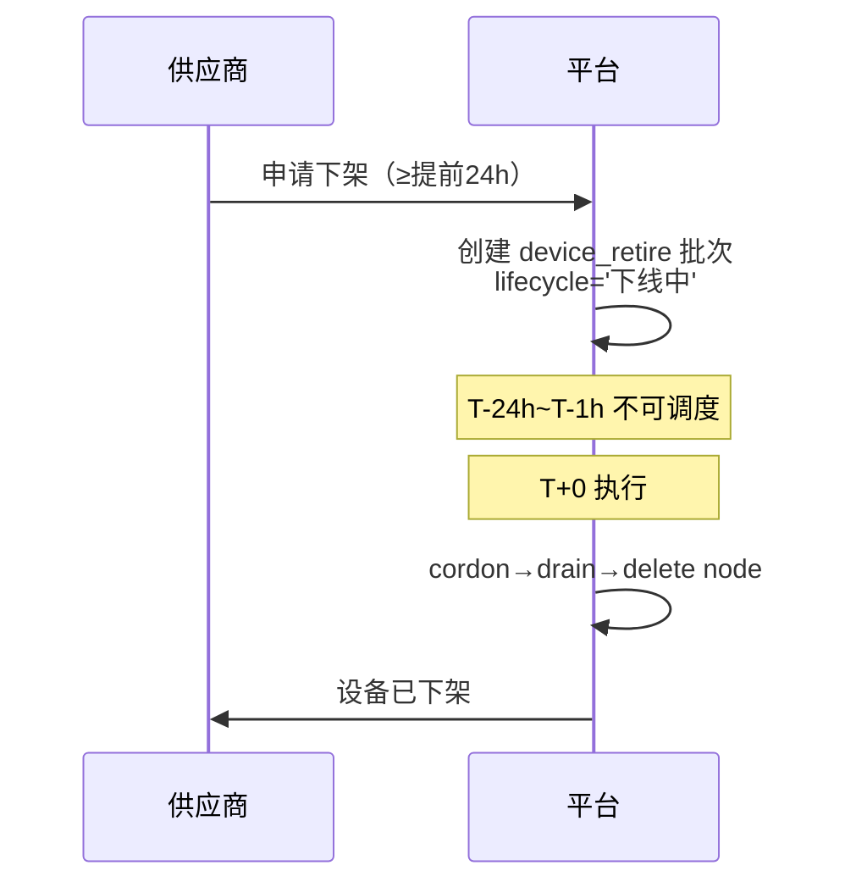
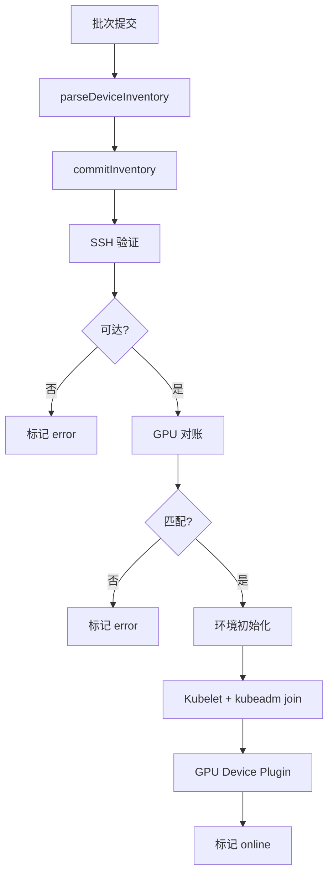

# IDC 供应商自动接入方案设计

> 版本：v1.2  
> 日期：2026-07-20  
> 状态：设计稿  
> 关联：`apps/supplier/`、`apps/web/`、`packages/db/src/supply-schema.ts`、`packages/db/src/auth-schema.ts`  
> 上层设计：[supplier-database.md](supplier-database.md)、[supplier-onboarding-plan-changelog-tracking-design.md](supplier-onboarding-plan-changelog-tracking-design.md)

---

## 1. 概述

### 1.1 角色分工

平台为闲时算力调度平台，供应商（IDC / 数据中心运营方）将空闲 GPU 设备接入平台后由平台统一调度出租。系统由两个应用模块协作：

| 应用 | 角色 | 职责 |
|------|------|------|
| **`apps/supplier`** | 供应商门户 | 自主注册 → 创建机房 → 上传设备 → 查看接入状态 → 查看设备实时状态 → 申请下架 → 设定合作模式 → 查看账单 |
| **`apps/web`** | 运营平台 | 审核供应商资质 → 配置机房配套费用 → 审批下架申请 → 资源大盘监控 |

### 1.2 供应商视角 vs 平台内部

供应商只关注**业务能力**，底层 Karmada / K8s / Capsule / Volcano / SkyPilot 完全透明：

| 供应商视角 | 对应平台内部自动化 |
|-----------|------------------|
| 设备是否成功接入 | SSH → 环境初始化 → Kubelet → K8s Node → GPU Plugin → Volcano → SkyPilot |
| 设备当前在做什么（裸金属/容器/闲置） | `devicePlatformProbeSnapshot` 探活快照 + `computeNode` 生命周期 |
| 是否可以下架设备 | 下架申请 → 平台审批 → Cordon → Drain → Delete Node → 资源回收 |
| 本月赚了多少钱 | `supplierBill` 月账单 + `supplierBillDaily` 日账单 |
| 设定合作模式（整租 / 闲时） | `supplier_device.cooperationType`，调度层按标签分流 |

### 1.3 业务约束

| 约束 | 说明 |
|------|------|
| **提前 24h 下架** | 供应商需提前 24 小时发起下架申请 |
| **根凭据上架** | 提供 root 账号密码后平台方可纳管设备 |
| **同批次同合作模式** | 单个设备批次中所有设备必须同合作模式 |
| **多类型共存** | 同一手机号可属于 platform / tenant / merchant，同类型不可多属 |
| **凭据安全** | 阶段一明文，阶段二 AES-256-GCM + KMS |
| **配套费用平台配置** | IP/带宽/存储等机房配套费由 `apps/web` 运营录入，供应商只读 |

---

## 2. 供应商视角：接入流程

### 2.1 整体流程



### 2.2 阶段一：供应商注册

**入口**：`apps/supplier` → `/signup` → `/onboarding`

1. 填写企业信息（公司名、USCC、法人姓名/身份证号）
2. 上传资质文件（营业执照、身份证正反面）
3. 提交 → `organization.orgType='supplier'`, `supplier.auditStatus='pending'`
4. 等待审核 → 审核通过后进入控制台

| 审核状态 | 供应商视角 | 可操作 |
|---------|-----------|--------|
| `pending` | 「审核中，预计 1-3 个工作日」 | 不可操作 |
| `approved` | 进入控制台 | 全部功能 |
| `rejected` | 「审核未通过：{原因}」 | 修改后重提 |

### 2.3 阶段二：创建机房

**入口**：供应商控制台 → 机房管理 → 新建机房

| 字段 | 说明 | 示例 |
|------|------|------|
| 机房名称 | 展示用 | 上海张江机房 |
| 机房编码 | 供应商内唯一 | SH-ZJ-01 |
| 所在城市 | | 上海 |
| 详细地址 | | 上海市浦东新区... |
| 内网网段 | CIDR | 10.0.0.0/16 |
| 公网 IP 数量 | 供调度规划 | 16 |
| 规模描述 | 自由填写 | 200 台 GPU 服务器 |
| 运维联系人 | 姓名/手机/邮箱/微信（可多个） | — |

**供应商不可见的平台内部字段**：`containerInstanceRegion`、`bareMetalRegion`、`cooperationStatus`、**机房配套费用**（IP/带宽/存储费由平台运营在 `apps/web` 配置，供应商只读）。

### 2.4 阶段三：上传设备批次

#### 2.4.1 创建上架批次

**入口**：供应商控制台 → 设备管理 → 创建上架批次

| 字段 | 说明 | 校验 |
|------|------|------|
| 选择机房 | 已创建的机房 | 必填 |
| 合作模式 | `闲时合作` / `整租合作` | **整批次统一** |
| 上传设备清单 | Excel（.xlsx/.csv） | 按模板格式 |

**同批次同合作模式**：批次级合作模式覆盖 Excel 中所有行，不同模式必须分批次上传。

#### 2.4.2 设备清单模板

| 列名 | 必填 | 示例 |
|------|------|------|
| 设备 SN | ✅ 全局唯一 | `SN2026A10001` |
| 资产编号 | | `AST-001` |
| GPU 卡型 | ✅ 下拉选择 | `NVIDIA A100 80GB` |
| GPU 数量 | ✅ | `8` |
| 内网 IP | ✅ | `10.0.1.101` |
| 外网 IP | | `203.0.113.1` |
| 设备用途 | | `客户算力池` |
| root 用户名 | ✅ 默认 root | `root` |
| root 密码 | ✅ | `******` |

#### 2.4.3 系统自动验证

供应商提交后系统自动处理，流程如下：

```
解析 Excel → 写入设备表 → SSH 连通性验证 → GPU 型号对账 → 环境初始化 → K8s Node 纳管 → GPU 资源注册 → 接入成功
```

**供应商可见的设备接入状态**（三态）：

| 状态 | 含义 | 供应商可操作 |
|------|------|-------------|
| 🟡 `pending` | 系统验证中 | 查看当前步骤 |
| 🟢 `online` | 已接入可调度 | 查看实时状态 / 下架 / 改合作模式 |
| 🔴 `error` | 验证失败 | 查看错误 / 修正重试 |

---

## 3. 设备实时状态

设备接入成功后，供应商需了解每台设备的实时运行情况——当前在跑什么、是否被占用、负载如何。

### 3.1 供应商可见维度

| 维度 | 数据来源 | 供应商可见 |
|------|---------|-----------|
| 业务类型（裸金属 / 容器 / 闲置） | `devicePlatformProbeSnapshot` | ✅ |
| 占用状态（租户 / 内部测试 / 空闲） | `devicePlatformProbeSnapshot` + `internalTestHold` + `bareMetalOrderDevice` | ✅ |
| 在线状态 | `computeNode.lifecycleStatus` | ✅ |
| 可用 GPU | `supplier_device.gpuCount` vs K8s allocatable | ✅ |

### 3.2 设备列表视图（供应商门户）



| 列表列 | 示例值 |
|--------|--------|
| 设备 SN | `SN2026A10001` |
| 在线状态 | 🟢 在线 |
| 业务类型 | 容器服务 + 裸金属 |
| 占用详情 | 租户占用 6 卡 / 闲置 2 卡 |
| 可用 GPU | `2` / `8` |
| 合作模式 | 闲时合作 |

**占用详情展开**（设备详情页）：

| 占用来源 | 判断条件 | 展示 |
|---------|---------|------|
| 裸金属租户 | `bareMetalOrderDevice.supplierDeviceId` 存在且 `allocationStatus ≠ 'released'` | 订单号 + 租户名 + 到期日 |
| 容器服务 | `proxyMatched=true` 且有 `proxyRentStatus` | 租户/项目名 + 服务名 |
| 内部测试 | `internalTestHoldDeviceLink` 有效记录 | 工单号 + 预计结束时间 |
| 网关/管控 | `computeNode.nodeRole ≠ 'compute'` | 角色描述 |
| 闲置可用 | 上述均不匹配 | 可调度 GPU 数 |

### 3.3 探活数据源

`devicePlatformProbeSnapshot` 每小时快照一次（设计见 [supplier-device-platform-probe-design.md](supplier-device-platform-probe-design.md)）：

| probe 字段 | 含义 | 供应商展示 |
|-----------|------|-----------|
| `probeStatus` | matched / missing_platform / missing_crm | 在线 / 离线 / 数据异常 |
| `presenceProxy` | 代理层可见 | — |
| `presenceK8s` | K8s 集群中 | — |
| `presenceBareMetal` | 裸金属订单关联 | — |
| `proxyRentStatus` | idle / rented / busy | 闲置 / 已出租 / 繁忙 |
| `proxyIsContainerInstance` | 是否容器实例 | 容器服务 |
| `bareMetalOrderNo` | 裸金属订单号 | 可点击跳转 |

---

## 4. 账单管理

### 4.1 月账单

供应商在门户中查看月度结算账单。

**入口**：供应商控制台 → 账单管理 → 月账单

#### 4.1.1 账单列表

| 列表列 | 来源字段 | 示例 |
|--------|---------|------|
| 账单月份 | `supplierBill.billMonth` | 2026-07 |
| 合作模式 | `supplierBill.cooperationMode` | 闲时合作 |
| 总卡时 | `supplierBill.totalUsageHours` | 12,500.00 |
| 算力费用 | `supplierBill.totalAmount` | ¥125,000.00 |
| 网络配套费 | `supplierBill.networkFee` | ¥1,500.00 |
| 管控配套费 | `supplierBill.managementFee` | ¥500.00 |
| 存储费 | `supplierBill.storageFee`（新增字段，见 §4.1.3） | ¥800.00 |
| 结算金额 | `supplierBill.finalAmount` | ¥127,800.00 |
| 状态 | `supplierBill.status` | 待确认 / 已确认 / 已付款 |
| 付款截止日 | `supplierBill.dueDate` | 2026-08-15 |

#### 4.1.2 账单详情

点击某月展开明细（`supplierBillDetail`）：

| 列 | 来源 | 示例 |
|----|------|------|
| 机房 | `data_center.name` | 上海张江 |
| GPU 卡型 | `gpu_card_type.name` | NVIDIA A100 80GB |
| 用量（卡时） | `supplierBillDetail.usageHours` | 6,000.00 |
| 单价（元/卡时） | `supplierBillDetail.unitCost` | 10.00 |
| 小计 | `supplierBillDetail.amount` | ¥60,000.00 |

#### 4.1.3 月账单表结构

已有 `supplierBill` + `supplierBillDetail`（见 `supply-schema.ts`），需新增 `storageFee` 字段对 `supplierBill` 做扩展：

```sql
-- 在现有 supplier_bill 表上增加存储费字段
ALTER TABLE supplier_bill ADD COLUMN storage_fee NUMERIC(15,4) NOT NULL DEFAULT 0;
```

### 4.2 日账单

供应商需日账单跟踪每日收益趋势。当前仅有 `tenant_bill_daily`（租户侧），**供应商日账单为新增**。

#### 4.2.1 日账单表（新增）

```sql
CREATE TABLE supplier_bill_daily (
  id                  TEXT PRIMARY KEY,
  supplier_id         TEXT NOT NULL REFERENCES supplier(id),
  data_center_id      TEXT NOT NULL REFERENCES data_center(id),
  usage_date          DATE NOT NULL,                 -- 2026-07-20
  usage_month         VARCHAR(7) NOT NULL,           -- 2026-07
  cooperation_mode    VARCHAR(32) NOT NULL,
  total_usage_hours   NUMERIC(15,4) NOT NULL,
  total_amount        NUMERIC(15,4) NOT NULL,
  network_fee_daily   NUMERIC(15,4) NOT NULL DEFAULT 0,
  mgmt_fee_daily      NUMERIC(15,4) NOT NULL DEFAULT 0,
  storage_fee_daily   NUMERIC(15,4) NOT NULL DEFAULT 0,
  online_device_count INTEGER NOT NULL DEFAULT 0,
  rented_gpu_count    INTEGER NOT NULL DEFAULT 0,
  idle_gpu_count      INTEGER NOT NULL DEFAULT 0,
  created_at          TIMESTAMPTZ NOT NULL DEFAULT now(),
  UNIQUE (supplier_id, data_center_id, usage_date, cooperation_mode)
);

CREATE INDEX idx_supplier_bill_daily_supplier_month ON supplier_bill_daily(supplier_id, usage_month);

CREATE TABLE supplier_bill_daily_detail (
  id               TEXT PRIMARY KEY,
  daily_bill_id    TEXT NOT NULL REFERENCES supplier_bill_daily(id) ON DELETE CASCADE,
  gpu_card_type_id TEXT NOT NULL REFERENCES gpu_card_type(id),
  usage_hours      NUMERIC(15,4) NOT NULL,
  unit_cost        NUMERIC(15,4) NOT NULL,
  amount           NUMERIC(15,4) NOT NULL,
  UNIQUE (daily_bill_id, gpu_card_type_id)
);
```

#### 4.2.2 日账单视图

| 列 | 来源 | 示例 |
|----|------|------|
| 日期 | `usageDate` | 2026-07-20 |
| 机房 | `data_center.name` | 上海张江 |
| 在线设备 | `onlineDeviceCount` | 45 台 |
| 已租用 GPU | `rentedGpuCount` | 180 卡 |
| 闲置 GPU | `idleGpuCount` | 60 卡 |
| 当日卡时 | `totalUsageHours` | 576.00 |
| 当日收入 | `totalAmount` | ¥5,760.00 |

点击展开按卡型明细：

| 卡型 | 卡时 | 单价 | 金额 |
|------|------|------|------|
| NVIDIA A100 80GB | 320.00 | ¥10.00 | ¥3,200.00 |
| NVIDIA H100 80GB | 256.00 | ¥15.00 | ¥3,840.00 |

#### 4.2.3 日账单生成策略

平台定时任务每日 00:05 生成前一日快照：

- 日卡时 = Σ(每小时间隔的 `rentedGpuCount` × 1h)，来自 `devicePlatformProbeSnapshot` 聚合
- 日收入 = 日卡时 × 当日生效的 `supplier_pricing_record.unitPricePerHour`
- 日分摊费 = 月配套费 ÷ 当月天数

---

## 5. 合作模式管理

| 模式 | `cooperationType` | 说明 |
|------|-------------------|------|
| 闲时合作 | `idle_time` | 空闲时段由平台调度 |
| 整租合作 | `whole_rent` | 整机出租固定租户 |

供应商可逐台或批量修改合作模式（立即生效，不影响运行中 job），修改记录写入 `supplier_device_change_log`。

---

## 6. 设备下架流程

### 6.1 供应商发起

**入口**：设备列表 → 勾选 → 申请下架

| 字段 | 校验 |
|------|------|
| 预计下架时间 | **≥ now + 24h** |
| 下架原因 | 合同到期 / 设备更新 / 维护需要 / 其他 |
| 备注 | 可选 |

### 6.2 下架状态

| 状态 | 含义 | 可操作 |
|------|------|--------|
| 🔵 审批中 | 平台审核中 | 可取消 |
| 🟡 执行中 | 平台驱逐任务中 | 不可操作 |
| ⚫ 已下架 | 设备已移除 | 查看历史 |



---

## 7. 平台运营侧（apps/web）

### 7.1 供应商资质审核

| 操作 | 效果 |
|------|------|
| 审核通过 | `auditStatus='approved'`, `status='cooperating'`, `supplierStatus='approved'` |
| 审核驳回 | 填写原因，供应商修改后重提 |

审核时同时设置：`supplierType`（gpu/cpu/hybrid）、`supplierTier`（basic/professional/enterprise）、`defaultCooperationMode`。

### 7.2 机房配套费用配置

供应商创建的机房不携带费用，由平台运营在 `apps/web` 为各机房配置。配套费用按月计入 `supplierBill`。

**入口**：`apps/web` → 供应商管理 → 机房详情 → 配套费用

#### 7.2.1 费用类型与存储

| 费用类型 | 存储位置 | 计入月账单字段 |
|---------|---------|---------------|
| 带宽费 | `supplierDatacenterInfrastructure.bandwidthConfig` (jsonb) | `supplierBill.networkFee` |
| IP 租赁费 | `supplierDatacenterInfrastructure.networkConfig` (jsonb) | `supplierBill.networkFee` |
| 存储费 | `supplierDatacenterInfrastructure.storageConfig` (jsonb) | `supplierBill.storageFee` |
| 管控节点费 | `data_center.mgmtNodeFeeMonthly` (numeric) | `supplierBill.managementFee` |

#### 7.2.2 带宽费用配置

| 配置项 | 字段路径 | 说明 |
|--------|---------|------|
| 计费模式 | `bandwidthConfig.billingMode` | `fixed` / `tier` / `per_gbps` |
| 固定月费 | `bandwidthConfig.fixed.monthlyFee` | 模式=`fixed` |
| 带宽档位 | `bandwidthConfig.tiers[]` | `minGbps`/`maxGbps`/`monthlyFee`，模式=`tier` |
| 单价（元/Gbps/月） | `bandwidthConfig.unitPrice` | 模式=`per_gbps` |
| 当前带宽 | `bandwidthConfig.currentGbps` | 模式=`per_gbps`，据此计算月费 |

#### 7.2.3 IP / 存储费用配置

**IP 费用**（`networkConfig.ipFee`）：

| 配置项 | 字段 | 说明 |
|--------|------|------|
| 单价（元/IP/月） | `ipFee.unitPrice` | |
| IP 数量 | `ipFee.count` | |
| 内网互联月费 | `networkConfig.interconnectFee` | 跨机房互联（可选） |

**存储费用**（`storageConfig`）：

| 配置项 | 字段 | 说明 |
|--------|------|------|
| 存储类型 | `type` | `nas` / `distributed` / `local` / `none` |
| 计费模式 | `billingMode` | `fixed` / `per_tb` |
| 固定月费 | `fixed.monthlyFee` | 模式=`fixed` |
| 单价（元/TB/月） | `unitPrice` | 模式=`per_tb` |
| 当前容量（TB） | `currentTb` | 模式=`per_tb` |

#### 7.2.4 月账单费用汇总规则

每月 1 日定时任务汇总各机房配套费写入 `supplierBill`：

```
月网络费 = 带宽计费结果 + ipFee.unitPrice × ipFee.count + interconnectFee
月管控费 = mgmtNodeFeeMonthly
月存储费 = (fixed ? fixed.monthlyFee : unitPrice × currentTb)
```

### 7.3 下架审批

平台运营在 `apps/web` 审批供应商的下架申请：

| 结果 | 效果 |
|------|------|
| 通过 | 启动自动退网（cordon → drain → delete node） |
| 驳回 | 填写原因，设备恢复 `online` |

### 7.4 资源大盘

全平台设备统计：按供应商/机房/卡型/合作模式/状态维度聚合，展示可售 GPU 卡数和下架待审批批次。

---

## 8. 平台内部自动化（供应商透明）

以下流程对供应商完全透明，供应商只需关注 §2~§6 中的业务结果。

### 8.1 自动验证与纳管流水线



### 8.2 平台内部注册表（供应商不可见）

| 表 | 用途 |
|----|------|
| `karmada_cluster_registry` | 机房 → Karmada Member Cluster 映射与 join 状态 |
| `capsule_tenant_registry` | 供应商 → Capsule Tenant 映射与同步状态 |
| `supplier_device_credential_audit` | root 密码变更审计（不可 UPDATE，仅 INSERT） |

### 8.3 调度层组件构建关键点

| 组件 | 复杂度 | 关键挑战 | 对策 |
|------|--------|----------|------|
| SSH 自动化 | ⚠️ 高 | 内网可达性、发行版碎片化、驱动版本差异 | 标准初始化脚本 + per-batch 覆盖；失败标记 error |
| Karmada | ⚠️ 高 | 多集群 kubeconfig、Push/Pull、跨集群 RBAC | 异步 join，`karmada_cluster_registry` 追踪 |
| Capsule | ⚠️ 中 | Tenant CR 版本、ResourceQuota 层级 | 首次设备接入成功时懒加载创建 |
| Volcano | ⚠️ 中 | Queue 层级、Gang Scheduling | 机房首次有 online 设备时自动创建 |
| SkyPilot | ✓ 低 | 复用 K8s kubeconfig | Member Cluster ready 后自动注册 |

### 8.4 定时任务

| 任务 | 频率 | 说明 |
|------|------|------|
| 设备 SSH 健康检查 | 每 30min | 连续 3 次失败标记异常 |
| GPU 对账 | 每 5min | `supplier_device.gpuCount` vs K8s 上报 |
| 探活快照 | 每小时 | 写入 `devicePlatformProbeSnapshot` |
| 日账单生成 | 每日 00:05 | 生成前一日 `supplierBillDaily` |
| 月账单生成 | 每月 1 日 | 汇总上月数据写入 `supplierBill` |
| 接入超时检测 | 每 1h | `pending` > 24h 告警 |
| 下架到期检查 | 每 1h | `expectedCompletionDate < now()` 告警 |
| 凭据过期提醒 | 每天 | 密码超过 90 天提醒 |

---

## 9. OpenAPI 接口

### 9.1 供应商门户（apps/supplier）

| 方法 | 路径 | 说明 |
|------|------|------|
| `POST` | `/api/supplier/register` | 注册入驻 |
| `GET` | `/api/supplier/profile` | 企业资料与审核状态 |
| `PUT` | `/api/supplier/profile` | 修改资料（驳回后重提） |
| `POST` | `/api/supplier/datacenters` | 创建机房 |
| `GET` | `/api/supplier/datacenters` | 机房列表 |
| `PUT` | `/api/supplier/datacenters/{id}` | 修改机房 |
| `GET` | `/api/supplier/datacenters/{id}/fees` | **查看机房配套费用（只读）** |
| `POST` | `/api/supplier/devices/batches` | 创建上架批次 |
| `GET` | `/api/supplier/devices/batches` | 批次列表 |
| `GET` | `/api/supplier/devices/batches/{id}` | 批次详情 + 验证进度 |
| `GET` | `/api/supplier/devices` | 设备列表（可筛选） |
| `GET` | `/api/supplier/devices/{id}` | 设备详情（含实时状态） |
| `PUT` | `/api/supplier/devices/{id}/cooperation` | 修改合作模式 |
| `PUT` | `/api/supplier/devices/batch-cooperation` | 批量修改合作模式 |
| `POST` | `/api/supplier/devices/retire` | 申请下架 |
| `DELETE` | `/api/supplier/devices/retire/{id}` | 取消下架（审批前） |
| `GET` | `/api/supplier/devices/retire` | 下架历史 |
| `GET` | `/api/supplier/bills/monthly` | **月账单列表** |
| `GET` | `/api/supplier/bills/monthly/{id}` | **月账单详情** |
| `GET` | `/api/supplier/bills/daily` | **日账单列表** （可按月筛选） |
| `GET` | `/api/supplier/bills/daily/{id}` | **日账单详情** |

### 9.2 运营平台（apps/web）

| 方法 | 路径 | 说明 |
|------|------|------|
| `GET` | `/api/admin/suppliers/pending` | 待审核供应商 |
| `POST` | `/api/admin/suppliers/{id}/audit` | 审核（通过/驳回） |
| `GET` | `/api/admin/suppliers` | 供应商管理 |
| `GET` | `/api/admin/datacenters/{id}/infrastructure` | **查看机房配套费配置** |
| `PUT` | `/api/admin/datacenters/{id}/infrastructure` | **配置机房配套费** |
| `GET` | `/api/admin/retire-batches/pending` | 待审批下架 |
| `POST` | `/api/admin/retire-batches/{id}/approve` | 审批通过 |
| `POST` | `/api/admin/retire-batches/{id}/reject` | 驳回 |

---

## 10. 供应商控制台页面规划（apps/supplier）

### 10.1 已有

| 路由 | 说明 |
|------|------|
| `/signin` | 登录 |
| `/signup` | 注册 |
| `/onboarding` | 入驻信息填写 |
| `/onboarding/complete` | 审核中提示 |
| `/console` | 控制台首页 |

### 10.2 待实现

| 路由 | 页面 | 说明 |
|------|------|------|
| `/console/datacenters` | 机房管理 | 列表 + 新建/编辑 → 查看配套费 |
| `/console/devices` | 设备管理 | 列表（状态/实时占用/合作模式筛选）+ 批量操作 |
| `/console/devices/batches` | 上架批次 | 列表 + 新建（选机房→合作模式→Excel） |
| `/console/devices/batches/{id}` | 批次详情 | 逐台验证进度 + 错误明细 |
| `/console/devices/{id}` | 设备详情 | SN/IP/GPU/**实时占用状态**/合作模式 + 操作 |
| `/console/devices/retire` | 下架管理 | 申请列表 + 历史 |
| `/console/bills/monthly` | **月账单** | 列表 + 详情 |
| `/console/bills/daily` | **日账单** | 列表（日历/趋势图）+ 按卡型详情 |
| `/console/settings` | 企业资料 | 查看/修改 |

### 10.3 侧边栏菜单

```
Dashboard        → /console
机房管理         → /console/datacenters
设备管理         → /console/devices
上架批次         → /console/devices/batches
下架管理         → /console/devices/retire
月账单           → /console/bills/monthly
日账单           → /console/bills/daily
企业资料         → /console/settings
```

---

## 11. 实施路线图

### Phase 1：供应商注册 + 机房管理（1 周）

- [ ] `apps/supplier` 入驻页面完善（资质文件上传）
- [ ] `apps/web` 审核列表 + 通过/驳回
- [ ] 机房管理 CRUD
- [ ] 机房配套费在 `apps/web` 的可视化配置（带宽/IP/存储）
- [ ] 供应商侧机房配套费**只读展示**

### Phase 2：设备批次上传 + 自动验证（2 周）

- [ ] 设备 Excel 模板 + 解析（`parseDeviceInventory`）
- [ ] 批次创建（同批次同合作模式约束）
- [ ] SSH 验证 + GPU 对账（异步 `onboarding_task`）
- [ ] 三态（pending/online/error）+ 逐台验证进度
- [ ] 设备列表 + 批量修改合作模式

### Phase 3：设备实时状态 + 自动纳管（2 周）

- [ ] 设备详情页实时状态展示（裸金属/容器/闲置/占用）
- [ ] 探活快照定时任务（对接 `devicePlatformProbeSnapshot`）
- [ ] 环境初始化 + K8s Node 纳管
- [ ] `karmada_cluster_registry`、`capsule_tenant_registry` 表
- [ ] 定时任务：SSH 健康检查 / GPU 对账 / 接入超时检测

### Phase 4：账单系统（1.5 周）

- [ ] `supplierBill` 月账单生成（每月 1 日）
- [ ] `supplierBillDaily` + `supplierBillDailyDetail` 表创建
- [ ] 日账单生成定时任务（每日 00:05）
- [ ] 供应商控制台月账单/日账单页面
- [ ] `supplierBill.storageFee` 字段扩展

### Phase 5：下架流程（1 周）

- [ ] 下架申请（24h 校验）
- [ ] `apps/web` 下架审批
- [ ] 自动退网（cordon → drain → delete node）
- [ ] 下架历史

---

## 12. 附录

### 12.1 供应商可见状态 vs 平台内部状态映射

| 供应商可见 | `lifecycleStatus` | `opsStatus`（典型） | `inMaintenance` |
|-----------|-------------------|---------------------|-----------------|
| 🟡 接入中 | `待接入` / `接入中` | `预留闲置中` | false |
| 🟢 已接入 | `在线` | `在集群中` / 裸金属各态 | false |
| 🔴 接入异常 | `接入中` | 任意 | **true** |
| 🔵 下架审批中 | `下线中` | 保持原状 | false |
| 🟡 下架执行中 | `下线中` | 保持原状 | **true** |
| ⚫ 已下架 | `下线中`（归档） | `已退订` | — |

### 12.2 供应商可见数据范围

供应商只能看到自身相关数据，以下表不暴露给供应商：

`compute_node`、`karmada_cluster_registry`、`capsule_tenant_registry`、`supplier_device_credential_audit`、`supplier_gpu_inventory`、`resource_pool_binding`、`supplier_pricing_record`（单价仅在账单中展示结算结果）

### 12.3 关联文档

| 文档 | 文件名 |
|------|--------|
| 供应商数据库设计 | `supplier-database.md` |
| 接入计划与变更跟踪 | `supplier-onboarding-plan-changelog-tracking-design.md` |
| 设备导入 Schema | `supplier-device-import-schema.md` |
| 设备探活设计 | `supplier-device-platform-probe-design.md` |
| 裸金属订单 Schema | `bare-metal-order-schema-design.md` |
| 设备下架设计 | `supplier-device-retire-design.md` |
