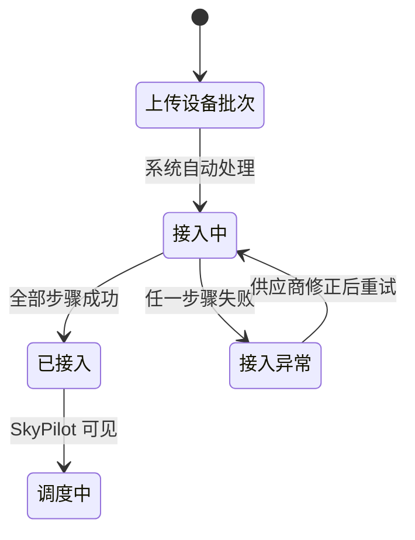
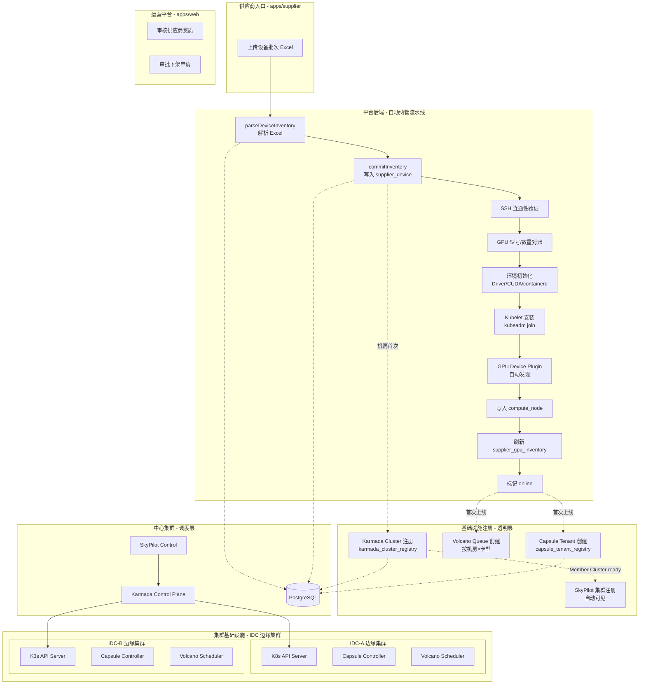
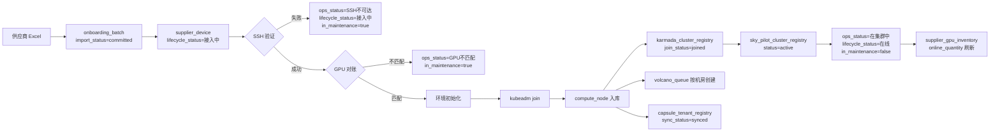
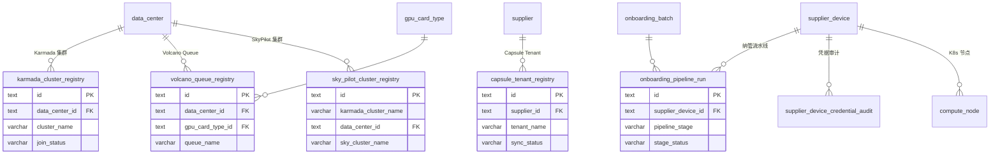
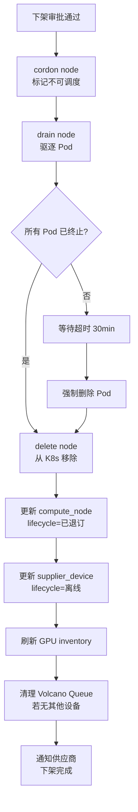

# GPU 裸金属设备自动纳管实现方案

> 版本：v1.0
> 日期：2026-07-20
> 状态：设计稿
> 关联：[idc-auto-onboarding-design.md](idc-auto-onboarding-design.md)（供应商视角流程设计）、[supplier-database.md](supplier-database.md)（数据库设计 v1.5）、[capsule-skypilot-multi-tenancy.md](../../../../docs/design/cloud/capsule-skypilot-multi-tenancy.md)（Capsule/SkyPilot 多租户设计）、[multi-idc-federation.md](../../../../docs/design/cloud/multi-idc-federation.md)（多 IDC 联邦设计）
> 实现层：`packages/db/src/supply-schema.ts`、`apps/web/src/lib/server/dataaccess/supplier/`

---

## 1. 概述

### 1.1 目标

将供应商上传的 GPU 裸金属设备，通过全自动化的纳管流水线，注册到 **K8s + Karmada + Volcano + Capsule** 集群基础设施中，最终由 **SkyPilot** 统一调度管理。整个过程对供应商**完全透明**——供应商只看到「接入中」→「已接入」或「接入异常」三种状态。

### 1.2 技术栈职责

| 组件 | 版本要求 | 职责 | 纳管时机 |
|------|---------|------|---------|
| **K8s** | ≥ 1.28 | 容器编排基础，Node 注册、Pod 调度 | 设备环境初始化后自动 join |
| **Karmada** | ≥ 1.8 | 多 IDC 集群联邦，跨集群资源发现与策略分发 | 机房首次接入时创建 Member Cluster |
| **Volcano** | ≥ 1.7 | GPU 批量调度 Queue、Gang Scheduling | 设备上线后按机房自动创建 Queue |
| **Capsule** | ≥ 0.8 (v1beta2) | 租户资源隔离，Namespace/ResourceQuota/NetworkPolicy | 租户首次提交任务时懒加载 |
| **SkyPilot** | ≥ 0.6 | 多集群 GPU 调度引擎，任务提交与管理 | Karmada Member Cluster ready 后自动注册 |

### 1.3 供应商视角



供应商仅需：上传 Excel → 等待 → 看到结果。底层 K8s/Karmada/Volcano/Capsule/SkyPilot 的安装、注册、配置全部自动完成。

---

## 2. 整体架构

### 2.1 系统架构图



### 2.2 数据流总览



---

## 3. 纳管流水线详细设计

### 3.1 阶段一：SSH 连通性验证

**触发时机**：`commitInventory` 完成后，自动异步启动

**执行组件**：`onboarding_worker`（后台 Worker 进程）

```typescript
// apps/web/src/lib/server/dataaccess/supplier/onboarding-worker.ts

interface SshVerificationTask {
  deviceId: string
  internalIp: string
  loginUsername: string
  loginPassword: string  // 阶段一明文，阶段二 AES-256-GCM
  batchId: string
  dataCenterId: string
  supplierId: string
}

async function verifySshConnectivity(task: SshVerificationTask): Promise<VerificationResult> {
  // 1. SSH 连通性检测（10s 超时）
  const sshResult = await sshClient.connect({
    host: task.internalIp,
    port: 22,
    username: task.loginUsername,
    password: task.loginPassword,
    timeout: 10_000,
  })

  if (!sshResult.success) {
    await updateDeviceStatus(task.deviceId, {
      opsStatus: 'SSH不可达',
      inMaintenance: true,
      lifecycleStatus: '接入中',
    })
    return { success: false, error: 'SSH 不可达，请检查 IP 和凭据' }
  }

  // 2. 基础环境探测
  const envInfo = await sshClient.exec(task.internalIp, `
    uname -a &&
    cat /etc/os-release | head -5 &&
    nvidia-smi --query-gpu=name,count,memory.total --format=csv,noheader 2>/dev/null ||
    echo "GPU_NOT_FOUND"
  `)

  return { success: true, envInfo }
}
```

**失败处理**：
- SSH 不可达 → `ops_status = 'SSH不可达'`，`in_maintenance = true`
- 连续 3 次重试（间隔 30s）仍失败 → 通知供应商「请检查 IP/凭据」
- 供应商修正后可在 `apps/supplier` 门户点击「重试」

### 3.2 阶段二：GPU 型号/数量对账

```typescript
interface GpuVerificationTask {
  deviceId: string
  expectedGpuCount: number
  expectedCardTypeCode: string  // e.g. "A100-80G"
  sshHost: string
  sshCredentials: { username: string; password: string }
}

async function verifyGpuInventory(task: GpuVerificationTask): Promise<VerificationResult> {
  const nvidiaSmiOutput = await sshClient.exec(task.sshHost, `
    nvidia-smi --query-gpu=name,count,memory.total --format=csv,noheader
  `)

  const gpus = parseNvidiaSmi(nvidiaSmiOutput)
  // gpus: [{ name: "NVIDIA A100-SXM4-80GB", count: 8, memory: "81920MiB" }]

  // GPU 数量对账
  if (gpus.totalCount !== task.expectedGpuCount) {
    return {
      success: false,
      error: `GPU 数量不匹配: 实际 ${gpus.totalCount} vs 预期 ${task.expectedGpuCount}`,
      details: { actual: gpus.totalCount, expected: task.expectedGpuCount },
    }
  }

  // GPU 型号对账（模糊匹配）
  const typeMatch = gpus.some(gpu =>
    normalizeGpuName(gpu.name).includes(normalizeGpuName(task.expectedCardTypeCode))
  )
  if (!typeMatch) {
    return {
      success: false,
      error: `GPU 型号不匹配: 实际 ${gpus.map(g => g.name).join(', ')} vs 预期 ${task.expectedCardTypeCode}`,
    }
  }

  return { success: true, gpuInfo: gpus }
}
```

**对账失败处理**：
- 标记 `ops_status = 'GPU不匹配'`
- 写入 `supplier_device_change_log`（`change_action = 'GPU对账失败'`）
- 通知供应商：列出实际 vs 预期的差异项

### 3.3 阶段三：环境初始化

对账通过后，自动执行标准化环境初始化脚本：

```bash
#!/bin/bash
# onboarding-init.sh — 平台标准初始化脚本
# 支持: Ubuntu 20.04/22.04, CentOS 7/8, Rocky Linux 8/9

set -euo pipefail

LOG_FILE="/var/log/GPURun-onboarding.log"
exec > >(tee -a "$LOG_FILE") 2>&1

echo "[$(date)] === GPURun GPU 环境初始化开始 ==="

# --- 1. 系统基础配置 ---
echo "[1/7] 系统基础配置"
# 关闭 swap
swapoff -a
sed -i '/ swap / s/^/#/' /etc/fstab

# 内核参数
cat >> /etc/sysctl.d/99-GPURun.conf <<EOF
net.bridge.bridge-nf-call-iptables  = 1
net.bridge.bridge-nf-call-ip6tables = 1
net.ipv4.ip_forward                 = 1
vm.panic_on_oom                     = 0
vm.overcommit_memory                = 1
EOF
sysctl --system

# 模块加载
modprobe br_netfilter
modprobe overlay

# --- 2. GPU 驱动安装 ---
echo "[2/7] GPU 驱动安装"
DRIVER_VERSION="${GPU_DRIVER_VERSION:-535.129.03}"
if ! nvidia-smi &>/dev/null; then
  # 使用 NVIDIA 官方仓库安装
  if command -v apt-get &>/dev/null; then
    apt-get update
    apt-get install -y nvidia-driver-535 nvidia-utils-535
  elif command -v yum &>/dev/null; then
    yum install -y nvidia-driver-535 nvidia-utils-535
  fi
  reboot  # 驱动安装后需要重启
fi

# --- 3. CUDA Toolkit ---
echo "[3/7] CUDA Toolkit 安装"
if ! command -v nvcc &>/dev/null; then
  CUDA_VERSION="${CUDA_VERSION:-12.2}"
  # 通过 NVIDIA 安装包安装 CUDA Toolkit（仅 toolkit，不含驱动）
  # 具体命令根据发行版调整
fi

# --- 4. Container Runtime (containerd) ---
echo "[4/7] Containerd 安装"
if ! command -v containerd &>/dev/null; then
  if command -v apt-get &>/dev/null; then
    apt-get update
    apt-get install -y containerd.io
  elif command -v yum &>/dev/null; then
    yum install -y containerd.io
  fi

  # 配置 containerd 使用 systemd cgroup
  mkdir -p /etc/containerd
  containerd config default > /etc/containerd/config.toml
  sed -i 's/SystemdCgroup = false/SystemdCgroup = true/' /etc/containerd/config.toml
  # 配置镜像加速（可选）
  systemctl enable containerd
  systemctl restart containerd
fi

# --- 5. NVIDIA Container Toolkit ---
echo "[5/7] NVIDIA Container Toolkit 安装"
if ! nvidia-container-cli info &>/dev/null; then
  # 安装 nvidia-container-toolkit
  # 配置 containerd 使用 nvidia runtime
  # 重启 containerd
fi

# --- 6. Kubelet 安装 ---
echo "[6/7] Kubelet 安装"
KUBE_VERSION="${KUBE_VERSION:-1.28}"
if ! command -v kubelet &>/dev/null; then
  # 添加 Kubernetes APT/YUM 源
  # 安装 kubelet, kubeadm, kubectl
  # 锁定版本防止自动升级
fi

# --- 7. 标签设置 ---
echo "[7/7] 节点标签设置"
# 等待 kubelet 注册后，由平台远程设置标签
# 这里先写入本地标记文件
cat > /etc/GPURun-node-info.json <<EOF
{
  "gpu_type": "${GPU_TYPE}",
  "gpu_count": ${GPU_COUNT},
  "datacenter_code": "${DATACENTER_CODE}",
  "supplier_id": "${SUPPLIER_ID}",
  "cooperation_type": "${COOPERATION_TYPE}"
}
EOF

echo "[$(date)] === 初始化完成，等待 kubelet join ==="
```

**关键设计决策**：

| 决策 | 方案 | 理由 |
|------|------|------|
| 驱动安装方式 | SSH 远程执行脚本 | 供应商设备无 Agent，只能通过 SSH |
| 重启处理 | 驱动安装后 reboot → 平台轮询恢复 | GPU 驱动安装通常需要重启 |
| 脚本幂等性 | 每步检查前置条件 | 失败重试时跳过已完成步骤 |
| 发行版适配 | 预置 apt/yum 双分支 | 供应商 Linux 发行版多样 |

### 3.4 阶段四：K8s Node 注册

```typescript
interface K8sJoinTask {
  deviceId: string
  internalIp: string
  sshCredentials: { username: string; password: string }
  targetCluster: string     // Karmada Member Cluster 名称
  nodeRole: 'worker' | 'control-plane'
  gpuLabels: Record<string, string>  // GPU 相关标签
}

async function joinK8sCluster(task: K8sJoinTask): Promise<JoinResult> {
  // 1. 获取目标集群的 join token（有效期 24h）
  const { token, caCertHash } = await getKarmadaClusterToken(task.targetCluster)

  // 2. 通过 SSH 执行 kubeadm join
  const joinCmd = [
    'kubeadm join',
    `${task.targetClusterEndpoint}:6443`,
    `--token ${token}`,
    `--discovery-token-ca-cert-hash sha256:${caCertHash}`,
    nodeRole === 'control-plane' ? '--control-plane' : '',
    '--apiserver-advertise-address', task.internalIp,
  ].filter(Boolean).join(' ')

  await sshClient.exec(task.internalIp, joinCmd)

  // 3. 等待 Node Ready（最长 5 分钟）
  const node = await waitForNodeReady(task.targetCluster, task.internalIp, 300_000)

  if (!node) {
    throw new Error(`Node ${task.internalIp} 未在 5 分钟内 Ready`)
  }

  // 4. 设置节点标签
  const labels = {
    'GPURun.io/device-id': task.deviceId,
    'GPURun.io/supplier-id': task.supplierId,
    'GPURun.io/gpu-type': task.gpuLabels.gpuType,
    'GPURun.io/gpu-count': task.gpuLabels.gpuCount,
    'GPURun.io/cooperation-type': task.gpuLabels.cooperationType,
    'GPURun.io/datacenter-code': task.gpuLabels.datacenterCode,
    'node.kubernetes.io/gpu-type': task.gpuLabels.gpuType,
    'topology.kubernetes.io/zone': task.gpuLabels.datacenterCode,
  }

  await karmadaClient.setNodeLabels(task.targetCluster, node.name, labels)

  // 5. 设置 taint（仅允许 GPU 工作负载）
  const taints = [
    {
      key: 'GPURun.io/gpu-node',
      value: 'true',
      effect: 'NoSchedule',
    },
  ]

  await karmadaClient.setNodeTaints(task.targetCluster, node.name, taints)

  return { success: true, nodeName: node.name }
}
```

**Karmada 集群选择策略**：

```typescript
async function selectTargetKarmadaCluster(
  dataCenterId: string,
  gpuCardTypeId: string,
): Promise<string> {
  // 1. 查询 karmada_cluster_registry 获取该机房对应的 Member Cluster
  const registry = await db.query.karmadaClusterRegistry.findFirst({
    where: and(
      eq(karmadaClusterRegistry.dataCenterId, dataCenterId),
      eq(karmadaClusterRegistry.joinStatus, 'joined'),
    ),
  })

  if (registry) return registry.clusterName

  // 2. 若无注册记录，按机房区域自动创建
  const dataCenter = await getDataCenter(dataCenterId)
  const clusterName = generateKarmadaClusterName(dataCenter)

  // 创建 Karmada Member Cluster 注册
  await createKarmadaClusterRegistry({
    dataCenterId,
    clusterName,
    joinStatus: 'pending',
  })

  return clusterName
}
```

### 3.5 阶段五：GPU Device Plugin 自动发现

K8s Node 注册成功后，自动部署 NVIDIA Device Plugin：

```typescript
async function deployGpuDevicePlugin(
  clusterName: string,
  nodeName: string,
  gpuType: string,
): Promise<void> {
  // 检查是否已部署（幂等）
  const existing = await karmadaClient.getDaemonSet(clusterName, 'nvidia-device-plugin', 'kube-system')
  if (existing) {
    log.info('GPU Device Plugin 已部署，跳过')
    return
  }

  // 部署 NVIDIA Device Plugin DaemonSet
  const daemonSet = buildNvidiaDevicePluginDaemonSet({
    clusterName,
    nodeSelector: { 'GPURun.io/gpu-type': gpuType },
    // 支持 MIG（Multi-Instance GPU）配置
    migEnabled: gpuType.includes('A100') || gpuType.includes('H100'),
  })

  await karmadaClient.applyDaemonSet(clusterName, daemonSet)

  // 等待 DaemonSet 在目标节点上 Ready
  await waitForDaemonSetReady(clusterName, 'nvidia-device-plugin', 'kube-system', nodeName, 120_000)

  // 验证 GPU 资源上报
  const nodeGpu = await karmadaClient.getNodeAllocatable(clusterName, nodeName, 'nvidia.com/gpu')
  if (parseInt(nodeGpu) === 0) {
    throw new Error(`节点 ${nodeName} GPU 资源上报为 0，Device Plugin 可能异常`)
  }

  log.info(`GPU Device Plugin 部署完成，节点 ${nodeName} 上报 ${nodeGpu} 个 GPU`)
}
```

### 3.6 阶段六：Volcano Queue 创建

设备上线后，按机房自动创建 Volcano Queue：

```typescript
async function ensureVolcanoQueue(
  dataCenterId: string,
  gpuCardTypeId: string,
): Promise<void> {
  const dataCenter = await getDataCenter(dataCenterId)
  const gpuCardType = await getGpuCardType(gpuCardTypeId)

  const queueName = `GPURun-${dataCenter.code}-${gpuCardType.code}`.toLowerCase()

  // 检查是否已存在
  const existing = await karmadaClient.getVolcanoQueue(dataCenter.containerInstanceRegion, queueName)
  if (existing) {
    log.info(`Volcano Queue ${queueName} 已存在`)
    return
  }

  // 创建 Volcano Queue
  const queue = {
    apiVersion: 'scheduling.volcano.sh/v1beta1',
    kind: 'Queue',
    metadata: {
      name: queueName,
      labels: {
        'GPURun.io/managed-by': 'GPURun',
        'GPURun.io/datacenter': dataCenter.code,
        'GPURun.io/gpu-type': gpuCardType.code,
        'GPURun.io/supplier-id': dataCenter.supplierId,
      },
      annotations: {
        'GPURun.io/datacenter-id': dataCenterId,
        'GPURun.io/gpu-card-type-id': gpuCardTypeId,
      },
    },
    spec: {
      weight: 1,
      reclaimable: true,
      // 按合作模式配置
      // idle_time 设备: 低权重，可被回收
      // whole_rent 设备: 高权重，独占
      guarantee: {
        'guaranteed-minimum': '0',
        'guaranteed-maximum': calculateMaxGpu(dataCenterId, gpuCardTypeId),
      },
    },
  }

  await karmadaClient.applyVolcanoQueue(dataCenter.containerInstanceRegion, queue)
  log.info(`Volcano Queue ${queueName} 创建成功`)

  // 更新 Volcano Queue 注册表
  await db.insert(volcanoQueueRegistry).values({
    id: generateId(),
    dataCenterId,
    gpuCardTypeId,
    queueName,
    clusterRegion: dataCenter.containerInstanceRegion,
    syncStatus: 'synced',
    syncedAt: new Date(),
  })
}
```

**Volcano Queue 与合作模式联动**：

| 合作模式 | Queue 策略 | Gang Scheduling | 回收策略 |
|---------|-----------|----------------|---------|
| `idle_time` | 低权重，可回收 | 启用 | 供应商回收时 Cordon → 等待 Pod 结束 → Delete |
| `whole_rent` | 高权重，独占 | 按租户隔离 | 仅整租到期时回收 |

### 3.7 阶段七：Capsule Tenant 创建

设备首次上线时，按供应商懒加载创建 Capsule Tenant：

```typescript
async function ensureCapsuleTenant(supplierId: string): Promise<void> {
  const supplier = await getSupplier(supplierId)

  // 查询 capsule_tenant_registry 是否已存在
  const existing = await db.query.capsuleTenantRegistry.findFirst({
    where: eq(capsuleTenantRegistry.supplierId, supplierId),
  })

  if (existing?.syncStatus === 'synced') {
    log.info(`Capsule Tenant for supplier ${supplierId} 已就绪`)
    return
  }

  // 获取该供应商所有已加入 Karmada 的集群
  const joinedClusters = await db.query.karmadaClusterRegistry.findMany({
    where: eq(karmadaClusterRegistry.joinStatus, 'joined'),
  })

  const tenantName = `supplier-${supplier.code}`.toLowerCase()

  for (const cluster of joinedClusters) {
    try {
      // 创建 Capsule Tenant CRD
      const tenant = buildCapsuleTenantCRD({
        name: tenantName,
        annotations: {
          'platform.supplier-id': supplierId,
          'platform.supplier-code': supplier.code,
          'platform.org-type': 'supplier',
        },
        spec: {
          owner: {
            kind: 'User',
            name: `${tenantName}-admin`,
          },
          namespaceOptions: { quota: 10 },
          networkPolicies: { enabled: true, deniedPorts: [22] },
          resourceQuotas: { scope: 'PerNamespace' },
          limitRanges: { enabled: true },
        },
      })

      await karmadaClient.applyCapsuleTenant(cluster.clusterName, tenant)
      log.info(`Capsule Tenant ${tenantName} 在集群 ${cluster.clusterName} 创建成功`)

    } catch (error) {
      log.error(`Capsule Tenant 创建失败: cluster=${cluster.clusterName}`, error)
      // 部分集群失败不影响其他集群
    }
  }

  // 回写注册状态
  if (existing) {
    await db.update(capsuleTenantRegistry)
      .set({
        syncStatus: 'synced',
        syncedAt: new Date(),
        syncError: null,
      })
      .where(eq(capsuleTenantRegistry.id, existing.id))
  } else {
    await db.insert(capsuleTenantRegistry).values({
      id: generateId(),
      supplierId,
      organizationId: supplier.platformTenantId,
      tenantName,
      syncStatus: 'synced',
      namespacePrefix: tenantName,
      syncedAt: new Date(),
    })
  }
}
```

### 3.8 阶段八：SkyPilot 集群注册

Karmada Member Cluster ready 后，自动注册到 SkyPilot：

```typescript
async function registerSkyPilotCluster(
  karmadaClusterName: string,
  dataCenterId: string,
): Promise<void> {
  const cluster = await getKarmadaCluster(karmadaClusterName)
  const dataCenter = await getDataCenter(dataCenterId)

  // 1. 获取 Karmada Member Cluster 的 kubeconfig
  const kubeconfig = await karmadaClient.getMemberClusterKubeconfig(karmadaClusterName)

  // 2. 注册到 SkyPilot Control
  const skyClusterName = `sky-${dataCenter.code}`.toLowerCase()

  await skyPilotClient.registerCluster({
    name: skyClusterName,
    kubeconfig: kubeconfig,
    metadata: {
      'GPURun.io/datacenter-id': dataCenterId,
      'GPURun.io/datacenter-code': dataCenter.code,
      'GPURun.io/region': dataCenter.containerInstanceRegion,
      'GPURun.io/supplier-id': dataCenter.supplierId,
    },
    // GPU 调度配置
    scheduling: {
      enableGangScheduling: true,
      enablePreemption: true,
      // 默认队列
      defaultQueue: `GPURun-${dataCenter.code}-default`,
    },
  })

  // 3. 更新 SkyPilot 集群注册表
  await db.insert(skyPilotClusterRegistry).values({
    id: generateId(),
    karmadaClusterName,
    dataCenterId,
    skyClusterName,
    status: 'active',
    registeredAt: new Date(),
  })

  log.info(`SkyPilot 集群 ${skyClusterName} 注册成功，对应 Karmada 集群 ${karmadaClusterName}`)
}
```

---

## 4. 数据库 Schema 扩展

### 4.1 新增表（在 `supply-schema.ts` 中）

以下表定义在 [idc-auto-onboarding-design.md §6.2](idc-auto-onboarding-design.md) 基础上扩展，供自动纳管流水线使用：

```typescript
// packages/db/src/supply-schema.ts — 新增表

/**
 * Karmada 集群注册追踪（机房级）
 * 每个 IDC 机房对应一个 Karmada Member Cluster
 */
export const karmadaClusterRegistry = pgTable(
  "karmada_cluster_registry",
  {
    id: text("id").primaryKey(),
    dataCenterId: text("data_center_id")
      .notNull()
      .references(() => dataCenter.id, { onDelete: "restrict" }),
    clusterName: varchar("cluster_name", { length: 253 }).notNull(),
    kubeconfigRef: varchar("kubeconfig_ref", { length: 1024 }),  // 密钥引用，非明文
    endpoint: varchar("endpoint", { length: 512 }),
    joinStatus: varchar("join_status", { length: 32 }).notNull().default("pending"),
      // pending / joining / joined / failed / removed
    joinError: text("join_error"),
    nodeCount: integer("node_count").default(0),
    gpuTotalCount: integer("gpu_total_count").default(0),
    lastHeartbeatAt: timestamp("last_heartbeat_at", { withTimezone: true }),
    syncedAt: timestamp("synced_at", { withTimezone: true }),
    ...supplyTimestamps,
  },
  (table) => [
    index("karmada_cluster_data_center_id_idx").on(table.dataCenterId),
    index("karmada_cluster_join_status_idx").on(table.joinStatus),
    uniqueIndex("karmada_cluster_name_uk").on(table.clusterName),
  ],
)

/**
 * Volcano Queue 注册追踪（机房×卡型级）
 */
export const volcanoQueueRegistry = pgTable(
  "volcano_queue_registry",
  {
    id: text("id").primaryKey(),
    dataCenterId: text("data_center_id")
      .notNull()
      .references(() => dataCenter.id, { onDelete: "restrict" }),
    gpuCardTypeId: text("gpu_card_type_id")
      .notNull()
      .references(() => gpuCardType.id, { onDelete: "restrict" }),
    queueName: varchar("queue_name", { length: 253 }).notNull(),
    clusterRegion: varchar("cluster_region", { length: 128 }).notNull(),
    syncStatus: varchar("sync_status", { length: 20 }).notNull().default("pending"),
      // pending / syncing / synced / failed
    syncError: text("sync_error"),
    ...supplyTimestamps,
  },
  (table) => [
    index("volcano_queue_data_center_id_idx").on(table.dataCenterId),
    uniqueIndex("volcano_queue_name_uk").on(table.queueName),
    uniqueIndex("volcano_queue_dc_gpu_uk").on(table.dataCenterId, table.gpuCardTypeId),
  ],
)

/**
 * Capsule 租户注册追踪（供应商级）
 */
export const capsuleTenantRegistry = pgTable(
  "capsule_tenant_registry",
  {
    id: text("id").primaryKey(),
    supplierId: text("supplier_id")
      .notNull()
      .references(() => supplier.id, { onDelete: "restrict" }),
    organizationId: text("organization_id").notNull(),
    tenantName: varchar("tenant_name", { length: 253 }).notNull(),
    syncStatus: varchar("sync_status", { length: 20 }).notNull().default("pending"),
      // pending / syncing / synced / failed
    namespacePrefix: varchar("namespace_prefix", { length: 128 }),
    syncedAt: timestamp("synced_at", { withTimezone: true }),
    syncError: text("sync_error"),
    ...supplyTimestamps,
  },
  (table) => [
    index("capsule_tenant_supplier_id_idx").on(table.supplierId),
    uniqueIndex("capsule_tenant_name_uk").on(table.tenantName),
  ],
)

/**
 * SkyPilot 集群注册追踪
 */
export const skyPilotClusterRegistry = pgTable(
  "sky_pilot_cluster_registry",
  {
    id: text("id").primaryKey(),
    karmadaClusterName: varchar("karmada_cluster_name", { length: 253 }).notNull(),
    dataCenterId: text("data_center_id")
      .notNull()
      .references(() => dataCenter.id, { onDelete: "restrict" }),
    skyClusterName: varchar("sky_cluster_name", { length: 253 }).notNull(),
    status: varchar("status", { length: 32 }).notNull().default("active"),
      // active / inactive / maintenance
    registeredAt: timestamp("registered_at", { withTimezone: true }),
    lastHealthCheckAt: timestamp("last_health_check_at", { withTimezone: true }),
    ...supplyTimestamps,
  },
  (table) => [
    index("sky_pilot_cluster_data_center_id_idx").on(table.dataCenterId),
    uniqueIndex("sky_pilot_cluster_karmada_uk").on(table.karmadaClusterName),
    uniqueIndex("sky_pilot_cluster_sky_uk").on(table.skyClusterName),
  ],
)

/**
 * 纳管流水线任务追踪（设备级）
 * 记录每台设备的纳管进度，支持断点续传
 */
export const onboardingPipelineRun = pgTable(
  "onboarding_pipeline_run",
  {
    id: text("id").primaryKey(),
    supplierDeviceId: text("supplier_device_id")
      .notNull()
      .references(() => supplierDevice.id, { onDelete: "cascade" }),
    onboardingBatchId: text("onboarding_batch_id")
      .notNull()
      .references(() => onboardingBatch.id, { onDelete: "cascade" }),
    pipelineStage: varchar("pipeline_stage", { length: 64 }).notNull()
      .default("ssh_verification"),
      // ssh_verification / gpu_check / env_init / k8s_join / gpu_plugin /
      // karmada_register / volcano_queue / capsule_tenant / skypilot_register / completed
    stageStatus: varchar("stage_status", { length: 32 }).notNull().default("pending"),
      // pending / running / success / failed / skipped
    stageError: text("stage_error"),
    stageStartedAt: timestamp("stage_started_at", { withTimezone: true }),
    stageCompletedAt: timestamp("stage_completed_at", { withTimezone: true }),
    attemptCount: integer("attempt_count").notNull().default(0),
    maxAttempts: integer("max_attempts").notNull().default(3),
    karmadaClusterName: varchar("karmada_cluster_name", { length: 253 }),
    nodeName: varchar("node_name", { length: 128 }),
    skyNodeId: varchar("sky_node_id", { length: 128 }),
    metadata: jsonb("metadata"),  // 阶段产出信息
    ...supplyTimestamps,
  },
  (table) => [
    index("onboarding_pipeline_device_id_idx").on(table.supplierDeviceId),
    index("onboarding_pipeline_batch_id_idx").on(table.onboardingBatchId),
    index("onboarding_pipeline_stage_idx").on(table.pipelineStage),
    index("onboarding_pipeline_status_idx").on(table.stageStatus),
  ],
)

/**
 * 凭据轮转审计（内部安全审计）
 */
export const supplierDeviceCredentialAudit = pgTable(
  "supplier_device_credential_audit",
  {
    id: text("id").primaryKey(),
    supplierDeviceId: text("supplier_device_id")
      .notNull()
      .references(() => supplierDevice.id, { onDelete: "cascade" }),
    credentialType: varchar("credential_type", { length: 32 }).notNull().default("ssh_password"),
    oldCredentialHash: text("old_credential_hash"),
    newCredentialHash: text("new_credential_hash").notNull(),
    changedBy: varchar("changed_by", { length: 256 }).notNull(),
    changedAt: timestamp("changed_at", { withTimezone: true }).notNull().defaultNow(),
    source: varchar("source", { length: 32 }).notNull().default("manual"),
      // manual / batch_import / auto_rotation
    onboardingBatchId: text("onboarding_batch_id")
      .references(() => onboardingBatch.id, { onDelete: "set null" }),
  },
  (table) => [
    index("credential_audit_device_id_idx").on(table.supplierDeviceId),
    index("credential_audit_batch_id_idx").on(table.onboardingBatchId),
  ],
)
```

### 4.2 现有表扩展字段

```typescript
// supplier_device 表新增字段（Drizzle migration）

// 纳管流水线状态
supplierDevice: {
  // ... 现有字段 ...
  onboardingPipelineStatus: varchar("onboarding_pipeline_status", { length: 32 })
    .default("not_started"),
    // not_started / in_progress / completed / failed
  lastPipelineRunId: text("last_pipeline_run_id")
    .references(() => onboardingPipelineRun.id),
  karmadaNodeName: varchar("karmada_node_name", { length: 128 }),  // K8s 节点名
  karmadaClusterName: varchar("karmada_cluster_name", { length: 253 }),  // Karmada 集群名
  skyNodeId: varchar("sky_node_id", { length: 128 }),  // SkyPilot 节点 ID
  volcanoQueueName: varchar("volcano_queue_name", { length: 253 }),  // Volcano Queue 名
  envInitCompletedAt: timestamp("env_init_completed_at", { withTimezone: true }),
  k8sJoinedAt: timestamp("k8s_joined_at", { withTimezone: true }),
  gpuPluginReadyAt: timestamp("gpu_plugin_ready_at", { withTimezone: true }),
}

// compute_node 表新增字段
computeNode: {
  // ... 现有字段 ...
  karmadaClusterName: varchar("karmada_cluster_name", { length: 253 }),
  kubernetesVersion: varchar("kubernetes_version", { length: 32 }),
  containerRuntime: varchar("container_runtime", { length: 32 }),  // containerd / cri-o
  nvidiaDriverVersion: varchar("nvidia_driver_version", { length: 32 }),
  cudaVersion: varchar("cuda_version", { length: 32 }),
  nodeLabels: jsonb("node_labels"),  // K8s 标签快照
  nodeTaints: jsonb("node_taints"),  // K8s taints 快照
}
```

### 4.3 ER 图扩展



---

## 5. 纳管流水线编排引擎

### 5.1 Pipeline Stage 定义

```typescript
// apps/web/src/lib/server/dataaccess/supplier/onboarding-pipeline.ts

type PipelineStage =
  | 'ssh_verification'
  | 'gpu_check'
  | 'env_init'
  | 'k8s_join'
  | 'gpu_plugin'
  | 'karmada_register'
  | 'volcano_queue'
  | 'capsule_tenant'
  | 'skypilot_register'
  | 'completed'

const STAGE_ORDER: PipelineStage[] = [
  'ssh_verification',
  'gpu_check',
  'env_init',
  'k8s_join',
  'gpu_plugin',
  'karmada_register',   // 机房首次时执行
  'volcano_queue',      // 机房首次时执行
  'capsule_tenant',     // 供应商首次时执行
  'skypilot_register',  // Karmada ready 后执行
  'completed',
]
```

### 5.2 Pipeline 执行器

```typescript
async function executePipeline(deviceId: string): Promise<void> {
  const device = await getDevice(deviceId)
  const pipelineRun = await getOrCreatePipelineRun(deviceId, device.onboardingBatchId)

  // 从上次断点继续
  const currentStageIndex = STAGE_ORDER.indexOf(pipelineRun.pipelineStage as PipelineStage)

  for (let i = currentStageIndex; i < STAGE_ORDER.length; i++) {
    const stage = STAGE_ORDER[i]

    // 更新当前阶段
    await updatePipelineRun(pipelineRun.id, {
      pipelineStage: stage,
      stageStatus: 'running',
      stageStartedAt: new Date(),
      attemptCount: 0,
    })

    try {
      const result = await executeStage(stage, device, pipelineRun)

      if (result.skipped) {
        await updatePipelineRun(pipelineRun.id, {
          stageStatus: 'skipped',
          stageCompletedAt: new Date(),
        })
        continue
      }

      await updatePipelineRun(pipelineRun.id, {
        stageStatus: 'success',
        stageCompletedAt: new Date(),
        metadata: result.metadata,
      })

    } catch (error) {
      const attemptCount = pipelineRun.attemptCount + 1

      if (attemptCount >= pipelineRun.maxAttempts) {
        // 达到最大重试次数，标记失败
        await updatePipelineRun(pipelineRun.id, {
          stageStatus: 'failed',
          stageError: error.message,
          attemptCount,
        })

        // 更新设备状态
        await updateDeviceStatus(deviceId, {
          inMaintenance: true,
          onboardingPipelineStatus: 'failed',
        })

        // 通知供应商
        await notifySupplierOnboardingFailed(deviceId, stage, error.message)

        return  // 停止流水线
      }

      // 重试
      await updatePipelineRun(pipelineRun.id, {
        stageStatus: 'pending',
        attemptCount,
        stageError: `重试 ${attemptCount}/${pipelineRun.maxAttempts}: ${error.message}`,
      })

      // 指数退避等待
      await sleep(Math.pow(2, attemptCount) * 10_000)
      i--  // 重试当前阶段
    }
  }

  // 全部阶段完成
  await updateDeviceStatus(deviceId, {
    lifecycleStatus: '在线',
    opsStatus: '在集群中',
    inMaintenance: false,
    onboardingPipelineStatus: 'completed',
  })

  await refreshGpuInventory(device.dataCenterId, device.gpuCardTypeId)
  await notifySupplierOnboardingSuccess(deviceId)
}
```

### 5.3 单阶段执行逻辑

```typescript
async function executeStage(
  stage: PipelineStage,
  device: SupplierDevice,
  pipelineRun: OnboardingPipelineRun,
): Promise<{ skipped?: boolean; metadata?: Record<string, unknown> }> {
  switch (stage) {
    case 'ssh_verification':
      return executeSshVerification(device)

    case 'gpu_check':
      return executeGpuCheck(device)

    case 'env_init':
      return executeEnvInit(device)

    case 'k8s_join':
      return executeK8sJoin(device, pipelineRun)

    case 'gpu_plugin':
      return executeGpuPlugin(device, pipelineRun)

    case 'karmada_register':
      return executeKarmadaRegister(device)  // 机房首次时实际执行

    case 'volcano_queue':
      return executeVolcanoQueue(device)  // 机房首次时实际执行

    case 'capsule_tenant':
      return executeCapsuleTenant(device)  // 供应商首次时实际执行

    case 'skypilot_register':
      return executeSkyPilotRegister(device, pipelineRun)  // Karmada ready 后

    case 'completed':
      return { skipped: true }
  }
}
```

---

## 6. 设备下架（退网）流程

### 6.1 退网流水线



### 6.2 退网执行器

```typescript
async function executeOffboarding(deviceId: string): Promise<void> {
  const device = await getDevice(deviceId)
  const computeNode = await getComputeNode(deviceId)

  if (!computeNode) {
    // 设备从未成功加入 K8s，直接标记离线
    await updateDeviceOffline(deviceId)
    return
  }

  const clusterName = computeNode.karmadaClusterName
  const nodeName = computeNode.nodeName

  try {
    // 1. Cordon — 标记节点不可调度
    await karmadaClient.cordonNode(clusterName, nodeName)
    log.info(`节点 ${nodeName} 已 Cordon`)

    // 2. Drain — 驱逐 Pod（30 分钟超时）
    await karmadaClient.drainNode(clusterName, nodeName, {
      timeoutSeconds: 1800,
      deleteEmptyDirData: true,
      force: true,  // 强制驱逐（即使有 DaemonSet Pod）
    })
    log.info(`节点 ${nodeName} Drain 完成`)

    // 3. Delete Node — 从 K8s 集群移除
    await karmadaClient.deleteNode(clusterName, nodeName)
    log.info(`节点 ${nodeName} 已从集群 ${clusterName} 移除`)

    // 4. 更新 compute_node 状态
    await updateComputeNode(computeNode.id, {
      lifecycleStatus: '已退订',
    })

    // 5. 更新 supplier_device 状态
    await updateDeviceStatus(deviceId, {
      lifecycleStatus: '离线',
      opsStatus: '已退订',
      karmadaNodeName: null,
      skyNodeId: null,
    })

    // 6. 刷新 GPU inventory
    await refreshGpuInventory(device.dataCenterId, device.gpuCardTypeId)

    // 7. 检查是否需要清理 Volcano Queue
    const remainingDevices = await countActiveDevicesInQueue(device.dataCenterId, device.gpuCardTypeId)
    if (remainingDevices === 0) {
      await cleanupVolcanoQueue(device.dataCenterId, device.gpuCardTypeId)
    }

    // 8. 通知供应商
    await notifySupplierOffboardingComplete(deviceId)

  } catch (error) {
    log.error(`退网执行失败: device=${deviceId}`, error)
    // 退网失败需要人工介入
    await createFaultIncident({
      deviceId,
      severity: 'P2',
      description: `退网执行失败: ${error.message}`,
    })
  }
}
```

---

## 7. 定时任务与健康检查

### 7.1 任务清单

```typescript
// apps/web/src/lib/server/dataaccess/supplier/onboarding-scheduled-tasks.ts

export const ONBOARDING_SCHEDULED_TASKS = [
  {
    name: 'ssh-health-check',
    cron: '*/30 * * * *',  // 每 30 分钟
    handler: checkSshHealth,
    description: 'SSH 连通性健康检查',
  },
  {
    name: 'gpu-resource-reconcile',
    cron: '*/5 * * * *',  // 每 5 分钟
    handler: reconcileGpuResources,
    description: 'GPU 资源对账（DB vs K8s）',
  },
  {
    name: 'onboarding-timeout-detect',
    cron: '0 * * * *',  // 每小时
    handler: detectOnboardingTimeout,
    description: '接入超时检测（pending > 24h 告警）',
  },
  {
    name: 'retire-expiry-check',
    cron: '0 * * * *',  // 每小时
    handler: checkRetireExpiry,
    description: '下架到期检查',
  },
  {
    name: 'credential-expiry-remind',
    cron: '0 9 * * *',  // 每天 9:00
    handler: remindCredentialExpiry,
    description: '凭据过期提醒（> 90 天）',
  },
  {
    name: 'karmada-heartbeat-check',
    cron: '*/5 * * * *',  // 每 5 分钟
    handler: checkKarmadaHeartbeat,
    description: 'Karmada 集群心跳检查',
  },
  {
    name: 'capsule-sync-reconcile',
    cron: '*/10 * * * *',  // 每 10 分钟
    handler: reconcileCapsuleSync,
    description: 'Capsule 租户同步状态检查',
  },
]
```

### 7.2 SSH 健康检查

```typescript
async function checkSshHealth(): Promise<void> {
  const onlineDevices = await db.query.supplierDevice.findMany({
    where: and(
      eq(supplierDevice.lifecycleStatus, '在线'),
      eq(supplierDevice.inMaintenance, false),
    ),
  })

  for (const device of onlineDevices) {
    try {
      const result = await sshClient.connect({
        host: device.internalIp,
        port: 22,
        username: device.loginUsername,
        password: device.loginPassword,  // 阶段一明文
        timeout: 5_000,
      })

      if (!result.success) {
        await handleSshFailure(device)
      }
    } catch {
      await handleSshFailure(device)
    }
  }
}

async function handleSshFailure(device: SupplierDevice): Promise<void> {
  const consecutiveFailures = (device.metadata?.sshConsecutiveFailures ?? 0) + 1

  if (consecutiveFailures >= 3) {
    // 连续 3 次失败，标记异常
    await updateDeviceStatus(device.id, {
      inMaintenance: true,
      opsStatus: 'SSH不可达',
    })

    await createFaultIncident({
      deviceId: device.id,
      severity: 'P3',
      description: `SSH 连续 ${consecutiveFailures} 次检查失败`,
    })

    await notifySupplierDeviceUnreachable(device.id)
  } else {
    // 更新失败计数
    await db.update(supplierDevice)
      .set({
        metadata: { ...device.metadata, sshConsecutiveFailures: consecutiveFailures },
      })
      .where(eq(supplierDevice.id, device.id))
  }
}
```

### 7.3 GPU 资源对账

```typescript
async function reconcileGpuResources(): Promise<void> {
  const clusters = await db.query.karmadaClusterRegistry.findMany({
    where: eq(karmadaClusterRegistry.joinStatus, 'joined'),
  })

  for (const cluster of clusters) {
    try {
      // 从 K8s 查询节点 GPU 资源
      const k8sNodes = await karmadaClient.listNodesWithGpu(cluster.clusterName)

      // 从 DB 查询该集群下的设备
      const dbDevices = await db.query.supplierDevice.findMany({
        where: eq(supplierDevice.karmadaClusterName, cluster.clusterName),
      })

      // 对比 K8s 上报 vs DB 记录
      const k8sNodeNames = new Set(k8sNodes.map(n => n.name))
      const dbNodeNames = new Set(dbDevices.map(d => d.karmadaNodeName).filter(Boolean))

      // 检测 DB 中有但 K8s 中无的设备（节点被删除）
      for (const device of dbDevices) {
        if (device.karmadaNodeName && !k8sNodeNames.has(device.karmadaNodeName)) {
          log.warn(`设备 ${device.sn} 的 K8s 节点 ${device.karmadaNodeName} 已不存在`)
          await updateDeviceStatus(device.id, {
            inMaintenance: true,
            opsStatus: '节点丢失',
          })
        }
      }

      // 检测 K8s 中有但 DB 中无的节点（孤儿节点）
      for (const node of k8sNodes) {
        if (!dbNodeNames.has(node.name)) {
          log.warn(`K8s 节点 ${node.name} 在 DB 中无对应设备记录`)
          // 可选：自动导入为孤儿设备（需配置规则）
        }
      }

      // 更新集群心跳
      await db.update(karmadaClusterRegistry)
        .set({
          lastHeartbeatAt: new Date(),
          nodeCount: k8sNodes.length,
          gpuTotalCount: k8sNodes.reduce((sum, n) => sum + n.gpuCount, 0),
        })
        .where(eq(karmadaClusterRegistry.id, cluster.id))

    } catch (error) {
      log.error(`集群 ${cluster.clusterName} GPU 对账失败:`, error)
    }
  }
}
```

---

## 8. 安全设计

### 8.1 凭据管理

| 阶段 | 存储方式 | 访问控制 |
|------|---------|---------|
| **阶段一** | `supplier_device.login_password` 明文 | API 层脱敏返回；仅纳管流水线可读 |
| **阶段二** | AES-256-GCM 加密，密钥由 KMS 管理 | 纳管流水线通过 KMS 解密后使用 |
| **轮转** | 写 `supplier_device_credential_audit` | 操作审计追溯 |

### 8.2 SSH 安全

```typescript
// SSH 连接安全策略
const SSH_SECURITY_POLICY = {
  // 1. 连接超时
  connectTimeout: 10_000,    // 10s
  commandTimeout: 60_000,    // 60s

  // 2. 并发控制
  maxConcurrentConnections: 50,  // 全局 SSH 并发上限
  maxPerDataCenter: 20,          // 单机房并发上限

  // 3. 密钥交换
  preferredAlgorithms: {
    kex: ['ecdh-sha2-nistp256', 'ecdh-sha2-nistp384'],
    serverHostKey: ['ssh-ed25519', 'rsa-sha2-512'],
    cipher: ['aes256-gcm@openssh.com', 'aes128-gcm@openssh.com'],
  },

  // 4. 失败锁定
  maxFailedAttempts: 5,
  lockoutDuration: 300_000,  // 5 分钟

  // 5. 日志审计
  logAllCommands: true,
  logFile: '/var/log/GPURun-ssh-audit.log',
}
```

### 8.3 K8s RBAC

```yaml
# Karmada Member Cluster 的平台 ServiceAccount 权限
apiVersion: rbac.authorization.k8s.io/v1
kind: ClusterRole
metadata:
  name: GPURun-node-manager
rules:
  # 节点管理
  - apiGroups: [""]
    resources: ["nodes"]
    verbs: ["get", "list", "watch", "update", "patch"]
  - apiGroups: [""]
    resources: ["nodes/status"]
    verbs: ["get", "patch"]
  # Pod 管理（drain 用）
  - apiGroups: [""]
    resources: ["pods"]
    verbs: ["get", "list", "delete"]
  # DaemonSet 管理（GPU Plugin 部署用）
  - apiGroups: ["apps"]
    resources: ["daemonsets"]
    verbs: ["get", "list", "create", "update", "patch"]
  # Volcano Queue 管理
  - apiGroups: ["scheduling.volcano.sh"]
    resources: ["queues"]
    verbs: ["get", "list", "create", "update", "delete"]
  # Capsule Tenant 管理
  - apiGroups: ["capsule.clastix.io"]
    resources: ["tenants"]
    verbs: ["get", "list", "create", "update", "delete"]
```

---

## 9. 错误处理与回滚

### 9.1 阶段失败策略

| 阶段 | 可重试 | 回滚策略 | 人工介入条件 |
|------|--------|---------|-------------|
| SSH 验证 | ✅ 3 次 | 无需回滚 | 3 次失败后通知供应商 |
| GPU 对账 | ✅ 1 次 | 无需回滚 | 型号不匹配需供应商确认 |
| 环境初始化 | ✅ 2 次 | 清理已安装组件 | 驱动安装失败需现场排查 |
| K8s Join | ✅ 2 次 | `kubeadm reset` | join 失败需检查集群证书 |
| GPU Plugin | ✅ 2 次 | 删除 DaemonSet | Plugin 无法启动需检查驱动 |
| Karmada 注册 | ✅ 1 次 | 删除 Member Cluster | 集群不可达需网络排查 |
| Volcano Queue | ✅ 1 次 | 删除 Queue | CRD 版本不兼容 |
| Capsule Tenant | ✅ 1 次 | 删除 Tenant | CRD 版本不兼容 |
| SkyPilot 注册 | ✅ 1 次 | 注销集群 | kubeconfig 获取失败 |

### 9.2 回滚脚本

```typescript
async function rollbackPipelineRun(pipelineRunId: string): Promise<void> {
  const run = await getPipelineRun(pipelineRunId)
  const device = await getDevice(run.supplierDeviceId)

  // 按阶段逆序回滚
  const completedStages = getCompletedStages(run)

  for (const stage of completedStages.reverse()) {
    try {
      switch (stage) {
        case 'skypilot_register':
          await skyPilotClient.deregisterCluster(device.karmadaClusterName)
          break

        case 'capsule_tenant':
          // Capsule Tenant 不删除（可能有其他设备在用）
          break

        case 'volcano_queue':
          // Volcano Queue 不删除（可能有其他设备在用）
          break

        case 'karmada_register':
          // Karmada Member Cluster 不删除（可能有其他设备在用）
          break

        case 'gpu_plugin':
          await karmadaClient.deleteDaemonSet(
            device.karmadaClusterName,
            'nvidia-device-plugin',
            'kube-system',
          )
          break

        case 'k8s_join':
          await sshClient.exec(device.internalIp, 'kubeadm reset -f')
          break

        case 'env_init':
          // 环境初始化不回滚（保留已安装组件）
          break
      }
    } catch (error) {
      log.error(`回滚阶段 ${stage} 失败:`, error)
      // 继续回滚其他阶段
    }
  }

  // 重置设备状态
  await updateDeviceStatus(device.id, {
    lifecycleStatus: '接入中',
    inMaintenance: false,
    onboardingPipelineStatus: 'not_started',
    karmadaNodeName: null,
    karmadaClusterName: null,
    skyNodeId: null,
    volcanoQueueName: null,
  })
}
```

---

## 10. 监控与告警

### 10.1 关键指标

| 指标 | 类型 | 告警阈值 | 说明 |
|------|------|---------|------|
| `onboarding_pipeline_success_rate` | Gauge | < 90% | 纳管流水线成功率 |
| `onboarding_pipeline_duration_seconds` | Histogram | > 600s (P95) | 纳管流水线耗时 |
| `onboarding_stage_failure_total` | Counter | > 10/hour | 各阶段失败次数 |
| `ssh_connectivity_check_total` | Counter | 连续 3 次失败 | SSH 连通性检查 |
| `gpu_resource_reconcile_diff` | Gauge | > 0 | GPU 资源 DB vs K8s 差异 |
| `karmada_cluster_heartbeat_gap_seconds` | Gauge | > 300 | Karmada 集群心跳间隔 |
| `capsule_sync_status` | Gauge | failed > 5min | Capsule 同步状态 |
| `volcano_queue_pending_jobs` | Gauge | > 100 | Volcano Queue 积压 |

### 10.2 告警渠道

| 告警级别 | 通知对象 | 渠道 |
|---------|---------|------|
| P1 (严重) | 平台运维 + 供应商 | 飞书 + 短信 |
| P2 (重要) | 平台运维 | 飞书 |
| P3 (一般) | 平台运营 | 飞书 |
| P4 (提醒) | 供应商 | 站内信 |

---

## 11. 实施路线图

### Phase 1: 基础管道（3 周）

- [ ] `onboarding_pipeline_run` 表创建 + Drizzle migration
- [ ] SSH 连通性验证 Worker
- [ ] GPU 型号/数量对账
- [ ] 环境初始化脚本（标准 Linux 发行版适配）
- [ ] 供应商可见的三态（pending / online / error）+ 逐台验证进度

### Phase 2: K8s 纳管（2 周）

- [ ] Kubelet 安装 + kubeadm join 自动化
- [ ] GPU Device Plugin 自动部署
- [ ] `compute_node` 表扩展字段 + 节点标签/taint 设置
- [ ] `karmada_cluster_registry` 表 + 异步同步

### Phase 3: 调度层集成（2 周）

- [ ] Volcano Queue 自动创建（按机房×卡型）
- [ ] Capsule Tenant 懒加载创建（按供应商）
- [ ] SkyPilot 集群自动注册
- [ ] `volcano_queue_registry`、`capsule_tenant_registry`、`sky_pilot_cluster_registry` 表

### Phase 4: 下架与运维（1.5 周）

- [ ] 退网流水线（cordon → drain → delete node）
- [ ] 定时任务：SSH 健康检查 / GPU 对账 / 接入超时检测
- [ ] 凭据轮转审计 + `supplier_device_credential_audit` 表
- [ ] 监控指标 + 告警配置

### Phase 5: 生产加固（1.5 周）

- [ ] 并发控制（SSH 连接池、K8s API 限流）
- [ ] 回滚脚本 + 断点续传
- [ ] 安全审计（SSH 命令日志、K8s RBAC 最小权限）
- [ ] 压力测试（50 台设备并行纳管）

**预计总工期：10 周**

---

## 12. 附录

### 12.1 供应商可见状态 vs 内部状态映射（完整）

| 供应商可见 | `lifecycleStatus` | `opsStatus`（典型） | `inMaintenance` | `onboardingPipelineStatus` |
|-----------|-------------------|---------------------|-----------------|---------------------------|
| 🟡 接入中 | `待接入` / `接入中` | `预留闲置中` | `false` | `in_progress` |
| 🟢 已接入 | `在线` | `在集群中` | `false` | `completed` |
| 🔴 接入异常 | `接入中` | 任意 | `true` | `failed` |
| 🔵 下架审批中 | `下线中` | 保持原状 | `false` | — |
| 🟡 下架执行中 | `下线中` | 保持原状 | `true` | — |
| ⚫ 已下架 | `下线中`（归档） | `已退订` | — | — |

### 12.2 内部注册表可见性

| 表 | 供应商可见 | 运营平台可见 | 说明 |
|----|-----------|-------------|------|
| `karmada_cluster_registry` | ❌ | ✅ | 机房级集群注册 |
| `volcano_queue_registry` | ❌ | ✅ | 机房×卡型 Queue |
| `capsule_tenant_registry` | ❌ | ✅ | 供应商级 Tenant |
| `sky_pilot_cluster_registry` | ❌ | ✅ | SkyPilot 集群 |
| `onboarding_pipeline_run` | ✅（仅进度） | ✅（全量） | 纳管流水线 |
| `supplier_device_credential_audit` | ❌ | ✅ | 凭据审计 |
| `compute_node` | ❌ | ✅ | K8s 节点 |

### 12.3 关键文件索引

| 类别 | 路径 |
|------|------|
| 供应商视角流程设计 | `idc-auto-onboarding-design.md` |
| 数据库设计 | `supplier-database.md`（v1.5） |
| 设备导入 Schema | `supplier-device-import-schema.md` |
| Capsule/SkyPilot 多租户 | `capsule-skypilot-multi-tenancy.md` |
| 多 IDC 联邦 | `multi-idc-federation.md` |
| GPU 数据库与 SkyPilot | `../../../gpus/content/design/gpus-database-and-skypilot.md` |
| 供应 Schema 实现 | `packages/db/src/supply-schema.ts` |
| 纳管数据访问层 | `apps/web/src/lib/server/dataaccess/supplier/` |

---

**变更记录**

| 版本 | 日期 | 说明 |
|------|------|------|
| v1.0 | 2026-07-20 | 首版：完整纳管流水线设计，覆盖 K8s/Karmada/Volcano/Capsule/SkyPilot 五层集成 |
