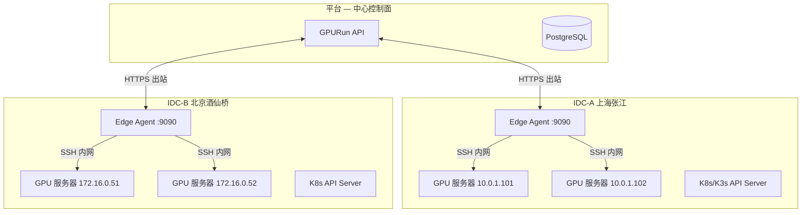
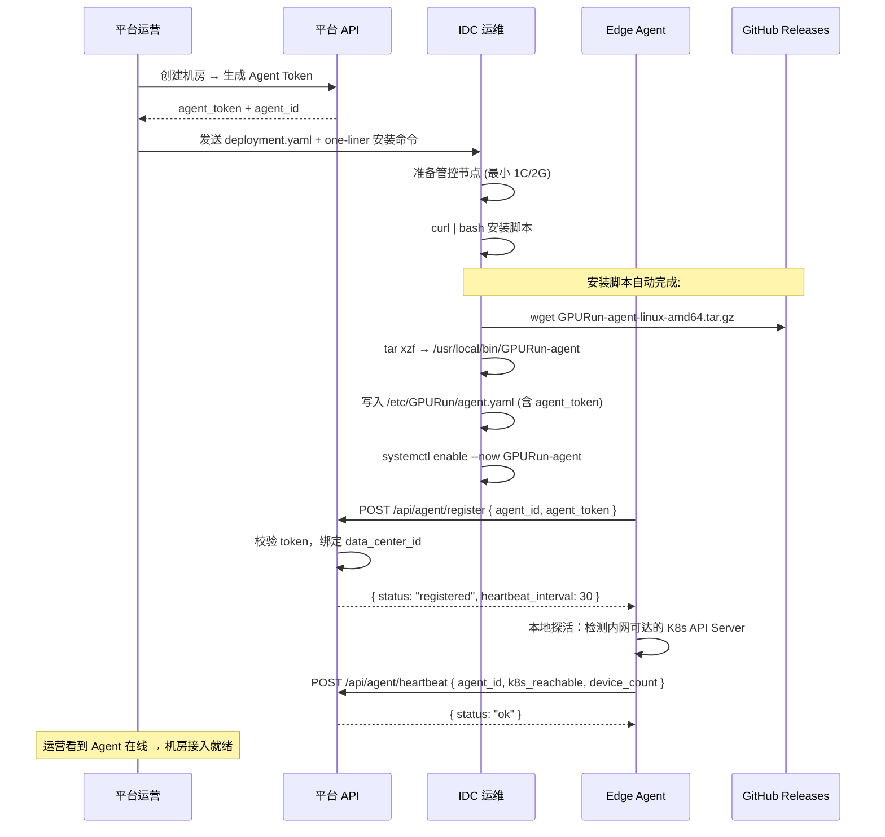
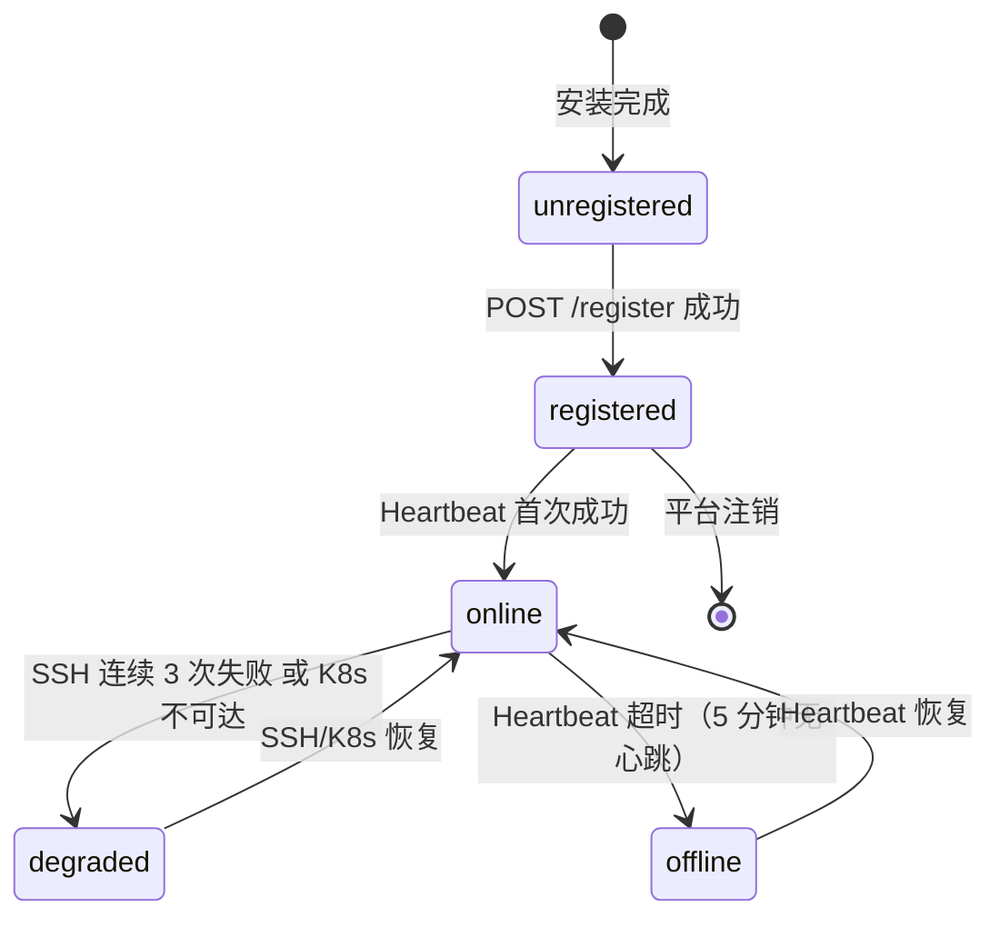
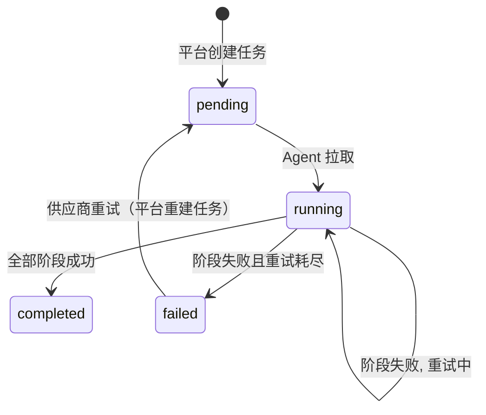

# IDC 边缘代理（Edge Agent）设计

> 版本：v1.0
> 日期：2026-07-20
> 状态：设计稿
> 关联：[idc-auto-onboarding-design.md](idc-auto-onboarding-design.md)（供应商接入流程）、[idc-auto-onboarding-implementation.md](idc-auto-onboarding-implementation.md)（自动纳管实现）、[supplier-database.md](supplier-database.md)（数据库设计）

---

## 1. 背景

### 1.1 问题

[idc-auto-onboarding-implementation.md](idc-auto-onboarding-implementation.md) 设计了从 SSH 验证到 K8s 纳管的完整自动流水线，但其隐含假设是**平台可以直接 SSH 到 IDC 内部设备**。现实中的 IDC 网络环境复杂多样：

| 网络场景 | 占比 | 平台直连可行性 |
|---------|------|---------------|
| 设备有公网 IP，22 端口开放 | ~20% | ✅ 直连 |
| 设备仅有内网 IP，IDC 有跳板机 | ~40% | ⚠️ 需跳板机代理 |
| 设备仅有内网 IP，无跳板机 | ~30% | ❌ 不可达 |
| 设备在隔离网段（NAT/防火墙） | ~10% | ❌ 不可达 |

方案需要一个**部署在 IDC 内部的独立服务**，作为平台与 IDC 内部设备之间的桥梁。

### 1.2 目标

将管控节点部署、设备上架、设备下架的操作封装为**独立的边缘代理服务（Edge Agent）**，部署在每个 IDC 机房内部：

- 平台通过 HTTPS 与 Edge Agent 通信（出站连接，无需 IDC 开放入站端口）
- Edge Agent 在 IDC 内网执行 SSH、环境初始化、K8s join 等本地操作
- 一套代码，所有 IDC 统一部署，通过配置适配不同网络环境

### 1.3 架构定位



---

## 2. 整体架构

### 2.1 通信模型

Edge Agent 采用 **Polling + Webhook 混合通信** 模式：

| 方向 | 模式 | 说明 |
|------|------|------|
| 平台 → Agent | **Polling（Agent 拉取任务）** | Agent 定期 `GET /api/agent/tasks/pending` 获取待执行任务，执行完毕后 `PATCH /api/agent/tasks/{id}` 上报结果 |
| Agent → 平台 | **Webhook（事件推送）** | 设备状态变更、SSH 结果等实时推送到平台 |

> **为什么用 Polling 而不是 WebSocket/gRPC？** IDC 内网经常有 HTTP 代理、防火墙。Polling 通过标准 HTTPS 兼容性最好，不需要长连接，防火墙策略简单。

### 2.2 组件分层

```
┌─────────────────────────────────────────────┐
│                Edge Agent                   │
├─────────────────────────────────────────────┤
│  HTTP Server (:9090)                        │  ← 供平台回调（仅内网可达）│
│  ┌───────────────┐  ┌───────────────────┐   │
│  │  Task Poller   │  │  Webhook Emitter  │   │  ← 平台通信（出站 HTTPS）
│  └───────────────┘  └───────────────────┘   │
├─────────────────────────────────────────────┤
│               Task Engine                    │
│  ┌──────────┐ ┌──────────┐ ┌─────────────┐  │
│  │  上架    │ │  下架    │ │  管控节点   │  │
│  │ Onboard  │ │ Offboard │ │ Bootstrap   │  │
│  └──────────┘ └──────────┘ └─────────────┘  │
├─────────────────────────────────────────────┤
│              Runtime Drivers                 │
│  ┌──────┐ ┌───────┐ ┌────────┐ ┌────────┐  │
│  │ SSH  │ │  K8s  │ │  GPU   │ │ System │  │
│  │Client│ │Client │ │  Util  │ │  Util  │  │
│  └──────┘ └───────┘ └────────┘ └────────┘  │
├─────────────────────────────────────────────┤
│  Config (YAML)  │  State (SQLite)           │  ← 本地持久化
└─────────────────────────────────────────────┘
```

### 2.3 技术选型

| 层 | 选型 | 理由 |
|----|------|------|
| 语言 | **Go 1.22+** | 单二进制部署、低内存、静态编译、丰富的 SSH 库 |
| HTTP | `net/http` + `chi` router | 标准库级性能，无需外部依赖 |
| 数据库 | **SQLite** (本地) | 无外部依赖，存储任务状态、设备缓存、审计日志 |
| SSH | `golang.org/x/crypto/ssh` | Go 标准 SSH 实现，支持密码/密钥/跳板机 |
| K8s | `client-go` + kubeconfig | 执行 kubeadm join / cordon / drain 等操作 |
| 构建 | 单二进制 `GPURun-agent` | `GOOS=linux GOARCH=amd64`，约 18MB |
| 部署 | systemd 托管 | `systemctl enable GPURun-agent` |

---

## 3. 部署与管控节点初始化

### 3.1 部署架构

每个 IDC 机房需要**一台管控节点**（可以是低配服务器或 VM）运行 Edge Agent：

```
IDC 机房内部网络
┌──────────────────────────────────────────────┐
│                                              │
│  管控节点 (1C/2G/20G 即可)                   │
│  ┌─────────────────────────┐                │
│  │  GPURun-agent        │                │
│  │  - HTTP :9090           │                │
│  │  - SQLite state.db      │                │
│  │  - agent.yaml           │                │
│  └─────────────────────────┘                │
│         │ SSH (内网)                          │
│         ▼                                    │
│  ┌──────────┐  ┌──────────┐  ┌──────────┐  │
│  │ DEV-001  │  │ DEV-002  │  │ DEV-00N  │  │
│  │ A100×8   │  │ H100×8   │  │ A100×8   │  │
│  └──────────┘  └──────────┘  └──────────┘  │
│                                              │
└──────────────────────────────────────────────┘
          │
          │ HTTPS (出站，仅需 443 出站)
          ▼
    平台 API Server
```

### 3.2 管控节点初始化流程



### 3.3 安装脚本（one-liner）

IDC 运维拿到平台运营分发的 `agent_token` 后，在管控节点执行一条命令完成安装：

```bash
# 标准安装（需要 wget + systemd）
curl -fsSL https://agent.GPURun.cn/install.sh | sudo bash -s -- \
  --token "${AGENT_TOKEN}" \
  --api-url "https://api.GPURun.cn" \
  --datacenter "SH-ZJ-01"
```

**`install.sh` 核心逻辑**：

```bash
#!/bin/bash
set -euo pipefail

AGENT_TOKEN=""
API_URL="https://api.GPURun.cn"
DATACENTER=""
INSTALL_DIR="/usr/local/bin"
CONFIG_DIR="/etc/GPURun"

# 解析参数...

# 1. 架构检测
ARCH=$(uname -m)
case "$ARCH" in
  x86_64)  AGENT_ARCH="amd64" ;;
  aarch64) AGENT_ARCH="arm64" ;;
  *) echo "不支持的架构: $ARCH"; exit 1 ;;
esac

# 2. 下载二进制
VERSION=$(curl -s "${API_URL}/api/agent/version" | jq -r '.latest')
DOWNLOAD_URL="${API_URL}/api/agent/downloads/${VERSION}/GPURun-agent-linux-${AGENT_ARCH}.tar.gz"
curl -fsSL "$DOWNLOAD_URL" -o /tmp/GPURun-agent.tar.gz
tar xzf /tmp/GPURun-agent.tar.gz -C "$INSTALL_DIR" GPURun-agent
chmod +x "${INSTALL_DIR}/GPURun-agent"

# 3. 生成配置
mkdir -p "$CONFIG_DIR"
cat > "${CONFIG_DIR}/agent.yaml" <<EOF
agent_id: "$(uuidgen)"
agent_token: "${AGENT_TOKEN}"
api_url: "${API_URL}"
datacenter: "${DATACENTER}"
listen_addr: ":9090"
state_dir: "${CONFIG_DIR}"
log_level: "info"
ssh:
  concurrent_limit: 20
  connect_timeout: 10
  command_timeout: 60
  preferred_auth: ["password", "publickey"]
EOF

# 4. 注册 systemd 服务
cat > /etc/systemd/system/GPURun-agent.service <<EOF
[Unit]
Description=GPURun Edge Agent
After=network-online.target
Wants=network-online.target

[Service]
Type=simple
ExecStart=${INSTALL_DIR}/GPURun-agent --config ${CONFIG_DIR}/agent.yaml
Restart=always
RestartSec=10
LimitNOFILE=65536

[Install]
WantedBy=multi-user.target
EOF

systemctl daemon-reload
systemctl enable --now GPURun-agent

# 5. 验证
sleep 3
if systemctl is-active --quiet GPURun-agent; then
  echo "✅ GPURun Edge Agent 安装成功"
  echo "   管控节点: ${DATACENTER}"
  echo "   日志: journalctl -u GPURun-agent -f"
else
  echo "❌ Agent 启动失败，请检查日志: journalctl -u GPURun-agent -n 50"
  exit 1
fi
```

---

## 4. API 设计

### 4.1 平台侧 API（Agent 调用的平台接口）

| 方法 | 路径 | 说明 | Agent 调用时机 |
|------|------|------|---------------|
| `POST` | `/api/agent/register` | Agent 注册 | 首次启动 |
| `POST` | `/api/agent/heartbeat` | 心跳上报（含设备数量/K8s 状态） | 每 30s |
| `GET` | `/api/agent/tasks/pending` | 拉取待执行任务 | 每 15s Polling |
| `PATCH` | `/api/agent/tasks/{taskId}` | 上报任务执行结果 | 任务完成/失败时 |
| `GET` | `/api/agent/version` | 获取最新 Agent 版本 | 安装脚本使用 |
| `GET` | `/api/agent/downloads/{version}/{file}` | 下载 Agent 二进制 | 安装脚本使用 |

### 4.2 Agent 任务协议

```json
// GET /api/agent/tasks/pending 返回
{
  "tasks": [
    {
      "id": "task_abc123",
      "type": "device_onboard",
      "priority": 1,
      "payload": {
        "device_sn": "SN2026A10001",
        "internal_ip": "10.0.1.101",
        "ssh_username": "root",
        "ssh_password": "encrypted_base64...",
        "gpu_card_type": "NVIDIA A100 80GB",
        "expected_gpu_count": 8,
        "target_cluster_endpoint": "10.0.1.1:6443",
        "kubeadm_token": "abcdef.0123456789abcdef",
        "kubeadm_ca_hash": "sha256:...",
        "node_labels": {
          "GPURun.io/supplier": "hb-gpu-01",
          "GPURun.io/datacenter": "sh-zj-01",
          "GPURun.io/gpu-card-type": "a100-80g",
          "GPURun.io/cooperation-type": "idle_time"
        }
      }
    },
    {
      "id": "task_def456",
      "type": "device_offboard",
      "priority": 0,
      "payload": {
        "device_sn": "SN2026A00042",
        "node_name": "sn2026a00042",
        "drain_timeout_seconds": 1800
      }
    }
  ]
}
```

```json
// PATCH /api/agent/tasks/task_abc123 上报结果
{
  "status": "completed",
  "stages": [
    {"stage": "ssh_verify", "status": "success", "duration_ms": 1234, "output": {...}},
    {"stage": "gpu_check",  "status": "success", "duration_ms": 3412, "output": {...}},
    {"stage": "env_init",   "status": "success", "duration_ms": 45234,"output": {...}},
    {"stage": "k8s_join",   "status": "success", "duration_ms": 8912, "output": {"node_name": "sn2026a10001"}}
  ]
}
```

---

## 5. 设备上架（Onboard）

### 5.1 平台侧：创建任务

供应商提交设备批次后，平台不再直接 SSH 到设备，而是创建 Agent 任务：

```typescript
async function dispatchOnboardTask(device: SupplierDevice): Promise<void> {
  const agent = await getAgentForDataCenter(device.dataCenterId)
  if (!agent || agent.status !== 'online') {
    throw new Error(`机房 ${device.dataCenterId} 的 Edge Agent 不在线`)
  }

  const taskPayload = buildOnboardPayload(device, agent)

  await db.insert(agentTask).values({
    id: generateTaskId(),
    agentId: agent.id,
    type: 'device_onboard',
    status: 'pending',
    priority: 1,
    payload: taskPayload,
    supplierDeviceId: device.id,
    onboardingBatchId: device.onboardingBatchId,
    maxRetries: 3,
    createdAt: new Date(),
  })
}
```

### 5.2 Agent 侧：上架流水线

Agent 拉取到 `device_onboard` 任务后，执行本地纳管流程。

```go
// internal/engine/onboard.go

type OnboardPipeline struct {
    sshClient   *ssh.Client
    k8sClient   *k8s.Client
    gpuUtil     *gpu.Util
    reportFn    func(stage StageResult)  // 实时上报进度
}

func (p *OnboardPipeline) Execute(ctx context.Context, task Task) error {
    stages := []StageFn{
        p.sshVerify,    // SSH 连通性验证
        p.gpuCheck,     // GPU 型号/数量对账
        p.envInit,      // 环境初始化
        p.k8sJoin,      // K8s Node 注册
        p.gpuLabel,     // GPU 标签与 taint 设置
    }

    for i, stage := range stages {
        result := stage(ctx, task)

        // 实时上报到平台
        p.reportFn(StageResult{
            Stage:      stageNames[i],
            Status:     result.Status,      // success / failed / skipped
            Output:     result.Output,
            DurationMs: result.Duration.Milliseconds(),
            Error:      result.Error,
        })

        if result.Status == "failed" {
            return fmt.Errorf("阶段 %s 失败: %v", stageNames[i], result.Error)
        }
    }

    return nil
}
```

#### 5.2.1 SSH 连通性验证

```go
func (p *OnboardPipeline) sshVerify(ctx context.Context, task Task) StageOutput {
    cfg := &ssh.ClientConfig{
        User: task.SSHUser,
        Auth: []ssh.AuthMethod{
            ssh.Password(task.SSHPassword),
        },
        HostKeyCallback: ssh.InsecureIgnoreHostKey(),
        Timeout:         10 * time.Second,
    }

    // 支持跳板机
    if task.BastionHost != "" {
        bastion, _ := ssh.Dial("tcp", net.JoinHostPort(task.BastionHost, task.BastionPort), cfg)
        conn, _ := bastion.Dial("tcp", net.JoinHostPort(task.DeviceIP, "22"))
        // ...
    } else {
        conn, err := ssh.Dial("tcp", net.JoinHostPort(task.DeviceIP, "22"), cfg)
        if err != nil {
            return StageOutput{Status: "failed", Error: err.Error()}
        }
        defer conn.Close()
    }

    // 探测基础环境
    session, _ := conn.NewSession()
    output, _ := session.CombinedOutput("uname -a && cat /etc/os-release | head -3")
    osInfo := parseOSInfo(output)

    return StageOutput{
        Status: "success",
        Output: map[string]interface{}{
            "os":          osInfo.ID,
            "version":     osInfo.VersionID,
            "kernel":      osInfo.Kernel,
            "architecture": osInfo.Arch,
        },
    }
}
```

#### 5.2.2 GPU 对账

```go
func (p *OnboardPipeline) gpuCheck(ctx context.Context, task Task) StageOutput {
    session, _ := p.sshClient.NewSession()
    output, _ := session.CombinedOutput(
        "nvidia-smi --query-gpu=name,count,memory.total --format=csv,noheader",
    )

    gpus := parseNvidiaSmi(string(output))

    // GPU 数量对账
    actualCount := 0
    for _, g := range gpus {
        actualCount += g.Count
    }

    if actualCount != task.ExpectedGPUCount {
        return StageOutput{
            Status: "failed",
            Error:  fmt.Sprintf("GPU 数量不匹配: 实际 %d vs 预期 %d", actualCount, task.ExpectedGPUCount),
            Output: map[string]interface{}{"actual": actualCount, "expected": task.ExpectedGPUCount},
        }
    }

    // GPU 型号校验
    typeMatched := false

    for _, g := range gpus {
        if normalizeName(g.Name) == normalizeName(task.ExpectedGPUType) {
            typeMatched = true
            break
        }
    }

    if !typeMatched {
        return StageOutput{
            Status: "failed",
            Error:  fmt.Sprintf("GPU 型号不匹配: 预期 %s", task.ExpectedGPUType),
            Output: map[string]interface{}{"actual": gpuNames(gpus), "expected": task.ExpectedGPUType},
        }
    }

    return StageOutput{
        Status: "success",
        Output: map[string]interface{}{"gpus": gpus},
    }
}
```

#### 5.2.3 环境初始化

```go
func (p *OnboardPipeline) envInit(ctx context.Context, task Task) StageOutput {
    // 1. 检测 OS 发行版
    osInfo := detectOS(p.sshClient)
    scriptPath := selectInitScript(osInfo)  // ubuntu.sh / centos.sh / rocky.sh

    // 2. 上传初始化脚本
    sftp, _ := p.sshClient.NewSession()
    go io.Copy(sftp.Stdin, bytes.NewReader(initScript))

    // 3. 远程执行（设置环境变量）
    envVars := map[string]string{
        "GPU_DRIVER_VERSION": task.GPUDriverVersion,
        "CUDA_VERSION":       task.CUDAVersion,
        "KUBE_VERSION":       task.KubeVersion,
        "SUPPLIER_ID":        task.SupplierID,
        "DATACENTER_CODE":    task.DatacenterCode,
        "COOPERATION_TYPE":   task.CooperationType,
    }

    // 4. 幂等执行（每步检查前置条件）
    session, _ := p.sshClient.NewSession()
    session.Setenv("GPU_DRIVER_VERSION", envVars["GPU_DRIVER_VERSION"])
    // ...

    output, err := session.CombinedOutput(fmt.Sprintf("bash /tmp/GPURun-init.sh"))
    if err != nil {
        return StageOutput{Status: "failed", Error: err.Error()}
    }

    return StageOutput{Status: "success", Output: map[string]interface{}{
        "script_output": string(output),
    }}
}
```

**发行版适配脚本选择逻辑**：

```go
func selectInitScript(osInfo OSInfo) string {
    switch {
    case strings.Contains(osInfo.ID, "ubuntu"):
        if strings.HasPrefix(osInfo.VersionID, "22") {
            return initScripts.Ubuntu2204
        }
        return initScripts.Ubuntu2004
    case strings.Contains(osInfo.ID, "centos"):
        return initScripts.CentOS7
    case strings.Contains(osInfo.ID, "rocky"):
        return initScripts.Rocky9
    default:
        return initScripts.Generic  // 通用 fallback
    }
}
```

#### 5.2.4 K8s Node 注册

```go
func (p *OnboardPipeline) k8sJoin(ctx context.Context, task Task) StageOutput {
    joinCmd := fmt.Sprintf(
        "kubeadm join %s --token %s --discovery-token-ca-cert-hash sha256:%s",
        task.K8sEndpoint, task.KubeadmToken, task.KubeadmCAHash,
    )

    session, _ := p.sshClient.NewSession()
    output, err := session.CombinedOutput(joinCmd)
    if err != nil {
        // 如果节点已经加入过，kubeadm reset 重试
        session, _ = p.sshClient.NewSession()
        session.CombinedOutput("kubeadm reset -f")

        session, _ = p.sshClient.NewSession()
        output, err = session.CombinedOutput(joinCmd)
        if err != nil {
            return StageOutput{Status: "failed", Error: string(output)}
        }
    }

    // 等待 Node Ready
    nodeName := task.DeviceSN
    if err := p.waitNodeReady(ctx, nodeName, 5*time.Minute); err != nil {
        return StageOutput{Status: "failed", Error: err.Error()}
    }

    // 设置标签
    for k, v := range task.NodeLabels {
        p.k8sClient.LabelNode(nodeName, k, v)
    }

    return StageOutput{
        Status: "success",
        Output: map[string]interface{}{"node_name": nodeName},
    }
}

func (p *OnboardPipeline) waitNodeReady(ctx context.Context, nodeName string, timeout time.Duration) error {
    ctx, cancel := context.WithTimeout(ctx, timeout)
    defer cancel()

    ticker := time.NewTicker(10 * time.Second)
    defer ticker.Stop()

    for {
        select {
        case <-ctx.Done():
            return fmt.Errorf("节点 %s 在 %v 内未 Ready", nodeName, timeout)
        case <-ticker.C:
            node, err := p.k8sClient.GetNode(nodeName)
            if err != nil {
                continue
            }
            for _, cond := range node.Status.Conditions {
                if cond.Type == "Ready" && cond.Status == "True" {
                    return nil
                }
            }
        }
    }
}
```

#### 5.2.5 GPU 标签与 Taint

```go
func (p *OnboardPipeline) gpuLabel(ctx context.Context, task Task) StageOutput {
    nodeName := task.DeviceSN

    // 标签
    labels := map[string]string{
        "nvidia.com/gpu.present":         "true",
        "nvidia.com/gpu.count":           strconv.Itoa(task.ExpectedGPUCount),
        "nvidia.com/gpu.product":         task.ExpectedGPUType,
        "GPURun.io/supplier":          task.SupplierCode,
        "GPURun.io/datacenter":        task.DatacenterCode,
        "GPURun.io/cooperation-type":  task.CooperationType,
    }
    for k, v := range labels {
        p.k8sClient.LabelNode(nodeName, k, v)
    }

    // GPU Taint（防止非 GPU 工作负载调度到 GPU 节点）
    taint := corev1.Taint{
        Key:    "GPURun.io/gpu-node",
        Value:  "true",
        Effect: corev1.TaintEffectNoSchedule,
    }
    p.k8sClient.TaintNode(nodeName, taint)

    // 验证 GPU Device Plugin
    ...
    return StageOutput{Status: "success"}
}
```

---

## 6. 设备下架（Offboard）

### 6.1 平台侧：创建下架任务

下架审批通过后，平台创建 Agent 任务：

```typescript
async function dispatchOffboardTask(device: SupplierDevice): Promise<void> {
  const agent = await getAgentForDataCenter(device.dataCenterId)

  await db.insert(agentTask).values({
    id: generateTaskId(),
    agentId: agent.id,
    type: 'device_offboard',
    status: 'pending',
    priority: 0,
    payload: {
      device_sn:             device.sn,
      node_name:             device.karmadaNodeName,
      drain_timeout_seconds: 1800,  // 30 分钟
      force:                 true,  // 强制驱逐
    },
    supplierDeviceId: device.id,
    createdAt: new Date(),
  })
}
```

### 6.2 Agent 侧：下架流水线

```go
func (p *OffboardPipeline) Execute(ctx context.Context, task Task) error {
    nodeName := task.NodeName
    timeout := time.Duration(task.DrainTimeout) * time.Second

    // 1. Cordon
    if err := p.k8sClient.CordonNode(ctx, nodeName); err != nil {
        return fmt.Errorf("cordon 失败: %w", err)
    }
    p.report("cordon", "success")

    // 2. Drain
    drainOpts := DrainOptions{
        Timeout:          timeout,
        DeleteEmptyDir:   true,
        IgnoreDaemonSets: true,
        Force:            task.Force,
    }
    if err := p.k8sClient.DrainNode(ctx, nodeName, drainOpts); err != nil {
        return fmt.Errorf("drain 失败: %w", err)
    }
    p.report("drain", "success")

    // 3. Delete Node
    if err := p.k8sClient.DeleteNode(ctx, nodeName); err != nil {
        return fmt.Errorf("delete node 失败: %w", err)
    }
    p.report("delete_node", "success")

    // 4. 提交最终结果给平台（平台更新 DB 状态）
    return nil
}
```

---

## 7. 重试与幂等性

### 7.1 任务级重试

```go
type RetryPolicy struct {
    MaxRetries   int           // 最大重试次数，默认 3
    BackoffBase  time.Duration // 基础退避，默认 10s
    BackoffMax   time.Duration // 最大退避，默认 5min
}

func (r *RetryPolicy) NextDelay(attempt int) time.Duration {
    delay := r.BackoffBase * time.Duration(1<<attempt) // 指数退避：10s, 20s, 40s...
    if delay > r.BackoffMax {
        delay = r.BackoffMax
    }
    return delay
}
```

### 7.2 阶段级幂等

每个上架阶段实现**幂等性**——重复执行安全：

| 阶段 | 幂等策略 |
|------|---------|
| SSH 验证 | 天然幂等 |
| GPU 对账 | 天然幂等 |
| 环境初始化 | 每步检查 `command -v` 或配置文件是否存在 |
| K8s Join | 先 `kubectl get node {name}` 检测是否已加入，已加入则跳过；失败时 `kubeadm reset -f` 后重试 |
| GPU Label | `kubectl label --overwrite` 覆盖写 |

### 7.3 管控节点级可靠性

```go
// Agent 本地 SQLite 存储未完成任务，重启后恢复执行
func (a *Agent) recoverPendingTasks() error {
    tasks, err := a.state.GetPendingTasks()
    if err != nil {
        return err
    }

    for _, task := range tasks {
        a.taskQueue <- task  // 重新入队
    }

    a.logger.Info("恢复待执行任务", "count", len(tasks))
    return nil
}
```

---

## 8. 本地状态存储（SQLite）

```sql
-- Agent 本地 SQLite schema

CREATE TABLE IF NOT EXISTS tasks (
  id          TEXT PRIMARY KEY,
  type        TEXT NOT NULL,          -- device_onboard / device_offboard
  status      TEXT NOT NULL DEFAULT 'pending',
  payload     TEXT NOT NULL,          -- JSON
  stages_json TEXT,                   -- 各阶段执行结果 JSON
  retry_count INTEGER DEFAULT 0,
  max_retries INTEGER DEFAULT 3,
  error       TEXT,
  created_at  TEXT NOT NULL,
  started_at  TEXT,
  finished_at TEXT
);

CREATE TABLE IF NOT EXISTS device_cache (
  sn           TEXT PRIMARY KEY,
  internal_ip  TEXT,
  node_name    TEXT,                  -- K8s Node name
  gpu_type     TEXT,
  gpu_count    INTEGER,
  os_id        TEXT,
  os_version   TEXT,
  labels_json  TEXT,
  last_probed_at TEXT,
  updated_at   TEXT
);

CREATE TABLE IF NOT EXISTS audit_log (
  id          INTEGER PRIMARY KEY AUTOINCREMENT,
  task_id     TEXT,
  action      TEXT NOT NULL,
  details     TEXT,                   -- JSON
  created_at  TEXT NOT NULL
);

CREATE INDEX idx_tasks_status ON tasks(status);
CREATE INDEX idx_tasks_type_status ON tasks(type, status);
```

---

## 9. 配置规范

### 9.1 `agent.yaml` 完整配置

```yaml
# /etc/GPURun/agent.yaml

agent_id: "a1b2c3d4-e5f6-7890-abcd-ef1234567890"
agent_token: "oat_xxxxxxxxxxxxxxxxxxxxxxxxxxxxxxxx"
api_url: "https://api.GPURun.cn"

# 当前管控节点归属的机房编码
datacenter: "SH-ZJ-01"

# 本地 HTTP 服务（供平台回调）
listen_addr: ":9090"

# 状态存储
state_dir: "/etc/GPURun"

# 日志
log_level: "info"         # debug / info / warn / error
log_file: ""              # 空 = 仅 stdout（systemd journal 管理）

# SSH 配置
ssh:
  # 并发 SSH 连接上限
  concurrent_limit: 20

  # 连接超时 (秒)
  connect_timeout: 10

  # 命令执行超时 (秒)
  command_timeout: 60

  # 认证方式优先级
  preferred_auth: ["publickey", "password"]

  # 跳板机（可选，所有设备需通过跳板机时配置）
  bastion:
    host: ""
    port: "22"
    user: "ops"
    private_key_path: "/etc/GPURun/bastion_key"

# K8s 配置（可选）
k8s:
  # kubeconfig 路径（不填则自动检测 ~/.kube/config）
  kubeconfig_path: "/etc/GPURun/kubeconfig"

  # Node 注册后标签
  default_labels:
    "GPURun.io/managed-by": "edge-agent"
    "GPURun.io/datacenter": "sh-zj-01"

# 轮询配置
polling:
  task_interval: 15        # 任务拉取间隔 (秒)
  heartbeat_interval: 30   # 心跳上报间隔 (秒)

# 重试配置
retry:
  max_attempts: 3
  backoff_base: 10         # 基础退避 (秒)
  backoff_max: 300         # 最大退避 (秒)

# 健康检查
health:
  ssh_probe_interval: 1800       # SSH 健康检查间隔 (秒)，0=禁用
  ssh_consecutive_fail_max: 3    # 连续失败阈值
  node_ready_timeout: 300        # K8s Node Ready 等待超时 (秒)
```

### 9.2 Docker Compose 部署（备选）

```yaml
# docker-compose.yml（无需 systemd 的环境）

version: '3.8'
services:
  GPURun-agent:
    image: GPURun/agent:latest
    restart: always
    network_mode: host
    volumes:
      - /etc/GPURun:/etc/GPURun:ro
      - /var/lib/GPURun:/var/lib/GPURun
      - ~/.kube/config:/home/agent/.kube/config:ro
    environment:
      - AGENT_CONFIG_PATH=/etc/GPURun/agent.yaml
```

---

## 10. 监控与运维

### 10.1 Agent 健康检查

```go
// GET :9090/health — 平台可回调管控节点的内网地址检查 Agent 健康
func (a *Agent) healthHandler(w http.ResponseWriter, r *http.Request) {
    health := HealthStatus{
        Status:    "ok",
        Version:   version,
        Uptime:    time.Since(a.startTime).String(),
        TaskCount: a.taskQueue.Len(),
        K8sReachable: a.k8sClient.IsReachable(),
        Devices:   a.deviceCache.Count(),
    }
    json.NewEncoder(w).Encode(health)
}
```

### 10.2 日志规范

```go
// 结构化日志（JSON 格式，方便平台日志系统消费）
a.logger.Info("task_started",
    "task_id", task.ID,
    "type", task.Type,
    "device_sn", task.DeviceSN,
)

a.logger.Info("stage_completed",
    "task_id", task.ID,
    "stage", "env_init",
    "status", "success",
    "duration_ms", result.Duration.Milliseconds(),
)

a.logger.Error("stage_failed",
    "task_id", task.ID,
    "stage", "gpu_check",
    "error", result.Error,
    "retry", retryCount,
)
```

### 10.3 关键指标

| 指标 | 说明 |
|------|------|
| `agent_task_total{type,status}` | 任务执行总数（按类型/状态） |
| `agent_task_duration_seconds{type,stage}` | 各阶段耗时分布 |
| `agent_ssh_errors_total` | SSH 连接失败总数 |
| `agent_polling_latency_seconds` | 任务拉取延迟 |
| `agent_heartbeat_age_seconds` | 最近一次心跳距今 |
| `agent_devices_managed` | 本 Agent 管理的设备总数 |

---

## 11. 安全设计

### 11.1 认证与授权

| 层面 | 机制 |
|------|------|
| Agent → 平台 **注册** | 平台下发的 `agent_token`（256-bit random，一次性使用，注册后废弃） |
| Agent → 平台 **API 调用** | Agent 注册后获取 JWT `access_token`（24h 有效期），后续请求带 `Authorization: Bearer {token}` |
| 平台 → Agent **回调** | 平台使用 HMAC 签名（`X-Signature: sha256=...`），Agent 本地验证 |
| SSH 凭据 | 平台加密传输（AES-256-GCM，密钥由平台 KMS 管理），Agent 内存解密后使用，不落盘 |

### 11.2 传输安全

- 所有平台 ↔ Agent 通信通过 HTTPS（TLS 1.3）
- SSH 使用 `aes256-gcm@openssh.com` cipher
- Agent 本地 SQLite 中不存储明文密码（仅存 base64 密文，由任务 payload 携带）

---

## 12. 实施计划

### Phase 1：Agent 核心框架（2 周）

- [ ] Go 项目脚手架 + `agent.yaml` 配置加载
- [ ] SQLite 本地状态存储
- [ ] 平台注册 + JWT 认证
- [ ] Polling 任务拉取 + 结果上报
- [ ] Heartbeat 心跳机制
- [ ] `install.sh` 安装脚本
- [ ] systemd 服务模板

### Phase 2：上架流水线（2 周）

- [ ] SSH 客户端（支持跳板机、多种认证）
- [ ] GPU 对账（nvidia-smi 解析）
- [ ] 环境初始化脚本（Ubuntu 20.04/22.04、CentOS 7、Rocky 9）
- [ ] K8s kubeadm join 自动化
- [ ] Node Ready 等待 + 标签/Taint 设置
- [ ] 阶段级幂等 + 任务级重试

### Phase 3：下架 + 运维（1.5 周）

- [ ] K8s Cordon → Drain → Delete Node 流水线
- [ ] Drain 超时策略 + 强制驱逐
- [ ] SSH 健康检查定时任务
- [ ] GPU 对账定时任务
- [ ] Agent 自更新机制（`systemctl restart`）

### Phase 4：平台侧集成（1 周）

- [ ] `agent_registry` 表 + Agent 注册/心跳 API
- [ ] `agent_task` 表 + 任务分发/结果收集 API
- [ ] 供应商门户 Agent 状态展示
- [ ] 运营平台 Agent 管理页

---

## 13. 附录

### 13.1 Agent 状态机



### 13.2 任务状态机



### 13.3 单机房部署最小硬件要求

| 组件 | CPU | 内存 | 磁盘 | 网络 |
|------|-----|------|------|------|
| Edge Agent 管控节点 | 1 核 | 512 MB | 10 GB | 内网可达所有设备 + 出站 443 至平台 API |
| 每管理 50 台 GPU 设备 | +0.5 核 | +256 MB | +2 GB | — |
| 每管理 200 台 GPU 设备 | +1 核 | +512 MB | +5 GB | — |

### 13.4 关联文档

| 文档 | 关系 |
|------|------|
| [idc-auto-onboarding-design.md](idc-auto-onboarding-design.md) | 供应商视角流程设计 |
| [idc-auto-onboarding-implementation.md](idc-auto-onboarding-implementation.md) | 自动纳管实现（原设计） |
| [supplier-database.md](supplier-database.md) | 数据库设计 |
