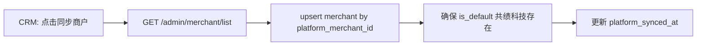
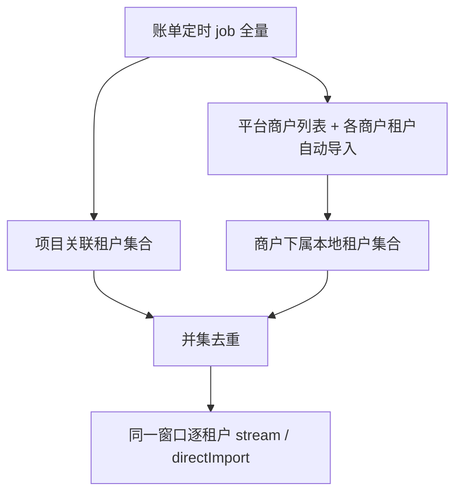
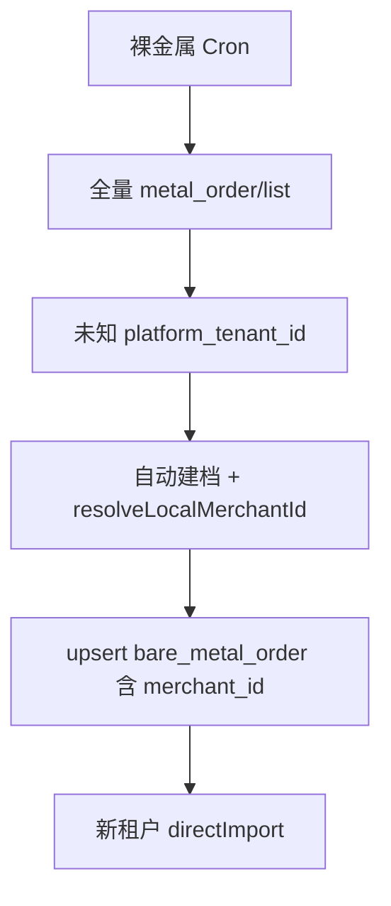
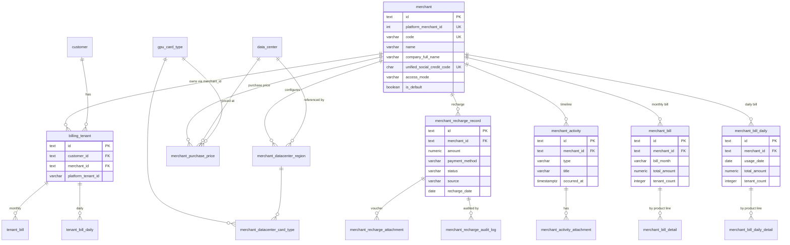

# 商户管理功能设计方案

> **版本**：v1.8  
> **日期**：2026-07-14  
> **状态**：**核心 CRUD 已接 tRPC + PostgreSQL；§8 反映当前实现；§15 列未实现项**  
> **变更**：v1.8 — §7.7 对齐实现：账单定时同步 **追加** 平台商户列表 + 各商户全部租户自动导入 + 同窗口导账单（含默认/非默认商户）；§7.6 rollup 明确为 **手动** `merchant.bill.rollup`（cron 不写 `merchant_bill*`）；§15 关闭 U1/U2/U3/U6/U7（表+手动 rollup）/U13/U14  
> **变更**：v1.7 — 事实表补齐 `merchant_id`（默认共绩）；写入以 `tenant.merchant_id` 为准（Q15）  
> **变更**：v1.6 — **废弃** `tenant_merchant`，在 `tenant` 上直接存 `merchant_id`（一租户一商户更简单）  
> **变更**：v1.5 — 租户↔商户改为 1:1；新增商户月/日账单；日账单与裸金属同步覆盖非默认商户  
> **关联**：`crm-database.md`（§1.1 Customer/Tenant 规则）、`platform-pricing-design.md`（L1 平台刊例价）、`supplier-database.md`（`data_center` / 机房区域）、`platform-tenant-import-design.md`（平台 `merchant_id`）、`tenant-billing-import-design.md` / `tenant-bill-daily-sync-design.md`（租户账单导入）、`bare-metal-order-schema-design.md`（裸金属订单同步）、`project-billing-scheduled-sync-design.md`（账单定时同步含商户阶段）、`project-tenant-daily-consumption-design.md`（消费明细粒度）、`role-menu-data-access-design.md`（菜单权限）、`merchant-am-data-access-design.md`（客户经理与数据范围）

**文档性质**：商户域逻辑设计（PostgreSQL 风格）；描述实体模型、定价分层、区域配额、回款与活动、消耗追踪与上下游集成。**§8 / §9 与当前代码实现对齐**（`apps/web/src/lib/server/routers/merchant/`）；v1.5+ 新增能力见 §15。

**术语校正（v1.5）**：**默认商户**「共绩科技」的 `platform_merchant_id` **固定为** `0`；**非默认商户**指 `platform_merchant_id ≠ 0` 的分销/合作伙伴商户。需求原文「非默认商户（商户Id为0）」按笔误校正为「非默认商户（商户Id ≠ 0）」。

---


## 1. 目标与原则


### 1.1 业务目标


| #   | 目标            | 说明                                                                                          |
| --- | ------------- | ------------------------------------------------------------------------------------------- |
| G1  | **租户归属唯一商户**  | 同一计费租户 **有且仅有一个** 商户归属；在 `tenant.merchant_id` 上维护；导入时平台 **必带 / 缺省为 0** 的 `merchant_id` 写入该列 |
| G2  | **默认商户**      | 系统内置默认商户 **共绩科技**（`platform_merchant_id = 0`）；历史租户与平台直客均归入该商户                               |
| G3  | **机房即区域**     | 商户可配置多个 **机房区域**（映射平台 `data_center`），向其下属租户展示为可选算力区域                                        |
| G4  | **区域差异化定价**   | 同一商户在不同机房的 **卡型 × 产品线** 进货价可不同；未配置时 **默认继承平台刊例价**                                           |
| G5  | **区域可用卡量**    | 可为商户在各开放区域配置 **可用 GPU 卡数上限**（配额），用于资源开放与风控                                                  |
| G6  | **进货价管理**     | 商户从平台 **进货**（平台刊例价为默认基准）；CRM 维护商户侧 **进货价** 主数据                                              |
| G7  | **消耗可区分**     | 商户下属租户消耗 **可追踪、可汇总**；与共绩科技直客消耗 **报表/财务口径分离**                                                |
| G8  | **接入模式**      | 商户主体维护 **接入模式**（OEM 品牌独立站 / IFrame / Promo 推广链接），标识与平台集成方式                                               |
| G9  | **商户充值记录**    | CRM 维护 **商户维度** 充值记录（手工录入 + 平台同步）；支持充值凭证附件；操作可审计                                            |
| G10 | **活动时间线**     | 商户详情展示运营活动时间线（系统事件 + 手工评论/附件），交互对齐供应商域                                                      |
| G11 | **商户月/日账单**   | 持久化商户维度 **月度账单** 与 **日账单**（= 所属全部租户对应账单汇总）；口径对齐租户 `tenant_bill`* / `tenant_bill_daily*`     |
| G12 | **非默认商户数据入账** | 日账单导入与裸金属订单同步 **覆盖** 非默认商户（`platform_merchant_id ≠ 0`）下属租户，不仅限共绩直客                          |


### 1.2 非目标（本期）

- **不**在 CRM 实现商户对终端客户的 **二次定价 / 零售价** 管理（终端扣费仍以平台计费引擎为准；本期只管理 **平台→商户** 的进货价）
- **不**替代供应商域 `supplier_unit_cost`（平台→供应商 **成本价**）；商户进货价是 **销售链上一层**，与供应商成本 **无自动联动**
- **不**实现商户自助门户（仅 CRM 管理端 + 平台 OpenAPI 同步）
- **不**改造 Customer / Project 三层经营模型（商户是 **计费域** 维度，Customer 仍为客户主体）
- **不**在一期实现商户间资源转让、跨商户租户迁移
- **不**保留 `tenant_merchant` **关联表** / **一租户多商户** / `commercial` **附加绑定**（v1.6 起归属列落在 `tenant.merchant_id`；换商户历史如需留痕走审计/活动，不另建绑定历史表）


### 1.3 设计原则

1. **平台 ID 对齐**：`merchant.platform_merchant_id` 与 OpenAPI `merchant_id` 全局 UK；每个 `tenant.merchant_id` **非空**，与平台租户 `merchant_id`（缺省 **0**）对齐。
2. **默认共绩**：迁移后所有无 `merchant_id` 的历史 `tenant` 回填为默认商户「共绩科技」。
3. **定价继承**：商户进货价 **显式覆盖优先**；无覆盖行时 **只读引用** L1 `platform_card_list_price.sell_price`（语义为平台刊例 = 默认进货价）。
4. **区域引用不复制**：商户区域配置 **FK 引用** `data_center`，不复制机房主数据；展示名可冗余 `data_center.name` / `container_instance_region`。
5. **消耗带商户维度**：计费事实表写入 `merchant_id`（取平台账单行 / `tenant.merchant_id`；**缺省视为** `0` → 共绩科技）；同一笔消耗 **只归属一个** 商户。
6. **读写分离**：列表读本地库；商户主数据经 **平台同步** 写入；`tenant.merchant_id` 由平台租户导入 / 账单与裸金属同步路径按平台 `merchant_id` 更新。
7. **主体信息完整**：商户须维护 **统一社会信用代码** 与 **公司全称**，用于合同、开票与主体识别。
8. **操作可审计**：商户充值记录的创建/修改写入审计日志；主数据变更、充值等系统事件自动写入活动时间线；租户换商户可写 `merchant_activity`。
9. **前后端对齐**：页面组件与 tRPC procedure **字段名、校验规则、副作用（活动/审计）保持一致**；新增能力先更新本稿再改代码。
10. **商户账单同源**：商户月/日账单字段与金额换算 **对齐** [tenant-billing-import-design.md](tenant-billing-import-design.md) / [tenant-bill-daily-sync-design.md](tenant-bill-daily-sync-design.md)；优先由所属租户账单 **rollup**，幂等可重跑。
11. **归属模型从简**：一租户一商户用 `tenant.merchant_id` **FK** 表达，**不**再维护中间表。

---


## 2. 领域模型


### 2.1 实体关系总览

```text
┌─────────────────────────────────────────────────────────────────────────┐
│  Platform（算算力平台）                                                  │
│  · L1 刊例价 platform_card_list_price                                    │
│  · 物理机房 data_center（供应商域）                                       │
│  · OpenAPI merchant / tenant（tenant 携带 merchant_id）                  │
└─────────────────────────────────────────────────────────────────────────┘
         │ 进货（默认=刊例价，可按机房覆盖）                │ 计费 / 消耗
         ▼                                                    ▼
┌──────────────────────┐         1 ── *              ┌──────────────────────┐
│  Merchant（商户）     │ ◄──── tenant.merchant_id ──│  Tenant（计费租户）   │
│  默认：共绩科技 (0)   │      （FK，唯一归属）        │  归属 1 Customer     │
└──────────────────────┘                              └──────────────────────┘
         │ 1                    │ 1
         │ *                    │ *
         ▼                      ▼
┌──────────────────────────┐  ┌──────────────────────────────────────────────┐
│ MerchantDatacenterRegion │  │ MerchantRechargeRecord（商户充值）              │
│ · 区域 / 配额 / 卡型      │  │ · 金额 / 支付方式 / 凭证附件 / 审计日志         │
│ · 嵌套进货价              │  └──────────────────────────────────────────────┘
└──────────────────────────┘              │ 1
         │                                │ *
         │                                ▼
         │                    ┌──────────────────────────────────────────────┐
         │                    │ MerchantActivity（活动时间线）                  │
         │                    │ · 系统事件 + 评论/附件；对齐 supplier_activity  │
         └────────────────────┴──────────────────────────────────────────────┘
         │ 1
         │ *
         ▼
┌──────────────────────────────────────────────────────────────────────────┐
│ MerchantBill / MerchantBillDaily（商户月/日账单）                          │
│ · 由所属租户 tenant_bill* / tenant_bill_daily* rollup                     │
└──────────────────────────────────────────────────────────────────────────┘
```


### 2.2 与现有 CRM 三层模型的关系


| 实体           | 层级     | 与商户关系                                                                 |
| ------------ | ------ | --------------------------------------------------------------------- |
| **Customer** | 经营客户主体 | 无直接 FK；经下属 `tenant.merchant_id` 间接关联商户                                |
| **Project**  | 经营项目   | 无变化；商户维度报表通过关联租户的 `tenant.merchant_id` 解析                             |
| **Tenant**   | 平台计费租户 | `tenant.merchant_id` **FK→merchant**，一租户一商户；导入时写平台 `merchant_id` 映射结果 |
| **Merchant** | 计费域新增  | 平台分销/转售主体；共绩科技 = 平台自营（`platform_merchant_id = 0`）                     |


**不变量（R7，v1.6 修订）**：


| 规则                      | 说明                                                                                                  |
| ----------------------- | --------------------------------------------------------------------------------------------------- |
| **R7.1 租户唯一商户**         | 每个 `tenant.merchant_id` **NOT NULL**；新建/导入时按平台 `merchant_id`（缺省 **0**）写入对应本地商户                      |
| **R7.2 归属即平台对齐**        | `tenant.merchant_id` ↔ `merchant.platform_merchant_id` = 平台租户 `merchant_id`（缺省 0）                   |
| **R7.3 平台 merchant 变更** | 平台 `merchant_id` 变更 → **UPDATE** `tenant.merchant_id`；映射失败 → 写入 `merchant_sync_issue`，不静默清空         |
| **R7.4 计费不重复**          | 同一笔平台账单 / 消费明细 **只归属一个** `merchant_id`（来自平台字段或 `tenant.merchant_id`；见 §6.3）                         |
| **R7.5 计费事实带商户**        | 事实表 **必须** 冗余 `merchant_id`，取值 **= `tenant.merchant_id`**（缺省共绩）；见 §5.12 v1.7 |
| **R7.6 共绩消耗分离**         | 报表默认维度 `merchant_id`；`platform_merchant_id = 0` / `merchant.code = 'gongji'` ；其它 = 分销口径             |
| **R7.7 平台 ID 缺省**       | 平台任意 API / 账单行 / 租户记录 **未带** `merchant_id` 时，CRM **视为** `0`，映射默认商户共绩科技                              |
| **R7.8 商户账单一致性**        | `merchant_bill`* / `merchant_bill_daily*` = 该商户下属租户（`tenant.merchant_id = ?`）对应账单之和（幂等 rollup）      |


### 2.3 默认商户「共绩科技」


| 项                                     | 值                                                                           |
| ------------------------------------- | --------------------------------------------------------------------------- |
| 逻辑标识                                  | `merchant.code = 'gongji'`（UK）                                              |
| 展示名 `name`                            | `共绩科技`（简称，列表/侧栏用）                                                           |
| 公司全称 `company_full_name`              | 工商注册全称（如「北京共绩科技有限公司」，seed 时填写）                                              |
| 统一社会信用代码 `unified_social_credit_code` | 18 位 USCC（seed 时填写；UK，见 §5.1）                                               |
| `platform_merchant_id`                | `0`**（固定）** — 平台侧默认/主商户 ID；seed 与迁移 **必须** 写入此值                             |
| `is_default`                          | `true`（全局至多一条）                                                              |
| `type`                                | `platform_direct`（平台直营）                                                     |
| `access_mode`                         | `oem`                                                                       |
| 历史数据                                  | 所有现有 `tenant` 在 migration 中 `UPDATE tenant SET merchant_id = <共绩.id>`（缺省回填） |


---


## 3. 定价分层（商户进货价）

在 `platform-pricing-design.md` L1/L2 之上，新增 **L3 商户进货价**：

```text
┌─────────────────────────────────────────────────────────────────────────┐
│  L1 平台刊例价（Platform Catalog Price）— 已有                            │
│  粒度：gpu_card_type × product_line × billing_unit                        │
│  语义：面向客户的平台标准价；**同时作为商户默认进货价**                      │
└─────────────────────────────────────────────────────────────────────────┘
                                    │
                                    │ 默认继承；可按机房覆盖
                                    ▼
┌─────────────────────────────────────────────────────────────────────────┐
│  L3 商户机房进货价（Merchant Purchase Price）— 本期新增                   │
│  粒度：merchant × data_center × gpu_card_type × product_line             │
│         [× billing_unit]                                                  │
│  语义：**平台向商户结算的进货单价**（元/卡/单位）                           │
│  管理者：平台运营 / 商务（CRM 管理端）                                     │
└─────────────────────────────────────────────────────────────────────────┘

（机房级销售价已归 **L1 机房级覆盖**；**L2 供应商机房成本价** — 已有，与 L3 独立，见 platform-pricing-design.md）
```


| 层级     | 价格类型      | 用途                | 默认来源       |
| ------ | --------- | ----------------- | ---------- |
| L1     | 平台刊例（销售）  | 客户标准价、**商户默认进货价** | 人工维护       |
| L1 机房级 | 机房销售价（L1 覆盖） | 区域/供应商差异化售卖价、资源池扣费基准 | 计费引擎       |
| L2     | 机房成本     | 供应商结算、平台采购成本、毛利核算 | 供应商商务 / 财务 |
| **L3** | **商户进货价** | 平台→商户结算、商户毛利核算    | **L1 刊例价** |


**产品线 / 租期单位**：与 `platform-pricing-design.md` §2 完全一致（`elastic_service`、`cloud_vm`、`bare_metal`、`job`、`spot`；裸金属 `hour/day/week/month`）。

**解析规则（读路径）**：

```text
effective_purchase_price(merchant, dc, card, pl, unit) =
  merchant_purchase_price 显式 active 行
  ?? platform_card_list_price 当前 active 行（L1 刊例）
  ?? NULL（未配置，UI 标红，同步阻塞可选）
```

---


## 4. 商户机房区域与可用卡量


### 4.1 概念

- **机房区域**：对商户租户可见的算力区域 = 平台 `data_center` 经商户配置后的 **子集**。
- **展示名**：优先 `data_center.container_instance_region`（容器区域码），辅以 `data_center.name`、`region_tags`。
- **开放区域**：仅 `status = open` 的区域对商户租户可选；`closed` / `maintenance` 在 CRM 可配但不对租户开放。


### 4.2 可用卡数量（配额）


| 字段                    | 说明                                               |
| --------------------- | ------------------------------------------------ |
| `available_gpu_quota` | 商户在该区域 **可售/可用 GPU 卡数上限**（整数）                    |
| `used_gpu_count`      | **读模型**：平台 `gpu_usage` 或 CRM 设备台账按商户+区域汇总（可选缓存表） |
| `remaining_gpu_count` | 见下方 **配额语义（已确认）**                                |


**配额语义（已确认 Q4）**：


| `available_gpu_quota` 值 | 含义                                               | UI 展示              |
| ----------------------- | ------------------------------------------------ | ------------------ |
| `0`                     | **不可用** — 该区域对该商户关闭售卖（即使 `status=open` 也应在平台侧拦截） | 配额 0 / 不可用         |
| `> 0`                   | 有限上限                                             | `used / quota`、进度条 |
| `-1`                    | **不限制**                                          | 展示「不限」、隐藏进度条上限     |


```text
remaining_gpu_count =
  quota = -1  → NULL（语义：不限）
  quota ≥ 0   → max(0, available_gpu_quota - used_gpu_count)
```

**口径建议**：

- **配额来源**：商务合同或平台运营手工配置；**不**自动等于机房物理 GPU 总量。
- **已用量**：首期从平台 OpenAPI 按 `merchant_id` + `region` 拉取；二期可与 CRM `supplier_device` 交叉校验（参考 `supplier-overview` 区域统计）。
- **超限策略**（平台侧实现，CRM 仅展示）：租户下单时平台校验；CRM 可展示 **配额使用率** 告警。


### 4.3 启用卡型

每个商户区域可配置 **启用卡型白名单**（`merchant_datacenter_card_type`）：

- 未配置：默认继承该平台机房已上架的全部 active 卡型（与 L2 销售价 `config_status = active` 交集）。
- 已配置：仅白名单内卡型对该商户租户可见；进货价按 L3 解析。

---


## 5. 数据模型


### 5.1 `merchant`（商户主数据）


| 列名                           | 类型            | 约束                     | 说明                                  |
| ---------------------------- | ------------- | ---------------------- | ----------------------------------- |
| `id`                         | text          | PK                     |                                     |
| `platform_merchant_id`       | integer       | UK, NOT NULL           | OpenAPI `merchant_id`               |
| `code`                       | varchar(64)   | UK, NOT NULL           | 稳定业务码，如 `gongji`                    |
| `name`                       | varchar(255)  | NOT NULL               | **展示简称**（列表、侧栏；可与公司全称不同）            |
| `company_full_name`          | varchar(512)  | NOT NULL               | **商户公司全称**（工商注册名称；合同/开票主体）          |
| `unified_social_credit_code` | char(18)      | UK, NOT NULL           | **统一社会信用代码**（18 位；入库前校验格式与校验位）      |
| `merchant_mark`              | varchar(128)  | 可空                     | 平台 `merchant_mark`                  |
| `access_mode`                | varchar(16)   | NOT NULL               | **接入模式**：`oem` / `api` / `iframe`   |
| `type`                       | varchar(32)   | NOT NULL               | `platform_direct` / `partner`       |
| `is_default`                 | boolean       | NOT NULL DEFAULT false | 默认商户标记                              |
| `status`                     | varchar(32)   | NOT NULL               | `active` / `inactive` / `suspended` |
| `contact_user`               | varchar(128)  | 可空                     |                                     |
| `contact_phone`              | varchar(32)   | 可空                     |                                     |
| `remark`                     | text          | 可空                     |                                     |
| `admin_url`                  | varchar(1024) | 可空                     | 管理后台地址（CRM 可编辑）                     |
| `console_url`                | varchar(1024) | 可空                     | 控制台地址（CRM 可编辑）                      |
| `website`                    | varchar(1024) | 可空                     | 官网地址（CRM 可编辑）                       |
| `platform_synced_at`         | timestamptz   | 可空                     | 最近一次主数据同步                           |
| `created_at` / `updated_at`  | timestamptz   | NOT NULL               |                                     |


**部分唯一索引**：`UNIQUE (is_default) WHERE is_default = true`（至多一个默认商户）。

**索引**：`(status)`、`(name)`、`(company_full_name)`。

**字段说明**：


| 字段                            | 规则                                                                            |
| ----------------------------- | ----------------------------------------------------------------------------- |
| `company_full_name`           | 创建/编辑商户时 **必填**；平台同步若仅有简称，写入 `name`，`company_full_name` 需人工补全或从平台扩展字段映射（联调确认） |
| `unified_social_credit_code`  | 创建时 **必填**；格式 `^[0-9A-Z]{18}$`（国标 GB 32100）；同一 USCC 全局不可重复                    |
| `name` vs `company_full_name` | `name` 用于 UI 短名；报表导出、合同附件使用 `company_full_name`                               |
| `access_mode`                 | CRM **可编辑**；平台同步 **不覆盖**（商务维护）；枚举见 §8.2                                       |


**接入模式枚举**：


| 值        | 展示     | 说明             |
| -------- | ------ | -------------- |
| `oem`    | OEM    | 白标 / OEM 嵌入集成  |
| `api`    | API    | OpenAPI 对接     |
| `iframe` | IFrame | iframe 嵌入平台控制台 |


**CRM 可编辑 vs 平台同步字段**（概览页编辑弹窗）：


| 可编辑                                                                                                                                                | 只读（平台同步）                                                                                              |
| -------------------------------------------------------------------------------------------------------------------------------------------------- | ----------------------------------------------------------------------------------------------------- |
| `name`、`company_full_name`、`unified_social_credit_code`、`merchant_mark`、`access_mode`、`type`、`status`、`admin_url`、`console_url`、`website`、`remark` | `code`、`platform_merchant_id`、`platform_synced_at`、`is_default`；**联系人**见 `merchant_contact`（概览页「通讯录」） |


编辑成功后写入 `merchant_activity`（`type=info_updated`）。

### 5.2 `tenant.merchant_id`（租户商户归属 — v1.6）

> **v1.6**：废弃中间表 `tenant_merchant`。一租户一商户直接落在 `tenant`（Drizzle：`billingTenant`）上，避免多余 JOIN 与写入路径。**2026-10-06 已执行**：schema 定义与 relations 已删、DB 空表已 DROP。


#### 扩展列


| 列名            | 类型   | 约束                        | 说明                            |
| ------------- | ---- | ------------------------- | ----------------------------- |
| `merchant_id` | text | FK→merchant, **NOT NULL** | 本地商户主键；与平台租户 `merchant_id` 对齐 |


**索引**：`INDEX (merchant_id)`。

**默认值 / 回填**：新建或迁移时，缺省映射 `platform_merchant_id = 0`（共绩科技）。

#### 写入路径（均携带平台 `merchant_id`）


| 入口          | 规则                                                                                            |
| ----------- | --------------------------------------------------------------------------------------------- |
| 平台租户导入      | 平台字段 `merchant_id`（缺省 **0**）→ 查 `merchant.platform_merchant_id` → `UPDATE tenant.merchant_id` |
| 日账单 / 月账单同步 | 若 `merchant_id` 为空或与平台不一致：按平台账单行 / 租户 API 补写；映射失败写 `merchant_sync_issue`                      |
| 裸金属订单同步     | 未知租户自动建档时写入 `merchant_id`；订单行若带平台 `merchant_id` 优先用之                                          |
| CRM 手工改绑    | **本期不提供** UI；仅平台同步驱动；变更可写 `merchant_activity`                                                 |


#### 读路径约定

- 租户详情「关联商户」：`JOIN merchant ON merchant.id = tenant.merchant_id`
- 商户详情「关联租户」：`WHERE tenant.merchant_id = ?`
- 解析本地商户：`platform_merchant_id = COALESCE(api.merchant_id, 0)`


#### 废弃表 `tenant_merchant`


| 项    | 说明                                                                 |
| ---- | ------------------------------------------------------------------ |
| 状态   | **v1.6 废弃**；migration 回填 `tenant.merchant_id` 后 **DROP**           |
| 回填规则 | 若存在有效行：取 `is_primary = true` 优先，否则任意一条 `effective_to IS NULL`；无则共绩 |
| 代码   | 删除 `tenantMerchant` Drizzle 定义及一切 JOIN；读路径改 `tenant.merchant_id`   |


### 5.3 `merchant_datacenter_region`（商户机房区域）


| 列名                          | 类型           | 约束                       | 说明                                                 |
| --------------------------- | ------------ | ------------------------ | -------------------------------------------------- |
| `id`                        | text         | PK                       |                                                    |
| `merchant_id`               | text         | FK→merchant, NOT NULL    |                                                    |
| `data_center_id`            | text         | FK→data_center, NOT NULL | 引用供应链机房                                            |
| `display_name`              | varchar(255) | 可空                       | 覆盖展示名；空则用机房名                                       |
| `region_code`               | varchar(128) | NOT NULL                 | 冗余 `container_instance_region` 或 `code`，供平台 API 对齐 |
| `status`                    | varchar(32)  | NOT NULL                 | `open` / `closed` / `maintenance`                  |
| `available_gpu_quota`       | integer      | NOT NULL DEFAULT 0       | 可用卡数上限；`0`**=不可用，**`−1`**=不限制**，正整数=有限配额           |
| `sort_order`                | integer      | NOT NULL DEFAULT 0       | 租户控制台排序                                            |
| `effective_from`            | date         | NOT NULL                 |                                                    |
| `effective_to`              | date         | 可空                       | NULL = 当前有效                                        |
| `updated_by_staff_id`       | text         | FK→user_staff            |                                                    |
| `created_at` / `updated_at` | timestamptz  | NOT NULL                 |                                                    |


**唯一约束**：`UNIQUE (merchant_id, data_center_id) WHERE effective_to IS NULL`。

**索引**：`(merchant_id, status)`、`(data_center_id)`。

### 5.4 `merchant_datacenter_card_type`（区域启用卡型）


| 列名                              | 类型          | 约束                                      | 说明                     |
| ------------------------------- | ----------- | --------------------------------------- | ---------------------- |
| `id`                            | text        | PK                                      |                        |
| `merchant_datacenter_region_id` | text        | FK→merchant_datacenter_region, NOT NULL |                        |
| `gpu_card_type_id`              | text        | FK→gpu_card_type, NOT NULL              |                        |
| `status`                        | varchar(32) | NOT NULL                                | `enabled` / `disabled` |
| `created_at` / `updated_at`     | timestamptz | NOT NULL                                |                        |


**唯一约束**：`UNIQUE (merchant_datacenter_region_id, gpu_card_type_id)`。

### 5.5 `merchant_purchase_price`（商户进货价 — 版本化）


| 列名                          | 类型            | 约束                              | 说明                                        |
| --------------------------- | ------------- | ------------------------------- | ----------------------------------------- |
| `id`                        | text          | PK                              |                                           |
| `merchant_id`               | text          | FK→merchant, NOT NULL           |                                           |
| `data_center_id`            | text          | FK→data_center, NOT NULL        |                                           |
| `gpu_card_type_id`          | text          | FK→gpu_card_type, NOT NULL      |                                           |
| `product_line`              | varchar(32)   | NOT NULL                        | §3 枚举                                     |
| `billing_unit`              | varchar(16)   | NOT NULL DEFAULT `hour`         |                                           |
| `purchase_price`            | numeric(15,4) | NOT NULL                        | **进货单价**                                  |
| `currency`                  | varchar(8)    | NOT NULL DEFAULT `CNY`          |                                           |
| `source`                    | varchar(32)   | NOT NULL                        | `manual` / `inherit_l1` / `platform_sync` |
| `platform_list_price_id`    | text          | FK→platform_card_list_price, 可空 | 继承溯源                                      |
| `effective_from`            | date          | NOT NULL                        |                                           |
| `effective_to`              | date          | 可空                              |                                           |
| `status`                    | varchar(32)   | NOT NULL                        | `draft` / `active` / `archived`           |
| `remark`                    | text          | 可空                              |                                           |
| `updated_by_staff_id`       | text          | FK→user_staff                   |                                           |
| `created_at` / `updated_at` | timestamptz   | NOT NULL                        |                                           |


**部分唯一**：

```sql
UNIQUE (merchant_id, data_center_id, gpu_card_type_id, product_line, billing_unit)
  WHERE effective_to IS NULL AND status = 'active'
```


### 5.6 `merchant_purchase_price_record`（当前进货价读模型）

结构与 `platform_card_price_record` 对称，UK：`(merchant_id, data_center_id, gpu_card_type_id, product_line, billing_unit)`；便于列表页 JOIN。

### 5.7 `merchant_recharge_record`（商户回款记录）

> **与租户级** `recharge` **区分**：`recharge` 表记录 **计费租户** 在算算力平台的充值流水；本表记录 **商户主体** 在 CRM 维度的预充值/打款记录。**不关联** `tenant_id`（已确认 Q8）。  
> **可选关联** `merchant_payment_node`（回款节点，见 §5.7.1）：手工录入时可挂到某回款节点，用于节点进度汇总。


| 列名                          | 类型            | 约束                           | 说明                                                                   |
| --------------------------- | ------------- | ---------------------------- | -------------------------------------------------------------------- |
| `id`                        | text          | PK                           |                                                                      |
| `merchant_id`               | text          | FK→merchant, NOT NULL        |                                                                      |
| `payment_node_id`           | text          | FK→merchant_payment_node, 可空 | 所属回款节点                                                               |
| `amount`                    | numeric(15,4) | NOT NULL                     | 充值金额（元）                                                              |
| `payment_method`            | varchar(32)   | NOT NULL                     | 银行转账 / 支付宝 / 微信 / 发票 等                                               |
| `status`                    | varchar(32)   | NOT NULL                     | `pending` / `completed` / `cancelled`                                |
| `transaction_id`            | varchar(128)  | 可空                           | 交易流水号                                                                |
| `recharge_date`             | date          | NOT NULL                     | 充值日期（业务日）                                                            |
| `remark`                    | text          | 可空                           |                                                                      |
| `source`                    | varchar(32)   | NOT NULL                     | `manual`（CRM 手工录入，**当前唯一来源**）/ `platform_sync`（**平台 API 预留**，见 §7.4） |
| `completed_at`              | timestamptz   | 可空                           | 完成时间                                                                 |
| `created_by_staff_id`       | text          | FK→user_staff                | 手工录入操作人                                                              |
| `updated_by_staff_id`       | text          | FK→user_staff                | 最后修改人                                                                |
| `created_at` / `updated_at` | timestamptz   | NOT NULL                     |                                                                      |


**索引**：`(merchant_id, recharge_date DESC)`、`(merchant_id, status)`。

**业务规则**（与 UI 原型一致）：


| 规则          | 说明                                                   |
| ----------- | ---------------------------------------------------- |
| R-R1 手工必填凭证 | `source=manual` **创建**时至少 1 个凭证附件                    |
| R-R2 手工保留凭证 | `source=manual` **编辑**后仍须至少 1 个凭证                    |
| R-R3 平台同步   | `source=platform_sync` 由 OpenAPI 写入；凭证可选；CRM 可改备注/状态 |
| R-R4 审计     | 每次 create / update 写入 `merchant_recharge_audit_log`  |


### 5.7.1 `merchant_payment_node`（回款节点 — 已实现）

商务合同维度的 **计划回款节点**；`/merchant/[id]/recharge` 页「回款管理」Tab 维护。回款记录可挂节点；节点进度由已完成回款金额汇总。


| 列名                | 类型            | 说明                     |
| ----------------- | ------------- | ---------------------- |
| `name`            | varchar(128)  | 节点名称（如首期款、验收款）         |
| `expected_amount` | numeric(15,4) | 计划回款金额                 |
| `due_date`        | date          | 计划回款日                  |
| `sort_order`      | integer       | 排序                     |
| `status`          | varchar(32)   | `active` / `cancelled` |


迁移：`packages/db/drizzle/0019_merchant_payment_node.sql`。

### 5.7.2 `merchant_contact`（商户联系人 — 已实现）

多值联系人；主联系人同步镜像至 `merchant.contact_user` / `contact_phone`（平台同步写入）。概览页 `MerchantContactsSection` + `merchant.contacts.*` tRPC。

### 5.8 `merchant_recharge_attachment`（充值凭证）


| 列名                     | 类型            | 约束                                    | 说明                                                                 |
| ---------------------- | ------------- | ------------------------------------- | ------------------------------------------------------------------ |
| `id`                   | text          | PK                                    |                                                                    |
| `recharge_id`          | text          | FK→merchant_recharge_record, NOT NULL | ON DELETE CASCADE                                                  |
| `file_name`            | varchar(255)  | NOT NULL                              | 原始文件名                                                              |
| `mime_type`            | varchar(128)  | NOT NULL                              |                                                                    |
| `file_size`            | bigint        | NOT NULL                              | 字节                                                                 |
| `storage_uri`          | varchar(1024) | NOT NULL                              | 对象存储 URI（**与** `supplier_activity_attachment` **同桶、同 SDK**，已确认 Q9） |
| `uploaded_by_staff_id` | text          | FK→user_staff                         |                                                                    |
| `created_at`           | timestamptz   | NOT NULL                              |                                                                    |


**上传约束**（UI 已实现）：

- 格式：**图片**（JPEG / PNG / GIF / WebP）+ **PDF**
- 数量：每条充值记录 **最多 5 个** 附件
- 单文件：**最大 20MB**

**索引**：`(recharge_id)`。

### 5.9 `merchant_recharge_audit_log`（充值操作审计）


| 列名                  | 类型           | 约束                                    | 说明                                 |
| ------------------- | ------------ | ------------------------------------- | ---------------------------------- |
| `id`                | text         | PK                                    |                                    |
| `recharge_id`       | text         | FK→merchant_recharge_record, NOT NULL |                                    |
| `merchant_id`       | text         | FK→merchant, NOT NULL                 | 冗余，便于按商户查最近审计                      |
| `action`            | varchar(16)  | NOT NULL                              | `create` / `update`                |
| `operator_staff_id` | text         | FK→user_staff                         |                                    |
| `operator_name`     | varchar(128) | NOT NULL                              | 冗余展示名                              |
| `occurred_at`       | timestamptz  | NOT NULL                              |                                    |
| `changes`           | jsonb        | 可空                                    | 字段级 diff：`{ field: { from, to } }` |
| `remark`            | text         | 可空                                    |                                    |


**索引**：`(recharge_id, occurred_at DESC)`、`(merchant_id, occurred_at DESC)`。

### 5.10 `merchant_activity`（活动时间线）

对齐供应商域 `supplier_activity`（见 `supply-schema.ts`）；记录 **系统事件** 与 **运营评论**。


| 列名                | 类型           | 约束                    | 说明                          |
| ----------------- | ------------ | --------------------- | --------------------------- |
| `id`              | text         | PK                    |                             |
| `merchant_id`     | text         | FK→merchant, NOT NULL | ON DELETE CASCADE           |
| `type`            | varchar(64)  | NOT NULL              | 见下表                         |
| `title`           | varchar(255) | NOT NULL              |                             |
| `description`     | text         | 可空                    |                             |
| `author_staff_id` | text         | FK→user_staff         | 系统事件可空                      |
| `author_name`     | varchar(128) | NOT NULL              |                             |
| `author_role`     | varchar(32)  | NOT NULL              | `staff` / `system`          |
| `ref_domain`      | varchar(64)  | 可空                    | 关联域，如 `recharge` / `region` |
| `ref_id`          | text         | 可空                    | 关联实体 ID                     |
| `metadata`        | jsonb        | 可空                    | 扩展 payload                  |
| `occurred_at`     | timestamptz  | NOT NULL              |                             |
| `created_at`      | timestamptz  | NOT NULL              |                             |


`type` **枚举**（与前端 `MerchantActivityType` 一致）：


| type               | 触发场景                         |
| ------------------ | ---------------------------- |
| `info_updated`     | 概览页编辑商户基本信息                  |
| `recharge_created` | 新增充值记录                       |
| `recharge_updated` | 修改充值记录                       |
| `region_added`     | 添加机房区域（二期接入写库时触发）            |
| `platform_sync`    | 平台主数据同步                      |
| `status_changed`   | 状态变更（可选，与 info_updated 合并亦可） |
| `comment`          | 运营手工评论（含评论+附件）               |
| `file`             | 仅上传附件、无评论正文                  |


**索引**：`(merchant_id, occurred_at DESC)`、`(ref_domain, ref_id)`。

### 5.11 `merchant_activity_attachment`（活动附件）


| 列名            | 类型            | 约束                             | 说明                                      |
| ------------- | ------------- | ------------------------------ | --------------------------------------- |
| `id`          | text          | PK                             |                                         |
| `activity_id` | text          | FK→merchant_activity, NOT NULL | ON DELETE CASCADE                       |
| `file_name`   | varchar(255)  | NOT NULL                       |                                         |
| `file_size`   | bigint        | 可空                             |                                         |
| `mime_type`   | varchar(128)  | 可空                             |                                         |
| `storage_uri` | varchar(1024) | NOT NULL                       | 与 `supplier_activity_attachment` 同桶（Q9） |


**上传约束**：与供应商活动面板一致 — 最多 **5** 个文件，单文件 **20MB**（`supplier-activity-panel.tsx`）。

### 5.12 现有表扩展


#### `tenant` — **新增** `merchant_id`

见 §5.2。商户归属 **直接** 存在 `tenant.merchant_id`，不再使用 `tenant_merchant`。

**缺省**：新建 / 回填时若平台未带 `merchant_id` 或映射失败前的占位 → **共绩科技**（`merchant.platform_merchant_id = 0` / `is_default = true`）。

#### 计费事实表扩展（冗余 `merchant_id`）

> **v1.7 写入规则（已确认）**：事实表 `merchant_id` **一律以所属租户 `tenant.merchant_id` 为准** 冗余写入；**不**再优先采信平台账单行上的 `merchant_id`（平台字段仅用于更新 `tenant.merchant_id`）。  
> 列类型：`text` FK→`merchant.id`；迁移回填缺省为共绩科技；应用层插入时若租户尚无归属则先解析共绩再写入。

| 表 | 是否新增列 | `merchant_id` 写入规则 |
|----|------------|------------------------|
| `tenant` | ✅ | 平台租户 `merchant_id`（缺省 **0**）→ 映射本地商户；**权威归属列** |
| `consumption_usage_daily` | ✅ | = `tenant.merchant_id` |
| `tenant_consumption_daily_detail` | ✅ | = `tenant.merchant_id` |
| `tenant_bill` | ✅ | = `tenant.merchant_id` |
| `tenant_bill_detail` | ✅ | = 所属 `tenant_bill.merchant_id`（或同事务取 `tenant.merchant_id`） |
| `tenant_bill_daily` | ✅ | = `tenant.merchant_id` |
| `tenant_bill_daily_detail` | ✅ | = `tenant.merchant_id` |
| `recharge` | ✅ | = `tenant.merchant_id` |
| `coupon` | ✅ | = `tenant.merchant_id` |
| `consumption_record` | ✅ | = `tenant.merchant_id` |
| `bare_metal_order` | ✅ | = `tenant.merchant_id`（建档时同步写租户归属） |

**索引建议**：各事实表 `(merchant_id, usage_date)` 或 `(merchant_id, bill_month)` / `(merchant_id, ordered_at)`；保留 `(tenant_id, …)` 索引不变。

#### `merchant_gpu_usage_snapshot`（可选读模型，二期）

| 列名 | 说明 |
|------|------|
| `merchant_id` | |
| `region_code` | |
| `snapshot_at` | |
| `used_gpu_count` | 平台已用量 |
| `available_gpu_quota` | 冗余配额 |


### 5.13 商户月度账单与日账单（v1.5 新增）

> **对齐** [tenant-billing-import-design.md](tenant-billing-import-design.md)（`tenant_bill` / `tenant_bill_detail`）与 [tenant-bill-daily-sync-design.md](tenant-bill-daily-sync-design.md)（`tenant_bill_daily` / `tenant_bill_daily_detail`）。  
> **语义**：某商户在某账期月 / 自然日的账单 = **该商户下属全部有效租户** 对应租户账单之和。


#### 5.13.1 `merchant_bill`（商户 × 账期月汇总）


| 列名                          | 类型            | 约束                    | 说明                                            |
| --------------------------- | ------------- | --------------------- | --------------------------------------------- |
| `id`                        | text          | PK                    |                                               |
| `merchant_id`               | text          | FK→merchant, NOT NULL |                                               |
| `bill_month`                | varchar(7)    | NOT NULL              | `YYYY-MM`                                     |
| `total_amount`              | numeric(15,4) | NOT NULL              | 总消费（元）                                        |
| `coupon_amount`             | numeric(15,4) | NOT NULL              | 券消费                                           |
| `balance_amount`            | numeric(15,4) | NOT NULL              | 余额消费 = total − coupon                         |
| `tenant_count`              | integer       | NOT NULL              | 当月有账单的下属租户数                                   |
| `source`                    | varchar(32)   | NOT NULL              | `rollup_from_tenant`（本期）/ `platform_sync`（预留） |
| `synced_at`                 | timestamptz   | NOT NULL              |                                               |
| `created_at` / `updated_at` | timestamptz   | NOT NULL              |                                               |


**UK**：`(merchant_id, bill_month)`。  
**索引**：`(bill_month)`。

#### 5.13.2 `merchant_bill_detail`（商户 × 账期月 × 产品线）


| 列名                                            | 类型            | 约束                                  | 说明                         |
| --------------------------------------------- | ------------- | ----------------------------------- | -------------------------- |
| `id`                                          | text          | PK                                  |                            |
| `merchant_bill_id`                            | text          | FK→merchant_bill, ON DELETE CASCADE |                            |
| `merchant_id`                                 | text          | FK→merchant, NOT NULL               | 冗余                         |
| `bill_month`                                  | varchar(7)    | NOT NULL                            | 冗余                         |
| `product_line`                                | varchar(64)   | NOT NULL                            | 与 `tenant_bill_detail` 同映射 |
| `resource_name`                               | varchar(255)  | NOT NULL                            | 展示名                        |
| `amount` / `coupon_amount` / `balance_amount` | numeric(15,4) | NOT NULL                            |                            |
| `type`                                        | varchar(32)   | NOT NULL                            | `prepaid` / `postpaid`     |


**UK**：`(merchant_bill_id, product_line)`。

#### 5.13.3 `merchant_bill_daily`（商户 × 自然日汇总）


| 列名                                                  | 类型            | 约束                    | 说明                   |
| --------------------------------------------------- | ------------- | --------------------- | -------------------- |
| `id`                                                | text          | PK                    |                      |
| `merchant_id`                                       | text          | FK→merchant, NOT NULL |                      |
| `usage_date`                                        | date          | NOT NULL              | 东八区自然日               |
| `usage_month`                                       | varchar(7)    | NOT NULL              | 由 `usage_date` 派生    |
| `total_amount` / `coupon_amount` / `balance_amount` | numeric(15,4) | NOT NULL              |                      |
| `tenant_count`                                      | integer       | NOT NULL              | 当日有日账单的下属租户数         |
| `source`                                            | varchar(32)   | NOT NULL              | `rollup_from_tenant` |
| `synced_at`                                         | timestamptz   | NOT NULL              |                      |
| `created_at` / `updated_at`                         | timestamptz   | NOT NULL              |                      |


**UK**：`(merchant_id, usage_date)`。  
**索引**：`(usage_date)`、`(merchant_id, usage_month)`。

#### 5.13.4 `merchant_bill_daily_detail`（商户 × 自然日 × 产品线）


| 列名                                            | 类型            | 约束                                        | 说明  |
| --------------------------------------------- | ------------- | ----------------------------------------- | --- |
| `id`                                          | text          | PK                                        |     |
| `daily_bill_id`                               | text          | FK→merchant_bill_daily, ON DELETE CASCADE |     |
| `merchant_id`                                 | text          | FK→merchant, NOT NULL                     | 冗余  |
| `usage_date`                                  | date          | NOT NULL                                  | 冗余  |
| `usage_month`                                 | varchar(7)    | NOT NULL                                  | 冗余  |
| `product_line`                                | varchar(64)   | NOT NULL                                  |     |
| `resource_name`                               | varchar(255)  | NOT NULL                                  |     |
| `amount` / `coupon_amount` / `balance_amount` | numeric(15,4) | NOT NULL                                  |     |
| `type`                                        | varchar(32)   | NOT NULL                                  |     |


**UK**：`(daily_bill_id, product_line)`。

#### 5.13.5 与 `merchant_consumption_daily` 的关系


| 表                                       | 用途                       | 本期策略                                            |
| --------------------------------------- | ------------------------ | ----------------------------------------------- |
| `merchant_bill` / `merchant_bill_daily` | **商户账单真值**（对齐租户账单 API 族） | **新建并作为商户消耗/账单主读路径**                            |
| `merchant_consumption_daily`（§6.4）      | 早期按产品线日汇总草稿              | **可废弃或改为视图**；新实现优先写 `merchant_bill_daily`*，不再双写 |


---


## 6. 消耗追踪与共绩分离


### 6.1 追踪维度


| 维度    | 字段                                  | 用途                                        |
| ----- | ----------------------------------- | ----------------------------------------- |
| 商户    | `merchant_id`                       | **与共绩分离的主维度**                             |
| 租户    | `tenant_id`                         | 下钻到具体计费账户                                 |
| 客户    | `customer_id`                       | CRM 经营视图                                  |
| 机房×卡型 | `data_center_*` / `gpu_card_type_*` | 明细级（已有 `tenant_consumption_daily_detail`） |
| 产品线   | `product_line`                      | 日/月汇总                                     |


### 6.2 报表口径


| 报表           | 过滤                                                                                     | 说明                                                |
| ------------ | -------------------------------------------------------------------------------------- | ------------------------------------------------- |
| **平台总消耗**    | 全部商户                                                                                   | Admin 全局看板                                        |
| **共绩直客消耗**   | `platform_merchant_id = 0` 或 `merchant.is_default = true` 或 `merchant.code = 'gongji'` | 平台自营                                              |
| **分销商户消耗**   | 其它 `platform_merchant_id`                                                              | 合作伙伴；**不进入财务月结（二期再议，已确认 Q7）**                     |
| **单商户消耗**    | `merchant_id = ?`                                                                      | 商户详情页；读 `merchant_bill`* / `merchant_bill_daily*` |
| **商户毛利（二期）** | 租户实付 − 商户进货成本                                                                          | 需 L3 价 × 卡时                                       |


### 6.3 同步与幂等

平台 OpenAPI 已具备：


| API                                           | 用途                                            |
| --------------------------------------------- | --------------------------------------------- |
| `GET /admin/merchant/list`                    | 商户主数据同步                                       |
| `GET /admin/merchant/list_id_merchant_mark`   | ID / mark 映射                                  |
| `GET /admin/merchant/billing_pod_record_list` | 商户维度 Pod 账单（交叉校验；本期商户账单以租户 rollup 为准）         |
| 租户 API `merchant_id` 字段                       | 租户归属；**导入必用**                                 |
| 租户账单 API 族                                    | `billing_record_list` / `detail`（`range=month |


**同步规则（已确认 Q1 / Q2；v1.7 修订）**：

1. **平台 `merchant_id` → 租户归属**：导入/同步时更新 `tenant.merchant_id`（缺省 **0** → 共绩科技）。
2. **事实表冗余**：写入 `tenant_bill*` / 日用量 / 充值 / 裸金属等时，**直接复制 `tenant.merchant_id`**（见 §5.12 v1.7）；**不以**平台账单行 `merchant_id` 覆盖事实行。
3. 本地 `tenant.merchant_id` 与平台租户字段不一致 → 以平台为准 **UPDATE 租户列**，并可选写入 `merchant_sync_issue`。
4. **商户账单 rollup**：按 `tenant.merchant_id` GROUP BY 幂等 upsert `merchant_bill*` / `merchant_bill_daily*`（见 §7.6）。
5. **分销商户消耗**：CRM 商户账单/消耗报表 **先行**；**不** 进入 `billing-period-import` 财务月结流水线（**二期**，Q7）。


### 6.4 逻辑表：`merchant_consumption_daily`（遗留）

> v1.5 起 **以 §5.13** `merchant_bill_daily`* **为准**。下表保留供对照；新开发勿再依赖。


| 列名                 | 类型            | 说明                   |
| ------------------ | ------------- | -------------------- |
| `id`               | text          | PK                   |
| `merchant_id`      | text          | FK                   |
| `usage_date`       | date          |                      |
| `usage_month`      | varchar(7)    |                      |
| `product_line`     | varchar(64)   |                      |
| `tenant_count`     | integer       | 当日有消耗租户数             |
| `amount`           | numeric(15,4) | 总消费                  |
| `voucher_amount`   | numeric(15,4) | 券消费                  |
| `balance_amount`   | numeric(15,4) | 实付                   |
| `total_card_hours` | numeric(15,4) |                      |
| `source`           | varchar(32)   | `rollup_from_tenant` |


**UK**：`(merchant_id, usage_date, product_line)`。

---


## 7. 平台集成


### 7.1 商户主数据同步




| 平台字段            | 本地列                                              | 说明（已确认 Q5）                          |
| --------------- | ------------------------------------------------ | ----------------------------------- |
| `id`            | `platform_merchant_id`                           | 共绩科技固定 `0`（Q1）                      |
| `merchant_mark` | `merchant_mark`                                  | 若有则映射                               |
| 名称类字段           | `name`                                           | 平台 **仅返回简称类字段**；**不返回** USCC / 公司全称 |
| —               | `company_full_name`、`unified_social_credit_code` | **CRM 手工必填**（创建/编辑）                 |
| —               | `access_mode`                                    | **CRM 专属**，不同步                      |


### 7.2 租户导入扩展（相对 platform-tenant-import-design.md）


| 变更                          | 说明                                                                                                       |
| --------------------------- | -------------------------------------------------------------------------------------------------------- |
| **写入** `tenant.merchant_id` | 平台 `merchant_id`（**必读**；缺省 **按 0 处理**）→ 查 `merchant.platform_merchant_id` → 写入 / 更新 `tenant.merchant_id` |
| **禁止空归属**                   | 新建租户 **必须** 有有效 `merchant_id`；`0` 映射共绩科技（seed 必须存在）                                                      |
| 缺失映射                        | 若 `merchant_id ≠ 0` 且本地不存在对应 `merchant` → preview 告警；commit **拒绝**                                       |
| 预览展示                        | 平台 `merchant_id` 在预览表 **只读展示**，并解析为本地商户简称                                                                |


**伪代码**：

```typescript
async function resolveAndSetTenantMerchantId(tenantId: string, platformMerchantId: number | null | undefined) {
  const pid = platformMerchantId ?? 0
  const m = await findMerchantByPlatformId(pid) // 0 → 共绩科技
  if (!m) throw new Error(`merchant not found for platform_merchant_id=${pid}`)
  await updateTenant(tenantId, { merchantId: m.id })
}
```


### 7.4 商户充值同步（预留 — 已确认 Q10）


| 项   | 结论                                                                       |
| --- | ------------------------------------------------------------------------ |
| 当前  | 平台 **暂未提供** 商户充值 OpenAPI；CRM **仅** `source = manual` 手工录入                |
| 后续  | 平台提供接口后 → `source = platform_sync` 写入；与手工记录 **并存**，以 `transaction_id` 幂等 |
| 凭证  | 平台若返回凭证 URL → 落 `merchant_recharge_attachment`；否则 CRM 可补传                |


---


### 7.5 区域配额与平台

CRM 维护 `available_gpu_quota`（`0` / `-1` / 正整数，见 §4.2）后，**需平台侧 API 下发** 方能在租户控制台生效。本期 CRM 为 **配置源 + 对账**；若平台暂无写 API，则 CRM 仅文档化手工配置流程。

### 7.6 商户月/日账单 rollup（v1.5；v1.8 对齐实现）

**触发时机**（与代码对齐）：


| 触发                     | 动作                                                                  |
| ---------------------- | ------------------------------------------------------------------- |
| 商户详情 / 账单页「刷新账单」       | `merchant.bill.rollup` → `merchantBillDataAccess.rollup`：按 `tenant.merchant_id` 从 `tenant_bill*` / `tenant_bill_daily*` 幂等写入 `merchant_bill*` |
| 列表/详情读路径（无已存汇总行时）     | **实时** `listMonthlyFromTenantBills` / `listDailyFromTenantBills` 聚合展示（不落库） |
| 租户账单 upsert / 账单定时 sync | **不**自动触发 rollup（见 [project-billing-scheduled-sync-design.md](project-billing-scheduled-sync-design.md) §1.2 非目标） |


**rollup 算法（月）**：

```text
tenants = tenant WHERE merchant_id=?
SUM tenant_bill.(total/coupon/balance) WHERE tenant_id IN tenants AND bill_month=?
→ upsert merchant_bill
DELETE merchant_bill_detail WHERE merchant_bill_id=?
INSERT … GROUP BY product_line FROM tenant_bill_detail JOIN tenant_bill …
tenant_count = COUNT(DISTINCT tenant_id) with bill row
```

日账单同理，源表换为 `tenant_bill_daily*`，键为 `usage_date`。

**金额单位**：人民币元，与租户账单一致（换算已在租户层完成，rollup **不再换算**）。

**幂等**：同一 `(merchant_id, bill_month|usage_date)` 重跑结果一致；明细 **先删后插**。

**非目标**：本期 **不**直接以 `GET /admin/merchant/billing_pod_record_list` 作为商户全产品线账单真值（该 API 偏 Pod）；仅可作交叉校验。  
**非目标**：账单 / 裸金属 cron **不**自动写 `merchant_bill*`（需手动 rollup 或依赖读路径实时聚合）。

### 7.7 账单定时同步 — 覆盖商户下属全部租户（v1.8 对齐实现）

> 背景：仅按经营项目关联租户同步时，分销商户下属未挂项目的租户会出现日/月账单缺口。  
> **实现**（2026-07-14）：在 [project-billing-scheduled-sync-design.md](project-billing-scheduled-sync-design.md) §3.6 追加商户阶段；**不修改**原项目租户收集逻辑。


| 项             | 规则                                                                                                                                                                  |
| ------------- | ------------------------------------------------------------------------------------------------------------------------------------------------------------------- |
| **何时执行**      | 全量账单定时 / 未指定 `projectIds` 的 `runNow`；指定项目子集的手动跑 **不**执行商户阶段                                                                                                         |
| **步骤 1**       | `merchantPlatformSyncDataAccess.syncAllFromPlatform()`：拉取平台全部商户并 upsert 本地 `merchant`（含默认 `platform_merchant_id=0` 与非默认商户）                                      |
| **步骤 2**       | 对每个商户平台 `tenant_ids`：`autoSyncFromPlatformTenantIds` 更新已有租户 / 自动建档未知租户（写 `tenant.merchant_id`；新建时自动建客户）                                                              |
| **步骤 3**       | 原项目路径：`collectTenantTargets`（active 等项目关联计费租户）→ 同窗口 `directImport`                                                                                                 |
| **步骤 4**       | 商户阶段得到的本地租户中 **未**被项目路径覆盖的，用 **同一**滑动窗口（或 backfill 日期）再 `directImport`；job item `summary` 前缀 `[商户]`                                                         |
| **导入内容**      | 与项目路径一致（`scope=full` 含月账单 / 日账单 / 充值 / 算力券等；补同步可 `daily_bills_only`）                                                                                                  |
| **商户 rollup** | **不**在本 job 内触发 §7.6；需手动 `merchant.bill.rollup` 或依赖列表实时聚合                                                                                                             |
| **互斥 / 窗口**   | 共用现有 `BILLING_SYNC_LOCK_KEY`、`BILLING_SYNC_WINDOW_DAYS` 与补同步 UI                                                                                                        |




> 相对 v1.5 草案：范围不限于「非默认商户」，而是 **全部平台商户**（含共绩）；先同步商户主数据与租户归属，再导账单。

### 7.8 裸金属订单同步 — 覆盖非默认商户（v1.5；v1.8 状态）

> 对齐 [bare-metal-order-schema-design.md](bare-metal-order-schema-design.md) §7.2。


| 项              | 规则                                                                                                                                             |
| -------------- | ---------------------------------------------------------------------------------------------------------------------------------------------- |
| **拉取**         | `fetchPlatformMetalOrdersGlobal` 全量时间窗口列表（实现未按非默认商户二次补拉）                                                                                        |
| **未知租户自动导入**   | `autoImportTenantsForBareMetalSync` 写入 `tenant.merchant_id`（`resolveLocalMerchantId`）；**禁止** 一律绑共绩（未知平台 merchant 映射失败则报错）                      |
| **订单 upsert**  | `bare_metal_order.merchant_id` = 租户当前归属（`getTenantMerchantId`）                                                                                |
| **新租户近 N 月账单** | `directImport` 后 **不**自动 `merchant_bill*` rollup（同 §7.6）                                                                                       |
| **可观测**        | `bare_metal_sync_job_*`；阶段含 `billing_sync` / `tenant_order_backfill`                                                                         |





---


## 8. 功能与页面


### 8.0 实现状态（2026-07-01）


| 层级                    | 状态     | 说明                                                                                                              |
| --------------------- | ------ | --------------------------------------------------------------------------------------------------------------- |
| **DB Schema**         | ✅      | `packages/db/src/merchant-schema.ts`；迁移自 `0003_keen_natasha_romanoff.sql`，回款节点 `0019_merchant_payment_node.sql` |
| **tRPC / DataAccess** | ✅ 主体完成 | `apps/web/src/lib/server/routers/merchant/`、`dataaccess/merchant/`*                                             |
| **前端页面**              | ✅ 主体完成 | `apps/web/src/app/[locale]/(protected)/merchant/`**                                                             |
| **未实现**               | ⏳      | 见 **§15**                                                                                                       |


**数据流**：页面 → tRPC mutation/query → PostgreSQL；附件经 OSS（`merchant-attachment-oss.ts`）+ `/api/merchant/attachments/[id]` 下载。

### 8.1 路由规划


| 路由                           | 页面       | 权限            | 主要能力                             | 组件                                                          |
| ---------------------------- | -------- | ------------- | -------------------------------- | ----------------------------------------------------------- |
| `/merchant`                  | 商户列表     | admin / AM 范围 | 搜索、统计、平台同步、客户经理筛选                | `merchant-list-content.tsx`                                 |
| `/merchant/[id]`             | 商户概览     | 同上            | 基本信息、编辑、消耗概览、通讯录、活动时间线           | `merchant-detail-content.tsx`、`merchant-activity-panel.tsx` |
| `/merchant/[id]/tenants`     | 关联租户     | 同上            | 只读绑定列表（**导航 Tab 暂隐藏**，路由仍可用）     | `merchant-tenants-content.tsx`                              |
| `/merchant/[id]/regions`     | 机房区域     | 同上            | 区域 CRUD、批量导入、卡型白名单、区域进货价         | `merchant-regions-content.tsx`                              |
| `/merchant/[id]/pricing`     | 进货价      | 同上            | 按卡型/机房矩阵只读列表                     | `merchant-pricing-content.tsx`                              |
| `/merchant/[id]/recharge`    | **回款管理** | 同上            | 回款节点 + 回款记录、凭证、审计                | `merchant-recharge-content.tsx`                             |
| `/merchant/[id]/consumption` | 消耗 / 账单  | 同上            | 日/月账单与租户排行（**导航 Tab 暂隐藏**，路由仍可用） | `merchant-consumption-content.tsx`                          |


**详情 Tab 导航**（`merchant-detail-nav.tsx`）：概览 → 机房区域 → 进货价 → **回款管理**。（关联租户、消耗 Tab 在导航中注释隐藏，概览页仍保留快捷入口。）

**菜单**：侧栏 **商户管理**（admin + 客户经理可见性见 `merchant-am-data-access-design.md`）。

### 8.2 商户列表


| 列         | 说明                                     |
| --------- | -------------------------------------- |
| 简称 / code | `name`、`code`；默认商户 Badge               |
| 公司全称      | `company_full_name`                    |
| 统一社会信用代码  | `unified_social_credit_code`           |
| 平台 ID     | `platform_merchant_id`                 |
| 类型        | 平台直营 / 合作伙伴                            |
| **接入模式**  | OEM 品牌独立站 / IFrame / Promo 推广链接 |
| 关联租户数     | COUNT `tenant` WHERE `merchant_id = ?` |
| 开放区域数     | COUNT region WHERE status=open         |
| 本月消耗      | `merchant_bill.total_amount`（当月；无则 0）  |
| 状态        | active / inactive / suspended          |
| 操作        | 详情                                     |


**顶栏操作**：同步平台（`merchant.sync.preview` / `commit`）、新建商户（**未实现**，见 §15）。

**创建/编辑**：

- **概览页**：「编辑」→ `MerchantEditDialog`（`merchant.update`）
- **列表页新建**：`merchant.create` **未实现**；按钮当前 toast「待接入」
- **必填**（编辑弹窗）：`name`、`company_full_name`、`unified_social_credit_code`（18 位格式校验）


### 8.3 商户概览


| 区块        | 内容                                                                               |
| --------- | -------------------------------------------------------------------------------- |
| 基本信息卡片    | 展示简称、公司全称、USCC、Code、平台 ID、Merchant Mark、**接入模式**、类型、状态、联系人、电话、最近同步、备注；右上角 **编辑** |
| 本月消耗概览    | 总消费 / 算力券 / 实付 / 关联租户数；跳转消耗页                                                     |
| 快捷卡片      | 关联租户、机房区域、进货价条目计数                                                                |
| **活动时间线** | 见 §8.8                                                                           |


### 8.4 机房区域配置 UI

**布局**：左侧商户已开放区域列表；右侧区域详情（`merchant-regions-content.tsx`）。


| 区块  | 字段 / 行为                                                                                    |
| --- | ------------------------------------------------------------------------------------------ |
| 添加  | `MerchantAddRegionDialog` — 仅可从 **平台已有机房**（`data_center`）中选择；配额 `0`**/**`-1`**/正整数**（§4.2） |
| 基础  | 展示名、状态、区域码、生效开始时间                                                                          |
| 配额  | `available_gpu_quota`（**0=不可用，-1=不限**，正整数=上限）、已用量、进度条                                      |
| 卡型  | 启用卡型 Badge 列表                                                                              |
| 进货价 | `MerchantRegionPricingDialog` — `merchant.pricing.getRegionForm` + `batchUpsertForRegion`  |


### 8.5 进货价管理 UI

`merchant-pricing-content.tsx`：表格 + 按卡型/机房 Tab 列出 active 进货价；读路径含 L1 刊例 fallback（`merchant.pricing.list`）。

**已实现**：区域弹窗矩阵编辑（`batchUpsertForRegion`）、保存写 `merchant_purchase_price` + 读模型。

**未实现**：进货价 Tab「一键继承 L1 刊例」独立 mutation（`merchant.pricing.inheritFromL1`，见 §15）；未显式覆盖时读路径已自动 fallback L1。

### 8.6 租户 ↔ 商户归属 UI（本期范围）

**本期仅只读** — 一租户一商户（`tenant.merchant_id`）；**不**提供手工改绑 UI（见 §1.2、§13 Q3）。

**入口**：

- 商户详情 `/merchant/[id]/tenants`：**只读**列表（`WHERE tenant.merchant_id = ?`）
- CRM 租户详情（计费 Tab）：**未实现** 关联商户只读展示（见 §15）


| 操作     | 本期                            |
| ------ | ----------------------------- |
| 查看关联租户 | ✅ 只读列表                        |
| 手工改绑   | ❌ 不实现（由平台 `merchant_id` 同步驱动） |


### 8.7 回款管理 UI

**页面**：`/merchant/[id]/recharge`（`merchant-recharge-content.tsx`）。


| 区块       | 说明                                                         |
| -------- | ---------------------------------------------------------- |
| **回款节点** | 计划节点 CRUD（`merchant.paymentNode.`*）；进度由已完成回款汇总             |
| 统计卡片     | 节点数、已完成回款金额、待支付笔数                                          |
| 回款表格     | 日期、金额、支付方式、状态、来源、凭证、流水号、所属节点                               |
| 新增/编辑    | `MerchantRechargeDialog` + `MerchantRechargeVoucherUpload` |
| 凭证预览     | 图片 inline；PDF 下载（OSS）                                      |
| 审计       | 节点与回款均支持行内审计 + 页底摘要                                        |


**表单字段**：金额、支付方式、状态、充值日期、流水号（可选）、备注、**回款凭证**（§5.8 约束）、可选 **回款节点**。

**写入副作用**：create / update → 对应 audit log + `merchant_activity`。

### 8.8 活动时间线 UI

**位置**：商户概览页底部（`merchant-activity-panel.tsx`）。

**交互对齐** `supplier-activity-panel.tsx`：


| 能力   | 说明                                              |
| ---- | ----------------------------------------------- |
| 添加备注 | Textarea + 头像；支持评论                              |
| 上传文件 | 最多 5 个、单文件 20MB；与评论一并发送                         |
| 活动列表 | 图标（评论/附件 vs 系统事件）、标题、类型 Badge、系统 Badge、描述、作者·时间 |
| 历史附件 | 列表 + 下载按钮                                       |


**系统事件自动写入**（已实现）：`info_updated`、`recharge_`*、`payment_node_*`、`region_added` / `region_removed`、`platform_sync`、`account_manager_changed` 等。

### 8.9 消耗 / 账单看板


| 视图   | 内容                 | 实现                                                       |
| ---- | ------------------ | -------------------------------------------------------- |
| 概览卡片 | 本月总消耗、券/实付拆分、活跃租户数 | `merchant.consumption.summary` → 改读 `merchant_bill`（§15） |
| 日明细表 | 近 30 日日账单          | `merchant.bill.daily` / 现 `consumption.daily`            |
| 月账单表 | 近 N 月月账单 + 产品线明细下钻 | `merchant.bill.monthly`（新增）                              |
| 对比   | 与共绩科技同口径对比         | 合并在 `summary.compareGongjiAmount`                        |
| 下钻   | 租户排行               | `merchant.consumption.tenantRank`                        |


**口径说明（目标）**：读 `merchant_bill`* / `merchant_bill_daily*`（rollup 自 `tenant.merchant_id` 下属租户账单）。  
**口径说明（当前实现）**：按 `tenant_merchant` 关联租户聚合 `consumption_usage_daily`（遗留）；**尚未**落 `tenant.merchant_id` 与商户账单表（见 §15）。

---


## 9. API 设计（tRPC — 已实现）

> 命名空间：`merchant.*`；鉴权：`merchantScopedProcedure` / `merchantWriteProcedure` / `adminProcedure`（见 `routers/trpc.ts`）。  
> 文件上传：充值凭证 / 活动附件 → OSS（`merchant-attachment-oss.ts`），落库 `storage_uri`。


| Procedure                                        | 类型             | 说明                                                | 状态    |
| ------------------------------------------------ | -------------- | ------------------------------------------------- | ----- |
| `merchant.list`                                  | query          | 分页搜索 + 客户经理筛选 + 统计                                | ✅     |
| `merchant.getById`                               | query          | 详情                                                | ✅     |
| `merchant.create`                                | mutation       | 手工创建商户                                            | ❌ §15 |
| `merchant.update`                                | mutation       | 更新 §5.1 可编辑字段；写 `merchant_activity(info_updated)` | ✅     |
| `merchant.sync.preview` / `sync.commit`          | mutation       | 平台 OpenAPI upsert；写 `platform_sync` 活动            | ✅     |
| `merchant.listAccountManagerFilterOptions`       | query          | 列表客户经理筛选项                                         | ✅     |
| `merchant.getAccountManagerAssignment`           | query          | 当前客户经理                                            | ✅     |
| `merchant.changeAccountManager`                  | mutation       | 变更客户经理                                            | ✅     |
| `merchant.tenant.list`                           | query          | 关联租户（只读）                                          | ✅     |
| `merchant.tenant.bind`                           | —              | 归属在 `tenant.merchant_id`，不提供手工绑                   | —     |
| `merchant.region.list`                           | query          | 区域列表                                              | ✅     |
| `merchant.region.listAvailableDatacenters`       | query          | 可添加机房                                             | ✅     |
| `merchant.region.create` / `batchCreate`         | mutation       | 添加 / 批量导入区域                                       | ✅     |
| `merchant.region.update`                         | mutation       | 配额 / 状态 / 展示名                                     | ✅     |
| `merchant.region.updateCardTypes`                | mutation       | 卡型白名单                                             | ✅     |
| `merchant.region.delete`                         | mutation       | 删除区域                                              | ✅     |
| `merchant.pricing.list`                          | query          | 进货价读模型（含 L1 fallback）                             | ✅     |
| `merchant.pricing.getRegionForm`                 | query          | 区域定价矩阵表单                                          | ✅     |
| `merchant.pricing.batchUpsertForRegion`          | mutation       | 区域批量改进货价                                          | ✅     |
| `merchant.pricing.inheritFromL1`                 | mutation       | 一键继承刊例                                            | ❌ §15 |
| `merchant.paymentNode.list/create/update/cancel` | mutation/query | 回款节点 CRUD                                         | ✅     |
| `merchant.paymentNode.auditList`                 | query          | 节点审计                                              | ✅     |
| `merchant.recharge.list/create/update`           | mutation/query | 回款记录 + 凭证                                         | ✅     |
| `merchant.recharge.auditList`                    | query          | 回款审计                                              | ✅     |
| `merchant.activity.list`                         | query          | 活动时间线                                             | ✅     |
| `merchant.activity.createComment`                | mutation       | 评论 + 附件                                           | ✅     |
| `merchant.contacts.*`                            | query/mutation | 多联系人 CRUD                                         | ✅     |
| `merchant.consumption.daily`                     | query          | 日汇总（过渡；目标改读 bill daily）                           | ✅     |
| `merchant.consumption.summary`                   | query          | 当月概览（含 `compareGongjiAmount`）                     | ✅     |
| `merchant.consumption.tenantRank`                | query          | 租户消耗排行                                            | ✅     |
| `merchant.bill.monthly`                          | query          | 商户月账单列表 / 明细                                      | ❌ §15 |
| `merchant.bill.daily`                            | query          | 商户日账单列表 / 明细                                      | ❌ §15 |
| `merchant.bill.rollup`                           | mutation       | 指定范围重算 rollup                                     | ❌ §15 |
| `merchant.consumption.compareGongji`             | —              | 已合并入 `summary`                                    | —     |


**输入校验要点**：

```typescript
// merchant.update — 与 MerchantEditDialog 对齐
accessMode: z.enum(['oem', 'api', 'iframe'])
unifiedSocialCreditCode: z.string().regex(/^[0-9A-Z]{18}$/)

// merchant.recharge.create — 与 MerchantRechargeDialog 对齐
attachments: z.array(...).min(1) // source=manual 时
// 单文件 ≤ 20MB，最多 5 个；mime: image/* | application/pdf
```

---


## 10. ER 图




---


## 11. 迁移与初始化


### 11.1 迁移步骤（建议顺序）


| 步骤  | 动作                                                                                              |
| --- | ----------------------------------------------------------------------------------------------- |
| M1  | CREATE `merchant` + seed 共绩科技（`platform_merchant_id = 0` 固定）                                    |
| M2  | CREATE 商户区域 / 进货价 / 读模型表                                                                        |
| M3  | CREATE `merchant_recharge_*`、`merchant_activity_*` 表                                            |
| M4  | **ALTER** `tenant` **ADD** `merchant_id` **FK**；从遗留 `tenant_merchant`（若有）回填，否则默认共绩；**NOT NULL** |
| M5  | 平台租户导入改为写 `tenant.merchant_id`（携带平台 `merchant_id`）                                              |
| M6  | ALTER 计费表 ADD `merchant_id` + BACKFILL（账单 `merchant_id`，缺省 **0**）                               |
| M7  | CREATE `merchant_bill*` / `merchant_bill_daily*` + 首次 rollup Job                                |
| M8  | 日账单 / 裸金属同步扩展非默认商户范围（§7.7 / §7.8）                                                               |
| M9  | **DROP** `tenant_merchant`（及 Drizzle / 代码引用）                                                    |


### 11.2 共绩科技区域初始化

默认商户 **不强制** 预填全部机房；可选「一键开放全部 online 机房」脚本。配额默认 `0`**（不可用）** 或按商务合同填写；「不限」填 `-1`。

---


## 12. 实施分期


| 阶段             | 范围                                                 | 交付          | 状态                                                                         |
| -------------- | -------------------------------------------------- | ----------- | -------------------------------------------------------------------------- |
| **P0 UI + 交互** | 全 Tab 页面与弹窗                                        | §8 可演示      | ✅                                                                          |
| **P1 基础归属**    | `merchant`、`tenant.merchant_id`、平台同步、列表/概览/编辑 tRPC | 持久化 + 编辑    | ⚠️ **部分**：`merchant` ✅；`tenant.merchant_id` ❌（§15）；遗留 `tenant_merchant` 空表 |
| **P2 区域与配额**   | `merchant_datacenter_region`、卡型、区域 UI              | 添加/导入/编辑/删除 | ✅                                                                          |
| **P3 进货价**     | L3 表、区域矩阵、列表                                       | 差异化进货价      | ✅（缺 `inheritFromL1`）                                                       |
| **P4 回款与活动**   | 回款节点、回款记录、凭证 OSS、活动/审计                             | 回款 CRUD     | ✅                                                                          |
| **P5 消耗分离**    | 事实表 `merchant_id`、商户月/日账单 rollup、消耗看板              | 与共绩分离报表     | ⚠️ 看板 ✅；账单表 / 事实表维度 ❌                                                      |
| **P6 非默认商户入账** | 日账单 §7.7、裸金属 §7.8、租户导入写 `merchant_id`              | 分销商户数据闭环    | 未开始                                                                        |
| **P7 平台闭环**    | 配额下发、商户充值 `platform_sync`                          | 见 §15       | 未开始                                                                        |


---


## 13. 已确认决策（2026-06-10；v1.5–v1.6 修订）

原「待确认项」已全部闭合，结论如下。接入 tRPC / DB 时 **以本节为准**。


| #       | 问题                          | **确认结论**                                                                              |
| ------- | --------------------------- | ------------------------------------------------------------------------------------- |
| **Q1**  | 共绩科技 `platform_merchant_id` | **固定为** `0`。seed / 迁移必须保证存在且唯一映射共绩科技。                                                 |
| **Q2**  | 平台账单是否带 `merchant_id`       | **带**；若 **未带** 则 **视为** `0` → 共绩科技。                                                   |
| **Q3**  | 一租户是否可多商户 / 中间表             | **否（v1.6）**：一租户一商户；归属落 `tenant.merchant_id`；**废弃** `tenant_merchant` 与 commercial。    |
| **Q4**  | `available_gpu_quota` 语义    | `0` **= 不可用**；`-1` **= 不限制**；正整数 = 有限配额。                                              |
| **Q5**  | 平台是否返回 USCC / 公司全称 / 接入模式   | **均不返回**。`company_full_name`、`unified_social_credit_code`、`access_mode` **CRM 手工维护**。 |
| **Q6**  | 租户终端售价是否在 CRM 管理            | **否**；本期 **仅进货价**（L3）。                                                                |
| **Q7**  | 分销商户消耗是否进入财务月结              | **否（本期）**；CRM 商户账单/消耗报表先行；与 `billing-period-import` 联调放 **二期**。                       |
| **Q8**  | 商户充值是否关联 `tenant_id`        | **不需要**；`merchant_recharge_record` 纯商户主体维度。                                           |
| **Q9**  | 凭证对象存储                      | **是** — 与 `supplier_activity_attachment.storage_uri` **同桶、同 SDK**。                    |
| **Q10** | 平台商户充值 OpenAPI              | **暂未提供**；后续提供后写 `source=platform_sync`。当前 CRM **仅** `manual`。                         |
| **Q11** | 商户月/日账单来源                   | **下属租户** `tenant_bill`* **/** `tenant_bill_daily`* **rollup**；字段对齐租户账单设计。             |
| **Q12** | 日账单是否含非默认商户租户               | **是**（`platform_merchant_id ≠ 0`），见 §7.7。                                             |
| **Q13** | 裸金属同步是否含非默认商户               | **是**，见 §7.8；自动建档必须写 `tenant.merchant_id`。                                            |
| **Q14** | 是否保留 `tenant_merchant`      | **否（v1.6）**：去掉中间表，用 `tenant.merchant_id`；换绑历史不单独建表（可用活动/审计）。                          |
| **Q15** | 事实表 `merchant_id` 以谁为准       | **以 `tenant.merchant_id` 为准** 冗余；缺省共绩（平台 `0`）。平台字段仅用于更新租户归属。 |


### Q3 / Q14 说明：为何不用关联表？

平台租户本就只有一个 `merchant_id`。v1.5 已确认一租户一商户后，关联表只增加 JOIN 与写入复杂度，且代码侧几乎无写入路径。v1.6 改为 `tenant.merchant_id` **FK**，导入/同步直接更新该列。

**已确认做法**：

- 事实表 `merchant_id` **= `tenant.merchant_id`**（缺省共绩）；平台账单行字段不直接覆盖事实行（Q15）。
- **DROP** `tenant_merchant`；不再实现 commercial / 多绑。
- 租户 Tab **只读**展示 `tenant.merchant_id` 对应商户。

---


## 14. 参考代码与文档


| 资源                 | 路径                                                                                       |
| ------------------ | ---------------------------------------------------------------------------------------- |
| **商户 UI**          | `apps/web/src/app/[locale]/(protected)/merchant/`                                        |
| **tRPC Router**    | `apps/web/src/lib/server/routers/merchant/`                                              |
| **Data Access**    | `apps/web/src/lib/server/dataaccess/merchant/`                                           |
| **DB Schema**      | `packages/db/src/merchant-schema.ts`、`crm-schema.ts`（`billingTenant.merchantId`）；迁移见 §11 |
| **附件下载 API**       | `apps/web/src/app/api/merchant/attachments/[id]/route.ts`                                |
| **类型定义**           | `apps/web/src/lib/types/merchant.ts`                                                     |
| **平台商户同步**         | `merchant-platform-sync.ts`（含 `syncAllFromPlatform`）、`suanli-merchant-api.ts`                                     |
| **商户租户同步**         | `merchant-tenant-sync.ts`（含 `autoSyncFromPlatformTenantIds`、preview/commit） |
| **客户经理与数据范围**      | `merchant-am-data-access-design.md`                                                      |
| **活动面板（参考实现）**     | `apps/web/src/components/dashboard/supplier-activity-panel.tsx`                          |
| CRM Tenant 模型      | `packages/db/src/crm-schema.ts` → `billingTenant`、`recharge`                             |
| 平台刊例价              | `packages/db/src/platform-pricing-schema.ts`                                             |
| 机房主数据              | `packages/db/src/supply-schema.ts` → `dataCenter`                                        |
| 租户 API merchant 字段 | `apps/web/src/lib/types/platform-tenant-import.ts`                                       |
| **租户月账单导入**        | [tenant-billing-import-design.md](tenant-billing-import-design.md)                     |
| **租户日账单同步**        | [tenant-bill-daily-sync-design.md](tenant-bill-daily-sync-design.md)                   |
| **账单定时同步**         | [project-billing-scheduled-sync-design.md](project-billing-scheduled-sync-design.md)   |
| **裸金属订单同步**        | [bare-metal-order-schema-design.md](bare-metal-order-schema-design.md) §7.2            |


---


## 15. 未实现清单（2026-07-14）

与代码库对照，以下设计项 **尚无实现或仅部分实现**：

| # | 项 | 设计位置 | 代码现状 |
|---|-----|----------|----------|
| ~~U1~~ | **`tenant.merchant_id` 列 + 写入** | §5.2、§7.2 | **已关闭**：列 NOT NULL + 导入/同步写入 |
| ~~U2~~ | **历史租户 / 事实表 backfill 共绩** | §2.3、§5.12 | **已关闭**：migration `0026` 回填 |
| ~~U3~~ | **平台租户导入写 `merchant_id`** | §7.2 | **已关闭**：`platform-tenant-import.ts` + 裸金属/商户自动建档均 `resolveLocalMerchantId` |
| U4 | **`merchant.create`** | §8.2、§9 | 列表「新建商户」toast「待接入」；主数据依赖平台同步 |
| U5 | **`merchant.pricing.inheritFromL1`** | §8.5、§9 | 无独立 mutation |
| ~~U6~~ | **计费事实表 `merchant_id` 列** | §5.12、R7.5 | **已关闭**：租户账单/日账单/充值/券/消费/裸金属订单等已冗余列 |
| ~~U7~~ | **`merchant_bill*` + rollup** | §5.13、§7.6 | **部分关闭**：表 + 手动 `merchant.bill.rollup` + 无表时实时聚合；**无**租户 upsert/cron 自动 rollup（接受现状） |
| U8 | **`merchant_sync_issue`** | R7.3、§6.3 | 表未建 |
| U9 | **区域 `used_gpu_count`** | §4.2 | 固定返回 0 |
| U10 | **配额下发平台 API** | §7.5 | CRM 仅本地配置 |
| U11 | **商户充值 `platform_sync`** | §7.4、Q10 | 平台 API 未提供 |
| U12 | **CRM 租户详情「关联商户」** | §8.6 | 无只读展示 |
| ~~U13~~ | **日账单覆盖商户下属租户** | §7.7 | **已关闭**：账单定时同步追加商户列表 + 全部下属租户 + 同窗口导账单（见 project-billing-scheduled-sync v1.4） |
| ~~U14~~ | **裸金属同步写商户归属** | §7.8 | **已关闭**：自动建档写 `merchant_id`；订单行冗余 `merchant_id` |
| U15 | **DROP `tenant_merchant`** | §5.2、M9 | 表仍在 schema；读/写已切到 `tenant.merchant_id`（可择机 DROP） |

**优先建议**：U4（手工建商户）→ U15（DROP 遗留表）→ U9 / U5 / U8 / U12。

---

**变更记录**

| 版本 | 日期 | 说明 |
|------|------|------|
| v1.8 | 2026-07-14 | §7.6/§7.7/§7.8 对齐实现；账单 cron 追加商户+租户导入；rollup 为手动；§15 关闭 U1–U3/U6/U7（部分）/U13/U14 |
| v1.7 | 2026-07-13 | §5.12/Q15：事实表补 `merchant_id`，**默认共绩**，写入 **以 `tenant.merchant_id` 为准**；§15 U6 列表明细 |
| v1.6 | 2026-07-13 | **废弃** `tenant_merchant`；归属改为 `tenant.merchant_id`；更新 R7 / §5.2 / 导入与同步 / §15 |
| v1.5 | 2026-07-13 | 一租户一商户；新增商户月/日账单（§5.13/§7.6）；日账单与裸金属覆盖非默认商户（§7.7/§7.8）；废弃 commercial 多绑 |
| v1.4 | 2026-07-01 | 移除 Mock 表述；对齐 tRPC/DB 实现；补充回款节点、联系人、客户经理；新增 §15 未实现清单 |
| v1.3.1 | 2026-06-10 | 前端接入 tRPC：列表/详情/编辑、充值（含凭证+审计）、活动时间线、租户 Tab 只读 |
| v1.3 | 2026-06-10 | §13 待确认项全部闭合；**commercial 绑定本期不实现** |
| v1.2 | 2026-06-10 | 接入模式、概览编辑、商户充值、活动时间线；§5.7–§5.11 表结构；§9 tRPC 补全 |
| v1.1 | 2026-06-10 | Tenant↔Merchant 多对多；USCC、公司全称；消耗归属规则 |
| v1.0 | 2026-06-10 | 初稿 |


