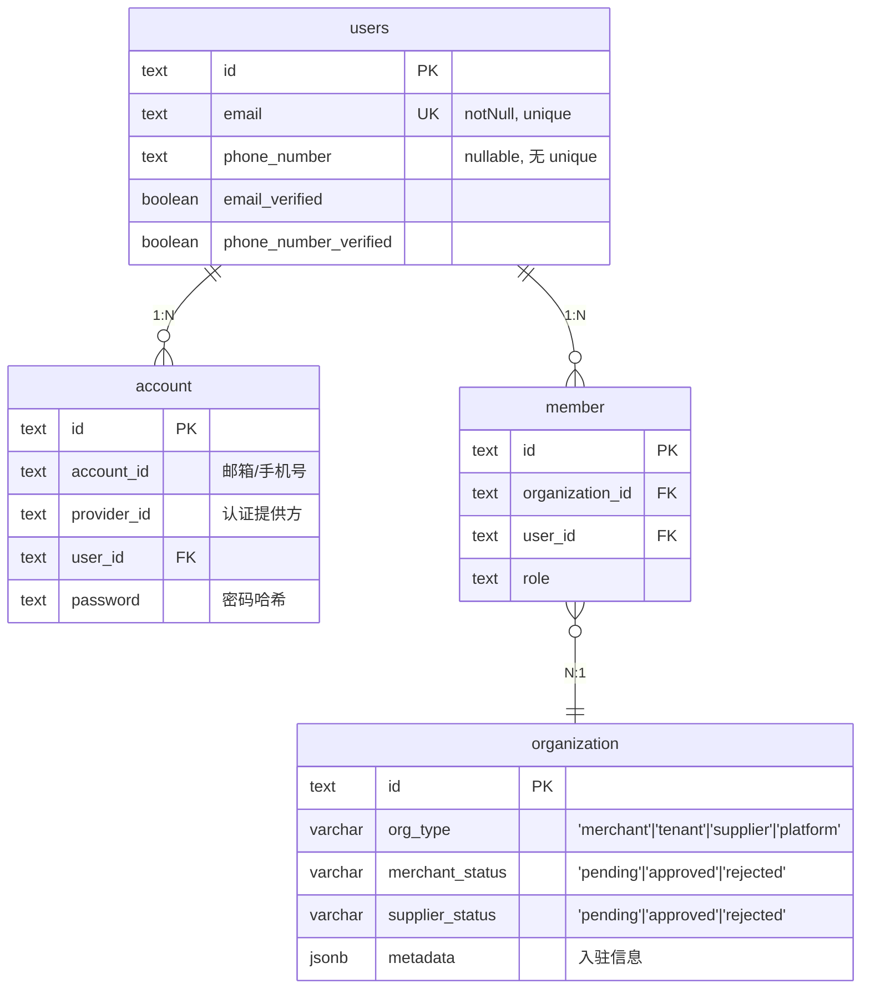
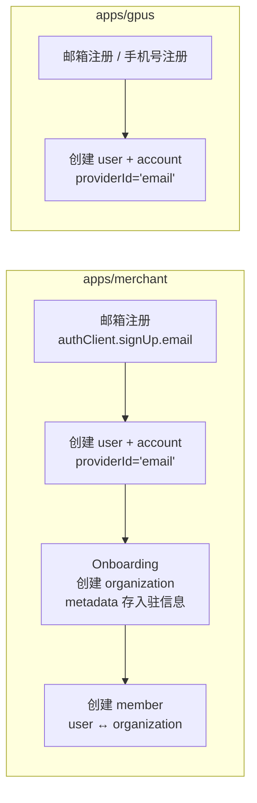
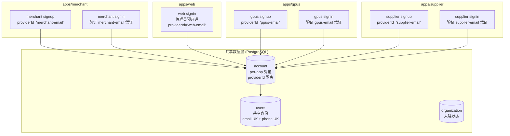
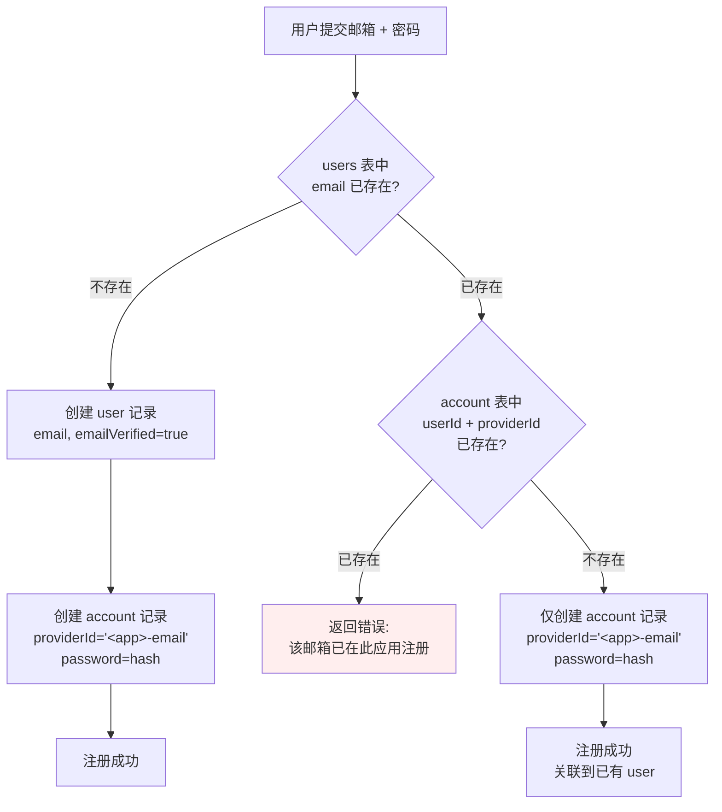
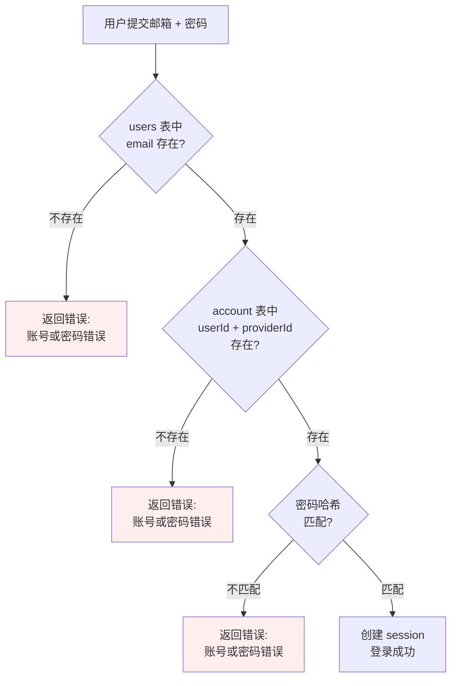
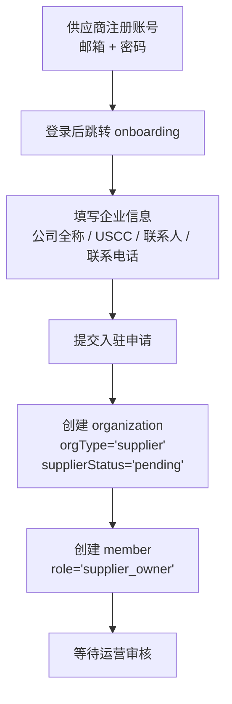

# 商户审核显示联系方式 & 跨应用独立注册登录设计方案

## 1. 背景与需求

### 1.1 需求一：审核页面显示联系方式

运营平台（`apps/web`）审核商户入驻申请时，需要显示商户注册时使用的手机号和邮箱地址，以便运营人员核实身份。

### 1.2 需求二：跨应用独立注册登录

同一个手机号/邮箱地址，可以在 merchant / gpus / supplier 三个应用中分别注册和登录，且每个应用可以设置不同的密码。各应用 session 完全独立，互不影响。

**范围界定**：

| 应用 | 注册方式 | 入驻类型 | 说明 |
|------|---------|---------|------|
| `apps/merchant` | 自助注册（邮箱/手机号） | 企业 + 个人 | 商户入驻主入口 |
| `apps/gpus` | 自助注册（邮箱/手机号） | — | 最终用户前端 |
| `apps/supplier` | 自助注册（邮箱/手机号） | **仅企业** | 供应商入驻 |
| `apps/web` | **仅管理员预开通** | — | 运营平台，不开放自助注册 |

### 1.3 需求三：手机号全局唯一

`users.phoneNumber` 增加唯一约束，同一手机号全局只能存在一条 user 记录（与 email 一致）。

---

## 2. 现状分析

### 2.1 数据模型



### 2.2 关键约束

| 约束 | 现状 | 变更后 |
|------|------|--------|
| `users.email` 唯一 | `unique()` 约束 | 保持不变 |
| `users.phoneNumber` | `nullable`，无 unique | **新增 unique 约束** |
| `account(providerId)` 默认值 | better-auth 硬编码 `'email'` / `'phoneNumber'` | 改为 per-app providerId |
| 各应用共享同一 PostgreSQL | 所有 app 通过 `@workspace/db` 连接同一数据库 | 保持不变 |
| Session 隔离 | 各应用独立 session | 保持不变，不共享 |

### 2.3 当前注册流程



**问题**：由于 `users.email` 唯一约束，用户在 merchant 注册 `user@example.com` 后，在 gpus 用同一邮箱注册会报错 "user already exists"。

### 2.4 当前审核流程

审核数据访问层（`merchant-review.ts`）查询 `organization` 表，通过 `metadata` JSON 提取入驻信息。**当前不查询 user 表**，因此无法显示注册手机号/邮箱。

数据路径：`organization` → `metadata`（入驻信息）| `member` → `user`（注册账号信息）

### 2.5 Supplier 应用现状

Supplier 当前为脚手架状态：有完整的 console shell（sidebar + header + theme/locale switcher），但 **零 auth、零 database、零 tRPC、零业务逻辑**。需要从头搭建认证和入驻流程。

---

## 3. 设计方案概览



**核心思路**：

1. **共享身份**：保持 `users.email` 和 `users.phoneNumber` 全局唯一，一个自然人一条 user 记录
2. **独立凭证**：通过 `account` 表的 `providerId`（`merchant-email` / `gpus-email` / `supplier-email`）隔离各应用密码
3. **Session 独立**：各应用独立管理 session，不共享

---

## 4. 需求一：审核页面显示联系方式

### 4.1 数据访问层变更

**文件**：`apps/web/src/lib/server/dataaccess/merchant/merchant-review.ts`

通过 `member` 表 JOIN `user` 表，获取注册账号的联系方式：

```typescript
// MerchantOnboardingRow 新增字段
export type MerchantOnboardingRow = {
  // ... 现有字段
  contactEmail: string | null      // 注册邮箱
  contactPhone: string | null      // 注册手机号
}

// listPending 查询增加 JOIN
const rows = await db
  .select({
    // ... 现有 organization 字段
    contactEmail: user.email,
    contactPhone: user.phoneNumber,
  })
  .from(organization)
  .leftJoin(member, eq(member.organizationId, organization.id))
  .leftJoin(user, eq(user.id, member.userId))
  .where(where)
  .orderBy(desc(organization.createdAt))
  .limit(pageSize)
  .offset(offset)
```

**注意**：`organization` → `member` 是 1:N 关系，但入驻时只创建一个 `merchant_owner` 成员。`listPending` 场景下取第一个 member 的用户信息即可。

### 4.2 Mapper 变更

`mapOnboardingRow` 增加 `contactEmail`、`contactPhone` 映射。

### 4.3 UI 变更

**文件**：`apps/web/src/app/[locale]/(protected)/merchant/onboarding/_components/review-list-content.tsx`

列表表格新增"联系方式"列，详情弹窗新增联系方式展示。

### 4.4 搜索增强

`listPending` 的搜索条件增加对 `user.email` 和 `user.phoneNumber` 的模糊匹配。

---

## 5. 需求二：跨应用独立注册登录

### 5.1 认证架构

每个应用使用独立的 `providerId` 前缀，在 `account` 表中隔离凭证：

| 应用 | 邮箱 providerId | 手机号 providerId | 合成邮箱后缀 |
|------|----------------|-------------------|-------------|
| `apps/merchant` | `merchant-email` | `merchant-phoneNumber` | `merchant.gpurun.cn` |
| `apps/gpus` | `gpus-email` | `gpus-phoneNumber` | `gpus.gpurun.cn` |
| `apps/supplier` | `supplier-email` | `supplier-phoneNumber` | `supplier.gpurun.cn` |
| `apps/web` | `web-email` | — （仅管理员开通） | `web.gpurun.cn` |

**数据示例**：用户 `alice@example.com` 在 merchant 和 gpus 分别注册：

```
users 表:
  id: "uuid-1", email: "alice@example.com", phone_number: "13800138000"

account 表:
  id: "acc-1", account_id: "alice@example.com", provider_id: "merchant-email",  user_id: "uuid-1", password: "$2b$xxx_merchant_hash"
  id: "acc-2", account_id: "alice@example.com", provider_id: "gpus-email",      user_id: "uuid-1", password: "$2b$xxx_gpus_hash"
  id: "acc-3", account_id: "alice@example.com", provider_id: "supplier-email",  user_id: "uuid-1", password: "$2b$xxx_supplier_hash"
```

### 5.2 注册流程（邮箱）



### 5.3 登录流程（邮箱）



> **安全说明**：所有错误统一返回 "账号或密码错误"，不区分具体失败原因，防止账号枚举。

### 5.4 手机号注册/登录流程

手机号流程与邮箱类似，但有以下特殊性：

1. **用户查找方式**：通过 `user.phoneNumber` 字段查找
2. **OTP 验证**：仍通过 better-auth 的 `phoneNumber` 插件发送和验证验证码
3. **合成邮箱**：手机号注册时生成合成邮箱（如 `13800138000@merchant.gpurun.cn`），仅作为 user 记录的 email 字段填充
4. **唯一约束**：`users.phoneNumber` 增加 unique 约束，同一手机号全局只创建一个 user

### 5.5 实现方式：自定义注册/登录端点

better-auth 的 `emailAndPassword` 插件内置注册流程硬编码了 `providerId: 'email'`，且不支持 "user exists but account doesn't" 的分支逻辑。因此需要**绕过 better-auth 的内置注册流程**，使用自定义端点。

#### 5.5.1 方案选择

| 方案 | 优点 | 缺点 |
|------|------|------|
| **A: 自定义 API 端点** | 完全控制流程，逻辑清晰 | 需要手动处理密码哈希、session 创建 |
| B: databaseHooks 拦截 | 不改端点 | 难以处理 "user exists" 分支，hook 粒度不够 |
| C: 扩展 better-auth 插件 | 最优雅 | 需要 fork/PR better-auth，周期长 |

**推荐方案 A**：在每个应用中实现自定义注册/登录 API 端点，复用 better-auth 的 session 管理和密码哈希工具。

#### 5.5.2 共享工具函数（`packages/auth`）

```typescript
// packages/auth/src/realm-auth.ts

export const REALM_PROVIDERS = {
  merchant:  { email: 'merchant-email',  phone: 'merchant-phoneNumber' },
  gpus:      { email: 'gpus-email',      phone: 'gpus-phoneNumber' },
  supplier:  { email: 'supplier-email',  phone: 'supplier-phoneNumber' },
  web:       { email: 'web-email',       phone: 'web-phoneNumber' },
} as const

export type Realm = keyof typeof REALM_PROVIDERS

export async function realmSignUp(params: {
  db: Database
  realm: Realm
  email?: string
  phoneNumber?: string
  password: string
  name: string
}): Promise<{ userId: string }> {
  const providerId = params.email
    ? REALM_PROVIDERS[params.realm].email
    : REALM_PROVIDERS[params.realm].phone

  const accountId = params.email ?? params.phoneNumber!

  let existingUser = null
  if (params.email) {
    existingUser = await db.query.user.findFirst({
      where: eq(user.email, params.email),
    })
  } else {
    existingUser = await db.query.user.findFirst({
      where: eq(user.phoneNumber, params.phoneNumber!),
    })
  }

  if (existingUser) {
    const existingAccount = await db.query.account.findFirst({
      where: and(
        eq(account.userId, existingUser.id),
        eq(account.providerId, providerId),
      ),
    })
    if (existingAccount) {
      throw new Error('该账号已在此应用注册')
    }
  }

  const userId = existingUser?.id ?? generateId()
  if (!existingUser) {
    await db.insert(user).values({
      id: userId,
      name: params.name,
      email: params.email ?? `${params.phoneNumber}@${params.realm}.gpurun.cn`,
      emailVerified: !!params.email,
      phoneNumber: params.phoneNumber ?? null,
      phoneNumberVerified: !!params.phoneNumber,
    })
  }

  const hashedPassword = await hashPassword(params.password)
  await db.insert(account).values({
    id: generateId(),
    accountId,
    providerId,
    userId,
    password: hashedPassword,
  })

  return { userId }
}

export async function realmSignIn(params: {
  db: Database
  realm: Realm
  email?: string
  phoneNumber?: string
  password: string
}): Promise<{ userId: string }> {
  const providerId = params.email
    ? REALM_PROVIDERS[params.realm].email
    : REALM_PROVIDERS[params.realm].phone

  let foundUser = null
  if (params.email) {
    foundUser = await db.query.user.findFirst({
      where: eq(user.email, params.email),
    })
  } else {
    foundUser = await db.query.user.findFirst({
      where: eq(user.phoneNumber, params.phoneNumber!),
    })
  }

  if (!foundUser) throw new Error('账号或密码错误')

  const foundAccount = await db.query.account.findFirst({
    where: and(
      eq(account.userId, foundUser.id),
      eq(account.providerId, providerId),
    ),
  })

  if (!foundAccount) throw new Error('账号或密码错误')
  if (!foundAccount.password) throw new Error('账号或密码错误')

  const valid = await verifyPassword(params.password, foundAccount.password)
  if (!valid) throw new Error('账号或密码错误')

  return { userId: foundUser.id }
}
```

### 5.6 better-auth 配置变更

各应用的 `auth.ts` 需要调整：

1. 保留 `emailAndPassword: { enabled: true }` 以便 session 管理正常工作
2. 注册/登录改由自定义端点处理
3. 保留 `phoneNumber` 插件用于 OTP 发送和验证

### 5.7 前端表单变更

各应用的注册表单将提交目标从 `authClient.signUp.email()` 改为调用自定义 API 端点。登录表单同理。

---

## 6. Supplier 应用搭建

### 6.1 新增依赖

```json
{
  "@workspace/auth": "workspace:*",
  "@workspace/db": "workspace:*",
  "better-auth": "...",
  "drizzle-orm": "...",
  "zod": "...",
  "@trpc/server": "...",
  "@trpc/client": "...",
  "@trpc/next": "...",
  "superjson": "..."
}
```

### 6.2 文件结构

```
apps/supplier/src/
├── app/
│   ├── api/
│   │   ├── auth/[...all]/route.ts          # better-auth catch-all
│   │   └── auth/realm-signup/route.ts      # 自定义注册端点
│   │   └── auth/realm-signin/route.ts      # 自定义登录端点
│   └── [locale]/
│       ├── (auth)/                          # 认证页面（无 sidebar）
│       │   ├── layout.tsx                   # 认证布局（居中卡片）
│       │   ├── signup/page.tsx              # 注册页
│       │   ├── signin/page.tsx              # 登录页
│       │   └── onboarding/page.tsx          # 企业入驻页
│       └── (console)/                       # 已有 console 布局
│           ├── layout.tsx                   # 增加 requireAuth
│           └── page.tsx
├── lib/
│   ├── auth.ts                              # better-auth 配置
│   ├── auth-client.ts                       # better-auth React 客户端
│   ├── db.ts                                # drizzle 数据库连接
│   ├── server/
│   │   ├── auth-utils.ts                    # requireAuth / getSession
│   │   ├── routers/
│   │   │   ├── trpc.ts                      # tRPC context + procedure
│   │   │   ├── index.ts                     # appRouter
│   │   │   └── onboard.ts                  # 入驻 tRPC router
│   │   └── dataaccess/
│   │       └── onboard.ts                   # 入驻数据访问
│   └── config/
│       └── website.ts                       # 增加 auth 配置
├── components/
│   ├── auth/
│   │   ├── register-form.tsx                # 注册表单
│   │   ├── login-form.tsx                   # 登录表单
│   │   └── auth-card.tsx                    # 认证卡片容器
│   └── onboard/
│       └── enterprise-onboard-form.tsx      # 企业入驻表单
```

### 6.3 better-auth 配置

```typescript
// apps/supplier/src/lib/auth.ts
import { schema } from '@workspace/db'
import { betterAuth } from 'betterAuth'
import { drizzleAdapter } from 'better-auth/adapters/drizzle'
import { nextCookies } from 'better-auth/next-js'
import { organization } from 'better-auth/plugins'
import { db } from './db'
import { ac, supplier_owner, supplier_operator, member } from '@workspace/auth'
import { websiteConfig } from './config/website'

export const auth = betterAuth({
  database: drizzleAdapter(db, { provider: 'pg', schema }),
  emailAndPassword: { enabled: true },
  plugins: [
    organization({
      ac,
      roles: { supplier_owner, supplier_operator, owner: supplier_owner, admin: supplier_operator, member },
    }),
    nextCookies(),
  ],
  trustedOrigins: websiteConfig.auth.trustedOrigins ?? [],
})
```

### 6.4 企业入驻流程



### 6.5 运营审核（apps/web）

Supplier 审核复用 merchant 审核的模式，在 `apps/web` 的 `supplier` 模块中实现：

- `supplier-review.ts` dataaccess：查询 `orgType='supplier'` 且 `supplierStatus='pending'` 的 organization
- 审核通过后创建 supplier 业务记录
- UI 在 `apps/web/src/app/[locale]/(protected)/supplier/onboarding/` 下

---

## 7. 需求三：手机号唯一约束

### 7.1 Schema 变更

**文件**：`packages/db/src/auth-schema.ts`

```typescript
phoneNumber: text('phone_number').unique(),
```

### 7.2 迁移脚本

```sql
-- 检查重复手机号
SELECT phone_number, COUNT(*) AS cnt
FROM users WHERE phone_number IS NOT NULL
GROUP BY phone_number HAVING COUNT(*) > 1;

-- 确认无重复后添加约束
ALTER TABLE users ADD CONSTRAINT users_phone_number_unique
  UNIQUE (phone_number);
```

---

## 8. 社交登录（微信/飞书）扩展性分析

### 8.1 当前设计是否涵盖？

**结论：当前设计架构可以自然涵盖社交登录场景。**

`account` 表的 `providerId` 模式（`<app>-<social>`）与邮箱/手机号完全一致。每个应用有独立的 OAuth `app_id`/`app_secret`，token 本来就 per-app。

### 8.2 数据模型示例

```
account 表:
  id: "acc-1", account_id: "wx_union_id_xxx",  provider_id: "merchant-wechat",      user_id: "uuid-1", access_token: "..."
  id: "acc-2", account_id: "fs_union_id_yyy",  provider_id: "supplier-feishu",      user_id: "uuid-1", access_token: "..."
  id: "acc-3", account_id: "alice@example.com", provider_id: "merchant-email",       user_id: "uuid-1", password: "$2b$xxx"
```

### 8.3 扩展方式

新增 `realmSocialLogin` 函数，处理 OAuth 回调中的 "user exists → 关联" 逻辑。各应用新增 OAuth 回调端点。

### 8.4 与现有设计的兼容性

| 维度 | 兼容性 |
|------|--------|
| `providerId` 命名 | `<app>-<social>` 与 `<app>-email` 模式相同 |
| `account` 表结构 | 无需变更，OAuth token 存储在现有字段中 |
| `users` 表 | 无需变更 |
| Session | 各应用独立，无需变更 |

---

## 9. 迁移方案

### 9.1 现有数据处理

| 场景 | 处理方式 |
|------|---------|
| 已有 user + account（providerId='email'） | 迁移 account 的 providerId 为 `<app>-email`，app 根据 user 的 member 关系推断 |
| 无 member 关联的 user（纯 gpus 租户） | 迁移为 `gpus-email` |
| 有 merchant member 的 user | 迁移为 `merchant-email` |
| 有 web staff 关联的 user | 迁移为 `web-email` |

### 9.2 迁移脚本

```sql
-- 1. merchant 用户
UPDATE account SET provider_id = 'merchant-email'
WHERE provider_id = 'email'
AND user_id IN (
  SELECT DISTINCT m.user_id FROM member m
  JOIN organization o ON o.id = m.organization_id
  WHERE o.org_type = 'merchant'
);

-- 2. web 运营用户
UPDATE account SET provider_id = 'web-email'
WHERE provider_id = 'email'
AND user_id IN (SELECT DISTINCT user_id FROM user_staff);

-- 3. gpus 用户（剩余）
UPDATE account SET provider_id = 'gpus-email'
WHERE provider_id = 'email'
AND user_id NOT IN (
  SELECT user_id FROM member m
  JOIN organization o ON o.id = m.organization_id
  WHERE o.org_type = 'merchant'
)
AND user_id NOT IN (SELECT DISTINCT user_id FROM user_staff);

-- 4. 手机号 account 同理
-- 5. 清理旧 providerId 残留
DELETE FROM account WHERE provider_id IN ('email', 'phoneNumber');
```

### 9.3 部署顺序

1. 部署 `packages/auth` 新增 `realm-auth.ts` 工具函数
2. 部署 `packages/db` schema 变更（phoneNumber unique）
3. 执行数据库迁移脚本（providerId 重命名 + phoneNumber unique）
4. 搭建 supplier 应用（auth + db + tRPC + 入驻流程）
5. 部署各应用的自定义注册/登录端点
6. 更新各应用前端表单提交目标
7. 验证各应用注册/登录流程
8. 部署 merchant 审核页面变更（显示联系方式）
9. 部署 supplier 审核功能（apps/web）

---

## 10. 安全考虑

| 风险 | 缓解措施 |
|------|---------|
| 同一邮箱在多应用注册后，任一应用可枚举其他应用是否存在账号 | 登录错误信息统一为 "账号或密码错误" |
| 手机号 OTP 跨应用重放 | OTP 验证码绑定 `verification.identifier`，各应用独立验证 |
| 密码哈希泄露 | 各应用使用独立密码，即使一个应用泄露不影响其他应用 |
| 旧 providerId='email' 的 account 残留 | 迁移脚本确保全量迁移 |
| Supplier 入驻仅开放企业 | 注册表单和入驻流程仅提供企业类型选项 |

---

## 11. 影响范围与工作量评估

### 11.1 文件变更清单

| 层 | 文件 | 变更类型 |
|----|------|---------|
| **共享包** | `packages/auth/src/realm-auth.ts` | 新增 |
| **共享包** | `packages/db/src/auth-schema.ts` | phoneNumber unique |
| **merchant** | `apps/merchant/src/app/api/auth/realm-signup/route.ts` | 新增 |
| **merchant** | `apps/merchant/src/app/api/auth/realm-signin/route.ts` | 新增 |
| **merchant** | `apps/merchant/src/components/auth/register-form.tsx` | 修改 |
| **merchant** | `apps/merchant/src/components/auth/login-form.tsx` | 修改 |
| **gpus** | `apps/gpus/src/app/api/auth/realm-signup/route.ts` | 新增 |
| **gpus** | `apps/gpus/src/app/api/auth/realm-signin/route.ts` | 新增 |
| **gpus** | `apps/gpus/src/components/auth/register-form.tsx` | 修改 |
| **gpus** | `apps/gpus/src/components/auth/unified-login-form.tsx` | 修改 |
| **supplier** | `apps/supplier/` 大量新增文件 | 新增 auth + db + tRPC + 入驻 |
| **web** | `apps/web/src/lib/server/dataaccess/merchant/merchant-review.ts` | 增加 JOIN user |
| **web** | `apps/web/src/app/[locale]/(protected)/merchant/onboarding/_components/review-list-content.tsx` | 显示联系方式 |
| **web** | `apps/web/src/lib/server/dataaccess/supplier/` | 新增 supplier 审核 |
| **web** | `apps/web/src/app/[locale]/(protected)/supplier/onboarding/` | 新增 supplier 审核 UI |
| **数据库** | 迁移脚本 | 新增 |
