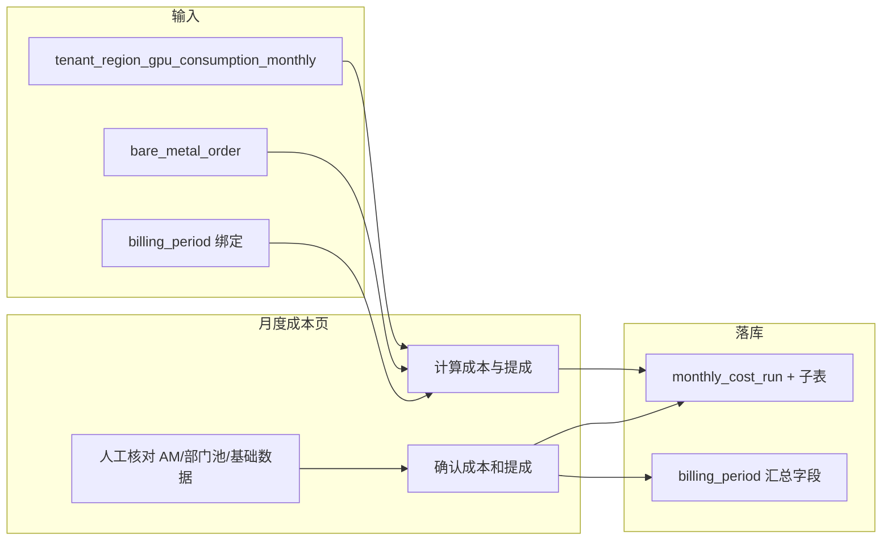

# 月度成本确认固化 & 账期成本/提成页下线 — 迁移方案

> **版本**：v1.0（已确认）  
> **日期**：2026-07-08  
> **状态**：**Phase 1～3 已实施**  
> **触发场景**：`/finance/monthly-cost` 已具备双分支成本毛利与提成跑批能力；需废弃账期维度的旧成本页 `/finance/[id]/cost` 与旧提成页 `/finance/[id]/commission`，改由月度成本跑批结果经人工确认后固化为账期正式数据。  
> **关联**：  
> - [monthly-cost-from-gpu-consumption-design.md](monthly-cost-from-gpu-consumption-design.md) — 新 pipeline 真源（v1.2 已实施）  
> - [cost-compute-v3-redesign-with-examples.md](cost-compute-v3-redesign-with-examples.md) — **待废弃** 账期成本 pipeline  
> - [platform-cost-commission-phase-derive-design.md](platform-cost-commission-phase-derive-design.md) — **待废弃** 账期提成派生  
> - [project-monthly-cost-snapshot-design.md](project-monthly-cost-snapshot-design.md) — 依赖旧中间表，需迁移或下线  
> - [finance-create-billing-period-dialog-plan.md](finance-create-billing-period-dialog-plan.md) — 创建账期弹窗成本步骤需调整

---

## 1. 目标与非目标

### 1.1 业务目标

| # | 目标 | 说明 |
|---|------|------|
| G1 | **单一成本真源** | 成本毛利与提成以 `monthly_cost_*` 跑批结果为计算真源 |
| G2 | **人工确认固化** | 财务在月度成本页核对后点击「确认成本和提成」，将当前 completed run 固化为账期正式版本 |
| G3 | **下线旧页面** | 移除 `/finance/[id]/cost`、`/finance/[id]/commission` 及全部专属 UI/API |
| G4 | **账期汇总对齐** | 确认后更新 `billing_period` 成本/毛利汇总字段，支撑账期列表、发布、运营报表 |
| G5 | **清理代码** | 删除旧 pipeline 与死链；保留仍被月度成本复用的纯函数（`cost-row-utils` 等） |

### 1.2 非目标（本期默认不做，除非确认项另有约定）

- 不改造收入 pipeline（`platform_income_monthly`、个人收入等）
- 不自动在跑批完成时隐式确认（必须显式点击确认按钮）
- 不实现工资发放 / 银行导出
- 不一次性 DROP 历史表（默认保留只读归档，见 §6）

---

## 2. 现状盘点

### 2.1 待下线页面与路由

| 路径 | 说明 |
|------|------|
| `/finance/[id]/cost` | 账期成本毛利主表（`platform_cost_monthly`） |
| `/finance/[id]/cost/source-lines` | 成本中间表浏览 + 项目成本弹窗 |
| `/finance/[id]/cost/tenant-bindings` | 租户项目映射 |
| `/finance/[id]/commission` | 弹性算力提成派生（`platform_cost_commission_derive_*`） |

**入口引用（需同步清理）**：

- `finance-billing-periods-content.tsx` — 下拉菜单、创建账期成功后跳转、重新上传并派生提成
- `finance/[id]/income/page.tsx`、`personal/page.tsx` — 「查看成本」链接
- `create-billing-period-dialog.tsx` — 裸金属 + 客户账单 + `computeCost` 步骤

### 2.2 待下线/收缩的后端模块

| 模块 | 路径 | 说明 |
|------|------|------|
| 账期成本计算 | `compute-cost.ts`、`compute-cost-source-line.ts`、`compute-cost-rollup.ts`、`compute-cost-pricing-snapshot.ts` | Excel/Raw → source_line → platform_cost_monthly |
| 成本重算 | `purge-cost.ts`（部分）、`billing-periods.regenerateCost` | 重新生成成本 |
| 成本调账 | `apply-balance-card-hours-adjustment.ts` | 券卡时手工调账 |
| 提成派生 | `commission-derive/*` | 独立 derive pipeline |
| 中间表查询 | `list-cost-source-lines.ts` | source-lines 页 |
| 项目成本快照写入 | `save-project-cost-snapshots.ts` | 依赖 source_line |
| tRPC | `periods.computeCost`、`prepareRegenerateCost`、`regenerateCost`、`listCostSourceLines`、`commissionDerive.*` | |

### 2.3 待下线/收缩的前端模块

| 模块 | 路径 |
|------|------|
| 成本页组件 | `finance/[id]/cost/_components/*` |
| 提成页 | `finance-commission-derive-content.tsx`、`commission-derive-regenerate-dialog.tsx` |
| 成本导出/展示 | `cost-detail-export.ts`、`cost-adjustment-export.ts`、`cost-group-utils.ts`、`cost-source-lines-export.ts` |
| 项目成本 | `project-cost-from-source-lines.ts`、`project-cost-enrichment.ts`、`project-cost-export.ts`、`project-cost-dialog.tsx` |
| 预检提示 | `billing-period-cost-pre-check-alerts.tsx`（若创建账期不再算成本则可删） |

### 2.4 须保留（被月度成本复用）

| 模块 | 原因 |
|------|------|
| `cost-row-utils.ts`、`cost-pricing-utils.ts` | 月度成本平台成本分支公式对齐 |
| `cost-tenant-resolve.ts`（部分） | 月度成本 `run.ts` 租户项目解析 |
| `cost-master-data.ts`、`cost-pricing-resolve.ts` | 裸金属同步、定价解析仍可能被其他模块使用 |
| `monthly-cost/*` | 新 pipeline 主体 |

### 2.5 旧数据表（DB）

| 表 | 角色 | 下线后处理（默认方案） |
|----|------|------------------------|
| `platform_cost_monthly` | 账期成本派生 | **保留表 + 历史数据只读**；新账期不再写入 |
| `billing_period_cost_source_line` | 成本中间表 | 同上 |
| `billing_period_cost_pricing_snapshot` | 定价快照 | 同上（若无其他引用可二期 DROP） |
| `voucher_card_hours_adjustment_history` | 券卡时调账历史 | 同上 |
| `platform_cost_commission_derive_*`（4 表） | 旧提成派生 | 同上 |
| `project_monthly_cost_snapshot` | 项目成本快照 | **迁移数据源** 或下线（见确认项 Q5） |
| `monthly_cost_*`（8 表） | 新 pipeline | **扩展确认字段**（见 §4） |

---

## 3. 目标架构



**原则**：

1. **计算**与**确认**分离：跑批可反复覆盖；确认后才写入账期正式汇总。
2. 账期 **不再** 拥有独立的成本计算入口与页面。
3. 提成查询统一在 `/finance/monthly-cost`（按账期 + 结算月 + 成本分支 Tab）。

---

## 4. 「确认成本和提成」功能设计

### 4.1 UI 行为（`monthly-cost-content.tsx`）

在现有「计算成本与提成」按钮旁增加主按钮 **「确认成本和提成」**：

| 状态 | 按钮 |
|------|------|
| 无 completed run | 禁用 |
| 有 completed run、未确认 | 可点击 → 二次确认弹窗 |
| 已确认且 run 未变 | 显示 Badge「已确认」+ 确认时间；按钮改为「重新确认」（需确认项 Q4） |
| 跑批后 run 已变 | 提示「计算结果已更新，请重新确认」 |

**弹窗文案（建议）**：

> 确认后，将把当前账期 **{period_code}**、结算月 **{usage_month}** 的成本毛利与提成结果固化为账期正式数据，并更新账期列表中的成本/毛利汇总。  
> 确认后如需修改，须重新跑批并再次确认。是否继续？

### 4.2 API

新增 tRPC：

```text
finance.monthlyCost.confirm({
  billingPeriodId: string,
  usageMonth: string,        // YYYY-MM
  costBranch?: MonthlyCostBranch  // 见确认项 Q1
})
```

返回：

```text
{
  runId: string,
  confirmedAt: string,
  projectCost: string,
  totalGrossProfit: string,
  periodStatus: string
}
```

### 4.3 前置条件（服务端校验）

| # | 规则 |
|---|------|
| C1 | 存在 `status = completed` 的 latest run，且 `billing_period_id` + `usage_month` 匹配 |
| C2 | `billing_period.period_code` 与 `usage_month` 月份一致（沿用现有校验） |
| C3 | `dept_distribution_status` 不为 `pending`（部门池权重已分配完） |
| C4 | `warning_count = 0` 或用户显式勾选「忽略警告继续确认」（见确认项 Q3） |
| C5 | 账期 `status` 不为 `void`；`published` 是否允许重新确认见 Q4 |

### 4.4 确认时服务端动作

**Step 1 — 标记 run 确认态**

在 `monthly_cost_run` 增加字段（推荐方案 A）：

| 列 | 类型 | 说明 |
|----|------|------|
| `confirmed_at` | timestamptz | 确认时间；NULL = 未确认 |
| `confirmed_by` | text FK | `user_staff.id` |
| `confirmed_cost_branch` | varchar(32) | 固化时选用的成本分支 |

同一 `(billing_period_id, usage_month)` 仅 **一个** run 可为「当前确认版本」：新确认时将同账期其他 run 的 `confirmed_at` 置 NULL。

**Step 2 — 回写账期汇总 `billing_period`**

从已确认 run 的 `monthly_cost_base_line` 聚合（**仅含 `project_id IS NOT NULL` 的项目行**，与现网 project_cost 语义对齐）：

```text
project_cost     = Σ (cost_branch 对应毛利基数的「成本」侧，见 Q2)
total_gross_profit = Σ gross_profit_{branch}
```

并更新：

```text
billing_period.project_cost
billing_period.total_gross_profit
billing_period.total_cost        // 见 Q2：是否含 internal_user_cost
billing_period.last_computed_at
billing_period.status            // 若收入已计算 → computed；否则保持 imported 等
```

**Step 3 — 操作日志**

`billing_period_operation_log` 新增 `operation = 'confirm_monthly_cost'`。

**Step 4 — 不写入旧表**

确认时 **禁止** 向 `platform_cost_monthly`、`platform_cost_commission_derive_*` 写入。

### 4.5 账期列表展示调整

| 列 | 变更 |
|----|------|
| 项目成本 / 内部用户成本 / 总成本 | 项目成本来自确认后 `project_cost`；内部用户成本见 Q2 |
| 操作菜单 | 移除「成本毛利」「弹性算力提成」「重新上传并派生提成」；可增加「月度成本」跳转并带 `?period={id}` |
| 创建账期成功 | 不再跳转 `/cost`；可提示「请到月度成本页跑批并确认」 |

---

## 5. 实施分期

### Phase 0 — 方案确认（当前）

- 评审本文档确认项 Q1～Q7
- 确认后更新 `monthly-cost-from-gpu-consumption-design.md` §1.2 非目标、§3.1 账期绑定语义

### Phase 1 — Schema + 确认 API（后端）

1. Migration：为 `monthly_cost_run` 增加 `confirmed_at`、`confirmed_by`、`confirmed_cost_branch`
2. 实现 `monthlyCost.confirm` data access + tRPC
3. 单元测试：聚合公式、确认幂等、published 保护

### Phase 2 — UI 确认按钮

1. `monthly-cost-content.tsx` 增加确认按钮、弹窗、已确认态展示
2. 账期列表入口调整（跳转月度成本、移除旧链接）

### Phase 3 — 下线旧页面与 API

1. 删除 `finance/[id]/cost/**`、`finance/[id]/commission/**`
2. 删除旧组件与 tRPC 路由
3. 收缩 `billing-periods.getBundle`（移除 `cost` 字段或整段废弃若仅成本页使用）
4. 简化 `create-billing-period-dialog`（移除 computeCost 步骤，见 Q6）

### Phase 4 — 清理 data access 与共享库

1. 删除 `compute-cost*.ts`、`commission-derive/*`、调账与 source-line 专属模块
2. 清理 `finance/index.ts` 导出
3. 更新 `design-implementation-gap-audit.md`

### Phase 5 — 设计文档归档

1. 旧设计文档头部标注 **已废弃**，指向本文档
2. 更新 `monthly-cost-from-gpu-consumption-design.md` 增加 §16 确认固化
3. 更新 `billing-period-import-design.md` 等交叉引用

### Phase 6 — 数据迁移（可选，取决于 Q7）

- 历史账期：保留旧表只读 **或** 一次性从最近 `monthly_cost_run` 回写汇总
- 不在 Phase 1～5 阻塞上线

---

## 6. 历史数据迁移策略（默认）

| 策略 | 说明 | 适用 |
|------|------|------|
| **A. 只读归档（推荐默认）** | 旧表与页面代码删除，DB 保留；历史账期汇总字段不动 | 历史账期不再变更 |
| **B. 汇总回填** | 对有 `monthly_cost_run.completed` 的账期，批量调用 confirm 逻辑回写 `billing_period` | 需统一成本分支 |
| **C. 明细迁移** | 将 `platform_cost_monthly` 行映射到 `monthly_cost_base_line` | 成本高、一般不推荐 |

---

## 7. 待删除文件清单（Phase 3～4）

### 7.1 页面

```text
apps/web/src/app/[locale]/(protected)/finance/[id]/cost/
apps/web/src/app/[locale]/(protected)/finance/[id]/commission/
```

### 7.2 组件

```text
apps/web/src/app/[locale]/(protected)/finance/_components/finance-commission-derive-content.tsx
apps/web/src/app/[locale]/(protected)/finance/_components/commission-derive-regenerate-dialog.tsx
apps/web/src/app/[locale]/(protected)/finance/_components/billing-period-cost-pre-check-alerts.tsx  # 视 Q6
apps/web/src/app/[locale]/(protected)/finance/_components/voucher-card-hours-adjustment-dialog.tsx  # 若无其他引用
```

### 7.3 后端

```text
apps/web/src/lib/server/dataaccess/finance/compute-cost.ts
apps/web/src/lib/server/dataaccess/finance/compute-cost-source-line.ts
apps/web/src/lib/server/dataaccess/finance/compute-cost-rollup.ts
apps/web/src/lib/server/dataaccess/finance/compute-cost-pricing-snapshot.ts
apps/web/src/lib/server/dataaccess/finance/compute-cost-mode.ts
apps/web/src/lib/server/dataaccess/finance/apply-balance-card-hours-adjustment.ts
apps/web/src/lib/server/dataaccess/finance/list-cost-source-lines.ts
apps/web/src/lib/server/dataaccess/finance/save-project-cost-snapshots.ts
apps/web/src/lib/server/dataaccess/finance/commission-derive/
apps/web/src/lib/server/dataaccess/finance/purge-cost.ts  # 收缩或删除
```

### 7.4 前端 lib

```text
apps/web/src/lib/finance/cost-detail-export.ts
apps/web/src/lib/finance/cost-adjustment-export.ts
apps/web/src/lib/finance/cost-group-utils.ts
apps/web/src/lib/finance/cost-source-lines-export.ts
apps/web/src/lib/finance/cost-source-line-financials.ts
apps/web/src/lib/finance/project-cost-from-source-lines.ts
apps/web/src/lib/finance/project-cost-enrichment.ts
apps/web/src/lib/finance/project-cost-export.ts
```

---

## 8. 风险与回滚

| 风险 | 缓解 |
|------|------|
| 账期发布依赖 `status = computed` | 确认时若收入已齐则置 `computed`；或放宽发布条件（需 Q4 确认） |
| `internal_user_cost` 缺失 | 明确 Q2 后汇总公式；运营报表口径同步 |
| 项目详情成本 Tab 断链 | Q5：改读 `monthly_cost_base_line` 或下线 Tab |
| 误确认 | 二次弹窗 + 操作日志；允许重新跑批 + 重新确认（Q4） |

**回滚**：保留 Git 历史与 DB 旧表；恢复页面需 redeploy 旧版本，不涉及 DROP。

---

## 9. 已确认项（2026-07-08）

| # | 结论 |
|---|------|
| Q1 | **A**：固化当前 UI 选中的 `costBranch`，写入 `confirmed_cost_branch` |
| Q2 | **A**：`project_cost` = 项目成本合计；`internal_user_cost` = 0；`total_cost` = `project_cost` |
| Q3 | **A**：存在警告时 **禁止** 确认 |
| Q4 | **A**：`published` 账期禁止重新确认，须先 unpublish |
| Q5 | **B**：确认时同步写入 `project_monthly_cost_snapshot` |
| Q6 | **A**：创建账期仅建主数据；收入单独导入；成本在月度成本页 |
| Q7 | **C**：历史账期须财务逐月重跑月度成本并确认 |

---

## 10. 变更记录

| 日期 | 版本 | 说明 |
|------|------|------|
| 2026-07-08 | v0.1 | 初稿 |
| 2026-07-08 | v1.0 | 确认 Q1～Q7；实施确认 API、UI 下线旧页 |

---

## 附录：原确认项（归档）

### Q1. 固化时默认成本分支

月度成本有两套分支：`platform_cost`（平台成本）与 `platform_sell_price`（平台售价，UI 默认）。

- **A（推荐）**：确认时固化 **当前 UI 选中的 `costBranch`**，并写入 `confirmed_cost_branch`
- **B**：始终固化 `platform_sell_price`，与 §13 Q7 默认展示一致
- **C**：两套同时固化到账期（需扩展 `billing_period` 字段或新表）

### Q2. 账期汇总字段口径

旧 pipeline 区分 `project_cost` 与 `internal_user_cost`（内部租户）。

- **A（推荐）**：`project_cost` = 确认 run 项目毛利对应 **成本合计**（收入 − 毛利）；`internal_user_cost` = 0 或 NULL；`total_cost` = `project_cost`
- **B**：`project_cost` = Σ `gross_profit` 的 **毛利**；`total_gross_profit` 同值；列表「成本」列改展示逻辑
- **C**：月度成本跑批增加内部租户识别，单独汇总 `internal_user_cost`

### Q3. 有警告时是否允许确认

跑批可能产生非阻断警告（裸金属租期回退等）。

- **A**：`warning_count > 0` 时禁止确认，须清零警告
- **B（推荐）**：允许确认，弹窗列出警告并要求勾选「已知悉」
- **C**：忽略警告，不额外提示

### Q4. 已发布账期能否重新确认

- **A（推荐）**：`published` 账期禁止重新确认；须先 unpublish
- **B**：允许重新确认并自动 unpublish
- **C**：允许重新确认，不影响发布态

### Q5. 项目详情「月度成本」Tab / `project_monthly_cost_snapshot`

当前数据来自旧中间表弹窗保存。

- **A（推荐）**：改读 `monthly_cost_base_line`（按项目 + usage_month 聚合），废弃快照表写入
- **B**：保留快照表，确认时同步写入快照
- **C**：下线项目详情该 Tab

### Q6. 创建账期弹窗是否仍要求上传客户账单

旧流程：创建 → 导入裸金属 → 上传客户账单 → computeCost。

收入仍可能依赖客户账单导入。

- **A（推荐）**：创建账期仅建主数据；收入在账期收入页单独导入；成本完全移至月度成本页
- **B**：保留客户账单上传（服务收入），仅移除 computeCost 步骤
- **C**：维持现网导入流程不变，仅删成本页

### Q7. 历史账期数据处理

- **A（推荐）**：旧表保留只读，历史 `billing_period` 汇总不动
- **B**：对有月度成本 run 的历史账期批量 confirm 回填汇总
- **C**：要求财务对历史账期逐月重跑月度成本并确认

~~原 §10 变更记录已合并至 §10。~~
