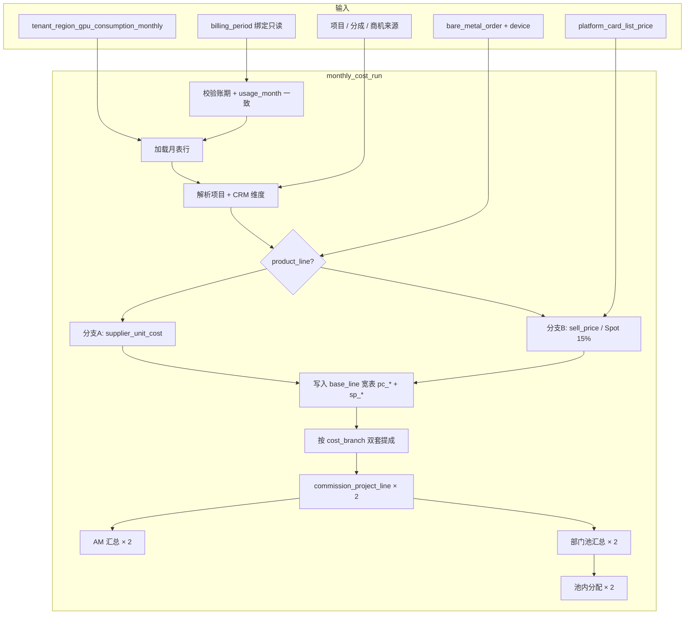

# 月度成本与提成 — 基于租户卡时月表自动核算

> **版本**：v1.2（已确认）  
> **日期**：2026-07-08  
> **状态**：**P1～P5 已实现（裸金属摊销审计、部门权重 UI）**  
> **触发场景**：`tenant_region_gpu_consumption_monthly` 已按产品线（弹性部署 / 裸金属 / Spot）持久化租户 × 区域 × 卡型的月度消费与卡时；需在此基础上 **自动** 关联裸金属订单、按项目汇总成本毛利，并进一步生成客户经理提成数据。  
> **关联（只读参考，运行时不得依赖）**：  
> - [tenant-region-gpu-consumption-monthly-import-design.md](tenant-region-gpu-consumption-monthly-import-design.md) — 月表 schema、产品线桶  
> - [tenant-region-gpu-consumption-daily-monthly-design.md](tenant-region-gpu-consumption-daily-monthly-design.md) — 日/月表、定价快照列  
> - [bare-metal-order-schema-design.md](bare-metal-order-schema-design.md) — `bare_metal_order` / `bare_metal_order_device`  
> - [cost-compute-v3-redesign-with-examples.md](cost-compute-v3-redesign-with-examples.md) — 账期成本 pipeline（**公式对齐，逻辑不复用**）  
> - [project-monthly-cost-snapshot-design.md](project-monthly-cost-snapshot-design.md) — 项目成本快照（人工确认路径，与本设计并列）  
> - [platform-cost-commission-phase-derive-design.md](platform-cost-commission-phase-derive-design.md) — 账期提成派生（**维度与提点矩阵不同**，见 §8）  
> - `apps/web/src/lib/finance/cost-row-utils.ts` — 毛利纯函数（可对齐常量，**不得 import 账期 pipeline**）  
> - [platform-pricing-design.md](platform-pricing-design.md) — L1 平台刊例价 `platform_card_list_price`（售价分支成本单价）  
> - `packages/db/src/platform-pricing-schema.ts` — 平台销售价表结构

---

## 1. 目标与非目标

### 1.1 业务目标

| # | 目标 | 说明 |
|---|------|------|
| G1 | **自动月度成本基础数据** | 读取 `tenant_region_gpu_consumption_monthly`，关联裸金属订单租期摊销，按 **项目** 汇总，输出成本毛利明细 |
| G2 | **双分支成本毛利** | 同一消费行并行计算 **平台成本** 与 **平台售价** 两套毛利，分别落库（§4、§5） |
| G3 | **账期关联绑定** | 跑批时 **必选** `billing_period` 作组织归属与校验；**不** 触发、**不** 读写账期成本 pipeline（§3.1） |
| G4 | **公式与账期成本 Tab 一致（平台成本分支）** | 平台成本分支的确认收入、售出/赠送时长成本、毛利公式与账期「成本毛利」页相同（§4.2） |
| G5 | **独立 pipeline** | 新建计算模块与落库表；**不调用** `compute-cost`、`persistCostSourceLines`、`rollupSourceLinesToPlatformMonthly` 等账期逻辑 |
| G6 | **产品线全覆盖** | 弹性部署、Spot、裸金属均参与双分支；裸金属平台成本分支仍由订单租期摊销驱动（§5） |
| G7 | **双分支提成派生** | 平台成本毛利、平台售价毛利 **分别** 生成 AM 提成与部门池提成（§8） |
| G8 | **部门池二次分配** | **中台**：全部项目入池；**市场**：仅市场来源项目；均按新客/老客汇总后池内分配到人（§8.6） |
| G9 | **可重复跑批** | 同一 `usage_month` + `billing_period_id` 可重算覆盖；保留 run 审计 |

### 1.2 非目标（本期不做）

- ~~**不** 向 `platform_cost_monthly`、`billing_period_cost_source_line`、`project_monthly_cost_snapshot` 写入任何数据~~ → **已变更**：确认固化时写入账期汇总与项目快照（见 [monthly-cost-confirm-and-legacy-cost-removal-plan.md](monthly-cost-confirm-and-legacy-cost-removal-plan.md)）
- **不** 因绑定账期而自动导入/重算账期 Excel Raw 或旧 `platform_cost_monthly` pipeline
- **不** 要求账期 `published` 或上传 Excel 客户账单
- **不** 实现 HR/工资系统对接与银行发放导出
- **不** 在一租户多项目且分成未配置时自动猜测分成（阻塞并提示，见 §6.3）

---

## 2. 现状与缺口

### 2.1 已有能力

| 组件 | 说明 |
|------|------|
| `tenant_region_gpu_consumption_monthly` | 月表：租户 × 月 × 区域 × GPU × **产品线**；含消费/卡时拆分及 CRM、机房、定价快照列 |
| `bare_metal_order` + `bare_metal_order_device` | 裸金属订单头/明细；设备级 `rent_starts_at` / `rent_ends_at`（平台 `start_time` / `end_time`） |
| `resolveTenantCrmSnapshot` | 解析租户→项目、客户经理、新客/老客（`customer_incentive_label`） |
| `resolveInfraPricingSnapshot` | 按区域×卡型×日期解析 `supplier_unit_cost` 与刊例价 |
| `bare-metal-daily-consumption.ts` | 按租期 overlap 将订单金额/卡时摊到 **自然日**（本设计推广到 **自然月**） |
| `billing_period` | 账期主数据；本设计 **只读** 绑定与校验，不参与账期成本计算 |
| `platform_card_list_price` | L1 平台统一售价；售价分支成本单价（如 4090 = 1.35 元/卡时） |
| `resolvePlatformListPriceAt` | 按卡型 × 产品线 × as-of 解析 `sell_price` |

### 2.2 缺口

| 缺口 | 说明 |
|------|------|
| 无月度成本批处理 | 月表仅有消费事实，未自动算成本/毛利/提成 |
| 裸金属月表与订单未关联 | 月表 `product_line = bare_metal` 行与 `bare_metal_order_device` 无 systematic join |
| 无提成落库 | 用户期望的 AM × 商机来源 × 新客/老客 矩阵无专用表 |
| 无部门池汇总与二次分配 | 中台（全项目）、市场（市场来源项目）需按新客/老客分池并支持池内到人 |
| 无双分支毛利 | 平台成本与平台售价两套毛利及提成未分列存储 |
| 无账期绑定 | 跑批无法关联财务账期组织上下文 |
| 与账期 pipeline 解耦 | 不能要求财务先跑账期「计算成本」 |

---

## 3. 设计决策（ADR）

### 3.1 账期关联绑定（与账期成本 pipeline 无关）

跑批 UI **必须选择** 一个 `billing_period` 并写入 `monthly_cost_run.billing_period_id`。

| 规则 | 说明 |
|------|------|
| **用途** | 组织归属、审计溯源、与财务月结 **同一账期编号** 对齐展示 |
| **只读** | 仅 `SELECT billing_period` 校验存在性与 `period_code`；**禁止** 调用 `computeBillingPeriodCost`、`persistCostSourceLines` 等 |
| **不写入** | ~~**不** 向 `platform_cost_monthly`…~~ → 跑批仍不写入旧表；**确认固化**时写入 `billing_period` 汇总与 `project_monthly_cost_snapshot` |
| **月份一致性** | `billing_period.period_code` 须与跑批 `usage_month` 一致：`period_code = YYYYMM` ↔ `usage_month = YYYY-MM`（如 `202606` ↔ `2026-06`） |
| **状态** | **不要求** 账期 `published`；`void` 账期禁止绑定 |
| **唯一性** | 建议 `(billing_period_id, usage_month)` 仅保留最新 completed run（或显式 run_version） |

```text
用户操作：选择账期 202606 + 确认 usage_month = 2026-06 → 跑批
系统行为：monthly_cost_run.billing_period_id = bp-202606
          不触碰 platform_cost_monthly / source_line
```

### 3.2 双成本分支

| 分支编码 | 中文名 | 成本单价来源 | 适用 |
|----------|--------|--------------|------|
| `platform_cost` | **平台成本** | `supplier_unit_cost`（机房×卡型成交/分成/阶梯，与账期成本 Tab 一致） | 全部产品线 |
| `platform_sell_price` | **平台售价** | `platform_card_list_price.sell_price`（平台统一售价，如 4090 = 1.35 元/卡时） | 全部产品线；**Spot 特例**见 §4.3 |

两套分支 **共享** 同一行消费输入（余额消费、卡时等），**分别** 计算成本与毛利，**分别** 驱动提成。

### 3.3 其他决策

| 决策 | 说明 |
|------|------|
| **D1 结算键** | **`usage_month`** + **`billing_period_id`**（跑批双键） |
| **D2 消费真源** | **`tenant_region_gpu_consumption_monthly`** |
| **D3 裸金属（平台成本分支）** | 订单租期 overlap 摊销 + `supplier_unit_cost`（§5） |
| **D4 裸金属（售价分支）** | 消费仍来自月表；成本单价用 `platform_card_list_price`（产品线 `bare_metal` + 对应 `billing_unit`）；不另做订单摊销定价 |
| **D5 汇总维度** | 基础数据行粒度不变；每行 **宽表** 存双分支指标（§7.1、§9.2） |
| **D6 项目归因** | 同 v1.1（§6） |
| **D7 客群** | `customer_incentive_label`（新客 / 老客） |
| **D8 商机来源** | 同 v1.1 |
| **D9 公式库** | 平台成本分支可对齐 `cost-row-utils`；售价分支独立纯函数（§4.3） |
| **D10 落库** | 基础表宽字段 + 提成/部门池表带 **`cost_branch`** 列（§9） |
| **D11～D13** | 部门池规则同 v1.1 |

---

## 4. 成本毛利计算公式（双分支）

消费侧输入（余额消费、卡时等）**两分支共用**。确认收入（不含税）**两分支相同**。差异在 **成本单价** 与 **Spot 售价分支特例**。

### 4.1 常量与共享输入

```text
COST_TAX_DIVISOR = 1.06
SPOT_SELL_PRICE_GROSS_PROFIT_RATE = 0.15   // Spot · 售价分支：毛利 = 余额消费 × 15%
```

| 字段 | 来源 |
|------|------|
| `balance_consumption` | 月表（含税） |
| `balance_card_hours` / `voucher_card_hours` | 月表 |
| `product_line` | 月表：`elastic_deployment` / `bare_metal` / `spot` |

**确认收入（两分支相同）**：

```text
confirmed_revenue_excl_tax = balance_consumption / COST_TAX_DIVISOR
```

**产品线 → 平台刊例价查询键**（售价分支）：

| 月表 `product_line` | `platform_card_list_price.product_line` | `billing_unit` |
|---------------------|----------------------------------------|----------------|
| `elastic_deployment` | `elastic_service` | `hour` |
| `spot` | `spot` | `hour` |
| `bare_metal` | `bare_metal` | 按订单/默认 `hour`（缺省 `hour`） |

as-of 日期：**结算月最后一天**（与平台成本分支一致）。

---

### 4.2 分支 A — 平台成本（`platform_cost`）

与账期「成本毛利」Tab 一致。成本单价来自 **`supplier_unit_cost`**（月表快照或 `resolveInfraPricingSnapshot`）。

```text
sold_duration_cost_excl_tax  = f_platform_cost(pricing_mode, unit_price_per_hour, balance_card_hours, …)
                             // 卡时：supplier 成交单价 × 余额卡时 / COST_TAX_DIVISOR
                             // 分成：balance_consumption × revenue_share_percent / COST_TAX_DIVISOR
                             // 阶梯：按 deal/list 落档（cost-pricing-utils 语义）

gifted_duration_cost_excl_tax = g_platform_cost(…, voucher_card_hours, …)

gross_profit_platform_cost = confirmed_revenue_excl_tax
                           − sold_duration_cost_excl_tax
                           − gifted_duration_cost_excl_tax
```

落库字段前缀：`pc_`（见 §9.2）。

---

### 4.3 分支 B — 平台售价（`platform_sell_price`）

成本单价来自 **`platform_card_list_price.sell_price`**（平台对卡型统一设置的 **销售成本价**，如 RTX 4090 = **1.35 元/卡时**）。**不** 使用 `supplier_unit_cost` 的分成/阶梯模式。

#### 4.3.1 弹性部署 / 裸金属（默认公式）

```text
sell_unit_price_per_hour = platform_card_list_price.sell_price   // 元/卡时（或元/卡/租期单位）

sold_duration_cost_excl_tax_sp  = sell_unit_price_per_hour × balance_card_hours / COST_TAX_DIVISOR
gifted_duration_cost_excl_tax_sp = sell_unit_price_per_hour × voucher_card_hours / COST_TAX_DIVISOR

gross_profit_platform_sell_price = confirmed_revenue_excl_tax
                                 − sold_duration_cost_excl_tax_sp
                                 − gifted_duration_cost_excl_tax_sp
```

#### 4.3.2 Spot 特例

当 `product_line = 'spot'` 时，**不** 按卡时 × 单价计算，直接：

```text
gross_profit_platform_sell_price = balance_consumption × SPOT_SELL_PRICE_GROSS_PROFIT_RATE
                                 = balance_consumption × 0.15

// 售价分支下 Spot 的 sold/gifted 成本列置 0；metadata 标记 formula = spot_balance_pct
```

> **口径说明**：15% 基数为 **含税余额消费**（与用户描述「余额消费金额的 15%」一致）；确认收入列仍按 §4.1 展示，便于与平台成本分支对照。

落库字段前缀：`sp_`（见 §9.2）。

---

### 4.4 与账期 pipeline 的差异（仅平台成本分支输入侧）

| 维度 | 账期成本 Tab | 本设计 · 平台成本分支 |
|------|-------------|----------------------|
| 消费 Raw | `billing_period_raw_tenant_bill` Excel | `tenant_region_gpu_consumption_monthly` |
| 裸金属 | 读库 Raw 整单卡时 | 月表消费 + 订单租期摊销（§5） |
| 定价 | `billing_period_cost_pricing_snapshot` | 月表快照 + `supplier_unit_cost` |
| 售价分支 | 账期 pipeline **无** | **`platform_card_list_price`**，本设计 **新增** |

---

### 4.5 双分支并行计算流程

```text
for each monthly_consumption_row:
  shared ← balance_consumption, card_hours, confirmed_revenue_excl_tax

  // 分支 A
  pricing_pc ← supplier_unit_cost (+ pricing_mode / tiers)
  pc ← computePlatformCostBranch(shared, pricing_pc)

  // 分支 B
  sell_price ← resolvePlatformListPriceAt(gpu_card_type_id, product_line, as_of)
  if product_line == spot:
    sp ← { gross: balance_consumption × 0.15, sold: 0, gifted: 0 }
  else:
    sp ← computeSellPriceBranch(shared, sell_price)

  persist base_line { ...shared, pc_*, sp_* }
```

---

## 5. 裸金属订单关联与租期摊销

### 5.1 业务约定

- 月表 **`product_line = 'bare_metal'`** 的行代表该平台租户在该月、该区域、该卡型的 **裸金属卡时消费**（余额/券拆分与弹性一致）。
- 对应 **供应商成本** 不直接取自月表单价，而由 **`bare_metal_order_device`** 在结算月内的 **有效租期** 摊销得到。
- 平台字段 **`start_time` / `end_time`** 映射 CRM **`rent_starts_at` / `rent_ends_at`**（设备级优先；头表 `rent_starts_at`/`rent_ends_at` 仅作兜底）。

### 5.2 订单筛选

纳入摊销的订单须同时满足：

| 条件 | 规则 |
|------|------|
| 支付 | `pay_status` 为已支付（复用 `isBaremetalPayStatusPaid` 语义） |
| 租户 | `bare_metal_order.platform_tenant_id` = 月表 `tenant_platform_id` |
| 租期 | 设备 `rent_starts_at`、`rent_ends_at` 均非空，且 `rent_starts_at < rent_ends_at` |
| 与月相交 | overlap(租期, 结算月) > 0 |
| 机房/卡型 | `data_center_id` + `gpu_card_type_id` 与月表解析结果一致（§5.3） |

### 5.3 匹配键

月表行与订单明细的 join 键：

```text
(tenant_platform_id, usage_month, data_center_id, gpu_card_type_id, product_line = 'bare_metal')
  ↔
(bare_metal_order.platform_tenant_id, bare_metal_order.data_center_id,
 bare_metal_order_device.gpu_card_type_id)
```

若月表 `data_center_id` / `gpu_card_type_id` 为空，跑批前须先执行定价/基础设施解析（`refresh-pricing` 同类逻辑）或标记 `pricing_resolve_status != 'ok'` 并 **跳过成本计算**。

### 5.4 时间 overlap 算法

东八区自然月界：

```text
month_start = usage_month 第 1 日 00:00:00 +08:00
month_end   = 次月第 1 日 00:00:00 +08:00   // 右开

device_total_hours = duration_hours
  若为空则用 (rent_ends_at − rent_starts_at) 换算小时

overlap_hours = max(0, min(rent_ends_at, month_end) − max(rent_starts_at, month_start)) / 3600

amort_ratio = overlap_hours / device_total_hours    // (0, 1]
```

参考实现：`bare-metal-daily-consumption.ts` 的 `overlapHours`，将 `usageDate` 换为整月窗口。

### 5.5 摊销到成本卡时

对每个匹配的设备明细行：

```text
month_balance_card_hours  += gpu_count × overlap_hours × (1 − voucher_ratio)
month_voucher_card_hours  += gpu_count × overlap_hours × voucher_ratio

voucher_ratio = order.coupon_amount / order.final_amount   // 订单级；final_amount = 0 时为 0
```

**消费金额**仍以月表为准（平台导出的余额/券消费）；摊销仅用于 **校验与成本侧卡时**：

- **首选**：成本卡时取摊销结果；若与月表 `balance_card_hours` / `voucher_card_hours` 偏差超过容忍度（卡时 0.02、金额 0.01），写入 `remark` 告警，**不阻断**；成本计算以 **月表卡时** 为准、以摊销结果为审计字段。
- **定价**：该 `(data_center_id, gpu_card_type_id)` 在 **结算月最后一天** 的 `supplier_unit_cost`（与弹性相同 as-of 规则）。

### 5.6 弹性部署 / Spot / 裸金属 — 双分支

| 产品线 | 平台成本分支（§4.2） | 平台售价分支（§4.3） |
|--------|---------------------|---------------------|
| `elastic_deployment` | 月表 + `supplier_unit_cost` | 月表 + `platform_card_list_price.sell_price` × 卡时 |
| `bare_metal` | 月表消费 + 订单摊销校验 + `supplier_unit_cost` | 月表 + `sell_price` × 卡时（不另做订单摊销定价） |
| `spot` | 月表 + `supplier_unit_cost`（同弹性） | **余额消费 × 15%**（§4.3.2 特例） |

---

## 6. 项目汇总

### 6.1 归因顺序

```text
1. 月表行 project_id 非空 → 直接使用
2. 否则 resolveTenantCrmSnapshot(tenant_platform_id, usage_month) → projectId
3. 仍为空 → project_id = NULL，基础数据仍落库，提成跳过并在 run 报告 unresolved 计数
```

### 6.2 CRM 维度填充

| 展示列 | 来源 |
|--------|------|
| 客户全称 | 月表 `customer_full_name` 或 `customer.name` |
| 平台租户 Id | `tenant_platform_id` |
| 客户经理 | 月表 `account_manager_name`；空则 `resolveEffectiveAccountManager(project_id, usage_month)` |
| 商机来源 | §3 D8；展示简称为 **市场 / 销售 / 高管**（§8.2） |
| 客群 | 月表 `customer_incentive_label`（**新客** / **老客**） |
| 区域 | 月表 `region_code` |
| 卡型 | 月表 `gpu_card_type_name` 或 `gpu_model` |

### 6.3 一租户多项目

与账期 G6 一致：

| 场景 | 处理 |
|------|------|
| 租户仅关联 1 个项目 | 100% 归入该项目 |
| 多项目 + `tenant_project_cost` 有效分成（合计 100%） | 按月表行度量 × `allocation_percent` 拆成多行基础数据 |
| 多项目且无法唯一解析 | **阻塞跑批**，错误信息列出 `tenant_platform_id` |

---

## 7. 月度成本基础数据

### 7.1 输出列（与用户 Excel 一致）

| 列名 | 字段 | 说明 |
|------|------|------|
| 客户全称 | `customer_full_name` | |
| 平台租户 Id | `tenant_platform_id` | |
| 客户经理 | `account_manager_name` | |
| 商机来源 | `opportunity_source_label` | 市场 / 销售 / 高管 |
| 客群 | `customer_incentive_label` | 新客 / 老客 |
| 区域 | `region_code` | |
| 卡型 | `gpu_card_type_name` | |
| 求和项:余额消费 | `balance_consumption` | 含税 |
| 求和项:余额卡时 | `balance_card_hours` | |
| 求和项:券卡时 | `voucher_card_hours` | |
| 确认收入(不含税) | `confirmed_revenue_excl_tax` | 两分支共用 |
| **平台成本** | | |
| 售出时长成本(不含税) | `pc_sold_duration_cost_excl_tax` | §4.2 |
| 赠送时长成本(不含税) | `pc_gifted_duration_cost_excl_tax` | §4.2 |
| 毛利 | `pc_gross_profit` | §4.2 |
| **平台售价** | | |
| 售出时长成本(不含税) | `sp_sold_duration_cost_excl_tax` | §4.3；Spot 为 0 |
| 赠送时长成本(不含税) | `sp_gifted_duration_cost_excl_tax` | §4.3；Spot 为 0 |
| 毛利 | `sp_gross_profit` | §4.3；Spot = 余额消费×15% |
| 备注 | `remark` | 摊销偏差、缺定价、Spot 公式标记等 |

可选隐藏列（落库、导出可选）：`project_id`、`product_line`、`usage_month`、`data_center_id`、`gpu_card_type_id`。

### 7.2 聚合规则

跑批 **先** 在 `(project_id, tenant_platform_id, region_code, gpu_card_type_id, product_line)` 粒度计算单行毛利，**再** 按项目 SUM 供项目视图；**基础数据表存明细粒度**，便于下钻机房/卡型。

项目级毛利（**按分支分别汇总**）：

```text
B_pc(project, usage_month) = Σ pc_gross_profit
B_sp(project, usage_month) = Σ sp_gross_profit
```

UI 提供 **分支切换**（平台成本 / 平台售价）或 **并列展示** 两套提成。

---

## 8. 提成计算

提成分为三层：**项目级提成行** → **部门池汇总** → **池内二次分配到人**。

**所有提成计算均带 `cost_branch` 维度**，与 §4 双分支 **一一对应**：

| `cost_branch` | 毛利基数 |
|---------------|----------|
| `platform_cost` | `pc_gross_profit` / `B_pc` |
| `platform_sell_price` | `sp_gross_profit` / `B_sp` |

同一项目、同一受益方、同一商机来源/客群下，**两分支各算一行**，提点矩阵相同（§8.3、§8.4）。

### 8.1 基数

```text
commission_base(cost_branch) =
  platform_cost      → pc_gross_profit
  platform_sell_price → sp_gross_profit

// 全部毛利均参与提成（含负值）；commission = gross_profit × rate，负毛利产生负提成
```

项目级毛利：

```text
B_pc(project) = Σ pc_gross_profit   // 含负数
B_sp(project) = Σ sp_gross_profit   // 含负数
```

**不参与提成的情形**：仅当 `gross_profit` 为 `NULL`（行被跳过）或缺少商机来源等项目级元数据；**不为** gross_profit ≤ 0。

### 8.2 商机来源映射（展示与提点）

| DB 编码 | 展示简称 | 说明 |
|---------|----------|------|
| `marketing_sales` | **市场** | 市场 + 销售 |
| `sales_self` | **销售** | 销售自拓 |
| `exec_sales` | **高管** | 高管 + 销售 |

无法解析商机来源的行：**跳过全部提成行**（含 AM 与部门池），计入 run 警告。

### 8.3 提点矩阵（客户经理个人）

占 **毛利 `B`** 的比例：

| 商机来源 | 新客 | 老客 |
|----------|------|------|
| 市场 | 10.00% | 7.00% |
| 销售 | 15.00% | 15.00% |
| 高管 | 12.00% | 9.00% |

```text
commission_sales = B(cost_branch) × rate_sales(opportunity_source, customer_incentive_label)
```

写入 `monthly_cost_commission_line`，`recipient_role = sales_individual`，**必填 `cost_branch`**。

**排除规则**（与账期提成政策对齐）：`user_staff.position = '经理'` 时不生成销售个人提成行，但项目毛利仍参与部门池计算。

### 8.4 提点矩阵（部门池 — 项目级入池）

部门池在项目级先产生 **入池金额**，再按 §8.5 汇总。占 **`B(cost_branch)`** 的比例：

| 受益部门 | 新客 | 老客 | 入池项目范围 |
|----------|------|------|--------------|
| **市场** | 3.00% | 3.00% | 仅 `opportunity_source = marketing_sales` |
| **中台** | 3.00% | 6.00% | **全部项目**（`P = 100%`，不按商机来源过滤） |

```text
commission_marketing_pool = B(cost_branch) × rate_marketing(customer_incentive_label)
commission_middle_pool    = B(cost_branch) × rate_middle(customer_incentive_label)
```

项目级中间结果写入 `monthly_cost_commission_project_line`（§9.3），含 **`cost_branch`**。

**唯一键扩展**：`(run_id, project_id, cost_branch, recipient_role, customer_incentive_label)`。

### 8.5 部门池汇总（一次汇总，不分商机来源）

跑批在 **项目级入池行** 之上，按 **`cost_branch` × 部门 × 新客/老客** 聚合：

#### 8.5.1 中台部门池

**全部项目** 的中台入池金额汇总，**不** 按商机来源拆分：

```text
pool_middle(incentive_label)
  = Σ commission_middle_pool
    OVER monthly_cost_commission_project_line
    WHERE run_id = :run
      AND cost_branch = :branch
      AND recipient_role = middle_office_dept_pool
      AND customer_incentive_label = :incentive_label
```

输出两桶：**新客**、**老客**。

#### 8.5.2 市场部门池

仅 **商机来源为市场**（`marketing_sales`）的项目参与：

```text
pool_marketing(incentive_label)
  = Σ commission_marketing_pool
    OVER monthly_cost_commission_project_line
    WHERE run_id = :run
      AND cost_branch = :branch
      AND recipient_role = marketing_dept_pool
      AND opportunity_source = marketing_sales
      AND customer_incentive_label = :incentive_label
```

输出两桶：**新客**、**老客**。

#### 8.5.3 汇总表与项目明细（同屏展示）

部门池 UI **同一视图** 包含：

1. **汇总表**（按新客/老客两列）
2. **项目列表**（该池桶下全部入池项目的明细，可排序/导出）

**中台**（2026-06，全部项目，`cost_branch = platform_sell_price`）：

**汇总**

| | 新客 | 老客 |
|---|------|------|
| 池内毛利基数合计 | {Σ B 新客} | {Σ B 老客} |
| **部门池提成合计** | **{pool_middle 新客}** | **{pool_middle 老客}** |
| 涉及项目数 | {count} | {count} |

**项目列表**（示例列）

| 项目名称 | 商机来源 | 客群 | 毛利基数 B | 中台入池金额 | 客户经理 |
|----------|----------|------|------------|--------------|----------|
| {project_a} | 销售 | 老客 | 8,726.42 | 523.59 | 柴哲轩 |
| {project_b} | 市场 | 新客 | 1,200.00 | 36.00 | 李四 |
| … | | | | | |

**市场**（2026-06，仅 `marketing_sales` 项目）：

**汇总**

| | 新客 | 老客 |
|---|------|------|
| 池内毛利基数合计 | {Σ B 新客, opp=市场} | {Σ B 老客, opp=市场} |
| **部门池提成合计** | **{pool_marketing 新客}** | **{pool_marketing 老客}** |
| 涉及项目数 | {count} | {count} |

**项目列表**：同上结构，仅含商机来源 = 市场的项目。

项目明细写入 `monthly_cost_dept_pool_project_line`（§9.5.1）；汇总写入 `monthly_cost_dept_pool_line`（§9.5）。

### 8.6 部门池二次分配（池内到人）

对每个 **`(cost_branch, usage_month, recipient_dept, customer_incentive_label)`** 桶分配：

```text
distributeDeptPool(pool_amount, dept, usage_month, incentive_label):

  weights = loadDeptContributionWeights(dept, usage_month, incentive_label)
  // Σ weight_percent = 100；仅 eligible 员工；见 §9.6

  for staff in weights:
    staff_amount = pool_amount × (weight_percent / 100)
    emit monthly_cost_dept_distribution_line(...)
```

**贡献度来源**（实现择一，默认 P1 用手工配置表）：

| 优先级 | 来源 | 说明 |
|--------|------|------|
| 1 | `monthly_cost_dept_contribution_weight` | 财务维护：`usage_month` × 部门 × 新客/老客 × 员工 |
| 2 | 项目四人组均分 | 无配置时，按该桶涉及项目的 `project_staff_assignment` 并集均分（二期） |

**约束**：

- 未配置权重或 Σ ≠ 100%：**不生成** `dept_distribution_line`，run 标记 `dept_distribution_pending`，池汇总仍可见
- `position = '经理'` 的员工 **默认不参与** 池内分配（可配置排除名单覆盖）
- 分配后：`Σ staff_amount ≈ pool_amount`（允许四舍五入误差 ≤ 0.01 元）

### 8.7 与 `platform_cost_commission_derive` 的区别

| 维度 | 账期提成派生 | 本设计 |
|------|-------------|--------|
| 输入 | ~~`billing_period_cost_source_line`~~（**表已删 2026-10-06**） | `monthly_cost_base_line` |
| 客群 | ~~`months_1_6` / `months_7_to_2026_12`~~（**枚举已删 2026-10-06**） | **新客 / 老客** |
| AM 提点 | ~~政策矩阵（按 month_phase）~~（**已删 2026-10-06**） | 同上矩阵，按 **新客/老客** |
| 部门池 | ~~市场/中台按 `month_phase` 汇总~~（**已删 2026-10-06**） | 市场/中台按 **新客/老客** 汇总 |
| 中台入池 | 全部项目 | **相同**：全部项目 |
| 市场入池 | 按政策（仅 marketing_sales 有市场池） | **相同** |
| 池内到人 | 本期不做 | **本设计实现** §8.6 |
| 触发 | 账期页「提成派生」 | 财务「月度成本」页按 `usage_month` |

两套模块 **并存**，互不读写对方表。

### 8.8 汇总输出格式

#### 8.8.1 客户经理个人

支持 **成本分支 Tab** 或并排：

```text
【平台成本】客户经理：{account_manager_name}     【平台售价】客户经理：{account_manager_name}
              新客    老客                              新客    老客
市场          …       …                                …       …
...
```

#### 8.8.2 部门池（汇总 + 分配明细）

部门池视图 **默认展示 `platform_sell_price`（平台售价/销售成本）分支**；Tab 可切换至 `platform_cost`（平台成本）。

**示例**（柴哲轩 / AM 个人 / 2026-06）：

| | 新客 | 老客 |
|---|------|------|
| 市场 | 0.00 | 64.18 |
| 销售 | 2,496.22 | 6,640.85 |
| 高管 | 349.72 | 97,689.06 |
| **合计** | **2,845.94** | **104,394.09** |

> AM 合计 = 各商机来源行之和（分列）。部门池为 **独立视图**，与 AM 个人提成 **叠加发放**，不互相抵扣。

---

## 9. 数据模型

### 9.1 `monthly_cost_run`

| 列 | 类型 | 说明 |
|----|------|------|
| `id` | text PK | |
| `billing_period_id` | text FK | → `billing_period.id` ON DELETE RESTRICT；**跑批必选** |
| `billing_period_code` | varchar(16) | 冗余 `period_code` 快照 |
| `usage_month` | varchar(7) | `YYYY-MM`；须与 `period_code` 一致 |
| `status` | varchar(16) | `running` / `completed` / `failed` |
| `base_line_count` | integer | 基础数据行数 |
| `commission_project_line_count` | integer | 项目级提成行数 |
| `commission_am_line_count` | integer | AM 汇总行数 |
| `dept_pool_line_count` | integer | 部门池汇总行数 |
| `dept_distribution_line_count` | integer | 池内分配行数 |
| `warning_count` | integer | 非阻断警告 |
| `dept_distribution_status` | varchar(16) | `complete` / `pending` / `not_applicable` |
| `error_summary` | text | 失败原因 |
| `started_at` / `finished_at` | timestamptz | |
| `triggered_by` | text FK | `user_staff.id` |

**唯一策略**：同一 `(billing_period_id, usage_month)` 仅保留 **最新一次 completed** 为官方版本；重跑时 delete+insert 子表。

**枚举 `cost_branch`**（提成相关表共用）：`platform_cost` | `platform_sell_price`。

### 9.2 `monthly_cost_base_line`

月度成本基础数据（§7.1 列 + 审计）。

| 列 | 类型 | 说明 |
|----|------|------|
| `id` | text PK | |
| `run_id` | text FK | → `monthly_cost_run.id` ON DELETE CASCADE |
| `usage_month` | varchar(7) | 冗余 |
| `project_id` | text FK | 可空 |
| `tenant_platform_id` | varchar(128) | |
| `tenant_id` | text FK | 可空 |
| `product_line` | varchar(64) | |
| `region_code` | varchar(64) | |
| `gpu_card_type_id` | text | 可空 |
| `gpu_card_type_name` | varchar(128) | |
| `data_center_id` | text | 可空 |
| `customer_full_name` | varchar(255) | |
| `account_manager_staff_id` | text | 可空 |
| `account_manager_name` | varchar(128) | |
| `opportunity_source` | varchar(32) | 编码 |
| `opportunity_source_label` | varchar(32) | 市场/销售/高管 |
| `customer_incentive_type` | varchar(32) | `new_customer` / `existing_customer` |
| `customer_incentive_label` | varchar(16) | 新客/老客 |
| `balance_consumption` | numeric(15,4) | |
| `balance_card_hours` | numeric(15,4) | |
| `voucher_card_hours` | numeric(15,4) | |
| `confirmed_revenue_excl_tax` | numeric(15,4) | 两分支共用 |
| `pc_sold_duration_cost_excl_tax` | numeric(15,4) | 平台成本分支 §4.2 |
| `pc_gifted_duration_cost_excl_tax` | numeric(15,4) | |
| `pc_gross_profit` | numeric(15,4) | |
| `sp_sold_duration_cost_excl_tax` | numeric(15,4) | 平台售价分支 §4.3 |
| `sp_gifted_duration_cost_excl_tax` | numeric(15,4) | |
| `sp_gross_profit` | numeric(15,4) | |
| `pc_supplier_unit_cost_id` | text | 平台成本定价溯源 |
| `sp_platform_card_list_price_id` | text | 售价分支 `sell_price` 溯源 |
| `sp_sell_price_per_hour` | numeric(15,4) | 快照单价（如 4090 → 1.35） |
| `remark` | text | |
| `metadata` | jsonb | 摊销、Spot 公式 `spot_balance_pct`、双分支计算审计 |

**索引**：`(usage_month, project_id)`、`(run_id)`、`(account_manager_staff_id, usage_month)`。

### 9.3 `monthly_cost_commission_project_line`

项目级提成明细（AM 个人 + 部门池入池）。

| 列 | 类型 | 说明 |
|----|------|------|
| `id` | text PK | |
| `run_id` | text FK | |
| `usage_month` | varchar(7) | |
| `cost_branch` | varchar(32) | `platform_cost` / `platform_sell_price` |
| `project_id` | text FK | |
| `recipient_role` | varchar(32) | `sales_individual` / `marketing_dept_pool` / `middle_office_dept_pool` |
| `recipient_dept` | varchar(16) | 可空 |
| `account_manager_staff_id` | text | |
| `opportunity_source` | varchar(32) | |
| `customer_incentive_label` | varchar(16) | |
| `gross_profit_base` | numeric(15,4) | `B_pc` 或 `B_sp` |
| `commission_rate` | numeric(7,4) | |
| `commission_amount` | numeric(15,4) | |

**唯一键**：`(run_id, project_id, cost_branch, recipient_role, customer_incentive_label)`。

### 9.4 `monthly_cost_commission_line`

客户经理 **汇总** 行（由 project_line 中 `sales_individual` 聚合，供 §8.8.1 透视）。

| 列 | 类型 | 说明 |
|----|------|------|
| `id` | text PK | |
| `run_id` | text FK | |
| `usage_month` | varchar(7) | |
| `cost_branch` | varchar(32) | |
| `account_manager_staff_id` | text | |
| `account_manager_name` | varchar(128) | |
| `opportunity_source` | varchar(32) | |
| `opportunity_source_label` | varchar(32) | |
| `customer_incentive_label` | varchar(16) | |
| `gross_profit_sum` | numeric(15,4) | |
| `commission_rate` | numeric(7,4) | |
| `commission_amount` | numeric(15,4) | |

**唯一键**：`(run_id, cost_branch, account_manager_staff_id, opportunity_source, customer_incentive_label)`。

### 9.5 `monthly_cost_dept_pool_line`

部门池 **一次汇总**（§8.5）。

| 列 | 类型 | 说明 |
|----|------|------|
| `id` | text PK | |
| `run_id` | text FK | |
| `usage_month` | varchar(7) | |
| `cost_branch` | varchar(32) | |
| `recipient_dept` | varchar(16) | `市场` / `中台` |
| `customer_incentive_label` | varchar(16) | |
| `gross_profit_base_sum` | numeric(15,4) | |
| `commission_pool_sum` | numeric(15,4) | |
| `project_count` | integer | |
| `pool_scope_note` | varchar(255) | |

**唯一键**：`(run_id, cost_branch, recipient_dept, customer_incentive_label)`。

### 9.5.1 `monthly_cost_dept_pool_project_line`

部门池 **项目明细**（§8.5.3 项目列表）。

| 列 | 类型 | 说明 |
|----|------|------|
| `id` | text PK | |
| `run_id` | text FK | |
| `dept_pool_line_id` | text FK | → `monthly_cost_dept_pool_line.id` |
| `cost_branch` | varchar(32) | |
| `recipient_dept` | varchar(16) | |
| `customer_incentive_label` | varchar(16) | |
| `project_id` | text FK | |
| `project_name` | varchar(255) | |
| `opportunity_source` | varchar(32) | |
| `opportunity_source_label` | varchar(32) | |
| `account_manager_name` | varchar(128) | |
| `gross_profit_base` | numeric(15,4) | 该项目在该分支下的 B |
| `commission_pool_amount` | numeric(15,4) | 该项目对该池的入池金额 |

**唯一键**：`(run_id, cost_branch, recipient_dept, customer_incentive_label, project_id)`。

### 9.6 `monthly_cost_dept_contribution_weight`

部门池二次分配权重（**跑批前** 由财务维护）。

| 列 | 类型 | 说明 |
|----|------|------|
| `id` | text PK | |
| `usage_month` | varchar(7) | |
| `cost_branch` | varchar(32) | 可选；缺省表示 **两分支共用同一套权重** |
| `recipient_dept` | varchar(16) | |
| `customer_incentive_label` | varchar(16) | 新客/老客 |
| `staff_id` | text FK | → `user_staff.id` |
| `weight_percent` | numeric(7,4) | 0～100 |
| `effective_from` | date | 可选 |
| `note` | text | |
| `updated_by` | text FK | |
| `updated_at` | timestamptz | |

**约束**：同一 `(usage_month, recipient_dept, customer_incentive_label)` 下 Σ `weight_percent` = 100。

### 9.7 `monthly_cost_dept_distribution_line`

部门池 **二次分配** 结果（§8.6）。

| 列 | 类型 | 说明 |
|----|------|------|
| `id` | text PK | |
| `run_id` | text FK | |
| `dept_pool_line_id` | text FK | |
| `usage_month` | varchar(7) | |
| `cost_branch` | varchar(32) | |
| `recipient_dept` | varchar(16) | |
| `customer_incentive_label` | varchar(16) | |
| `staff_id` | text FK | |
| `staff_name` | varchar(128) | 快照 |
| `weight_percent` | numeric(7,4) | |
| `commission_amount` | numeric(15,4) | |
| `source_pool_amount` | numeric(15,4) | 冗余池总额 |

**唯一键**：`(run_id, dept_pool_line_id, staff_id)`。

---

## 10. Pipeline 流程



### 10.1 前置条件

| 检查 | 规则 |
|------|------|
| 账期绑定 | 已选 `billing_period` 存在、非 `void`，且 `period_code` 与 `usage_month` 匹配 |
| 月表有数据 | 目标 `usage_month` 至少 1 行 |
| 平台成本定价 | `supplier_unit_cost` 齐全（as-of 月末） |
| 平台售价定价 | 参与行（**不含 Spot**）均须能解析 `platform_card_list_price.sell_price`；**任一缺失则阻断整批**（§10.1、§13） |
| Spot 售价分支 | 不要求 `sell_price`；强制 §4.3.2 公式 |
| 裸金属租期 | 有 `bare_metal` 消费时，相交订单缺少租期 → 警告 + 成本卡时回退月表 |
| 多项目分成 | §6.3 |

### 10.2 触发与权限

| 入口 | 说明 |
|------|------|
| 财务菜单「月度成本」 | **选择账期** + 确认 `usage_month` → 「计算成本与提成」 |
| API | `finance.monthlyCost.run({ billingPeriodId, usageMonth })` |
| 导出 | 基础数据（含双分支毛利列）、分分支 AM/部门池提成 Excel |
| 权重维护 | 财务「月度成本 → 部门池分配权重」维护 `monthly_cost_dept_contribution_weight` |

---

## 11. 实例演算（简化）

**设定**：`usage_month = 2026-06`，租户 `984`，项目 `proj-A`，裸金属一行。

**月表**（`bare_metal`）：

| 区域 | 卡型 | 余额消费 | 余额卡时 | 券卡时 |
|------|------|----------|----------|--------|
| tj1q | 5090 | 3,652.44 | 2,356.72 | 0 |

**订单设备**：租期 2026-06-10 ～ 2026-07-09（720h），`gpu_count=8`，与 6 月 overlap = 504h，占比 0.7。

**双分支演算**（`elastic_deployment`，4090，`balance_consumption = 10,600`，`balance_card_hours = 1000`）：

```text
confirmed_revenue_excl_tax = 10,600 / 1.06 = 10,000

// 分支 A · 平台成本（supplier 成交单价 8.50）
pc_sold_cost = 8.50 × 1000 / 1.06 = 8,018.87
pc_gross_profit ≈ 10,000 − 8,018.87 = 1,981.13

// 分支 B · 平台售价（sell_price = 1.35）
sp_sold_cost = 1.35 × 1000 / 1.06 = 1,273.58
sp_gross_profit ≈ 10,000 − 1,273.58 = 8,726.42
```

**Spot 售价分支**（`balance_consumption = 1,000`）：

```text
sp_gross_profit = 1,000 × 15% = 150
pc_gross_profit 仍按 §4.2 正常计算
```

提成（`B_pc = 1,981`，销售/老客/平台成本分支）：`AM = 1,981 × 15% = 297.15`  
同项目售价分支（`B_sp = 8,726`）：`AM = 8,726 × 15% = 1,308.90` — **独立落库**。

---

## 12. 测试要点

| # | 场景 | 期望 |
|---|------|------|
| T1 | 仅弹性月表 | 双分支毛利均正确；Spot 售价 = 余额×15% |
| T2 | 账期绑定 | `period_code` 与 `usage_month` 不一致 → 阻断 |
| T3 | 缺 sell_price | **整批失败**；`error_summary` 列出卡型×产品线×区域 |
| T4 | 双分支提成 | 同一 AM 在 `platform_cost` / `platform_sell_price` 各一套独立金额 |
| T5 | 裸金属租期跨月 | overlap 正确；仅影响平台成本分支卡时校验 |
| T6 | 中台/市场池 | 各 cost_branch 独立两桶（新客/老客） |
| T7 | 不触碰账期成本 | 跑批后 `platform_cost_monthly` 行数不变 |

---

## 13. 已确认项

| # | 问题 | 结论 |
|---|------|------|
| Q1 | 账期绑定是否要求 `published`？ | **否**；仅校验非 void + 月份一致 |
| Q2 | Spot 15% 是否不含税？ | **否**；基数为含税 `balance_consumption` |
| Q3 | 两分支提点矩阵是否相同？ | **是** |
| Q4 | 部门池权重是否分分支？ | 默认 **共用**；可选 `cost_branch` 分列 |
| Q5 | 售价分支缺 `sell_price` 是否阻断整批？ | **是**；跑批前全量校验，失败时返回可操作的错误清单 |
| Q6 | 负毛利是否参与提成？ | **是**；`commission = gross_profit × rate`，负值按负值计算 |
| Q7 | 默认展示哪套毛利/提成？ | **平台售价分支**（`platform_sell_price`）；UI 可切换至平台成本 |
| Q8 | 部门池汇总是否含项目列表？ | **是**；汇总表与项目明细同屏（§8.5.3） |

### 13.1 缺 `sell_price` 阻断错误格式（Q5）

跑批 **预检阶段** 收集全部缺失项后 **一次性** 抛出，不部分写入：

```text
平台售价分支缺少卡型销售单价，无法计算。请在「平台定价」维护以下条目后重试：

1. 卡型 RTX 4090（gpu-4090）· 产品线 elastic_service · 租期 hour · 结算月 2026-06 末快照
2. 卡型 RTX 5090（gpu-5090）· 产品线 bare_metal · 租期 hour · …

共 2 项缺失。Spot 产品线不校验 sell_price。
```

---

## 14. 实施分期

| 阶段 | 范围 |
|------|------|
| **P1** | 账期选择 UI + schema + 双分支 base_line 计算 |
| **P2** | 平台成本分支（supplier + 裸金属摊销） |
| **P3** | 平台售价分支（`platform_card_list_price` + Spot 15%） |
| **P4** | 双分支提成 + AM/部门池 UI |
| **P5** | 部门权重 + 池内二次分配 |
| **P6** | 确认固化到账期 + 下线 `/finance/[id]/cost` 与 `/finance/[id]/commission` |

---

## 16. 确认固化（P6）

| 日期 | 版本 | 说明 |
|------|------|------|
| 2026-07-08 | v1.0 | 初稿：月表驱动成本、裸金属租期摊销、项目汇总、AM 提成矩阵 |
| 2026-07-08 | v1.1 | 增补部门池：中台（全项目）/ 市场（市场来源项目）按新客/老客汇总；池内二次分配到人 |
| 2026-07-08 | v1.2.1 | 实现跑批/API/UI；裸金属订单月摊销审计；部门池权重维护；池内二次分配 |
| 2026-07-08 | v1.3 | P6：确认固化 API/UI；下线账期成本/提成页 |
