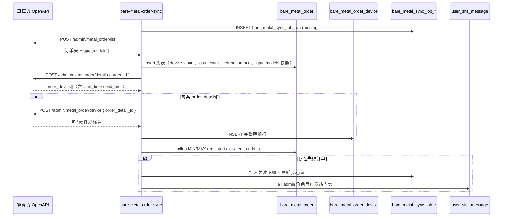

# 裸金属订单平台 API 字段映射

**版本**：v2.2（2026-06-28）  
**状态**：**已实施**

本文档对照算算力平台裸金属订单三个 Admin API 的响应字段，与 CRM 供应域表 `bare_metal_order`（头表）、`bare_metal_order_device`（明细）的列映射关系。

---

## 1. 同步链路概览（目标）

### 1.1 设计原则

| 原则 | 说明 |
|------|------|
| **`gpu_models[]`  mostly 快照** | 整段写入头表 `platform_payload`；**不**用于明细行展开、`device_count` / `line_amount` 取值、device/details 调用入口推断 |
| **`gpu_models[].gpu_count` 算头表 `gpu_count`** | 头表 `gpu_count = SUM(gpu_models[].gpu_count)`，在 **list 步骤一次写入**，避免明细全部落库后再 rollup，**提升性能** |
| **`device_count` 直映** | 列表 `device_count` → 头表 `device_count` |
| **租期以 details 为主** | `metal_order/device` 常无法返回可靠租期；默认从 `metal_order/details` 的 `order_details[]` 读取；device 有值时可覆盖 |
| **明细一次 INSERT 写全** | 合并 device + details 后 **直接 INSERT** `bare_metal_order_device` |
| **`order_mark` 不阻断同步** | `order_mark` 为设备/渠道展示标记，**与订单是否可 upsert 无关**；已有 `order_mark = offline` 的订单 **仍执行** 平台 upsert |
| **失败可观测** | 失败订单写入 **`bare_metal_sync_job_item` 扩展列**；admin 站内信链至 **订单同步错误处理页** |

### 1.2 时序



| 步骤 | 动作 |
|------|------|
| 0 | 创建 `bare_metal_sync_job_run`（批次开始） |
| 1 | `list` → upsert `bare_metal_order`（含 `gpu_count` 自 list 一次算好） |
| 2 | 同一订单调用 **`details`**（每订单 1 次） |
| 3 | 对每条 `order_details[].order_detail_id` 调用 **`device`** |
| 4 | 合并两接口 → **DELETE 旧明细后 INSERT** |
| 5 | 头表 rollup 租期起止（**不**再 rollup `gpu_count`） |
| 6 | 失败订单写批次失败记录；批次含失败时 **站内信通知 admin** |

**明细行来源**：以 `details.order_details[]` 为权威列表（行数应与 `device_count` 一致；不一致时记 `match_flags.detail_count_mismatch`）。

---

## 2. 请求体说明

### 2.1 `POST /admin/metal_order/list`

```json
{
  "page": 1,
  "page_size": 100,
  "conditional": {
    "condition": "",
    "status": "",
    "idc_ids": "",
    "is_paid": true,
    "start_time": "2026-05-31T16:00:00.000Z",
    "end_time": "2026-06-29T16:00:00.000Z"
  }
}
```

按租户拉取时在 `conditional` 中增加 `"tenant_tid": 984`。

### 2.2 `POST /admin/metal_order/details`

```json
{ "order_id": 1496 }
```

每订单调用一次，在头表 upsert 之后、写入明细之前调用。

### 2.3 `POST /admin/metal_order/device`

```json
{ "order_detail_id": 1493 }
```

`order_detail_id` 取自 **`details.order_details[].order_detail_id`**。

> list 字段名为 `order_details_id`（复数），device 请求体为 `order_detail_id`（单数）。

---

## 3. 金额换算

列表及 details 明细金额使用 **`PLATFORM_METAL_ORDER_LIST_AMOUNT_DIVISOR = 1_000_000`**（10⁶ 平台单位 = 1 元）。

| 平台字段 | 示例 | DB 列 | 换算 |
|----------|------|-------|------|
| `old_total_price` | `28000000` | `order_amount` | ÷ 10⁶ |
| `total_price` | `28000000` | `final_amount` | ÷ 10⁶ |
| `discount_price` | `0` | `coupon_amount` | ÷ 10⁶ |
| — | — | `balance_amount` | `(total_price - discount_price)` ÷ 10⁶；**确认收入（不含算力券）** |
| `cancel_total_price` | `0` | `refund_amount` | ÷ 10⁶ |
| `order_details[].total_price` | `28000000` | `line_amount` | ÷ 10⁶ |

函数：`platformMetalOrderListAmountToMoneyString`（`tenant-billing-import-utils.ts`）。

---

## 4. 字段映射（目标）

### 4.1 列表 `metal_order/list` → `bare_metal_order`

| 平台字段 | 类型/示例 | DB 列 | 映射规则 |
|----------|-----------|-------|----------|
| `order_id` | `1497` | `platform_order_id` | `String(order_id)`；幂等 upsert 键 |
| `order_no` | `"1781747799221"` | `order_no` | 原样 |
| `tenant_id` | `984` | `tenant_id` / `platform_tenant_id` | 经 `billing_tenant` 解析 |
| — | — | `customer_id` | 来自 `billing_tenant.customer_id` |
| `old_total_price` | `28000000` | `order_amount` | `platformMetalOrderListAmountToMoneyString` |
| `total_price` | `28000000` | `final_amount` | `platformMetalOrderListAmountToMoneyString` |
| `discount_price` | `0` | `coupon_amount` | `platformMetalOrderListAmountToMoneyString(discount_price ?? 0)` |
| — | — | `balance_amount` | `total_price - discount_price`；**确认收入（不含算力券）** |
| `cancel_total_price` | `0` | `refund_amount` | `platformMetalOrderListAmountToMoneyString` |
| `status` | `"Finished"` | `status` | `mapPlatformOrderStatus` |
| `create_time` | 见样例 | `ordered_at` / `paid_at` | `parsePlatformDate` |
| `billing_type` | `"Hour"` | `billing_unit` | `mapPlatformBillingUnit` |
| `idc_name` | `"天津一区机房"` | `idc_name` + 主数据 | `resolveDataCenterByName` 等 |
| `buy_count` | `1` | `purchase_qty` | 原样 |
| `device_count` | `1` | `device_count` | **原样直映** |
| `gpu_models[]` | 见样例 | `platform_payload.gpu_models` | 整段 JSON 快照 |
| **`gpu_models[].gpu_count`** | `8` | **`gpu_count`** | **`SUM(gpu_models[].gpu_count)`，list 步骤一次写入**；无 `gpu_models` 时回退 `0` 或按 `device_count` 占位（实施时二选一并文档化） |
| — | — | `order_mark` | 平台同步写入 `online`；**不因库中已有 `offline` 而跳过 upsert** |
| — | — | `source` | `platform_sync` |
| — | — | `pay_status` | `paid` |
| — | — | `project_id` | `null` |
| 整行 JSON | — | `platform_payload` | 完整 list 行快照 |
| `idc_name` 未匹配 | — | `match_flags.idc_unmatched` | `true` |

**头表 rollup（明细写入后，仅租期）**：

| 来源 | DB 列 | 规则 |
|------|-------|------|
| 各明细 `rent_starts_at` | `rent_starts_at` | `MIN`（忽略 null） |
| 各明细 `rent_ends_at` | `rent_ends_at` | `MAX`（忽略 null） |
| `order_details.length` ≠ `device_count` | `match_flags.detail_count_mismatch` | `true` |
| device/details 部分失败 | `match_flags.device_enrich_partial` | `true` |

> **`gpu_count` 不在明细完成后 rollup**，已在 list upsert 时由 `gpu_models[].gpu_count` 求和得到。

#### `order_mark` 与 upsert 策略

| 项 | 规则 |
|----|------|
| 语义（本同步域） | 设备/渠道展示标记；**不**表示「禁止平台覆盖」 |
| 已有 `order_mark = offline` | **仍执行** upsert（头表 + 明细） |
| 平台 cron 写入 | 头表 `order_mark = online`，`source = platform_sync` |
| 与 `bare-metal-order-schema-design.md` | 该文档 §7 中「offline 跳过 cron」**作废**，以本文件为准 |

#### `mapPlatformOrderStatus` / `mapPlatformBillingUnit`

与 v1.0 相同（`Finished` → `completed`，`Hour` → `hour` 等）。

---

### 4.2 `gpu_models[]` 的处理

| 平台字段 | 处理方式 |
|----------|----------|
| `gpu_models` 整体 | 写入 `platform_payload.gpu_models` |
| **`gpu_count`（各元素）** | **累加写入头表 `gpu_count`**（§4.1） |
| `gpu_model` / `order_details_id` / `order_detail_status` / `total_price` / `is_paid` | **不**单独映射明细列；**不**用于展开行数、明细 `line_amount` |

> 明细业务仍以 **`details.order_details[]` + `device`** 为准；`gpu_models` 供审计、对账及 **头表 GPU 卡数快速落库**。

---

### 4.3 `metal_order/details` → 明细租期与明细级字段

接口：`POST /admin/metal_order/details`，`{ "order_id": <list.order_id> }`。

#### 4.3.1 订单级

details 订单级字段 **不重复覆盖头表**（头表已在 list 步骤写入）。details 响应可存入 `platform_payload.details_snapshot`。

#### 4.3.2 `order_details[]` → 驱动明细行

每条 `order_details[]` 对应一行 `bare_metal_order_device`（`line_no` = 数组下标 + 1）。

| details 字段 | DB 列 | 映射规则 |
|--------------|-------|----------|
| `order_detail_id` | `platform_device_id` | `String(order_detail_id)` |
| `order_detail_status` | `device_status` | 原样 |
| `total_price` | `line_amount` | `platformMetalOrderListAmountToMoneyString` |
| `start_time` | `rent_starts_at` | `parsePlatformDateTime`（device 无值时的默认来源） |
| `end_time` | `rent_ends_at` | 同上 |
| 租期 + `total_price` + `gpu_count` | `duration_hours` / `unit_price_per_card_hour` | 推导，4 位小数 |
| `gpu_model` | `device_model_text` | 原样；device 可覆盖 |
| `gpu_model` | `gpu_card_type_id` | `resolveGpuCardType` |
| `gpu_count` | `gpu_count`（明细列） | 原样；与 device 不一致时记 flag |
| 其他硬件字段 | `platform_payload.details` | 快照 |

---

### 4.4 `metal_order/device` → 明细设备详情

在 details 行解析后调用；**租期**：device 返回非 null 的 `start_time` / `end_time` 时 **以 device 为准**；为 null 时 **回退 details**（§4.3.2）。

| 平台字段 | DB 列 | 映射规则 |
|----------|-------|----------|
| `start_time` / `end_time` | `rent_starts_at` / `rent_ends_at` | 非 null 优先 device；否则 details |
| `pub_ip` / `inner_ip` | `external_ip` / `internal_ip` | device |
| `gpu_model` / `gpu_count` | `device_model_text` / `gpu_count` | device 优先 |
| 硬件规格等 | `platform_payload.device` | 快照 |
| 完整 device `data` | `platform_payload.device` | 合并写入 |

**明细 INSERT 列合成**：

| DB 列 | 来源优先级 |
|-------|------------|
| `rent_starts_at` / `rent_ends_at` | device（非 null）→ details |
| `duration_hours` / `unit_price_per_card_hour` | 由最终租期 + details `line_amount` + 明细 `gpu_count` 推导 |
| `line_amount` | details `order_details[].total_price` |
| `external_ip` / `internal_ip` | device |
| `device_model_text` / `gpu_count`（明细） | device 优先，details 兜底 |
| `device_status` | details `order_detail_status` |
| `platform_device_id` | details `order_detail_id` |
| `allocation_status` | 固定 `planned`（或按状态映射，待定） |
| `line_no` | `order_details[]` 下标 + 1 |

---

## 5. 未落库 / 仅快照字段

### 5.1 list 响应

| 平台字段 | 处理方式 |
|----------|----------|
| `zone_name` / `zone_id` / `device_id` | `platform_payload` 快照 |
| `is_paid` | API 过滤；`pay_status` = `paid` |
| `gpu_models[]` 除 `gpu_count` 累加外 | 见 §4.2 |

### 5.2 DB 列无平台直写来源

| DB 列 | 说明 |
|-------|------|
| `completed_at` / `purchase_qty_text` / `import_batch_id` / `remark` | 同步路径为 `null` |
| 明细 `sn` / `asset_no` / `supplier_device_id` / `linked_at` | 同步路径为 `null` |

---

## 6. 幂等与冲突策略

| 场景 | 行为 |
|------|------|
| 相同 `platform_order_id` | UPDATE 头表；DELETE 全部明细后 INSERT |
| 已有 `order_mark = offline` | **照常 upsert**（不跳过） |
| 未知 `tenant_id` | 跳过该订单；INSERT item（`error_code = UNKNOWN_TENANT`） |
| details 调用失败 | INSERT item（`error_code = DETAILS_FETCH_FAILED`） |
| 单条 device 调用失败 | INSERT item（`error_code = DEVICE_FETCH_FAILED`）；头表可记 `device_enrich_partial` |

**幂等键**：头表 `platform_order_id`；明细 `(bare_metal_order_id, line_no)` 与 `platform_device_id`。

---

## 7. 同步失败批次记录、错误处理页与站内信

### 7.1 批次表（已有）

每轮 Cron / 手动补同步创建 **`bare_metal_sync_job_run`** 一行：

| 列 | 失败时填写 |
|----|------------|
| `status` | `failed` / `partial` / `success` |
| `orders_fetched_count` | list 拉取条数 |
| `order_upserted_count` | 成功 upsert 数 |
| `failed_count` | 失败订单数（含租户未知、details/device 失败等） |
| `error_summary` | 摘要（前 N 条错误拼接，供列表预览） |
| `finished_at` | 批次结束时间 |

实现参考：`bare-metal-order-scheduled-sync.ts`（待扩展订单级 item 写入）。

---

### 7.2 `bare_metal_sync_job_item` 扩展（订单失败记录）

**决策**：在现有 **`bare_metal_sync_job_item`** 表上扩展列，**不**新建子表。租户级阶段（`billing_sync` / `tenant_import`）与订单级失败（`order_upsert`）共用同一张 item 表，以 `phase` 区分。

#### 7.2.1 现有列（保持不变）

| 列 | 说明 |
|----|------|
| `id` | PK |
| `job_run_id` | FK → `bare_metal_sync_job_run.id` |
| `platform_tenant_id` | 平台租户 ID（订单失败时取自 list `tenant_id`） |
| `tenant_id` | CRM 租户（未知租户时为 `null`） |
| `phase` | `billing_sync` \| `tenant_import` \| **`order_upsert`** |
| `status` | `success` \| `failed` \| `skipped` |
| `order_count` | 租户级阶段：影响订单数；**`order_upsert` 固定 `1`** |
| `error_message` | 人类可读失败原因 |

#### 7.2.2 新增列（migration）

| 列 | 类型 | 可空 | 说明 |
|----|------|------|------|
| `platform_order_id` | varchar(64) | YES | 平台 `order_id`；**仅 `phase = order_upsert` 时必填** |
| `order_no` | varchar(128) | YES | 平台订单号；便于错误页搜索 |
| `error_code` | varchar(32) | YES | 机器可读错误码（见 §7.2.3） |
| `resolved_at` | timestamptz | YES | 人工标记已处理时间 |
| `resolved_by_staff_id` | text FK | YES | 处理人 `user_staff.id` |
| `platform_payload` | jsonb | NO DEFAULT `{}` | 失败时 list 行快照（可选 details/device 错误上下文） |

**索引（建议）**：

- `(job_run_id, phase, status)` — 错误页按批次筛失败单
- `(phase, status, resolved_at)` — 未处理失败队列
- `(platform_order_id)` WHERE `platform_order_id IS NOT NULL` — 按平台 ID 查历史失败

**Drizzle 位置**：`packages/db/src/supply-schema.ts` → migration `0015_*`（编号以实施时为准）。

#### 7.2.3 `error_code` 枚举（`order_upsert`）

| `error_code` | 场景 |
|--------------|------|
| `UNKNOWN_TENANT` | CRM 无对应 `billing_tenant` |
| `DETAILS_FETCH_FAILED` | `metal_order/details` 异常或空 `order_details` |
| `DEVICE_FETCH_FAILED` | 某条 `metal_order/device` 失败且明细无法写全 |
| `DETAIL_COUNT_MISMATCH` | `order_details.length` ≠ `device_count` |
| `UPSERT_FAILED` | 头表/明细 DB 写入异常 |
| `PLATFORM_API_ERROR` | list 以外 OpenAPI 通用错误 |

#### 7.2.4 写入规则

| 时机 | 动作 |
|------|------|
| 单订单 upsert 链失败 | **立即 INSERT** 一条 `phase = order_upsert`、`status = failed` 的 item |
| 单订单 upsert 成功 | **不写** item（或可选写 `status = success`，默认 **不写** 以控制行量） |
| 租户级 `billing_sync` 失败 | 沿用现有 item 写法（`platform_order_id` 等为 null） |
| 批次结束 | 汇总 `job_run.failed_count`；`error_summary` 取前 20 条 item 摘要 |

**幂等**：同一 `job_run_id` + `platform_order_id` + `phase = order_upsert` 在同一批次内 **最多一条**（重试批次可产生新 job_run 的新 item）。

#### 7.2.5 TypeScript DTO 扩展

`BareMetalOrderSyncJobItemDto`（`bare-metal-order-sync-api.ts`）增加：

```typescript
platformOrderId?: string | null
orderNo?: string | null
errorCode?: string | null
resolvedAt?: string | null
resolvedByStaffId?: string | null
resolvedByStaffName?: string | null
```

---

### 7.3 订单同步错误处理页（UI）

#### 7.3.1 路由与权限

| 项 | 值 |
|----|-----|
| 路径 | **`/supplier/bare-metal-orders/sync-errors`** |
| 深链 | **`/supplier/bare-metal-orders/sync-errors?jobRunId={id}`**（站内信 CTA 默认带此参数） |
| 可选 | `?resolved=open\|all`、分页 `page` / `pageSize` |
| 权限 | **`adminProcedure`**（`users.role === 'admin'`） |
| 菜单 | 供应域 · 裸金属订单 · 子入口「同步错误」或任务详情页 Tab（二选一，推荐独立页 + 面包屑回订单列表） |

#### 7.3.2 页面结构

```text
/supplier/bare-metal-orders/sync-errors
├── 页头：同步错误处理 · 未处理 {n} 条
├── 筛选栏
│     ├── 批次（Select，默认来自 query jobRunId）
│     ├── 处理状态：未处理 / 已处理 / 全部
│     ├── 错误码（多选）
│     └── 搜索：order_no / platform_order_id / 租户名
├── 表格
│     ├── 批次时间 · 触发方式
│     ├── 订单号 · 平台 order_id
│     ├── 租户（平台 ID + CRM 名）
│     ├── error_code Badge
│     ├── error_message（截断 + Tooltip）
│     ├── 失败时间
│     └── 操作
└── 分页
```

#### 7.3.3 行内操作

| 操作 | 说明 |
|------|------|
| **重试同步** | 调用 tRPC `supplier.bareMetalOrder.sync.retryOrder`（单订单重新走 list 快照或按 `platform_payload` 重跑 upsert 链）；成功则将该 item `resolved_at` 自动写入 |
| **标记已处理** | 仅更新 item `resolved_at` / `resolved_by_staff_id`（无需重试成功，如已知平台侧问题） |
| **查看快照** | Drawer 展示 `platform_payload` JSON（list 行 + 错误栈） |
| **跳转订单** | 若重试后已入库，链至 `/supplier/bare-metal-orders/{crmOrderId}` |

#### 7.3.4 批次摘要区（带 `jobRunId` 时）

页面顶部 Card 展示关联 **`bare_metal_sync_job_run`**：

- 触发方式 / 开始·结束时间 / 状态 Badge
- `orders_fetched_count` · `order_upserted_count` · `failed_count`
- `error_summary` 全文

#### 7.3.5 tRPC（建议）

| 过程 | 输入 | 输出 |
|------|------|------|
| `sync.listFailedItems` | `jobRunId?`, `resolved`, `errorCode[]`, `search`, `page`, `pageSize` | 分页 item 列表 + 未处理总数 |
| `sync.resolveFailedItem` | `itemId` | 更新 `resolved_*` |
| `sync.retryOrder` | `itemId` 或 `platformOrderId` + `jobRunId` | 重跑 upsert；返回 `{ success, orderId?, error? }` |
| `sync.getJobRun` | `jobRunId` | 批次摘要（错误页顶栏） |

Data access：`bare-metal-order-sync-settings.ts` 扩展，或新建 `bare-metal-order-sync-errors.ts`。

---

### 7.4 站内信通知 admin

当 **`bare_metal_sync_job_run.status` 为 `failed` 或 `partial`** 且 **存在 `phase = order_upsert` 且 `status = failed` 的 item** 时：

| 项 | 规则 |
|----|------|
| 收件人 | `users.role = 'admin'`（**仅 admin**） |
| 写入表 | `user_site_message`（见 `site-messages-design.md`） |
| 去重 | 同一 `job_run_id` 只发一次 |
| `category` | `bare_metal_sync` |
| `title` | `裸金属订单同步失败（{failedOrderCount} 单）` |
| `summary` | `{trigger} · {startedAt} · 成功 {orderUpsertedCount} / 失败 {failedOrderCount}` |
| `content` | Markdown：时间窗、失败单数、前 5 条 `order_no` + `error_code` + 一行 `error_message` |
| **`links`** | **主 CTA**：`{ label: '处理同步错误', href: '/supplier/bare-metal-orders/sync-errors?jobRunId={jobRunId}' }` |
| 次要链接 | `{ label: '查看同步批次', href: '/supplier/bare-metal-orders/sync-jobs/{jobRunId}' }`（若批次详情页一并实施） |

**发送时机**：批次 `job_run` 落库且失败 item 全部 INSERT 完成后发送。

**参考实现**：`supplier-quote-notify.ts` → 新建 `bare-metal-order-sync-notify.ts`（收件人仅 `admin`）。

**站内信与错误页联动**：

1. admin 点击铃铛 → 打开消息 → 点击「处理同步错误」
2. 进入错误页并 **自动筛选该 `jobRunId`**
3. 表格仅展示该批次失败 item；顶栏展示批次摘要

---

## 8. API 封装建议（待实施）

| 接口 | 建议函数 | 文件 |
|------|----------|------|
| `metal_order/list` | `fetchPlatformMetalOrders` / `fetchPlatformMetalOrdersGlobal` | `suanli-billing-api.ts` |
| `metal_order/details` | `fetchPlatformMetalOrderDetails`（新增） | `suanli-billing-api.ts` |
| `metal_order/device` | `fetchPlatformMetalOrderDevice` | `suanli-billing-api.ts` |

同步编排：`upsertPlatformBareMetalOrder` → `fetchPlatformMetalOrderDetails` → 逐条 device → `insertPlatformBareMetalOrderDevices`；批次编排：`runBareMetalOrderScheduledSync` → 写 `bare_metal_sync_job_item`（`order_upsert`）→ `notifyBareMetalSyncFailureToAdmins`。

---

## 9. 相关文档与代码

| 资源 | 说明 |
|------|------|
| `supply-schema.ts` | `bare_metal_order`、`bare_metal_sync_job_*` |
| `site-messages-design.md` | `user_site_message` 收件箱 |
| `bare-metal-order-schema-design.md` | 供应域整体设计（§7 offline 保护需与本文件对齐） |
| `bare-metal-order-sync.ts` | 当前实现（v1.0） |
| `bare-metal-order-scheduled-sync.ts` | Cron 批次（待扩展 item 写入 + 通知） |
| `bare-metal-order-sync-errors.ts`（待建） | 错误页 list / resolve / retry |
| `/supplier/bare-metal-orders/sync-errors` | 订单同步错误处理页（待建） |

---

## 10. 修订记录

| 日期 | 版本 | 说明 |
|------|------|------|
| 2026-06-28 | v1.0 | 初版：对照 API 样例与当时代码 |
| 2026-06-28 | v2.0 | gpu_models 快照；device_count / refund_amount 直映；details + device 合并 INSERT |
| 2026-06-28 | v2.1 | gpu_models.gpu_count → 头表 gpu_count；offline 不跳过 upsert；失败批次 + admin 站内信 |
| 2026-06-28 | v2.2 | **`bare_metal_sync_job_item` 扩展列**定稿；**订单同步错误处理页**；站内信 CTA 链至错误页 |

---

## 11. 与当前代码差异（v1.0 → v2.2）

| 项 | 当前代码 (v1.0) | 目标 (v2.2) |
|----|-----------------|-------------|
| `device_count` | `gpu_models.length` 等 | list `device_count` 直写 |
| 头表 `gpu_count` | 明细 gpu 累加 rollup | **list `gpu_models[].gpu_count` 求和** |
| `gpu_models` | 展开明细、取 line_amount | 快照 + **仅头表 gpu_count 运算** |
| `refund_amount` | 固定 `'0'` | `cancel_total_price` |
| `order_mark = offline` | **跳过 upsert** | **仍 upsert** |
| `metal_order/details` | 未调用 | 每单必调 |
| 明细写入 | 占位 + UPDATE | details + device → INSERT |
| 同步失败 | 仅 `job_run.error_summary` | **`job_item` 扩展列（订单级）** |
| 失败处置 UI | 无 | **`/supplier/bare-metal-orders/sync-errors`** |
| 站内信 | 无 | admin 通知 + **错误处理页深链** |

**实施清单（v2.2）**：

1. Migration：`bare_metal_sync_job_item` 新增 §7.2.2 列  
2. `bare-metal-order-sync.ts` / `suanli-billing-api.ts`：v2.0 同步逻辑  
3. `bare-metal-order-scheduled-sync.ts`：失败 item INSERT  
4. `bare-metal-order-sync-notify.ts`：admin 站内信  
5. 错误处理页 + tRPC：`sync-errors` 路由与 §7.3.5 API  
6. `bare-metal-order-sync-api.ts`：DTO 扩展  
