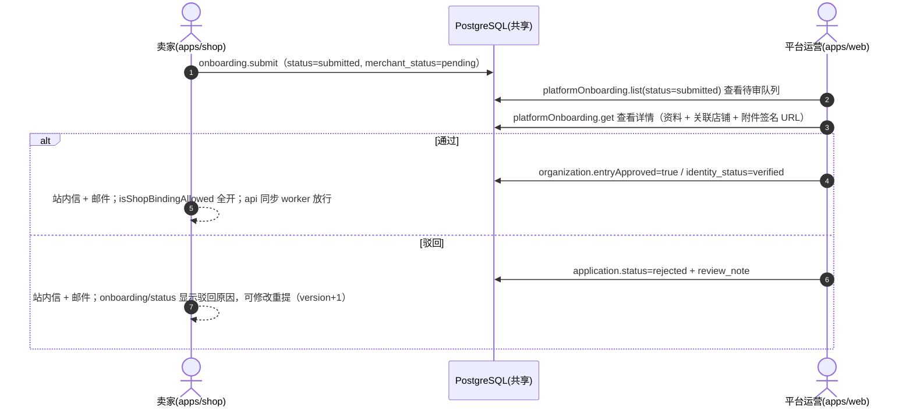

# 平台运营后台：入驻审核闭环、店铺管理与用户管理

> 状态：生效（2026-11-10）
> 范围：`apps/web` 跨境运营中枢下的入驻审核（补齐）、店铺管理、用户管理；与 `apps/shop` 的入驻-审核闭环
> 关联文档：[tenant-onboarding-and-store-binding.md](../../../shop/content/design/tenant-onboarding-and-store-binding.md)（§12.3 `platformOnboarding`、§11.8 审核线框）、[crossborder-mvp-overview.md](../../../../docs/design/crossborder-mvp-overview.md)（apps/web 模块边界）
> 代码落点：`apps/web/src/lib/server/{routers,dataaccess}/`、`apps/web/src/app/[locale]/(protected)/crossborder/*`

---

## 1. 目标与范围

1. 平台运营在 `apps/web` 完成企业/个人入驻申请的**审核通过 / 驳回**，与 `apps/shop` 形成「提交 → 待审 → 通过/驳回 → 通知 → 修改重提 / 开启同步」闭环。
2. 新增**店铺管理**：跨租户店铺总览（只读为主），平台风控停用与恢复。
3. 新增**用户管理**：租户侧用户总览（只读为主），平台风控封禁与解封。

非目标：平台代租户授权店铺、平台代租户编辑入驻资料、组织成员邀请（租户侧 `members` 已有）。

## 2. 入驻-审核闭环

### 2.1 闭环校验点

| 环节 | 实现 |
| --- | --- |
| 提交进队列 | `tenant_onboarding_applications.status='submitted'` + `(status, submitted_at)` 索引 |
| 审核详情 | `getOnboardingReview`：申请 + 组织审核字段 + 关联店铺（≤50）+ 附件 5 分钟签名 URL |
| 附件访问 | `/api/onboarding/file`：平台管理员会话 + HMAC 签名 + `tenant-onboarding/` 前缀校验 |
| 通过/驳回 | 事务内更新申请与 organization（entryApproved / identityStatus / merchantStatus）+ `audit_events` + `console_notifications` + 邮件（失败仅告警不回滚） |
| 租户感知 | shop `onboarding.getState`（状态机）、`/onboarding/status` 页、控制台站内信 Inbox |
| 同步闸 | `apps/api` 同步 worker 按 `organization.entryApproved=true` 过滤（业务同步）；OAuth 技术授权不受审核阻断（设计 D4） |
| 重提 | shop `onboarding.resubmit`：`rejected → submitted`，version+1，清空审核字段回队列 |

### 2.2 审核队列（`platformOnboarding`）

| 过程 | 输入 | 说明 |
| --- | --- | --- |
| `list` | `page/pageSize/status/countryCode/q` | DB 级分页；q 匹配企业名/注册号/联系人/组织名 |
| `stats` | — | 待审核数、今日通过/驳回数（UTC 自然日）、国家选项 |
| `get` | `id` | 详情 + 关联店铺 + 附件签名 URL |
| `approve` / `reject` | `id, note` | 仅 `submitted` 可操作；驳回必须填写原因 |
| `listConflicts` / `resolveConflict` | — | 跨租户店铺冲突处理（沿用） |
| `tenants` / `disableTenant` | — | 租户列表与整体停用（沿用） |

页面：`/crossborder/onboarding`（统计卡片 + 国家/状态筛选 + 搜索 + 分页）、`/crossborder/onboarding/[id]`（主体资料、法人/代理人材料、组织审核状态、关联店铺、审核记录、通过/驳回）。

## 3. 权限

沿用 `protectedProcedure`：`web_auth` 中 `org_type='platform'` 且角色 ∈ `ORG_ROLES.platform` 的成员才可调用全部平台过程；页面由 `(protected)/layout.tsx` 会话级校验兜底。跨租户写操作仅限本文件定义的风控动作。

## 4. 店铺管理（`platformShops`）

| 过程 | 类型 | 输入 | 说明 |
| --- | --- | --- | --- |
| `list` | query | `page/pageSize/q/platform/status` | 跨租户列表；q 匹配店铺名/平台店铺 ID/卖家 ID/租户名；汇总卡片（总数/已授权/待授权/失效停用） |
| `get` | query | `id` | 店铺详情：字段、凭证存在性与到期（**不返回明文**）、同步健康、最近 20 条 `integration_logs` |
| `disable` | mutation | `shopId, reason?` | 风控停用：`shops.status='disabled'` + `meta.syncPaused` + `integration_states.health='paused'` + 审计 + 站内信 |
| `restore` | mutation | `shopId` | 仅 `disabled` 可恢复：回到 `draft`（待授权），由租户重新走 OAuth |

状态语义与设计 §5.2 一致：恢复后由租户「重新启用并授权」，平台不代授权。

## 5. 用户管理（`platformUsers`）

| 过程 | 类型 | 输入 | 说明 |
| --- | --- | --- | --- |
| `list` | query | `page/pageSize/q/status(all/active/banned)` | 租户侧 `public.users`；q 匹配姓名/邮箱/手机号；附所属租户组织与角色；汇总（总数/租户成员数/封禁数） |
| `get` | query | `id` | 用户详情 + 所属组织（orgType/角色/入驻状态/店铺数） |
| `ban` | mutation | `userId, reason, banExpiresAt?` | 封禁：`users.banned/ban_reason/ban_expires` + **删除该用户全部 session**（立即下线）+ 各所属组织审计与站内信 |
| `unban` | mutation | `userId` | 清空封禁字段 + 审计 + 站内信 |

约定：

- 平台管理员自身在 `web_auth` schema，与租户用户物理隔离，不会出现在本列表。
- 封禁原因必填且租户可见；`banExpiresAt` 到期后由登录校验放行或运营手动解封，不做后台定时任务。
- 用户封禁不影响其组织的其他成员与既有数据。

## 6. 页面与导航

| 路由 | 说明 |
| --- | --- |
| `/crossborder/onboarding` | 审核队列（统计 + 筛选 + 分页） |
| `/crossborder/onboarding/[id]` | 审核详情与通过/驳回 |
| `/crossborder/shops` | 店铺管理列表（新增） |
| `/crossborder/shops/[id]` | 店铺详情与停用/恢复（新增） |
| `/crossborder/users` | 用户管理列表（新增） |
| `/crossborder/users/[id]` | 用户详情与封禁/解封（新增） |

导航：`CROSSBORDER_NAV` 增补「店铺」「用户」。

## 7. 验收要点

- 提交入驻后，审核队列可见并可按国家/状态/关键词筛选；统计卡片与列表一致。
- 审核详情可见全部资料、办理方式分支材料、组织审核状态与关联店铺；附件签名 URL 5 分钟内有效且仅平台管理员可读。
- 通过后：`entryApproved=true`，租户收到站内信/邮件，`/onboarding/status` 显示已通过，同步 worker 放行。
- 驳回后：租户可看到驳回原因，修改重提后回到待审核且 version 递增。
- 平台停用店铺：店铺转 `disabled`、同步暂停、租户收站内信；恢复后回 `draft` 待重新授权。
- 封禁用户：立即下线、登录被拒、所属组织收到通知；解封后可重新登录。
- 所有平台写操作均落 `audit_events`；API 响应不出现明文 token 或附件内容。
