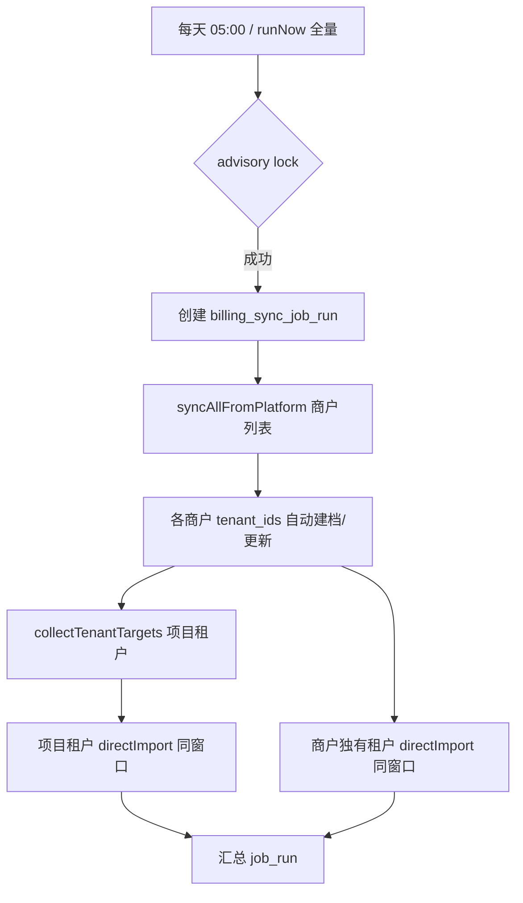
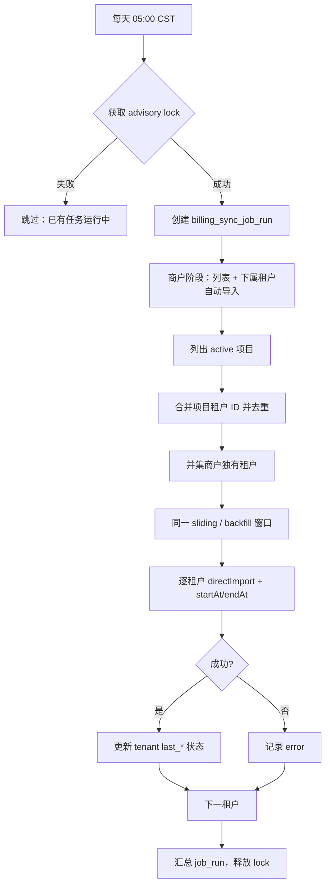

# 项目租户账单定时同步设计方案

> 版本：v1.4  
> 日期：2026-07-14  
> 状态：**已实施**  
> 变更：v1.4 — **追加**商户自动导入阶段：全量定时同步前拉取平台商户列表 + 各商户 `tenant_ids` 下全部租户，再对未挂项目的商户租户用**同一滑动窗口**导账单；原项目租户路径不变；指定 `projectIds` 的手动跑不跑商户阶段。对齐 [merchant-management-design.md](merchant-management-design.md) §7.7  
> 变更：v1.3 — `full` scope 同步增加算力券实例（`coupon`）；模板日更见 [discount-coupon-sync-design.md](discount-coupon-sync-design.md)  
> 变更：v1.2 — 对齐实现：**滑动窗口**增量（`computeSlidingSyncWindow`），移除游标推进与日历安全窗口设计；env 统一为 `BILLING_SYNC_WINDOW_DAYS`  
> 变更：v1.1 — 按 §13 确认项完成编码（cron + admin UI）  
> 关联：[tenant-billing-import-design.md](tenant-billing-import-design.md)、[tenant-bill-daily-sync-design.md](tenant-bill-daily-sync-design.md)、[discount-coupon-sync-design.md](discount-coupon-sync-design.md)、[merchant-management-design.md](merchant-management-design.md)、`tenant-billing-import.ts`、`project-billing-sync-dialog.tsx`

---

## 1. 目标与原则

### 1.1 业务目标

| # | 目标 | 说明 |
|---|------|------|
| G1 | 每日自动同步 | 每天 **东八区 05:00** 自动拉取各经营项目关联租户的 CRM 平台账单 |
| G2 | 滑动窗口增量 | 每次同步回看 **向前 N 天（默认 2 = 48h）** 至执行时刻，重叠区间幂等 upsert |
| G3 | 近期数据刷新 | 同步至 **执行时刻**（含今天/昨天部分数据）；平台回写可在窗口内被后续 job 覆盖 |
| G4 | 复用现有链路 | 调用已有 `directImport` / OpenAPI 封装，与手动「项目同步账单」行为一致 |
| G5 | 可观测 | 记录每次任务与每个项目/租户的执行结果，便于排查与 UI 展示 |
| G6 | 缺口可补 | Cron 长时间失败后需 **手动补同步**（`mode=backfill`）；见 §3.4 |
| G7 | 覆盖商户租户 | 全量定时同步 **追加** 平台商户列表 + 各商户下属全部租户建档/更新，并对未挂项目的商户租户导账单（窗口与项目路径一致）；见 §3.6 |

### 1.2 非目标（本期）

- **不**替代财务域 `billing_period` Excel 导入（见 `billing-period-import-design.md`）
- **不**在定时任务中做 preview 两步确认；直接 `directImport` 写库
- **不**新建独立 `apps/workers` 镜像（当前 Docker 仅部署 web；优先在 web 进程内调度）
- **不**改造 finance 模块的 `billing_period_tenant_bill_window`（刊例价子窗口，与 CRM 平台同步无关）
- **不**在账单 cron 内自动写入 `merchant_bill*` 汇总表（商户月度 rollup 仍为手动 `merchant.bill.rollup`；列表可无表时实时聚合 `tenant_bill`）

### 1.3 设计原则

1. **与手动同步同逻辑**：定时任务与 `crm.projects.syncBilling` 共用 data access，避免两套行为。
2. **滑动窗口 + 幂等**：固定回看 N×24h，重叠日重复 upsert；不维护租户游标。
3. **幂等可重跑**：租户级 upsert / 先删后插策略已由 `tenant-billing-import.ts` 保证。
4. **单实例互斥**：多副本部署时用 DB advisory lock，保证同一时刻只有一个 job 在跑。
5. **部分失败可继续**：单租户失败不阻断同批次其它租户；项目级汇总失败数。

---

## 2. 现状梳理

### 2.1 已有能力

| 组件 | 路径 | 说明 |
|------|------|------|
| 项目级同步 | `tenant-billing-import.ts` → `syncBillingForProject` | 遍历项目关联租户，逐个 `directImport` |
| 租户级导入 | `directImport` | `fetchPreview` + `commitImport`，跳过 UI 确认 |
| 手动入口 | `project-billing-sync-dialog.tsx` | 默认日期：当月 1 日 ~ 今天 |
| tRPC | `crm.projects.syncBilling` | `adminProcedure`，需登录管理员 |
| API 限流 | `suanli-billing-api-throttle.ts` | 全局限流 + 段间 delay（env 可配） |
| 依赖 | `node-cron@4.2.1` | 已在 `apps/web/package.json`，**尚未使用** |

### 2.2 缺口（v1.2 已补齐）

- ~~无定时调度入口~~ → `instrumentation.ts` + `register-billing-sync-cron.ts`
- ~~无 job 运行日志表~~ → `billing_sync_job_run` / `billing_sync_job_item`
- Docker `svc-workers` 指向不存在的 `apps/workers`（遗留占位，本期不启用）

### 2.3 租户归属规则（与手动同步一致）

`getBillingTenantIdsForProject` 解析顺序：

1. `project.primary_tenant_id`
2. `project_tenant` 关联表
3. 若仍为空：客户下 `is_default = true` 的租户

仅 `platform_tenant_id` 非空的租户可实际调用 OpenAPI。

---

## 3. 同步范围与时间窗

### 3.1 调度范围

**默认**：所有 `project.status = 'active'` 的项目。

| 项 | 规则 |
|----|------|
| 项目过滤 | `status = 'active'`；`paused` / `completed` 不同步（可 env 扩展） |
| 租户去重 | 同一 job 内按 `tenantId` 去重；一个租户只同步一次（即使挂多个项目） |
| 项目维度日志 | 仍按项目记录「本 job 内该项目下租户结果」，便于项目详情页展示 |

> **去重说明**：现有 `syncBillingForProject` 按项目循环，若租户 A 同时属于项目 P1、P2，手动各同步一次会重复调 API。定时任务建议在 job 层 **全局去重**，以租户为同步单元，项目仅作审计维度。

### 3.2 滑动窗口（Sliding Window）

定时 **增量**（`mode=incremental`）不使用租户游标，而使用精确时间回看：

```
windowDays = env BILLING_SYNC_WINDOW_DAYS（默认 2）
endAt   = job 开始时刻（timestamptz）
startAt = endAt − windowDays × 24h
startDate / endDate = 上述区间在东八区的日历日边界（供日志与部分 API 参数）
```

**API 查询**：`directImport` 传入 `startAt` / `endAt`，stream 路径用 `toSlidingWindowQueryTimes` 生成平台 ISO 时间（左闭右闭至执行时刻）。

示例（2026-05-26 05:00:00 CST 执行，`windowDays=2`）：

- `startAt ≈ 2026-05-24 05:00:00 CST`
- `endAt = 2026-05-26 05:00:00 CST`
- 日志 `startDate`/`endDate` 约为 `2026-05-24` ~ `2026-05-26`

**与旧版「日历安全窗口」差异**（v1.2 起废止）：

| 旧设计 | 现实现 |
|--------|--------|
| 不同步最近 N 个**日历日** | 同步至**执行时刻**，含当天已产生数据 |
| 游标驱动增量 | 固定滑动回看，每日重叠 |

### 3.3 补同步（Backfill）

| 模式 | 窗口 | 触发 |
|------|------|------|
| `incremental` | 滑动窗口（§3.2） | Cron、`runNow` 默认 |
| `backfill` | 用户指定 `[startDate, endDate]`（日历日，≤ 东八区今天） | 设置页「补同步遗漏账单 / 日账单」 |

补同步 **不受** 滑动窗口长度限制，用于首次上线历史回填或 Cron 长时间失败后的缺口修复。

### 3.4 运维注意

| 场景 | 行为 |
|------|------|
| Cron **每日成功** | 48h 重叠保证无日级缺口；旧日数据在出窗后不再自动刷新 |
| Cron **连续失败 ≥3 天**（`windowDays=2`） | 窗口外日历日可能永久缺失，需 **backfill** |
| 新租户 / 首次启用 | 增量仅最近 `windowDays`；历史需 backfill |
| 平台近期账单回写 | 窗口内日会在后续 job 被覆盖更新（幂等 upsert） |

### 3.5 时区与 Cron 表达式

| 项 | 值 |
|----|-----|
| 时区 | `Asia/Shanghai`（东八区） |
| 表达式 | `0 5 * * *`（每天 05:00） |
| 可配置 | `BILLING_SYNC_CRON`（默认 `0 5 * * *`）、`BILLING_SYNC_TIMEZONE`（默认 `Asia/Shanghai`） |

### 3.6 商户自动导入阶段（v1.4）

> 对齐 [merchant-management-design.md §7.7](merchant-management-design.md)。**不修改** §3.1 项目租户收集口径；仅在全量 job 中**追加**阶段。

| 项 | 规则 |
|----|------|
| **何时执行** | `runScheduledBillingSync` 且 **未** 指定 `projectIds`（定时 cron、全量 `runNow`）。指定 `projectIds` 的手动跑 **跳过** 本阶段 |
| **步骤 1 — 商户列表** | `merchantPlatformSyncDataAccess.syncAllFromPlatform()`：拉取 `GET /admin/merchant/list` 全部分页，upsert 本地 `merchant`（无 preview 确认） |
| **步骤 2 — 商户下租户** | 对每个平台商户的 `tenant_ids`，调用 `merchantTenantSyncDataAccess.autoSyncFromPlatformTenantIds`：已有租户更新字段并绑 `merchant_id`；未知租户自动建客户 + 租户（与裸金属自动建档口径一致） |
| **步骤 3 — 项目路径** | 仍按 §3.1 `collectTenantTargets` 收集 active 项目关联租户并导账单（逻辑不变） |
| **步骤 4 — 商户侧账单** | 商户阶段得到的本地租户中，**尚未**被项目路径覆盖的，用与项目路径 **同一** `window`（增量滑动窗口或 backfill 日期）调用 `directImport` + 裸金属日消耗 |
| **去重** | 同一 job 内按 `tenantId` 全局去重；项目路径优先；商户侧 item `summary` 前缀 `[商户]`，`project_id` 可为 null |
| **失败策略** | 商户阶段单行失败记入 `error_summary`，不阻断项目路径；若账单全成功但商户阶段有错误 → job `partial` |
| **非目标** | 本阶段 **不** 调用 `merchant.bill.rollup` |



---

## 4. 数据模型

### 4.1 租户同步状态（`billing_tenant` 扩展）

| 列 | 类型 | 说明 |
|----|------|------|
| `billing_sync_cursor_end_date` | `date` nullable | **历史遗留，不再写入**（v1.2；保留列避免迁移） |
| `billing_sync_last_started_at` | `timestamptz` nullable | 最近一次同步开始时间 |
| `billing_sync_last_finished_at` | `timestamptz` nullable | 最近一次同步结束时间 |
| `billing_sync_last_status` | `varchar(32)` nullable | `success` / `failed` / `skipped` |
| `billing_sync_last_error` | `text` nullable | 最近一次失败摘要 |

### 4.2 任务运行日志（新表 `billing_sync_job_run`）

| 列 | 类型 | 说明 |
|----|------|------|
| `id` | `text` PK | UUID |
| `trigger` | `varchar(32)` | `scheduled` / `manual` |
| `started_at` | `timestamptz` | |
| `finished_at` | `timestamptz` nullable | |
| `status` | `varchar(32)` | `running` / `success` / `partial` / `failed` |
| `sync_end_date` | `date` | 本次 job 增量窗口的 `endDate`（日历日，供列表展示） |
| `safety_days` | `integer` | **滑动窗口天数**（列名 legacy；值 = `windowDays`） |
| `project_count` | `integer` | 扫描项目数 |
| `tenant_count` | `integer` | 去重后租户数 |
| `success_count` | `integer` | |
| `failed_count` | `integer` | |
| `skipped_count` | `integer` | 窗口为空等 |
| `error_summary` | `text` nullable | |

### 4.3 租户级明细日志（新表 `billing_sync_job_item`）

| 列 | 类型 | 说明 |
|----|------|------|
| `id` | `text` PK | |
| `job_run_id` | FK → `billing_sync_job_run` | |
| `tenant_id` | FK → `billing_tenant` | |
| `project_id` | FK → `project` nullable | 审计用；去重同步时记录「代表项目」 |
| `start_date` | `date` | |
| `end_date` | `date` | |
| `status` | `varchar(32)` | `success` / `failed` / `skipped` |
| `summary` | `text` nullable | `directImport` 返回的 summary |
| `error` | `text` nullable | |

索引：`job_run_id`、`tenant_id`、`started_at`（job 表）。

---

## 5. 执行流程

### 5.1 总览



> v1.4：指定 `projectIds` 时跳过「商户阶段」，仅跑项目租户路径（与 v1.3 行为一致）。

### 5.2 核心函数（data access 层）

`apps/web/src/lib/server/dataaccess/crm/billing-scheduled-sync.ts`：

```typescript
// 伪代码
export async function runScheduledBillingSync(options?: {
  trigger: 'scheduled' | 'manual'
  projectIds?: string[]  // manual 可指定 subset；有值则跳过商户阶段
  mode?: 'incremental' | 'backfill'
  scope?: 'full' | 'daily_bills_only' | 'coupons_only'
  startDate?: string
  endDate?: string
}): Promise<BillingSyncJobRunResult>
```

内部复用：

- `merchantPlatformSyncDataAccess.syncAllFromPlatform`（v1.4）
- `merchantTenantSyncDataAccess.autoSyncFromPlatformTenantIds`（v1.4）
- `tenantBillingImportDataAccess.directImport({ tenantId, startDate, endDate, startAt, endAt, scope })`
- `projectsDataAccess.getBillingTenantIdsForProject`
- `validateBillingDateRange` / `computeSlidingSyncWindow`

**不**直接调用 `syncBillingForProject`（避免项目间重复同步同一租户）；改为 job 层去重后按租户循环。

商户阶段与项目阶段 **共用同一窗口**；job 内项目租户与商户租户再按 `tenantId` 去重。

### 5.3 互斥锁

```typescript
// PostgreSQL advisory lock，key 固定，例如 hash('billing_sync_job')
await db.execute(sql`SELECT pg_try_advisory_lock(${LOCK_KEY})`)
// finally: pg_advisory_unlock
```

多 web 副本时仅一个实例执行；未拿到锁则打日志并退出（不报错）。

### 5.4 超时与体量

| 风险 | 缓解 |
|------|------|
| 租户多、API 慢 | 已有 throttle；job 串行处理租户（与现 manual 一致） |
| 单 job 过长 | env `BILLING_SYNC_MAX_TENANTS_PER_RUN` 可选上限；超出留待次日（记录 warning） |
| 进程重启 | 滑动窗口不依赖进程内状态；`running` job 可 cleanup 标记 failed |

---

## 6. 调度层方案

### 6.1 推荐：Next.js Instrumentation + node-cron

| 项 | 说明 |
|----|------|
| 文件 | `apps/web/instrumentation.ts` |
| 条件 | `process.env.BILLING_SYNC_ENABLED === 'true'` 且 `NEXT_RUNTIME === 'nodejs'` |
| 注册 | `cron.schedule(BILLING_SYNC_CRON, handler, { timezone })` |
| 优点 | 与现有 Docker 单 web 容器一致；无需新服务 |
| 注意 | **开发环境默认关闭**，避免 dev 热重载重复注册 |

### 6.2 备选：HTTP Cron Route（多副本 / 外部调度）

| 项 | 说明 |
|----|------|
| 路径 | `POST /api/internal/cron/billing-sync` |
| 鉴权 | Header `Authorization: Bearer ${CRON_SECRET}` |
| 用途 | K8s CronJob / 云调度器触发；内部仍走 advisory lock |

两种入口 **共用** `runScheduledBillingSync`。

### 6.3 不推荐（本期）

- 新建 `apps/workers`：Docker compose 未部署，增加运维成本
- 纯 Redis 队列：当前无 BullMQ 等基础设施

---

## 7. 配置项（环境变量）

| 变量 | 默认 | 说明 |
|------|------|------|
| `BILLING_SYNC_ENABLED` | `false` | 是否启用定时任务 |
| `BILLING_SYNC_CRON` | `0 5 * * *` | Cron 表达式 |
| `BILLING_SYNC_TIMEZONE` | `Asia/Shanghai` | 时区 |
| `BILLING_SYNC_WINDOW_DAYS` | `2` | 滑动窗口天数（精确 24h × N 回看至执行时刻） |
| `BILLING_SYNC_INITIAL_START_DATE` | _(空)_ | **未接入增量路径**；运维 backfill 时可作参考起始日 |
| `BILLING_SYNC_PROJECT_STATUSES` | `active` | 逗号分隔的项目 status 过滤 |
| `CRON_SECRET` | _(空)_ | HTTP 触发鉴权（启用 route 时必填） |

已有 OpenAPI 限流 env 继续生效（`SUANLI_BILLING_API_*`）。

---

## 8. 管理入口（可选，建议本期一并做）

| 入口 | 说明 |
|------|------|
| tRPC `crm.billingSync.runNow` | `adminProcedure`，手动触发一次 job（`trigger=manual`） |
| tRPC `crm.billingSync.listRuns` | 分页查询 `billing_sync_job_run` + items |
| 项目详情 | 展示关联租户 `billing_sync_last_finished_at` / 状态 |
| 系统设置页 | 只读展示 cron 配置与安全窗口（值来自 env） |

手动触发与定时任务 **完全同代码路径**。

---

## 9. 与手动「项目同步账单」的差异

| 维度 | 手动（现有 UI） | 定时任务 |
|------|----------------|----------|
| 日期范围 | 用户填写，默认当月 1 日 ~ 今天 | 滑动窗口（最近 N 天至执行时刻） |
| 确认步骤 | 项目弹窗确认 | 无 UI，直接写库 |
| 租户范围 | 当前项目下全部计费租户 | 全部 active 项目，**租户去重** |
| 结束边界 | 可含「今天」 | 含执行时刻之前全部数据（含今天已产生部分） |
| 权限 | admin 登录 | 系统进程 / CRON_SECRET |

手动同步与定时任务 **互不共享游标**（v1.2 已无游标）；二者均幂等 upsert。

---

## 10. 错误处理

| 场景 | 处理 |
|------|------|
| 租户无 `platformTenantId` | `skipped`，记 item 日志 |
| OpenAPI 失败 | 租户 `failed`，更新 `billing_sync_last_*` |
| 窗口为空（`windowDays < 0` 等） | `skipped` |
| 拿不到 advisory lock | 整 job 跳过，不建 run 或建 `skipped` run |
| 部分租户失败 | job_run.status = `partial` |
| 全部失败 | `failed` |

---

## 11. 模块与文件规划

| 层级 | 路径 | 职责 |
|------|------|------|
| Migration | `packages/db/drizzle/xxxx_billing_sync.sql` | 新表 + tenant 扩展列 |
| Schema | `packages/db/src/crm-schema.ts` | Drizzle 定义 |
| 工具 | `lib/crm/tenant-billing-import-utils.ts` | `computeSlidingSyncWindow`、`toSlidingWindowQueryTimes` |
| Data access | `lib/server/dataaccess/crm/billing-scheduled-sync.ts` | job 主逻辑（含商户阶段） |
| Data access | `lib/server/dataaccess/merchant/merchant-platform-sync.ts` | `syncAllFromPlatform` |
| Data access | `lib/server/dataaccess/merchant/merchant-tenant-sync.ts` | `autoSyncFromPlatformTenantIds` |
| Data access | `lib/server/dataaccess/crm/tenant-billing-import.ts` | 保持 `directImport` 不变 |
| 调度 | `apps/web/instrumentation.ts` | node-cron 注册 |
| Route（可选） | `app/api/internal/cron/billing-sync/route.ts` | HTTP 触发 |
| tRPC | `lib/server/routers/crm/index.ts` | `billingSync.*` |
| 类型 | `lib/types/billing-scheduled-sync.ts` | Job run DTO |

---

## 12. 测试计划

| # | 用例 | 预期 |
|---|------|------|
| T1 | `computeSlidingSyncWindow`，windowDays=2 | startAt = endAt − 48h；startDate/endDate 为东八区日历日 |
| T2 | 同一 job 内两项目共享租户 | 只调一次 API |
| T3 | directImport 成功 | 更新 `billing_sync_last_*`；**不写** cursor 列 |
| T4 | directImport 失败 | `billing_sync_last_status=failed` |
| T5 | Cron 连续失败 3 天后 backfill | 缺口区间可被补同步写入 |
| T6 | 并发两个 job | 第二个拿不到 lock |
| T7 | `BILLING_SYNC_ENABLED=false` | cron 不注册 |
| T8 | manual runNow | 与 scheduled 同结果，trigger=manual |
| T9 | 全量 job 含未挂项目的商户租户 | 商户阶段建档后该租户有 `billing_sync_job_item`，summary 含 `[商户]` |
| T10 | runNow 指定 projectIds | 不调用商户平台同步；行为与 v1.3 一致 |

---

## 13. 待确认事项

| # | 问题 | 建议 | 状态 |
|---|------|------|------|
| Q1 | 增量策略？ | **滑动窗口**（默认 2 天 / 48h），非游标 + 日历安全窗口 | **已确认 v1.2** |
| Q2 | 首次 / 历史数据？ | 增量仅最近窗口；**backfill** 补历史 | **已确认 v1.2** |
| Q3 | 同步哪些项目？ | 仅 **`status=active`** | **已确认** |
| Q4 | 租户跨项目重复？ | job 内 **按 tenantId 去重** | **已确认** |
| Q5 | 调度方式？ | **Instrumentation + node-cron**（prod 开 env）；另留 HTTP cron 备选 | **已确认** |
| Q6 | Cron 失败恢复？ | 依赖 **手动 backfill**；运维接受 | **已确认 v1.2** |
| Q7 | 是否需要 UI 查看同步历史？ | admin 列表页 `/crm/billing-sync` + 项目同步弹窗展示 last sync | **已确认** |
| Q8 | 是否覆盖商户下属未挂项目租户？ | 全量 job **追加**商户列表 + 租户自动导入 + 同窗口账单；**不**自动 rollup `merchant_bill*` | **已确认 v1.4** |

---

## 14. 实施步骤（已完成）

1. Migration：tenant 状态字段 + `billing_sync_job_run` / `billing_sync_job_item`
2. 实现 `computeSlidingSyncWindow` + stream `directImport`
3. 实现 `billing-scheduled-sync.ts`（含 advisory lock）
4. 注册 `instrumentation.ts` + cron route
5. tRPC：`runNow` / `listRuns`
6. 设置页 `/crm/billing-sync` 与补同步 Dialog
7. 生产 env：`BILLING_SYNC_ENABLED=true`，`BILLING_SYNC_WINDOW_DAYS=2`
8. **v1.4**：`syncAllFromPlatform` + `autoSyncFromPlatformTenantIds` 挂入全量账单 job；与项目路径去重同窗口导账单
