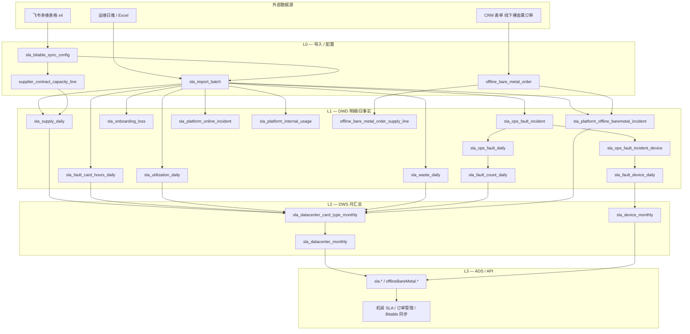
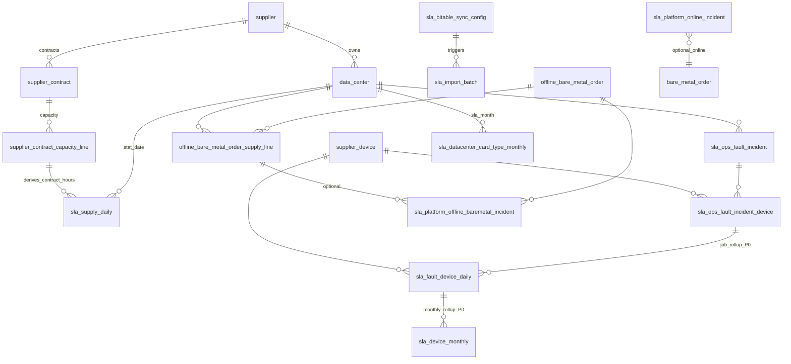
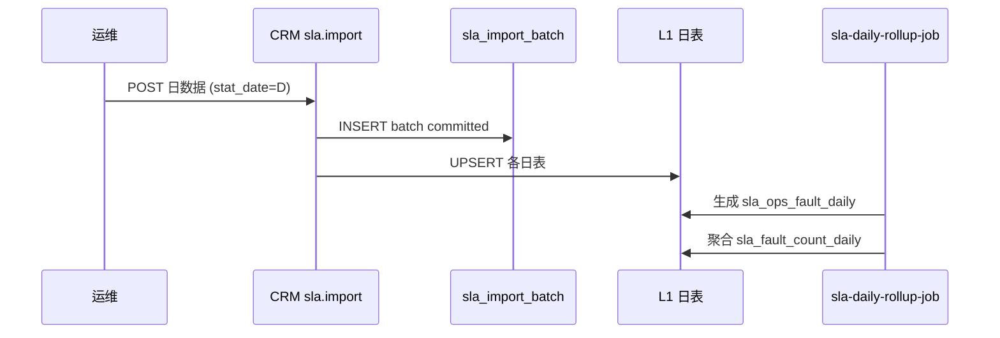
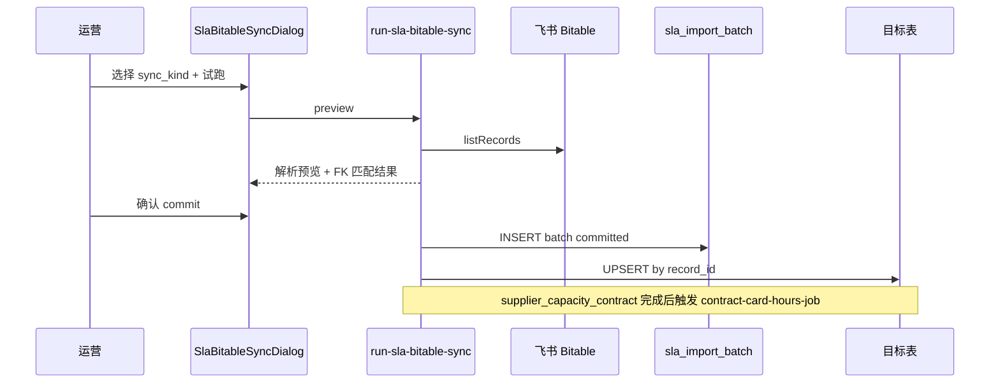

# 机房月度 SLA 指标 — 数据库与实现方案

> **版本**：v1.6  
> **日期**：2026-07-17  
> **状态**：**P0 已落地 schema + 读 API**（`packages/db/src/sla-schema.ts`、migration `0022`；`supplier.sla.*`；UI 无 rollup 时降级 Mock）  
> **需求来源**：[requirement.md](requirement.md)  
> **关联**：  
>
> - [sla-ops-direct-db-write-design.md](sla-ops-direct-db-write-design.md) — 运维直写 PG 专篇（含 **P0 设备故障 SLA** 运维要求 §5.4.1）  
> - [supplier-database.md](../supplier-database.md) — `supplier`、`data_center`、`gpu_card_type`、`supplier_card_list_price`、`supplier_device`  
> - [bare-metal-order-schema-design.md](../bare-metal-order-schema-design.md) — 线上 `bare_metal_order`（与线下订单 **分表**）  
> - [supply-chain-leads-bitable-import-design.md](../supply-chain-leads-bitable-import-design.md) — 飞书多维表格 **预览 → commit** 同步范式  
> - [feishu-integration-design.md](../feishu-integration-design.md) — Bitable 客户端与作业审计  
> - `packages/db/src/supply-schema.ts` — 供应域主数据（一期只读引用）  
> **触发场景**：按 **机房 × 卡型 × 自然月** 评估 SLA；**P0 起支持单设备故障可用率**（设备×日/月）；运维日推指标；**中台三类数据 + 供应商产能合同** 均通过 **飞书多维表格导入**；线下裸金属订单在 CRM **表单管理**。  
> **一期边界**：不做现网交叉校验；SLA 事实以导入为准；主数据 FK：`supplier`、`data_center`、`gpu_card_type`、`supplier_card_list_price`、`supplier_device`、`bare_metal_order`（仅线上订单关联）。

---


## 1. 目标与非目标


### 1.1 业务目标


| #   | 目标            | 说明                                                                      |
| --- | ------------- | ----------------------------------------------------------------------- |
| G1  | **日粒度事实落库**   | 运维侧：故障、供给、故障卡时、闲置/浪费、上架损耗；频率均为 **按自然日**（东八区）                            |
| G2  | **中台事件落库**    | 线下裸金属交付故障、线上故障、内部使用 — **均通过飞书多维表格同步** 入库 |
| G3  | **机房×卡型×月汇总** | 由日表 rollup 生成月度 SLA 读模型，支撑机房详情页 / 月报 / 对账                               |
| G4  | **维度一致**      | 统一 FK `data_center_id` + `gpu_card_type_id`；`gpu_card_type.device_role=infra` 计 0 |
| G5  | **幂等与追溯**     | Bitable `record_id` / 外部唯一键 + `import_batch_id`；保留 `raw_json`          |
| G6  | **故障设备明细**    | 故障事件 1:N 关联物理机，每台设备独立记录故障时段与卡时                                   |
| G7  | **故障次数统计**    | 日/月汇总 **新增、遗留、关闭** 故障次数（事件级 + 设备级）                                  |
| G8  | **独立表族**       | SLA 使用独立表族，不读写现网 `fault_incident`；与大盘 KPI **解耦**                     |
| G9  | **供应商合同产能**   | 与商务 **`supplier_contract` 同一合同**；机房×卡型产能明细落 **`supplier_contract_capacity_line`**；Bitable 导入；驱动合同卡时计算 |
| G10 | **线下裸金属订单**   | 一单多机房供给明细；表单 CRUD + 列表/详情页；关联 SLA 赔付与成本                           |
| G11 | **单设备故障 SLA（P0）** | 由 `sla_ops_fault_incident_device` 日切 rollup 至 **设备×日/月**；与 §8.1 机房供给可用率 **分口径** |


### 1.2 非目标（一期）

- **不**做现网交叉校验（不与 `device_daily_snapshot`、消费表、变更表、`fault_incident` 等对账）
- **不**在本期定义 SLA 合同阈值与赔付规则引擎（公式见 §8；达标阈值二期配置）
- **不**在一期实现 **单设备供给/闲置/浪费 SLA**（无 `sla_device_daily` 全量事实表；见 §5.3.2–§5.3.3、§10 P1）
- **不**改造 `onboarding_batch` / 变更表 / 大盘 ETL 流程
- **不**在一期实现实时流式计算（按日批处理 / API 导入即可）
- **不**修改代码（本文档仅描述方案）

---


## 2. 需求与指标映射

需求原文见 [requirement.md](requirement.md)。下表将每条需求映射到 **数据来源** 与 **目标表**。


| 需求块        | 频率  | 维度    | 主要字段                                              | 数据来源                     | 目标表（§5）                                                                 |
| ---------- | --- | ----- | ------------------------------------------------- | ------------------------ | ----------------------------------------------------------------------- |
| 新增故障列表     | 日   | 机房+卡型 | 故障 ID、发现/开始/结束时间、状态、父故障、类别、类型、运营、措施、影响设备/卡数、租户/订单 | **运维推送**                 | `sla_ops_fault_incident` + `sla_ops_fault_incident_device` + 日快照/次数表 |
| 遗留故障列表     | 日   | 机房+卡型 | 同上；**非当日新增且未关闭**                                  | 运维推送 + CRM 日切 Job        | `sla_ops_fault_daily` + `sla_fault_count_daily`                         |
| 故障次数       | 日   | 机房+卡型 | 新增/遗留/关闭/未关闭（事件数、设备数）                             | CRM 日切 Job 自故障表聚合        | `sla_fault_count_daily` → 月表                                             |
| 资源利用率·总供给  | 日   | 机房+卡型 | 台时、卡时                                             | **运维推送**                 | `sla_supply_daily.total_*`                                              |
| 资源利用率·合同卡时 | 日   | 机房+卡型 | 合同卡时                                              | **`supplier_contract_capacity_line` 日切 Job** | `sla_supply_daily.contract_card_hours` |
| 故障卡时       | 日   | 机房+卡型 | 台时、卡时；类型 internal/external                        | 运维推送                     | `sla_fault_card_hours_daily`                                            |
| 闲置率        | 日   | 机房+卡型 | 服务部署消耗、裸金属消耗、实际使用合计、供给−使用−浪费−内部                   | 运维 + 内部使用 Bitable        | `sla_utilization_daily`                                                 |
| 浪费率        | 日   | 机房+卡型 | 台时、卡时                                             | 运维推送                     | `sla_waste_daily`                                                       |
| 上架损耗       | 事件  | 机房+卡型 | 设备数、卡数、接收时间、实际上架时间                                | **运维推送**                 | `sla_onboarding_loss`                                                   |
| 线下裸金属交付故障  | 事件  | 机房+卡型 | 客诉、合同、故障时段、责任、赔付等                                 | **飞书多维表格**               | `sla_platform_offline_baremetal_incident`                               |
| 线上故障       | 事件  | 机房+卡型 | 租户、产品线、订单、节点、赔付等                                  | **飞书多维表格**               | `sla_platform_online_incident`                                          |
| 内部使用       | 事件  | 机房+卡型 | 期望/实际时间、部门、人员、台数卡数、单价                             | **飞书多维表格**               | `sla_platform_internal_usage`                                           |
| 供应商合同产能    | 合同行 | 供应商+机房+卡型 | 起止日期、台数/卡数、合作模式（整租/闲时）                         | **飞书多维表格** → `supplier_contract` + `supplier_contract_capacity_line` | 供应域 `supply-schema.ts`（**已实施** capacity_line） |
| 线下裸金属订单    | 订单  | 客户订单 + 多机房供给 | 数量、起止、合作模式、配套费、SLA 赔付、成本                    | **CRM 表单**（可 Excel 批量）   | `offline_bare_metal_order` + `offline_bare_metal_order_supply_line`     |


### 2.1 统计范围（运维约定）

需求提到「设备接入、平台上架、服务部署和线上裸金属」四类场景。表结构上通过 `sla_scope` 枚举统一标注，便于按场景过滤：


| `sla_scope`         | 中文    | 说明           |
| ------------------- | ----- | ------------ |
| `device_access`     | 设备接入  | 供应商侧接入管道     |
| `platform_shelf`    | 平台上架  | 平台可见/可售      |
| `service_deploy`    | 服务部署  | 弹性部署 / Job 等 |
| `online_bare_metal` | 线上裸金属 | 平台裸金属产品线     |


同一机房×卡型日汇总行 `sla_scope` **默认** `all`（全场景合计）；明细表可按 scope 拆分存储。

---


## 3. 一期主数据依赖（只读 FK）

一期 **仅** 引用以下供应域主数据做维度解析与设备关联；**不**读取大盘快照、消费事实、变更表、`fault_incident` 等做校验或回填。

| 现网表 | 用途 | 一期用法 |
|--------|------|----------|
| `supplier` | 供应商 | 机房 SLA 上卷；导入时解析供应商编码 |
| `data_center` | 机房 | FK；`code` / `container_instance_region` 解析 |
| `gpu_card_type` | 卡型 | FK；`device_role=infra` 计 0 |
| `supplier_card_list_price` | 刊例价 | 内部使用单价对账展示（可选 FK 快照） |
| `supplier_device` | 物理机 | **故障设备关联**、上架损耗设备列表；按 `sn` / `asset_no` / `id` 匹配 |
| `supplier_contract` | 供应商商务合同（头） | Bitable 按 `contract_no` upsert；SLA 合同卡时 **正式真源** |
| `supplier_contract_capacity_line` | 合同×机房×卡型产能明细 | Bitable 一行一条；`bitable_record_id` 幂等 |
| `bare_metal_order` | 裸金属订单头（**线上**） | 线上故障 `order_id` 解析 FK |
| `bare_metal_order_device` | 裸金属订单明细（线上） | 线上故障设备/节点关联 |
| `offline_bare_metal_order` | **线下**裸金属订单（SLA 域） | 线下交付故障、供给成本 FK |
| `offline_bare_metal_order_supply_line` | 线下订单×机房供给行 | 可 FK `supplier_contract_capacity_line` |

**决策 SLA-F1**：新增 `sla_ops_fault_incident` + `sla_ops_fault_incident_device` 作为 SLA 故障真源；**不**读写现网 `fault_incident`。

**决策 SLA-F2（一期）**：机房×卡型 **供给/利用/浪费** 度量 **以运维/中台导入为唯一真源**；`supplier_device` 在供给侧仅用于关联与 UI 下钻，**不**用其字段反算导入值。

**决策 SLA-F3（P0）**：**单设备故障 SLA** 由 CRM Job 自 `sla_ops_fault_incident_device` **派生**（裁剪至自然日），写入 `sla_fault_device_daily` → `sla_device_monthly`；运维 **不直写** 设备 rollup 表，但须保证设备明细行完整准确（见 [sla-ops-direct-db-write-design.md](sla-ops-direct-db-write-design.md) §5.4.1）。

### 3.1 二期可扩展（一期不做）

以下现网能力留作二期对账/镜像，**不纳入一期范围**：

- `device_daily_snapshot` / `device_hourly_snapshot` — 供给交叉校验  
- `tenant_region_gpu_consumption_daily` — 服务部署卡时校验  
- `onboarding_batch_device_link` — 实际上架时间校验  
- `internal_test_hold` — 内部占用对账  
- `fault_incident` — 大盘 KPI 镜像  

### 3.2 Schema 归属


| 决策         | 说明                                                                              |
| ---------- | ------------------------------------------------------------------------------- |
| **SLA-D1** | 新增 `packages/db/src/sla-schema.ts`，与 `dashboard-schema`、`finance-schema` 并列     |
| **SLA-D2** | 导入批次表 `sla_import_batch` 统一管理运维 Excel/API 与 **Bitable 同步批次** |
| **SLA-D7** | 中台三类 + 产能合同：**仅** Bitable 导入（`source_system=feishu_bitable`），不提供独立 REST 推送为一期路径 |
| **SLA-D8** | SLA 产能合同 **合并** 至供应域：`supplier_contract`（头）+ `supplier_contract_capacity_line`（机房×卡型明细）；**废除** `sla_supplier_capacity_contract` |
| **SLA-D3** | 日表 UK：`(stat_date, data_center_id, gpu_card_type_id, sla_scope, …)`             |
| **SLA-D4** | 月表 UK：`(sla_month, data_center_id, gpu_card_type_id, sla_scope)`                |
| **SLA-D5** | 金额用 `numeric(15,4)`；卡时用 `numeric(15,4)`（与 `cardHours` 类型一致）；台时用 `numeric(15,4)` |
| **SLA-D6** | 时间戳 `timestamptz`；自然日 `date`（东八区业务日）                                            |


---


## 4. 数据架构


### 4.1 分层




### 4.2 写入职责


| 写入方     | 表                                                                                                                                            | 方式                                     |
| ------- | -------------------------------------------------------------------------------------------------------------------------------------------- | -------------------------------------- |
| 运维      | `sla_ops_fault_incident`、`sla_supply_daily`（供给/上架损耗部分）、`sla_fault_card_hours_daily`、`sla_utilization_daily`（运维部分）、`sla_waste_daily`、`sla_onboarding_loss` | 日批 Excel/API → `sla_import_batch` |
| 飞书 Bitable | `sla_platform_*`、`supplier_contract` + **`supplier_contract_capacity_line`** | `sla_bitable_sync_config` → 预览 → commit |
| CRM 表单  | `offline_bare_metal_order`、`offline_bare_metal_order_supply_line` | 管理页 CRUD；可选 Excel 批量导入 |
| CRM Job | `sla_supply_daily.contract_card_hours`（自产能合同）、`sla_ops_fault_daily`、`sla_fault_count_daily`、**`sla_fault_device_daily`、`sla_device_monthly`（P0）**、`sla_datacenter_card_type_monthly` | 日切/月切 rollup |

### 4.3 飞书多维表格导入（中台三类 + 产能合同）

中台侧 **线下裸金属交付故障、线上故障、内部使用、供应商产能合同** 均在飞书多维表格维护，CRM 通过 **Bitable 同步** 入库（架构对齐 [supply-chain-leads-bitable-import-design.md](../supply-chain-leads-bitable-import-design.md)）。

| 能力 | 说明 |
|------|------|
| 配置 | `sla_bitable_sync_config`：每 `sync_kind` 一条或多条（`app_token` + `table_id` + 字段映射） |
| 流程 | **试跑预览**（`auto_commit=false`）→ 人工确认 → **commit** → 写 `sla_import_batch` + 目标表 |
| 幂等 | Bitable `record_id` → `external_*_id` / `bitable_record_id`；UK 冲突则 UPDATE |
| 作业 | 扩展 Cron `register-feishu-bitable-sync-cron` 或独立 `run-sla-bitable-sync.ts`；审计写 `feishu_integration_job_run` |
| UI | `/supplier/sla/bitable-sync` 统一入口，Tab 切换四种 `sync_kind` |


#### 4.3.1 `sync_kind` 与目标表

| `sync_kind` | 目标表 | 行粒度 |
|-------------|--------|--------|
| `platform_offline_baremetal` | `sla_platform_offline_baremetal_incident` | 一条故障 |
| `platform_online_incident` | `sla_platform_online_incident` | 一条故障 |
| `platform_internal_usage` | `sla_platform_internal_usage` | 一条内部占用 |
| `supplier_capacity_contract` | `supplier_contract` + `supplier_contract_capacity_line` | Bitable 一行 → 产能明细；必要时补建合同头 |

#### 4.3.2 中台三类 Bitable 建议列（摘要）

**线下裸金属交付故障** → `sla_platform_offline_baremetal_incident`

| 中文列名 | canonical | 必填 |
|----------|-----------|------|
| 收到用户报告时间 | `report_received_at` | 是 |
| 客户全称 | `customer_full_name` | 是 |
| 合同编号 | `contract_no` | 否 |
| 线下订单号 | `offline_order_no` | 否 |
| 故障开始/结束时间 | `fault_started_at` / `fault_ended_at` | 是/否 |
| 影响时长（分钟） | `impact_minutes` | 是 |
| 机房 / 卡型 | `data_center` / `gpu_card_type` | 是 |
| 责任归属 | `responsibility` | 是 |
| 故障说明 / 处理措施 | `fault_description` / `remediation` | 否 |
| 是否免责 / 是否赔付 / 赔付金额 / 赔付工单 | `is_force_majeure_exempt` 等 | 否 |

**线上故障** → `sla_platform_online_incident`：在 requirement.md 字段基础上增加 Bitable 标准列名映射（租户 ID、产品线、订单 ID、受影响节点 JSON 或逗号分隔）。

**内部使用** → `sla_platform_internal_usage`：期望/实际时间、部门、人员、机房、卡型、台数、卡数、单价、合计。

---


## 5. 数据库表结构

以下 DDL 为 **设计稿**（实施时写入 `sla-schema.ts` + drizzle migration）。

### 5.1 `sla_import_batch` — 导入批次


| 列名                          | 类型            | 约束                 | 说明                                         |
| --------------------------- | ------------- | ------------------ | ------------------------------------------ |
| `id`                        | text          | PK                 |                                            |
| `source_system`             | varchar(32)   | NOT NULL           | `ops` / `feishu_bitable` / `crm_form`      |
| `dataset_kind`              | varchar(64)   | NOT NULL           | 见 §5.1.1                                   |
| `stat_date`                 | date          | 可空                 | 日数据集必填                                     |
| `sla_month`                 | varchar(7)    | 可空                 | 月补录时用                                      |
| `file_name`                 | varchar(255)  | 可空                 |                                            |
| `file_uri`                  | varchar(1024) | 可空                 |                                            |
| `import_status`             | varchar(32)   | NOT NULL           | `draft` / `parsed` / `committed` / `error` |
| `parse_error`               | text          | 可空                 |                                            |
| `row_count`                 | integer       | NOT NULL DEFAULT 0 |                                            |
| `committed_row_count`       | integer       | NOT NULL DEFAULT 0 |                                            |
| `committed_at`              | timestamptz   | 可空                 |                                            |
| `created_by_staff_id`       | text          | FK→`user_staff`    | 可空（API 为空）                                 |
| `created_at` / `updated_at` | timestamptz   | NOT NULL           |                                            |


**索引**：`(dataset_kind, stat_date)`、`(import_status, created_at)`

#### 5.1.1 `dataset_kind` 枚举


| 值                            | 说明      |
| ---------------------------- | ------- |
| `ops_fault_incident`         | 运维故障明细（**含设备子行**） |
| `ops_supply_daily`           | 日供给     |
| `ops_fault_card_hours`       | 日故障卡时   |
| `ops_utilization_daily`      | 日利用/闲置  |
| `ops_waste_daily`            | 日浪费     |
| `ops_onboarding_loss`        | 上架损耗    |
| `platform_offline_baremetal` | 线下裸金属交付故障（Bitable） |
| `platform_online_incident`   | 线上故障（Bitable） |
| `platform_internal_usage`    | 内部使用（Bitable） |
| `supplier_capacity_contract` | 供应商产能合同（Bitable） |


---


### 5.2 `sla_ops_fault_incident` — 运维故障事件（事件级真源）

> **事件级**：一条记录对应运维侧一个故障事件（`external_fault_id`）。**每台受影响设备**的故障明细写入 §5.2.1；本表 `affected_device_count` / `affected_gpu_count` 由设备子表聚合或导入时一并校验。

| 列名                          | 类型            | 约束                           | 说明                                                         |
| --------------------------- | ------------- | ---------------------------- | ---------------------------------------------------------- |
| `id`                        | text          | PK                           | CRM 生成                                                     |
| `external_fault_id`         | varchar(128)  | NOT NULL                     | 运维侧唯一标识                                                    |
| `import_batch_id`           | text          | FK→`sla_import_batch`        |                                                            |
| `supplier_id`               | text          | FK→`supplier`, NOT NULL      | 冗余自 data_center                                            |
| `data_center_id`            | text          | FK→`data_center`, NOT NULL   |                                                            |
| `gpu_card_type_id`          | text          | FK→`gpu_card_type`, NOT NULL | 事件主卡型（跨卡型事件按运维规则拆多条）                                       |
| `sla_scope`                 | varchar(32)   | NOT NULL DEFAULT `all`       | §2.1                                                       |
| `scope_label`               | varchar(32)   | 可空                           | `datacenter` / `platform`（需求「机房/平台」）                       |
| `discovered_at`             | timestamptz   | NOT NULL                     | 发现时间                                                       |
| `started_at`                | timestamptz   | NOT NULL                     | 开始时间（事件级）                                                  |
| `ended_at`                  | timestamptz   | 可空                           | 结束时间；NULL=进行中                                              |
| `incident_status`           | varchar(32)   | NOT NULL                     | `ongoing` / `resolved` / `temporarily_resolved` / `closed` |
| `parent_external_fault_id`  | varchar(128)  | 可空                           | 父级故障标识                                                     |
| `parent_incident_id`        | text          | FK→本表                        | 解析后父 FK                                                    |
| `fault_category`            | varchar(32)   | NOT NULL                     | `network` / `hardware` / `human`                           |
| `fault_type`                | varchar(128)  | NOT NULL                     | 故障类型（运维字典）                                                 |
| `fault_operator`            | varchar(128)  | 可空                           | 故障运营                                                       |
| `remediation`               | text          | 可空                           | 处理措施（事件级摘要）                                                |
| `postmortem`                | text          | 可空                           | **故障复盘**（月报列）；与 remediation 区分                            |
| `impact_minutes`            | integer       | 可空                           | 事件级影响分钟；可空，可由设备子表 SUM                                     |
| `affected_device_count`     | integer       | NOT NULL DEFAULT 0           | = COUNT(设备子表)                                              |
| `affected_gpu_count`        | integer       | NOT NULL DEFAULT 0           | = SUM(设备子表.gpu_count)                                       |
| `affected_tenant_ids`       | jsonb         | NOT NULL DEFAULT `[]`        | 平台租户 ID 列表                                                 |
| `affected_order_ids`        | jsonb         | NOT NULL DEFAULT `[]`        | 订单 ID 列表                                                   |
| `fault_card_hours`          | numeric(15,4) | 可空                           | 事件级汇总；默认 SUM(设备子表.fault_card_hours)                          |
| `fault_machine_hours`       | numeric(15,4) | 可空                           | 默认 SUM(设备子表.fault_machine_hours)                           |
| `impact_side`               | varchar(16)   | NOT NULL DEFAULT `external`  | `internal` / `external`（故障卡时类型）                            |
| `first_seen_date`           | date          | NOT NULL                     | 首次进入 SLA 库的 **业务日**（判新增）                                   |
| `raw_json`                  | jsonb         | 可空                           |                                                            |
| `created_at` / `updated_at` | timestamptz   | NOT NULL                     |                                                            |

**唯一约束**：`UNIQUE (external_fault_id)`  
**索引**：`(data_center_id, gpu_card_type_id, started_at)`、`(incident_status, ended_at)`、`(first_seen_date, data_center_id)`

**新增判定（需求「新增：之前未解决的故障不计入」）**：

```text
is_new_on(stat_date) =
  first_seen_date = stat_date
  AND NOT EXISTS (
    同一 external_fault_id 在 stat_date 之前已入库且 incident_status ∉ {closed}
  )
```

---

### 5.2.1 `sla_ops_fault_incident_device` — 故障 × 设备明细（每台设备一条）

| 列名                          | 类型            | 约束                              | 说明 |
| --------------------------- | ------------- | ------------------------------- | ---- |
| `id`                        | text          | PK                              | |
| `incident_id`               | text          | FK→`sla_ops_fault_incident`, NOT NULL | |
| `supplier_device_id`        | text          | FK→`supplier_device`            | 匹配成功时必填；未入库设备可空 |
| `device_sn`                 | varchar(64)   | NOT NULL                        | 运维 SN；用于匹配 `supplier_device.sn` |
| `device_asset_no`           | varchar(64)   | 可空                            | 资产编号 |
| `data_center_id`            | text          | FK, NOT NULL                    | 冗余 |
| `gpu_card_type_id`          | text          | FK, NOT NULL                    | 冗余；可与事件主卡型不同（拆行后一致） |
| `gpu_count`                 | integer       | NOT NULL                        | 该设备 GPU 卡数 |
| `discovered_at`             | timestamptz   | NOT NULL                        | 该设备发现时间 |
| `started_at`                | timestamptz   | NOT NULL                        | 该设备故障开始 |
| `ended_at`                  | timestamptz   | 可空                            | 该设备故障结束 |
| `device_incident_status`    | varchar(32)   | NOT NULL                        | 该设备故障状态（可与事件级不同，如部分已恢复） |
| `fault_type`                | varchar(128)  | 可空                            | 设备级故障类型；空则继承事件 |
| `fault_category`            | varchar(32)   | 可空                            | 设备级类别 |
| `remediation`               | text          | 可空                            | 该设备处理措施 |
| `impact_minutes`            | integer       | 可空                            | 该设备影响分钟数 |
| `fault_machine_hours`       | numeric(15,4) | NOT NULL DEFAULT 0              | 该设备故障台时 |
| `fault_card_hours`          | numeric(15,4) | NOT NULL DEFAULT 0              | 该设备故障卡时 = 台时 × gpu_count（或运维直传） |
| `impact_side`               | varchar(16)   | NOT NULL DEFAULT `external`     | 该设备 internal/external |
| `bare_metal_order_id`       | text          | FK→`bare_metal_order`           | 可空；裸金属场景 |
| `bare_metal_order_device_id`| text          | FK→`bare_metal_order_device`    | 可空 |
| `raw_json`                  | jsonb         | 可空                            | |
| `created_at` / `updated_at` | timestamptz   | NOT NULL                        | |

**唯一约束**：`UNIQUE (incident_id, device_sn)`  
**索引**：`(supplier_device_id, started_at)`、`(incident_id)`、`(data_center_id, gpu_card_type_id, started_at)`

**导入规则**：

1. 每条故障事件 **至少 1 行** 设备明细；`affected_device_count` 须与设备行数一致。  
2. 优先按 `device_sn` 匹配 `supplier_device`；匹配成功后写 `supplier_device_id`，并校验 `data_center_id` / `gpu_card_type_id` 与事件一致（不一致则 import 警告，不阻断）。  
3. 未匹配设备仍入库（`supplier_device_id=NULL`），保留 SN 供后续补挂。  
4. 事件级 `fault_card_hours` 默认 = `SUM(device.fault_card_hours)`；运维若传事件级总值，与 SUM 差异 > 0.01 时写 batch 警告。

---


### 5.3 `sla_ops_fault_daily` — 故障日快照（新增 / 遗留）

按日固化「新增故障列表」与「遗留故障列表」，便于 UI 直接查询，避免重复扫描全量 incident。


| 列名                 | 类型          | 约束                                    | 说明                  |
| ------------------ | ----------- | ------------------------------------- | ------------------- |
| `id`               | text        | PK                                    |                     |
| `stat_date`        | date        | NOT NULL                              |                     |
| `list_kind`        | varchar(16) | NOT NULL                              | `new` / `carryover` |
| `incident_id`      | text        | FK→`sla_ops_fault_incident`, NOT NULL |                     |
| `data_center_id`   | text        | NOT NULL                              | 冗余                  |
| `gpu_card_type_id` | text        | NOT NULL                              | 冗余                  |
| `snapshot_status`  | varchar(32) | NOT NULL                              | 当日结束时状态快照           |
| `created_at`       | timestamptz | NOT NULL                              |                     |


**唯一约束**：`UNIQUE (stat_date, list_kind, incident_id)`  
**索引**：`(stat_date, data_center_id, gpu_card_type_id, list_kind)`

**遗留规则**：

```text
carryover on stat_date D =
  incident 在 D 日末 incident_status ∉ {closed}
  AND first_seen_date < D
```

---

### 5.3.1 `sla_fault_count_daily` — 故障次数日汇总

按 **机房 × 卡型 × 自然日** 汇总故障次数，支撑月报与 SLA 页 KPI 卡片。

| 列名                          | 类型      | 约束                     | 说明 |
| --------------------------- | ------- | ---------------------- | ---- |
| `id`                        | text    | PK                     | |
| `stat_date`                 | date    | NOT NULL               | |
| `data_center_id`            | text    | FK, NOT NULL           | |
| `gpu_card_type_id`          | text    | FK, NOT NULL           | |
| `sla_scope`                 | varchar(32) | NOT NULL DEFAULT `all` | |
| **事件级次数**                   |         |                        | |
| `new_fault_count`           | integer | NOT NULL DEFAULT 0     | 当日新增故障 **事件** 数（`list_kind=new`） |
| `carryover_fault_count`     | integer | NOT NULL DEFAULT 0     | 日末遗留故障 **事件** 数 |
| `closed_fault_count`        | integer | NOT NULL DEFAULT 0     | 当日关闭故障 **事件** 数（`ended_at` 落在 D） |
| `resolved_fault_count`      | integer | NOT NULL DEFAULT 0     | 当日解决（含临时解决）事件数 |
| **设备级次数**                   |         |                        | |
| `new_fault_device_count`    | integer | NOT NULL DEFAULT 0     | 当日新增故障涉及 **设备** 数（去重 SN） |
| `carryover_fault_device_count` | integer | NOT NULL DEFAULT 0  | 日末仍有未关闭设备故障的设备数 |
| `closed_fault_device_count` | integer | NOT NULL DEFAULT 0     | 当日关闭的设备故障数 |
| **分类（可选）**                  |         |                        | |
| `new_fault_by_category`     | jsonb   | NOT NULL DEFAULT `{}`  | `{network:2,hardware:1,human:0}` |
| `created_at` / `updated_at` | timestamptz | NOT NULL           | |

**唯一约束**：`UNIQUE (stat_date, data_center_id, gpu_card_type_id, sla_scope)`

**聚合来源（CRM 日切 Job）**：

```text
new_fault_count       = COUNT(sla_ops_fault_daily WHERE list_kind='new')
carryover_fault_count = COUNT(sla_ops_fault_daily WHERE list_kind='carryover')
closed_fault_count    = COUNT(incident WHERE date(ended_at)=stat_date AND incident_status='closed')
new_fault_device_count = COUNT(DISTINCT device_sn FROM sla_ops_fault_incident_device
                               JOIN incident ON first_seen_date=stat_date)
```

设备级「遗留」：日末 `device_incident_status ∉ {closed}` 且 `date(started_at) < stat_date` 的去重 SN 数。

---

### 5.3.2 `sla_fault_device_daily` — 设备×日故障 rollup（P0）

> **粒度**：每台物理机 × 自然日 × `impact_side` 一行。  
> **写入方**：CRM Job `sla-fault-device-daily-job`（运维 **勿直写**）。  
> **真源**：`sla_ops_fault_incident_device`（运维直写 L1）。

| 列名 | 类型 | 约束 | 说明 |
|------|------|------|------|
| `id` | text | PK | |
| `stat_date` | date | NOT NULL | 业务日（东八区） |
| `supplier_device_id` | text | FK→`supplier_device` | SN 匹配成功时填；未匹配可空 |
| `device_sn` | varchar(64) | NOT NULL | 冗余；**UK 组成部分** |
| `data_center_id` | text | FK, NOT NULL | 冗余自设备行 |
| `gpu_card_type_id` | text | FK, NOT NULL | 冗余自设备行 |
| `gpu_count` | integer | NOT NULL | 冗余自设备行 |
| `impact_side` | varchar(16) | NOT NULL | `internal` / `external` |
| `fault_machine_hours` | numeric(15,4) | NOT NULL DEFAULT 0 | 当日裁剪后故障 **台时** 合计 |
| `fault_card_hours` | numeric(15,4) | NOT NULL DEFAULT 0 | 当日裁剪后故障 **卡时** 合计 |
| `supply_machine_hours` | numeric(15,4) | NOT NULL DEFAULT 0 | 当日设备 **供给台时**（Job 自 `sla_supply_daily` 分摊；见 §8.8） |
| `supply_card_hours` | numeric(15,4) | NOT NULL | 当日设备 **供给卡时**（SLA / 闲置 / 浪费统一分母） |
| `device_sla_rate` | numeric(8,6) | 可空 | 仅 **external** 行写入；见 §8.8 |
| `incident_count` | integer | NOT NULL DEFAULT 0 | 当日涉及该 SN 的 incident_device 行数（去重 incident） |
| `source_incident_device_ids` | jsonb | NOT NULL DEFAULT `[]` | 追溯：`sla_ops_fault_incident_device.id` 列表 |
| `rollup_at` | timestamptz | NOT NULL | Job 写入时间 |
| `created_at` / `updated_at` | timestamptz | NOT NULL | |

**唯一约束**：`UNIQUE (stat_date, device_sn, impact_side)`  
**索引**：`(supplier_device_id, stat_date)`、`(data_center_id, gpu_card_type_id, stat_date)`

#### 5.3.2.1 日切裁剪规则（Job）

对 `stat_date = D`（东八区 `[D 00:00, D+1 00:00)`）：

```text
clip_start = GREATEST(device.started_at, D 00:00 Asia/Shanghai)
clip_end   = LEAST(
               COALESCE(device.ended_at, D+1 00:00),  -- 进行中：截到日末
               D+1 00:00
             )
fault_machine_hours_on_D =
  MAX(0, EXTRACT(EPOCH FROM (clip_end - clip_start)) / 3600.0)

fault_card_hours_on_D =
  fault_machine_hours_on_D × gpu_count
  -- 若运维直传 device.fault_card_hours 且与上式差异 > 0.01，Job 以裁剪时长重算为准
```

**聚合**：同一 `(D, device_sn, impact_side)` 下多条 `sla_ops_fault_incident_device` **SUM** 台时/卡时。

**纳入条件**：

- `device_incident_status` 任意（含进行中）；以时段与 D 相交为准  
- 仅统计与 D 有时间交集的设备行  
- `gpu_card_type.device_role = 'infra'` 的设备 **跳过**（SLA 卡时计 0）

#### 5.3.2.2 与机房×卡型日表对账

Job 完成后可选校验（±0.01 卡时）：

```text
SUM(sla_fault_device_daily.fault_card_hours WHERE stat_date=D AND dc AND card AND impact_side)
  ≈ sla_fault_card_hours_daily.fault_card_hours（同桶）
```

不一致写 Job 日志 `warning`；**不阻断** rollup（运维聚合与设备裁剪可能存在 SN 未匹配等差异）。

---

### 5.3.3 `sla_device_monthly` — 设备×月 SLA 读模型（P0）

> **粒度**：每台物理机 × 自然月一行。  
> **写入方**：CRM Job `sla-device-monthly-rollup-job`（运维 **勿直写**）。

| 列名 | 类型 | 约束 | 说明 |
|------|------|------|------|
| `id` | text | PK | |
| `sla_month` | varchar(7) | NOT NULL | `YYYY-MM` |
| `supplier_device_id` | text | FK | 可空（SN 未匹配时） |
| `device_sn` | varchar(64) | NOT NULL | **UK 组成部分** |
| `data_center_id` | text | FK, NOT NULL | 月内末次或众数 |
| `gpu_card_type_id` | text | FK, NOT NULL | 月内末次或众数 |
| `gpu_count` | integer | NOT NULL | 月内末次值 |
| `active_days` | integer | NOT NULL DEFAULT 0 | 月内出现在 `sla_fault_device_daily` 的天数（含 0 故障天） |
| `external_fault_machine_hours` | numeric(15,4) | NOT NULL DEFAULT 0 | SUM daily external 台时 |
| `internal_fault_machine_hours` | numeric(15,4) | NOT NULL DEFAULT 0 | SUM daily internal 台时 |
| `external_fault_card_hours` | numeric(15,4) | NOT NULL DEFAULT 0 | SUM daily external 卡时 |
| `internal_fault_card_hours` | numeric(15,4) | NOT NULL DEFAULT 0 | SUM daily internal 卡时 |
| `supply_machine_hours` | numeric(15,4) | NOT NULL | SUM(`supply_machine_hours`) |
| `supply_card_hours` | numeric(15,4) | NOT NULL | SUM(`supply_card_hours`) |
| `device_sla_rate` | numeric(8,6) | 可空 | **外部**故障 SLA；见 §8.8 |
| `sla_met` | boolean | 可空 | 与 `sla_target_config` 比对（二期）；P0 可空 |
| `rollup_status` | varchar(32) | NOT NULL | `pending` / `complete` / `partial` |
| `rollup_at` | timestamptz | 可空 | |
| `metadata` | jsonb | NOT NULL DEFAULT `{}` | 对账差异、缺失天列表 |
| `created_at` / `updated_at` | timestamptz | NOT NULL | |

**唯一约束**：`UNIQUE (sla_month, device_sn)`  
**索引**：`(supplier_device_id, sla_month)`、`(data_center_id, gpu_card_type_id, sla_month)`

**P0 `active_days` 口径**：月内该 SN 在 `sla_ops_fault_incident_device` 中 **至少有一条与当月任意日相交** 则计 1 天；无故障但需纳入 SLA 池的设备列表 **P1** 再扩展（见 §10）。

---


### 5.4 `sla_supply_daily` — 日供给与合同卡时


| 列名                          | 类型            | 约束                     | 说明                                     |
| --------------------------- | ------------- | ---------------------- | -------------------------------------- |
| `id`                        | text          | PK                     |                                        |
| `stat_date`                 | date          | NOT NULL               |                                        |
| `data_center_id`            | text          | FK, NOT NULL           |                                        |
| `gpu_card_type_id`          | text          | FK, NOT NULL           |                                        |
| `sla_scope`                 | varchar(32)   | NOT NULL DEFAULT `all` |                                        |
| `import_batch_id`           | text          | FK                     | 运维批次                                   |
| `total_machine_hours`       | numeric(15,4) | NOT NULL               | 总供给台时                                  |
| `total_card_hours`          | numeric(15,4) | NOT NULL               | **总供给卡时**；须满足 §8.1 与合同卡时、上架损耗关系 |
| `contract_card_hours`       | numeric(15,4) | 可空                     | **合同卡时**；由 Job 自 **`supplier_contract_capacity_line`** 写入 |
| `onboarding_loss_card_hours`| numeric(15,4) | NOT NULL DEFAULT 0     | 当日上架损耗卡时 |
| `contract_source`           | varchar(32)   | 可空                     | `capacity_contract_job` / `ops_override` |
| `online_device_count`       | integer       | 可空                     | 辅助字段（运维可选填）                            |
| `online_gpu_count`          | integer       | 可空                     | 辅助字段                                    |
| `source`                    | varchar(32)   | NOT NULL DEFAULT `ops_import` | 一期固定 `ops_import`；中台合同卡时 PATCH 后可为 `mixed` |
| `raw_json`                  | jsonb         | 可空                     |                                        |
| `created_at` / `updated_at` | timestamptz   | NOT NULL               |                                        |

**唯一约束**：`UNIQUE (stat_date, data_center_id, gpu_card_type_id, sla_scope)`

**供给恒等式（与可用率口径绑定，§8.1）**：

```text
total_card_hours = contract_card_hours − onboarding_loss_card_hours
```

- 运维导入时可直传 `total_card_hours`，须与上式在 ±0.01 内一致；否则 batch 标记 `warning`。  
- 一期 **不**从 `device_daily_snapshot` 或其他现网表派生或校验。

---


### 5.5 `sla_fault_card_hours_daily` — 日故障卡时


| 列名                          | 类型            | 约束                     | 说明                      |
| --------------------------- | ------------- | ---------------------- | ----------------------- |
| `id`                        | text          | PK                     |                         |
| `stat_date`                 | date          | NOT NULL               |                         |
| `data_center_id`            | text          | FK, NOT NULL           |                         |
| `gpu_card_type_id`          | text          | FK, NOT NULL           |                         |
| `sla_scope`                 | varchar(32)   | NOT NULL DEFAULT `all` |                         |
| `impact_side`               | varchar(16)   | NOT NULL               | `internal` / `external` |
| `import_batch_id`           | text          | FK                     |                         |
| `fault_machine_hours`       | numeric(15,4) | NOT NULL               |                         |
| `fault_card_hours`          | numeric(15,4) | NOT NULL               |                         |
| `raw_json`                  | jsonb         | 可空                     |                         |
| `created_at` / `updated_at` | timestamptz   | NOT NULL               |                         |


**唯一约束**：`UNIQUE (stat_date, data_center_id, gpu_card_type_id, sla_scope, impact_side)`

---


### 5.6 `sla_utilization_daily` — 日利用与闲置


| 列名                          | 类型            | 约束                     | 说明                        |
| --------------------------- | ------------- | ---------------------- | ------------------------- |
| `id`                        | text          | PK                     |                           |
| `stat_date`                 | date          | NOT NULL               |                           |
| `data_center_id`            | text          | FK, NOT NULL           |                           |
| `gpu_card_type_id`          | text          | FK, NOT NULL           |                           |
| `sla_scope`                 | varchar(32)   | NOT NULL DEFAULT `all` |                           |
| `import_batch_id`           | text          | FK                     |                           |
| `service_deploy_card_hours` | numeric(15,4) | NOT NULL DEFAULT 0     | 服务部署消耗卡时                  |
| `bare_metal_card_hours`     | numeric(15,4) | NOT NULL DEFAULT 0     | 裸金属消耗（开机摊销）               |
| `actual_usage_card_hours`   | numeric(15,4) | NOT NULL               | 实际使用合计                    |
| `total_supply_card_hours`   | numeric(15,4) | NOT NULL               | 冗余自 supply 或同批导入          |
| `waste_card_hours`          | numeric(15,4) | NOT NULL DEFAULT 0     | 浪费卡时                      |
| `internal_usage_card_hours` | numeric(15,4) | NOT NULL DEFAULT 0     | 内部每日使用（中台）                |
| `idle_card_hours`           | numeric(15,4) | NOT NULL               | 闲置卡时（可导入或计算）              |
| `idle_rate`                 | numeric(8,6)  | 可空                     | 闲置率 = idle / total_supply |
| `raw_json`                  | jsonb         | 可空                     |                           |
| `created_at` / `updated_at` | timestamptz   | NOT NULL               |                           |


**唯一约束**：`UNIQUE (stat_date, data_center_id, gpu_card_type_id, sla_scope)`

**口径（与需求对齐）**：

```text
actual_usage_card_hours = service_deploy_card_hours + bare_metal_card_hours

idle_card_hours =
  total_supply_card_hours
  − actual_usage_card_hours
  − waste_card_hours
  − internal_usage_card_hours

idle_rate = idle_card_hours / NULLIF(total_supply_card_hours, 0)
```

入库时可 **运维直传** `idle_card_hours`，CRM Job 校验上述恒等式（误差阈值 0.01 卡时）。

**裸金属摊销（说明）**：以设备 **开机时间** 为起点按自然日摊销至 `stat_date` 当日 24h 上限；设备级明细放 `raw_json.bare_metal_breakdown` 或二期表 `sla_bare_metal_usage_daily`（本期不建表，由运维汇总推送）。

---


### 5.7 `sla_waste_daily` — 日浪费


| 列名                          | 类型            | 约束                     | 说明                                         |
| --------------------------- | ------------- | ---------------------- | ------------------------------------------ |
| `id`                        | text          | PK                     |                                            |
| `stat_date`                 | date          | NOT NULL               |                                            |
| `data_center_id`            | text          | FK, NOT NULL           |                                            |
| `gpu_card_type_id`          | text          | FK, NOT NULL           |                                            |
| `sla_scope`                 | varchar(32)   | NOT NULL DEFAULT `all` |                                            |
| `import_batch_id`           | text          | FK                     |                                            |
| `waste_machine_hours`       | numeric(15,4) | NOT NULL               |                                            |
| `waste_card_hours`          | numeric(15,4) | NOT NULL               |                                            |
| `waste_rate`                | numeric(8,6)  | 可空                     | waste_card_hours / total_supply_card_hours |
| `raw_json`                  | jsonb         | 可空                     |                                            |
| `created_at` / `updated_at` | timestamptz   | NOT NULL               |                                            |


**唯一约束**：`UNIQUE (stat_date, data_center_id, gpu_card_type_id, sla_scope)`

与 `sla_utilization_daily.waste_card_hours` **应一致**；月 rollup 以本表为准，utilization 表存冗余便于闲置公式。

---


### 5.8 `sla_onboarding_loss` — 上架损耗（事件级）


| 列名                          | 类型            | 约束                    | 说明                                         |
| --------------------------- | ------------- | --------------------- | ------------------------------------------ |
| `id`                        | text          | PK                    |                                            |
| `external_record_id`        | varchar(128)  | NOT NULL              | 运维侧唯一键                                     |
| `import_batch_id`           | text          | FK                    |                                            |
| `data_center_id`            | text          | FK, NOT NULL          |                                            |
| `gpu_card_type_id`          | text          | FK, NOT NULL          |                                            |
| `device_count`              | integer       | NOT NULL              |                                            |
| `gpu_count`                 | integer       | NOT NULL              |                                            |
| `ops_received_at`           | timestamptz   | NOT NULL              | 运维接收设备时间                                   |
| `actual_shelved_at`         | timestamptz   | NOT NULL              | 实际上架时间                                     |
| `loss_hours`                | numeric(15,4) | NOT NULL              | `(actual_shelved_at − ops_received_at)` 小时 |
| `loss_card_hours`           | numeric(15,4) | NOT NULL              | `loss_hours × gpu_count`（按台均摊）             |
| `supplier_device_ids`       | jsonb         | NOT NULL DEFAULT `[]` | 关联 `supplier_device.id` 列表（一期必填至少 SN 匹配结果） |
| `raw_json`                  | jsonb         | 可空                    |                                            |
| `created_at` / `updated_at` | timestamptz   | NOT NULL              |                                            |

**唯一约束**：`UNIQUE (external_record_id)`  
**索引**：`(data_center_id, gpu_card_type_id, ops_received_at)`

一期 **不**校验 `supplier_device.received_at`、`onboarding_batch_device_link.linked_at`；设备关联仅通过导入 SN 列表 ↔ `supplier_device` 匹配。

---


### 5.9 `sla_platform_offline_baremetal_incident` — 线下裸金属交付故障


| 列名                           | 类型            | 约束                     | 说明                                     |
| ---------------------------- | ------------- | ---------------------- | -------------------------------------- |
| `id`                         | text          | PK                     |                                        |
| `external_incident_id`       | varchar(128)  | NOT NULL               | 幂等键；默认 = Bitable `record_id`              |
| `bitable_record_id`          | varchar(128)  | 可空                     | 飞书 record_id（与 external 相同可冗余）        |
| `import_batch_id`            | text          | FK                     |                                        |
| `offline_bare_metal_order_id` | text         | FK→`offline_bare_metal_order` | 可空；匹配客户/合同/订单号后关联          |
| `offline_supply_line_id`     | text          | FK→`offline_bare_metal_order_supply_line` | 可空 |
| `report_received_at`         | timestamptz   | NOT NULL               | 收到用户报告时间                               |
| `customer_full_name`         | varchar(255)  | NOT NULL               |                                        |
| `contract_no`                | varchar(128)  | 可空                     | 合同编号                                   |
| `fault_started_at`           | timestamptz   | NOT NULL               |                                        |
| `fault_ended_at`             | timestamptz   | 可空                     |                                        |
| `impact_minutes`             | integer       | NOT NULL               | 影响时长（分钟）                               |
| `data_center_id`             | text          | FK, NOT NULL           |                                        |
| `gpu_card_type_id`           | text          | FK, NOT NULL           |                                        |
| `responsibility`             | varchar(32)   | NOT NULL               | `datacenter` / `platform` / `customer` |
| `fault_description`          | text          | 可空                     |                                        |
| `remediation`                | text          | 可空                     |                                        |
| `is_force_majeure_exempt`    | boolean       | NOT NULL DEFAULT false | 免责例外                                   |
| `is_compensated`             | boolean       | NOT NULL DEFAULT false |                                        |
| `compensation_amount`        | numeric(15,4) | 可空                     | 赔付金额                                   |
| `compensation_work_order_id` | varchar(128)  | 可空                     | 赔付工单 ID                                |
| `raw_json`                   | jsonb         | 可空                     |                                        |
| `created_at` / `updated_at`  | timestamptz   | NOT NULL               |                                        |


**唯一约束**：`UNIQUE (external_incident_id)`

---


### 5.10 `sla_platform_online_incident` — 线上故障


| 列名                            | 类型            | 约束                     | 说明                                                                  |
| ----------------------------- | ------------- | ---------------------- | ------------------------------------------------------------------- |
| `id`                          | text          | PK                     |                                                                     |
| `external_incident_id`        | varchar(128)  | NOT NULL               | 幂等键；默认 = Bitable `record_id`              |
| `bitable_record_id`           | varchar(128)  | 可空                     |                                        |
| `import_batch_id`             | text          | FK                     |                                        |
| `report_received_at`          | timestamptz   | NOT NULL               |                                                                     |
| `tenant_platform_id`          | varchar(128)  | NOT NULL               |                                                                     |
| `tenant_id`                   | text          | FK→`billing_tenant`    | 解析后可空                                                               |
| `fault_started_at`            | timestamptz   | NOT NULL               |                                                                     |
| `fault_ended_at`              | timestamptz   | 可空                     |                                                                     |
| `impact_minutes`              | integer       | NOT NULL               |                                                                     |
| `data_center_id`              | text          | FK, NOT NULL           |                                                                     |
| `gpu_card_type_id`            | text          | FK, NOT NULL           |                                                                     |
| `product_line`                | varchar(32)   | NOT NULL               | `service_deploy` / `cloud_host` / `bare_metal` / `job` / `job_spot` |
| `order_id`                    | varchar(128)  | 可空                     | 线上裸金属订单 ID 等                                                        |
| `bare_metal_order_id`         | text          | FK→`bare_metal_order`  | 解析后可空                                                               |
| `affected_nodes`              | jsonb         | NOT NULL DEFAULT `[]`  | 受影响节点                                                               |
| `responsibility`              | varchar(32)   | NOT NULL               | `datacenter` / `platform` / `customer`                              |
| `fault_description`           | text          | 可空                     |                                                                     |
| `remediation`                 | text          | 可空                     |                                                                     |
| `is_force_majeure_exempt`     | boolean       | NOT NULL DEFAULT false |                                                                     |
| `is_compensated`              | boolean       | NOT NULL DEFAULT false |                                                                     |
| `compensation_voucher_amount` | numeric(15,4) | 可空                     | 算力券                                                                 |
| `compensation_work_order_id`  | varchar(128)  | 可空                     |                                                                     |
| `raw_json`                    | jsonb         | 可空                     |                                                                     |
| `created_at` / `updated_at`   | timestamptz   | NOT NULL               |                                                                     |


**唯一约束**：`UNIQUE (external_incident_id)`  
**索引**：`(data_center_id, gpu_card_type_id, fault_started_at)`、`(tenant_platform_id, fault_started_at)`

---


### 5.11 `sla_platform_internal_usage` — 内部使用（中台）


| 列名                          | 类型            | 约束                      | 说明                                             |
| --------------------------- | ------------- | ----------------------- | ---------------------------------------------- |
| `id`                        | text          | PK                      |                                                |
| `external_record_id`        | varchar(128)  | NOT NULL                | 幂等键；默认 = Bitable `record_id` |
| `bitable_record_id`         | varchar(128)  | 可空                      | |
| `import_batch_id`           | text          | FK                      |                                                |
| `expected_at`               | timestamptz   | 可空                      | 期望时间                                           |
| `actual_started_at`         | timestamptz   | NOT NULL                |                                                |
| `actual_returned_at`        | timestamptz   | 可空                      | 实际交还                                           |
| `actual_shelved_at`         | timestamptz   | 可空                      | 实际上架                                           |
| `department`                | varchar(128)  | NOT NULL                |                                                |
| `user_name`                 | varchar(128)  | NOT NULL                | 人员                                             |
| `data_center_id`            | text          | FK, NOT NULL            |                                                |
| `gpu_card_type_id`          | text          | FK, NOT NULL            |                                                |
| `device_count`              | integer       | NOT NULL                | 台数                                             |
| `gpu_count`                 | integer       | NOT NULL                | 卡数                                             |
| `unit_price`                | numeric(15,4) | NOT NULL                | 单价                                             |
| `total_amount`              | numeric(15,4) | NOT NULL                | 合计                                             |
| `usage_card_hours`          | numeric(15,4) | 可空                      | 按占用时段折算，供 rollup 至 `internal_usage_card_hours` |
| `list_price_per_hour`       | numeric(15,4) | 可空                      | 可 FK 快照 `supplier_card_list_price` as-of 占用日 |
| `raw_json`                  | jsonb         | 可空                      |                                                |
| `created_at` / `updated_at` | timestamptz   | NOT NULL                |                                                |


**唯一约束**：`UNIQUE (external_record_id)`

**日汇总写入**：Job 将 `[stat_date]` 内有效占用记录 SUM(`usage_card_hours`) → 更新 `sla_utilization_daily.internal_usage_card_hours`（按机房×卡型）。

---


### 5.12 `sla_datacenter_card_type_monthly` — 机房×卡型×月 SLA 汇总（DWS）


| 列名                                | 类型            | 约束                     | 说明                                              |
| --------------------------------- | ------------- | ---------------------- | ----------------------------------------------- |
| `id`                              | text          | PK                     |                                                 |
| `sla_month`                       | varchar(7)    | NOT NULL               | `YYYY-MM`                                       |
| `data_center_id`                  | text          | FK, NOT NULL           |                                                 |
| `gpu_card_type_id`                | text          | FK, NOT NULL           |                                                 |
| `sla_scope`                       | varchar(32)   | NOT NULL DEFAULT `all` |                                                 |
| `supplier_id`                     | text          | FK                     | 冗余自 data_center                                 |
| **供给**                            |               |                        |                                                 |
| `contract_card_hours`             | numeric(15,4) | NOT NULL               | SUM(`sla_supply_daily.contract_card_hours`) — **总合同卡时** |
| `total_supply_card_hours`         | numeric(15,4) | NOT NULL               | SUM(`sla_supply_daily.total_card_hours`)        |
| `total_supply_machine_hours`      | numeric(15,4) | NOT NULL               |                                                 |
| `onboarding_loss_card_hours`      | numeric(15,4) | NOT NULL               | SUM 月内上架损耗卡时（= SUM daily onboarding_loss 或事件表） |
| **故障次数**                          |               |                        |                                                 |
| `new_fault_count`                 | integer       | NOT NULL               | SUM(`sla_fault_count_daily.new_fault_count`) — 月新增 **事件** 数 |
| `carryover_fault_count_end`       | integer       | NOT NULL               | 月末日 `carryover_fault_count`（**非** SUM）           |
| `closed_fault_count`              | integer       | NOT NULL               | SUM 月内关闭事件数                                    |
| `new_fault_device_count`          | integer       | NOT NULL               | SUM 月内新增故障设备数（或月末去重，见 Job 配置）                  |
| `carryover_fault_device_count_end`| integer       | NOT NULL               | 月末遗留故障设备数                                     |
| **故障卡时**                          |               |                        |                                                 |
| `external_fault_card_hours`       | numeric(15,4) | NOT NULL               | SUM fault_card_hours external                   |
| `internal_fault_card_hours`       | numeric(15,4) | NOT NULL               | SUM internal                                    |
| **利用**                            |               |                        |                                                 |
| `actual_usage_card_hours`         | numeric(15,4) | NOT NULL               |                                                 |
| `idle_card_hours`                 | numeric(15,4) | NOT NULL               |                                                 |
| `idle_rate_avg`                   | numeric(8,6)  | 可空                     | 加权平均或月末比                                        |
| `waste_card_hours`                | numeric(15,4) | NOT NULL               |                                                 |
| `waste_rate_avg`                  | numeric(8,6)  | 可空                     |                                                 |
| `internal_usage_card_hours`       | numeric(15,4) | NOT NULL               |                                                 |
| **上架**                            |               |                        |                                                 |
| `onboarding_loss_event_count`     | integer       | NOT NULL               | 月内上架损耗 **事件** 条数                                |
| **中台客诉**                          |               |                        |                                                 |
| `platform_offline_incident_count` | integer       | NOT NULL               |                                                 |
| `platform_online_incident_count`  | integer       | NOT NULL               |                                                 |
| `compensation_amount_total`       | numeric(15,4) | NOT NULL               | 线下金额 + 线上券折算                                    |
| `exempt_incident_count`           | integer       | NOT NULL               | 免责例外计数                                          |
| **SLA 派生**                        |               |                        |                                                 |
| `availability_rate`               | numeric(8,6)  | 可空                     | §8.1 供给可用率                                       |
| `fault_sla_rate`                  | numeric(8,6)  | 可空                     | **§8.3.1 合同 SLA**；(供给 − 外部故障) / 供给              |
| `sla_met`                         | boolean       | 可空                     | **基于 `fault_sla_rate`** 与目标阈值比较（阈值 P2 配置）        |
| `rollup_status`                   | varchar(32)   | NOT NULL               | `pending` / `complete` / `partial`              |
| `rollup_at`                       | timestamptz   | 可空                     |                                                 |
| `metadata`                        | jsonb         | NOT NULL DEFAULT `{}`  | 日缺失列表、差异说明                                      |
| `created_at` / `updated_at`       | timestamptz   | NOT NULL               |                                                 |


**唯一约束**：`UNIQUE (sla_month, data_center_id, gpu_card_type_id, sla_scope)`

---


### 5.13 `sla_datacenter_monthly` — 机房×月汇总（可选）

机房级 **跨卡型** 汇总，字段与 §5.12 相同但 **无** `gpu_card_type_id`，指标为加权 SUM（卡时加权）。

**唯一约束**：`UNIQUE (sla_month, data_center_id, sla_scope)`

也可在 API 层对 §5.12 GROUP BY 动态聚合；若月报固定查机房级，建议物化本表。

---

### 5.14 `sla_bitable_sync_config` — 飞书多维表格同步配置

| 列名 | 类型 | 约束 | 说明 |
|------|------|------|------|
| `id` | text | PK | |
| `sync_kind` | varchar(64) | NOT NULL | §4.3.1 |
| `name` | varchar(128) | NOT NULL | 配置显示名 |
| `enabled` | boolean | NOT NULL DEFAULT true | |
| `app_token` | varchar(128) | NOT NULL | 多维表格 app_token |
| `table_id` | varchar(128) | NOT NULL | 数据表 table_id |
| `view_id` | varchar(128) | 可空 | 可选视图 |
| `field_mapping_json` | jsonb | NOT NULL | Bitable 列名 →  canonical 字段 |
| `auto_commit` | boolean | NOT NULL DEFAULT false | 默认试跑 |
| `cursor_record_id` | varchar(128) | 可空 | 增量游标（可选） |
| `last_synced_at` | timestamptz | 可空 | |
| `last_success_at` | timestamptz | 可空 | |
| `created_by_staff_id` | text | FK | |
| `created_at` / `updated_at` | timestamptz | NOT NULL | |

**索引**：`UNIQUE (sync_kind, app_token, table_id)`（同表多视图时加 `view_id`）

---

### 5.15 供应商合同产能 — `supplier_contract` + `supplier_contract_capacity_line`（已合并，已实施 schema）

> **v1.3 决策**：废除独立表 `sla_supplier_capacity_contract`。SLA 合同卡时与商务 **共用** `supplier_contract`；机房×卡型×数量×合作模式（整租/闲时）落在子表 **`supplier_contract_capacity_line`**（`packages/db/src/supply-schema.ts`，migration `0021_flaky_mentor.sql`）。

#### 5.15.1 模型分工

| 层 | 表 | 职责 |
|----|-----|------|
| 合同头 | `supplier_contract` | 合同编号、供应商、商务状态（`draft`/`active`/…）、计价模式、合同期（`start_date`/`end_date`）、PDF 等 — 见 [supplier-database.md](../supplier-database.md) |
| 产能明细 | `supplier_contract_capacity_line` | **SLA 合同卡时真源**：机房×卡型×台数/卡数×资源合作类型×明细起止日 |

**字段映射（产能明细行，已实现）**：

| 列名 | 类型 | 说明 |
|------|------|------|
| `id` | text PK | |
| `contract_id` | FK→`supplier_contract` | 所属商务合同 |
| `data_center_id` | FK | 机房 |
| `gpu_card_type_id` | FK | 卡型 |
| `cooperation_type` | varchar(32) | `whole_rent` 整租 / `idle_time` 闲时（对齐 `supplier_device.cooperation_type`） |
| `device_quantity` | integer | 承诺台数 |
| `gpu_quantity` | integer | 承诺 GPU 卡数 |
| `gpu_count_per_device` | integer | 可空 |
| `start_date` / `end_date` | date | 明细有效期（须在合同头 `[start_date,end_date]` 内） |
| `line_status` | varchar(32) | `active` / `paused` / `terminated` |
| `bitable_record_id` | varchar(128) | Bitable 幂等键（UK，partial） |
| `remark` / `raw_json` | | Bitable 追溯 |

**UK**：`(contract_id, data_center_id, gpu_card_type_id, start_date)`；`(bitable_record_id)` WHERE NOT NULL。

#### 5.15.2 Bitable 导入（`sync_kind=supplier_capacity_contract`）

1. 解析供应商 → `supplier_id`；按 **`contract_no`** 匹配或创建 **`supplier_contract`** 头（`status=active`，合同期取 Bitable 或明细 min/max）。  
2. UPSERT **`supplier_contract_capacity_line`**（`bitable_record_id` 幂等）。  
3. 头表 `cooperation_mode`（计价：`card_time`/`revenue_share`）与明细 `cooperation_type`（资源：整租/闲时）**语义不同**，Bitable「合作模式」列映射到 **`cooperation_type`**。

| 中文列名 | 写入目标 | 必填 |
|----------|----------|------|
| 供应商 | `supplier_contract.supplier_id` | 是 |
| 合同编号 | `supplier_contract.contract_no` | 是 |
| 机房 / 卡型 | 明细 FK | 是 |
| 合作模式 | `cooperation_type` | 是 |
| 台数 / 卡数 | `device_quantity` / `gpu_quantity` | 是 |
| 开始/结束日期 | 明细 `start_date`/`end_date`（可同步到头表） | 是 |
| 状态 | `line_status` + 头 `status` | 否 |

#### 5.15.3 合同卡时日计算

实现：`apps/web/src/lib/sla/contract-card-hours.ts`

日切 Job `sla-contract-card-hours-job` 对每个自然日 `stat_date = D`：

```text
active_lines(D) =
  supplier_contract.status = 'active'
  AND line.line_status = 'active'
  AND line.start_date <= D <= line.end_date

contract_card_hours(D, dc, card) =
  SUM over active_lines of (gpu_quantity × 24)
```

结果 UPSERT 至 `sla_supply_daily.contract_card_hours`，`contract_source = capacity_contract_job`。

---

### 5.16 `offline_bare_metal_order` — 线下裸金属订单（头表）

> 与平台同步的 `bare_metal_order`（线上）**分表**；本表管理 **线下交付** 客户订单，一单可拆多个供应商机房供给（见 §5.17）。

| 列名 | 类型 | 约束 | 说明 |
|------|------|------|------|
| `id` | text | PK | |
| `order_no` | varchar(64) | NOT NULL | 业务订单号；UK |
| `customer_full_name` | varchar(255) | NOT NULL | 客户全称 |
| `contract_no` | varchar(128) | 可空 | 客户合同编号 |
| `tenant_id` | text | FK→`billing_tenant` | 可空 |
| `project_id` | text | FK→`crm_project` | 可空 |
| `order_status` | varchar(32) | NOT NULL | `draft` / `active` / `completed` / `cancelled` |
| `ordered_at` | timestamptz | NOT NULL | 下单/签约时间 |
| `expected_delivery_at` | timestamptz | 可空 | 期望交付 |
| `remark` | text | 可空 | |
| `total_device_count` | integer | NOT NULL DEFAULT 0 | 冗余：供给行台数合计 |
| `total_gpu_count` | integer | NOT NULL DEFAULT 0 | 冗余：供给行卡数合计 |
| `total_cost_amount` | numeric(15,4) | NOT NULL DEFAULT 0 | 冗余：供给行成本合计 |
| `total_sla_compensation` | numeric(15,4) | NOT NULL DEFAULT 0 | 冗余：SLA 赔付合计 |
| `created_by_staff_id` | text | FK | |
| `created_at` / `updated_at` | timestamptz | NOT NULL | |

**唯一约束**：`UNIQUE (order_no)`  
**索引**：`(customer_full_name)`、`(order_status, ordered_at)`

---

### 5.17 `offline_bare_metal_order_supply_line` — 线下订单 × 机房供给明细

| 列名 | 类型 | 约束 | 说明 |
|------|------|------|------|
| `id` | text | PK | |
| `offline_bare_metal_order_id` | text | FK, NOT NULL | |
| `line_no` | integer | NOT NULL | 行号 1..N |
| `supplier_id` | text | FK→`supplier`, NOT NULL | |
| `data_center_id` | text | FK→`data_center`, NOT NULL | |
| `gpu_card_type_id` | text | FK→`gpu_card_type`, NOT NULL | |
| `cooperation_mode` | varchar(32) | NOT NULL | `whole_rent` / `idle_time` |
| `device_quantity` | integer | NOT NULL | 该机房提供 **台数** |
| `gpu_quantity` | integer | NOT NULL | 该机房提供 **卡数** |
| `started_at` | timestamptz | NOT NULL | 供给开始时间 |
| `ended_at` | timestamptz | 可空 | 供给结束；NULL=进行中 |
| `ancillary_equipment_fee` | numeric(15,4) | NOT NULL DEFAULT 0 | **配套设备费用**（元） |
| `sla_compensation_amount` | numeric(15,4) | NOT NULL DEFAULT 0 | **SLA 赔付**累计（元） |
| `cost_amount` | numeric(15,4) | NOT NULL DEFAULT 0 | **成本**（元） |
| `unit_cost_per_card_hour` | numeric(15,4) | 可空 | 卡时成本单价（辅助） |
| `capacity_contract_line_id` | text | FK→`supplier_contract_capacity_line` | 可空 |
| `contract_id` | text | FK→`supplier_contract` | 可空；冗余头表 |
| `remark` | text | 可空 | |
| `created_at` / `updated_at` | timestamptz | NOT NULL | |

**唯一约束**：`UNIQUE (offline_bare_metal_order_id, line_no)`  
**索引**：`(supplier_id, data_center_id)`、`(data_center_id, gpu_card_type_id, started_at)`

头表冗余字段在供给行 CRUD 后由服务端 **同事务刷新**。

---

### 5.18 ER 关系（摘要）




---


## 6. 数据写入与 Rollup 流程


### 6.1 运维日批（T+1）



| 步骤  | 动作                                                         |
| --- | ---------------------------------------------------------- |
| 1   | 运维在 D+1 推送 `stat_date=D` 的全量或增量（含故障事件 + **设备明细行**）      |
| 2   | 解析 `data_center.code` / `gpu_card_type.code` → FK；`device_sn` → `supplier_device` |
| 3   | UPSERT 各 DWD 表（ON CONFLICT DO UPDATE）                      |
| 4   | 日切 Job：写 `sla_ops_fault_daily`、`sla_fault_count_daily`、**`sla_fault_device_daily`（P0）** |
| 5   | 可选：Bitable 同步内部使用后 Job 汇总 `internal_usage_card_hours`；产能合同 Job 写 `contract_card_hours` |
| 6   | 月切 / 每日重算：`sla_device_monthly`（P0）、`sla_datacenter_card_type_monthly` |


### 6.2 飞书多维表格同步（中台 + 产能合同）



| 数据集 | 触发 | 写入 |
|--------|------|------|
| 产能合同 | 手动 / Cron | UPSERT `supplier_contract` + `supplier_contract_capacity_line` → Job 写 `sla_supply_daily.contract_card_hours` |
| 内部使用 | 手动 / Cron | UPSERT `sla_platform_internal_usage` → Job 汇总 `internal_usage_card_hours` |
| 线下/线上故障 | 手动 / Cron | UPSERT 两张 platform incident 表 |

### 6.3 线下裸金属订单（CRM 表单）

- **创建/编辑**：头表 + 动态供给行（≥1 行）；校验 `ended_at > started_at`、机房/卡型 FK。  
- **删除供给行**：软删或硬删后刷新头表冗余合计。  
- **与 Bitable 故障**：导入时按 `offline_order_no` / `contract_no` + 客户名 **可选** 关联 `offline_bare_metal_order_id`。

### 6.4 月度 Rollup（M+1 或每日重算当月）

```sql
-- 示意：机房×卡型×月 供给
INSERT INTO sla_datacenter_card_type_monthly (...)
SELECT
  :sla_month,
  data_center_id,
  gpu_card_type_id,
  'all',
  SUM(total_card_hours),
  ...
FROM sla_supply_daily
WHERE to_char(stat_date, 'YYYY-MM') = :sla_month
GROUP BY data_center_id, gpu_card_type_id
ON CONFLICT (...) DO UPDATE ...;
```

Job 名称建议：`sla-monthly-rollup-job`（机房×卡型）、**`sla-device-monthly-rollup-job`（设备×月，P0）**；支持 **手动重跑** 单机房单月 / 单设备单月。

#### 6.4.1 `sla-fault-device-daily-job`（P0）

| 项 | 约定 |
|----|------|
| 触发 | Cron 日切（建议 D+1 01:30，在运维日批与 `sla-daily-rollup-job` 之后）或手动 `stat_date` |
| 输入 | `sla_ops_fault_incident_device`（只读） |
| 输出 | UPSERT `sla_fault_device_daily` |
| 幂等 | `ON CONFLICT (stat_date, device_sn, impact_side) DO UPDATE` |
| 重跑 | 支持指定 `stat_date` 或日期范围；修正 incident_device 后须重跑对应日 |

```sql
-- 示意：UPSERT 骨架（裁剪逻辑见 §5.3.2.1，在应用层或 SQL 函数实现）
INSERT INTO sla_fault_device_daily (
  id, stat_date, supplier_device_id, device_sn,
  data_center_id, gpu_card_type_id, gpu_count, impact_side,
  fault_machine_hours, fault_card_hours,
  supply_machine_hours, supply_card_hours, device_sla_rate,
  incident_count, source_incident_device_ids, rollup_at,
  created_at, updated_at
) VALUES ( ... )
ON CONFLICT (stat_date, device_sn, impact_side) DO UPDATE SET
  fault_machine_hours = EXCLUDED.fault_machine_hours,
  fault_card_hours = EXCLUDED.fault_card_hours,
  device_sla_rate = EXCLUDED.device_sla_rate,
  incident_count = EXCLUDED.incident_count,
  source_incident_device_ids = EXCLUDED.source_incident_device_ids,
  rollup_at = EXCLUDED.rollup_at,
  updated_at = now();
```

---


## 7. 一期数据真源（无交叉校验）

| SLA 指标 | 唯一真源 | 主数据关联 |
| ------ | -------------------------------- | ---------------------------------------------------- |
| 总合同卡时  | `sla_supply_daily.contract_card_hours` | Job 自 **`supplier_contract_capacity_line`**（JOIN `supplier_contract.status=active`） |
| 总供给卡时  | `sla_supply_daily.total_card_hours`（运维） | = 合同卡时 − 上架损耗 |
| 上架损耗卡时 | `sla_onboarding_loss` / `sla_supply_daily.onboarding_loss_card_hours` | `supplier_device`（SN 列表） |
| 故障事件/次数 | `sla_ops_fault_incident` + `sla_fault_count_daily` | `supplier`、`data_center`、`gpu_card_type` |
| 故障设备明细 | `sla_ops_fault_incident_device` | **`supplier_device`**（SN 匹配） |
| **单设备故障 SLA（P0）** | **`sla_fault_device_daily` → `sla_device_monthly`** | Job 自 incident_device 裁剪；运维保证 L1 设备行质量 |
| 线下裸金属订单 | `offline_bare_metal_order` + supply_line | `supplier`、`data_center`、`gpu_card_type` |
| 线下交付故障 | `sla_platform_offline_baremetal_incident` | Bitable 导入；可选 FK 线下订单 |
| 线上故障 | `sla_platform_online_incident` | Bitable 导入；可选 FK **`bare_metal_order`** |
| 内部使用 | `sla_platform_internal_usage` | Bitable 导入 |
| 内部使用单价展示 | `sla_platform_internal_usage` | 可引用 **`supplier_card_list_price`** |


---


## 8. 月度 SLA 计算公式

### 8.1 可用率（Availability）— **已确认口径**

可用率衡量 **合同承诺卡时** 中，扣除上架损耗后 **实际供给** 的达成比例：

```text
total_supply_card_hours = contract_card_hours − onboarding_loss_card_hours

availability_rate =
  total_supply_card_hours / NULLIF(contract_card_hours, 0)
= (contract_card_hours − onboarding_loss_card_hours) / NULLIF(contract_card_hours, 0)
```

| 符号 | 含义 | 月汇总来源 |
|------|------|------------|
| `contract_card_hours` | **总合同卡时** | SUM(`sla_supply_daily.contract_card_hours`)；真源 = 产能合同 Job |
| `onboarding_loss_card_hours` | **上架损耗卡时** | SUM(`sla_supply_daily.onboarding_loss_card_hours`) 或 SUM(`sla_onboarding_loss.loss_card_hours`) |
| `total_supply_card_hours` | **总供给卡时** | SUM(`sla_supply_daily.total_card_hours`) |

**约束**：月 rollup 时三者须满足供给恒等式（±0.01 卡时/月）。  
**说明**：故障卡时 **不参与** 可用率分子分母；故障以 **次数**、**故障卡时** 与 **SLA（§8.3.1）** 独立展示。  
**统一分母**：SLA、闲置率、浪费率均以 **供给卡时** 为分母（分子分别为供给−故障、闲置、浪费）。


### 8.2 故障次数（月）

```text
new_fault_count_month        = SUM(sla_fault_count_daily.new_fault_count)
closed_fault_count_month     = SUM(sla_fault_count_daily.closed_fault_count)
carryover_fault_count_month_end = 月末日 sla_fault_count_daily.carryover_fault_count

new_fault_device_count_month = SUM(sla_fault_count_daily.new_fault_device_count)
carryover_fault_device_count_month_end = 月末日 carryover_fault_device_count
```

UI 建议同时展示 **事件次数** 与 **设备次数**；按 `fault_category`  breakdown 读 `new_fault_by_category` 月末聚合。

### 8.3 故障卡时（月，独立指标）

```text
external_fault_card_hours_month = SUM(sla_fault_card_hours_daily WHERE impact_side='external')
internal_fault_card_hours_month = SUM(... internal ...)
```

### 8.3.1 合同 SLA / 故障可用率（月，统一供给口径）

> **v1.5 决策**：SLA、闲置率、浪费率 **共用供给卡时分母**；废除「总可用卡时 / eligible 卡时」独立口径。

```text
sla_rate_month =
  (total_supply_card_hours − external_fault_card_hours_month)
  / NULLIF(total_supply_card_hours, 0)
```

| 符号 | 含义 |
|------|------|
| `total_supply_card_hours` | §8.1 供给卡时（合同卡时 − 上架损耗） |
| `external_fault_card_hours_month` | §8.3 外部故障卡时 |

机房×卡型、单设备、月度报告 **均用同一公式**；仅聚合粒度不同。

### 8.4 闲置率 / 浪费率（月）

```text
idle_rate_month =
  SUM(idle_card_hours) / NULLIF(SUM(total_supply_card_hours), 0)

waste_rate_month =
  SUM(waste_card_hours) / NULLIF(SUM(total_supply_card_hours), 0)
```


### 8.5 上架损耗占比

```text
onboarding_loss_ratio =
  onboarding_loss_card_hours / NULLIF(contract_card_hours, 0)
```

### 8.6 故障密度（参考）

```text
new_faults_per_1k_contract_card_hours =
  new_fault_count_month × 1000 / NULLIF(contract_card_hours, 0)
```

### 8.7 SLA 达标

```text
sla_met = (fault_sla_rate >= sla_target_availability)
```

> **注意**：达标判据使用 **合同 SLA（§8.3.1 `fault_sla_rate`）**，**不是** §8.1 `availability_rate`（供给可用率）。

目标阈值建议存 `sla_target_config`（二期配置表：`data_center_id` + `gpu_card_type_id` + `effective_from` + `target_availability`），本期可写死在 `metadata` 或应用常量 `0.995`。

### 8.8 单设备 SLA（P0）— **供给卡时口径**

> 与 §8.1、§8.3.1、§8.4 **同一供给池**；不再使用 `eligible_card_hours` / 「总可用卡时」。

**日（external）**：

```text
device_supply_card_hours(D, device) =
  当日该设备分摊的供给卡时（Job 自 sla_supply_daily 按 gpu_count 占比分摊）

device_sla_rate(D, device) =
  (device_supply_card_hours − external_fault_card_hours)
  / NULLIF(device_supply_card_hours, 0)
```

仅 `impact_side = 'external'` 的 `sla_fault_device_daily` 行写入 `device_sla_rate`；`internal` 行该列为 NULL。

**月**：

```text
device_sla_rate_month =
  (SUM(device_supply_card_hours) − SUM(external_fault_card_hours))
  / NULLIF(SUM(device_supply_card_hours), 0)
```

写入 `sla_device_monthly.device_sla_rate`（列名可与 UI「单实例 SLA」对齐）。

**设备 SLA 达标（P0 可选展示，阈值 P2）**：

```text
device_sla_met = (device_sla_rate_month >= device_target_availability)
```

`device_target_availability` 默认与机房×卡型目标一致，二期可 per-device 配置。

**UI 建议**：设备详情 / 故障下钻页展示 **设备月 SLA**；机房×卡型 Tab 与 §8.3.1 公式一致。

---


## 9. API 与 UI（概要）


### 9.1 tRPC 路由（建议）


| 过程                                   | 权限        | 说明            |
| ------------------------------------ | --------- | ------------- |
| `sla.import.previewOpsDaily`         | admin     | 预览运维日批        |
| `sla.import.commitOpsDaily`          | admin     | 提交日批          |
| `sla.import.previewBitableSync`      | admin     | Bitable 试跑预览（按 sync_kind） |
| `sla.import.commitBitableSync`       | admin     | Bitable 确认入库              |
| `sla.bitableConfig.list` / `upsert`  | admin     | 同步配置管理                  |
| `offlineBareMetal.list`              | protected | 线下订单列表                  |
| `offlineBareMetal.getById`           | protected | 订单详情 + 供给行             |
| `offlineBareMetal.create` / `update` | admin     | 表单提交                      |
| `offlineBareMetal.delete`            | admin     | 删除（供给行 cascade）          |
| `sla.getDatacenterMonthly`           | protected | 机房×月汇总列表（`supplier.sla.getOverview`） |
| `sla.getCardTypeMonthlyDetail`       | protected | 机房×卡型×月 + 日序列（`getDatacenterDetail`） |
| `sla.listFaultIncidents`             | protected | 故障事件列表（分页）      |
| `sla.listFaultIncidentDevices`       | protected | 某故障下设备明细        |
| `sla.getFaultCountDaily`             | protected | 故障次数日序列          |
| **`sla.getDeviceFaultDaily`（P0）**  | protected | 单设备 / 机房 设备故障日序列 |
| **`sla.getDeviceMonthly`（P0）**     | protected | 单设备×月 SLA 汇总      |
| **`sla.getMonthlyReport`（P0）**     | protected | **月度 SLA 报告**（方案 A：查询组装） |
| `sla.rollupMonthly`                  | admin     | 手动触发 rollup   |
| **`sla.rollupDeviceMonthly`（P0）**  | admin     | 手动触发设备月 rollup   |

### 9.1.1 月度报告（方案 A）

查询时组装，不物化报告主表：

| 数据 | 来源 |
|------|------|
| 汇总头 | `sla_datacenter_monthly` |
| 故障行 | `sla_ops_fault_incident`（+ `postmortem` / `impact_minutes`）+ 设备子表 |
| 平台组 | `scope_label = platform`；组级可用性 = 机房月 `fault_sla_rate` |
| 单机组 | 按 `device_sn` 分组；可用性 = `sla_device_monthly.device_sla_rate` |
| 赔偿覆盖 | `sla_monthly_report_compensation`（`group_key` = `platform` \| `device_sn`） |

事件表相对需求补列：`postmortem`（故障复盘）、`impact_minutes`（事件级影响分钟）。

### 5.16 `sla_monthly_report_compensation` — 月报赔偿手工覆盖

| 列名 | 类型 | 说明 |
|------|------|------|
| `sla_month` / `data_center_id` / `group_key` | UK | `group_key` = `platform` 或 `device_sn` |
| `service_fee` / `compensation_tier` / `compensation_amount` | numeric | 可空；空则 API 按梯度现算 |
| `compensation_note` | text | 协商备注（有 note 时 UI 隐藏梯度） |


### 9.2 UI 入口（建议）

| 入口 | 内容 |
|------|------|
| `/supplier/sla/bitable-sync` | **多维表格同步**（Tab：产能合同 / 线下故障 / 线上故障 / 内部使用）；配置、试跑、commit、作业历史 |
| `/supplier/sla/offline-bare-metal-orders` | **线下裸金属订单列表**：订单号、客户、状态、台数/卡数/成本/赔付合计、操作（查看/编辑） |
| `/supplier/sla/offline-bare-metal-orders/new` | **新建订单表单**（见 §9.3） |
| `/supplier/sla/offline-bare-metal-orders/[id]` | **订单详情**：头信息 + 供给行表格 + 关联 SLA 故障列表 |
| `/supplier/datacenters/[id]/sla` | 机房 SLA Tab：月 KPI、合同卡时/可用率、卡型 breakdown |
| `/supplier/datacenters/[id]/sla/faults` | 运维故障 + 设备明细下钻 |
| 运维导入 | 独立 SLA 运维日批导入页（Excel/API） |

### 9.3 线下裸金属订单 — 表单设计

#### 9.3.1 头表字段（`offline_bare_metal_order`）

| 字段 | 控件 | 校验 |
|------|------|------|
| 订单号 | 文本 | 必填；UK；新建可自动生成可改 |
| 客户全称 | 文本 | 必填 |
| 合同编号 | 文本 | 可选 |
| 关联租户 / 项目 | 下拉 | 可选；搜索 CRM 租户/项目 |
| 订单状态 | 枚举 | 默认 `draft` |
| 下单时间 | 日期时间 | 必填 |
| 期望交付 | 日期时间 | 可选 |
| 备注 | 多行文本 | 可选 |

#### 9.3.2 供给行（动态表格，`offline_bare_metal_order_supply_line`）

| 列 | 控件 | 说明 |
|----|------|------|
| 供应商 | 下拉 | FK `supplier` |
| 机房 | 下拉 | 过滤该供应商下 `data_center` |
| 卡型 | 下拉 | FK `gpu_card_type` |
| 合作模式 | 单选 | 整租 / 闲时 |
| 台数 / 卡数 | 数字 | 必填；卡数可与台数联动（默认单机 8 卡可改） |
| 开始时间 / 结束时间 | 日期时间 | 开始必填；结束可空=进行中 |
| 配套设备费用 | 金额 | 默认 0 |
| SLA 赔付 | 金额 | 默认 0；可累计编辑 |
| 成本 | 金额 | 必填或自动算（卡时×单价） |
| 关联 SLA 产能合同 | 可选下拉 | 同供应商×机房×卡型有效合同 |
| 备注 | 文本 | 可选 |

**交互**：支持「添加供给机房」增加行；保存时校验至少一行；头表合计字段只读展示。

#### 9.3.3 列表页列

订单号、客户全称、状态、下单时间、供给机房数、总台数、总卡数、总成本、SLA 赔付合计、最近更新、操作。


---


## 10. 实施分期


| 阶段     | 范围                 | 交付                                                                                       |
| ------ | ------------------ | ---------------------------------------------------------------------------------------- |
| **P0** | 供应域合同产能 + 运维日批 + **设备故障 SLA** | **`supplier_contract_capacity_line`（已落地）**、§5.2–5.8、§5.3.2–§5.3.3、`contract-card-hours.ts`、故障 Job、**`sla-fault-device-daily-job`** |
| **P1** | 中台三类 Bitable + 月 rollup + 线下订单 CRUD + **设备全量 SLA** | §5.9–5.13、§5.16–5.17、Bitable 同步 UI、订单列表/表单、monthly Job；**`sla_device_daily`（供给/利用/浪费）**、合同设备映射 |
| **P2** | 配置与告警              | `sla_target_config`、SLA 未达标通知、月报自动出数                                                     |
| **P3** | 现网交叉校验（可选）         | 供给 vs 快照等对账 — **不在一期**                                         |


---


## 11. 迁移与兼容


| 项                                              | 策略                                                  |
| ---------------------------------------------- | --------------------------------------------------- |
| 历史 `fault_incident`                            | **不迁移、不镜像**（一期）；SLA 仅用新表族                        |
| 存量运维 Excel                                     | 新增 SLA 模板：**事件行 + 设备明细行**（一对多）                    |
| `supplier_ops_upload_batch.kind=fault_records` | 保留现网能力；SLA 导入 **独立** `dataset_kind=ops_fault_incident` |


---


## 12. 开放问题（需产品/运维确认）


| #   | 问题                               | 影响                                          |
| --- | -------------------------------- | ------------------------------------------- |
| Q1  | 月内 `new_fault_device_count` 用 SUM 还是 DISTINCT SN | 月表聚合 Job |
| Q2  | 产能合同 Bitable「数量」以 **台数+卡数** 双列还是仅卡数 | `supplier_contract_capacity_line` 列必填 |
| Q3  | 同一故障跨卡型：拆多条事件还是单事件多卡型设备行           | 导入模板与 UK 设计                               |
| Q4  | 平台「产品线」与 CRM `product_line` 枚举映射 | Bitable 线上故障映射 |
| Q5  | 线下订单是否与 CRM 项目详情「导入线下裸金属」共用 `bare_metal_order` | 本方案 **分表**；是否二期合并 |
| Q6  | 设备 SN 未匹配 `supplier_device` 是否阻断导入     | 建议 **警告不阻断**                            |
| Q7  | 四种 Bitable 是否共用一张飞书表多视图 | `sla_bitable_sync_config` 条数 |
| Q8  | P0 设备 `supply_card_hours` 分摊规则（按 gpu 占比 vs 合同行） | §8.8、§5.3.2 Job |
| Q9  | 月内无故障但仍在 SLA 池的设备是否写入 `sla_device_monthly` | P0 仅含「当月有故障交集」的 SN；P1 扩展 |


---


## 13. 变更记录


| 版本   | 日期         | 说明                                              |
| ---- | ---------- | ----------------------------------------------- |
| v1.6 | 2026-07-17 | **落地**：`sla-schema.ts` + migration 0022；`fault_sla_rate` / `sla_met` 口径修正；月报方案 A + `sla_monthly_report_compensation`；`supplier.sla.*` 读 API；UI Mock 降级 |
| v1.5 | 2026-07-17 | **统一供给口径**：SLA / 闲置率 / 浪费率均按 **供给卡时** 计算；废除「总可用卡时 / eligible_card_hours」；§8.3.1、§8.8 重写 |
| v1.4 | 2026-07-17 | **P0 单设备故障 SLA**：新增 §5.3.2 `sla_fault_device_daily`、§5.3.3 `sla_device_monthly`、§8.8 设备可用率口径、Job §6.4.1；决策 SLA-F3 |
| v1.3 | 2026-07-16 | 废除 `sla_supplier_capacity_contract`；产能明细合并为 `supplier_contract_capacity_line`；落地 schema + `contract-card-hours.ts` |
| v1.2 | 2026-07-16 | 中台三类 + 产能合同改飞书 Bitable；新增线下裸金属订单；新增 SLA 产能合同表（**v1.3 已合并至 supplier_contract**） |
| v1.1 | 2026-07-16 | 可用率改为合同卡时−上架损耗；新增故障次数日表与设备明细表；一期取消现网校验，收窄主数据依赖 |
| v1.0 | 2026-07-16 | 初稿：基于 requirement.md 与现网 schema 的表结构与 rollup 方案 |


