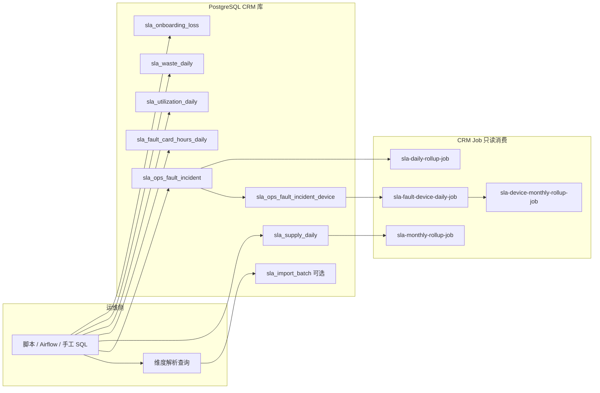
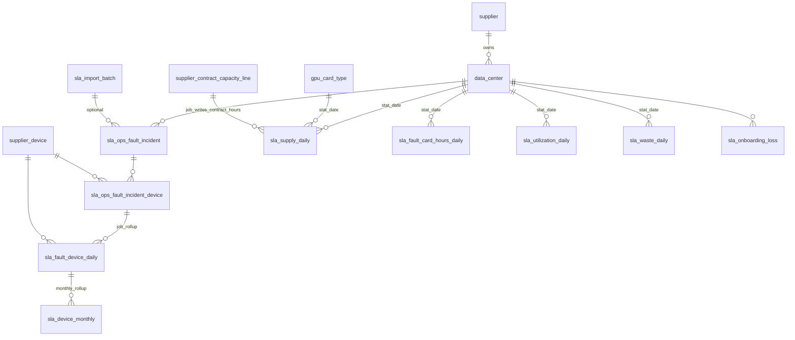

# SLA 运维数据 — 直写数据库实现方案

> **版本**：v1.5（待确认）  
> **日期**：2026-07-16  
> **状态**：**方案设计 — 仅文档，未实施**  
> **父文档**：[datacenter-sla-implementation-design.md](datacenter-sla-implementation-design.md)（完整 SLA 域表结构、口径、月汇总）；**本文 §5** 为运维直写相关表结构专篇。  
> **需求来源**：[requirement.md](requirement.md)  
> **文档性质**：描述运维侧 SLA 指标 **不经 CRM API/Excel**，由运维脚本或 ETL **直接 INSERT/UPSERT PostgreSQL** 的写入规范。  
> **不修改代码**：本文档仅约定写入方式；CRM 读路径与 Job 仍按父文档实施。

---

## 1. 目标与边界

### 1.1 目标

| # | 目标 | 说明 |
|---|------|------|
| G1 | **运维自治写入** | 运维在 T+1（或补录）自行将日指标写入 CRM 库，不依赖 CRM 导入接口 |
| G2 | **表结构对齐** | 写入目标表与本文 §5 **完全一致**，保证后续 SLA 页 / 月报 Job 可消费 |
| G3 | **幂等可重跑** | 同一业务日、同一外部键重复执行 **UPSERT**，不产生重复行 |
| G4 | **维度可解析** | 写入前通过供应域主数据解析 `data_center_id`、`gpu_card_type_id`、`supplier_id`、`supplier_device_id` |
| G5 | **可追溯** | 建议每条写入带 `raw_json`；可选登记 `sla_import_batch` |
| G6 | **设备故障 SLA 真源（P0）** | 运维写入 **`sla_ops_fault_incident_device`** 设备明细；CRM Job 派生 `sla_fault_device_daily` / `sla_device_monthly`（运维 **勿直写**） |

### 1.2 运维写入范围（本专篇）

| 数据集 | 频率 | 目标表 | 运维直写 |
|--------|------|--------|----------|
| 故障事件 + 设备明细 | 日/实时 | `sla_ops_fault_incident`、`sla_ops_fault_incident_device` | ✅ |
| 日供给（总供给、上架损耗卡时） | 日 | `sla_supply_daily` | ✅（`contract_card_hours` **除外**，见 §1.3） |
| 日故障卡时 | 日 | `sla_fault_card_hours_daily` | ✅ |
| 日利用/闲置 | 日 | `sla_utilization_daily` | ✅（`internal_usage_card_hours` 可由中台 Job 后补） |
| 日浪费 | 日 | `sla_waste_daily` | ✅ |
| 上架损耗事件 | 事件 | `sla_onboarding_loss` | ✅ |

### 1.3 非运维写入（勿直写）

| 数据集 | 写入方 | 表 | 原因 |
|--------|--------|-----|------|
| 合同卡时 | CRM Job | `sla_supply_daily.contract_card_hours` | 自 `supplier_contract_capacity_line` 日切计算 |
| 故障日快照 | CRM Job | `sla_ops_fault_daily` | 由 incident 表日切生成 |
| 故障次数日汇总 | CRM Job | `sla_fault_count_daily` | 聚合自 snapshot + incident |
| **设备×日故障 rollup（P0）** | CRM Job | `sla_fault_device_daily` | 自 `sla_ops_fault_incident_device` 日切裁剪 |
| **设备×月 SLA（P0）** | CRM Job | `sla_device_monthly` | 自 `sla_fault_device_daily` 月汇总 |
| 月 SLA 汇总 | CRM Job | `sla_datacenter_card_type_monthly` | Rollup |
| 中台三类 + 产能合同 | Bitable 同步 | `sla_platform_*`、`supplier_contract*` | 见父文档 §4.3 |
| 线下裸金属订单 | CRM 表单 | `offline_bare_metal_order*` | CRM UI |

---

## 2. 架构



**原则**：运维只写 **L1 运维事实表**；L2 汇总由 CRM Job 读取后生成。**P0 单设备故障 SLA** 的真源是 `sla_ops_fault_incident_device`，Job 写入 `sla_fault_device_daily` → `sla_device_monthly`。

---

## 3. 前置条件

### 3.1 数据库与权限

| 项 | 约定 |
|----|------|
| 连接 | 运维只读/读写账号连接 CRM 业务库（与 `DATABASE_URL` 同实例） |
| 权限 | `INSERT` / `UPDATE` / `SELECT` on SLA 运维表 + `SELECT` on `supplier`、`data_center`、`gpu_card_type`、`supplier_device` |
| 禁止 | `DELETE` 生产数据（修正用 UPSERT）；不修改 `supplier_*` 主数据（除只读查询） |
| 时区 | 业务日 = **Asia/Shanghai** 自然日；`timestamptz` 存 UTC，写入时带 offset 或显式 `AT TIME ZONE` |

### 3.2 主键 `id` 生成

| 规则 | 示例 |
|------|------|
| 类型 | `text`，全局唯一 |
| 推荐格式 | `{表前缀}_{uuid}` 或 `{表前缀}_{stat_date}_{dc_code}_{card_code}` |
| 示例 | `sla_fault_inc_550e8400-e29b-41d4-a716-446655440000` |

### 3.3 外部幂等键

| 表 | 幂等键列 | 运维侧建议格式 |
|----|----------|----------------|
| `sla_ops_fault_incident` | `external_fault_id` | 运维工单号或 `OPS-FAULT-{yyyyMMdd}-{seq}` |
| `sla_onboarding_loss` | `external_record_id` | `OPS-ONB-{yyyyMMdd}-{seq}` |
| 日表 | UK 组合键 | `(stat_date, data_center_id, gpu_card_type_id, sla_scope[, impact_side])` |

---

## 4. 维度解析（写入前必查）

写入前将运维报表中的 **机房编码、卡型编码、SN** 解析为 CRM FK。

### 4.1 机房

```sql
-- 按 IDC code（supplier 内唯一）
SELECT dc.id AS data_center_id,
       dc.supplier_id,
       dc.code,
       dc.name
FROM data_center dc
WHERE dc.supplier_id = :supplier_id   -- 可选：已知供应商时缩小范围
  AND dc.code = :idc_code;
```

### 4.2 卡型

```sql
SELECT id AS gpu_card_type_id, code, name, device_role
FROM gpu_card_type
WHERE code = :gpu_card_type_code;
-- device_role = 'infra' 的行 SLA 卡时计 0，一般不应出现在运维 SLA 报表
```

### 4.3 物理机（故障设备关联）

```sql
SELECT id AS supplier_device_id,
       sn,
       data_center_id,
       gpu_card_type_id,
       gpu_count
FROM supplier_device
WHERE sn = :device_sn;
```

### 4.4 供应商（故障事件冗余字段）

```sql
SELECT supplier_id FROM data_center WHERE id = :data_center_id;
```

---

## 5. 数据库表结构

以下 DDL 为 **设计稿**（与父文档 §5 对齐；实施时写入 `sla-schema.ts` + drizzle migration）。  
**运维直写**列在「运维写入」列标注 ✅ / ❌ / Job。

### 5.0 公共枚举

#### 5.0.1 `sla_scope` — 统计范围

| 值 | 中文 | 说明 |
|----|------|------|
| `all` | 全场景合计 | **日汇总默认**；运维一期建议统一写此值 |
| `device_access` | 设备接入 | 供应商侧接入管道 |
| `platform_shelf` | 平台上架 | 平台可见/可售 |
| `service_deploy` | 服务部署 | 弹性部署 / Job 等 |
| `online_bare_metal` | 线上裸金属 | 平台裸金属产品线 |

#### 5.0.2 `impact_side` — 故障影响侧

| 值 | 说明 |
|----|------|
| `external` | 外部（客户侧）故障卡时 |
| `internal` | 内部故障卡时 |

#### 5.0.3 `incident_status` / `device_incident_status`

| 值 | 说明 |
|----|------|
| `ongoing` | 进行中 |
| `resolved` | 已解决 |
| `temporarily_resolved` | 临时解决 |
| `closed` | 已关闭 |

#### 5.0.4 `fault_category`

| 值 | 说明 |
|----|------|
| `network` | 网络 |
| `hardware` | 硬件 |
| `human` | 人为 |

---

### 5.1 维度主数据（只读，写入前解析 FK）

运维 **SELECT**，不 INSERT/UPDATE。完整表结构见供应域 [supplier-database.md](../supplier-database.md)；以下为运维 SLA 写入 **必查字段** 及精简 DDL。

#### 5.1.0 `supplier` — 供应商

| 列名 | 类型 | 运维用法 |
|------|------|----------|
| `id` | text | → 故障事件 `supplier_id`（通常自 `data_center.supplier_id` 冗余） |
| `code` | varchar | 供应商标识，辅助核对 |
| `name` | varchar | 展示 |

#### 5.1.1 `data_center` — 机房

| 列名 | 类型 | 运维用法 |
|------|------|----------|
| `id` | text | → 各 SLA 表 `data_center_id` |
| `supplier_id` | text | → 故障事件 `supplier_id` |
| `code` | varchar | 运维报表「机房编码」匹配键 |
| `name` | varchar | 展示 |

#### 5.1.2 `gpu_card_type` — GPU 卡型

| 列名 | 类型 | 运维用法 |
|------|------|----------|
| `id` | text | → 各 SLA 表 `gpu_card_type_id` |
| `code` | varchar | 运维报表「卡型编码」匹配键 |
| `name` | varchar | 展示 |
| `device_role` | varchar | `infra` 卡型 SLA 卡时计 0，一般不入运维 SLA 报表 |

#### 5.1.3 `supplier_device` — 物理机

| 列名 | 类型 | 运维用法 |
|------|------|----------|
| `id` | text | → 故障设备 `supplier_device_id` |
| `sn` | varchar | 运维报表 SN 匹配键 |
| `data_center_id` | text | 校验冗余 |
| `gpu_card_type_id` | text | 校验冗余 |
| `gpu_count` | integer | 设备卡数 |

#### 5.1.4 维度主数据 DDL（运维关键字段）

> **说明**：四表 **已存在于 CRM 供应域**，运维 **只读**；下列 DDL 仅保留 §4 维度解析与 SLA 写入所需的 **关键列**，便于脚本侧理解表结构，**非**完整生产表定义。

```sql
-- ---------------------------------------------------------------------------
-- supplier — 供应商（关键字段）
-- 运维用法：故障事件冗余 supplier_id 时，可按 id 核对名称
-- ---------------------------------------------------------------------------
CREATE TABLE "supplier" (
	"id" text PRIMARY KEY NOT NULL,
	"code" varchar(64) NOT NULL,
	"name" varchar(255) NOT NULL
);

CREATE UNIQUE INDEX "supplier_code_uk" ON "supplier" USING btree ("code");

-- ---------------------------------------------------------------------------
-- data_center — 机房（关键字段）
-- 运维用法：按 code（+ 可选 supplier_id）解析 → data_center_id、supplier_id
-- ---------------------------------------------------------------------------
CREATE TABLE "data_center" (
	"id" text PRIMARY KEY NOT NULL,
	"supplier_id" text NOT NULL,
	"code" varchar(64) NOT NULL,
	"name" varchar(255) NOT NULL
);

CREATE UNIQUE INDEX "data_center_supplier_code_uk"
	ON "data_center" USING btree ("supplier_id", "code");

ALTER TABLE "data_center"
	ADD CONSTRAINT "data_center_supplier_id_supplier_id_fk"
	FOREIGN KEY ("supplier_id") REFERENCES "public"."supplier"("id")
	ON DELETE restrict ON UPDATE no action;

-- ---------------------------------------------------------------------------
-- gpu_card_type — GPU 卡型（关键字段）
-- 运维用法：按 code 解析 → gpu_card_type_id；device_role=infra 的 SLA 卡时计 0
-- ---------------------------------------------------------------------------
CREATE TABLE "gpu_card_type" (
	"id" text PRIMARY KEY NOT NULL,
	"code" varchar(64) NOT NULL,
	"name" varchar(128) NOT NULL,
	"device_role" varchar(16) DEFAULT 'compute' NOT NULL
);

CREATE UNIQUE INDEX "gpu_card_type_code_uk" ON "gpu_card_type" USING btree ("code");

-- ---------------------------------------------------------------------------
-- supplier_device — 物理机（关键字段）
-- 运维用法：按 sn 解析 → supplier_device_id；并校验 data_center_id / gpu_card_type_id / gpu_count
-- ---------------------------------------------------------------------------
CREATE TABLE "supplier_device" (
	"id" text PRIMARY KEY NOT NULL,
	"sn" varchar(64) NOT NULL,
	"data_center_id" text,
	"gpu_card_type_id" text NOT NULL,
	"gpu_count" integer NOT NULL
);

CREATE UNIQUE INDEX "supplier_device_sn_uk" ON "supplier_device" USING btree ("sn");
CREATE INDEX "supplier_device_data_center_id_idx"
	ON "supplier_device" USING btree ("data_center_id");

ALTER TABLE "supplier_device"
	ADD CONSTRAINT "supplier_device_data_center_id_data_center_id_fk"
	FOREIGN KEY ("data_center_id") REFERENCES "public"."data_center"("id")
	ON DELETE set null ON UPDATE no action;
ALTER TABLE "supplier_device"
	ADD CONSTRAINT "supplier_device_gpu_card_type_id_gpu_card_type_id_fk"
	FOREIGN KEY ("gpu_card_type_id") REFERENCES "public"."gpu_card_type"("id")
	ON DELETE restrict ON UPDATE no action;
```

**维度解析速查**（与 §4 对应）：

| 运维报表字段 | 查询表 | 匹配键 | 得到 |
|-------------|--------|--------|------|
| 机房编码 | `data_center` | `code`（+ 可选 `supplier_id`） | `id` → `data_center_id`；`supplier_id` |
| 卡型编码 | `gpu_card_type` | `code` | `id` → `gpu_card_type_id` |
| 设备 SN | `supplier_device` | `sn` | `id` → `supplier_device_id` |
| 供应商 | `data_center` / `supplier` | 自机房反查 | `supplier_id` |

---

### 5.2 `sla_import_batch` — 导入批次（可选）

登记运维每次直写批次，便于追溯；`import_batch_id` 可空。

| 列名 | 类型 | 约束 | 运维写入 | 说明 |
|------|------|------|----------|------|
| `id` | text | PK | ✅ | 批次 ID |
| `source_system` | varchar(32) | NOT NULL | ✅ | 固定 `ops` |
| `dataset_kind` | varchar(64) | NOT NULL | ✅ | 见 §5.2.1 |
| `stat_date` | date | 可空 | ✅ | 日数据集必填 |
| `sla_month` | varchar(7) | 可空 | 可空 | 月补录 |
| `file_name` | varchar(255) | 可空 | 可空 | 脚本/文件名 |
| `file_uri` | varchar(1024) | 可空 | 可空 | |
| `import_status` | varchar(32) | NOT NULL | ✅ | `committed` |
| `parse_error` | text | 可空 | 可空 | |
| `row_count` | integer | NOT NULL DEFAULT 0 | ✅ | |
| `committed_row_count` | integer | NOT NULL DEFAULT 0 | ✅ | |
| `committed_at` | timestamptz | 可空 | ✅ | |
| `created_by_staff_id` | text | FK→`user_staff` | ❌ | API 场景用 |
| `created_at` / `updated_at` | timestamptz | NOT NULL | ✅ | |

**索引**：`(dataset_kind, stat_date)`、`(import_status, created_at)`

#### 5.2.1 运维 `dataset_kind` 取值

| 值 | 对应目标表 |
|----|------------|
| `ops_fault_incident` | `sla_ops_fault_incident` + `sla_ops_fault_incident_device` |
| `ops_supply_daily` | `sla_supply_daily` |
| `ops_fault_card_hours` | `sla_fault_card_hours_daily` |
| `ops_utilization_daily` | `sla_utilization_daily` |
| `ops_waste_daily` | `sla_waste_daily` |
| `ops_onboarding_loss` | `sla_onboarding_loss` |

---

### 5.3 `sla_ops_fault_incident` — 运维故障事件

事件级真源；一条记录 = 运维侧一个故障事件（`external_fault_id`）。

| 列名 | 类型 | 约束 | 运维写入 | 说明 |
|------|------|------|----------|------|
| `id` | text | PK | ✅ | 全局唯一 |
| `external_fault_id` | varchar(128) | NOT NULL | ✅ | **幂等键**；运维工单号 |
| `import_batch_id` | text | FK→`sla_import_batch` | 可选 | |
| `supplier_id` | text | FK→`supplier`, NOT NULL | ✅ | 冗余自 `data_center` |
| `data_center_id` | text | FK→`data_center`, NOT NULL | ✅ | |
| `gpu_card_type_id` | text | FK→`gpu_card_type`, NOT NULL | ✅ | 事件主卡型 |
| `sla_scope` | varchar(32) | NOT NULL DEFAULT `all` | ✅ | 默认 `all` |
| `scope_label` | varchar(32) | 可空 | 可选 | `datacenter` / `platform` |
| `discovered_at` | timestamptz | NOT NULL | ✅ | 发现时间 |
| `started_at` | timestamptz | NOT NULL | ✅ | 开始时间 |
| `ended_at` | timestamptz | 可空 | ✅ | 结束；NULL=进行中 |
| `incident_status` | varchar(32) | NOT NULL | ✅ | §5.0.3 |
| `parent_external_fault_id` | varchar(128) | 可空 | 可选 | 父故障标识 |
| `parent_incident_id` | text | FK→本表 | ❌ | CRM 解析后回填 |
| `fault_category` | varchar(32) | NOT NULL | ✅ | §5.0.4 |
| `fault_type` | varchar(128) | NOT NULL | ✅ | 运维字典 |
| `fault_operator` | varchar(128) | 可空 | 可选 | 故障运营 |
| `remediation` | text | 可空 | 可选 | 处理措施摘要 |
| `affected_device_count` | integer | NOT NULL DEFAULT 0 | ✅ | = 设备子表行数 |
| `affected_gpu_count` | integer | NOT NULL DEFAULT 0 | ✅ | = SUM(设备.gpu_count) |
| `affected_tenant_ids` | jsonb | NOT NULL DEFAULT `[]` | 可选 | 租户 ID 列表 |
| `affected_order_ids` | jsonb | NOT NULL DEFAULT `[]` | 可选 | 订单 ID 列表 |
| `fault_card_hours` | numeric(15,4) | 可空 | ✅ | 默认 SUM(设备) |
| `fault_machine_hours` | numeric(15,4) | 可空 | ✅ | 默认 SUM(设备) |
| `impact_side` | varchar(16) | NOT NULL DEFAULT `external` | ✅ | §5.0.2 |
| `first_seen_date` | date | NOT NULL | ✅ | 首次入库业务日 |
| `raw_json` | jsonb | 可空 | 建议 | 原始报文 |
| `created_at` / `updated_at` | timestamptz | NOT NULL | ✅ | |

**唯一约束**：`UNIQUE (external_fault_id)`  
**索引**：`(data_center_id, gpu_card_type_id, started_at)`、`(incident_status, ended_at)`、`(first_seen_date, data_center_id)`

---

### 5.4 `sla_ops_fault_incident_device` — 故障 × 设备明细

每台受影响设备一条；**须**在事件之后写入。

| 列名 | 类型 | 约束 | 运维写入 | 说明 |
|------|------|------|----------|------|
| `id` | text | PK | ✅ | |
| `incident_id` | text | FK→`sla_ops_fault_incident`, NOT NULL | ✅ | 父事件 `id` |
| `supplier_device_id` | text | FK→`supplier_device` | 可选 | SN 匹配成功时填 |
| `device_sn` | varchar(64) | NOT NULL | ✅ | **UK 组成部分** |
| `device_asset_no` | varchar(64) | 可空 | 可选 | 资产编号 |
| `data_center_id` | text | FK, NOT NULL | ✅ | 冗余 |
| `gpu_card_type_id` | text | FK, NOT NULL | ✅ | 冗余 |
| `gpu_count` | integer | NOT NULL | ✅ | 该设备 GPU 数 |
| `discovered_at` | timestamptz | NOT NULL | ✅ | |
| `started_at` | timestamptz | NOT NULL | ✅ | |
| `ended_at` | timestamptz | 可空 | ✅ | |
| `device_incident_status` | varchar(32) | NOT NULL | ✅ | §5.0.3 |
| `fault_type` | varchar(128) | 可空 | 可选 | 空则继承事件 |
| `fault_category` | varchar(32) | 可空 | 可选 | |
| `remediation` | text | 可空 | 可选 | |
| `impact_minutes` | integer | 可空 | 可选 | |
| `fault_machine_hours` | numeric(15,4) | NOT NULL DEFAULT 0 | ✅ | |
| `fault_card_hours` | numeric(15,4) | NOT NULL DEFAULT 0 | ✅ | 台时 × gpu_count 或直传 |
| `impact_side` | varchar(16) | NOT NULL DEFAULT `external` | ✅ | |
| `bare_metal_order_id` | text | FK | 可空 | 裸金属场景 |
| `bare_metal_order_device_id` | text | FK | 可空 | |
| `raw_json` | jsonb | 可空 | 建议 | |
| `created_at` / `updated_at` | timestamptz | NOT NULL | ✅ | |

**唯一约束**：`UNIQUE (incident_id, device_sn)`  
**索引**：`(supplier_device_id, started_at)`、`(incident_id)`、`(data_center_id, gpu_card_type_id, started_at)`

#### 5.4.1 设备故障 SLA 对运维的要求（P0）

> 父文档 §5.3.2–§5.3.3、§8.8；决策 **SLA-F3**。

| 项 | 运维责任 |
|----|----------|
| 真源表 | **`sla_ops_fault_incident_device`** — 每台受影响设备 **至少 1 行** |
| 时段字段 | `started_at` / `ended_at` 须准确（`ended_at` NULL = 进行中，Job 截到日末） |
| SN | `device_sn` **必填**；优先匹配 `supplier_device_id` |
| 卡数 | `gpu_count` 必填；用于 `fault_card_hours = 台时 × gpu_count` |
| 影响侧 | `impact_side` 必填（`external` / `internal`）；**设备 SLA 达标仅看 external** |
| 勿直写 | `sla_fault_device_daily`、`sla_device_monthly` — CRM Job 专用 |

**写入后**：触发或等待 `sla-fault-device-daily-job`（`stat_date`）→ `sla-device-monthly-rollup-job`（`sla_month`）。

---

### 5.5 `sla_supply_daily` — 日供给与合同卡时

按 **机房 × 卡型 × 自然日 × sla_scope** 一行。

| 列名 | 类型 | 约束 | 运维写入 | 说明 |
|------|------|------|----------|------|
| `id` | text | PK | ✅ | |
| `stat_date` | date | NOT NULL | ✅ | 业务日 |
| `data_center_id` | text | FK, NOT NULL | ✅ | |
| `gpu_card_type_id` | text | FK, NOT NULL | ✅ | |
| `sla_scope` | varchar(32) | NOT NULL DEFAULT `all` | ✅ | |
| `import_batch_id` | text | FK | 可选 | |
| `total_machine_hours` | numeric(15,4) | NOT NULL | ✅ | 总供给台时 |
| `total_card_hours` | numeric(15,4) | NOT NULL | ✅ | 总供给卡时 |
| `contract_card_hours` | numeric(15,4) | 可空 | ❌ **Job** | 自 `supplier_contract_capacity_line` |
| `onboarding_loss_card_hours` | numeric(15,4) | NOT NULL DEFAULT 0 | ✅ | 当日上架损耗卡时 |
| `contract_source` | varchar(32) | 可空 | ❌ **Job** | `capacity_contract_job` |
| `online_device_count` | integer | 可空 | 可选 | 辅助 |
| `online_gpu_count` | integer | 可空 | 可选 | 辅助 |
| `source` | varchar(32) | NOT NULL DEFAULT `ops_import` | ✅ | 固定 `ops_import` |
| `raw_json` | jsonb | 可空 | 建议 | |
| `created_at` / `updated_at` | timestamptz | NOT NULL | ✅ | |

**唯一约束**：`UNIQUE (stat_date, data_center_id, gpu_card_type_id, sla_scope)`

**供给恒等式**（Job 写 `contract_card_hours` 后校验）：

```text
total_card_hours = contract_card_hours − onboarding_loss_card_hours
```

---

### 5.6 `sla_fault_card_hours_daily` — 日故障卡时

每个 `(stat_date, dc, card, scope, impact_side)` **一行**（internal / external 各一行）。

| 列名 | 类型 | 约束 | 运维写入 | 说明 |
|------|------|------|----------|------|
| `id` | text | PK | ✅ | |
| `stat_date` | date | NOT NULL | ✅ | |
| `data_center_id` | text | FK, NOT NULL | ✅ | |
| `gpu_card_type_id` | text | FK, NOT NULL | ✅ | |
| `sla_scope` | varchar(32) | NOT NULL DEFAULT `all` | ✅ | |
| `impact_side` | varchar(16) | NOT NULL | ✅ | §5.0.2 |
| `import_batch_id` | text | FK | 可选 | |
| `fault_machine_hours` | numeric(15,4) | NOT NULL | ✅ | |
| `fault_card_hours` | numeric(15,4) | NOT NULL | ✅ | |
| `raw_json` | jsonb | 可空 | 建议 | |
| `created_at` / `updated_at` | timestamptz | NOT NULL | ✅ | |

**唯一约束**：`UNIQUE (stat_date, data_center_id, gpu_card_type_id, sla_scope, impact_side)`

---

### 5.7 `sla_utilization_daily` — 日利用与闲置

| 列名 | 类型 | 约束 | 运维写入 | 说明 |
|------|------|------|----------|------|
| `id` | text | PK | ✅ | |
| `stat_date` | date | NOT NULL | ✅ | |
| `data_center_id` | text | FK, NOT NULL | ✅ | |
| `gpu_card_type_id` | text | FK, NOT NULL | ✅ | |
| `sla_scope` | varchar(32) | NOT NULL DEFAULT `all` | ✅ | |
| `import_batch_id` | text | FK | 可选 | |
| `service_deploy_card_hours` | numeric(15,4) | NOT NULL DEFAULT 0 | ✅ | 服务部署消耗 |
| `bare_metal_card_hours` | numeric(15,4) | NOT NULL DEFAULT 0 | ✅ | 裸金属消耗 |
| `actual_usage_card_hours` | numeric(15,4) | NOT NULL | ✅ | = 部署 + 裸金属 |
| `total_supply_card_hours` | numeric(15,4) | NOT NULL | ✅ | 与 supply 表一致 |
| `waste_card_hours` | numeric(15,4) | NOT NULL DEFAULT 0 | ✅ | 与 waste 表一致 |
| `internal_usage_card_hours` | numeric(15,4) | NOT NULL DEFAULT 0 | 默认 0 | 中台 Bitable Job 可后补 |
| `idle_card_hours` | numeric(15,4) | NOT NULL | ✅ | 可导入或计算 |
| `idle_rate` | numeric(8,6) | 可空 | 可选 | idle / total_supply |
| `raw_json` | jsonb | 可空 | 建议 | |
| `created_at` / `updated_at` | timestamptz | NOT NULL | ✅ | |

**唯一约束**：`UNIQUE (stat_date, data_center_id, gpu_card_type_id, sla_scope)`

**口径**：

```text
actual_usage_card_hours = service_deploy_card_hours + bare_metal_card_hours

idle_card_hours =
  total_supply_card_hours
  − actual_usage_card_hours
  − waste_card_hours
  − internal_usage_card_hours
```

---

### 5.8 `sla_waste_daily` — 日浪费

| 列名 | 类型 | 约束 | 运维写入 | 说明 |
|------|------|------|----------|------|
| `id` | text | PK | ✅ | |
| `stat_date` | date | NOT NULL | ✅ | |
| `data_center_id` | text | FK, NOT NULL | ✅ | |
| `gpu_card_type_id` | text | FK, NOT NULL | ✅ | |
| `sla_scope` | varchar(32) | NOT NULL DEFAULT `all` | ✅ | |
| `import_batch_id` | text | FK | 可选 | |
| `waste_machine_hours` | numeric(15,4) | NOT NULL | ✅ | |
| `waste_card_hours` | numeric(15,4) | NOT NULL | ✅ | |
| `waste_rate` | numeric(8,6) | 可空 | 可选 | waste / total_supply |
| `raw_json` | jsonb | 可空 | 建议 | |
| `created_at` / `updated_at` | timestamptz | NOT NULL | ✅ | |

**唯一约束**：`UNIQUE (stat_date, data_center_id, gpu_card_type_id, sla_scope)`

与 `sla_utilization_daily.waste_card_hours` **应一致**。

---

### 5.9 `sla_onboarding_loss` — 上架损耗（事件级）

| 列名 | 类型 | 约束 | 运维写入 | 说明 |
|------|------|------|----------|------|
| `id` | text | PK | ✅ | |
| `external_record_id` | varchar(128) | NOT NULL | ✅ | **幂等键** |
| `import_batch_id` | text | FK | 可选 | |
| `data_center_id` | text | FK, NOT NULL | ✅ | |
| `gpu_card_type_id` | text | FK, NOT NULL | ✅ | |
| `device_count` | integer | NOT NULL | ✅ | |
| `gpu_count` | integer | NOT NULL | ✅ | |
| `ops_received_at` | timestamptz | NOT NULL | ✅ | 运维接收时间 |
| `actual_shelved_at` | timestamptz | NOT NULL | ✅ | 实际上架时间 |
| `loss_hours` | numeric(15,4) | NOT NULL | ✅ | 时长（小时） |
| `loss_card_hours` | numeric(15,4) | NOT NULL | ✅ | loss_hours × gpu_count |
| `supplier_device_ids` | jsonb | NOT NULL DEFAULT `[]` | 建议 | `supplier_device.id` 数组 |
| `raw_json` | jsonb | 可空 | 建议 | |
| `created_at` / `updated_at` | timestamptz | NOT NULL | ✅ | |

**唯一约束**：`UNIQUE (external_record_id)`  
**索引**：`(data_center_id, gpu_card_type_id, ops_received_at)`

---

### 5.10 CRM Job 表（运维勿写，供理解下游）

| 表 | 写入方 | 说明 |
|----|--------|------|
| `sla_ops_fault_daily` | CRM 日切 Job | 新增/遗留故障快照 |
| `sla_fault_count_daily` | CRM 日切 Job | 故障次数日汇总 |
| **`sla_fault_device_daily`（P0）** | **`sla-fault-device-daily-job`** | 设备×日故障 rollup |
| **`sla_device_monthly`（P0）** | **`sla-device-monthly-rollup-job`** | 设备×月故障 SLA |
| `sla_datacenter_card_type_monthly` | CRM 月切 Job | 机房×卡型月 SLA 汇总 |

Job 自运维 L1 表 **只读** 消费；运维直写完成后触发或等待 Cron 执行。

---

### 5.11 ER 关系（运维域）



---

### 5.12 表清单速查

| 表名 | 粒度 | 运维 | 幂等键 |
|------|------|------|--------|
| `sla_import_batch` | 批次 | 可选 | `id` |
| `sla_ops_fault_incident` | 事件 | ✅ | `external_fault_id` |
| `sla_ops_fault_incident_device` | 事件×设备 | ✅ | `(incident_id, device_sn)` |
| `sla_supply_daily` | 日×机房×卡型 | ✅（部分列） | `(stat_date, data_center_id, gpu_card_type_id, sla_scope)` |
| `sla_fault_card_hours_daily` | 日×机房×卡型×侧 | ✅ | + `impact_side` |
| `sla_utilization_daily` | 日×机房×卡型 | ✅ | `(stat_date, data_center_id, gpu_card_type_id, sla_scope)` |
| `sla_waste_daily` | 日×机房×卡型 | ✅ | 同上 |
| `sla_onboarding_loss` | 事件 | ✅ | `external_record_id` |
| **`sla_fault_device_daily`（P0）** | **设备×日** | ❌ Job | `(stat_date, device_sn, impact_side)` |
| **`sla_device_monthly`（P0）** | **设备×月** | ❌ Job | `(sla_month, device_sn)` |

---

### 5.13 DDL 建表语句（PostgreSQL）

> **说明**  
> - 以下 DDL 与 §5.2–§5.9 列定义、唯一约束、索引 **一一对应**；实施时写入 `sla-schema.ts` + Drizzle migration。  
> - §5.1 维度主数据（`supplier`、`data_center`、`gpu_card_type`、`supplier_device`）**已存在于供应域**，运维只读；精简 DDL 见 **§5.1.4**。  
> - §5.10 CRM Job 表一并给出，供理解下游；**运维勿写**。  
> - 枚举列（`sla_scope`、`impact_side`、`incident_status` 等）以 `varchar` 存储，取值见 §5.0；未加 `CHECK` 以便后续扩展。  
> - 外键 `ON DELETE`：`restrict` 保护主数据与事件真源；可空批次 FK 用 `set null`。  
> - **权威 DDL 文件**：[`sla-ops-direct-db-write-schema.sql`](sla-ops-direct-db-write-schema.sql)（含各字段 `COMMENT ON` 中文注释；**仅含 13 张 SLA 表**，外键只约束 SLA 域内部，供应域 FK 见 SQL 附录/Drizzle migration）。

#### 5.13.1 运维直写表

完整 DDL（含 **`COMMENT ON`** 字段中文注释、索引与外键）见独立 SQL 文件：

**[`sla-ops-direct-db-write-schema.sql`](sla-ops-direct-db-write-schema.sql)**

| 部分 | 表 |
|------|-----|
| 第一部分 | `sla_import_batch`、`sla_ops_fault_incident`、`sla_ops_fault_incident_device`、**`sla_supply_daily`**、`sla_fault_card_hours_daily`、`sla_utilization_daily`、`sla_waste_daily`、`sla_onboarding_loss` |

> 注释方式：`COMMENT ON TABLE` / `COMMENT ON COLUMN`；在 psql 中执行 `\d+ 表名` 或于 pgAdmin 查看中文说明。

#### 5.13.2 CRM Job 下游表（运维勿写）

见同一 SQL 文件 **第二部分**。

| 表 | 写入方 |
|----|--------|
| `sla_ops_fault_daily` | CRM 日切 Job |
| `sla_fault_count_daily` | CRM 日切 Job |
| `sla_fault_device_daily`（P0） | `sla-fault-device-daily-job` |
| `sla_device_monthly`（P0） | `sla-device-monthly-rollup-job` |
| `sla_datacenter_card_type_monthly` | CRM 月切 Job |

> 完整列定义见父文档 [datacenter-sla-implementation-design.md](datacenter-sla-implementation-design.md) §5.3、§5.3.1、§5.3.2–§5.3.3、§5.12。

#### 5.13.3 建表顺序建议

| 顺序 | 表 | 依赖 |
|------|-----|------|
| 1 | `sla_import_batch` | `user_staff`（已存在） |
| 2 | `sla_ops_fault_incident` | `sla_import_batch`、`supplier`、`data_center`、`gpu_card_type` |
| 3 | `sla_ops_fault_incident_device` | `sla_ops_fault_incident`、`supplier_device`、`bare_metal_order*` |
| 4 | `sla_supply_daily` / `sla_fault_card_hours_daily` / `sla_utilization_daily` / `sla_waste_daily` / `sla_onboarding_loss` | `sla_import_batch`、`data_center`、`gpu_card_type` |
| 5 | `sla_ops_fault_daily` / `sla_fault_count_daily` / **`sla_fault_device_daily`（P0）** | `sla_ops_fault_incident` + **`sla_ops_fault_incident_device`**（Job 写入） |
| 6 | **`sla_device_monthly`（P0）** | `sla_fault_device_daily`（Job 写入） |
| 7 | `sla_datacenter_card_type_monthly` | 日表 rollup（Job 写入） |

---

## 6. 写入顺序与事务

### 6.1 单日批处理推荐顺序

同一 `stat_date = D` 建议 **单事务** 提交，顺序如下：

| 步骤 | 表 | 说明 |
|------|-----|------|
| 0 | `sla_import_batch`（可选） | 登记本批 `dataset_kind`、`stat_date` |
| 1 | `sla_onboarding_loss` | 事件级；更新当日 `onboarding_loss_card_hours` 前先写入 |
| 2 | `sla_ops_fault_incident` | 故障事件 |
| 3 | `sla_ops_fault_incident_device` | 设备明细（依赖 incident.id） |
| 4 | `sla_supply_daily` | 含 `total_*`、`onboarding_loss_card_hours` |
| 5 | `sla_fault_card_hours_daily` | internal / external 各一行 |
| 6 | `sla_waste_daily` | |
| 7 | `sla_utilization_daily` | 最后写；`total_supply_card_hours` 与 supply 表一致 |

**勿写**：`sla_ops_fault_daily`、`sla_fault_count_daily`、**`sla_fault_device_daily`、`sla_device_monthly`（P0，CRM Job）**。

运维写入完成后，须触发或等待：

| Job | 输入 | 输出 |
|-----|------|------|
| `sla-daily-rollup-job` | incident 表 | `sla_ops_fault_daily`、`sla_fault_count_daily` |
| **`sla-fault-device-daily-job`（P0）** | **`sla_ops_fault_incident_device`** | **`sla_fault_device_daily`** |
| **`sla-device-monthly-rollup-job`（P0）** | `sla_fault_device_daily` | **`sla_device_monthly`** |

修正 `incident_device` 后须 **重跑** 对应 `stat_date` 的设备日 Job 及所在 `sla_month` 的设备月 Job。

### 6.2 可选批次表

```sql
INSERT INTO sla_import_batch (
  id, source_system, dataset_kind, stat_date,
  import_status, row_count, committed_row_count, committed_at,
  created_at, updated_at
) VALUES (
  :batch_id,
  'ops',
  'ops_supply_daily',  -- 或 ops_fault_incident 等
  :stat_date,
  'committed',
  :row_count,
  :row_count,
  now(),
  now(),
  now()
);
```

子表 `import_batch_id` 可指向该批次；**允许 NULL**（无批次追溯时）。

---

## 7. 分表写入规范

以下 SQL 为 **模板**；`:param` 为绑定变量。冲突策略均为 **UPSERT**。

### 7.1 故障事件 `sla_ops_fault_incident`

**先写事件，再写设备。**

```sql
INSERT INTO sla_ops_fault_incident (
  id, external_fault_id, import_batch_id,
  supplier_id, data_center_id, gpu_card_type_id,
  sla_scope, scope_label,
  discovered_at, started_at, ended_at,
  incident_status, parent_external_fault_id, parent_incident_id,
  fault_category, fault_type, fault_operator, remediation,
  affected_device_count, affected_gpu_count,
  affected_tenant_ids, affected_order_ids,
  fault_card_hours, fault_machine_hours, impact_side,
  first_seen_date, raw_json,
  created_at, updated_at
) VALUES (
  :id, :external_fault_id, :import_batch_id,
  :supplier_id, :data_center_id, :gpu_card_type_id,
  'all', :scope_label,
  :discovered_at, :started_at, :ended_at,
  :incident_status, :parent_external_fault_id, NULL,
  :fault_category, :fault_type, :fault_operator, :remediation,
  :affected_device_count, :affected_gpu_count,
  '[]'::jsonb, '[]'::jsonb,
  :fault_card_hours, :fault_machine_hours, :impact_side,
  :first_seen_date, :raw_json::jsonb,
  now(), now()
)
ON CONFLICT (external_fault_id) DO UPDATE SET
  incident_status = EXCLUDED.incident_status,
  ended_at = EXCLUDED.ended_at,
  affected_device_count = EXCLUDED.affected_device_count,
  affected_gpu_count = EXCLUDED.affected_gpu_count,
  fault_card_hours = EXCLUDED.fault_card_hours,
  fault_machine_hours = EXCLUDED.fault_machine_hours,
  remediation = EXCLUDED.remediation,
  raw_json = EXCLUDED.raw_json,
  updated_at = now();
```

| 字段 | 枚举 / 约束 |
|------|-------------|
| `incident_status` | `ongoing` / `resolved` / `temporarily_resolved` / `closed` |
| `fault_category` | `network` / `hardware` / `human` |
| `impact_side` | `internal` / `external` |
| `first_seen_date` | 首次入库业务日；**新增故障**判定时 = 首次出现日 |
| `scope_label` | `datacenter` / `platform`，可 NULL |

### 7.2 故障设备 `sla_ops_fault_incident_device`

```sql
INSERT INTO sla_ops_fault_incident_device (
  id, incident_id, supplier_device_id,
  device_sn, device_asset_no,
  data_center_id, gpu_card_type_id, gpu_count,
  discovered_at, started_at, ended_at,
  device_incident_status, fault_type, fault_category, remediation,
  impact_minutes, fault_machine_hours, fault_card_hours, impact_side,
  bare_metal_order_id, bare_metal_order_device_id,
  raw_json, created_at, updated_at
) VALUES ( ... )
ON CONFLICT (incident_id, device_sn) DO UPDATE SET
  ended_at = EXCLUDED.ended_at,
  device_incident_status = EXCLUDED.device_incident_status,
  fault_card_hours = EXCLUDED.fault_card_hours,
  fault_machine_hours = EXCLUDED.fault_machine_hours,
  supplier_device_id = COALESCE(EXCLUDED.supplier_device_id, sla_ops_fault_incident_device.supplier_device_id),
  updated_at = now();
```

**校验**（脚本内自行 assert，DB 不强制）：

- 每个 `incident_id` 至少 1 行设备  
- `affected_device_count` = 该 incident 设备行数  
- `affected_gpu_count` = SUM(`gpu_count`)  
- `fault_card_hours`（事件）≈ SUM(设备.`fault_card_hours`)，误差 ≤ 0.01  

### 7.3 日供给 `sla_supply_daily`

```sql
INSERT INTO sla_supply_daily (
  id, stat_date, data_center_id, gpu_card_type_id, sla_scope,
  import_batch_id,
  total_machine_hours, total_card_hours,
  contract_card_hours, onboarding_loss_card_hours,
  contract_source, online_device_count, online_gpu_count,
  source, raw_json, created_at, updated_at
) VALUES (
  :id, :stat_date, :data_center_id, :gpu_card_type_id, 'all',
  :import_batch_id,
  :total_machine_hours, :total_card_hours,
  NULL,  -- 合同卡时由 Job 回填；勿运维直写
  :onboarding_loss_card_hours,
  NULL,
  :online_device_count, :online_gpu_count,
  'ops_import', :raw_json::jsonb, now(), now()
)
ON CONFLICT (stat_date, data_center_id, gpu_card_type_id, sla_scope) DO UPDATE SET
  total_machine_hours = EXCLUDED.total_machine_hours,
  total_card_hours = EXCLUDED.total_card_hours,
  onboarding_loss_card_hours = EXCLUDED.onboarding_loss_card_hours,
  online_device_count = EXCLUDED.online_device_count,
  online_gpu_count = EXCLUDED.online_gpu_count,
  raw_json = EXCLUDED.raw_json,
  updated_at = now();
```

**供给恒等式**（写入后自检，父文档 §8.1）：

```text
total_card_hours ≈ contract_card_hours − onboarding_loss_card_hours
```

- 运维写入 **`total_card_hours`** 与 **`onboarding_loss_card_hours`**  
- **`contract_card_hours`** 由 CRM Job 自 `supplier_contract_capacity_line` 写入后再对齐  
- 若 Job 尚未跑，可先只写 `total_card_hours`；Job 跑完后再校验三者关系  

**`onboarding_loss_card_hours` 汇总**（可选，由事件表聚合）：

```sql
SELECT COALESCE(SUM(loss_card_hours), 0)
FROM sla_onboarding_loss
WHERE data_center_id = :data_center_id
  AND gpu_card_type_id = :gpu_card_type_id
  AND ops_received_at::date = :stat_date;
```

### 7.4 日故障卡时 `sla_fault_card_hours_daily`

每个 `(stat_date, dc, card, scope, impact_side)` 一行。

```sql
INSERT INTO sla_fault_card_hours_daily (
  id, stat_date, data_center_id, gpu_card_type_id, sla_scope,
  impact_side, import_batch_id,
  fault_machine_hours, fault_card_hours,
  raw_json, created_at, updated_at
) VALUES ( ... )
ON CONFLICT (stat_date, data_center_id, gpu_card_type_id, sla_scope, impact_side)
DO UPDATE SET
  fault_machine_hours = EXCLUDED.fault_machine_hours,
  fault_card_hours = EXCLUDED.fault_card_hours,
  updated_at = now();
```

### 7.5 日浪费 `sla_waste_daily`

```sql
INSERT INTO sla_waste_daily ( ... )
ON CONFLICT (stat_date, data_center_id, gpu_card_type_id, sla_scope)
DO UPDATE SET
  waste_machine_hours = EXCLUDED.waste_machine_hours,
  waste_card_hours = EXCLUDED.waste_card_hours,
  waste_rate = EXCLUDED.waste_rate,
  updated_at = now();
```

`waste_rate = waste_card_hours / NULLIF(total_supply_card_hours, 0)`，supply 取自同日 `sla_supply_daily.total_card_hours`。

### 7.6 日利用/闲置 `sla_utilization_daily`

```sql
INSERT INTO sla_utilization_daily (
  id, stat_date, data_center_id, gpu_card_type_id, sla_scope,
  import_batch_id,
  service_deploy_card_hours, bare_metal_card_hours, actual_usage_card_hours,
  total_supply_card_hours, waste_card_hours, internal_usage_card_hours,
  idle_card_hours, idle_rate,
  raw_json, created_at, updated_at
) VALUES ( ... )
ON CONFLICT (stat_date, data_center_id, gpu_card_type_id, sla_scope)
DO UPDATE SET
  service_deploy_card_hours = EXCLUDED.service_deploy_card_hours,
  bare_metal_card_hours = EXCLUDED.bare_metal_card_hours,
  actual_usage_card_hours = EXCLUDED.actual_usage_card_hours,
  total_supply_card_hours = EXCLUDED.total_supply_card_hours,
  waste_card_hours = EXCLUDED.waste_card_hours,
  internal_usage_card_hours = EXCLUDED.internal_usage_card_hours,
  idle_card_hours = EXCLUDED.idle_card_hours,
  idle_rate = EXCLUDED.idle_rate,
  updated_at = now();
```

**恒等式**（§5.7）：

```text
actual_usage_card_hours = service_deploy_card_hours + bare_metal_card_hours

idle_card_hours =
  total_supply_card_hours
  − actual_usage_card_hours
  − waste_card_hours
  − internal_usage_card_hours
```

`internal_usage_card_hours` 默认 `0`；中台 Bitable 同步后由 CRM 更新 utilization 行（或运维补写 UPSERT）。

### 7.7 上架损耗 `sla_onboarding_loss`

```sql
INSERT INTO sla_onboarding_loss (
  id, external_record_id, import_batch_id,
  data_center_id, gpu_card_type_id,
  device_count, gpu_count,
  ops_received_at, actual_shelved_at,
  loss_hours, loss_card_hours,
  supplier_device_ids, raw_json,
  created_at, updated_at
) VALUES (
  :id, :external_record_id, :import_batch_id,
  :data_center_id, :gpu_card_type_id,
  :device_count, :gpu_count,
  :ops_received_at, :actual_shelved_at,
  EXTRACT(EPOCH FROM (:actual_shelved_at - :ops_received_at)) / 3600.0,
  (EXTRACT(EPOCH FROM (:actual_shelved_at - :ops_received_at)) / 3600.0) * :gpu_count,
  :supplier_device_ids::jsonb,
  :raw_json::jsonb,
  now(), now()
)
ON CONFLICT (external_record_id) DO UPDATE SET
  actual_shelved_at = EXCLUDED.actual_shelved_at,
  loss_hours = EXCLUDED.loss_hours,
  loss_card_hours = EXCLUDED.loss_card_hours,
  supplier_device_ids = EXCLUDED.supplier_device_ids,
  updated_at = now();
```

`supplier_device_ids` 示例：`'["dev_abc","dev_def"]'::jsonb`，由 SN 查 `supplier_device.id` 得到。

---

## 8. 日批作业 SOP（T+1）

| 序号 | 动作 | 负责 |
|------|------|------|
| 1 | 确认 `stat_date = D`（东八区昨日） | 运维 |
| 2 | 导出/生成当日报表（机房×卡型） | 运维 |
| 3 | 跑维度解析，失败行记录日志 | 脚本 |
| 4 | 事务写入 §6.1 顺序各表 | 脚本 |
| 5 | 跑 §9 自检 SQL | 脚本 |
| 6 | 通知 CRM 触发日切 Job（或等待 Cron） | 运维/平台 |
| 7 | Job 完成后 spot-check 月报可用率 | 运维/商务 |
| 8 | **（P0）** 确认 `sla-fault-device-daily-job` 已跑；spot-check 单设备 `device_availability_rate` | 运维/平台 |

**补录**：对历史 `stat_date` 重复步骤 3–5，UPSERT 覆盖；Job 需 **重跑** 对应日的 snapshot、**设备日 rollup** 与月汇总。

---

## 9. 写入后自检 SQL

### 9.1 供给恒等式（Job 写 contract 后）

```sql
SELECT s.stat_date, dc.code, gct.code,
       s.contract_card_hours,
       s.onboarding_loss_card_hours,
       s.total_card_hours,
       s.contract_card_hours - s.onboarding_loss_card_hours AS expected_total,
       s.total_card_hours - (s.contract_card_hours - s.onboarding_loss_card_hours) AS diff
FROM sla_supply_daily s
JOIN data_center dc ON dc.id = s.data_center_id
JOIN gpu_card_type gct ON gct.id = s.gpu_card_type_id
WHERE s.stat_date = :stat_date
  AND s.contract_card_hours IS NOT NULL
  AND abs(s.total_card_hours - (s.contract_card_hours - s.onboarding_loss_card_hours)) > 0.01;
-- 期望 0 行
```

### 9.2 闲置恒等式

```sql
SELECT stat_date, data_center_id, gpu_card_type_id,
       idle_card_hours,
       total_supply_card_hours - actual_usage_card_hours - waste_card_hours - internal_usage_card_hours AS expected_idle
FROM sla_utilization_daily
WHERE stat_date = :stat_date
  AND abs(idle_card_hours - (total_supply_card_hours - actual_usage_card_hours - waste_card_hours - internal_usage_card_hours)) > 0.01;
```

### 9.3 浪费双表一致

```sql
SELECT u.stat_date, u.data_center_id, u.gpu_card_type_id,
       u.waste_card_hours AS util_waste,
       w.waste_card_hours AS waste_table
FROM sla_utilization_daily u
JOIN sla_waste_daily w USING (stat_date, data_center_id, gpu_card_type_id, sla_scope)
WHERE u.stat_date = :stat_date
  AND u.sla_scope = 'all'
  AND abs(u.waste_card_hours - w.waste_card_hours) > 0.01;
```

### 9.4 故障设备完整性

```sql
SELECT i.external_fault_id,
       i.affected_device_count,
       COUNT(d.id) AS device_rows,
       i.affected_gpu_count,
       COALESCE(SUM(d.gpu_count), 0) AS sum_gpu
FROM sla_ops_fault_incident i
LEFT JOIN sla_ops_fault_incident_device d ON d.incident_id = i.id
WHERE i.first_seen_date = :stat_date
GROUP BY i.id, i.external_fault_id, i.affected_device_count, i.affected_gpu_count
HAVING i.affected_device_count <> COUNT(d.id)
    OR i.affected_gpu_count <> COALESCE(SUM(d.gpu_count), 0);
```

### 9.5 设备故障卡时 vs 机房×卡型日表（P0，Job 跑完后）

```sql
-- 设备 rollup 之和 vs 运维推送的机房×卡型故障卡时（external）
SELECT f.stat_date, f.data_center_id, f.gpu_card_type_id,
       SUM(f.fault_card_hours) AS device_sum_external,
       d.fault_card_hours AS dc_card_external,
       SUM(f.fault_card_hours) - d.fault_card_hours AS diff
FROM sla_fault_device_daily f
JOIN sla_fault_card_hours_daily d
  ON d.stat_date = f.stat_date
 AND d.data_center_id = f.data_center_id
 AND d.gpu_card_type_id = f.gpu_card_type_id
 AND d.sla_scope = 'all'
 AND d.impact_side = 'external'
WHERE f.stat_date = :stat_date
  AND f.impact_side = 'external'
GROUP BY f.stat_date, f.data_center_id, f.gpu_card_type_id, d.fault_card_hours
HAVING abs(SUM(f.fault_card_hours) - d.fault_card_hours) > 0.01;
-- 期望 0 行；非 0 时查 SN 未匹配、时段裁剪、impact_side 不一致
```

### 9.6 单设备 SLA 恒等式（P0，供给口径）

```sql
SELECT stat_date, device_sn,
       device_sla_rate,
       (supply_card_hours - fault_card_hours) / NULLIF(supply_card_hours, 0) AS expected_rate
FROM sla_fault_device_daily
WHERE stat_date = :stat_date
  AND impact_side = 'external'
  AND device_sla_rate IS NOT NULL
  AND abs(device_sla_rate - (supply_card_hours - fault_card_hours) / NULLIF(supply_card_hours, 0)) > 0.000001;
-- 期望 0 行
```

---

## 10. 修正与删除策略

| 场景 | 做法 |
|------|------|
| 数值填错 | 同 UK / `external_*_id` **UPSERT** 覆盖 |
| 重复导入 | UPSERT，不产生新行 |
| 错误故障事件 | 更新 `incident_status=closed` + `ended_at`；**不物理 DELETE** |
| 错误设备行 | UPSERT 修正；极端情况联系 DBA 按 incident 删除 device 行（非标准流程） |
| 整日重导 | 事务内 UPSERT 当日所有机房×卡型行 |
| **修正设备故障时段（P0）** | UPSERT `sla_ops_fault_incident_device` → **重跑** `sla-fault-device-daily-job(stat_date)` + `sla-device-monthly-rollup-job(sla_month)` |

---

## 11. 运维报表 → 表字段映射（摘要）

### 11.1 日汇总行（每机房×卡型×日一行）

| 运维报表列 | 目标表.列 |
|------------|-----------|
| 日期 | `stat_date` |
| 机房 | → `data_center_id` |
| 卡型 | → `gpu_card_type_id` |
| 总供给台时/卡时 | `sla_supply_daily.total_*` |
| 上架损耗卡时 | `sla_supply_daily.onboarding_loss_card_hours` |
| 外部/内部故障卡时 | `sla_fault_card_hours_daily`（分 `impact_side` 两行） |
| 服务部署卡时 | `sla_utilization_daily.service_deploy_card_hours` |
| 裸金属卡时 | `sla_utilization_daily.bare_metal_card_hours` |
| 浪费台时/卡时 | `sla_waste_daily` + `sla_utilization_daily.waste_card_hours` |
| 闲置卡时 | `sla_utilization_daily.idle_card_hours` |

### 11.2 故障明细（事件 + 设备）

| 运维报表列 | 事件表 | 设备表 |
|------------|--------|--------|
| 故障 ID | `external_fault_id` | — |
| 发现/开始/结束时间 | `discovered_at` / `started_at` / `ended_at` | 同名列（设备级） |
| 状态 | `incident_status` | `device_incident_status` |
| 父故障 ID | `parent_external_fault_id` | — |
| 类别/类型/运营/措施 | `fault_category` 等 | 可覆盖 |
| SN | — | `device_sn` → `supplier_device_id` |
| 影响侧（内部/外部） | `impact_side`（事件级默认） | **`impact_side`（设备级，P0 SLA 按 external 计）** |
| 影响租户/订单 | `affected_tenant_ids` / `affected_order_ids` jsonb | — |

---

## 12. 与父文档路径对照

| 父文档路径 | 本专篇替代 |
|------------|------------|
| §6.1 运维日批 API | **运维脚本直写 PG** |
| `sla.import.previewOpsDaily` / `commitOpsDaily` | 不实施（或二期只读校验接口） |
| Excel 模板导入 | 运维自有报表 → SQL UPSERT |

中台 Bitable、CRM 表单、合同卡时 Job、月汇总 Job **不变**，见父文档。  
**P0 新增**：父文档 §5.3.2–§5.3.3（设备 SLA 表）、§8.8（设备可用率公式）、§6.4.1（`sla-fault-device-daily-job`）。

---

## 13. 实施清单（运维侧）

| 项 | 交付物 |
|----|--------|
| 1 | 维度解析视图或 SQL 片段（§4） |
| 2 | 按日 UPSERT 脚本（Python/psql/ Airflow DAG） |
| 3 | 自检 SQL（§9）纳入 CI 或跑批末尾 |
| 4 | 运维报表模板与 §11 字段映射说明 |
| 5 | 补录与重跑 SOP（§8、§10） |
| 6 | DB 只读账号给商务验收查询 |

---

## 14. 开放问题

| # | 问题 | 影响 |
|---|------|------|
| Q1 | 运维是否统一写 `sla_scope=all`，还是分场景多行 | UK 与报表粒度 |
| Q2 | `import_batch_id` 是否强制 | 追溯粒度 |
| Q3 | 合同卡时 Job 与运维写 supply 的先后顺序 | §9.1 自检时机 |
| Q4 | 故障关闭是否由运维 UPDATE incident，还是仅 INSERT 新状态行 | 仅 UPSERT 一种行 |
| Q5 | P0 设备 SLA 是否与机房×卡型故障卡时强制对账一致 | §9.5；建议 warning 不阻断 |

---

## 15. 变更记录

| 版本 | 日期 | 说明 |
|------|------|------|
| v1.5 | 2026-07-17 | §5.13 DDL 迁移至 [`sla-ops-direct-db-write-schema.sql`](sla-ops-direct-db-write-schema.sql)，各字段增加 `COMMENT ON` 中文注释（含 `sla_supply_daily`） |
| v1.4 | 2026-07-17 | **P0 单设备故障 SLA**：G6、§1.3/§2 架构、§5.4.1 运维要求、§5.10–§5.12、§6/§8/§9/§10/§11/§14 同步 |
| v1.3 | 2026-07-17 | 新增 §5.1.0 供应商说明、§5.1.4 维度主数据精简 DDL（运维关键字段） |
| v1.2 | 2026-07-17 | 新增 §5.13 PostgreSQL DDL 建表语句（运维直写表 + CRM Job 下游表） |
| v1.1 | 2026-07-16 | 新增 §5 数据库表结构（列定义、约束、运维写入标注、ER、速查） |
| v1.0 | 2026-07-16 | 初稿：运维直写 PG 专篇，对齐父文档 v1.3 表结构与口径 |
