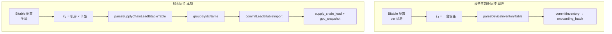
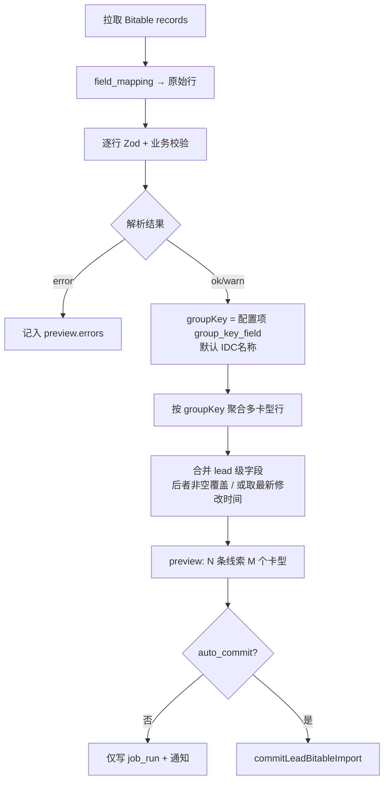
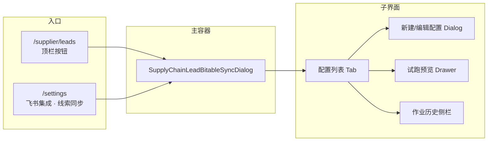
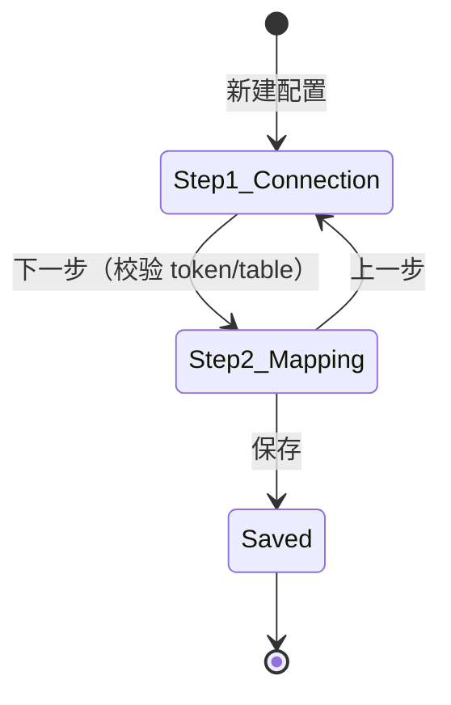
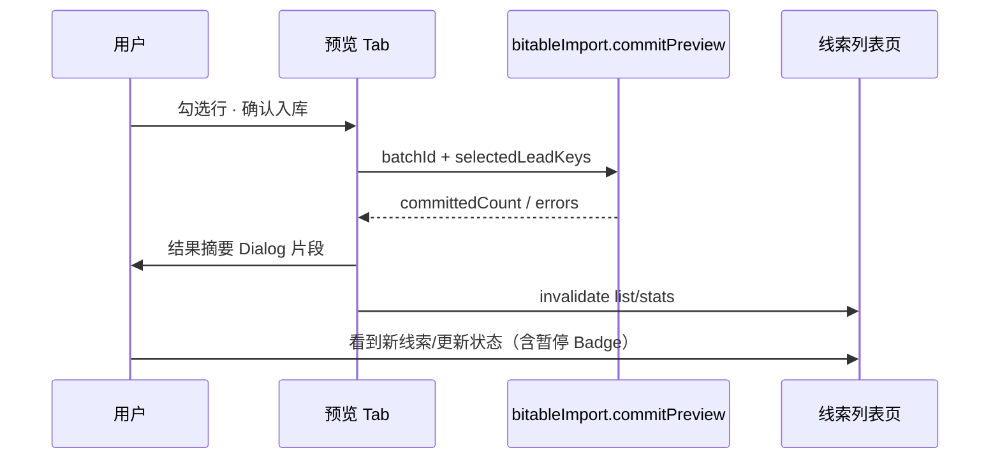
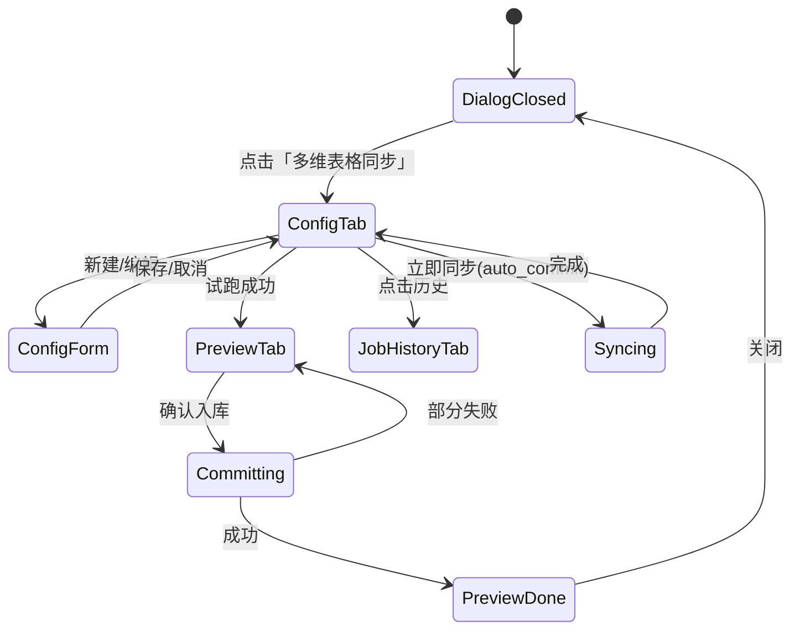

# 供应链线索 — 飞书多维表格导入实现方案

> **部分失效（2026-10-06）**：流程图中 **设备侧 `commitInventory` 分支已下线**（整条 Excel 设备导入链删除）；本文主体（线索 Bitable 导入）仍有效，实现于 `run-lead-bitable-sync.ts`。

> **版本**：v1.1（UED 已确认）  
> **日期**：2026-06-26  
> **状态**：**已实施（P1）** — 配置表、试跑预览、`commitPreview`、Cron 与设备 Bitable 同步体验对齐（2026-07）  
> **页面入口**：`/supplier/leads`（`supply-chain-leads-content.tsx`）  
> **参考实现**：原机房详情页「设备主数据同步」（`FeishuBitableSyncPanel` + `run-bitable-sync.ts`）— **该组件与设备 Bitable 同步已于 2026-10-06 下线**；本文实际复用的是 `run-lead-bitable-sync.ts` 与 `register-feishu-bitable-sync-cron.ts`（均存活）

**关联文档**：

- [supply-chain-leads-design.md](supply-chain-leads-design.md)（线索领域模型、tRPC、表结构）
- [feishu-integration-design.md](feishu-integration-design.md) §7（Bitable → Excel 导入流水线）
- [opportunity-import-design.md](opportunity-import-design.md)（宽表白名单、预览 → commit 两步流）
- [supplier-device-import-schema.md](supplier-device-import-schema.md)（设备导入批次语义）

**文档性质**：本文 **不修改代码**，描述从运营侧飞书多维表格同步供应链线索的完整方案，供评审与排期。

---

## 1. 背景与目标

### 1.1 业务背景

运营团队在飞书多维表格中维护机房资源线索，典型列如下（用户提供样例行）：

| IDC名称 | 卡型 | 总数 | 闲置数量 | 分组标识 | 算力描述 | 资源商务对接负责人 | 进度更新 | 进度 | 项目所处阶段 | 项目状态 | 对接范围 | 开始支持日期 | 技术支持 |
|---------|------|------|----------|----------|----------|-------------------|----------|------|--------------|----------|----------|--------------|----------|
| 浙江炽橙 | A100 | （空） | 0 | 浙江炽橙 | A100，但目前没有闲置 | 李梓楠 | 0303：IDC反馈目前没有闲置 | 0% | 线索跟踪 | 暂停 | Spot+裸金属 | 2025/02/25 | （空） |

当前 CRM 供应链线索页（`supply-chain-leads-content.tsx`）仅支持手工「登记供应商 / 登记机房」，无法从上述在线表格批量同步，导致：

- 运营在飞书与 CRM 双写，数据易漂移  
- 卡型库存、进度更新、对接人变更无法自动落库  
- 与机房管理侧已落地的「设备主数据多维表格同步」体验不一致  

### 1.2 目标（G1–G6）

| # | 目标 | 说明 |
|---|------|------|
| G1 | **在线同步** | 从飞书 Bitable 拉取记录，映射为线索 + 卡型快照，支持定时与手动触发 |
| G2 | **复用设备同步架构** | 字段映射、试跑预览、增量游标、`auto_commit`、作业审计与现有 `feishu_bitable_sync` 流水线对齐 |
| G3 | **宽表兼容** | Bitable 可含运营自定义列；解析器按白名单读取，多余列静默忽略 |
| G4 | **行粒度归并** | 表格 **一行 = 一个机房 × 一种卡型**；入库前按机房归并为一条线索 + 多条 GPU 快照 |
| G5 | **可预览、可部分成功** | 默认 `auto_commit=false` 试跑；手动确认后 commit；单行解析失败不阻断其它行（可配置） |
| G6 | **列表页入口** | 在 `supply-chain-leads-content.tsx` 顶栏增加「多维表格同步」，配置与历史作业可管理 |

### 1.3 非目标（本期）

- **不** 替代转正后的 `supplier_gpu_inventory` 主数据真值  
- **不** 从多维表格直接创建正式 `supplier` / `data_center`（仅写线索域）  
- **不** 实现双向同步（CRM → 飞书）  
- **不** 在本期支持供应商类型线索（`type=supplier`）的 Bitable 同步；默认 `type=datacenter`  
- ~~**不** 在本期改造既有 `feishu_bitable_sync_config` 中 `device_*` 同步行为~~（**该表与设备同步已于 2026-10-06 下线**）  

---

## 2. 与设备主数据同步的对照

### 2.1 可复用组件

| 层级 | 设备主数据同步（现网） | 线索同步（本期） |
|------|------------------------|------------------|
| 飞书客户端 | `bitable-client.ts`（listFields / listRecords） | **复用** |
| 字段映射 | `bitable-field-mapper.ts`（canonical header → field_id） | **扩展** `sync_kind=supply_chain_leads` |
| 记录 → 行 | `mapBitableRecordsToImportRows` | **扩展** |
| 作业运行 | ~~`run-bitable-sync.ts`~~（**已下线 2026-10-06**） | **平行模块** `run-lead-bitable-sync.ts`（已实施） |
| 作业审计 | `feishu_integration_job_run` | **复用** |
| UI 面板 | ~~`FeishuBitableSyncPanel`~~（**已下线 2026-10-06**） | 实际实现见 `/supplier/leads` 页 `supply-chain-leads-content.tsx` |
| Cron | `register-feishu-bitable-sync-cron.ts` | **扩展** 注册新 sync_kind |

### 2.2 关键差异

| 维度 | 设备主数据 | 供应链线索 |
|------|-----------|------------|
| 配置作用域 | `supplier_id` + `data_center_id`（每机房一条配置） | **全局 / 租户级** 一条或多条配置（不绑定正式机房） |
| 源表行粒度 | 一行 = 一台设备 | 一行 = 一个机房 × 一种卡型 |
| 入库目标 | `supplier_device` + `onboarding_batch` | `supply_chain_lead` + `supply_chain_lead_gpu_snapshot` + contacts + activity |
| 匹配键 | 设备 ID / 内网 IP | **机房名（IDC名称）** + 卡型名 |
| 批次表 | `onboarding_batch` | **新建** `supply_chain_lead_import_batch`（见 §5.1） |



---

## 3. 源表结构与字段映射

### 3.1 白名单列（14 列）

解析第一行表头（或 Bitable 字段映射配置），仅读取下表列；其余列 **静默忽略**（与 [opportunity-import-design.md](opportunity-import-design.md) §2.3 一致）。

| 序 | 标准表头 | 必填 | 映射目标 | 说明 |
|----|----------|------|----------|------|
| 1 | IDC名称 | ✓ | `supply_chain_lead.name` | 机房线索名称；**归并键** |
| 2 | 卡型 | ✓ | `supply_chain_lead_gpu_snapshot.card_type_name` | 与 `gpu_card_type` 字典模糊匹配 |
| 3 | 总数 | | `total_quantity` | 空 → 0 |
| 4 | 闲置数量 | | `idle_quantity` | 空 → 0 |
| 5 | 分组标识 | | 归并键备选 | 仅当 `group_key_field=group_key` 时作归并键（O2 默认用 IDC名称） |
| 6 | 算力描述 | | `gpu_snapshot.notes` 或 `lead.description` | 卡型级备注优先写 snapshot.notes |
| 7 | 资源商务对接负责人 | ✓ | `supply_chain_lead_contact`（`contact_role=resource`） | 按姓名解析；无电话 |
| 8 | 进度更新 | | `supply_chain_lead_activity`（`type=comment`） | 有内容且与库内最新摘要不同时追加活动 |
| 9 | 进度 | | `metadata.progress_percent`（activity）或忽略 | 本期 **仅展示在预览**，不入 lead 主表 |
| 10 | 项目所处阶段 | | `supply_chain_lead.status` | 枚举映射见 §3.3 |
| 11 | 项目状态 | | `status`（enum，含 `paused`）/ `lost_reason` | 「暂停」「关闭」等映射见 §3.3；**项目状态列优先于项目所处阶段** |
| 12 | 对接范围 | | `supply_chain_lead.docking_scope` | 枚举映射见 §3.4 |
| 13 | 开始支持日期 | | `estimated_online_date` | 日期解析 `YYYY/MM/DD` 或 ISO |
| 14 | 技术支持 | | `supply_chain_lead_contact`（`contact_role=other`，`title=技术支持`） | 可空 |

**样例行解析结果（浙江炽橙 / A100）**：

```text
lead: {
  type: 'datacenter',
  name: '浙江炽橙',
  status: 'paused',              // 项目状态=暂停 → paused（覆盖「线索跟踪」）
  dockingScope: 'spot_and_bare_metal',
  estimatedOnlineDate: '2025-02-25',
  description: null,             // 算力描述落在卡型 notes
}
contacts: [
  { role: 'resource', name: '李梓楠', isPrimary: true },
]
gpuSnapshots: [
  { cardType: 'A100', total: 0, idle: 0, notes: 'A100，但目前没有闲置', source: 'import' },
]
activity (if 进度更新 changed): {
  type: 'comment',
  title: '多维表格同步',
  description: '0303：IDC反馈目前没有闲置',
}
```

### 3.2 表头别名

| 标准表头 | 可接受别名 |
|----------|------------|
| IDC名称 | IDC 名称、机房名称、机房、idc_name |
| 卡型 | 显卡型号、GPU型号、card_type |
| 总数 | 总量、GPU总数、total |
| 闲置数量 | 闲置、空闲数量、idle |
| 分组标识 | 分组、group_key |
| 资源商务对接负责人 | 资源对接人、对接负责人、资源商务负责人 |
| 进度更新 | 最新进度、跟进记录 |
| 项目所处阶段 | 所处阶段、阶段 |
| 项目状态 | 状态（与 CRM status 冲突时，**项目状态** 列优先） |
| 对接范围 | docking_scope |
| 开始支持日期 | 开始日期、上线日期、estimated_online_date |
| 技术支持 | 技术对接人、tech_support |

### 3.3 状态与阶段映射（已确认）

运营表「项目所处阶段」「项目状态」与 CRM `supply_chain_lead.status` 不完全一致。解析时 **先读项目状态，再读项目所处阶段**（项目状态非空且可映射时覆盖阶段结果）。

**枚举扩展（O1 已确认）**：在 `SupplyChainLeadStatus` 增加 `paused`（暂停），与 `lost`、`converted` 同为 **终态类展示**（不占阶段进度条节点，见 §7.10）。

| 枚举值 | 中文展示 | 色板建议 |
|--------|----------|----------|
| `new` | 新建 | slate |
| `contacting` | 接洽中 | blue |
| `evaluating` | 评估中 | purple |
| `negotiating` | 商务谈判 | amber |
| `paused` | **暂停** | **orange** |
| `converted` | 已转正 | green |
| `lost` | 已流失 | red |

**项目所处阶段 → `status`（仅当项目状态为空或「正常/跟进中」时生效）**

| Excel / Bitable 值 | CRM `status` |
|--------------------|--------------|
| 线索跟踪、线索 | `contacting` |
| 接洽、沟通中 | `contacting` |
| 评估、技术评估 | `evaluating` |
| 谈判、商务谈判 | `negotiating` |
| 新建、待跟进 | `new` |
| 已转正、已接入 | `converted`（仅当库内已转正时保留，否则 warn） |

**项目状态 → 覆盖（优先级高于项目所处阶段）**

| Excel / Bitable 值 | CRM `status` | 附加行为 |
|--------------------|--------------|----------|
| 正常、跟进中、（空） | 沿用阶段映射 | — |
| 暂停、搁置、hold | **`paused`** | 写 `stage_change` activity；可从 `paused` 恢复为阶段映射值 |
| 关闭、流失、终止 | `lost` | `lost_reason = 项目状态原文` |
| 已转正 | `converted` | 若 `converted_data_center_id` 不存在则 warn，不强制改 status |

**状态机补充规则**：

- `converted` 线索：同步 **不** 回退 status（保护规则不变）  
- `paused` 线索：仍更新 GPU 快照、对接人、进度更新 activity  
- 从 `paused` → 跟进中：由运营在飞书改「项目状态」为正常后，下次同步按阶段列恢复  

### 3.4 对接范围映射

| Excel 值 | CRM `docking_scope` |
|----------|---------------------|
| 仅Spot、Spot | `spot_only` |
| 仅裸金属、裸金属 | `bare_metal_only` |
| Spot+裸金属、Spot+仅裸金属 | `spot_and_bare_metal` |
| 正常 | `normal` |

无法识别 → 预览行 `warning: UNKNOWN_DOCKING_SCOPE`，commit 时默认 `normal`。

### 3.5 卡型字典匹配

1. `trim` 后精确匹配 `gpu_card_type.name` / `code`  
2. 别名表（如 `A100 80G` → `A100`）可配置  
3. 未匹配：`gpu_card_type_id = null`，`card_type_name` 用原文（与手工登记一致）

---

## 4. 核心业务流程

### 4.1 行解析 → 机房归并



**归并规则（R-L1 ~ R-L5）**：

| 编号 | 规则 |
|------|------|
| R-L1 | 同一 `groupKey` 下多行合并为 **一条** `type=datacenter` 线索 |
| R-L2 | 卡型维度 `(lead, card_type_name)` 唯一；同卡型多行取 **Bitable `last_modified_time` 最新** 一行 |
| R-L3 | lead 级字段（对接范围、开始支持日期、阶段）：取组内 **最新修改行** 的非空值 |
| R-L4 | `资源商务对接负责人`：组内不一致 → `warning: CONTACT_CONFLICT`，取最新行 |
| R-L5 | `进度更新`：与库内该线索最近一条 `comment` 去重（normalize 后比较）；有变化则新建 activity |

### 4.2 匹配已有线索（UPSERT）

| 策略 | 匹配条件 | 行为 |
|------|----------|------|
| **默认（O2）** | `type=datacenter` AND `name` = `groupKey`（trim + 大小写不敏感；groupKey 默认取 IDC名称） | 命中 → UPDATE；未命中 → INSERT |
| 可选（配置） | `code` = 分组标识 | `merge_key_field=code` 时启用 |
| 保护 | `status=converted` | 仅更新 GPU 快照与 activity，**不** 回退 status / 不改 name |

**外部 ID（建议 P2）**：在 Bitable 增加「CRM线索ID」列，映射后优先按 `id` 更新，避免改名导致重复线索。

### 4.3 Commit 事务（单条线索）

对每个归并后的线索，在 **一个数据库事务** 内：

1. UPSERT `supply_chain_lead`（更新 `updated_at`、`last_activity_at`）  
2. UPSERT `supply_chain_lead_contact`（resource 主联系人；技术支持 → `contact_role=other`）  
3. UPSERT `supply_chain_lead_gpu_snapshot`（`source=import`，刷新 `snapshot_at`）  
4. 若 `进度更新` 有变化 → INSERT `supply_chain_lead_activity`（`type=comment`，`author_role=system`）  
5. 若 status 变更 → INSERT `stage_change` activity  
6. 写 `supply_chain_lead_import_batch_item` 审计行  

失败则回滚该线索事务，其它线索继续（与商机导入一致）。

### 4.4 增量同步

复用设备同步游标语义（`cursor_json`）：

| 字段 | 说明 |
|------|------|
| `lastModifiedMs` | 仅处理 `LastModifiedTime > cursor` 的 Bitable 记录 |
| `lastRecordId` | 同毫秒 tie-break |

**注意**：因存在 **按机房归并**，增量拉取后仍需对「本次触及的 groupKey」做全量重算该组内卡型快照，避免只更新单行导致组内其它卡型过期。

**全量同步**：配置项 `forceFullSync` 或每月一次 cron 全量，修正漂移。

---

## 5. 数据模型扩展

### 5.1 导入批次（审计）

设备导入使用 `onboarding_batch`；线索域建议 **独立批次表**，避免与接入批次混淆。

**`supply_chain_lead_import_batch`**

| 列名 | 类型 | 说明 |
|------|------|------|
| `id` | text PK | |
| `source` | varchar(32) | `feishu_bitable` \| `excel` |
| `file_name` | varchar(512) | 如 `feishu-bitable/leads/{timestamp}` |
| `bitable_config_id` | text FK 可空 | 关联同步配置 |
| `status` | varchar(32) | `parsed` \| `committed` \| `failed` |
| `row_count` | integer | 源表行数 |
| `lead_count` | integer | 归并后线索数 |
| `ok_count` / `error_count` | integer | |
| `operator_staff_id` | text FK | |
| `committed_at` | timestamptz | |
| `created_at` | timestamptz | |

**`supply_chain_lead_import_batch_item`**

| 列名 | 说明 |
|------|------|
| `id`, `batch_id`, `lead_id` | |
| `row_nos` | int[]，来源行号 |
| `action` | `created` \| `updated` \| `skipped` \| `error` |
| `message` | 错误或跳过原因 |

### 5.2 Bitable 同步配置

现有 `feishu_bitable_sync_config` 含 **NOT NULL** `supplier_id`、`data_center_id`，与线索全局表不匹配。推荐 **新建**：

**`supply_chain_lead_bitable_sync_config`**

| 列名 | 类型 | 说明 |
|------|------|------|
| `id` | text PK | |
| `name` | varchar(128) | 配置显示名，如「运营线索总表」 |
| `app_token` | varchar(128) | 飞书多维表格 app_token |
| `table_id` | varchar(128) | |
| `view_id` | varchar(128) 可空 | |
| `field_mapping_json` | jsonb | canonical 表头 → field_id |
| `filter_formula` | text 可空 | 飞书筛选公式 |
| `group_key_field` | varchar(64) | `idc_name` \| `group_key`，默认 `idc_name`（O2） |
| `merge_key_field` | varchar(64) | 匹配已有线索：`name` \| `code` |
| `gpu_snapshot_merge_mode` | varchar(32) | `replace_all` \| `import_only`，默认 `replace_all`（O5） |
| `cron_expr` | varchar(64) | 默认 `30 * * * *` |
| `auto_commit` | boolean | 默认 **false** |
| `cursor_json` | jsonb | |
| `enabled` | boolean | |
| `last_run_at` / `last_success_at` | timestamptz | |

**备选（不推荐）**：放宽 `feishu_bitable_sync_config.supplier_id/data_center_id` 为可空并增加 `sync_kind=supply_chain_leads` — 会破坏现网唯一索引语义，迁移成本高。

### 5.3 `supply_chain_lead` 扩展列

| 列名 | 类型 | 阶段 | 说明 |
|------|------|------|------|
| `status` 枚举值 `paused` | varchar(32) | **P1** | 应用层 + 迁移无需改列宽；更新 `LEAD_STATUS_*` 常量 |
| `progress_percent` | smallint | **P2**（O4） | 0–100；来自飞书「进度」列 |
| `external_stage` | varchar(64) | 可选 P2 | 保留运营「项目所处阶段」原文，与 CRM status 并存 |

---

## 6. API 设计（tRPC）

命名空间：`supplier.supplyChainLeads.bitableImport`（或 `integration.feishu.leadBitableSync`，与设备同步并列）。

### 6.1 Procedures

| Procedure | 类型 | 说明 |
|-----------|------|------|
| `listConfigs` | query | 列出 `supply_chain_lead_bitable_sync_config` |
| `upsertConfig` | mutation | 新建/更新配置 + 字段映射 |
| `listTableFields` | mutation | 拉取 Bitable 字段并自动匹配建议（复用 `autoMatchFeishuBitableFields` 扩展） |
| `preview` | mutation | 试跑：`{ configId, forceFullSync? }` → 预览归并结果 |
| `runNow` | mutation | 执行同步（尊重 `auto_commit`） |
| `listJobRuns` | query | 查 `feishu_integration_job_run`（`ref_domain=supply_chain_lead_bitable_sync_config`） |
| `commitPreview` | mutation | （可选）试跑后人工确认 commit，传入 `previewToken` 或 `batchId` |

设备同步已有 `integration.feishu.bitableSync.*`；线索可：

- **方案 A**：扩展 `syncKindSchema` 增加 `supply_chain_leads`，`run-bitable-sync.ts` 内分支 — 配置表仍独立  
- **方案 B**：独立 router，共享 `bitable-client` 与 mapper 工具函数  

推荐 **方案 B**（配置模型差异大），共享底层解析与 commit。

### 6.2 权限

| 操作 | admin | member（供应链） |
|------|-------|------------------|
| 查看配置与作业 | ✓ | ✓ |
| 编辑映射 / 启用 cron | ✓ | 可配置 |
| 手动 runNow / commit | ✓ | ✓ |
| 删除配置 | ✓ | ✗ |

与 `supplyProcedure` / 设备同步权限对齐。

### 6.3 预览响应结构（示例）

```typescript
type SupplyChainLeadBitablePreviewResult = {
  recordCount: number
  parsedRowCount: number
  groupedLeadCount: number
  okCount: number
  warningCount: number
  errorCount: number
  missingRequiredHeaders: string[]
  leads: Array<{
    groupKey: string
    action: 'create' | 'update' | 'skip'
    existingLeadId?: string
    lead: { name: string; status: string; dockingScope?: string; /* ... */ }
    gpuSnapshots: Array<{ cardType: string; total: number; idle: number; parseStatus: string }>
    warnings: string[]
    errors: string[]
    sourceRowNos: number[]
  }>
}
```

---

## 7. UED 交互设计

> 对齐现网：`FeishuBitableSyncPanel`（机房设备同步）+ `CrmOpportunityImportDialog`（预览 → 确认入库两步流）。  
> 线索同步 **无** 供应商/机房锁定，配置为 **全局级**。

### 7.1 设计原则

| 原则 | 说明 |
|------|------|
| **熟悉感** | 供应链用户已在机房详情页使用过设备多维表格同步；控件、文案、作业历史表格保持一致 |
| **先预览后入库** | P1 默认 `auto_commit=false`；试跑 → 预览归并结果 → 用户勾选确认 → commit |
| **宽表无感** | 用户直接粘贴飞书表链接或填 app_token，不要求删减多余列 |
| **错误可定位** | 行级错误带 `rowNo`；线索级 warning 可展开；样例错误最多展示 20 条 |
| **不打断列表** | 主交互在 Dialog 内完成；成功后 toast + 刷新列表，不强制跳转 |

### 7.2 信息架构与入口



| 入口 | 位置 | 触发控件 | 说明 |
|------|------|----------|------|
| **主入口** | `supply-chain-leads-content.tsx` 顶栏 | `Button variant="outline"` + `IconTable` · **多维表格同步** | 与「登记供应商」「登记机房」并列，置左（次要操作） |
| **管理入口** | `/settings` → 飞书集成 | 卡片「供应链线索同步」· **管理配置** | 与设备 Bitable 同步设置并列（O6 已确认：双入口） |

### 7.3 列表页改造线框

```text
┌─────────────────────────────────────────────────────────────────────────────┐
│ 供应链线索                                                                   │
│ 登记供应商与机房线索，实时掌握卡型库存、闲置资源与对接人信息                    │
│                                                                              │
│              [ ⊞ 多维表格同步 ]  [ 登记供应商 ]  [ + 登记机房 ]              │
├─────────────────────────────────────────────────────────────────────────────┤
│  [统计卡片 × 6]                                                              │
│  [搜索] [类型] [状态▾含暂停] [优先级] [卡型多选]                              │
│  [线索表格 …]                                                                │
└─────────────────────────────────────────────────────────────────────────────┘
```

**列表页增量（仅 UI 文案/筛选项，导入功能开发时一并落地）**：

- 状态筛选 `Select` 增加 **暂停**（`paused`）  
- 状态列 `Badge`：`paused` 使用橙色描边（`bg-orange-500/20 text-orange-400`）  
- 阶段进度条：**不展示** `paused` / `lost` / `converted` 节点（与 `lost` 一致）

### 7.4 主 Dialog 结构

**组件**：`SupplyChainLeadBitableSyncDialog`  
**尺寸**：`DialogContent className="max-w-4xl max-h-[90vh] overflow-y-auto"`  
**标题**：飞书多维表格 · 供应链线索同步  
**描述**：从运营多维表格拉取机房线索与卡型库存；支持试跑预览与定时同步。

```text
┌────────────────────────────────────────────────────────────────── Dialog ──┐
│ 飞书多维表格 · 供应链线索同步                                          [ × ] │
│ 从运营多维表格拉取机房线索与卡型库存；支持试跑预览与定时同步。                  │
├──────────────────────────────────────────────────────────────────────────────┤
│  [ 同步配置 ]  [ 试跑预览 ]  [ 作业历史 ]          ← Tabs（有试跑结果时自动切预览）│
├──────────────────────────────────────────────────────────────────────────────┤
│  （Tab 内容区，见 §7.5–7.8）                                                  │
├──────────────────────────────────────────────────────────────────────────────┤
│                                              [ 关闭 ]                         │
└──────────────────────────────────────────────────────────────────────────────┘
```

### 7.5 Tab：同步配置

**空态**（`configs.length === 0`）：

```text
┌────────────────────────────────────────────────────────┐
│         [ 表格图标 ]                                    │
│     尚未配置线索多维表格同步                             │
│     绑定运营维护的飞书表后，可试跑或定时同步线索与卡型库存  │
│              [ + 新建同步配置 ]                         │
└────────────────────────────────────────────────────────┘
```

**配置列表**（有数据时）：

```text
┌────────────────────────────────────────────────────────────────────────────┐
│ 说明：定时从飞书多维表格同步机房线索，一行一卡型，按 IDC 名称归并。  [+ 新建] │
├──────────┬────────┬────────┬──────────┬────────────┬────────────────────────┤
│ 配置名称  │ 状态   │ 自动入库│ 上次成功  │ 归并键     │ 操作                    │
├──────────┼────────┼────────┼──────────┼────────────┼────────────────────────┤
│ 运营线索表│ 已启用 │ 否     │ 06-26 14:30│ IDC名称    │ 试跑│同步│编辑│删除│历史 │
└──────────┴────────┴────────┴──────────┴────────────┴────────────────────────┘
```

| 操作 | 行为 |
|------|------|
| **试跑** | 调用 `preview`；`auto_commit` 忽略；完成后切到「试跑预览」Tab |
| **同步** | 调用 `runNow`；尊重 `auto_commit`；成功 toast 并 `onSyncSuccess` |
| **编辑** | 打开配置子 Dialog（§7.6） |
| **删除** | `AlertDialog` 二次确认 |
| **历史** | 切到「作业历史」Tab 并筛选该 `configId` |

### 7.6 子 Dialog：新建/编辑配置

**尺寸**：`max-w-3xl`，分 **两步 Stepper**（降低一次性表单负担）。



#### Step 1 — 连接与调度

```text
┌─────────────────────────────────────────────────────────────────┐
│ 新建同步配置                                              [ × ] │
│ 步骤 1/2 · 连接与调度                                            │
├─────────────────────────────────────────────────────────────────┤
│ 配置名称 *     [ 运营线索总表                              ]     │
│ 说明           [ 可选备注                                  ]     │
│                                                                  │
│ ── 飞书多维表格 ──                                               │
│ app_token *    [ bascnxxxxxxxxxxxxxxxx                       ]     │
│ table_id *     [ tblxxxxxxxx                                ]     │
│ view_id        [ vewxxxxxxxx（可选）                        ]     │
│ 筛选公式       [ 可选，飞书 formula 语法                      ]     │
│                              [ 拉取字段 ▾ ]  ← 成功后进入 Step 2 │
│                                                                  │
│ ── 归并与匹配（O2/O5 默认）──                                     │
│ 归并键         (●) IDC名称  ( ) 分组标识                          │
│ 匹配已有线索   (●) 按名称   ( ) 按 code（分组标识）               │
│ GPU 覆盖策略   (●) 覆盖全部卡型快照  ( ) 仅更新 source=import 的行 │
│                                                                  │
│ ── 调度 ──                                                       │
│ Cron           [ 30 * * * *                                ]     │
│ 启用定时       [开关 ON]                                         │
│ 自动入库       [开关 OFF]  关闭时需试跑后手动确认入库              │
├─────────────────────────────────────────────────────────────────┤
│                              [ 取消 ]  [ 下一步：字段映射 ]        │
└─────────────────────────────────────────────────────────────────┘
```

**「拉取字段」交互**：

1. 点击后按钮变为 Loading「拉取中…」  
2. 成功：自动跳转 Step 2，toast「已识别 N 个字段，自动匹配 M 列」  
3. 失败：字段下 inline 错误（如 app_token 无效）

#### Step 2 — 字段映射

```text
┌─────────────────────────────────────────────────────────────────┐
│ 新建同步配置                                              [ × ] │
│ 步骤 2/2 · 字段映射（白名单 14 列，其余列忽略）                    │
├─────────────────────────────────────────────────────────────────┤
│ 标准列（CRM）          │ 飞书字段（下拉）        │ 必填 │ 匹配    │
├────────────────────────┼────────────────────────┼──────┼─────────┤
│ IDC名称                │ [ IDC名称           ▾] │  ✓   │ 自动    │
│ 卡型                   │ [ 卡型              ▾] │  ✓   │ 自动    │
│ …（共 14 行）          │                        │      │         │
├─────────────────────────────────────────────────────────────────┤
│ 缺失必填映射时保存按钮 disabled；底部提示缺少：IDC名称、卡型        │
├─────────────────────────────────────────────────────────────────┤
│                    [ 上一步 ]  [ 保存配置 ]                       │
└─────────────────────────────────────────────────────────────────┘
```

- 下拉选项来自 Bitable `field_name`；存 `field_id`  
- 自动匹配逻辑复用 `autoMatchFeishuBitableFields` 扩展  
- 必填列：`IDC名称`、`卡型`、`资源商务对接负责人`

### 7.7 Tab：试跑预览

试跑完成后自动切换到此 Tab；布局参考 `CrmOpportunityImportDialog` 预览步。

```text
┌────────────────────────────────────────────────────────────────────────────┐
│ 试跑结果 · 运营线索总表 · 2026-06-26 14:32                                  │
├────────────────────────────────────────────────────────────────────────────┤
│ ┌────────┐ ┌────────┐ ┌────────┐ ┌────────┐ ┌────────┐                      │
│ │源记录  │ │解析行  │ │归并线索│ │ 成功   │ │ 错误   │                      │
│ │  128   │ │  128   │ │   45   │ │  42    │ │   3    │                      │
│ └────────┘ └────────┘ └────────┘ └────────┘ └────────┘                      │
│                                                                              │
│ ⚠ 已忽略 18 个非白名单列（默认折叠）                                          │
│ ⚠ 2 条对接人冲突警告（展开查看）                                              │
├────────────────────────────────────────────────────────────────────────────┤
│ [ 全选可入库 ]  筛选: [全部▾] [仅新建] [仅更新] [仅有警告] [仅有错误]          │
├────────────────────────────────────────────────────────────────────────────┤
│ ☐ │ 操作 │ 机房/归并键 │ 状态      │ 卡型数 │ 对接人 │ 警告/错误              │
├───┼──────┼─────────────┼───────────┼────────┼────────┼───────────────────────┤
│ ☑ │ 新建 │ 浙江炽橙    │ 暂停      │ 1      │ 李梓楠 │ —                     │
│ ☑ │ 更新 │ 上海星云    │ 接洽中    │ 3      │ 王伟   │ ⚠ 对接人不一致         │
│ ☐ │ 错误 │ —           │ —         │ —      │ —      │ ✕ 第 12 行：IDC名称为空│
├────────────────────────────────────────────────────────────────────────────┤
│ 展开行 ▼ 浙江炽橙                                                            │
│   卡型: A100 · 总 0 / 闲 0 · 备注: A100，但目前没有闲置                       │
│   对接范围: Spot+裸金属 · 开始支持: 2025-02-25                               │
│   进度更新: 0303：IDC反馈目前没有闲置 → 将写入活动时间线                        │
├────────────────────────────────────────────────────────────────────────────┤
│                              [ 返回配置 ]  [ 确认入库 38 条 ]                 │
└────────────────────────────────────────────────────────────────────────────┘
```

**预览表交互细则**：

| 交互 | 规则 |
|------|------|
| 行勾选 | 默认勾选 `action=create|update` 且无 `errors` 的行；`error` 行不可勾选 |
| 展开行 | 展示归并后 GPU 列表、将写入的 activity 摘要、status 变更（如 → `paused`） |
| 确认入库 | 调用 `commitPreview`；按钮文案动态 `确认入库 N 条`；Loading 态防重复提交 |
| 入库完成 | 切到结果摘要（成功/失败计数）+ toast；关闭 Dialog 或留在作业历史 |



### 7.8 Tab：作业历史

```text
┌────────────────────────────────────────────────────────────────────────────┐
│ 配置筛选 [ 全部配置 ▾ ]                                    [ 刷新 ]         │
├──────────┬────────┬──────────────────────────────┬────────────┬─────────────┤
│ 时间     │ 状态   │ 摘要                          │ 触发       │ 详情        │
├──────────┼────────┼──────────────────────────────┼────────────┼─────────────┤
│ 14:32:10 │ 成功   │ 试跑 128 行 → 45 线索，未入库  │ 手动试跑   │ [ 查看 ]    │
│ 13:00:05 │ 成功   │ 增量 12 行 → commit 8 线索   │ 定时       │ [ 查看 ]    │
│ 12:15:00 │ 失败   │ 缺少映射：资源商务对接负责人    │ 手动同步   │ [ 查看 ]    │
└──────────┴────────┴──────────────────────────────┴────────────┴─────────────┘
```

**详情展开**：`response_summary` JSON 友好展示 — `okCount`、`errorCount`、`sampleErrors` 表格。

### 7.9 设置页入口线框

```text
/settings → 飞书集成
┌─────────────────────────────────────────────────────────────┐
│ 设备多维表格同步（现有）                                      │
│ …                                                            │
├─────────────────────────────────────────────────────────────┤
│ 供应链线索多维表格同步                                        │
│ 绑定运营线索总表，按 IDC 归并卡型；支持试跑与定时入库。          │
│                                    [ 管理配置 ]              │
└─────────────────────────────────────────────────────────────┘
```

点击「管理配置」打开与列表页 **同一** `SupplyChainLeadBitableSyncDialog`（共享组件）。

### 7.10 反馈、状态与异常

| 场景 | 反馈 |
|------|------|
| 试跑成功 | toast：`试跑完成：128 行，归并 45 条线索，成功 42，警告 2，错误 3` |
| 同步成功（auto_commit） | toast：`同步完成，已入库 38 条线索` + 刷新列表 |
| 同步跳过 | toast info：`飞书集成未启用` / `无增量记录` |
| 配置保存 | toast：`同步配置已保存` |
| 必填映射缺失 | 保存按钮 disabled + 字段下 inline 文案 |
| 飞书 API 失败 | Dialog 内 `Alert variant="destructive"`，保留用户已填内容 |
| 并发同步 | toast：`其他实例正在同步该配置` |

**线索状态 Badge（含新增 `paused`）**：

```text
新建 │ 接洽中 │ 评估中 │ 商务谈判 │ [ 暂停 ] │ 已转正 │ 已流失
                              ↑ orange
```

### 7.11 全局交互状态机



### 7.12 组件清单与回调

| 组件 | 路径 |
|------|------|
| `SupplyChainLeadBitableSyncDialog` | `supplier/_components/supply-chain-lead-bitable-sync-dialog.tsx` |
| `SupplyChainLeadBitableSyncConfigDialog` | `supplier/_components/supply-chain-lead-bitable-sync-config-dialog.tsx` |
| `SupplyChainLeadBitablePreviewPanel` | `supplier/_components/supply-chain-lead-bitable-preview-panel.tsx` |
| `SupplyChainLeadBitableJobHistoryPanel` | `supplier/_components/supply-chain-lead-bitable-job-history-panel.tsx` |

**列表页挂载**（`supply-chain-leads-content.tsx`）：

```typescript
const [bitableSyncOpen, setBitableSyncOpen] = useState(false)

const handleBitableSyncSuccess = () => {
  void utils.supplier.supplyChainLeads.list.invalidate()
  void utils.supplier.supplyChainLeads.stats.invalidate()
  void utils.supplier.supplyChainLeads.listCardTypeFilterOptions.invalidate()
}

// 顶栏
<Button variant="outline" onClick={() => setBitableSyncOpen(true)}>
  <IconTable className="w-4 h-4 mr-2" />
  多维表格同步
</Button>

<SupplyChainLeadBitableSyncDialog
  open={bitableSyncOpen}
  onOpenChange={setBitableSyncOpen}
  onSyncSuccess={handleBitableSyncSuccess}
/>
```

---

## 8. 前端接入（实现备注）

§7 已包含完整 UED；本节仅保留与后端对接的实现备注。

- 状态筛选与 `LEAD_STATUS_LABELS` 需增加 `paused: '暂停'`  
- `supply-chain-lead-detail-content.tsx` 阶段条：`paused` 与 `lost` 同样单独展示  
- 设置页挂载见 §7.9  

---

## 9. 后端模块划分

```text
apps/web/src/lib/
├── supply-chain-leads/
│   ├── parse-lead-bitable-import.ts      # 白名单解析、别名、枚举映射
│   ├── group-lead-bitable-rows.ts        # 按 groupKey 归并
│   └── bitable-import-mappings.ts        # 阶段/状态/对接范围映射表
├── server/
│   ├── dataaccess/supplier/
│   │   └── supply-chain-lead-bitable-import.ts   # preview + commit
│   ├── jobs/feishu-bitable-sync/
│   │   └── run-lead-bitable-sync.ts      # 或扩展 run-bitable-sync.ts
│   └── integrations/feishu/
│       └── lead-bitable-field-mapper.ts  # canonical headers + autoMatch
└── types/
    └── supply-chain-lead-bitable-import.ts
```

**解析器入口**：

```typescript
// 与设备导入相同模式
const headers = getCanonicalHeadersForLeadSync()
const table = buildImportTableFromRows(headers, importRows)
const parsed = parseSupplyChainLeadBitableTable(table)
const grouped = groupLeadBitableRows(parsed.rows, { groupKeyField: 'idc_name' })
```

---

## 10. Cron、锁与可观测性

| 项 | 约定 |
|----|------|
| Cron 注册 | `register-feishu-bitable-sync-cron.ts` 增加对 `supply_chain_lead_bitable_sync_config` 的调度 |
| 默认表达式 | `30 * * * *`（东八区，与设备 `15 * * * *` 错开） |
| 互斥锁 | `pg_advisory_lock(hash('feishu-lead-bitable:' + configId))` |
| 作业表 | `feishu_integration_job_run`，`job_kind=lead_bitable_sync` |
| 日志 | `supplierLog('lead-bitable-sync', ...)` |
| 告警 | `auto_commit=true` 且 `error_count > 0` 时写通知（复用飞书集成通知通道，若有） |

---

## 11. 实施分期

| 阶段 | 范围 | 交付物 |
|------|------|--------|
| **P1 — 手动同步 MVP** | 配置表 + `paused` 枚举 + 字段映射 + preview + commitPreview + 列表页 Dialog（§7 UED） | 可试跑，人工确认后入库 |
| **P2 — 自动入库** | `auto_commit=true` + Cron + 增量 cursor + `progress_percent` 列 | 与设备同步体验一致 |
| **P3 — Excel 并行入口** | 上传 `.xlsx` 走同一 `parse` / `group` / `commit` | 不依赖飞书 API 的补录 |
| **P4 — 增强** | 外部 ID 列、`external_stage`、供应商线索 type | 按运营反馈迭代 |

---

## 12. 测试要点

| 场景 | 预期 |
|------|------|
| 样例行（浙江炽橙 / A100） | 创建机房线索，status=**paused**，卡型 A100 total=0 idle=0，对接人李梓楠 |
| 项目状态=暂停 | status=`paused`，写 stage_change activity |
| 项目状态=正常 + 阶段=线索跟踪 | status=`contacting` |
| 同 IDC 多卡型多行 | 归并为 1 条线索、2 条 gpu_snapshot |
| IDC名称 空 | 行级 error，不入库 |
| 卡型 空 | 行级 error |
| 对接范围无法识别 | warning + 默认 normal |
| 项目状态=关闭 | status=lost，写 lost_reason |
| 已转正线索同名 | 仅更新快照与活动，不改 status |
| 进度更新与上次相同 | 不重复写 activity |
| 增量同步只改一行 | 该 groupKey 下卡型快照全量重算 |
| 飞书未配置 | runNow 返回 skipped |
| 宽表 30+ 列 | 仅 14 列生效，其余忽略 |

---

## 13. 产品决策（已确认）

| # | 问题 | **决策** |
|---|------|----------|
| O1 | 「暂停」是否单独状态？ | **已确认**：扩展 enum `paused`；飞书「暂停/搁置/hold」→ `paused`；橙色 Badge，不占阶段条；**「跟进中」统计不含 `paused`**（可选增加「暂停」计数卡片 P2） |
| O2 | 归并键用 IDC名称 还是 分组标识？ | **已确认**：默认 `IDC名称`；配置项 `group_key_field` 可切换为 `group_key` |
| O3 | 同一机房多行对接人不一致 | **已确认**：取 Bitable 最新修改行 + 预览 `warning: CONTACT_CONFLICT` |
| O4 | `进度` 百分比是否入库？ | **已确认**：**P2** 增加 `progress_percent` 列（smallint）；P1 仅预览展示，写入试跑 `activity.metadata` 可选 |
| O5 | 同步是否覆盖手工 GPU 快照？ | **已确认**：默认 **覆盖该线索下全部卡型快照**；配置可改为「仅更新 `source=import` 的行」 |
| O6 | 配置入口 | **已确认**：**双入口** — `/supplier/leads` 顶栏 + `/settings` 飞书集成卡片 |
| O7 | 大表性能 | **已确认**：Bitable 分页 500 条/页；按 `groupKey` 批量 commit；首次全量可配置 `forceFullSync` |

---

## 14. 附录：与现网代码锚点

| 能力 | 现网文件 |
|------|----------|
| 线索列表页 | `apps/web/src/app/[locale]/(protected)/supplier/_components/supply-chain-leads-content.tsx` |
| 线索 dataaccess | `apps/web/src/lib/server/dataaccess/supplier/supply-chain-leads.ts` |
| 设备 Bitable 同步 UI | `apps/web/src/components/settings/feishu-bitable-sync-panel.tsx` |
| 设备同步作业 | `apps/web/src/lib/server/jobs/feishu-bitable-sync/run-bitable-sync.ts` |
| 字段映射 | `apps/web/src/lib/server/integrations/feishu/bitable-field-mapper.ts` |
| 设备导入 commit | `apps/web/src/lib/server/dataaccess/supplier/device-import.ts` |
| 商机 Excel 导入参考 | `apps/web/content/design/opportunity-import-design.md` |
| 线索领域设计 | `apps/web/content/design/supply-chain-leads-design.md` |

---

**文档结束** — §13 产品决策与 §7 UED 已确认，可进入 P1 开发（数据库迁移、`paused` 枚举、解析器与 Dialog 组件）。
