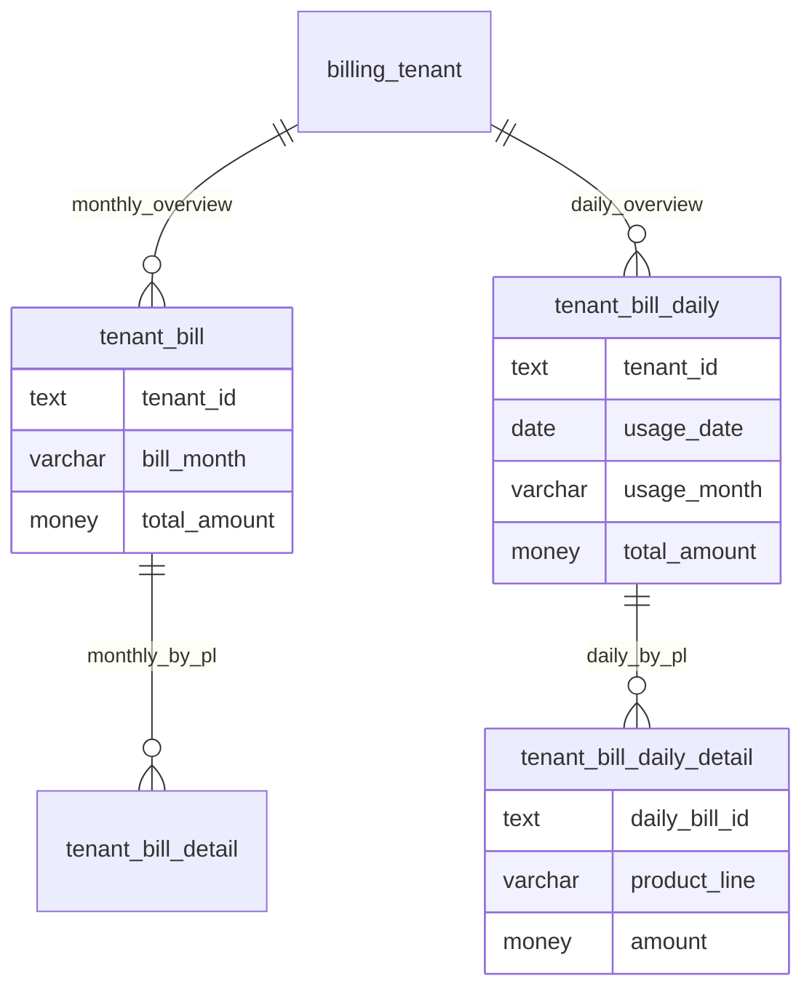
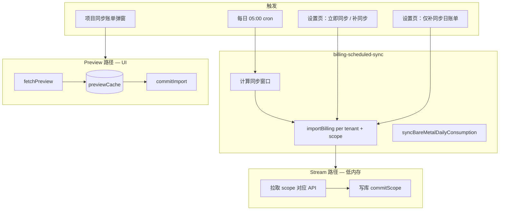
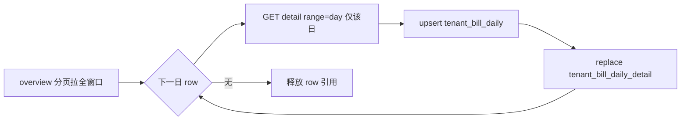
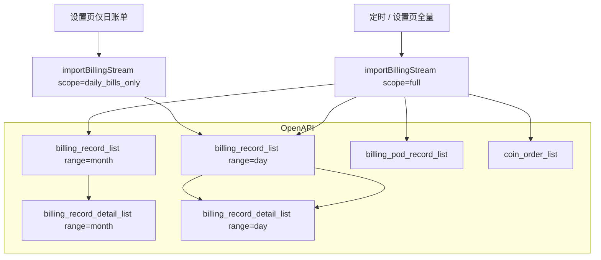

# 租户账单日消耗同步 — 设计方案

> **版本**：v1.3  
> **日期**：2026-07-07  
> **状态**：**P0/P1 已实施**（v1.3 — 明确 Dashboard 读路径与 job scope 落库方式）  
> **变更**：v1.2 — 同步窗口对齐滑动窗口策略，见 `project-billing-scheduled-sync-design.md` v1.2  
> **变更**：v1.1 — stream 导入 + 设置页日账单补同步 + Dashboard 日表读路径  
> **关联**：  
> - [tenant-billing-import-design.md](tenant-billing-import-design.md)（月度 `tenant_bill` / `tenant_bill_detail`）  
> - [project-billing-scheduled-sync-design.md](project-billing-scheduled-sync-design.md)（每日 05:00 定时同步；**v1.4** 起全量 job 另含商户列表 + 商户下属租户，日账单随 `full` / `daily_bills_only` 一并写入）  
> - [merchant-management-design.md](merchant-management-design.md) §7.7（商户阶段覆盖未挂项目租户）  
> - [project-tenant-daily-consumption-design.md](project-tenant-daily-consumption-design.md)（`consumption_usage_daily` / Pod 日用量）  
> - [operational-dashboard-consumption-trend-implementation-plan.md](../../../../docs/design/archive/operational-dashboard-consumption-trend-implementation-plan.md)  
> - `tenant-billing-import.ts`、`suanli-billing-api.ts`、`billing-scheduled-sync.ts`

---

## 1. 背景与问题

### 1.1 现状

当前 CRM 平台账单导入（手动 + 定时）仅同步 **月度** 账单：

| 平台 API | `range` | 本地表 | 粒度 |
|----------|---------|--------|------|
| `GET /admin/tenant/billing_record_list` | `month` | `tenant_bill` | 租户 × 账期月 |
| `GET /admin/tenant/billing_record_detail_list` | `month` | `tenant_bill_detail` | 租户 × 账期月 × 产品线 |

运营大盘（`/dashboard`）消费趋势、产品线趋势等模块目前只能按 `bill_month` 聚合，**无法展示近 7 天 / 本月逐日曲线**（见消费趋势专篇 §3.2「按账单月聚合，不做按日 proration」）。

此外，现有 `directImport` 经 `fetchPreview` 将窗口内 **全部类型** 账单数据载入内存并缓存 15 分钟，定时同步长窗口时 **堆内存峰值偏高**（见 §5.3）。

### 1.2 平台能力

平台同一套账单接口支持 **`range=day`**，返回东八区自然日维度的汇总与分产品线明细：

**日汇总** — `billing_record_list?range=day`

```json
{
  "results": [
    {
      "start_time": "2026-06-23T00:00:00+08:00",
      "end_time": "2026-06-24T00:00:00+08:00",
      "total_billing_value": 5604099820,
      "total_discount_value": 261016
    }
  ]
}
```

**日明细** — `billing_record_detail_list?range=day`（每条 overview 的 `start_time/end_time` 原样传入）

```json
{
  "results": [{
    "start_time": "2026-06-23T00:00:00+08:00",
    "end_time": "2026-06-24T00:00:00+08:00",
    "amounts": {
      "Pod:Deployment": { "billing_value": 5595597290, "discount_value": 0 },
      "ShareStorage": { "billing_value": 261332, "discount_value": 261332 }
    },
    "total_amount": { "billing_value": 5626964936, "discount_value": 261332 }
  }]
}
```

金额单位为平台最小单位（与现有月度导入一致，经 `platformBillingValueToRmb` 换算为元）。

### 1.3 与现有日表的区别

| 表 / 来源 | API | 覆盖范围 | 用途 |
|-----------|-----|----------|------|
| `consumption_usage_daily` | `billing_pod_record_list`（`range=day` + `task_type`） | 仅 Pod 三类任务 | 租户 CRM 日用量 Tab |
| **新增 `tenant_bill_daily`** | `billing_record_list`（`range=day`） | **全产品线日汇总** | 运营大盘日趋势、与月度账单同源 |
| **新增 `tenant_bill_daily_detail`** | `billing_record_detail_list`（`range=day`） | **全产品线日明细** | 产品线日趋势、Top10 等 |

> **原则**：运营大盘消费类指标以 **`tenant_bill_daily*`** 为真值（与 `tenant_bill*` 月度口径同 API 族）；`consumption_usage_daily` 保留给 CRM 租户详情，本期不迁移读路径。

---

## 2. 目标与非目标

### 2.1 业务目标

| # | 目标 | 说明 |
|---|------|------|
| G1 | 持久化日账单 | 新增两张表，保存平台 `range=day` 的汇总与分产品线明细 |
| G2 | 接入定时同步 | 与现有 **每日 05:00 账单定时同步** 共用滑动窗口、job 日志（见 [project-billing-scheduled-sync-design.md §3.2](project-billing-scheduled-sync-design.md)） |
| G3 | 接入手动同步 | 项目「同步账单」弹窗可走全量或仅日账单 scope |
| G4 | 支撑运营大盘 | Dashboard 消费趋势 / 产品线趋势 / Top10 等改读日表，支持近 7 天逐日展示 |
| G5 | 幂等可重跑 | 同一 `(tenant_id, usage_date)` 重复同步结果一致 |
| G6 | 与月度表并存 | `tenant_bill` / `tenant_bill_detail` 逻辑不变；日表独立存储 |
| G7 | **低内存导入** | 定时/补同步路径 **不** 经 preview 缓存；按日拉取即写库 |
| G8 | **日账单独立补全** | 设置页提供单独按钮，仅同步 `tenant_bill_daily*`，用于历史回填 |

### 2.2 非目标（本期）

- **不**删除或合并 `consumption_usage_daily`
- **不**改造财务域 `billing_period` Excel 导入
- **不**在日表存机房 × 卡型（无对应 API 字段；见 `tenant-region-gpu-consumption-daily-monthly-design.md`）
- **不**做日表 → 月表自动 rollup 回写 `tenant_bill`（月度仍以 `range=month` 同步为准）
- **不**在 Dashboard 首期切换「已发布账期」的财务权威数据源（关账月仍走 `platform_income_monthly` 等，见 §8）

---

## 3. 数据模型

### 3.1 实体关系



**说明**：`tenant_bill_daily` 与 `tenant_bill` **无外键关联**；二者来自同一 API 族不同 `range`，可交叉校验但不强制一致。

### 3.2 新增表：`tenant_bill_daily`（租户 × 自然日汇总）

| 列名 | 类型 | 约束 | 说明 |
|------|------|------|------|
| `id` | text | PK | `crypto.randomUUID()` |
| `customer_id` | text | FK→`customer.id`，ON DELETE SET NULL | 冗余，便于客户维度报表 |
| `tenant_id` | text | FK→`billing_tenant.id`，NOT NULL | 计费租户 |
| `usage_date` | date | NOT NULL | 东八区自然日，由 `start_time` 提取 |
| `usage_month` | varchar(7) | NOT NULL | `YYYY-MM`，由 `usage_date` 派生 |
| `total_amount` | money | NOT NULL | 总消费（元）= `total_billing_value` |
| `coupon_amount` | money | NOT NULL | 券消费 = `total_discount_value` |
| `balance_amount` | money | NOT NULL | 余额消费 = total − coupon |
| `platform_period_start` | timestamptz | NOT NULL | overview 返回的 `start_time` |
| `platform_period_end` | timestamptz | NOT NULL | overview 返回的 `end_time` |
| `synced_at` | timestamptz | NOT NULL DEFAULT now() | 最近同步时间 |

**约束与索引**：

```sql
CREATE UNIQUE INDEX tenant_bill_daily_tenant_date_uk
  ON tenant_bill_daily (tenant_id, usage_date);

CREATE INDEX tenant_bill_daily_tenant_month_idx
  ON tenant_bill_daily (tenant_id, usage_month);

CREATE INDEX tenant_bill_daily_usage_date_idx
  ON tenant_bill_daily (usage_date);
```

**校验（应用层）**：

```text
total_amount ≈ coupon_amount + balance_amount
```

### 3.3 新增表：`tenant_bill_daily_detail`（租户 × 自然日 × 产品线）

| 列名 | 类型 | 约束 | 说明 |
|------|------|------|------|
| `id` | text | PK | |
| `daily_bill_id` | text | FK→`tenant_bill_daily.id`，ON DELETE CASCADE | 日汇总头 |
| `tenant_id` | text | FK→`billing_tenant.id`，NOT NULL | 冗余，便于 Dashboard 直查 |
| `usage_date` | date | NOT NULL | 冗余 |
| `usage_month` | varchar(7) | NOT NULL | 冗余 |
| `product_line` | varchar(64) | NOT NULL | 如 `pod_deployment` |
| `resource_name` | varchar(255) | NOT NULL | 展示名，如「弹性部署」 |
| `amount` | money | NOT NULL | 总消费 |
| `coupon_amount` | money | NOT NULL | 券消费 |
| `balance_amount` | money | NOT NULL | 余额消费 |
| `type` | varchar(32) | NOT NULL | `prepaid` / `postpaid`，复用 `detailLineType()` |

**约束与索引**：

```sql
CREATE UNIQUE INDEX tenant_bill_daily_detail_bill_pl_uk
  ON tenant_bill_daily_detail (daily_bill_id, product_line);

CREATE INDEX tenant_bill_daily_detail_tenant_date_idx
  ON tenant_bill_daily_detail (tenant_id, usage_date);

CREATE INDEX tenant_bill_daily_detail_tenant_month_pl_idx
  ON tenant_bill_daily_detail (tenant_id, usage_month, product_line);
```

**产品线映射**：复用 `mapPlatformProductLine()` / `PRODUCT_LINE_MAP`（与 `tenant_bill_detail` 一致）。

**零值行**：跳过 `billing_value=0 && discount_value=0` 的 `amounts` 项（与月度明细一致）。

### 3.4 Drizzle 定义位置

- 文件：`packages/db/src/crm-schema.ts`（紧接 `tenantBillDetail` 之后）
- 导出 relations：`tenantBillDailyRelations`、`tenantBillDailyDetailRelations`
- Migration：`packages/db/drizzle/0011_*.sql`（下一序号）

---

## 4. 平台 API 封装

### 4.1 新增函数（`suanli-billing-api.ts`）

| 函数 | Path | Query | 说明 |
|------|------|-------|------|
| `fetchPlatformDailyBillingRecords` | `/admin/tenant/billing_record_list` | `tenant_tid`, `range=day`, `start_time`, `end_time`, 分页 | 复用 `toDailyUsageBillQueryTimes` 或新增 `toDailyBillRecordQueryTimes`（规则与月度相同：东八区自然日 → UTC ISO 左闭右开） |
| `fetchPlatformDailyBillDetailsForOverview` | `/admin/tenant/billing_record_detail_list` | 同上 + **`range=day`** | 对 overview 每条串行请求；`start_time/end_time` **原样**传入（复用 `toBillDetailQueryTimes`） |

**实现要点**：

1. 从现有 `fetchPlatformMonthlyBills` / `fetchPlatformBillDetailsForOverview` **参数化 `range`**，或复制为 day 专用函数，避免误传 `range=month`。
2. 响应结构与月度相同，复用 `paginatedSchema`、`normalizeBillDetailRecords`。
3. 限流：overview 与 detail 之间沿用 `BILLING_IMPORT_SECTION_DELAY_MS`、`BILLING_API_DETAIL_DELAY_MS`。

### 4.2 日期转换

| 步骤 | 函数 |
|------|------|
| CRM 同步窗口 `[startDate, endDate]` → API 查询参数 | `toDailyBillRecordQueryTimes(startDate, endDate)`（可与 `toDailyUsageBillQueryTimes` 合并） |
| 平台 `start_time` → `usage_date` | `usageDateFromPlatformPeriod(start_time)` |
| 平台 `start_time` → `usage_month` | `usageMonthFromDate(usage_date)` |

示例（与用户提供的 URL 一致）：

```text
startDate=2026-06-22, endDate=2026-06-23
→ start_time=2026-06-21T16:00:00.000Z  （东八区 6/22 00:00）
→ end_time=2026-06-23T16:00:00.000Z    （东八区 6/24 00:00，左闭右开）
```

Detail 请求使用 overview 返回的 `+08:00` 原值，**不做 UTC 二次转换**。

---

## 5. 同步链路

### 5.1 设计原则：双路径导入

现有 `directImport` = `fetchPreview`（全量拉取 → **内存缓存 15min**）+ `commitImport`（读缓存写库）。一次同步含月度、充值、Pod 日用量、任务明细等多类数据，**窗口拉长时峰值内存高**，且定时任务完全不需要 preview UI。

**v1.1 改为双路径**：

| 路径 | 适用场景 | 内存特征 |
|------|----------|----------|
| **Preview 路径** | CRM 弹窗「确认 → 确认导入」 | 保留 `previewCache`；可展示 diff Tab |
| **Stream 路径** | 定时同步、设置页补同步、项目批量 `directImport` | **无 preview 缓存**；按 scope 分段拉取、即时写库 |



### 5.2 导入 Scope

新增枚举 `BillingImportScope`（`tenant-billing-import.ts`）：

| Scope | 拉取 API | 写入表 | 典型触发 |
|-------|----------|--------|----------|
| `full` | 月度 + 日账单 + 充值 + Pod 日用量 + 任务明细 + 裸金属 | 全部 | 定时增量、设置页「立即同步」、设置页「补同步遗漏账单」 |
| `daily_bills_only` | `billing_record_list?range=day` + `billing_record_detail_list?range=day` | **`tenant_bill_daily` / `tenant_bill_daily_detail` 仅** | 设置页「补同步日账单」、Dashboard 历史回填 |
| `monthly_bills_only` | 现有月度段 | `tenant_bill` / `tenant_bill_detail` + 充值等 | 预留，本期可不暴露 UI |

> **关键**：`daily_bills_only` **不**调用月度 API、充值、Pod 接口，内存与 API 调用量最小。

### 5.3 Stream 路径 — 内存优化（核心）

#### 5.3.1 问题分析

| 现状 | 问题 |
|------|------|
| `CachedBillingImport` 一次持有窗口内所有类型原始记录 | 90 天 × 多租户 × 任务明细 → 堆内存峰值高 |
| `directImport` 先 `fetchPreview` 再 `commitImport` | 定时任务重复构建 preview diff（`toCreate/toUpdate`），无 UI 消费 |
| 日账单 detail 全窗口拉完再写库 | 每自然日 1 次 detail，30 天 = 30 份 `amounts` 对象常驻内存 |

#### 5.3.2 优化策略

**A. 新增 `importBillingStream()`（取代定时任务中的 `directImport`）**

```typescript
async function importBillingStream(input: {
  tenantId: string
  startDate: string
  endDate: string
  scope: BillingImportScope
}): Promise<PlatformImportBillingItemResult>
```

- **不**写入 `previewCache`
- **不**构建 preview diff（`TenantBillingImportPreviewItem`）
- 返回精简 `summary` 字符串（与现 `directImport` 一致）

**B. 日账单段：按自然日迭代（逐日释放）**



伪代码：

```typescript
for (const dayRow of dailyOverviewRows) {
  const details = await fetchPlatformDailyBillDetailsForOverview({
    platformTenantId,
    overviewRows: [dayRow], // 每次仅 1 日
    traceId,
  })
  await commitDailyBillDay({ tenantId, dayRow, details }) // 单条短事务
  // dayRow / details 出作用域即 GC
}
```

- overview 仍可按窗口 **一次分页拉全**（结果仅为「日 × 4 数字段」，体积远小于 detail）
- detail **禁止**一次性对全窗口 N 日并发/批量拉取后再写库

**C. `full` scope 分段提交**

| 顺序 | 段 | 写库后 |
|------|-----|--------|
| 1 | 月度 overview + detail | 释放月度原始对象 |
| 2 | 日账单（逐日，见 B） | 每日写完后释放 |
| 3 | 充值 | 逐条 upsert 或批量后释放 |
| 4 | Pod 日用量 + 任务明细 | 按日或按 task 迭代写库 |

各段 **独立 try/catch**；段内失败记 error，不阻断其它段（与现 partial failure 一致）。

**D. Preview 路径保持不变**

- `fetchPreview` / `commitImport` 仍服务 CRM 弹窗
- 弹窗「确认导入」可写全 scope；**可选**后续增加「仅导入日账单」checkbox（P2）
- Preview 缓存 TTL 维持 15min；**禁止**定时任务走此路径

**E. `directImport` 重构**

```typescript
async directImport(input: {
  tenantId: string
  startDate?: string
  endDate?: string
  scope?: BillingImportScope // 默认 'full'
}) {
  if (input.scope && input.scope !== 'full') {
    return importBillingStream({ ...input, scope: input.scope })
  }
  // 定时 / 批量默认走 stream，不再经 previewCache
  return importBillingStream({ ...input, scope: 'full' })
}
```

> **Breaking 行为说明**：`directImport` 不再调用 `fetchPreview`+`commitImport`，批量路径统一 stream。弹窗仍显式调用 `fetchBillingImportPreview` + `commitBillingImport`。

#### 5.3.3 内存预算（估算）

| 路径 | 峰值常驻（单租户，30 天窗口） |
|------|------------------------------|
| 旧 `fetchPreview` full | 30 日 detail amounts + 全量 recharge + 全量 task 明细 |
| 新 `importBillingStream` daily only | **1 日** detail + 30 条 overview 行 |
| 新 `importBillingStream` full | 分段峰值 ≈ max(月度 detail, 1 日 detail, recharge 批) |

### 5.4 总体流程（定时 + 补同步）



### 5.5 接入点

| 组件 | 变更 |
|------|------|
| `tenant-billing-import.ts` | 新增 `importBillingStream`、`commitDailyBillDay`；`directImport` 委托 stream |
| `fetchPreview` / `commitImport` | 仅 UI；commit 增加日表写入（弹窗确认导入时） |
| `billing-scheduled-sync.ts` | 改调 `directImport({ scope: 'full' })` 或 `importBillingStream`；支持 `scope` 参数 |
| `syncBillingForProject` | 同上 |

### 5.6 写库策略

**日汇总 `tenant_bill_daily`** — upsert by `(tenant_id, usage_date)`：

```text
存在 → UPDATE 金额 + platform_period_* + synced_at
不存在 → INSERT
```

**日明细 `tenant_bill_daily_detail`** — **先删后插**（与 `tenant_bill_detail` 一致）：

```text
DELETE FROM tenant_bill_daily_detail WHERE daily_bill_id = ?
INSERT 新行（跳过全零产品线）
```

**事务粒度**：

- **Stream 逐日路径**：每个 `usage_date` 独立短事务（头 + 明细），失败仅回滚该日
- **Preview 弹窗路径**：仍可在单大事务内按原顺序写入（用户单次确认）

### 5.7 同步时间窗

与 [project-billing-scheduled-sync-design.md §3.2–§3.4](project-billing-scheduled-sync-design.md) **完全一致**（滑动窗口 + backfill）：

| 模式 | 窗口 | 适用按钮 |
|------|------|----------|
| 增量 | `computeSlidingSyncWindow`：执行时刻向前 `windowDays` 天（默认 48h），含 `startAt`/`endAt` | 设置页「立即同步」、Cron |
| 补同步（全量 scope） | 用户指定 `[startDate, endDate]` | 设置页「补同步遗漏账单」 |
| 补同步（仅日账单） | 用户指定 `[startDate, endDate]` | 设置页 **「补同步日账单」** |

| 补同步类型 | 受滑动窗口限制 | scope |
|------------|----------------|-------|
| 遗漏账单（现有） | ❌ 用户指定区间 | `full` |
| **日账单（新增）** | ❌ 用户指定区间 | `daily_bills_only` |

日账单补同步 **不**调用月度/充值/Pod API，适合 Dashboard 上线前批量回填历史日曲线。

**日期校验**（与现有补同步一致）：

- 结束日期 ≤ 东八区今天
- 建议单次区间 ≤ **90 天**（UI 提示；超出可分批执行，避免 detail 请求过多）

### 5.8 设置页 — 仅补同步日账单（新增）

**位置**：`apps/web/src/components/settings/billing-sync-settings-content.tsx` — 「账单定时同步」Card 内，与现有按钮并列。

**现有按钮（不变）**：

| 按钮 | 行为 |
|------|------|
| 立即同步 | `runNow({ mode: 'incremental' })` → scope `full` |
| 补同步遗漏账单 | Dialog 选日期 → `runNow({ mode: 'backfill', startDate, endDate })` → scope `full` |

**新增按钮**：

| 按钮 | 文案建议 | 行为 |
|------|----------|------|
| 补同步日账单 | 「补同步日账单」 | 打开 `BillingDailyBackfillDialog` → `runNow({ mode: 'backfill', scope: 'daily_bills_only', startDate, endDate })` |

**Dialog 说明文案（示例）**：

> 仅拉取平台 `range=day` 账单，写入 `tenant_bill_daily` / `tenant_bill_daily_detail`。  
> 不更新月度账单、充值、Pod 用量。用于运营大盘日趋势历史补全。

**UI 结构**（复用 `BillingSyncBackfillDialog` 模式）：

```tsx
// billing-sync-settings-content.tsx — BillingSyncCard 操作区
<div className="flex flex-wrap gap-2">
  <Button onClick={handleRunNow}>立即同步</Button>
  <Button variant="outline" onClick={() => setBackfillOpen(true)}>
    补同步遗漏账单
  </Button>
  <Button variant="outline" onClick={() => setDailyBackfillOpen(true)}>
    补同步日账单
  </Button>
</div>
```

**tRPC 扩展**（`crm.billingSync.runNow` input）：

```typescript
z.object({
  mode: z.enum(['incremental', 'backfill']).optional(),
  scope: z.enum(['full', 'daily_bills_only']).optional().default('full'),
  startDate: z.string().regex(/^\d{4}-\d{2}-\d{2}$/).optional(),
  endDate: z.string().regex(/^\d{4}-\d{2}-\d{2}$/).optional(),
  projectIds: z.array(z.string()).optional(),
})
```

**Job 日志**：

- 复用 `billing_sync_job_run` / `billing_sync_job_item`（不新建 job 表）
- **`scope` 不落库列**（v1.3 确认）：scope 写入 `billing_sync_job_run.error_summary` 前缀（如 `[daily_bills_only]`）及 item `summary` 文案；列表可按前缀筛选
- item `summary` 示例：`[仅日账单] 新增 28，更新 2；明细 252 行`

**互斥**：与现有 job 共用 advisory lock（`BILLING_SYNC_LOCK_KEY`）；日账单补同步与全量补同步 **不可并行**。

### 5.9 预览 UI（CRM 弹窗）

CRM「导入平台账单」弹窗（`crm-tenant-billing-import-dialog.tsx`）走 Preview 路径，Tab 为：

| Tab | 数据 | 说明 |
|-----|------|------|
| 月度账单 | `tenant_bill` | 已有 |
| 充值 | `recharge` | 已有 |
| 每日用量 | `consumption_usage_daily`（Pod） | 已有；**非** `tenant_bill_daily` |
| 账单明细 | `tenant_bill_detail` | 已有 |

**未实施（P2，接受现状）**：独立 Tab「日账单汇总 / 日账单明细」（`tenant_bill_daily*`）。日账单由 **stream 定时同步**、设置页「补同步日账单」写入，不在 CRM 导入弹窗预览。

批量/定时 **禁止** 走 Preview。

### 5.10 Job 摘要文案

`formatBillingCommitSummary` / stream 返回扩展：

```text
日账单：新增 3，更新 1；日明细：写入 24 行
[仅日账单] 新增 28，更新 2；明细 252 行
```

`billing_sync_job_item.summary` 与设置页 toast 共用。

---

## 6. 模块与文件规划

| 层级 | 路径 | 变更 |
|------|------|------|
| Schema | `packages/db/src/crm-schema.ts` | 新增 `tenantBillDaily`、`tenantBillDailyDetail` + relations |
| Migration | `packages/db/drizzle/0011_*.sql` | CREATE TABLE + 索引；可选 `billing_sync_job_run.scope` |
| Utils | `tenant-billing-import-utils.ts` | `toDailyBillRecordQueryTimes`；`formatBillingCommitSummary` 扩展 |
| API | `suanli-billing-api.ts` | `fetchPlatformDailyBillingRecords`；detail 支持 `range=day` |
| Import | `tenant-billing-import.ts` | **`importBillingStream`**、`commitDailyBillDay`；`directImport` 改委托 stream |
| Sync | `billing-scheduled-sync.ts` | `runScheduledBillingSync` 传 `scope`；`runNow` input 扩展 |
| Router | `lib/server/routers/crm/index.ts` | `billingSync.runNow` 增加 `scope` |
| Settings UI | `billing-sync-settings-content.tsx` | **「补同步日账单」按钮 + Dialog** |
| Types | `lib/types/billing-scheduled-sync.ts` | `BillingImportScope`、`runNow` input |
| Types | `lib/types/tenant-billing-import.ts` | stream commit 结果 |
| Dashboard | `operational-dashboard.ts` | 读路径切换（§8） |
| 文档 | `operational-dashboard-consumption-trend-implementation-plan.md` | 更新口径为日表 |
| 文档 | `project-billing-scheduled-sync-design.md` | 交叉引用 stream 路径 |
| 文档 | `crm-database.md` | 补充新表说明 |

---

## 7. 实施步骤

| 阶段 | 内容 | 产出 |
|------|------|------|
| **P0** | DB migration + Drizzle schema | 表可写 |
| **P0** | API 封装（day range） | 可拉取日 overview + detail |
| **P0** | **`importBillingStream` + 逐日 commit** | 低内存写库 |
| **P0** | `directImport` / 定时同步改走 stream | 05:00 job 不写 previewCache |
| **P0** | 设置页 **「补同步日账单」** + `runNow(scope)` | 历史日数据可补全 |
| **P1** | Dashboard 消费趋势改读 `tenant_bill_daily_detail` | 近 7 天逐日曲线 |
| **P1** | Dashboard 产品线趋势 / Top10 改读日表明细 | 按日 × 产品线 |
| **P2** | CRM 导入弹窗日账单预览 Tab | 运营可人工核对 |
| **P2** | `billing_sync_job_run.scope` 列（可选） | **不实施**；scope 记 summary 前缀（见 §5.8） |

**建议开发顺序**：P0 schema → stream 导入 → 设置页日账单补同步 → 单租户对账 → P1 Dashboard。

---

## 8. 运营大盘读路径

### 8.1 数据源选择（已实施，2026-07-08 确认）

运营大盘（`/dashboard`）**KPI、消费趋势、产品线趋势、Top10** 在 `last7days` / `thisMonth` / `customMonth` 下 **统一读** `tenant_bill_daily_detail`（东八区逐日 SUM）。`getMeta.isPreview` 仅控制角标文案（未关账 / 已发布账期预览态），**不切换**读表。

| 统计周期 | 粒度 | 主表 | 说明 |
|----------|------|------|------|
| `last7days` | **日** | `tenant_bill_daily_detail` | 近 7 天逐日曲线 |
| `thisMonth` | **日** | `tenant_bill_daily_detail` | 当月 1 日～today |
| `customMonth`（任意） | **日** | `tenant_bill_daily_detail` | 已发布账期 `isPreview=false`，仍展示日曲线 |
| 财务关账权威 | 月 | `platform_income_monthly` 等 | **财务域**账期收入/成本；运营大盘 **不**改读此表 |

> **产品决策（Q3，2026-07-08）**：运营大盘侧重「平台日账单预览与趋势」，不与财务关账月表混读；关账月财务数字以 `/finance` 为准。

### 8.2 需改造的 Procedure

| Procedure | 现数据源 | 改后 |
|-----------|----------|------|
| `dashboard.ops.consumptionTrend` | `tenant_bill_detail` × `bill_month` | `tenant_bill_daily_detail`，`GROUP BY usage_date` |
| `dashboard.ops.productLineTrend` | 同上 | `tenant_bill_daily_detail`，`GROUP BY usage_date, product_line` |
| `dashboard.ops.top10Consumption` | 同上 | 区间内 `SUM` by project/tenant |
| `dashboard.ops.kpi`（消费项） | 月表 | 短周期改日表 SUM；跨月时按月 SUM 或分段（见下） |

**过滤条件**（保持不变）：

- `listIncomeEligibleProjects(periodRange)` 有效项目租户
- `internal` 租户排除
- 客群 `new` / `old` 项目标签过滤

### 8.3 SQL 示意 — 消费趋势（逐日）

```sql
SELECT
  d.usage_date AS date,
  COALESCE(SUM(d.balance_amount), 0) AS balance_consumption,
  COALESCE(SUM(d.coupon_amount), 0) AS voucher_consumption
FROM tenant_bill_daily_detail d
JOIN billing_tenant t ON t.id = d.tenant_id
WHERE d.usage_date >= :startDate
  AND d.usage_date <= :endDate
  AND d.tenant_id = ANY(:eligibleTenantIds)
  AND NOT internal_tenant_excluded(t, :periodRange)
GROUP BY d.usage_date
ORDER BY d.usage_date;
```

### 8.4 补零

复用 `enumerateShanghaiDates(startDate, endDate)`：查询结果 LEFT JOIN 日期日历，无数据日填 0。

### 8.5 前端

- `ConsumptionTrendChart`：X 轴恢复「按天」；`date` 为 `YYYY-MM-DD`
- 数据模式角标：未关账区间显示「预览 · 平台日账单」
- 单月已发布账期：可继续展示单月单点或切换财务口径（产品确认）

---

## 9. 对账与验收

### 9.1 对账规则

| # | 规则 |
|---|------|
| R1 | 同一租户、同一 `usage_date`：`tenant_bill_daily.total_amount` ≈ SUM(`tenant_bill_daily_detail.amount`) |
| R2 | 同一租户、同一 `usage_month`：SUM(日表 `total_amount`) **不必等于** `tenant_bill.total_amount`（平台月结与日累计可能存在结算差；仅作参考告警） |
| R3 | 日表 vs `consumption_usage_daily`：Pod 产品线金额可能接近但不强制相等（API 族不同） |

### 9.2 验收用例

| # | 场景 | 期望 |
|---|------|------|
| T1 | 定时同步跑完 | 窗口内每个租户、每个自然日在 `tenant_bill_daily` 有行 |
| T2 | 某租户 2026-06-23 | detail 表含 `pod_deployment`、`share_storage` 等非零产品线 |
| T3 | 重复同步同一窗口 | 行数不变，金额更新，`synced_at` 刷新 |
| T4 | overview 空 | 不调用 detail API，不插空日 |
| T5 | detail 部分失败 | job item 记 warning，其它日/其它租户继续 |
| T6 | Dashboard 近 7 天 | 曲线 7 个点，与平台日账单 SUM 一致（扣除内部租户） |
| T7 | 手动「项目同步账单」 | 与定时任务写入相同表 |
| T8 | 设置页「补同步日账单」90 天 | 仅 `tenant_bill_daily*` 有数据；月度/充值不变 |
| T9 | stream full 30 天窗口 | 进程堆内存明显低于旧 preview 路径（可 `process.memoryUsage` 对比） |
| T10 | 日账单补同步与全量 job 并行触发 | 后者提示「已有同步任务正在运行」 |

---

## 10. 风险与缓解

| 风险 | 缓解 |
|------|------|
| API 调用量翻倍（每个自然日 +1 次 detail） | 沿用现有限流；窗口通常 ≤30 天；overview 为空则跳过 detail |
| 平台 `range=day` 与 `range=month` 金额口径差异 | 文档标注；Dashboard 短周期用日表，关账月用财务表 |
| 近期日数据未最终结算 | 滑动窗口含执行时刻前数据；Dashboard 近 7 天/本月为**预览态**，平台回写可在窗口内被后续 job 覆盖 |
| Cron 长时间失败导致缺口 | 设置页「补同步遗漏账单 / 日账单」；建议单次 ≤90 天分批 |
| **长窗口 stream 仍拉全 overview** | overview 仅 4 数字段/日，可接受；detail 严格逐日 |
| **`directImport` 不再经 preview** | 弹窗仍走 `fetchPreview`+`commitImport`；集成测试覆盖两条路径 |

---

## 11. 环境变量

无新增必填 env。沿用：

| 变量 | 用途 |
|------|------|
| `BILLING_SYNC_ENABLED` | 定时任务开关 |
| `BILLING_SYNC_WINDOW_DAYS` | 滑动窗口天数（默认 2） |
| `BILLING_IMPORT_SECTION_DELAY_MS` | 段间延迟 |
| `BILLING_API_DETAIL_DELAY_MS` | detail 请求间隔 |

---

## 12. 待确认项

| # | 问题 | 建议 | 状态 |
|---|------|------|------|
| Q1 | 表名 `tenant_bill_daily` / `tenant_bill_daily_detail` 是否 OK？ | 与 `tenant_bill*` 对称 | 待确认 |
| Q2 | CRM 导入弹窗是否加「日账单」Tab？ | **不实施**；日表走 stream + 设置页补同步 | **v1.3 已确认** |
| Q3 | 已发布账期下 Dashboard 是否仍显示日曲线？ | **是**；统一读日表；`isPreview` 仅角标 | **v1.3 已确认** |
| Q4 | 是否在 `tenant_bill_daily` 存 `project_id`？ | **不存** | 待确认 |
| Q5 | 日账单补同步单次最大天数？ | UI 建议 ≤90 天，超出提示分批 | **v1.1 采纳** |
| Q6 | 定时任务是否仍同步 full scope？ | 是（月度+日账单+充值+Pod）；仅补同步按钮可 daily only | **v1.1 采纳** |
| Q7 | `directImport` 改 stream 是否可接受？ | 批量路径统一 stream；弹窗仍 preview | **v1.1 采纳** |

---

## 13. 附录：类型草案

```typescript
/** 导入范围 */
type BillingImportScope = 'full' | 'daily_bills_only' | 'monthly_bills_only'

/** fetchPlatformDailyBillingRecords 单行 */
type PlatformDailyBillingRecord = {
  start_time: string
  end_time: string
  total_billing_value: number
  total_discount_value: number
}

/** 低内存流式导入（定时 / 补同步 / directImport） */
async function importBillingStream(input: {
  tenantId: string
  startDate: string
  endDate: string
  scope: BillingImportScope
}): Promise<PlatformImportBillingItemResult>

/** 单日写库（短事务） */
async function commitDailyBillDay(input: {
  tenantId: string
  customerId: string | null
  dayRow: PlatformDailyBillingRecord
  details: PlatformBillDetailRecord[]
}): Promise<{ created: boolean; detailRows: number }>

/** billingSync.runNow 扩展 */
type BillingSyncRunNowInput = {
  mode?: 'incremental' | 'backfill'
  scope?: BillingImportScope // default 'full'
  startDate?: string
  endDate?: string
  projectIds?: string[]
}

/** stream commit 结果 */
type BillingStreamCommitResult = {
  dailyBills: { created: number; updated: number; errors: Array<{ key: string; message: string }> }
  dailyBillDetails: { rows: number; errors: Array<{ key: string; message: string }> }
  // full scope 时另有 monthlyBills / recharges / …
}
```
