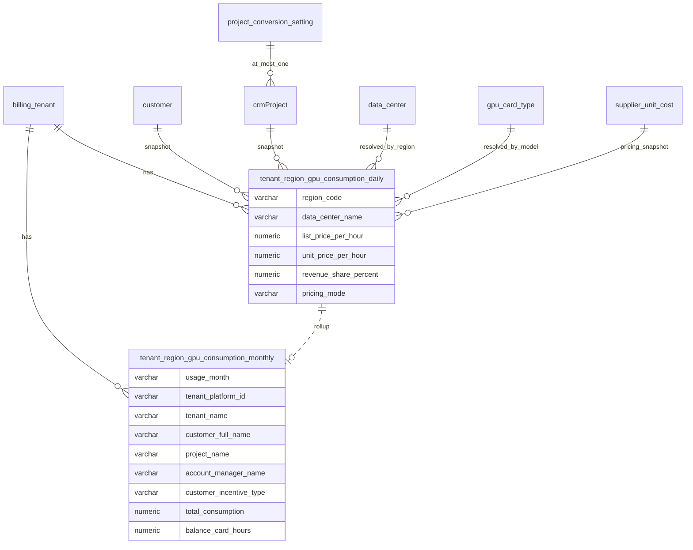

# 租户 × 区域 × GPU · 日/月卡时消费表 — 数据库设计

> **版本**：v1.3（待确认）  
> **日期**：2026-06-23  
> **状态**：**方案设计 — 仅文档，未实施**  
> **关联**：  
> - `project-tenant-daily-consumption-design.md`（产品线 × 任务明细层）  
> - `project-monthly-cost-snapshot-design.md`（租户/项目/客户经理快照字段参考）  
> - `billing-period-import-design.md`（§6 租户→项目→分成；区域/GPU 匹配规则）  
> - `cost-compute-v3-redesign-with-examples.md`（机房×卡型定价、source_line 补全）  
> - `enrichment.ts` / `cost-tenant-resolve.ts`（**`listProjectsForPlatformTenant` 权威实现**）  
> - `cost-master-data.ts` / `tenant-bill-pricing.ts`（**`resolveDataCenterByContainerRegion`、定价解析**）  
> - `platform-pricing-design.md` / `supplier-database.md`（刊例价、成交单价、分成模式）  
> - `packages/db/src/crm-schema.ts`（`consumption_usage_daily`、`tenant_consumption_daily_detail`）  
> - `packages/db/src/supply-schema.ts`（`data_center`、`supplier_unit_cost`、`supplier_pricing_record`）  
> - `packages/db/src/finance-schema.ts`（`billing_period_raw_tenant_bill`、`billing_period_cost_pricing_snapshot`）  
> **触发场景**：需要两张**独立**事实表，按「租户 × 自然日 × 机房区域 × GPU 型号」持久化卡时与消费拆分；日表支撑租户侧统计展示，月表由日表 rollup 供月度成本核算与对账。

---

## 1. 目标与非目标

### 1.1 业务目标

| # | 目标 | 说明 |
|---|------|------|
| G1 | **日粒度事实** | 每个租户、每个自然日、每个机房区域、每种 GPU 型号一行，字段与用户提供的 Excel 表头一致 |
| G2 | **月字段自动派生** | 写入日表时由 `usage_date` 自动计算并保存 `usage_month`（`YYYY-MM`）；月表同样保存 `usage_month` |
| G3 | **月表 rollup** | 由日表按 `(tenant, usage_month, region, gpu)` 聚合生成/刷新月表，供按租户查看月度汇总 |
| G4 | **租户展示** | CRM 租户详情、项目关联租户视图：按日/月展示总消费、券/余额拆分、总/券/余额卡时 |
| G5 | **月度成本输入** | 月表粒度与财务「客户账单详情」一致（租户 × 区域 × GPU），可作为成本 pipeline 的**读库替代/补充**数据源（相对 Excel 导入） |
| G6 | **可对账** | 保留平台幂等键与 `raw_json`；数值关系与账期 Raw 校验规则一致 |
| G7 | **CRM 维度快照** | 导入/同步时自动解析并**固化**租户名称、客户全称、项目名称、客户经理、新客/老客（激励开始日期） |
| G8 | **机房与定价快照** | 按 **`region_code` → `data_center.container_instance_region`** 解析机房名称；按 **`usage_date` 时点** 固化刊例价、成交单价、分成比例与定价模式，供后续成本/毛利测算 |

### 1.2 非目标（本期表结构不覆盖）

- **不**替代 `tenant_consumption_daily_detail`（任务级明细、含 `product_line`）
- **不**替代 `consumption_usage_daily`（租户 × 日 × **产品线** 汇总）
- **不**替代 `billing_period_raw_tenant_bill`（账期 Excel Raw；月表与之字段对齐但生命周期独立）
- **不**在本表存裸金属订单（裸金属仍走 `bare_metal_order` / 财务 Raw）
- **不**在一租户多项目场景 **拆分消费金额**（与 `billing_period_raw_tenant_bill` / enrichment 一致：Raw 行存 **租户全额**；分成仅在财务成本 pipeline）

---

## 2. 用户输入表头与示例

### 2.1 Excel / 展示表头（中文 → 英文字段）

| 中文表头 | DB 列名 | 类型 | 必填 | 说明 |
|----------|---------|------|------|------|
| 日期 | `usage_date` | date | 是 | 东八区自然日 |
| base_value | `base_value` | numeric(15,4) | 否 | 基准消费金额，见 §3.2 |
| 总消费 | `total_consumption` | numeric(15,4) | 是 | 元 |
| 券消费 | `voucher_consumption` | numeric(15,4) | 是 | 算力券抵扣金额，默认 0 |
| 余额消费 | `balance_consumption` | numeric(15,4) | 是 | 余额/实付消费 |
| 总卡时 | `total_card_hours` | numeric(15,4) | 是 | |
| 券卡时 | `voucher_card_hours` | numeric(15,4) | 是 | 默认 0 |
| 余额卡时 | `balance_card_hours` | numeric(15,4) | 是 | |
| GPU型号 | `gpu_model` | varchar(128) | 是 | 平台原始型号字符串，如 `4090-48G`、`5090` |
| 区域 | `region_code` | varchar(64) | 是 | 容器实例区域 / 机房区域码，如 `zjsx-p1`、`fjsq` |
| 租户Id | `tenant_platform_id` | varchar(128) | 是 | 算算力平台租户 ID（非 CRM `tenant.id`） |

以下列 **不出现在导入 Excel**，写入时由 CRM 自动查询并快照（见 §5.4）：

| 中文展示 | DB 列名 | 说明 |
|----------|---------|------|
| 租户名称 | `tenant_name` | `tenant.name` |
| 客户全称 | `customer_full_name` | `customer.name` |
| 项目名称 | `project_name` | 解析到的经营项目名 |
| 客户经理 | `account_manager_name` | `usage_month` 有效客户经理姓名 |
| 新客/老客 | `customer_incentive_type` + `customer_incentive_label` | 见 §3.3 |
| 激励开始日期 | `incentive_start_date` | 老客时有值；新客为 NULL |
| 机房名称 | `data_center_name` | 见 §5.5 |
| 卡型名称 | `gpu_card_type_name` | `gpu_card_type.name` 快照 |
| 定价模式 | `pricing_mode` | `revenue_share` / `tiered_card_time` / `tiered_revenue_share` / `fixed` 等 |
| 刊例价（元/卡时） | `list_price_per_hour` | 平台 `platform_card_list_price` as-of `usage_date` |
| 成交单价（元/卡时） | `unit_price_per_hour` | 供应商成本配置 as-of `usage_date`；卡时模式结算单价 |
| 分成比例（%） | `revenue_share_percent` | 分成类模式有效；如 `65.0000` 表示 65% |

### 2.2 示例行（用户提供）

| 日期 | base_value | 总消费 | 券消费 | 余额消费 | 总卡时 | 券卡时 | 余额卡时 | GPU型号 | 区域 | 租户Id |
|------|------------|--------|--------|----------|--------|--------|----------|---------|------|--------|
| 2026-06-21 | 7,118.22 | 3,652.44 | 0 | 3,652.44 | 2,356.72 | 0 | 2,356.72 | 4090-48G | zjsx-p1 | 984 |
| 2026-06-21 | 152.86 | 152.85 | 67.11 | 85.74 | 81.83 | 38.23 | 43.6 | 4090 | fjsq | 8068 |
| 2026-06-21 | 0 | 1.21 | 0 | 1.21 | 528 | 0 | 528 | 5090 | of-p1 | 1024 |

---

## 3. 设计决策

| 决策 | 说明 |
|------|------|
| **D1 存储粒度（日表）** | 一行 = **`usage_date` × `tenant_platform_id` × `region_code` × `gpu_model`** |
| **D2 存储粒度（月表）** | 一行 = **`usage_month` × `tenant_platform_id` × `region_code` × `gpu_model`**；租户级月汇总通过 `GROUP BY tenant_platform_id, usage_month` 查询 |
| **D3 表归属** | 新增表放在 **`packages/db/src/crm-schema.ts`**（租户消费事实域，与 `consumption_usage_daily` 并列） |
| **D4 租户双写** | 必填 `tenant_platform_id`；解析到 CRM 后写入 `tenant_id` FK（可空，未导入租户仍保留平台 ID） |
| **D5 月字段** | `usage_month = to_char(usage_date, 'YYYY-MM')`（东八区）；日表写入时 **冗余保存**；月表 `usage_month` 为聚合键 |
| **D6 月表刷新** | 日表 upsert 成功后 **异步或同事务** 刷新对应 `(tenant, month, region, gpu)` 月行（SUM 指标列） |
| **D7 幂等** | 日表 UK：`(tenant_platform_id, usage_date, region_code, gpu_model)`；确定性 `id` 或 `platform_idempotency_key` |
| **D8 数值校验** | 与 `billing-period-import-design.md` V5 一致：`balance_*` ≥ 0；`total ≈ voucher + balance` 保留6位小数 |
| **D9 与现有表关系** | **新建两张表**，不修改 `consumption_usage_daily` / `tenant_consumption_daily_detail` 结构；读路径逐步迁移 |
| **D10 CRM 快照** | 导入/同步写入日表时 **一次性查询 CRM 并固化** 维度字段；**不**随主数据变更 retroactive 更新历史行（与 `project_monthly_cost_snapshot` 一致） |
| **D11 项目绑定** | **完全复用** 财务 `enrichment.ts` 的 `listProjectsForPlatformTenant` + 预置分成读取逻辑；单行 `project_*` 选取见 §5.4.4 |
| **D12 客户经理** | 与 enrichment **一致**：取绑定项目上 **`project_staff_assignment`** 当前在岗 AM（`role_type = account_manager` 且 `effective_to IS NULL`）；**不使用** `resolveEffectiveAccountManager` 结算月时点 |
| **D13 新客/老客** | 以 **§5.4.4 选中的快照项目** 的 `project_conversion_setting` 为准（见 §3.3） |
| **D14 多项目明细** | `project_enrichment_snapshot`（jsonb）固化 enrichment 返回的 **全部** 关联项目及预置分成，供 UI 下钻；与 `billing_period_tenant_project_enrichment` 字段形状对齐 |
| **D15 机房解析** | **`region_code`**（容器实例区域）经 `normalizeBillingRegion` 后匹配 **`data_center.container_instance_region`**；复用 `resolveDataCenterByContainerRegion`（与成本 flex 补全一致） |
| **D16 定价 as-of** | 以 **`usage_date` 自然日** 为 as-of（日表逐日快照）；**非**账期 `period_end` 单点（与日粒度事实一致） |
| **D17 定价来源** | 刊例价 ← `resolvePlatformListPriceAt`；成交单价/分成/模式 ← `resolveUnitCostForPair`（`tenant-bill-pricing.ts`）；与 `billing_period_cost_pricing_snapshot` 字段语义对齐 |

### 3.1 卡时 / 消费恒等式

与财务 Raw 口径一致：

```text
总卡时   = 券卡时   + 余额卡时
总消费   ≈ 券消费   + 余额消费   （展示/入库允许 0.01 元误差）
```

### 3.2 `base_value` 定义

| 项 | 约定 |
|----|------|
| 业务含义 | **刊例基准消费金额**：按当日有效平台刊例价 × 总卡时计算的参考金额，用于展示折扣力度、辅助对账 |
| 平台有字段 | 同步时直接映射平台日账单 `base_value` |
| 平台无字段 | CRM 按 **`list_price_per_hour` × `total_card_hours`** 回填（`list_price_per_hour` 见 §5.5） |
| 无刊例价 | 写 `0`（见示例第三行：`base_value=0` 仍有消费） |
| 成本计算 | **不**作为 `platform_cost_monthly` 的直接输入；成本仍用 `balance_consumption` / `balance_card_hours`；本表定价列供 **预计算 / 对账 / 二期读库** |

### 3.4 定价字段语义（便于后续计算）

| 列 | 含义 | 分成模式 | 卡时模式 |
|----|------|----------|----------|
| `list_price_per_hour` | 平台刊例价（元/卡时） | 必填（分成基数） | 必填 |
| `unit_price_per_hour` | 供应商成交/结算单价（元/卡时） | 可空 | 必填 |
| `revenue_share_percent` | 供应商分成比例（%） | 必填 | 通常 NULL |
| `pricing_mode` | 合作计价模式 | 决定用卡时价还是分成公式 | 同左 |

**后续测算参考**（与 `cost-pricing-utils.ts` 一致，本表 **只存快照不计算**）：

```text
卡时成本（示意） ≈ balance_card_hours × unit_price_per_hour        （tiered_card_time / fixed）
分成成本（示意） ≈ balance_consumption × revenue_share_percent / 100 （revenue_share）
刊例基准消费     ≈ total_card_hours × list_price_per_hour            （与 base_value 回填一致）
```

解析失败时：`pricing_resolve_status` 标记原因，价格列 NULL，度量列仍入库。

### 3.3 新客 / 老客（激励开始日期）

与运营月报「项目标签」口径 **不同**；本表仅看 **项目是否已设置激励开始**：

| 展示 | `customer_incentive_type` | `customer_incentive_label` | `incentive_start_date` | 判定 |
|------|---------------------------|----------------------------|------------------------|------|
| **新客** | `new_customer` | `新客` | `NULL` | 解析到的项目 **无** `project_conversion_setting` 行 |
| **老客** | `existing_customer` | `老客` | `project_conversion_setting.conversion_date` | 解析到的项目 **有** 激励开始设置 |

补充规则：

- 判定挂在 **§5.4.4 选中的快照 `project_id`** 上
- **≥2 项目且无法唯一选定快照项目** 时：`project_id` / `project_name` / AM 置 NULL；新客/老客默认 `new_customer`；完整项目列表见 `project_enrichment_snapshot`
- `incentive_start_date` 写入 **`conversion_date`**（激励开始生效日），**不是** `deal_closed_month`（提成锚定月）
- 同一租户月内项目或激励设置变更时，**仅影响之后新写入/重刷的行**；已固化历史行不变

---

## 4. 实体关系



**数据流**：

```text
算算力平台日账单 API / 手工导入
  → 解析 CRM 快照（§5.4）+ 机房/定价快照（§5.5）
  → tenant_region_gpu_consumption_daily（upsert）
  → 按 (tenant_platform_id, usage_month, region_code, gpu_model) SUM + 快照继承
  → tenant_region_gpu_consumption_monthly（upsert）

CRM 租户页 / 项目页
  → 日表：WHERE tenant_id IN (...)
  → 月表：GROUP BY 或直查 monthly 表

财务成本（可选二期）
  → 月表 WHERE usage_month = period_code 映射月
  → 映射为 billing_period_raw_tenant_bill 形状 → source_line
```

---

## 5. 表结构

### 5.1 通用约定

| 项 | 约定 |
|----|------|
| 主键 | `text`，`crypto.randomUUID()` 或确定性 ID |
| 金额 | `numeric(15,4)` — 与现有 `money()` 一致 |
| 卡时 | `numeric(15,4)` — 与现有 `cardHours()` 一致 |
| 日期 | `usage_date date` — **东八区自然日** |
| 月份 | `usage_month varchar(7)` — `YYYY-MM`，**由 `usage_date` 派生，冗余索引** |
| 枚举 | `varchar` + 应用常量 |

---

### 5.2 日表：`tenant_region_gpu_consumption_daily`

租户 × 自然日 × 区域 × GPU 型号的卡时消费事实。

| 列名 | 类型 | 约束 | 说明 |
|------|------|------|------|
| `id` | text | PK | |
| `tenant_platform_id` | varchar(128) | NOT NULL | 平台租户 Id（用户表头「租户Id」） |
| `tenant_id` | text | FK→`tenant.id` ON DELETE RESTRICT | CRM 计费租户；未解析时 NULL |
| `tenant_name` | varchar(255) | NULL | **快照**：`tenant.name` |
| `customer_id` | text | FK→`customer.id` ON DELETE SET NULL | 冗余，便于客户维度查询 |
| `customer_full_name` | varchar(255) | NULL | **快照**：`customer.name`（客户全称） |
| `project_id` | text | FK→`project.id` ON DELETE SET NULL | 解析到的经营项目 |
| `project_name` | varchar(255) | NULL | **快照**：`project.name` |
| `account_manager_staff_id` | text | FK→`user_staff.id` ON DELETE SET NULL | enrichment 绑定项目上的当前 AM |
| `account_manager_name` | varchar(128) | NULL | **快照**：`user_staff.display_name` |
| `enrichment_binding_source` | varchar(32) | NOT NULL DEFAULT `none` | `none` \| `auto_single` \| `auto_preset` \| `multi_project_primary` \| `multi_project_unresolved` |
| `project_enrichment_snapshot` | jsonb | NOT NULL DEFAULT `[]` | enrichment 全部关联项目 + 预置分成，见 §5.4.5 |
| `customer_incentive_type` | varchar(32) | NOT NULL DEFAULT `new_customer` | `new_customer` \| `existing_customer` |
| `customer_incentive_label` | varchar(16) | NOT NULL DEFAULT `新客` | `新客` \| `老客` |
| `incentive_start_date` | date | NULL | 老客：`project_conversion_setting.conversion_date` |
| `usage_date` | date | NOT NULL | 自然日 |
| `usage_month` | varchar(7) | NOT NULL | `YYYY-MM`，**写入时由 `usage_date` 计算** |
| `region_code` | varchar(64) | NOT NULL | 容器实例区域（平台账单「区域」列） |
| `gpu_model` | varchar(128) | NOT NULL | GPU 型号原始字符串 |
| `data_center_id` | text | FK→`data_center.id` ON DELETE SET NULL | §5.5 解析 |
| `data_center_code` | varchar(64) | NULL | **快照**：`data_center.code` |
| `data_center_name` | varchar(255) | NULL | **快照**：`data_center.name`（机房名称） |
| `gpu_card_type_id` | text | FK→`gpu_card_type.id` ON DELETE SET NULL | §5.5 解析 |
| `gpu_card_type_code` | varchar(64) | NULL | **快照**：`gpu_card_type.code` |
| `gpu_card_type_name` | varchar(128) | NULL | **快照**：`gpu_card_type.name` |
| `pricing_mode` | varchar(32) | NULL | 供应商计价模式，见 §3.4 |
| `list_price_per_hour` | numeric(15,4) | NULL | 平台刊例价（元/卡时） |
| `unit_price_per_hour` | numeric(15,4) | NULL | 成交/结算单价（元/卡时） |
| `revenue_share_percent` | numeric(7,4) | NULL | 分成比例（%） |
| `platform_card_list_price_id` | text | FK→`platform_card_list_price.id` ON DELETE SET NULL | 刊例价溯源 |
| `supplier_unit_cost_id` | text | FK→`supplier_unit_cost.id` ON DELETE SET NULL | 成本配置溯源 |
| `supplier_pricing_record_id` | text | FK→`supplier_pricing_record.id` ON DELETE SET NULL | 定价记录溯源 |
| `pricing_resolve_status` | varchar(32) | NOT NULL DEFAULT `pending` | `ok` \| `region_not_found` \| `card_type_not_found` \| `pricing_pair_not_found` \| `platform_list_price_not_found` \| `pending` |
| `base_value` | numeric(15,4) | NULL DEFAULT 0 | 刊例基准消费，见 §3.2 |
| `total_consumption` | numeric(15,4) | NOT NULL | 总消费 |
| `voucher_consumption` | numeric(15,4) | NOT NULL DEFAULT 0 | 券消费 |
| `balance_consumption` | numeric(15,4) | NOT NULL | 余额消费 |
| `total_card_hours` | numeric(15,4) | NOT NULL | 总卡时 |
| `voucher_card_hours` | numeric(15,4) | NOT NULL DEFAULT 0 | 券卡时 |
| `balance_card_hours` | numeric(15,4) | NOT NULL | 余额卡时 |
| `source` | varchar(32) | NOT NULL DEFAULT `platform_sync` | `platform_sync` \| `manual_import` \| `backfill` |
| `platform_idempotency_key` | varchar(256) | NOT NULL | 幂等键，见 §6.2 |
| `raw_json` | jsonb | NULL | 平台原始 payload |
| `created_at` / `updated_at` | timestamptz | NOT NULL | 标准时间戳 |

**唯一约束**：

```sql
CREATE UNIQUE INDEX tenant_region_gpu_consumption_daily_uk
  ON tenant_region_gpu_consumption_daily (
    tenant_platform_id,
    usage_date,
    region_code,
    gpu_model
  );
```

**查询索引**：

```sql
CREATE INDEX tenant_region_gpu_consumption_daily_tenant_date_idx
  ON tenant_region_gpu_consumption_daily (tenant_id, usage_date);

CREATE INDEX tenant_region_gpu_consumption_daily_tenant_month_idx
  ON tenant_region_gpu_consumption_daily (tenant_id, usage_month);

CREATE INDEX tenant_region_gpu_consumption_daily_platform_month_idx
  ON tenant_region_gpu_consumption_daily (tenant_platform_id, usage_month);

CREATE INDEX tenant_region_gpu_consumption_daily_am_month_idx
  ON tenant_region_gpu_consumption_daily (account_manager_staff_id, usage_month);

CREATE INDEX tenant_region_gpu_consumption_daily_incentive_month_idx
  ON tenant_region_gpu_consumption_daily (customer_incentive_type, usage_month);

CREATE INDEX tenant_region_gpu_consumption_daily_dc_month_idx
  ON tenant_region_gpu_consumption_daily (data_center_id, usage_month);

CREATE INDEX tenant_region_gpu_consumption_daily_pricing_status_idx
  ON tenant_region_gpu_consumption_daily (pricing_resolve_status, usage_month);
```

---

### 5.5 机房与定价快照（导入/同步时自动解析并固化）

与财务 flex 补全（`compute-cost-source-line.ts` + `cost-master-data.ts`）**同一套主数据解析**；as-of 取 **`usage_date`**（非账期末日）。

#### 5.5.1 机房：容器实例区域 → `data_center`

| 步骤 | 输入 | 规则 | 写入列 |
|------|------|------|--------|
| 1 归一化 | `region_code` | `normalizeBillingRegion`：`trim` + `toLowerCase`（与 `billing-period-import-design.md` §4.2 一致） | — |
| 2 匹配机房 | 归一化后的 region | `data_center.container_instance_region` **精确匹配**（经同样归一化后比对） | `data_center_id`, `data_center_code`, `data_center_name` |
| 3 多机房同 region | 命中多条 | 取 **`dataCentersByContainerRegion` 列表首条**（与 `resolveDataCenterByContainerRegion` 一致）；`pricing_resolve_status` 可写 `ok` 并在 `raw_json` 记录 `matched_data_center_count` | |
| 4 未命中 | — | `pricing_resolve_status = region_not_found`；机房列 NULL | |

```typescript
// 与 cost-master-data.ts 一致
const dc = resolveDataCenterByContainerRegion(masterCtx, regionCode)
// dc?.id, dc?.code, dc?.name
```

#### 5.5.2 卡型：`gpu_model` → `gpu_card_type`

| 步骤 | 规则 | 写入列 |
|------|------|--------|
| 归一化 | `normalizeGpuCodeForMatch(gpu_model)` | — |
| 匹配 | `gpu_card_type.code` **精确匹配**（归一化后） | `gpu_card_type_id`, `gpu_card_type_code`, `gpu_card_type_name` |
| 未命中 | `pricing_resolve_status = card_type_not_found` | |

#### 5.5.3 定价：机房 × 卡型 × `usage_date`

在机房、卡型均解析成功后：

| 步骤 | API / 表 | as-of | 写入列 |
|------|----------|-------|--------|
| A 平台刊例价 | `resolvePlatformListPriceAt({ gpuCardTypeId, asOfDate: usage_date, productLine: 'elastic_service', billingUnit: 'hour' })` | `usage_date` | `list_price_per_hour`, `platform_card_list_price_id` |
| B 供应商成本价 | `resolveUnitCostForPair({ regionCode, gpuModel }, usage_date, pricingCtx)` | `usage_date` | `pricing_mode`, `unit_price_per_hour`, `revenue_share_percent`, `supplier_unit_cost_id`, `supplier_pricing_record_id` |
| C 状态 | A 且 B 均成功 | — | `pricing_resolve_status = ok` |
| D 部分失败 | 缺刊例价 | — | `platform_list_price_not_found`；B 成功则仍写供应商列 |
| E 部分失败 | 缺成本配置 | — | `pricing_pair_not_found`；A 成功则仍写刊例价列 |

**`base_value` 回填**（平台未提供时）：

```text
base_value = total_card_hours × list_price_per_hour   （list_price_per_hour 非空时）
```

#### 5.5.4 伪代码

```typescript
async function resolveInfraPricingSnapshot(input: {
  regionCode: string
  gpuModel: string
  usageDate: string
}): Promise<InfraPricingSnapshot> {
  const masterCtx = await loadCostMasterDataContext()
  const pricingCtx = await loadPricingResolveContext() // tenant-bill-pricing

  const dc = resolveDataCenterByContainerRegion(masterCtx, input.regionCode)
  const card = resolveGpuCardType(masterCtx, input.gpuModel)
  if (!dc) return { pricing_resolve_status: 'region_not_found', ...emptyFields }
  if (!card) return { pricing_resolve_status: 'card_type_not_found', ...dcFields(dc), ...emptyPricing }

  const platformPrice = await resolvePlatformListPriceAt({
    gpuCardTypeId: card.id,
    asOfDate: input.usageDate,
    productLine: DEFAULT_TENANT_BILL_PRODUCT_LINE,
    billingUnit: DEFAULT_TENANT_BILL_BILLING_UNIT,
  })

  const unitCost = await resolveUnitCostForPair(
    { regionCode: input.regionCode, gpuModel: input.gpuModel },
    input.usageDate,
    pricingCtx,
  )

  return {
    data_center_id: dc.id,
    data_center_code: dc.code,
    data_center_name: dc.name,
    gpu_card_type_id: card.id,
    gpu_card_type_code: card.code,
    gpu_card_type_name: card.name,
    list_price_per_hour: platformPrice?.listPricePerHour ?? null,
    platform_card_list_price_id: platformPrice?.platformCardListPriceId ?? null,
    pricing_mode: unitCost?.pricingMode ?? null,
    unit_price_per_hour: unitCost?.unitPricePerHour ?? null,
    revenue_share_percent: unitCost?.revenueSharePercent ?? null,
    supplier_unit_cost_id: unitCost?.supplierUnitCostId ?? null,
    supplier_pricing_record_id: unitCost?.pricingRecordId ?? null,
    pricing_resolve_status: resolvePricingStatus(platformPrice, unitCost),
  }
}
```

#### 5.5.5 固化策略

| 场景 | 行为 |
|------|------|
| 首次 import / sync | 与 CRM 快照 **同批** 解析并写入 |
| 同 UK upsert | **重算并覆盖** 机房/定价列（as-of 仍为该行 `usage_date`） |
| 月表 rollup | 机房名、定价列 **继承** 月内 `updated_at` 最大日行（**不求和、不平均**） |
| 主数据/定价事后变更 | 不回溯；对该 `usage_date` 重跑 sync 后更新 |

---

### 5.4 导入/同步时 CRM 维度快照（与财务 enrichment 一致）

写入日表 **之前**，按 `tenant_platform_id` + `usage_month` 调用与 **`enrichment.ts` / `cost-tenant-resolve.ts` 相同** 的项目绑定逻辑，再固化快照列。

> **实现要求**：抽取或复用 `listProjectsForPlatformTenant(platformTenantId)`，**禁止**另写简化版 SQL（避免与账期导入 drift）。

#### 5.4.1 `listProjectsForPlatformTenant`（与 enrichment 相同）

| 条件 | 规则 |
|------|------|
| 租户 | `billing_tenant.platform_tenant_id = :platformTenantId` |
| 项目关联 | `crm_project.customer_id = billing_tenant.customer_id` **且**（`crm_project.primary_tenant_id = billing_tenant.id` **或** `project_tenant` 关联） |
| 项目状态 | `crm_project.status NOT IN ('archived', 'paused')` |
| 客户经理 | `LEFT JOIN project_staff_assignment`：`role_type = 'account_manager'` 且 `effective_to IS NULL` → `staff_id` / `display_name` |
| 返回 | `{ tenantId, projectId, projectName, staffId, accountManagerName }[]`（`selectDistinct`，顺序与 enrichment 一致） |

与现网代码一致，见 `apps/web/src/lib/server/dataaccess/finance/enrichment.ts` L30–89。

#### 5.4.2 预置分成（无账期上下文时的 enrichment 子集）

本表 **无** `billing_period_id`，故 **不读** `billing_tenant_cost_allocation`（账期手工分成）；仅读 **`tenant_project_cost` 预置**，规则与 enrichment 中 preset 段相同：

| 项 | 规则 |
|----|------|
| as-of 日 | `usage_month` **自然月最后一日**（等同 enrichment 传入的 `periodEnd`） |
| 筛选 | `tenant_id = :tenantId` AND `effective_from <= asOf` AND `effective_to IS NULL` |
| 映射 | `project_id → allocation_percent` |

#### 5.4.3 解析步骤（写入列）

| 步骤 | 输入 | 规则 | 写入列 |
|------|------|------|--------|
| 1 项目列表 | `tenant_platform_id` | `listProjectsForPlatformTenant` | `project_enrichment_snapshot`（§5.4.5） |
| 2 租户/客户 | 列表非空时 `projects[0].tenantId` | `billing_tenant` ⋈ `customer`（同 `getTenantDisplayNames`） | `tenant_id`, `tenant_name`, `customer_id`, `customer_full_name` |
| 3 快照项目 | §5.4.4 | 唯一可选项目 | `project_id`, `project_name`, `enrichment_binding_source` |
| 4 客户经理 | 快照项目的 enrichment 行 | 该行 `staffId` / `accountManagerName`（当前 AM） | `account_manager_staff_id`, `account_manager_name` |
| 5 新客/老客 | 快照 `project_id` | `project_conversion_setting` | §3.3 各列 |
| 6 无 CRM 租户 | 列表为空 | — | `enrichment_binding_source = none`；度量列仍可写 |

#### 5.4.4 单行快照项目选取（一租户多项目）

消费 **UK 不含 `project_id`**，故 `project_id` / `project_name` / AM 为 **展示快照**；金额仍为 **租户全额**（与 Raw / enrichment 导入一致）。

| # | enrichment 场景 | `enrichment_binding_source` | 快照 `project_id` | 说明 |
|---|-----------------|----------------------------|-------------------|------|
| A | **0 项目** | `none` | NULL | 不参与财务 enrichment；CRM 列可空 |
| B | **1 项目** | `auto_single` | 唯一项目 | 同 enrichment `source = auto_single`，隐含 100% |
| C | **≥2 项目**，且存在 **唯一** `primary_tenant_id = tenant_id` 的项目且在列表中 | `multi_project_primary` | 主计费租户项目 | 与 CRM `primary_tenant_id` 语义一致 |
| D | **≥2 项目**，预置中 **仅一个** 项目 `allocation_percent = 100` | `auto_preset` | 该项目 | 同 enrichment 在 preset 100% 时可唯一归因 |
| E | **≥2 项目**，预置已覆盖全部项目且合计 100%，**仅一个** 项目占比最高 | `auto_preset` | 最高占比项目（并列则 NULL → F） | 主分成项目 |
| F | **≥2 项目**，以上均不满足 | `multi_project_unresolved` | NULL | 同账期 `pending_allocation` 语义；AM / 新客老客置默认空值；**完整列表见 jsonb** |

> 与 `billing-period-import-design.md` §6 对齐：≥2 项目且缺分成配置时，财务侧阻断成本计算；本表仍 **入库租户全额消费**，标记 `multi_project_unresolved` 供报表筛出。

#### 5.4.5 `project_enrichment_snapshot` JSON

```typescript
/** 与 billing_period_tenant_project_enrichment 行语义对齐（无 billing_period_id） */
type ProjectEnrichmentSnapshotItem = {
  project_id: string
  project_name: string
  staff_id: string | null
  account_manager_name: string | null
  allocation_percent: string | null // tenant_project_cost 预置；未配置为 null
  is_primary_tenant_project: boolean // primary_tenant_id = tenant_id
}

type ProjectEnrichmentSnapshot = ProjectEnrichmentSnapshotItem[]
```

- **0 项目**：`[]`
- **≥1 项目**：列表内 **每个** enrichment 项目一条；`allocation_percent` 来自 §5.4.2 预置 Map
- 月表 rollup：**原样继承** 月内最后 sync 日行（与 `project_name` 等快照列相同策略）

#### 5.4.6 伪代码

```typescript
async function resolveTenantCrmSnapshot(
  tenantPlatformId: string,
  usageMonth: string,
): Promise<TenantCrmSnapshot> {
  const asOf = lastDayOfMonth(usageMonth) // YYYY-MM-DD
  const projects = await listProjectsForPlatformTenant(tenantPlatformId) // enrichment.ts
  const snapshotItems = buildEnrichmentSnapshotItems(projects, asOf) // §5.4.5

  if (projects.length === 0) {
    return { enrichment_binding_source: 'none', project_enrichment_snapshot: [], ... }
  }

  const tenantId = projects[0]!.tenantId
  const presetMap = await loadTenantProjectCostPresets(tenantId, asOf) // §5.4.2
  const picked = pickSnapshotProject(projects, tenantId, presetMap) // §5.4.4 A–F

  const row = projects.find((p) => p.projectId === picked.projectId)
  return {
    tenant_id: tenantId,
    tenant_name: ...,
    customer_full_name: ...,
    project_id: picked.projectId,
    project_name: row?.projectName ?? null,
    enrichment_binding_source: picked.source,
    project_enrichment_snapshot: snapshotItems,
    account_manager_staff_id: row?.staffId ?? null,
    account_manager_name: row?.accountManagerName ?? null,
    ...resolveIncentiveType(picked.projectId),
  }
}
```

#### 5.4.7 固化策略

| 场景 | 行为 |
|------|------|
| 首次 import / platform_sync | 计算快照，写入日表全部 CRM 列 |
| 同 UK 重复 upsert（数值变更） | **重算并覆盖** CRM 快照列（以最新 CRM 为准） |
| 月表 rollup | 快照列取自月内 **`updated_at` 最大** 的日表行（`last_daily_sync_at` 同行） |
| 主数据事后变更 | **不**回溯已存在日表行，除非对该日重跑 import/sync |

---

### 5.3 月表：`tenant_region_gpu_consumption_monthly`

由日表 rollup 的 **租户 × 自然月 × 区域 × GPU** 汇总；租户级月度合计查询此表 `GROUP BY tenant_platform_id, usage_month`。

| 列名 | 类型 | 约束 | 说明 |
|------|------|------|------|
| `id` | text | PK | |
| `tenant_platform_id` | varchar(128) | NOT NULL | |
| `tenant_id` | text | FK→`tenant.id` ON DELETE RESTRICT | 可空 |
| `tenant_name` | varchar(255) | NULL | 继承日表快照 |
| `customer_id` | text | FK→`customer.id` ON DELETE SET NULL | |
| `customer_full_name` | varchar(255) | NULL | 继承日表快照 |
| `project_id` | text | FK→`project.id` ON DELETE SET NULL | |
| `project_name` | varchar(255) | NULL | 继承日表快照 |
| `account_manager_staff_id` | text | FK→`user_staff.id` ON DELETE SET NULL | |
| `account_manager_name` | varchar(128) | NULL | 继承日表快照 |
| `enrichment_binding_source` | varchar(32) | NOT NULL DEFAULT `none` | 继承日表快照 |
| `project_enrichment_snapshot` | jsonb | NOT NULL DEFAULT `[]` | 继承日表快照 |
| `customer_incentive_type` | varchar(32) | NOT NULL DEFAULT `new_customer` | 继承日表快照 |
| `customer_incentive_label` | varchar(16) | NOT NULL DEFAULT `新客` | 继承日表快照 |
| `incentive_start_date` | date | NULL | 继承日表快照 |
| `usage_month` | varchar(7) | NOT NULL | `YYYY-MM` |
| `region_code` | varchar(64) | NOT NULL | |
| `gpu_model` | varchar(128) | NOT NULL | |
| `data_center_id` | text | FK→`data_center.id` ON DELETE SET NULL | 继承日表快照 |
| `data_center_code` | varchar(64) | NULL | 继承日表快照 |
| `data_center_name` | varchar(255) | NULL | 继承日表快照（机房名称） |
| `gpu_card_type_id` | text | FK→`gpu_card_type.id` ON DELETE SET NULL | 继承日表快照 |
| `gpu_card_type_code` | varchar(64) | NULL | 继承日表快照 |
| `gpu_card_type_name` | varchar(128) | NULL | 继承日表快照 |
| `pricing_mode` | varchar(32) | NULL | 继承日表快照 |
| `list_price_per_hour` | numeric(15,4) | NULL | 继承日表快照（月内最后 sync 日行） |
| `unit_price_per_hour` | numeric(15,4) | NULL | 继承日表快照 |
| `revenue_share_percent` | numeric(7,4) | NULL | 继承日表快照 |
| `platform_card_list_price_id` | text | FK→`platform_card_list_price.id` ON DELETE SET NULL | 继承日表快照 |
| `supplier_unit_cost_id` | text | FK→`supplier_unit_cost.id` ON DELETE SET NULL | 继承日表快照 |
| `supplier_pricing_record_id` | text | FK→`supplier_pricing_record.id` ON DELETE SET NULL | 继承日表快照 |
| `pricing_resolve_status` | varchar(32) | NOT NULL DEFAULT `pending` | 继承日表快照 |
| `base_value` | numeric(15,4) | NOT NULL DEFAULT 0 | **SUM**(日表 `base_value`) |
| `total_consumption` | numeric(15,4) | NOT NULL DEFAULT 0 | **SUM** |
| `voucher_consumption` | numeric(15,4) | NOT NULL DEFAULT 0 | **SUM** |
| `balance_consumption` | numeric(15,4) | NOT NULL DEFAULT 0 | **SUM** |
| `total_card_hours` | numeric(15,4) | NOT NULL DEFAULT 0 | **SUM** |
| `voucher_card_hours` | numeric(15,4) | NOT NULL DEFAULT 0 | **SUM** |
| `balance_card_hours` | numeric(15,4) | NOT NULL DEFAULT 0 | **SUM** |
| `day_count` | integer | NOT NULL DEFAULT 0 | 月内有效自然日条数（审计） |
| `last_daily_sync_at` | timestamptz | NULL | 最近一次参与 rollup 的日表 `updated_at` 最大值 |
| `created_at` / `updated_at` | timestamptz | NOT NULL | |

**唯一约束**：

```sql
CREATE UNIQUE INDEX tenant_region_gpu_consumption_monthly_uk
  ON tenant_region_gpu_consumption_monthly (
    tenant_platform_id,
    usage_month,
    region_code,
    gpu_model
  );
```

**查询索引**：

```sql
CREATE INDEX tenant_region_gpu_consumption_monthly_tenant_month_idx
  ON tenant_region_gpu_consumption_monthly (tenant_id, usage_month);

CREATE INDEX tenant_region_gpu_consumption_monthly_platform_month_idx
  ON tenant_region_gpu_consumption_monthly (tenant_platform_id, usage_month);

CREATE INDEX tenant_region_gpu_consumption_monthly_am_month_idx
  ON tenant_region_gpu_consumption_monthly (account_manager_staff_id, usage_month);
```

---

## 6. `usage_month` 派生与月表刷新

### 6.1 日表写入时计算 `usage_month`

```typescript
/** 东八区自然日 → YYYY-MM */
function usageMonthFromDate(usageDate: string /* YYYY-MM-DD */): string {
  return usageDate.slice(0, 7) // 或 date-fns-tz 按 Asia/Shanghai 格式化
}
```

规则：

- `usage_date` 必须为东八区日历日（与 `usageDateFromPlatformPeriod` 一致）
- 禁止手工写入与 `usage_date` 不一致的 `usage_month`；服务端 **覆盖** 为派生值
- 跨月边界：6 月 30 日与 7 月 1 日分别进入 `2026-06` / `2026-07`

### 6.2 幂等键（日表）

```text
platform_idempotency_key =
  "trg-daily-{tenantPlatformId}-{usageDate}-{regionCode}-{gpuModel}"
```

手工导入可使用：

```text
"trg-daily-import-{batchId}-{rowNo}"
```

### 6.3 月表 rollup SQL（逻辑）

```sql
INSERT INTO tenant_region_gpu_consumption_monthly (...)
SELECT
  gen_random_uuid(),
  tenant_platform_id,
  max(tenant_id),
  max(tenant_name),
  max(customer_id),
  max(customer_full_name),
  max(project_id),
  max(project_name),
  max(account_manager_staff_id),
  max(account_manager_name),
  max(enrichment_binding_source),
  max(project_enrichment_snapshot::text)::jsonb, -- 实现时用 DISTINCT ON updated_at 取最新日行，勿对 jsonb 做 max
  max(customer_incentive_type),
  max(customer_incentive_label),
  max(incentive_start_date),
  usage_month,
  region_code,
  gpu_model,
  max(data_center_id),
  max(data_center_code),
  max(data_center_name),
  max(gpu_card_type_id),
  max(gpu_card_type_code),
  max(gpu_card_type_name),
  max(pricing_mode),
  max(list_price_per_hour),
  max(unit_price_per_hour),
  max(revenue_share_percent),
  max(platform_card_list_price_id),
  max(supplier_unit_cost_id),
  max(supplier_pricing_record_id),
  max(pricing_resolve_status),
  sum(base_value),
  sum(total_consumption),
  sum(voucher_consumption),
  sum(balance_consumption),
  sum(total_card_hours),
  sum(voucher_card_hours),
  sum(balance_card_hours),
  count(*)::int AS day_count,
  max(updated_at),
  now(),
  now()
FROM tenant_region_gpu_consumption_daily
WHERE tenant_platform_id = :tid
  AND usage_month = :month
GROUP BY tenant_platform_id, usage_month, region_code, gpu_model
ON CONFLICT (tenant_platform_id, usage_month, region_code, gpu_model)
DO UPDATE SET
  tenant_name = EXCLUDED.tenant_name,
  customer_full_name = EXCLUDED.customer_full_name,
  project_name = EXCLUDED.project_name,
  account_manager_name = EXCLUDED.account_manager_name,
  enrichment_binding_source = EXCLUDED.enrichment_binding_source,
  project_enrichment_snapshot = EXCLUDED.project_enrichment_snapshot,
  customer_incentive_type = EXCLUDED.customer_incentive_type,
  customer_incentive_label = EXCLUDED.customer_incentive_label,
  incentive_start_date = EXCLUDED.incentive_start_date,
  data_center_name = EXCLUDED.data_center_name,
  list_price_per_hour = EXCLUDED.list_price_per_hour,
  unit_price_per_hour = EXCLUDED.unit_price_per_hour,
  revenue_share_percent = EXCLUDED.revenue_share_percent,
  pricing_mode = EXCLUDED.pricing_mode,
  pricing_resolve_status = EXCLUDED.pricing_resolve_status,
  base_value = EXCLUDED.base_value,
  total_consumption = EXCLUDED.total_consumption,
  -- ... 其余 SUM 列 ...
  day_count = EXCLUDED.day_count,
  last_daily_sync_at = EXCLUDED.last_daily_sync_at,
  updated_at = now();
```

> **快照列说明**：上式 `max(...)` 为示意；实现时应对月内 **`updated_at` 最大** 的日表行做 `DISTINCT ON` 或子查询，避免 CRM 字段被错误聚合。

触发时机：

| 场景 | 行为 |
|------|------|
| 单日 sync / import | 刷新该租户该 `usage_month` 下 **受影响** `(region, gpu)` 月行 |
| 月内历史回填 | 按租户 + 月批量 rollup |
| 日表 DELETE | 同事务重算对应月行；若月内无日行则 DELETE 月行 |

---

## 7. 查询场景

### 7.1 租户详情 — 按日展示（示例数据形状）

```sql
SELECT
  usage_date,
  tenant_name,
  customer_full_name,
  project_name,
  account_manager_name,
  customer_incentive_label,
  incentive_start_date,
  base_value,
  total_consumption,
  voucher_consumption,
  balance_consumption,
  total_card_hours,
  voucher_card_hours,
  balance_card_hours,
  gpu_model,
  region_code,
  tenant_platform_id
FROM tenant_region_gpu_consumption_daily
WHERE tenant_id = :tenantId
  AND usage_date BETWEEN :start AND :end
ORDER BY usage_date DESC, region_code, gpu_model;
```

### 7.2 租户详情 — 按日展示（含机房与定价）

```sql
SELECT
  usage_date,
  data_center_name,
  gpu_card_type_name,
  list_price_per_hour,
  unit_price_per_hour,
  revenue_share_percent,
  pricing_mode,
  pricing_resolve_status,
  balance_card_hours,
  balance_consumption
FROM tenant_region_gpu_consumption_daily
WHERE tenant_id = :tenantId
  AND usage_month = :month
ORDER BY usage_date, region_code;
```

### 7.3 租户详情 — 按月汇总（单租户合计，含 CRM 维度）

```sql
SELECT
  usage_month,
  tenant_platform_id,
  max(tenant_name)              AS tenant_name,
  max(customer_full_name)       AS customer_full_name,
  max(project_name)             AS project_name,
  max(account_manager_name)     AS account_manager_name,
  max(customer_incentive_label) AS customer_incentive_label,
  max(incentive_start_date)     AS incentive_start_date,
  sum(total_consumption)        AS total_consumption,
  sum(voucher_consumption)      AS voucher_consumption,
  sum(balance_consumption)      AS balance_consumption,
  sum(total_card_hours)         AS total_card_hours,
  sum(voucher_card_hours)       AS voucher_card_hours,
  sum(balance_card_hours)       AS balance_card_hours,
  sum(base_value)               AS base_value
FROM tenant_region_gpu_consumption_monthly
WHERE tenant_id = :tenantId
GROUP BY usage_month, tenant_platform_id
ORDER BY usage_month DESC;
```

### 7.4 按客户经理 / 新客老客 / 定价缺失筛选（月表）

```sql
-- 某月某客户经理名下租户卡时消费
SELECT *
FROM tenant_region_gpu_consumption_monthly
WHERE usage_month = :month
  AND account_manager_staff_id = :staffId;

-- 某月待配置分成的多项目租户（与财务 pending_allocation 同集）
SELECT *
FROM tenant_region_gpu_consumption_monthly
WHERE usage_month = :month
  AND enrichment_binding_source = 'multi_project_unresolved';

-- 某月新客租户（快照项目未设置激励开始日期）
SELECT *
FROM tenant_region_gpu_consumption_monthly
WHERE usage_month = :month
  AND customer_incentive_type = 'new_customer'
  AND enrichment_binding_source <> 'multi_project_unresolved';

-- 某月缺机房或成本定价配置的行
SELECT *
FROM tenant_region_gpu_consumption_monthly
WHERE usage_month = :month
  AND pricing_resolve_status <> 'ok';
```

### 7.5 月度成本 — 按租户 × 区域 × GPU（对齐 Raw 形状）

月表一行可直接映射为 `billing_period_raw_tenant_bill` 等价结构：

| 月表列 | Raw 列 |
|--------|--------|
| `tenant_platform_id` | `tenant_platform_id` |
| `region_code` | `region_code` |
| `gpu_model` | `gpu_model` |
| `total_consumption` | `total_consumption` |
| `voucher_consumption` | `voucher_consumption` |
| `balance_consumption` | `balance_consumption` |
| `total_card_hours` | `total_card_hours` |
| `voucher_card_hours` | `voucher_card_hours` |
| `balance_card_hours` | `balance_card_hours` |

成本侧重 **`balance_consumption` / `balance_card_hours`**（与现网 import 校验一致）。

### 7.6 项目页

与 `project-tenant-daily-consumption-design.md` 相同路径：

```text
project.id → tenant_ids → WHERE tenant_id IN (tenant_ids)
```

---

## 8. 与现有表边界

| 表 | 粒度 | 本方案关系 |
|----|------|------------|
| `consumption_usage_daily` | 租户 × 日 × **产品线** | 并存；产品线汇总仍用此表 |
| `tenant_consumption_daily_detail` | 租户 × 日 × 产品线 × 机房 × 卡型 [× 任务] | 并存；任务下钻仍用此表 |
| **`tenant_region_gpu_consumption_daily`** | 租户 × 日 × **区域 × GPU** | **新增**；含机房名、刊例价、成交单价、分成快照 |
| **`tenant_region_gpu_consumption_monthly`** | 租户 × 月 × 区域 × GPU | **新增**；日表 rollup |
| `billing_period_cost_pricing_snapshot` | 账期 × 机房 × 卡型 × window | 字段语义对齐；本表 as-of **`usage_date`** |
| `data_center` | 主数据 | `container_instance_region` ← `region_code` |
| `billing_period_raw_tenant_bill` | 账期 × 租户 × 区域 × GPU（Excel） | 字段对齐；月表可二期替代重复上传 |
| `platform_cost_monthly` | 账期 × AM × 机房 × 卡型 | 仍由成本 pipeline 写入；输入可来自月表 |

**一致性期望**（同一自然月、同一租户）：

```text
Σ tenant_region_gpu_consumption_daily（按 region×gpu）
  ≈ tenant_region_gpu_consumption_monthly
  ≈ billing_period_raw_tenant_bill（若该月 Excel 已导入）
```

允许因导入时点、平台调账产生差异；差异应可通过对账任务标记。

---

## 9. 数据写入来源（实施指引）

| 来源 | `source` | 说明 |
|------|----------|------|
| 平台日账单 API | `platform_sync` | 定时任务；映射 §2.1 各列 |
| Excel 手工导入 | `manual_import` | 列名支持中英文 alias（与 `import.ts` 风格一致） |
| 历史回填 | `backfill` | 从 `tenant_consumption_daily_detail` 按日 GROUP BY 迁移（可选一次性脚本） |

写入后必做：

1. **`resolveTenantCrmSnapshot(tenant_platform_id, usage_month)`** → 固化 §5.4 各列
2. **`resolveInfraPricingSnapshot({ region_code, gpu_model, usage_date })`** → 固化 §5.5 机房名称、刊例价、成交单价、分成
3. 若平台未给 `base_value` 且 `list_price_per_hour` 非空 → `base_value = total_card_hours × list_price_per_hour`
4. 校验 §3.1 恒等式
5. 刷新 §6.3 月表（度量 SUM；CRM/机房/定价列继承）

---

## 10. 示例：日表入库与月表结果

### 10.1 日表三行（`2026-06-21`）

与 §2.2 用户示例一一对应（数值去千分位）：

| usage_date | data_center_name | list_price_per_hour | unit_price_per_hour | revenue_share_percent | pricing_mode | tenant_name | … | region_code | gpu_model | tenant_platform_id |
|------------|------------------|---------------------|---------------------|----------------------|--------------|-------------|---|-------------|-----------|-------------------|
| 2026-06-21 | 浙江算力-P1 | 3.0200 | 2.5600 | NULL | `tiered_card_time` | 某 AI 租户 | … | zjsx-p1 | 4090-48G | 984 |
| 2026-06-21 | 福建算力 | 1.8700 | 1.8700 | NULL | `tiered_card_time` | 游戏渲染租户 | … | fjsq | 4090 | 8068 |
| 2026-06-21 | NULL | NULL | NULL | NULL | NULL | NULL | … | of-p1 | 5090 | 1024 |

（末行：`region_not_found` 或 `pricing_pair_not_found` 时机房/定价列为 NULL，`pricing_resolve_status` 标记原因。）

### 10.2 月表（`2026-06`，仅含上述 sync 时）

每个 `(tenant_platform_id, region_code, gpu_model)` 一行；若 6 月仅有 6-21 一天有数据：

| usage_month | tenant_platform_id | data_center_name | list_price_per_hour | unit_price_per_hour | region_code | gpu_model | balance_consumption | balance_card_hours | day_count |
|-------------|-------------------|------------------|---------------------|---------------------|-------------|-----------|---------------------|-------------------|-----------|
| 2026-06 | 984 | 浙江算力-P1 | 3.0200 | 2.5600 | zjsx-p1 | 4090-48G | 3652.4400 | 2356.7200 | 1 |
| 2026-06 | 8068 | 福建算力 | 1.8700 | 1.8700 | fjsq | 4090 | 85.7400 | 43.6000 | 1 |
| 2026-06 | 1024 | NULL | NULL | NULL | of-p1 | 5090 | 1.2100 | 528.0000 | 1 |

### 10.3 租户 `984` 的 6 月合计（查询层）

| usage_month | tenant_platform_id | total_consumption | balance_consumption | total_card_hours | balance_card_hours |
|-------------|-------------------|-------------------|---------------------|------------------|-------------------|
| 2026-06 | 984 | 3652.4400 | 3652.4400 | 2356.7200 | 2356.7200 |

---

## 11. 待确认项

| # | 项 | 建议默认 |
|---|-----|----------|
| Q1 | `base_value` 是否必须由平台 API 提供 | **已确认**：否；用 `list_price_per_hour × total_card_hours` 回填 |
| Q2 | 月表定价列如何 rollup | **已确认**：继承月内最后 sync 日行，**不求和** |
| Q3 | 成本 pipeline 是否二期改为读月表 | 首期仍 Excel；二期 `source=db_rollup` |
| Q4 | 与 `tenant_consumption_daily_detail` 双写还是迁移 | 建议双写过渡期，避免破坏任务下钻 |
| Q5 | 一租户多项目取哪个项目做快照 | **已确认**：与 `enrichment.ts` §5.4.4 一致；≥2 且无法唯一归因 → `multi_project_unresolved` + jsonb 全量列表 |
| Q6 | upsert 是否总是重算 CRM 快照 | 建议 **是**（同 UK 重入时覆盖） |
| Q7 | 客户经理用结算月时点还是当前 AM | **已确认**：与 enrichment 一致，用 **当前在岗 AM** |
| Q8 | 同一 container region 命中多机房 | **已确认**：与 `resolveDataCenterByContainerRegion` 一致，取 **首条** |
| Q9 | 定价 as-of 用 usage_date 还是月末 | **已确认**：**`usage_date`**（日表逐日快照） |

---

## 12. 变更记录

| 版本 | 日期 | 说明 |
|------|------|------|
| v1.0 | 2026-06-23 | 初稿：日表 + 月表字段、rollup、`usage_month` 派生、与现网边界 |
| v1.1 | 2026-06-23 | 增加 CRM 快照列：租户名称、客户全称、项目、客户经理、新客/老客、激励开始日期；§5.4 导入固化规则 |
| v1.2 | 2026-06-23 | 一租户多项目选取与 `enrichment.ts` 完全对齐；新增 `enrichment_binding_source`、`project_enrichment_snapshot` |
| v1.3 | 2026-06-23 | 容器区域→机房解析；新增 `data_center_name`、刊例价/成交单价/分成/定价模式；§5.5 与 cost-master-data、tenant-bill-pricing 对齐 |
