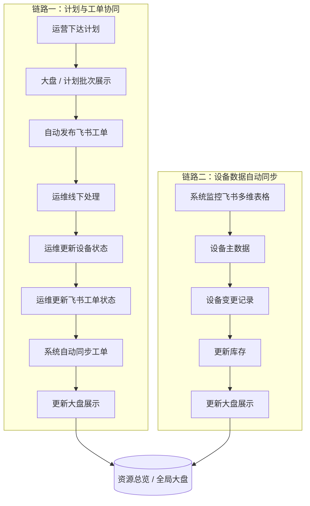
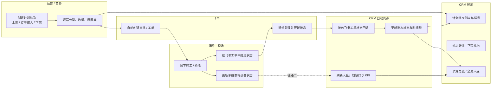
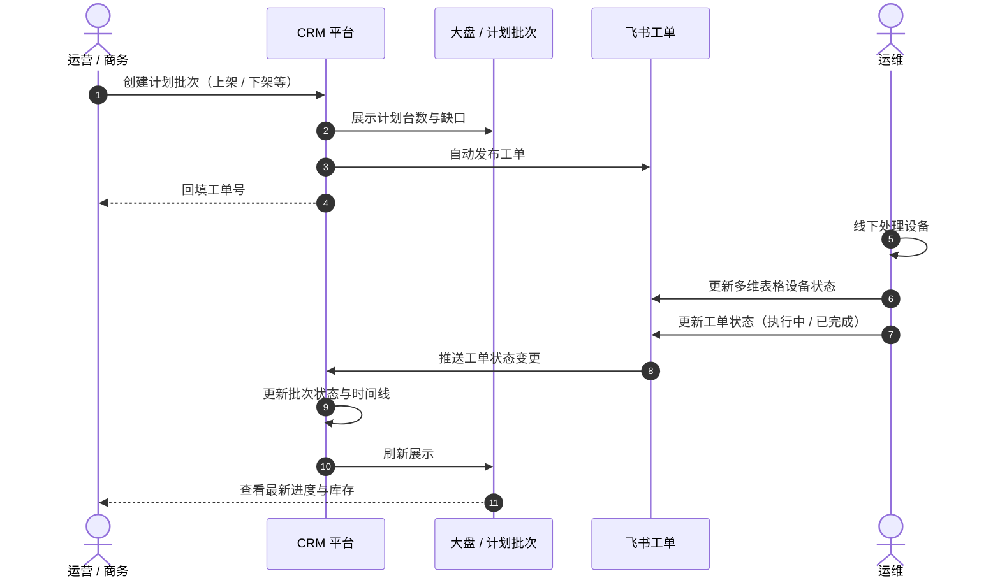
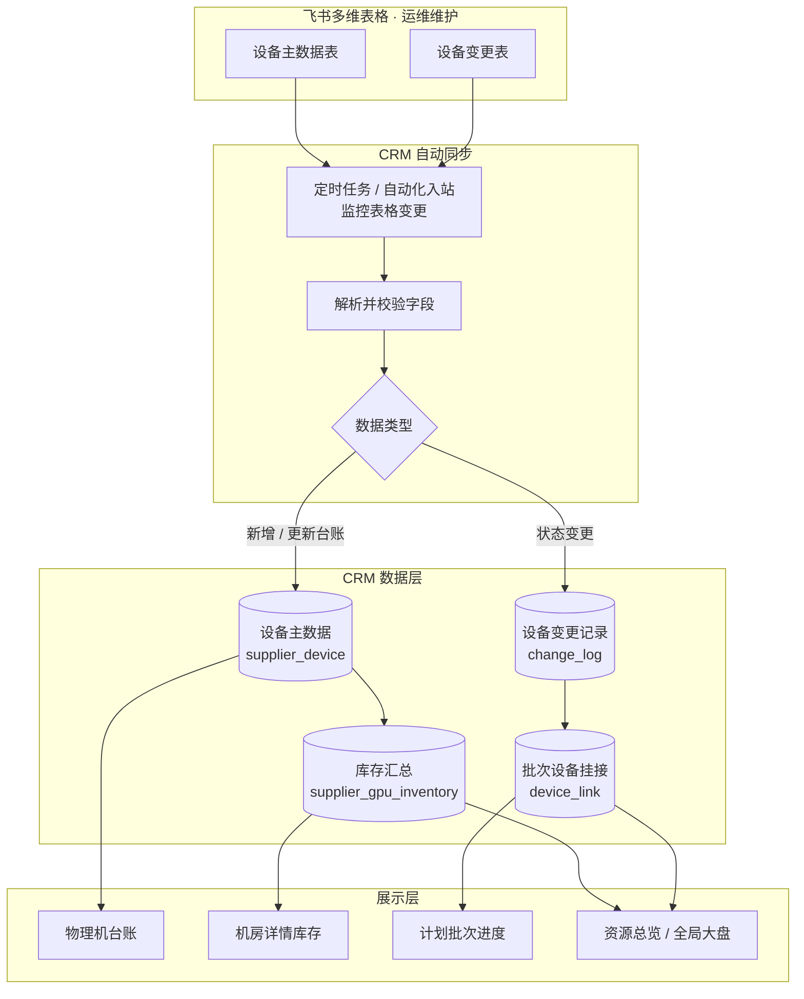
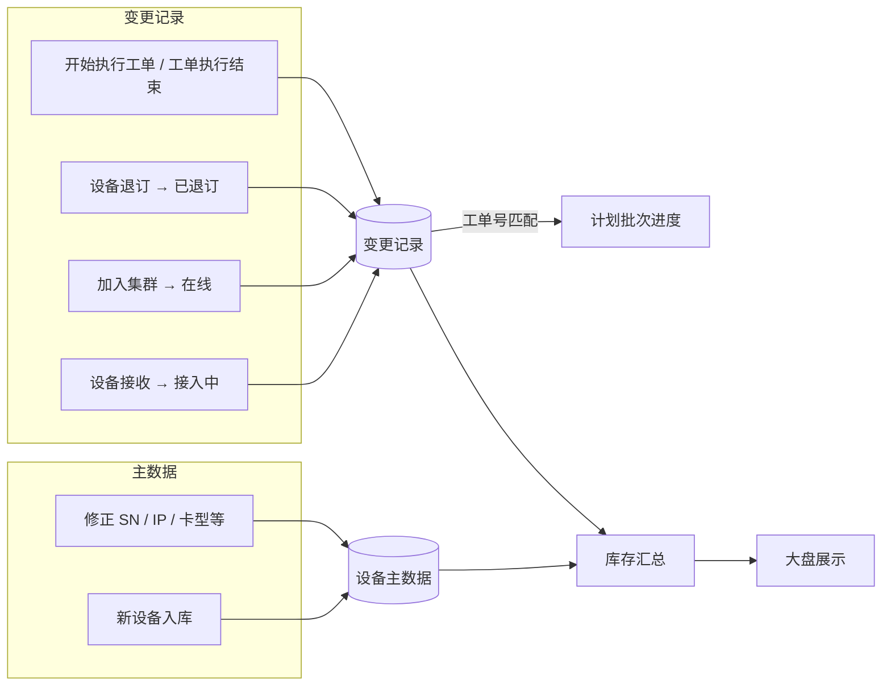
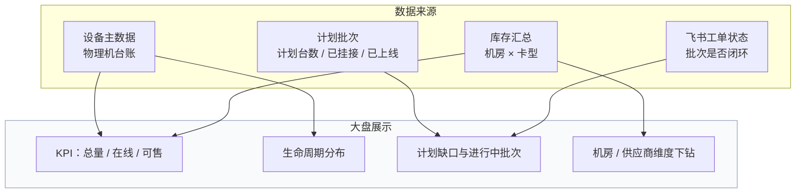

# 供应链平台运行指南

**文档性质**：面向运营、运维与商务的最终用户说明  
**适用读者**：需要了解「平台如何运转、各角色做什么、数据从哪里来」的业务人员  
**关联设计**：[supplier-device-management-ops-panorama.md](../design/supplier-device-management-ops-panorama.md)、[feishu-integration-design.md](../design/feishu-integration-design.md)

---

## 1. 平台在做什么

供应链平台把 **商务计划**、**运维落地** 和 **库存大盘** 串成一条可追溯的链路：

- **运营 / 商务** 在 CRM 下达计划（设备上架、订单接入、设备下架等），系统同步展示在大盘，并自动向飞书发起工单。
- **运维** 在线下完成施工后，在飞书多维表格中更新设备状态与工单进度；系统定时或实时拉取这些数据，写入设备主数据与变更记录，刷新库存与大盘。
- **所有人** 在 CRM 的计划批次、机房详情、资源总览 / 全局大盘上，看到同一套进度与库存数字。

一句话：**计划驱动工单，工单关联设备，设备状态驱动库存，库存汇总进大盘。**

---

## 2. 总体运行全景

下图展示两条并行链路如何共同支撑大盘展示：

| 链路 | 触发方 | 核心动作 | 您在 CRM 中看到的结果 |
|------|--------|----------|------------------------|
| **链路一** | 运营创建计划批次 | 飞书工单自动建单、状态双向同步 | 计划批次进度、工单号、批次状态 |
| **链路二** | 运维维护飞书多维表格 | 系统定时拉取并入库 | 物理机台账、机房库存、在线率 |

两条链路 **相互独立又互相印证**：工单反映「计划是否闭环」，设备数据反映「现场是否落地」。

---

## 3. 链路一：从下达计划到大盘更新

适用于 **设备上架**、**订单接入**、**设备下架** 等计划批次。

### 3.1 端到端流程

### 3.2 分步说明

| 步骤 | 谁来做 | 做什么 | 系统做什么 |
|:----:|--------|--------|------------|
| ① | 运营 / 商务 | 在 CRM 创建计划批次（上架、订单接入，或在机房详情发起下架） | 批次入库；列表与大盘展示计划台数、缺口 |
| ② | 系统 | — | **自动**向飞书发起审批 / 工单，回填工单号到批次 |
| ③ | 运维 | 按工单要求线下施工（网络、镜像、上架、退订等） | — |
| ④ | 运维 | 在飞书多维表格中更新单台设备的运维状态 | 见 **链路二**；变更记录挂接到对应工单 |
| ⑤ | 运维 | 在飞书工单中将状态推进（如「执行中」「已完成」） | 系统接收回调，更新批次 `batch_status` 与供应商时间线 |
| ⑥ | 系统 | — | 汇总批次进度、库存与计划缺口，**刷新大盘展示** |

### 3.3 角色协作（序列图）

### 3.4 您需要知道的几件事

- **工单号** 是计划与现场之间的「桥」：变更记录通过工单号挂接到对应批次，进度数字才会动。
- **批次状态**（如「接入中」「已完成」）由飞书工单驱动；**单台设备状态**（如「在线」「已退订」）由运维在多维表格中维护后经链路二同步。
- 若工单已结束但设备状态未达标，批次可能出现 **「待复核」** 标记，需运营与运维核对。

---

## 4. 链路二：设备数据自动同步

运维日常在 **飞书多维表格** 维护设备台账；系统按配置 **自动监控并同步**，无需每次手工上传 Excel。

### 4.1 数据流转

### 4.2 分步说明

| 步骤 | 说明 | 业务含义 |
|:----:|------|----------|
| ① | 系统监控运维维护的飞书多维表格 | 新机器入库、状态变更会被自动发现 |
| ② | 同步为 **设备主数据** | 每台物理机（SN、IP、卡型、机房等）进入 CRM 台账 |
| ③ | 同步为 **设备变更记录** | 每次状态动作留痕；通过工单号挂接到计划批次 |
| ④ | **更新库存** | 按机房 × 卡型汇总 GPU 总量、在线量等 |
| ⑤ | **更新大盘展示** | 资源总览、全局大盘、机房详情数字一并刷新 |

### 4.3 主数据 vs 变更记录

| 类型 | 典型场景 | 影响 |
|------|----------|------|
| **设备主数据** | 新机器首次登记、修正基础信息 | 台账是否齐全、库存总量 |
| **设备变更记录** | 施工推进、上下线、退订 | **计划批次进度**、在线率、可售量 |

---

## 5. 两条链路如何汇合到大盘

| 大盘指标 | 主要来自 | 更新时机 |
|----------|----------|----------|
| GPU 总量 / 在线量 | 设备主数据 + 库存汇总 | 主数据或变更同步后 |
| 计划缺口 | 计划批次 vs 已挂接设备 | 变更记录挂接后 |
| 批次进行中数量 | 飞书工单 + 批次状态 | 工单状态回调后 |
| 单台下钻 | 物理机台账 | 随时可查 |

---

## 6. 各角色职责速查

| 角色 | 在 CRM 中 | 在飞书中 | 关注的大盘 |
|------|-----------|----------|------------|
| **运营 / 商务** | 创建计划批次、跟踪进度、处理待复核 | 查看工单进展 | 计划缺口、进行中批次 |
| **运维** | 查看批次与机房信息（只读为主） | 维护多维表格设备状态、推进工单 | 在线率、异常设备 |
| **管理层** | 查看资源总览 / 全局大盘 | — | KPI、生命周期、供应商维度 |

---

## 7. 常用入口

| 我想… | 去哪里 |
|-------|--------|
| 查看 / 创建上架、订单、下架计划 | 侧栏 **计划批次** → `/supplier/online-tasks` |
| 查看单机房库存与发起下架 | **机房详情** → `/supplier/datacenters/[id]` |
| 查看单台物理机 | **物理机台账** → `/supplier/devices` |
| 查看全局 KPI 与资源构成 | **全局大盘** → `/dashboard/global` |
| 查看供应商维度总览 | **资源总览** → `/supplier/overview` |

---

## 8. 常见问题

**Q：创建了计划批次，进度为什么还是 0？**  
A：进度由 **设备变更记录** 通过工单号挂接驱动。请确认运维已在多维表格中更新设备状态，且变更记录中的工单号与批次一致。

**Q：飞书工单已完成，设备为什么还没显示在线？**  
A：工单状态只更新 **批次进程**（如「已完成」），不直接改设备状态。设备是否在线，取决于运维是否在变更表中完成了「加入集群」等动作。

**Q：大盘数字和批次详情不一致怎么办？**  
A：大盘展示的是 **当前库存截面**；批次详情展示的是 **本批次的挂接进度**。两者口径不同，均属正常。若同一指标在两处矛盾，请联系管理员核对同步任务是否成功。

**Q：还需要手工上传 Excel 吗？**  
A：在飞书多维表格同步启用后，运维以表格维护为主，系统会自动入库。特殊场景（批量纠错、历史补录）仍可在机房详情使用 Excel 导入。

---

## 9. 延伸阅读

| 文档 | 说明 |
|------|------|
| [supplier-device-management-ops-panorama.md](../design/supplier-device-management-ops-panorama.md) | 运营经理视角完整设备管理全景 |
| [supplier-planned-batches-hub-design.md](../design/supplier-planned-batches-hub-design.md) | 计划批次统一工作台 |
| [feishu-integration-design.md](../design/feishu-integration-design.md) | 飞书工单与多维表格集成设计 |
| [feishu-env-configuration.md](feishu-env-configuration.md) | 飞书集成环境配置（管理员 / 实施） |
