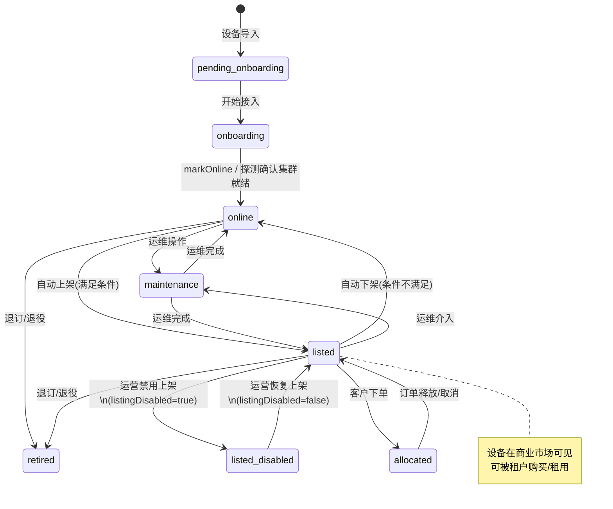
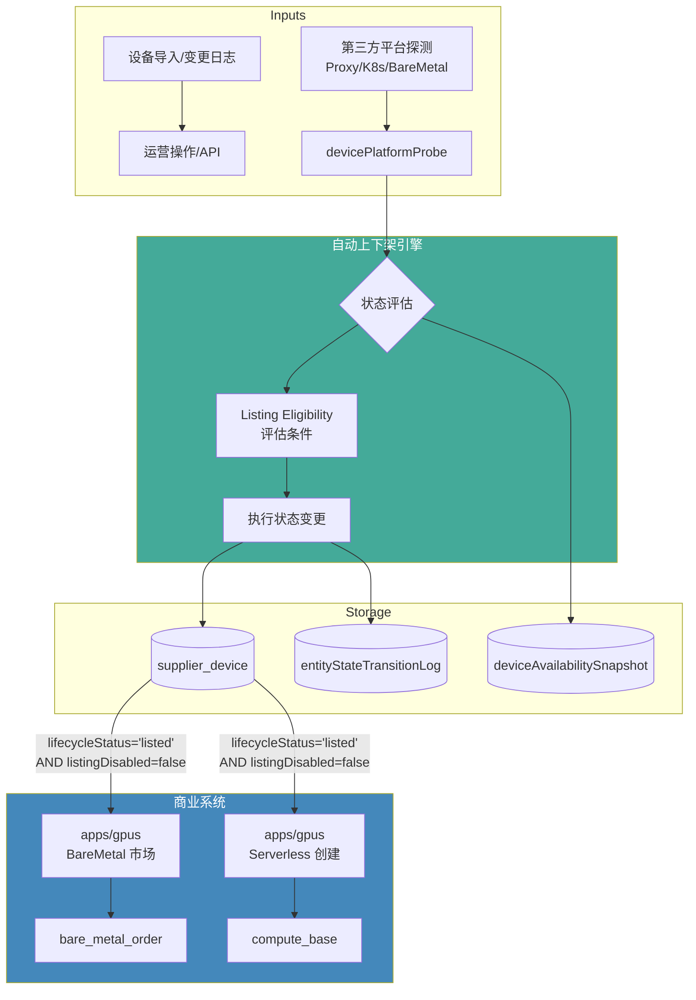
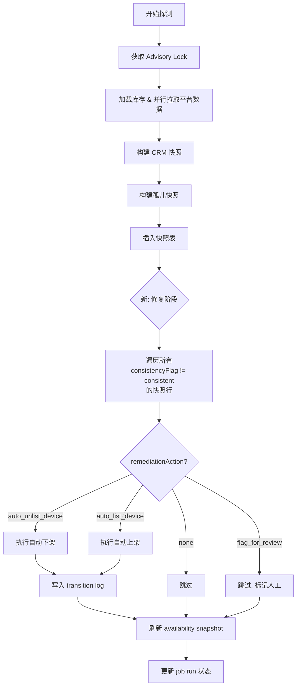

# 设备自动上下架与商业化方案

> **落地注记（2026-09-26）**：`isEligibleForListing` 已启用 probe `consistent` 门禁（`DEVICE_LISTING_REQUIRES_PROBE`，默认 true）；Cron + listingDisabled + probe 调度后的深度 auto-unlist 已接线。完整 RemediationAction 枚举改造仍可按本文 Phase 2 继续深化，但不阻塞商业闭环 P0。


## 1. 现状分析

### 1.1 核心问题：两套互不关联的状态体系

当前存在**两套独立的生命周期状态系统**，没有桥接机制：

| 体系 | 所属应用 | 关键状态值 | 使用场景 |
|------|---------|-----------|---------|
| **运营状态** | `apps/web` | `'待接入'` → `'接入中'` → `'在线'` → `'维护中'` → `'退订'` | 设备导入、运维管理、平台探测 |
| **商业状态** | `apps/gpus` | `'available'` / `'offline'` | Bare metal 市场可见性、设备分配 |

**关键断层**：
- 运营侧 `markOnline()` 将设备设为 `lifecycleStatus='在线'`，但商业市场查询的是 `lifecycleStatus='available'`，两者**永远不会匹配**
- `'available'` 目前仅由 seed 脚本写入（`seed-metal-devices.ts`），没有任何生产代码路径能设置它
- 当前没有任何自动机制将 `'在线'` 转为 `'available'`
- 当前没有任何自动机制在设备进入维护/退订时取消其商业可见性

### 1.2 现有可复用基础设施

尽管存在上述问题，但系统已经具备大量可复用的基础设施：

| 组件 | 当前状态 | 复用方式 |
|------|---------|---------|
| **devicePlatformProbe** | 只读诊断（每小时对比 CRM vs 平台） | 改造为 auto-remediation 引擎 |
| **一致性矩阵** (`OPS_CHANNEL_MATRIX`) | 定义了每种 opsStatus 的期望通道 | 复用为 listing eligibility 判据 |
| **bare metal order 分配/释放** | 完整实现（allocateDevice/stopOrder/cancelOrder） | 直接使用，无需改动 |
| **serverless 实例创建** | 完整实现（createServerless/billServerlessCreate） | 直接使用，无需改动 |
| **调度规则引擎** (`resolveSchedulingAction`) | 已实现但未接入快照刷新 | 接入快照刷新实现池分配 |
| **平台定价** (`platformCardPriceRecord`) | 完整实现 | 作为上架前提条件 |
| **供应商定价** (`supplierCardListPrice`) | 完整实现 | 作为上架前提条件 |
| **余额/计费系统** (`packages/billing`) | 完整实现 | 直接使用 |
| **Cron 基础设施** (`apps/web/src/lib/server/jobs/`) | 已有多条 cron job | 扩展注册新的 listing cron |

## 2. 总体架构

### 2.1 核心设计原则

1. **单一设备记录，统一状态机**：`supplier_device` 是唯一设备记录，取消 "运营状态" 和 "商业状态" 的割裂
2. **可观测性优先**：所有状态变更记录到 `entityStateTransitionLog`，原因可追溯
3. **渐进式自动化**：先实现自动上架（最关键的缺失环节），再优化下架和调度
4. **可配置门控**：自动上下架通过环境变量和配置开关控制

### 2.2 新状态模型



### 2.3 状态值定义

**`lifecycleStatus` 新定义（统一值域）：**

| 值 | 含义 | 可售 | 自动转换 |
|----|------|------|---------|
| `'pending_onboarding'` | 待接入 | 否 | 设备导入时设置 |
| `'onboarding'` | 接入中 | 否 | 开始接入流程时设置 |
| `'online'` | 在线（运营就绪） | 否 | `markOnline()` 或变更日志 |
| `'listed'` | **已上架（商业可见）** | **是** | **自动上架引擎** |
| `'listed_disabled'` | 已上架但运营禁用 | 否 | 运营设 `listingDisabled=true` |
| `'maintenance'` | 维护中 | 否 | 运维标记/变更日志 |
| `'retired'` | 已退订（终端） | 否 | 退订流程 |
| `'allocated'` | 已分配给客户 | 否（已占用） | `allocateDevice()` |

**`opsStatus` 保留现有值域**（12 个种子值 + `可租用`/`使用中`），`opsStatus` 继续表示精确的运维状态细节，`lifecycleStatus` 表示商业生命周期阶段。`opsStatus` **不参与**用户端市场展示和下单逻辑。

### 2.4 系统架构



## 3. 实现步骤

### Phase 1：统一状态模型与基础能力

#### 1.1 扩展 `lifecycleStatus` 值域

**涉及文件：**
- `packages/db/src/supply-schema.ts` — `supplierDevice` 表的 `lifecycleStatus` 列（无需改 schema，值是 varchar）
- `packages/db/src/supply-lifecycle-dictionary.ts` — 种子映射表
- `apps/gpus/src/lib/server/dataaccess/metal-market.ts` — 查询条件
- `apps/gpus/src/lib/server/services/metal-order.ts` — `allocateDevice()` 查询条件
- `apps/gpus/src/lib/server/dataaccess/metal-order-data.ts` — 其他商业查询

**操作：**

1. 定义 `newLifecycleStatus` 统一枚举：
```typescript
// packages/db/src/supply-lifecycle-dictionary.ts 新增
export const LIFECYCLE_STATUS = {
  PENDING_ONBOARDING: 'pending_onboarding',
  ONBOARDING: 'onboarding',
  ONLINE: 'online',
  LISTED: 'listed',
  MAINTENANCE: 'maintenance',
  ALLOCATED: 'allocated',
  RETIRED: 'retired',
} as const

export type LifecycleStatus = (typeof LIFECYCLE_STATUS)[keyof typeof LIFECYCLE_STATUS]
```

2. 更新 `resolveLifecycleStatus()` 函数，将原中文值映射到新值域：
```typescript
// 映射表
const OPS_TO_NEW_LIFECYCLE: Record<string, string> = {
  '预留闲置中': LIFECYCLE_STATUS.ONBOARDING,
  '在集群中': LIFECYCLE_STATUS.ONLINE,
  '集群组件运行中': LIFECYCLE_STATUS.ONLINE,
  '不可调度节点运行中': LIFECYCLE_STATUS.ONLINE,
  '网关直连裸金属上架中': LIFECYCLE_STATUS.ONLINE,
  // ... 其他映射
}
```

3. 更新 `apps/gpus` 中所有查询 `lifecycleStatus='available'` 的位置改为 `lifecycleStatus='listed'`

4. 更新 `allocateDevice()` 的查询条件，增加 `lifecycleStatus='listed'` 而非 `'available'`

5. 更新 `deviceAvailabilitySnapshot` 快照刷新器，改为查询 `lifecycleStatus='listed'` 而非 `'available'`

#### 1.2 新增 `listing_disabled` 字段

**涉及文件：**
- `packages/db/src/supply-schema.ts` — `supplier_device` 表新增字段

```sql
ALTER TABLE supplier_device ADD COLUMN listing_disabled boolean NOT NULL DEFAULT false;
```

`listing_disabled` 允许运营在不改变 `lifecycleStatus` 的情况下临时隐藏设备：
- `lifecycleStatus='listed'` + `listingDisabled=false` → 市场可见
- `lifecycleStatus='listed'` + `listingDisabled=true` → 市场不可见
- `inMaintenance=true` → 无论 `listingDisabled` 如何，强制不可见

#### 1.3 新增 listing 相关 mutation

**涉及文件：**
- `apps/web/src/lib/server/dataaccess/supplier/physical-devices.ts` — 新增函数
- `apps/web/src/lib/server/routers/supplier/index.ts` — 新增 tRPC procedure

**新增函数：**

```typescript
// physical-devices.ts
async function listDevice(deviceId: string, operatorStaffId?: string): Promise<void>
async function batchListDevices(deviceIds: string[], operatorStaffId?: string): Promise<void>
async function unlistDevice(deviceId: string, operatorStaffId?: string, reason?: string): Promise<void>
async function batchUnlistDevices(deviceIds: string[], operatorStaffId?: string): Promise<void>
async function setListingDisabled(deviceId: string, disabled: boolean, operatorStaffId?: string): Promise<void>
```

**`listDevice` 执行逻辑（事务内）：**
1. 验证设备当前 `lifecycleStatus='online'`
2. 验证设备 `inMaintenance=false`
3. 验证 `listingDisabled=false`
4. 验证设备已配置 pricing（检查 `supplierCardListPrice` 是否有该设备的有效价格）
5. 验证 probe 状态为 `consistent`（最后一次 probe 通过）
6. 设置 `lifecycleStatus='listed'`
7. 写入 `entityStateTransitionLog`
8. 写入 `supplierActivity`

**`unlistDevice` 执行逻辑（事务内）：**
1. 验证设备当前 `lifecycleStatus='listed'`
2. 检查设备无正在进行的 `bare_metal_order_device` 分配（`allocationStatus != 'released'`）
3. 设置 `lifecycleStatus='online'`
4. 写入 `entityStateTransitionLog`
5. 写入 `supplierActivity`

**`setListingDisabled` 执行逻辑：**
1. 验证设备当前 `lifecycleStatus='listed'`
2. 设置 `listingDisabled=disabled`
3. 写入 `entityStateTransitionLog`

#### 1.3 新增供应商端 device listing API

**涉及文件：**
- `apps/supplier/src/lib/server/dataaccess/device.ts` — 新增函数
- `apps/supplier/src/lib/server/routers/device.ts` — 新增 procedure

虽然 `apps/supplier` 当前是只读管理，但为了实现供应商自主上下架流程，需要添加：

```typescript
// device.ts dataaccess
async function listDeviceForSupplier(deviceId: string, supplierOrgId: string): Promise<void>
async function unlistDeviceForSupplier(deviceId: string, supplierOrgId: string): Promise<void>
```

这些函数执行相同的状态变更逻辑，但使用 `supplierProcedure` 中间件进行身份验证，确保供应商只能操作自己的设备。

### Phase 2：改造 devicePlatformProbe 为自动上架引擎

这是方案中最关键的部分。当前 probe 系统有成熟的通道探测和一致性评估能力，但结果**只读**。我们将其改造为：

1. 保持现有探测能力（Proxy/K8s/BareMetal 通道探测、一致性矩阵评估）
2. 新增**自动修复**阶段：根据一致性结果执行状态变更
3. 新增**上架评估**阶段：对满足条件的设备执行上架

#### 2.1 新增 `AutoListingEligibility` 评估

**涉及文件：**
- `apps/web/src/lib/server/dataaccess/supplier/` — 新增 `device-auto-listing.ts`

```typescript
// 上架评估输入
interface ListingEligibilityInput {
  device: {
    id: string
    lifecycleStatus: string
    opsStatus: string
    inMaintenance: boolean
    dataCenterId: string
    gpuCardTypeId: string
    supplierId: string
  }
  probeSnapshot: {
    consistencyFlag: string
    probeStatus: string
    presenceProxy: boolean
    presenceK8s: boolean
    presenceBareMetal: boolean
  }
}

// 上架评估结果
interface ListingEligibilityResult {
  eligible: boolean
  reasons: string[]      // 不符合的原因列表
  suggestedAction: 'list' | 'unlist' | 'none'
}

// 上架评估函数
async function evaluateListingEligibility(
  input: ListingEligibilityInput
): Promise<ListingEligibilityResult> {
  const reasons: string[] = []

  // 条件 1: 当前必须是 online 状态
  if (input.device.lifecycleStatus !== 'online') {
    reasons.push('设备未处于在线状态')
  }

  // 条件 2: listingDisabled 必须为 false
  // opsStatus 不参与上架资格判定（纯运维标签）

  // 条件 3: 不在维护中
  if (input.device.inMaintenance) {
    reasons.push('设备处于维护中')
  }

  // 条件 4: Probe 一致性必须为 consistent
  if (input.probeSnapshot.consistencyFlag !== 'consistent') {
    reasons.push(`设备平台一致性检查未通过: ${input.probeSnapshot.consistencyFlag}`)
  }

  // 条件 5: 必须有有效的定价配置
  const hasPricing = await checkDeviceHasPricing(
    input.device.supplierId,
    input.device.dataCenterId,
    input.device.gpuCardTypeId
  )
  if (!hasPricing) {
    reasons.push('设备未配置有效价格')
  }

  return {
    eligible: reasons.length === 0,
    reasons,
    suggestedAction: reasons.length === 0 ? 'list' : 'none',
  }
}
```

#### 2.2 改造 probe 一致性引擎，增加自动修复

**涉及文件：**
- `apps/web/src/lib/server/dataaccess/supplier/device-platform-probe-consistency.ts`

当前 `deriveProbeConsistency()` 返回 `consistencyFlag` + `suggestedAction`（纯文本描述）。改造为：

1. 保留现有一致性判定逻辑
2. 增加 `remediationAction` 字段，类型化为枚举值：

```typescript
type RemediationAction =
  | 'none'
  | 'auto_list_device'           // 满足上架条件，自动上架
  | 'auto_unlist_device'         // 通道缺失，自动下架
  | 'auto_mark_maintenance'      // 通道消失，标记维护
  | 'flag_for_review'            // 需要人工审核
```

更新 `deriveProbeConsistency()` 的输出：

```typescript
interface ProbeConsistencyResult {
  consistencyFlag: ConsistencyFlag
  consistencyReason: string
  suggestedAction: string
  remediationAction: RemediationAction
  eligibilityResult?: ListingEligibilityResult
}
```

更新 `OPS_CHANNEL_MATRIX` 增加 `remediation` 列：

| opsStatus | 期望通道 | 缺失时的 remediation |
|-----------|---------|---------------------|
| `预留闲置中` | none: none | `none` |
| `在集群中` | proxy:optional, k8s:required, bm:none | `auto_unlist_device` |
| `集群组件运行中` | proxy:optional, k8s:required, bm:none | `auto_unlist_device` |
| `不可调度节点运行中` | proxy:optional, k8s:required, bm:none | `auto_unlist_device` |
| `可租用` | proxy:optional, k8s:optional, bm:optional | `auto_unlist_device` |

#### 2.3 在 probe 调度执行中增加 auto-remediation 阶段

**涉及文件：**
- `apps/web/src/lib/server/dataaccess/supplier/device-platform-probe-scheduled.ts`

改造 `runScheduledDevicePlatformProbe()`，在现有构建快照之后，新增一个**修复阶段**：



**核心新增逻辑：**

```typescript
// 在 probe 调度中新增
async function remediateDeviceStatuses(
  snapshots: ProbeSnapshotInsert[],
  tx: Transaction
): Promise<RemediationSummary> {
  const summary: RemediationSummary = { listed: 0, unlisted: 0, flagged: 0 }

  for (const snapshot of snapshots) {
    if (snapshot.recordKind !== 'crm_inventory') continue
    if (!snapshot.supplierDeviceId) continue

    const result = snapshot.consistencyResult  // 新字段

    switch (result.remediationAction) {
      case 'auto_list_device':
        // 检查是否已上架
        const device = await tx.select({ lifecycleStatus })
          .from(supplierDevice)
          .where(eq(supplierDevice.id, snapshot.supplierDeviceId))
          .then(r => r[0])
        if (device && device.lifecycleStatus === 'online') {
          await autoListDevice(tx, snapshot.supplierDeviceId)
          summary.listed++
        }
        break

      case 'auto_unlist_device':
        await autoUnlistDevice(tx, snapshot.supplierDeviceId, result.consistencyReason)
        summary.unlisted++
        break

      case 'flag_for_review':
        // 写入告警供人工查看
        summary.flagged++
        break
    }
  }

  return summary
}
```

#### 2.4 修改 probe 配置增加 listing 相关开关

**涉及文件：**
- `apps/web/src/lib/server/dataaccess/supplier/device-platform-probe-config.ts`

```typescript
export const deviceProbeConfig = {
  // 现有配置...
  autoListingEnabled: env('DEVICE_AUTO_LISTING_ENABLED', 'false') === 'true',
  autoUnlistingEnabled: env('DEVICE_AUTO_UNLISTING_ENABLED', 'true') === 'true',
  listingRequiresPricing: env('DEVICE_LISTING_REQUIRES_PRICING', 'true') === 'true',
  listingRequiresProbeConsistency: env('DEVICE_LISTING_REQUIRES_PROBE', 'true') === 'true',
}
```

### Phase 3：商业化端点桥接

#### 3.1 更新 `apps/gpus` 商业查询

**涉及文件：**
- `apps/gpus/src/lib/server/dataaccess/metal-market.ts`

将 `lifecycleStatus` 查询条件从 `'available'` 改为 `'listed'`：

```typescript
// 修改前
eq(supplierDevice.lifecycleStatus, "available"),

// 修改后
eq(supplierDevice.lifecycleStatus, "listed"),
```

同时移除 `opsStatus` 条件（`opsStatus` 不参与市场展示）：

```typescript
// 修改前: 有过多的 opsStatus 条件
sql`${supplierDevice.opsStatus} IN ('可租用', 'available')`,

// 修改后: opsStatus 不再作为市场展示条件, 仅由 lifecycleStatus + listingDisabled + inMaintenance 决定
// opsStatus 保持纯运维标签
```

#### 3.2 更新 `allocateDevice()` 分配查询

**涉及文件：**
- `apps/gpus/src/lib/server/services/metal-order.ts`

```typescript
// 修改前
eq(supplierDevice.lifecycleStatus, "available"),

// 修改后
eq(supplierDevice.lifecycleStatus, "listed"),
eq(supplierDevice.listingDisabled, false),
eq(supplierDevice.inMaintenance, false),
// opsStatus 不参与分配查询
```

#### 3.3 更新设备分配后的状态变更

在 `allocateDevice()` 分配设备后，除了设置 `opsStatus='使用中'`，同时将 `lifecycleStatus` 改为 `'allocated'`：

```typescript
// 在分配事务中新增
await tx.update(supplierDevice)
  .set({
    opsStatus: '使用中',
    lifecycleStatus: 'allocated',  // 新增
  })
  .where(eq(supplierDevice.id, device.id))
```

在 `stopOrder()` / `cancelOrder()` 释放设备后，除了设置 `opsStatus='可租用'`，同时将 `lifecycleStatus` 改回 `'listed'`：

```typescript
// 在释放事务中新增
await tx.update(supplierDevice)
  .set({
    opsStatus: '可租用',
    lifecycleStatus: 'listed',  // 改回
  })
  .where(eq(supplierDevice.id, deviceId))
```

#### 3.4 更新 scheduling 快照刷新

**涉及文件：**
- `apps/web/src/lib/server/dataaccess/scheduling/snapshot-refresher.ts`

```typescript
// 修改前
.where(eq(supplierDevice.lifecycleStatus, 'available'))

// 修改后：商业可见的设备都纳入快照
.where(
  inArray(supplierDevice.lifecycleStatus, [
    LIFECYCLE_STATUS.LISTED,
    LIFECYCLE_STATUS.ALLOCATED,
  ])
)
```

同时将 `resolveSchedulingAction` 集成到快照刷新流程中，为每台设备分配 pool/priority：

```typescript
async function refreshAllSnapshots() {  // 伪代码
  const devices = await loadListedDevices()

  for (const device of devices) {
    const action = await resolveSchedulingAction({
      tenantId: device.supplierId,
      deviceSpec: parseDeviceSpec(device.deviceSpec),
    })

    await upsertSnapshot(device, {
      pool: mapActionToPool(action.type),
      currentPriorityClass: action.priorityClass,
      currentWeight: action.weight,
    })
  }
}
```

### Phase 4：前端变更

#### 4.1 `apps/web` 运营平台 — 设备详情页增加上下架操作

**涉及文件：**
- `apps/web/src/app/[locale]/supplier/physical-devices/_components/` — 新增上下架按钮
- `apps/web/src/app/[locale]/supplier/physical-devices/[id]/page.tsx` — 详情页

在设备详情页中：
- 如果设备 `lifecycleStatus='online'`，显示"上架"按钮
- 如果设备 `lifecycleStatus='listed'`，显示"下架"按钮（确认弹窗）
- 显示自动上架状态（启用/禁用状态、上次评估时间、不满足条件的原因）

#### 4.2 `apps/supplier` 供应商门户 — 设备列表增加上下架操作

**涉及文件：**
- `apps/supplier/src/app/[locale]/console/devices/_components/device-list-client.tsx` — 列表操作列

供应商可以在自己的设备列表中：
- 对处于 `'online'` 状态的设备点击"上架"
- 对处于 `'listed'` 状态的设备点击"下架"
- 查看自动上架状态

#### 4.3 `apps/gpus` 用户端 — 市场页面

**当前状态**：`apps/gpus/src/app/[locale]/console/metal/list/page.tsx` 已经实现了市场浏览页面，可以展示，但数据只有 seed。当 auto-listing 完成后，市场将展示真实数据。

无需修改前端代码，只需确保 tRPC 查询 `trpc.metal.deviceList` 能返回真实数据。

### Phase 5：任务发布（Serverless / Container）

**当前状态**：Serverless 实例创建和计费流程已经完整实现。唯一缺失的是底层调度（`scheduling/engine.ts` 的 `resolveSchedulingAction` 已实现但未接入快照刷新）。

**需要完成的工作：**

#### 5.1 完成 scheduling 快照刷新 → 规则集成

```typescript
// snapshot-refresher.ts
// 修改 refreshAllSnapshots / refreshDeviceSnapshot
// 让每台设备调用 resolveSchedulingAction() 来决定 pool/priority
```

#### 5.2 确保 `compute.createServerless` 通过 scheduling layer

当前 serverless 创建 (`compute.ts`) 直接使用 `deviceAvailabilitySnapshot` 表。确保：
- `listAvailableDevices` 查询使用 `lifecycleStatus='listed'` 而非旧的值
- 调度规则匹配能正确处理 `productLine='serverless'`

#### 5.3 更新 compute_base / serverless_detail 的状态依赖

无需大改，只需确认状态查询条件与新的 `lifecycleStatus` 值域一致。

### Phase 6：自动下架与异常处理

#### 6.1 Probe 驱动自动下架

当 probe 检测到以下情况时，自动触发下架：

| 场景 | 探测结果 | 操作 |
|------|---------|------|
| 设备在 CRM 但平台消失 | `consistencyFlag='missing_platform'` | 自动下架 (`lifecycleStatus='online'`) |
| 设备进入维护 | `inMaintenance=true` | 自动下架 |
| 设备 opsStatus 变为不可调度 | `opsStatus='不可调度节点运行中'` | 自动下架 |
| 设备被退订 | `lifecycleStatus='retired'` | 自动清理快照 |
| 订单逾期未续租 | `status='overdue'` + retries >= 3 | 自动停止并释放 |

#### 6.2 运维操作触发下架

当运维人员在 `apps/web` 中：
- 将设备 `inMaintenance` 设为 `true` → 自动触发 `unlistDevice()`
- 通过变更日志将设备 opsStatus 改为不可售状态 → 自动检查并下架
- 设备退订 → 自动清理

## 4. 数据库变更

### 4.1 新增 migration（Drizzle）

**SQL 迁移内容（无需 schema 变更，完全是数据迁移）：**

```sql
-- 第一步：将旧的 lifecycleStatus 映射到新值域
-- '待接入' → 'pending_onboarding'
-- '接入中' → 'onboarding'
-- '在线' → 'online'
-- '维护中' → 'maintenance'
-- '退订' → 'retired'
-- 'available' → 'listed'
-- 'offline' → 'retired' (seed 中 stock=0 的情况)

UPDATE supplier_device
SET lifecycle_status = 'listed'
WHERE lifecycle_status IN ('available');

UPDATE supplier_device
SET lifecycle_status = 'online'
WHERE lifecycle_status IN ('在线');

UPDATE supplier_device
SET lifecycle_status = 'onboarding'
WHERE lifecycle_status IN ('接入中', '待接入');

UPDATE supplier_device
SET lifecycle_status = 'maintenance'
WHERE lifecycle_status IN ('维护中');

UPDATE supplier_device
SET lifecycle_status = 'retired'
WHERE lifecycle_status IN ('退订', 'offline');

-- 第二步：种子数据中 opsStatus='available' 改为 '可租用'
UPDATE supplier_device
SET ops_status = '可租用'
WHERE ops_status = 'available';
```

### 4.2 新增可选索引

```sql
CREATE INDEX IF NOT EXISTS idx_supplier_device_listed
ON supplier_device (lifecycle_status)
WHERE lifecycle_status IN ('listed', 'allocated');
```

## 5. 文件变更清单

| # | 文件路径 | 变更类型 | 变更内容 |
|---|---------|---------|---------|
| **Phase 1 — 统一状态模型** |
| 1 | `packages/db/src/supply-lifecycle-dictionary.ts` | 修改 | 新增 `LIFECYCLE_STATUS` 枚举、映射函数 |
| 2 | `packages/db/src/supply-schema.ts` | **修改** | **新增 `listingDisabled` 字段** |
| 3 | `apps/web/src/lib/server/dataaccess/supplier/device-import-utils.ts` | 修改 | 更新 `resolveLifecycleStatus()` 映射到新值域 |
| 4 | `apps/web/src/lib/server/dataaccess/supplier/physical-devices.ts` | 修改 | 更新 `markOnline()` 目标值；新增 `listDevice()`/`unlistDevice()`/`setListingDisabled()` |
| 5 | `apps/web/src/lib/server/routers/supplier/index.ts` | 修改 | 新增 `supplier.listDevice`/`supplier.unlistDevice`/`supplier.batchListDevices`/`supplier.setListingDisabled` tRPC |
| 6 | `apps/supplier/src/lib/server/dataaccess/device.ts` | 修改 | 新增 `listDeviceForSupplier()`/`unlistDeviceForSupplier()` |
| 7 | `apps/supplier/src/lib/server/routers/device.ts` | 修改 | 新增 `device.list`/`device.unlist` mutation |
| **Phase 2 — Probe 改造** |
| 8 | `apps/web/src/lib/server/dataaccess/supplier/device-auto-listing.ts` | **新增** | `evaluateListingEligibility()` 核心评估逻辑 |
| 9 | `apps/web/src/lib/server/dataaccess/supplier/device-platform-probe-consistency.ts` | 修改 | 新增 `RemediationAction` 类型，扩展 `deriveProbeConsistency()` 输出 |
| 10 | `apps/web/src/lib/server/dataaccess/supplier/device-platform-probe-build.ts` | 修改 | 构建快照时附加 `remediationAction` |
| 11 | `apps/web/src/lib/server/dataaccess/supplier/device-platform-probe-scheduled.ts` | 修改 | 新增修复阶段 → 调用 `remediateDeviceStatuses()` |
| 12 | `apps/web/src/lib/server/dataaccess/supplier/device-platform-probe-config.ts` | 修改 | 新增 auto-listing 开关配置 |
| **Phase 3 — 商业化桥接** |
| 13 | `apps/gpus/src/lib/server/dataaccess/metal-market.ts` | 修改 | `lifecycleStatus='listed'` |
| 14 | `apps/gpus/src/lib/server/services/metal-order.ts` | 修改 | `allocateDevice()` + `stopOrder()`/`cancelOrder()` 新增 lifecycleStatus 变更 |
| 15 | `apps/web/src/lib/server/dataaccess/scheduling/snapshot-refresher.ts` | 修改 | 查询条件改为 `['listed', 'allocated']`，接入 `resolveSchedulingAction()` |
| **Phase 4 — 前端变更** |
| 16 | `apps/web/src/app/[locale]/supplier/physical-devices/[id]/page.tsx` | 修改 | 详情页增加上下架按钮 |
| 17 | `apps/web/src/app/[locale]/supplier/physical-devices/_components/*.tsx` | 修改 | 列表页增加批量上下架操作 |
| 18 | `apps/supplier/src/app/[locale]/console/devices/_components/device-list-client.tsx` | 修改 | 列表操作列增加上下架按钮 |
| **Phase 5 — 任务发布** |
| 19 | `apps/web/src/lib/server/dataaccess/scheduling/engine.ts` | 无需改 | 已实现，只需接入刷新器 |
| 20 | `apps/web/src/lib/server/dataaccess/scheduling/snapshot-refresher.ts` | 见 #15 | 同上 |
| **Phase 6 — 自动下架** |
| 21 | 同 #11 和 #9 | 修改 | probe 修复阶段的 unlist 逻辑 |

**总计：约 21 个文件变更（3 个新增，18 个修改）**

## 6. 环境变量（新增）

| 变量名 | 默认值 | 说明 |
|-------|--------|------|
| `DEVICE_AUTO_LISTING_ENABLED` | `'false'` | 开启自动上架功能 |
| `DEVICE_AUTO_UNLISTING_ENABLED` | `'true'` | 开启自动下架功能 |
| `DEVICE_LISTING_REQUIRES_PRICING` | `'true'` | 上架需要定价已配置 |
| `DEVICE_LISTING_REQUIRES_PROBE` | `'true'` | 上架需要 probe 一致性通过 |

## 7. 上线步骤

### Step 1: 部署 Phase 1（统一状态模型）
1. 执行数据迁移 SQL，将现有 `lifecycleStatus` 映射到新值域
2. 部署更新后的 `apps/web`（新增 list/unlist tRPC）
3. 部署更新后的 `apps/supplier`（新增供应商上下架 API）
4. 验证运营人员可以手动上下架设备

### Step 2: 部署 Phase 2（Probe 改造）
1. 部署更新后的 `devicePlatformProbe` 系统（加 auto-remediation）
2. 初期设置 `DEVICE_AUTO_LISTING_ENABLED=false`，仅启用自动下架
3. 观察 probe 行为，确认 auto-remediation 不会误操作
4. 逐步开放自动上架

### Step 3: 部署 Phase 3（商业化桥接）
1. 部署更新后的 `apps/gpus`（更新查询条件）
2. 部署更新后的 scheduling 快照刷新
3. 验证真实设备出现在 bare metal 市场上
4. 验证端到端下单流程：浏览 → 下单 → 分配 → 使用 → 释放

### Step 4: 灰度与监控
1. 逐步将更多设备纳入自动上架范围
2. 监控 `entityStateTransitionLog` 确保状态变更正确
3. 监控 `devicePlatformProbeJobRun` 的 remediation 计数
4. 设置告警：remediation 异常频率过高时告警

## 8. 风险与缓解

| 风险 | 影响 | 缓解方案 |
|------|------|---------|
| 自动上架将尚不稳定的设备暴露给客户 | 用户体验差、客诉 | 1. `DEVICE_AUTO_LISTING_ENABLED` 默认关闭<br>2. 上架需要 probe consistent + pricing 双重条件<br>3. 运营可通过 `listingDisabled` 随时隐藏 |
| 自动下架将正常运行的客户实例中断 | 商业损失 | 下架前检查 `bare_metal_order_device.allocationStatus != 'released'`，有活跃订单的设备不自动下架 |
| 种子数据中存在 `lifecycleStatus='available'` 的设备 | 可能与新值域冲突 | 数据迁移时统一映射到 `'listed'` |
| `apps/gpus` 查询条件变更导致旧数据不可见 | 市场展示为空 | 迁移期间新旧值域兼容（`IN ('listed', 'available')`） |

## 9. 验证方案

### 9.1 单元测试
- `evaluateListingEligibility()` 的各种条件组合
- `remediateDeviceStatuses()` 的各 remediation 路径
- `autoListDevice()` / `autoUnlistDevice()` 的事务正确性

### 9.2 集成测试
- 手动上架 + 自动下架流程
- 自动上架 → 订购 → 释放 → 自动恢复流程
- Probe 一致性变更触发自动修复

### 9.3 E2E 测试
- 运营 web 上架设备 → gpus 市场可见 → 租户下单 → 使用 → 释放
- 供应商门户上架设备 → 市场可见
- Probe 检测到设备异常 → 自动下架 → 市场不可见

## 10. 架构总览（最终形态）

```mermaid
flowchart LR
    subgraph DataInput[数据输入]
        A[设备导入(原 Excel 链 2026-10-06 已下线,现经 supplier/devices 页维护)] --> B[apps/web 运营平台]
        C[变更日志] --> B
        D[Probe 定时探测] --> E[Auto-Listing Engine]
    end

    subgraph Engine[Auto-Listing Engine\napps/web]
        E --> F{一致性评估}
        F --> G[List Eligibility]
        G --> H[执行上架/下架]
        H --> I[entityStateTransitionLog]
        H --> J[deviceAvailabilitySnapshot]
    end

    subgraph Billing[计费系统]
        K[packages/billing]
    end

    subgraph Commercial[商业系统]
        L[apps/gpus 市场] --> M[bare_metal_order]
        L --> N[compute_base/serverless]
        M --> K
        N --> K
    end

    subgraph Supplier[供应商]
        O[apps/supplier 门户]
        O --> B
    end

    B --> E
    J --> L
    J --> N

    style Engine fill:#4a9,color:#fff
    style Commercial fill:#48b,color:#fff
    style Billing fill:#e83,color:#fff
```

## 11. 无需修改的部分

以下功能已经完整实现，**不需要修改**：

| 功能 | 说明 |
|------|------|
| Bare metal 订单创建 (`createMetalOrder`) | 完整的余额扣减 + 订单创建 + 价格快照 |
| 设备分配 (`allocateDevice`) | 并发安全的 `FOR UPDATE SKIP LOCKED` 分配 |
| 订单停止/取消/退款 | `stopOrder()` / `cancelOrder()` 含按比例退款 |
| 自动续租 (`scanAndRenewOrders`) | cron 驱动的自动续租 + 逾期处理 |
| Serverless 实例创建 (`createServerless`) | 含计费冻结 + SkyPilot 部署 |
| 定期扣费 (`billServerlessPeriodicDeduction`) | 每 5 分钟从预留余额扣费 |
| 余额管理 (`packages/billing`) | credit/debit/freeze/unfreeze/consume |
| 调度规则 CRUD | `rules.ts` + `engine.ts` 完整实现 |
| 平台定价管理 | `platformCardPriceRecord` CRUD |
| 供应商定价管理 | `supplierCardListPrice` CRUD |
