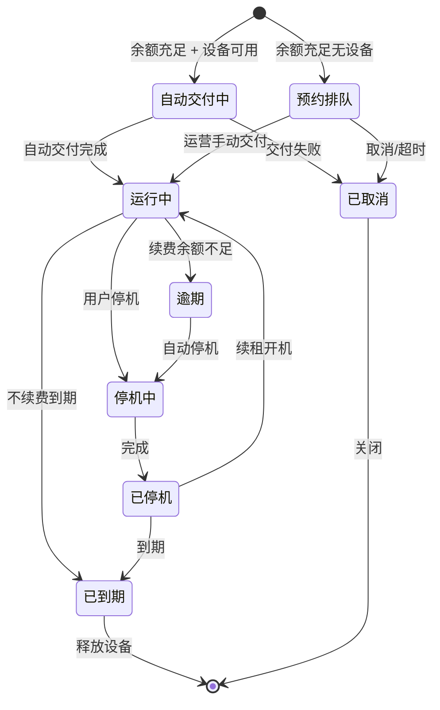
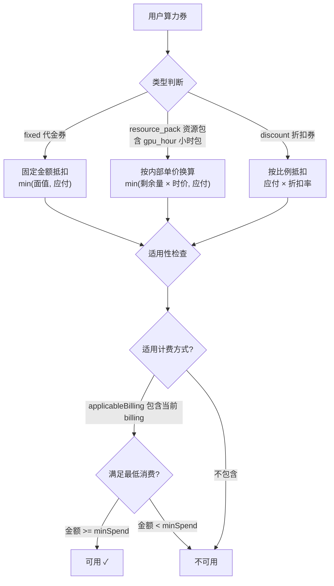
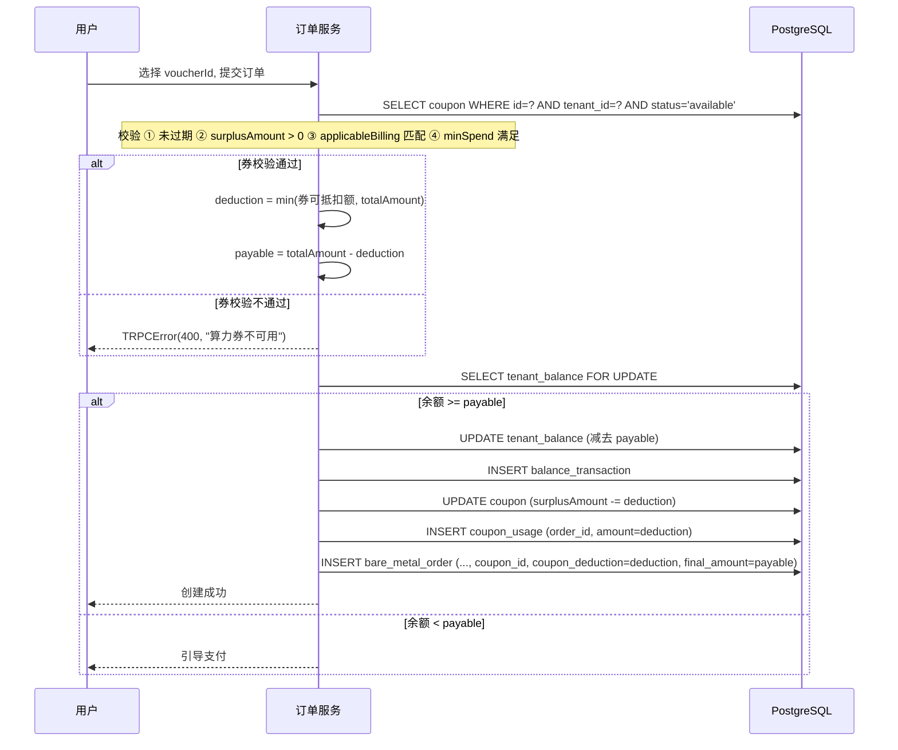
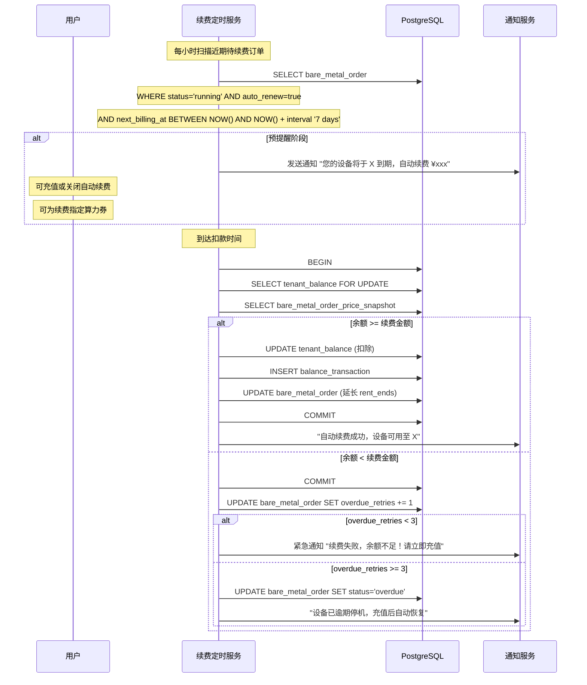
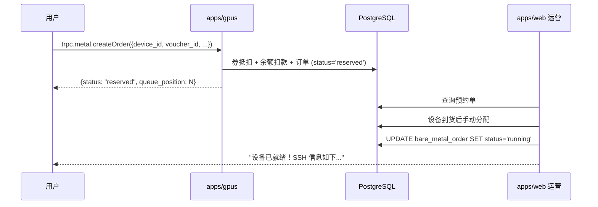
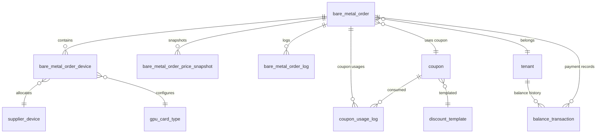
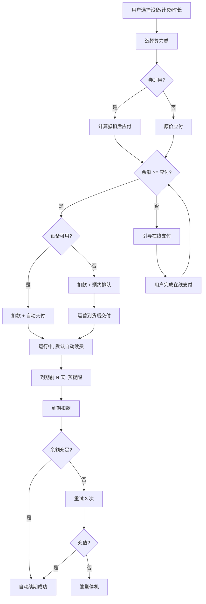
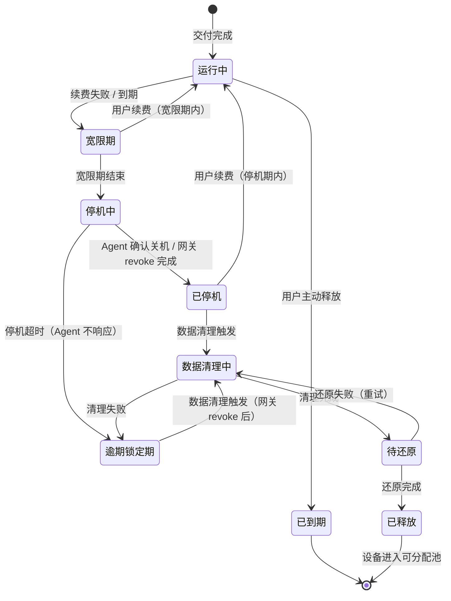

# 裸金属订单设计

> 余额充足 + 设备可用 → 自动交付，用户即时获得 SSH。
> 设备不足 → 预约单，运营到货后手动交付。
> 自动续费默认开启，支持算力券抵扣。
>
> **余额表**：一律使用 `tenant_balance`（`available_balance` / `reserved_balance`），原语见 `../design/cloud/tenant-balance-unification.md`。
> 裸金属预付走 `deduct_available`，不使用 `freeze`。
> **券类型**：`fixed` / `discount` / `resource_pack`（见 `product-line-taxonomy.md` §6 算力券类型）。

---

## 1. 核心原则

```
订单创建 → 算力券抵扣 → 余额检查 → 设备检查
                                        │
                         ┌──────────────┼──────────────┐
                         ▼              ▼              ▼
                    余额不足         余额充足         余额充足
                                   设备可用         设备不可用
                                      │                │
                                      ▼                ▼
                                 即时自动交付        预约单
                                 (running)         (reserved)
                                      │                │
                                      ▼                ▼
                                用户获得 SSH      等待运营交付
                                直接使用           到货后手动交付

运行中 → 默认自动续费 → 到期前分级提醒 → 券抵扣 → 余额扣款 → 续期
                                          → 余额不足紧急提醒 → 逾期停机
```

| 条件 | 结果 | 交付方式 |
|------|------|---------|
| 余额充足 + 设备可用 | 即时创建 + 自动交付 | 全自动 |
| 余额充足 + 设备不可用 | 预约单（扣款，排队） | 运营手动 |
| 余额不足 | 引导在线支付 | 引导支付 |

---

## 2. 状态机



---

## 3. 算力券系统

### 3.1 券类型与适用性



**券适用规则**（类型权威见 `product-line-taxonomy.md` §6 算力券类型；§7 为计算任务字段）：

| 字段 | 说明 | 裸金属场景 |
|------|------|-----------|
| `type` | fixed / discount / **resource_pack** | 原「hours 小时券」= `resource_pack` + `pack_unit=gpu_hour` |
| `applicableBilling` | 适用的 billing 方式 | 映射：`hour`→`hour`（包时券）；按秒任务侧用 `on-demand`；daily/weekly/monthly 同名 |
| `minSpend` | 最低消费门槛 | 订单总金额 >= minSpend 才可用 |
| `expiresAt` | 过期时间 | 必须在有效期内 |
| `surplusAmount` / pack 剩余 | 剩余额度 | 抵扣后减少，用完为止 |

**计费方式映射**（复用电面现有 `metalBillingToVoucherBilling`）：

| 裸金属 `billingUnit` | 映射为券 `applicableBilling` |
|---------------------|----------------------------|
| `hour` | `hour` |
| `day` | `daily` |
| `week` | `weekly` |
| `month` | `monthly` |

> K8s 按秒任务的券适用值使用 `on-demand`（与 `commitment` 对齐）。裸金属无「按秒」SKU，包时用 `hour`。

### 3.2 下单时券抵扣逻辑



**下单时券只能抵扣第一期费用**，后续续费使用新券或余额。

### 3.3 续费时券处理

续费扣款时 **不自动使用新券**。系统每次扣款优先从余额扣除，用户可手动为续费指定券：

```sql
-- 续费扣款不使用券（默认）
UPDATE tenant_balance SET available_balance = available_balance - ?
WHERE tenant_id = ?;

-- 若用户提前指定续费券，则走 coupon 抵扣流程
-- 用户调用: trpc.metal.setRenewalVoucher({orderId, voucherId})
```

**视觉提示**：续费提醒通知中提示用户可选用券抵扣。

### 3.4 券使用记录追踪

> 计划使用共享表 `coupon_usage_log`（`../design/cloud/database-design.md` §9.2）——**该表当前未建**，实现仅扣减券额度、未写使用流水（`metal-order.ts` 存在 TODO）。
> 裸金属场景写入时：`ref_type='bare_metal_order'`, `ref_id=订单ID`。

### 3.5 用户前端券选择

裸金属部署页已有以下组件和逻辑，直接映射到后端：

| 前端组件/函数 | 用途 | 后端对应 |
|-------------|------|---------|
| `metalBillingToVoucherBilling(billing)` | 将裸金属计费方式映射为券适用计费方式 | — |
| `isComputeVoucherApplicable(voucher, billing, amount)` | 前端实时校验券是否可用 | 后端同样校验逻辑 |
| `getComputeVoucherDeduction(voucher, price, hourlyRate)` | 计算券可抵扣额 | 后端 coupon_usage.amount |
| `MetalVoucherSelect` | 用户选择券的 UI | — |
| `voucherId` in submit payload | 用户选中的券 ID | bare_metal_order.coupon_id |

---

## 4. 自动续费机制

### 4.1 续费规则

续费周期 = 下单时的 billing_unit。默认开启。

| 计费单位 | 续费周期 | 扣款时机 | 预提醒 | 紧急提醒 |
|---------|---------|---------|-------|---------|
| `hour` | 每小时 | 到期前 5 分钟 | 到期前 10 分钟 | 扣款失败立即 |
| `day` | 每日 | 到期前 1 小时 | 到期前 6 小时 | 扣款失败立即 |
| `week` | 每周 | 到期前 6 小时 | 到期前 3 天 | 扣款失败立即 |
| `month` | 每月 | 到期前 24 小时 | 到期前 7 天 | 扣款失败立即 |

### 4.2 续费全流程



### 4.3 重试策略

```
第 1 次失败 → 紧急提醒, 1h 内充值可恢复
第 2 次失败 → 再次提醒, 6h 宽限期
第 3 次失败 → 标记 overdue, 自动停机
用户充值后 → 从 overdue 恢复为 running
```

---

## 5. 用户下单流程

### 5.1 Happy Path：余额充足 + 设备可用 + 使用券

```mermaid
sequenceDiagram
    participant U as 用户
    participant G as apps/gpus tRPC
    participant DB as PostgreSQL
    participant A as 自动交付服务

    U->>G: trpc.metal.createOrder({
    U->>G:   device_id, billing, duration,
    U->>G:   voucher_id: "monthly-50", auto_renew: true
    U->>G: })

    G->>DB: SELECT coupon (校验可用性、余额)
    Note over G: deduction = min(50, total)
    Note over G: payable = total - deduction

    G->>DB: BEGIN TX
    G->>DB: SELECT tenant_balance FOR UPDATE (payable >= 余额)

    alt 自动交付
        G->>DB: UPDATE tenant_balance (减去 payable)
        G->>DB: INSERT balance_transaction
        G->>DB: UPDATE coupon (surplusAmount -= deduction)
        G->>DB: INSERT coupon_usage_log (ref_type='bare_metal_order', ref_id=order.id)
        G->>DB: INSERT bare_metal_order_price_snapshot
        G->>DB: INSERT bare_metal_order (
        Note over G:   status='provisioning', coupon_id, coupon_deduction=50,
        Note over G:   final_amount=payable, coupon_amount=50,
        Note over G:   auto_renew=true, next_billing_at=...)
        G->>DB: COMMIT

        A->>DB: 自动交付（分配设备、下发 SSH）
        G-->>U: {
          status: "running",
          ssh: {host, port, user, key},
          coupon: {name: "包月满300减50", deduction: 50},
          payable: 8590,
          rent_ends: "2026-08-16",
          auto_renew: true
        }
    end
```

### 5.2 预约单流程



### 5.3 余额不足引导支付

```mermaid
sequenceDiagram
    participant U as 用户
    participant G as apps/gpus tRPC

    U->>G: trpc.metal.createOrder({...})
    G->>G: 券抵扣后 payable > 余额

    G-->>U: {
      error: "BALANCE_INSUFFICIENT",
      total: 8640, deduction: 50, payable: 8590,
      balance: 1000,
      payment_options: { wechat: true, alipay: true }
    }

    alt 在线支付
        U->>G: trpc.account.createPayment({amount: 8590, method: "wechat"})
        G-->>U: {code_url: "weixin://wxpay/..."}
    end
```

---

## 6. 数据库表结构

### 6.1 apps/gpus 裸金属相关表总览

| 表名 | 文件 | 用途 | 状态 |
|------|------|------|------|
| `bare_metal_order` | supply-schema.ts | 裸金属订单主表 | ✅ 已实现 |
| `bare_metal_order_device` | supply-schema.ts | 订单设备分配明细 | ✅ 已实现 |
| `bare_metal_order_price_snapshot` | — | 下单时价格快照 | ✅ 已建（`supply-schema.ts`） |
| `bare_metal_order_log` | — | 订单审计日志 | 📝 需新建 |
| `coupon_usage_log` | database-design.md §9.2 | 券使用记录（共享表） | ⚠️ **未建**（schema 中不存在，当前仅扣减、未落流水） |
| `balance_transaction` | database-design.md §9.1 | 余额流水（共享表） | 📝 引用共享定义 |
| `coupon` | crm-schema.ts | 算力券实例 | ✅ 已有，扩充应用场景 |
| `discount_template` | crm-schema.ts | 券模板 | ✅ 已有 |

### 6.2 bare_metal_order — 裸金属订单（完整定义）

```sql
-- 已有字段（supply-schema.ts 中已定义）
CREATE TABLE bare_metal_order (
    id                  TEXT PRIMARY KEY,
    platform_order_id   VARCHAR(64) UNIQUE,          -- 平台订单 ID
    order_no            VARCHAR(128) UNIQUE,          -- 订单编号
    tenant_id           TEXT NOT NULL REFERENCES tenant(id),
    merchant_id         TEXT NOT NULL,
    customer_id         TEXT REFERENCES customer(id),
    project_id          TEXT REFERENCES project(id),
    data_center_id      TEXT REFERENCES data_center(id),
    supplier_id         TEXT REFERENCES supplier(id),
    idc_code            VARCHAR(64),
    idc_name            VARCHAR(128),
    status              VARCHAR(32) NOT NULL,         -- provisioning / running / reserved / stopping / stopped / overdue / expired / cancelled
    pay_status          VARCHAR(32) NOT NULL,
    billing_unit        VARCHAR(16) NOT NULL,         -- hour / day / week / month
    purchase_qty        INTEGER,
    device_count        INTEGER NOT NULL DEFAULT 0,
    gpu_count           INTEGER NOT NULL DEFAULT 0,
    order_amount        NUMERIC(15,4),                -- 原价（未抵扣）
    refund_amount       NUMERIC(15,4) NOT NULL DEFAULT 0,
    final_amount        NUMERIC(15,4) NOT NULL,       -- 实付（抵扣后）
    balance_amount      NUMERIC(15,4) NOT NULL DEFAULT 0,
    coupon_amount       NUMERIC(15,4) NOT NULL DEFAULT 0,

    -- 时间线
    ordered_at          TIMESTAMP NOT NULL,
    paid_at             TIMESTAMP,
    rent_starts_at      TIMESTAMP,
    rent_ends_at        TIMESTAMP,
    completed_at        TIMESTAMP,

    -- 导入信息
    import_batch_id     TEXT REFERENCES bare_metal_order_import_batch(id),
    source              VARCHAR(32) NOT NULL DEFAULT 'platform_sync',
    platform_payload    JSONB NOT NULL DEFAULT '{}',

    -- 算力券
    coupon_id           TEXT REFERENCES coupon(id),
    coupon_deduction    NUMERIC(15,4) DEFAULT 0,      -- 券抵扣金额

    -- 自动续费
    auto_renew          BOOLEAN NOT NULL DEFAULT true,
    next_billing_at     TIMESTAMP,                     -- 下次续费扣款时间
    renew_count         INTEGER NOT NULL DEFAULT 0,    -- 续费累计次数
    overdue_retries     INTEGER NOT NULL DEFAULT 0,    -- 逾期重试计数
    overdue_at          TIMESTAMP,                     -- 逾期时间

    -- 交付信息
    delivery_note       TEXT,

    -- 审计
    match_flags         JSONB NOT NULL DEFAULT '{}',
    remark              TEXT,
    created_at          TIMESTAMP NOT NULL DEFAULT NOW(),
    updated_at          TIMESTAMP NOT NULL DEFAULT NOW(),

    -- 消费者端下单字段（apps/gpus 自助下单）
    workspace_id        TEXT,                           -- 关联 GPU 工作空间（gpu_workspace.id）
    description         VARCHAR(255),                  -- 用户自定义订单名称/备注
    payment_order_id    TEXT,                           -- 关联支付订单（payment_order.id）
    deploy_config       JSONB NOT NULL DEFAULT '{}',   -- 部署配置（环境模板、SSH、自动续租等）
    organization_id     VARCHAR(64)                     -- 组织 ID，与 gpus 消费者域对齐
);
```

**关键字段说明**：

| 字段 | 计算逻辑 |
|------|---------|
| `order_amount` | 原价 = unit_price × duration × quantity（无券、无折扣） |
| `coupon_amount` | 券抵扣总额（可能多次续费累计，但简单场景仅首次） |
| `balance_amount` | 余额支付部分 = final_amount（余额支付占全部） |
| `final_amount` | 实付 = order_amount - coupon_deduction（裸金属场景等于 balance_amount） |

**deploy_config JSON 结构**：

```json
{
  "envTemplateId": "pytorch-cuda12",
  "sshEnabled": true,
  "sshKey": "ssh-rsa AAAA...",
  "ports": "22",
  "autoRenew": false
}
```

**数据来源对照**：

| 数据来源 | workspace_id | payment_order_id | deploy_config | organization_id |
|----------|-------------|-----------------|---------------|----------------|
| 消费者自助下单（gpus） | 必填 | 必填 | 必填 | 必填 |
| 平台同步（web） | null | null | `{}` | null |
| 线下导入（web） | null | null | `{}` | null |

### 6.3 bare_metal_order_device — 订单设备明细

```sql
-- 已有字段（supply-schema.ts 中已定义）
CREATE TABLE bare_metal_order_device (
    id                  TEXT PRIMARY KEY,
    bare_metal_order_id TEXT NOT NULL REFERENCES bare_metal_order(id) ON DELETE CASCADE,
    line_no             INTEGER NOT NULL,
    allocation_status   VARCHAR(32) NOT NULL DEFAULT 'planned',
        -- planned / reserved / allocated / released
    gpu_card_type_id    TEXT REFERENCES gpu_card_type(id),
    device_model_text   VARCHAR(128),
    gpu_count           INTEGER NOT NULL DEFAULT 0,
    platform_device_id  VARCHAR(128) UNIQUE,
    supplier_device_id  TEXT REFERENCES supplier_device(id),
    device_status       VARCHAR(32),

    -- 设备标识
    sn                  VARCHAR(64),
    asset_no            VARCHAR(64),

    -- 连接信息
    external_ip         VARCHAR(45),
    internal_ip         VARCHAR(45),
    ssh_port            INTEGER DEFAULT 22,
    ssh_user            VARCHAR(128) DEFAULT 'root',
    ssh_key             TEXT,                           -- SSH 公钥/私钥

    -- 计费
    line_amount         NUMERIC(15,4),                  -- 行金额
    duration_hours      NUMERIC(15,4),                  -- 时长（小时）
    unit_price_per_card_hour NUMERIC(15,4),             -- 每卡小时单价

    -- 时间线
    rent_starts_at      TIMESTAMP,
    rent_ends_at        TIMESTAMP,
    linked_at           TIMESTAMP,

    -- 扩展
    platform_payload    JSONB NOT NULL DEFAULT '{}',
    match_flags         JSONB NOT NULL DEFAULT '{}',
    created_at          TIMESTAMP NOT NULL DEFAULT NOW(),
    updated_at          TIMESTAMP NOT NULL DEFAULT NOW(),

    UNIQUE (bare_metal_order_id, line_no),
    UNIQUE (supplier_device_id) WHERE allocation_status <> 'released'
);
```

### 6.4 需新建的表

#### bare_metal_order_price_snapshot — 价格快照

```sql
CREATE TABLE bare_metal_order_price_snapshot (
    id                  TEXT PRIMARY KEY,
    order_id            TEXT NOT NULL REFERENCES bare_metal_order(id) ON DELETE CASCADE,
    gpu_card_type_id    TEXT NOT NULL REFERENCES gpu_card_type(id),
    billing_unit        VARCHAR(16) NOT NULL,           -- hour / day / week / month
    unit_price          NUMERIC(15,4) NOT NULL,         -- 下单时的单价
    quantity            INTEGER NOT NULL,
    discount_rate       NUMERIC(5,4) DEFAULT 1.0,       -- 折扣率（包月折扣等）
    line_amount         NUMERIC(15,4) NOT NULL,          -- 行金额 = unit_price × quantity × duration
    created_at          TIMESTAMP NOT NULL DEFAULT NOW()
);

CREATE INDEX bmops_order_idx ON bare_metal_order_price_snapshot(order_id);
```

**作用**：冻结下单时的价格，后续续费按快照价格执行，不受平台调价影响。

#### coupon_usage_log — 券使用明细（共享表）

> 定义见 `../design/cloud/database-design.md` §9.2。裸金属场景写入时 `ref_type='bare_metal_order'`, `ref_id=订单ID`。

#### bare_metal_order_log — 操作审计日志

```sql
CREATE TABLE bare_metal_order_log (
    id                  TEXT PRIMARY KEY,
    order_id            TEXT NOT NULL REFERENCES bare_metal_order(id) ON DELETE CASCADE,
    action              VARCHAR(32) NOT NULL,
        -- created / paid / delivered / renewed / stopped / expired / cancelled / overdue
    operator_type       VARCHAR(16) NOT NULL,           -- system / user / staff
    operator_id         TEXT,                           -- tenant.id / user_staff.id
    before_status       VARCHAR(32),
    after_status        VARCHAR(32),
    payload             JSONB,                          -- { amount, coupon_id, reason, ... }
    created_at          TIMESTAMP NOT NULL DEFAULT NOW()
);

CREATE INDEX bmol_order_idx ON bare_metal_order_log(order_id);
```

#### balance_transaction — 余额流水（共享表）

> 定义见 `../design/cloud/database-design.md` §9.1。裸金属场景写入时 `ref_type='bare_metal_order'`。

### 6.5 ER 关系



---

## 7. 自动交付前提条件

```sql
SELECT sd.* FROM supplier_device sd
JOIN data_center dc ON dc.id = sd.data_center_id
WHERE sd.lifecycle_status = 'listed'
  AND sd.listing_disabled = false
  AND sd.in_maintenance = false
  AND sd.gpu_card_type_id = ?
  AND sd.data_center_id = ?
  AND dc.cooperation_status = 'active'
  AND dc.status = 'active'
  AND sd.external_ip IS NOT NULL
  AND sd.internal_ip IS NOT NULL
ORDER BY sd.created_at ASC
LIMIT 1
FOR UPDATE SKIP LOCKED;
```

---

## 8. tRPC 接口

### 8.1 用户端 (apps/gpus)

```typescript
export const metalRouter = createTRPCRouter({
  // 裸金属市场
  listOfferings: publicProcedure /* ... */,
  getOfferingDetail: publicProcedure /* ... */,

  // 创建订单（含券抵扣）
  createOrder: protectedProcedure
    .input(z.object({
      deviceId: z.string(),
      billing: z.enum(['hour', 'day', 'week', 'month']),
      duration: z.number().int().positive(),
      quantity: z.number().int().positive().default(1),
      voucherId: z.string().nullable().optional(),
      autoRenew: z.boolean().default(true),
    }))
    .mutation(async ({ ctx, input }) => metalOrderService.create(ctx.user, input)),

  // 我的订单
  listOrders: protectedProcedure
    .input(z.object({
      status: z.string().optional(),
      page: z.number().int().min(1).default(1),
      pageSize: z.number().int().min(1).max(50).default(20),
    }))
    .query(async ({ ctx, input }) => metalOrderService.list(ctx.user, input)),

  getOrderDetail: protectedProcedure
    .input(z.object({ orderId: z.string() }))
    .query(async ({ ctx, input }) => metalOrderService.getDetail(ctx.user, input.orderId)),

  // 操作
  stopOrder: protectedProcedure
    .input(z.object({ orderId: z.string() }))
    .mutation(async ({ ctx, input }) => metalOrderService.stop(ctx.user, input.orderId)),

  renewNow: protectedProcedure
    .input(z.object({ orderId: z.string() }))
    .mutation(async ({ ctx, input }) => metalOrderService.renewNow(ctx.user, input.orderId)),

  cancelOrder: protectedProcedure
    .input(z.object({ orderId: z.string() }))
    .mutation(async ({ ctx, input }) => metalOrderService.cancel(ctx.user, input.orderId)),

  // 自动续费设置
  setAutoRenew: protectedProcedure
    .input(z.object({ orderId: z.string(), autoRenew: z.boolean() }))
    .mutation(async ({ ctx, input }) => metalOrderService.setAutoRenew(ctx.user, input)),

  // 可用算力券列表（已过滤 applicableBilling / minSpend / 过期）
  listApplicableVouchers: protectedProcedure
    .input(z.object({
      billing: z.enum(['hour', 'day', 'week', 'month']),
      amount: z.number().positive(),
    }))
    .query(async ({ ctx, input }) => metalOrderService.listApplicableVouchers(ctx.user, input)),
})
```

### 8.2 运营端 (apps/web)

```typescript
export const supplierRouter = createTRPCRouter({
  bareMetalOrders: createTRPCRouter({
    listPendingReserved: supplyProcedure.query(),
    confirmDelivery: supplyProcedure.input(deliverySchema).mutation(),
    listAll: supplyProcedure.input(listFilterSchema).query(),
    getDetail: supplyProcedure.input(orderIdSchema).query(),
    forceStop: supplyProcedure.input(orderStopSchema).mutation(),
    listOrderLogs: supplyProcedure.input(orderIdSchema).query(),
  }),
})
```

---

## 9. 定时任务

### 续费扫描

```sql
-- 每小时执行：扫描 1h 内需续费订单
SELECT o.*, b.available_balance,
  (SELECT line_amount FROM bare_metal_order_price_snapshot ps
   WHERE ps.order_id = o.id LIMIT 1) AS renew_amount
FROM bare_metal_order o
JOIN tenant_balance b ON b.tenant_id = o.tenant_id
WHERE o.status = 'running'
  AND o.auto_renew = true
  AND o.next_billing_at BETWEEN NOW() - INTERVAL '5 minutes' AND NOW() + INTERVAL '5 minutes';
```

### 预提醒

```sql
-- 月付: 7 天前提醒
SELECT * FROM bare_metal_order
WHERE status = 'running' AND auto_renew = true
  AND next_billing_at BETWEEN NOW() + INTERVAL '3 days' AND NOW() + INTERVAL '7 days'
  AND billing_unit IN ('week', 'month');
```

### 逾期处理

```sql
UPDATE bare_metal_order
SET status = 'overdue', overdue_at = NOW()
WHERE status = 'running' AND overdue_retries >= 3;
```

---

## 10. 运营页面

### 预约单交付列表

```
预约单交付                                    待交付: 5 单
┌──────┬────────┬────────┬──────┬──────┬──────────┬──────────┐
│ 订单  │ 用户   │ 设备   │ 金额  │ 下单 │ 排队序号  │ 操作     │
├──────┼────────┼────────┼──────┼──────┼──────────┼──────────┤
│ #005 │ user_a │ H100×1 │¥3,500│ 7/15 │ 第 2 位  │ [交付]   │
│ #006 │ user_b │ A100×2 │¥8,640│ 7/14 │ 第 3 位  │ [交付]   │
└──────┴────────┴────────┴──────┴──────┴──────────┴──────────┘
```

### 逾期订单列表

```
逾期订单                                           未处理: 3 单
┌──────┬────────┬────────┬──────┬──────┬──────┬─────────────┐
│ 订单  │ 用户   │ 设备   │ 金额  │ 逾期 │ 重试  │ 操作        │
├──────┼────────┼────────┼──────┼──────┼──────┼─────────────┤
│ #009 │ user_c │ 4090×4 │¥2,880│ 7/18 │ 3/3  │ [已停机]     │
│ #010 │ user_d │ A100×1 │¥4,320│ 7/17 │ 2/3  │ [强制停机]   │
└──────┴────────┴────────┴──────┴──────┴──────┴─────────────┘
```

---

## 11. 交互图汇总

### 完整下单与续费生命周期



### 金额计算

```
                 order_amount (原价)
                       │
                       │ 减去
                       ▼
               coupon_deduction (券抵扣)
                        │
                        │ 等于
                        ▼
                 final_amount (实付)
                        │
                        │ 等于
                        ▼
               balance_amount (余额扣款)
                        │
                        │ 分拆
                        ├── 首次: bare_metal_order.coupon_deduction
                        └── 续费: 每次扣款金额 = price_snapshot.line_amount
```

---

## 12. 逾期处理与设备还原技术方案

### 12.1 逾期处理状态机（详细）



**宽限期配置**：

| 计费方式 | 宽限期 | 停机保留期 | 数据保留期 | 说明 |
|---------|--------|-----------|-----------|------|
| 小时 | 30 分钟 | 2 小时 | 24 小时 | 短期任务，快速回收 |
| 天 | 1 小时 | 6 小时 | 24 小时 | 日租，较短保留 |
| 周 | 1 小时 | 6 小时 | 24 小时 | 周租，与天租对齐 |
| 月 | 24 小时 | 48 小时 | 72 小时 | 月租，较长保留 |

### 12.2 Btrfs 数据清理与还原

**核心优势**：Btrfs 将"数据清理"从应用层问题转化为文件系统层操作。

```
部署时：btrfs subvolume snapshot @snap_template → @inst-{id}   （秒级）
退租时：btrfs subvolume delete @inst-{id}                       （秒级）
```

**还原脚本**（Agent 执行）：

```bash
#!/bin/bash
# /opt/GPURun-agent/scripts/device_cleanup.sh
# Btrfs 方案：秒级还原

INSTANCE_ID=$1
TEMPLATE=${2:-pytorch}
SYSTEM_DISK="/dev/nvme0n1"
DATA_DISK="/dev/nvme1n1"
MNT="/mnt/system"

log() { echo "[$(date '+%Y-%m-%d %H:%M:%S')] $1"; }

# ══════════════════════════════════════════════
# Phase 1: 系统盘 Btrfs 还原（秒级）
# ══════════════════════════════════════════════

log "Phase 1: System disk Btrfs restore"

# Step 1: 卸载用户实例
log "  Unmounting instance..."
umount /mnt/instance 2>/dev/null || true

# Step 2: 删除用户 subvolume
log "  Deleting @inst-${INSTANCE_ID}..."
btrfs subvolume delete "${MNT}/@inst-${INSTANCE_ID}"

# Step 3: 从 @base 重建模板快照
log "  Rebuilding @snap_${TEMPLATE} from @base..."
if [ -d "${MNT}/@snap_${TEMPLATE}" ]; then
    btrfs subvolume delete "${MNT}/@snap_${TEMPLATE}" 2>/dev/null || true
fi
btrfs subvolume snapshot "${MNT}/@base" "${MNT}/@snap_${TEMPLATE}"

# Step 4: 创建新实例
log "  Creating fresh instance..."
btrfs subvolume snapshot "${MNT}/@snap_${TEMPLATE}" "${MNT}/@inst-${INSTANCE_ID}"
mkdir -p /mnt/instance
mount -o subvol=@inst-${INSTANCE_ID},compress=zstd "${SYSTEM_DISK}" /mnt/instance

# ══════════════════════════════════════════════
# Phase 2: 数据盘清理
# ══════════════════════════════════════════════

log "Phase 2: Data disk cleanup"
if [ -b "${DATA_DISK}" ]; then
    dd if=/dev/zero of="${DATA_DISK}" bs=1M count=10 2>/dev/null || true
    nohup dd if=/dev/zero of="${DATA_DISK}" bs=1M > /dev/null 2>&1 &
fi

# ══════════════════════════════════════════════
# Phase 3: 凭据轮换
# ══════════════════════════════════════════════

log "Phase 3: Credential rotation"
NEW_PASSWORD=$(openssl rand -base64 32 | tr -d '=/+' | head -c 24)
echo "root:${NEW_PASSWORD}" | chpasswd
rm -f /etc/ssh/ssh_host_* && ssh-keygen -A 2>/dev/null

# ══════════════════════════════════════════════
# Phase 4: 网络 + GPU 重置
# ══════════════════════════════════════════════

log "Phase 4: Network + GPU reset"
iptables -F USER_CHAIN 2>/dev/null || true
nvidia-smi --gpu-reset 2>/dev/null || true

log "Cleanup completed"
echo "NEW_PASSWORD=${NEW_PASSWORD}"
```

**还原耗时对比**：

| 步骤 | Btrfs 方案 | 文件级方案 |
|------|-----------|-----------|
| SSH 网关 revoke | < 1 秒 | < 1 秒 |
| 数据清理 | < 10 秒（subvolume delete） | 3-5 分钟（逐文件 wipe） |
| 凭据轮换 | < 1 秒 | < 1 秒 |
| GPU 重置 | < 5 秒 | < 5 秒 |
| **总计** | **< 20 秒** | **3-5 分钟** |

### 12.3 Agent 出站指令

| 指令 | 说明 | 回调状态 |
|------|------|---------|
| `device_stop` | 关闭设备 | stopped / stop_failed / stop_locked |
| `device_cleanup` | Btrfs 还原 | cleanup_done / cleanup_failed |
| `device_status_report` | 上报状态 | — |

**device_stop**：

```json
{
  "type": "device_stop",
  "deviceId": "sd-xxx",
  "payload": { "force": false, "timeoutSeconds": 300, "reason": "overdue_grace_expired" },
  "callback": { "successStatus": "stopped", "failureStatus": "stop_failed", "timeoutStatus": "stop_locked" }
}
```

**device_cleanup**（Btrfs 方案）：

```json
{
  "type": "device_cleanup",
  "deviceId": "sd-xxx",
  "payload": { "method": "btrfs", "instanceId": "inst-xxx", "template": "pytorch", "wipeDataDisk": true, "rotateCredentials": true }
}
```

**Agent 安全边界**：

```
✅ Agent 可以做的：
├── 上报设备状态（GPU、磁盘、内存、进程数）
├── 执行 shutdown（平台指令）
├── 执行 btrfs 还原命令（平台指令）
├── 执行 GPU health check
└── 检查自身版本并更新

❌ Agent 不应该做的：
├── 记录用户命令或输入
├── 读取用户文件内容
├── 监控用户网络流量
├── 收集 GPU 使用率（属于用户隐私）
└── 在用户活跃时执行任何操作
```

### 12.4 用户通知体系

```
T-10min    到期前提醒（站内信）
T+0        到期 / 续费失败（站内信+短信）
T+15min    宽限期中段提醒（站内信+短信+邮件）
T+30min    宽限期结束，开始停机（站内信+短信）
T+30.5min  停机完成，数据保留 24h（站内信+短信+邮件）
T+24h      数据清理前提醒（站内信+短信+邮件）
T+25h      数据清理完成，设备释放（站内信+短信+邮件）
```

### 12.5 异常处理

| 异常场景 | 处理方式 |
|---------|---------|
| Agent 不响应 | 标记 locked → SSH revoke → IPMI 硬关机（如有）→ IDC 运维人工收回（兜底） |
| 数据清理失败 | 标记 failed → 保留数据 → 设备标记 maintenance → 人工介入 |
| 用户拒绝释放 | SSH revoke → Agent shutdown → IPMI 硬关机（如有）→ IDC 运维物理断电 |
| GPU 硬件故障 | 设备标记 maintenance → 硬件维修 → 健康检查通过后重新入池 |

### 12.6 设备控制分层（IPMI/BMC 可选）

| 层级 | 控制手段 | 适用条件 | 可靠性 |
|------|---------|---------|--------|
| **L1** | SSH 网关 revoke | 所有设备 | ✅ 最高 |
| **L2** | Agent device_stop | Agent 在线 | ✅ 高 |
| **L3** | IPMI 硬关机 | 设备有 BMC | ⚠️ 中 |
| **L4** | IDC 运维人工收回 | 所有设备（兜底） | ⚠️ 低 |

### 12.7 数据一致性保障

- **定时对账**：每小时扫描订单状态与设备状态的不一致
- **Agent 心跳**：设备 offline 时自动触发 overdue 检测
- **幂等性**：所有逾期处理操作使用事务 + 乐观锁防止并发

### 12.8 监控告警

| 指标 | 告警阈值 | 说明 |
|------|---------|------|
| `bare_metal_overdue_count` | > 0 | 当前逾期订单数量 |
| `bare_metal_cleanup_failure_rate` | > 5% | 数据清理失败率 |
| `bare_metal_restore_duration_seconds` | > 300 | 设备还原耗时 |
| `bare_metal_agent_offline_count` | > 0 | Agent 不响应的设备数 |
