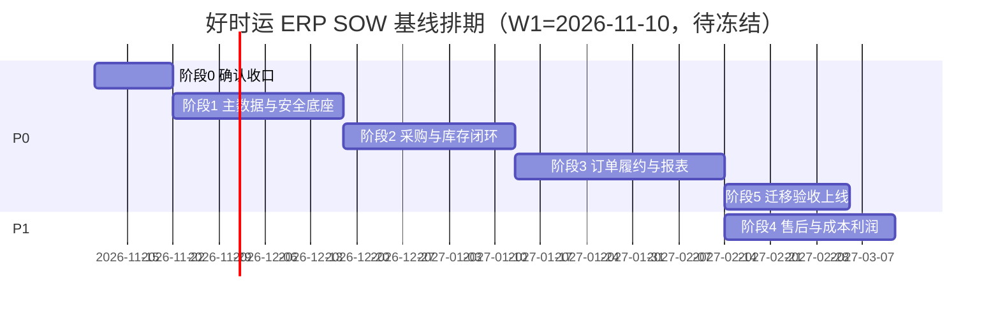

# 好时运 ERP 产品工作说明书（SOW）

| 项 | 内容 |
|----|------|
| 版本 | v1.2（草案，待双方确认） |
| 日期 | 2026-11-12 |
| 编制依据 | [好时运ERP运营需求清单_V1.1_现有ERP整改版.xlsx](../../apps/shop/content/design/好时运ERP运营需求清单_V1.1_现有ERP整改版.xlsx)（功能清单/优先级）、[好时运ERP开发人员整改清单_2026-11-03.xlsx](../../apps/shop/content/design/好时运ERP开发人员整改清单_2026-11-03.xlsx)（26 项整改优先级）、当前设计文档与仓库代码现状 |
| 需求统筹 | 杨洁（业务验收） |
| 开发方 | 外部 ERP 开发人员 |
| 商业目标 | **两份 Excel 未定义营收类商业 KPI**；本 SOW 以需求清单 §一「项目目标」与各功能「第一版验收标准」为成功口径（见 §2） |
| 关联 | [erp-rectification-2026-11-03.md](../design/erp-rectification-2026-11-03.md)（C1–C30 确认清单）、[haoshiyun-erp-gap-analysis-and-remediation.md](../design/haoshiyun-erp-gap-analysis-and-remediation.md) §5（阶段 0–5）、[haoshiyun-erp-target-function-matrix.md](../design/haoshiyun-erp-target-function-matrix.md)（D0–D3 成熟度） |

---

## 1. 背景

现有粗版 ERP 保留了页面骨架，但商品数据模型、缺失业务闭环与真实数据接入均未完成：控制台以 localStorage 原型展示（D1），业务 tRPC 仅有 `apiKeys`，平台 connector 默认 dry-run。运营方已产出两份 Excel（V1.1 需求清单 + 2026-11-03 整改清单），本 SOW 把二者收敛为一份按优先级排期的交付计划。**（基线口径 2026-11-04；2026-11-08 更新：主路径已分模块接 tRPC，`mock-data.ts` 已删，见 shop-module1–14 与 cost-finance-production-closure.md §9。）**

## 2. 目标与成功口径

需求清单 §一（原文口径）：建立以公司内部 SKU 为核心、支持多平台多店铺扩展的 ERP；所有平台订单经正式映射回到内部 SKU，统一管理商品、采购、库存、订单、物流、售后、成本和利润；数据结构支持后续新增店铺与平台，不为单店定制。

成功口径 = 各功能「第一版验收标准」（Excel 原列）逐条签收，核心为：

1. 商品从建档 → 上架 → 下单 → 锁库/扣库 → 采购入库全程可追溯；
2. 同一内部 SKU 五国共享库存，任何并发路径不超卖；
3. 越权操作被服务端阻止，关键数据变更可审计；
4. 首批迁移错误行可定位、批次可回滚。

## 3. 范围

### 3.1 优先级口径（沿用 Excel）

| 优先级 | 含义 | 本 SOW 处置 |
| --- | --- | --- |
| P0 必须 | 第一版必须实现 | 全部纳入，阶段 1–3 + 5 交付 |
| P1 重要 | 重要增强 | 纳入第二交付段（阶段 4），P0 上线前完成开发、可与验收并行 |
| P2 扩展 | 后续扩展 | **不纳入本期**（AI 选品等，另行立项） |

### 3.2 范围内（按 Excel 编号）

| 来源 | P0 | P1 | P2（本期不含） |
| --- | --- | --- | --- |
| 功能需求清单 | F01–F14、F17、F18、F19（17 项） | F15 售后、F16 成本利润 | — |
| 现有 ERP 整改总表 | R01、R03–R07、R10（7 项） | R08 成本计算、R09 财务中心 | R02 AI 选品 |
| 菜单模块蓝图 | 工作台/商品/刊登/采购/仓库/订单履约/报表/系统设置（标注「P0 必须」页） | 售后中心、成本财务 | AI 辅助 |
| 字段明细 | 177 个「P0 必须」字段 | 25 个「P1 重要」字段 | — |
| 整改清单 26 项 | 18 项（含 5 项必须修改、11 项需补充、2 项共同确认中的 P0 部分） | 7 项：Q14、Q15、Q16、Q17、Q21、Q29、Q30 | Q35 AI 选品来源 |

### 3.3 范围外（本期不交付）

- Shopee / TikTok Shop 等新平台接入、新店铺批量扩张（P2 结构性预留，不重做编码体系）；
- AI 选品自动化决策（C30 已定：仅人工候选+评审，关闭自动采购/发布）；
- 订单采购、一件代发模式（需求清单 §二标注为「未来履约」）；
- 营收/利润类商业 KPI 承诺（两份 Excel 未定义）；
- 客服 IM、评论抓取等未列入两份 Excel 的模块。

## 4. 现状基线（工作量估算依据）

| 层 | 现状 | 对 SOW 的含义 |
| --- | --- | --- |
| 页面原型 | 菜单蓝图 35 页中大部分已有 D1 原型（localStorage） | **不重做 UI**；阶段工作 = 补字段/状态 + 接真实服务 |
| 数据库 | `commerce-schema.ts` 约 28 表（占位级）；目标设计约 75 表 | 阶段 1–2 集中补 schema + `db:generate` |
| 业务服务 | tRPC router 仅 `apiKeys`；无 dataaccess 事务层 | **最大工作量**：按 UI → tRPC → dataaccess → Drizzle 链路逐域接入 |
| 平台连接器 | `packages/marketplace` 有 OAuth/签名/同步草案，默认 dry-run | 阶段 3 接真实拉单/状态回写；Q02/Q03/Q04 补充项为前置 |
| 权限 | erp-access 矩阵壳，无服务端强制 | 阶段 1 交付 country scope + 六动作码服务端校验（C5） |

成熟度口径：本期目标 = P0 域从 **D1 → D2 → D3**（见 target-function-matrix §1）；P1 域至少到 D2。

## 5. 交付物

1. **代码**：阶段 1–5 对应的 schema 迁移、tRPC router/dataaccess、服务端权限与审计、connector 接入、导入迁移工具；
2. **文档**：每阶段验收记录；Q03 字段三类清单、Q04 同步频率表、Q07 平台状态→ERP 动作映射表初稿；
3. **测试证据**：五国共享库存并发压测（0 超卖，C11）、事务/唯一性单测、关键端到端验收单；
4. **迁移产物**：导入模板、字段映射、校验报告、错误行、旧新编码对照、批次回滚、抽查报告（C18 范围 = 仅库存+映射）；
5. **环境**：测试环境 + 每角色 1 个演示账号（C6）；部署与备份方案（C16 待确认后固化）；
6. **操作级交付清单**：[好时运ERP功能级交付清单_操作级.xlsx](../../apps/shop/content/design/好时运ERP功能级交付清单_操作级.xlsx)（每个按钮/操作一行，含操作级验收标准与签收列，见 §6）。

## 6. 功能级交付清单（三级模块）

> **三级定义**：一级 = 左侧菜单分组；二级 = 页面；三级 = 页面内按钮/操作，说明点击后的业务功能与约束。
> **优先级**沿用 Excel（P0 必须 / P1 重要 / P2 扩展）；**预计完成日期**为阶段基线（见 §7，M0 冻结后生效）；**验收标准**取自需求清单 F/R「第一版验收标准」原文与已拍板整改规则（C 类，见 [erp-rectification §6.1](../design/erp-rectification-2026-11-03.md)）。三级操作依据「页面功能字段」表 PF01–PF37 操作功能列与 UED 目录。
> **操作级清单**：本表为页面级摘要（「三级（按钮/操作）与操作功能」合列展示）；逐操作签收以附件 [好时运ERP功能级交付清单_操作级.xlsx](../../apps/shop/content/design/好时运ERP功能级交付清单_操作级.xlsx) 为准——该附件将三级拆为「三级（按钮/操作）」「操作功能」两列，**每个按钮/操作一行**（共 190 行），并附「验收标准（操作级）」与「签收」列，验收标准写法与边界见 §8。

| 一级模块 | 二级模块 | 功能说明 | 三级（按钮/操作）与操作功能（摘要，逐行见附件） | 优先级 | 预计完成日期 | 验收标准（页面级） |
| --- | --- | --- | --- | --- | --- | --- |
| 工作台 | 运营仪表盘 | 按日期/平台/国家/店铺/履约筛选，展示经营指标卡、商品库存指标、趋势排行与待办入口，数据可下钻 | 查询/重置：应用或清除全局筛选 保存常用筛选：保存当前筛选组合 导出：导出当前筛选结果 点击指标卡：下钻对应明细 切换指标周期：7/30/90 天与自定义 进入待办：跳转我的待办 | P0 必须 | 2027-02-19 | 各汇总数字与明细数量一致、筛选生效（F01）；任一卡片可追溯明细，五国合计=各站点折算汇总，显示数据来源与最后同步时间（R01） |
| 工作台 | 我的待办 | 统一承载采购/刊登/库存调整审批、订单与接口异常、系统提醒，区分任务类型并记录完整审批日志 | 查看：任务摘要与历史意见 确认/同意：通过当前节点 驳回：填写驳回原因 退回修改：退回提交人 转交：转给其他审批人 催办：发送提醒 批量处理：同类任务批量确认（禁自审实时校验） 查看来源单：跳转原单据 | P0 必须 | 2027-02-05 | 杨洁或黄发聪按规则审核采购、申请人不能自审、每次处理留痕（R03/PF09）；仅显示本人可处理或可查看任务 |
| 商品中心 | 商品库SPU | SPU 主档建档与维护，HSY+六位流水号自动生成，关联内部 SKU 与 Listing 汇总 | 新建：生成 SPU 编码建档 编辑非编码字段：名称/品牌/品类/材质/款式等 停用：软停用（不可删除、不复用） 导入/导出：批量建档与导出 | P0 必须 | 2026-12-05 | 系统自动生成 HSY 六位 SPU、重复建档有提示（F04）；一款一个 SPU、永久唯一只停用不删除（R01/R06） |
| 商品中心 | 内部SKU | 按 SPU 维护颜色/尺码/包装规格与重量尺寸、条码、标准成本 | 新增规格：SPU+三位流水号生成内部 SKU 编辑属性：颜色/尺码/条码/重量尺寸 停用：停用后不复用 打印条码：输出条码标签 | P0 必须 | 2026-12-05 | 规格号 001–999 不重复、停用不复用（F05）；一个可交付规格仅一个内部 SKU（R02） |
| 商品中心 | 供应商货号 | 内部 SKU 与多采购来源映射：厂家款号、采购价、交期、首选标记 | 新增映射：绑定供应商与厂家款号 设为首选：同 SKU 唯一首选 停用：停用映射不影响历史采购 | P0 必须 | 2026-12-12 | 一个 SKU 可关联多个供应商、历史采购不丢失（F08）；最多一个首选、历史 PO 价格不可变 |
| 商品中心 | 属性字典 | 颜色/尺码/品牌/品类标准值、代码、别名与启停维护，录入统一从字典选择 | 新增：新增标准值与别名 编辑：改名称/排序（标准代码不可改） 停用：旧值只停用不删除 导入：批量导入字典 | P0 必须 | 2026-12-12 | 深灰/深灰色等旧写法映射到统一标准值（F06）；历史订单仍能识别，录入从字典选择 |
| 刊登中心 | Listing列表 | 多平台链接主档管理：草稿、发布、暂停、改价、同步状态与错误重试 | 新建刊登：创建链接主档 编辑：标题/价格/负责人等 复制草稿：从现有刊登复制 发布/暂停：变更平台状态 重试：失败任务重发 导出：导出列表 | P0 必须 | 2027-02-12 | 列表改为 Listing 主档+变体明细（R05）；一条链接可只含部分颜色尺码；列表库存不代替仓库库存 |
| 刊登中心 | 变体映射 | Listing 变体逐规格绑定 Seller SKU ↔ 内部 SKU，含冲突校验与解绑历史 | 绑定：建立 Seller SKU→内部 SKU 映射 解绑：解除映射并留历史 批量映射：多行批量绑定 冲突校验：校验店铺内唯一性 | P0 必须 | 2026-12-19 | 店铺+Seller SKU 唯一映射一个内部 SKU、DB 阻止冲突（F07）；订单不靠拆码识别（R05） |
| 刊登中心 | 发布与同步任务 | 发布/库存/价格/状态同步任务追踪，错误明细与重试入口 | 重试：失败任务人工重试 转人工：转人工处理队列 标记解决：人工关闭错误 下载错误：导出错误明细 | P0 必须 | 2027-02-19 | 失败不能静默、可查询可重试（F18/PF17）；库存同步值与共享可用库存分列展示 |
| 采购中心 | 采购申请 | 全员提交采购需求，关联补货建议与选品候选 | 新建/编辑草稿：录入 SKU、数量、供应商、预计到货 提交：进入审核流 撤回：提交人撤回草稿 关联补货建议/选品候选：带出数量与供应商 | P0 必须 | 2026-12-31 | 三种申请场景按既定审核人流转（F09）；所有内部员工可提交 |
| 采购中心 | 采购审核 | 按 PUR-001~003 自动分配审核人，审核/驳回并留痕，通过后生成采购单 | 系统自动分配审核人：杨洁↔黄发聪互审 同意：通过并记录意见 驳回：填写原因 生成采购单：仅已通过申请可生成 查看审批日志：节点/意见/时间 | P0 必须 | 2027-01-07 | 申请人不能自审（服务端硬拒绝）、未审核单无法入库（F09/R10）；审批记录不可删除 |
| 采购中心 | 采购单 | 向供应商下单并跟踪到货状态，仅由已审核申请生成 | 生成采购单：由审核通过申请转换 编辑价格数量：变更留版本痕迹 确认下单：进入待到货 关闭/取消：填写原因 | P0 必须 | 2027-01-07 | 只允许由已审核申请生成（菜单蓝图）；未审核申请不能正式采购 |
| 采购中心 | 到货质检入库 | 分批到货、质检分级、合格入库与退供应商，到货/质检/入库数量分记 | 登记到货：按 PO 行分批登记数量与附件 质检：合格/残次/短缺分级 部分入库：合格量写入库单与流水 退供应商：不合格退库 完成：批次闭环 | P0 必须 | 2027-01-14 | 分批收货/部分合格/部分入库数量分别核对（Q13）；仅合格量进入可用库存 |
| 采购中心 | 供应商管理 | 供应商主档：联系人、结算、交期、质量、附件与启停 | 新建/编辑：维护供应商资料 停用/启用：停用不影响历史单据 上传附件：合同与资质 | P0 必须 | 2026-12-12 | 停用不影响历史单据；采购可维护、普通运营只读 |
| 仓库中心 | 仓库与库位 | 仓库与库位维护、SKU 绑定与占用状态，绑定履历只读可查 | 新增仓库 添加库位：支持批量导入编码、同仓唯一 绑定：库位绑定一个启用 SKU 解绑/换绑：库存为零或先走库存转移单（C3） 停用：停用库位 查看绑定履历：只读时间线；**不提供删除绑定按钮**（C1） | P0 必须 | 2026-12-31 | 同库位第二个启用 SKU 被 DB 级阻止（F10/C2）；绑定记录禁物理删除、留操作人/时间/原因（C1） |
| 仓库中心 | 库存汇总 | 按仓库/库位/SPU/SKU 查询实际、可用、锁定、待入库、残次库存 | 查询：多条件筛选 查看流水：下钻变动时间线 导出：导出当前结果 发起盘点或调整：跳转盘点/调整单 | P0 必须 | 2027-01-07 | 五国共享同一库存池、一国占用他国同步减少（F11）；库存不能无痕修改 |
| 仓库中心 | 库存流水 | 全类型库存变动只读追溯：入库/锁定/释放/出库/盘点/退货/报损 | 按类型/日期/来源单查询 查看来源单：跳转采购/订单/售后原单 只读：无编辑、无删除入口 | P0 必须 | 2027-01-07 | 任一库存数可追溯完整流水且前后连续（F12）；历史流水不可删除 |
| 仓库中心 | 入库单 | 采购与退货入库执行：收货、质检结果、上架库位并写流水 | 确认收货 分配库位 确认上架：写库存流水 打印：入库单打印 | P0 必须 | 2027-01-14 | 必须关联来源单据；入库数量与库存流水一致 |
| 仓库中心 | 出库单 | 订单拣货、复核、打包、称重、出库过账 | 生成拣货单 拣货确认 复核 打包/称重 确认出库：扣减库存+释放锁定（C12 出库过账扣减） | P0 必须 | 2027-01-14 | 出库数量与订单和库存流水一致；避免重复出库 |
| 仓库中心 | 盘点与调整 | 盘点任务、差异审批、库存调整与报损，全部调整需审批 | 创建盘点任务 提交差异调整：原因+前后数量 审批：同意/驳回 过账：写库存流水 报损：不可售处理 | P0 必须 | 2027-01-16 | 保留修改前后数量和原因（R10）；全部库存调整均需审批、普通用户禁直改余额（C13） |
| 仓库中心 | 库存预警 | 安全库存、补货点、销量与可售天数计算，输出建议采购量与库龄 | 生成采购申请草稿：带出建议量 忽略一次：本次不处理 调整参数：安全库存/补货点/周期 | P0 必须 | 2027-01-16 | 预警按内部 SKU 触发、任一数量可追溯流水（R07）；建议量扣除已审核在途（PF24） |
| 订单履约 | 订单列表 | 平台订单头+明细同步、去重、状态与 SLA 管理 | 查询/重置：日期类型可选（下单/付款/发货） 手动同步：触发增量拉单 查看详情/明细 分配：指派处理人 打印/导出 | P0 必须 | 2027-02-05 | 测试订单只生成一次、映射正确（F13）；重复同步不重复建单/扣库；按平台订单号+店铺去重（R06） |
| 订单履约 | 订单异常 | 未映射/重复映射/缺货/同步异常处理队列，技术与业务异常分列 | 修复映射/去映射：重新绑定 Seller SKU 重试识别：重新匹配 人工复核 释放：释放锁定库存（填原因） 重试：重推/重拉 查看原始数据 | P0 必须 | 2027-02-05 | 未映射订单进异常清单且不自动扣库、异常有明确原因（F13/R06）；禁止异常单静默扣库 |
| 订单履约 | 拣货打包发货 | 仓内出库执行：拣货单、面单、复核、称重、出库 | 生成拣货单 打印面单 确认出库：过账扣减+写流水 交接登记：交承运商 | P0 必须 | 2027-02-12 | 出库过账扣减并写流水（C12）；避免重复出库 |
| 订单履约 | LGS物流 | MY/PH/SG/VN 订单 LGS 交接、轨迹、签收与异常跟踪 | 交接登记 状态批量更新 轨迹查看 异常标记 导出 | P0 必须 | 2027-02-19 | 按店铺履约模式展示正确流程、状态可追踪（F14）；四国站点正确标识 LGS |
| 订单履约 | JSB与TH物流 | TH 自营仓出库→JSB 交接→清关→官方尾程全节点记录与费用异常 | 自营仓出库登记 JSB 交接登记 清关登记 尾程/签收更新 费用录入 异常标记 批量更新/导出 | P0 必须 | 2027-02-26 | 完整记录每个时间节点（F14）；TH 展示 JSB 链路（自营仓→JSB→官方尾程） |
| 售后中心 | 取消与退款 | 取消/仅退款处理，联动锁定库存自动释放 | 同步售后单：平台售后拉取/录入 审核：确认退款 确认释放：取消事件自动释放锁定+写流水（C12，无静默改库存） 关闭：单据闭环 | P1 重要 | 2027-03-12 | 取消订单释放锁定库存并写流水（F15）；退款关联原订单 |
| 售后中心 | 退货质检与回库 | 退货收货、质检、可售回库或报损 | 登记收货 质检：合格/残次判定 回库：合格量入可用库存 报损：残次处理 关闭 | P1 重要 | 2027-03-26 | 质检后才增加可用库存；回库与报损均形成库存流水（F15） |
| 成本财务 | SKU成本 | 费用模板与成本版本：标准成本、到仓成本、订单实际成本分开，按平台/国家/履约/有效期配置 | 新建版本 测算：试算到仓成本 提交审核：进入审核流 启用/停用：状态机流转（C8） 查看历史：版本快照（C9 永不重算） | P1 重要 | 2027-03-12 | 不同国家和履约方式可配置费用项；历史订单保留当时成本版本、不被新价格覆盖（R08/C9） |
| 成本财务 | 平台结算对账 | 平台账单导入与自动匹配，差异处理与确认 | 导入账单：平台账单文件 自动匹配：按订单号匹配 人工匹配：差异单手动关联 确认：对账闭环 导出 | P1 重要 | 2027-03-19 | 多币种不得直接相加（R09）；每项费用保留来源账单与订单关联（PF29）；蔡值只读 |
| 成本财务 | 订单与SKU利润 | 订单级/SKU 级利润归集与多维度汇总下钻（口径按 C17） | 下钻订单：明细到单 切换维度：日期/平台/站点/店铺/SPU/SKU/负责人 导出 | P1 重要 | 2027-03-26 | 抽查订单可追溯每项成本费用、按 SKU 和店铺汇总一致（F16）；跨币种 MVP 不合计（C17） |
| 报表中心 | 销售库存采购利润报表 | 按日期/平台/国家/店铺/SPU/SKU/负责人筛选、汇总与导出 | 筛选/查询 汇总下钻：汇总到明细 导出：CSV | P0 必须 | 2027-02-26 | 同筛选条件下报表与订单、库存明细一致并可导出（F17）；汇总值必须可下钻到明细 |
| AI辅助 | AI选品 | 候选列表、证据与人工评审（本期不交付，仅保留原型） | 查看/指派/导出 提交评审/修改决策/查看历史：通过、有条件通过、搁置、拒绝 创建草稿/取消/转交：仅生成草稿，不自动采购、不自动发布 | P2 扩展 | 不排期（另行立项） | AI 结果仅建议或草稿、不自动采购建 SKU 发布（R02/C30）；潜力值显示计算说明与数据日期 |
| 系统设置 | 平台店铺与授权 | 平台/店铺主档、国家站点、Seller ID、授权与同步配置 | 新建店铺：向导式配置 授权/续期：OAuth 流程（C23 各国独立授权） 测试连接：接口连通性 停用：店铺停用 | P0 必须 | 2026-11-28 | 能完整维护 Lazada 五国、新增店铺不改库结构（F02）；每 Seller ID 独立监控授权、失效提示（C23） |
| 系统设置 | 人员角色权限 | 账号、角色、六动作权限与平台/国家/店铺数据范围配置 | 新建账号 分配角色 配置模块×动作：查看/新增/修改/审核/导出/配置（六动作码） 配置 scope：全组织/平台/国家/站点/店铺（C5 country） 停用/重置密码 查看日志 | P0 必须 | 2026-12-19 | 越权操作被服务端阻止、停用不能登录、操作有日志（F03）；country scope 服务端强制（C5） |
| 系统设置 | 接口日志 | 同步任务监控：成功失败数、错误原因、重试与操作审计 | 人工重试：失败任务重跑 下载错误：导出错误明细 导出日志 查看操作审计：只读、修改前后值 | P0 必须 | 2027-02-19 | 可查询失败记录并重试、关键数据变更可追溯（F18）；接口失败不能静默 |
| 系统设置 | 数据导入迁移 | 模板下载、上传、dry-run 校验、错误行与批次回滚（首批仅库存+映射，C18） | 下载模板 上传文件 试运行校验：dry-run 行级校验 确认导入：生成导入批次 查看错误行：定位来源行 回滚导入批次：仅撤本批次 导出报告：校验/抽查报告 | P0 必须 | 2027-04-09 | 错误行不影响正确行、结果可核对可追溯可回滚（F19）；旧新编码对照+迁移后抽查报告（C18/Q19/Q34） |

**清单统计**：一级模块 11 个，二级模块 37 个；P0 = 32 页，P1 = 4 页，P2 = 1 页（不排期）。操作级清单共 **190 个按钮/操作**（P0 = 158，P1 = 23，P2 = 9），每个按钮/操作一行并附操作级验收标准，见附件。

---

## 7. 排期

### 7.1 前提假设

- W1 起点 = 双方确认本 SOW 与整改清单剩余待填项之日（**基线：2026-11-10 周一**，待确认）；
- 投入：外部 ERP 开发人员 1–2 人全职 + 运营方每周固定确认窗口（杨洁）；
- 阶段有重叠（后一阶段在前一阶段确认门通过后启动），日期为**基线估算，Q26 回填后冻结**；
- 已拍板的 19 项 C 类确认（见 erp-rectification §6.1）视为无阻塞；剩余 10 项待确认 + 5 项待填为阶段 0 门禁。

### 7.2 阶段总览

| 阶段 | 优先级 | 主题 | 周期 | 基线日期（待冻结） | 里程碑 |
| --- | --- | --- | --- | --- | --- |
| 0 | P0 前置 | 确认收口与计划冻结 | 2 周 | 11-10 → 11-21 | M0：Q26 计划回填、10+5 待确认项关闭 |
| 1 | P0 | 主数据与安全底座 | 4 周 | 11-24 → 12-19 | M1：商品/字典/供应商/仓库库位/RBAC/导入框架 D2 |
| 2 | P0 | 采购与库存闭环 | 4 周 | 12-22 → 01-16 | M2：采购互审 + 共享库存 + 流水并发达标 |
| 3 | P0 | 订单履约、工作台与报表 | 5 周 | 01-19 → 02-26 | M3：真实拉单 → 锁/放/扣 → LGS/JSB 全链路 D3 |
| 4 | P1 | 售后、成本与利润 | 4 周 | 03-01 → 03-26 | M4：F15/F16/R08/R09 D2，费用导入对账可用 |
| 5 | P0 | 迁移、验收与上线 | 3 周 | 03-29 → 04-16 | M5：迁移抽查通过 + 业务验收 + 上线 |
| 后续 | P2 | AI 选品、新平台 | 另行立项 | — | — |

合计：P0+P1 约 **22 周**（含阶段重叠）；P0 单独可用约 18 周（阶段 0–3 + 5，阶段 4 与 5 部分并行）。

### 7.3 阶段明细

#### 阶段 0 · 确认收口与计划冻结（P0 前置，W1–W2）

| 项 | 内容 |
| --- | --- |
| 范围 | 关闭整改清单剩余 **10 项待确认**（C14/C16/C19/C21/C22/C24/C26/C27/C28/C29）+ **5 项待填细节**（C4 改动行、C10 责任人/日期、C11 P99 阈值、C18 抽查比例、C20 目标月）；按 Q26 要求回填页面/接口/数据库/里程碑/测试环境/验收/上线日期与负责人 |
| 交付 | 冻结版排期（本 SOW 升版后）；角色权限矩阵终稿（C4）；部署模式与备份归属（C16）；缺陷 SLA 四级表（C19） |
| 验收 | 整改清单 H–L 列全部回填、杨洁 M 列复核通过；无「待确认」阻塞项进入阶段 1 |
| 依赖 | 杨洁/黄发聪/财务集中确认（C14 需三方） |

#### 阶段 1 · P0 主数据与安全底座（W3–W6）

| 项 | 内容 |
| --- | --- |
| 范围 | F02 平台店铺、F04 SPU、F05 内部 SKU、F06 属性字典、F07 刊登映射、F08 供应商、F10 仓库库位、F03 人员权限（country scope + 六动作码 C5）、F19 导入框架、F18 接口日志骨架；整改项 Q10（C1/C2 禁删+双保险）、Q23（RBAC+测试账号 C6）、Q32（字段补齐启动）、Q34（旧码对照表结构） |
| 交付 | 目标 schema 第一批迁移（主数据域）；tRPC + dataaccess 接入上述域；导入模板/校验/错误行/批次回滚框架；每角色 1 演示账号 |
| 验收 | SPU/SKU 自动生成且不可删除复用；同库位第二启用 SKU 被 **DB 级**阻止；越权 API 被服务端拒绝；错误行不影响正确行 |
| 依赖 | 阶段 0 门禁通过 |

#### 阶段 2 · P0 采购与库存闭环（W7–W10）

| 项 | 内容 |
| --- | --- |
| 范围 | F09 采购（PUR-001~003、禁自审服务端硬拒绝 Q12）、F11 库存汇总（五国共享池）、F12 库存流水、R03 统一待办审批中心、盘点/调整（C13 全部需审批）；整改项 Q09（并发 0 超卖）、Q07/Q08/Q11（C12 库存状态机：已付款自动锁+人工补锁、出库过账扣减、取消自动释放+30 分钟超时兜底） |
| 交付 | 采购申请→审核→采购单→收货/质检/入库全链路；inventory ledger + 余额投影同事务；Lazada 状态→ERP 动作映射表初稿（Q07 产物） |
| 验收 | 申请人不能自审、未审不能入库；并发压测 **0 超卖**（P99 阈值按 C11 待填值）；任一余额可重放流水核对；重复同步不重复扣减 |
| 依赖 | Q07/Q08/Q11 已拍板（C12/C13 ✅）；压测环境（Q24 容量目标，阶段 0 确认） |

#### 阶段 3 · P0 订单履约、工作台与报表（W11–W15）

| 项 | 内容 |
| --- | --- |
| 范围 | F13 订单同步/去重/映射异常、F14 LGS 与 JSB、F01 工作台、F17 报表、F18 接口日志上线、R01/R04/R05/R06/R07 整改落地；整改项 Q02（授权续期告警）、Q03（字段三类清单）、Q04（逐接口频率/频控/补数）、Q31（页面真实/模拟状态标注）、Q33（六场景演示）、Q25（测试账号与 SLA 生效） |
| 交付 | 真实 connector 拉单（顺序按 C20：**Daraz LK 先**，Lazada 五站随后，目标月待填）；包裹与 LGS/JSB 事件模型；仪表盘真实聚合 + 下钻（C17 口径：下单日/净 GMV/跨币种不合计） |
| 验收 | 测试订单只生成一次且映射正确；未映射订单进异常清单不扣库；任一卡片可追溯明细；失败非静默、可重试；Q33 六场景演示走通 |
| 依赖 | Q02/Q03/Q04 补充交付；C20 目标月回填 |

#### 阶段 4 · P1 售后、成本与利润（W16–W19）

| 项 | 内容 |
| --- | --- |
| 范围 | F15 售后（取消/退款/退货质检回库）、F16 成本利润、R08 成本计算、R09 财务中心；整改项 Q14（成本算法，阶段 0 选型）、Q15（汇率留痕）、Q16（费用模板导入+来源标记）、Q17（JSB 模板）、Q21（审计保留）、Q29（报表口径明细）、Q30（费用模板版本 C8/C9） |
| 交付 | 售后单+退货质检回库/报损流水；费用导入与订单/SKU 利润归集；成本版本历史快照（永不重算） |
| 验收 | 退货质检后才增加可用库存；退款关联原订单；抽查订单可追溯每项成本费用；历史订单成本不被新价格覆盖 |
| 依赖 | C14 成本算法、C27 广告分摊、C28 JSB 模板在阶段 0 关闭 |

#### 阶段 5 · P0 迁移、验收与上线（W20–W22）

| 项 | 内容 |
| --- | --- |
| 范围 | F19 执行（C18：首批仅库存+映射，历史订单延后）、Q19/Q34 迁移全套产物、Q22 部署与备份（C16）、Q24 容量与压测复验、全量回归 |
| 交付 | dry-run → 业务抽查 → 正式导入；旧新编码对照 + 抽查报告；备份恢复演练；全量数据导出验证；上线检查单 |
| 验收 | 错误行可定位来源行、批次可回滚；杨洁按 §2 四条成功口径签收；整改清单 26 项 L 列「已提交」+ M 列复核通过 |
| 依赖 | C16 部署模式、C18 抽查比例、C19 验收 SLA 已关闭 |

#### 后续（P2，不排本期）

R02/Q35 AI 选品（仅人工候选+评审）、Shopee/TikTok 接入、订单采购/一件代发：阶段 5 上线后按独立 SOW 立项。

### 7.4 整改清单 26 项排期映射

| 阶段 | P0 项 | P1 项 |
| --- | --- | --- |
| 0 确认收口 | Q26（计划本体）、Q31/Q32 的排期与基线部分 | — |
| 1 主数据安全 | Q10、Q23、Q32、Q34（结构） | — |
| 2 采购库存 | Q07、Q08、Q09、Q11、Q12 | — |
| 3 订单履约 | Q02、Q03、Q04、Q25、Q31、Q33、Q34（抽查方案） | — |
| 4 售后成本 | — | Q14、Q15、Q16、Q17、Q21、Q29、Q30 |
| 5 迁移上线 | Q19、Q22、Q25（验收执行）、Q34（执行） | Q21（保留期限落地） |
| 后续 P2 | Q35 | — |

> 5 项「必须修改」（Q09/Q10/Q19/Q26/Q35）：Q09/Q10 → 阶段 1–2，Q19 → 阶段 5，Q26 → 阶段 0，Q35 → 不排期（C30）。

## 8. 验收与缺陷 SLA

- **验收人**：杨洁统筹，黄发聪/财务按域会签（C19 详情阶段 0 确认）；
- **验收方式**：每阶段按 §7.3「验收」列逐条演示 + 证据（测试地址/截图/压测报告）记录到整改清单 H–L 列；逐模块验收按 §6 功能级清单逐行签收，**操作级签收以附件 [操作级交付清单](../../apps/shop/content/design/好时运ERP功能级交付清单_操作级.xlsx) 为准，每个按钮/操作一行**；
- **操作级验收标准**：每个按钮/操作对应 1 条标准，只写该操作自身的可观察结果（状态变化/记录生成/数字一致/被拒绝的具体表现）；**仅覆盖该行列明项，清单未列的行为不作为本期缺陷判定依据**，新增要求走 §11 变更控制；
- **操作级签收范围**：P0 操作（158 条）全量逐行签收；P1 操作（23 条）随阶段 4 验收；P2 操作（9 条）不排期、不列入本期签收；每行留截图或测试记录二选一作为证据；
- **上线门禁**：P0 验收全部通过、迁移抽查通过、并发压测 0 超卖、越权用例全部被服务端拒绝；
- **缺陷 SLA**：四级响应/修复时限由阶段 0 按 C19 填入本表附录（当前待定：24h/48h/3 工作日三选一）；
- **回归**：每阶段结束跑关键链路回归（建档→上架→下单→锁/扣→入库→流水核对）。

## 9. 组织与职责

| 角色 | 人员 | 职责 |
| --- | --- | --- |
| 需求统筹/业务验收 | 杨洁 | 关闭待确认项、阶段验收签收、变更批准 |
| 业务会签 | 黄发聪、财务 | 采购互审（PUR 规则）、成本算法/费用口径会签 |
| 全业务只读 | 蔡值 | 经营数据查看、部署模式决策（与 C16 相关） |
| 开发 | 外部 ERP 开发人员 | 全部代码、文档、测试证据交付；整改清单 H–L 列填写 |
| 技术账号 | 外部 IT（可停用） | 技术排查，无业务审批权 |

## 10. 假设、依赖与风险

| # | 假设/依赖/风险 | 影响 | 缓解 |
| --- | --- | --- | --- |
| 1 | 阶段 0 的 10+5 项未按时关闭 | 整体排期顺延 | M0 为硬门禁，未关闭不启动阶段 1 |
| 2 | 人力按 1–2 人全职假设 | 工期 ±40% | Q26 回填实际人力后重算并冻结 |
| 3 | C14 成本算法、C16 部署模式未定 | 阶段 4/5 方案返工 | 列为阶段 0 必关项 |
| 4 | 平台 API 字段/频控与 Q03/Q04 假设不符 | 阶段 3 联调延期 | 阶段 1 内先交付字段三类清单，偏差走变更 |
| 5 | 历史数据质量未知（旧码对照） | 迁移抽查不通过 | 先 dry-run，错误行隔离，批次回滚 |
| 6 | 原型 localStorage 数据不迁移 | 上线后历史操作记录缺失 | 明确为演示数据，生产从迁移批次起算 |

## 11. 变更控制

- 范围/优先级变更：杨洁书面确认后更新本 SOW 版本，并同步整改清单与 [INDEX.md](../design/INDEX.md)；
- 排期变更：M0 冻结后的任何里程碑移动需双方确认并记录原因；
- 新增 P0 项：须同时给出验收标准与排期影响，不默认插入当前阶段；
- 操作级清单（附件操作级交付清单 Excel）的增删行或验收标准修改，视同范围变更，须经杨洁书面确认后同步更新本 SOW 版本与附件。

## 12. 关联文档

| 文档 | 用途 |
| --- | --- |
| [运营需求清单 V1.1](../../apps/shop/content/design/好时运ERP运营需求清单_V1.1_现有ERP整改版.xlsx) | 功能范围、优先级、字段、验收标准源头 |
| [操作级交付清单](../../apps/shop/content/design/好时运ERP功能级交付清单_操作级.xlsx) | §6 附件：每个按钮/操作一行 + 操作级验收标准 + 签收列（190 行） |
| [整改清单 2026-11-03](../../apps/shop/content/design/好时运ERP开发人员整改清单_2026-11-03.xlsx) | 26 项整改与 H–L 列交付跟踪 |
| [erp-rectification-2026-11-03.md](../design/erp-rectification-2026-11-03.md) | C1–C30 确认状态（19 已拍板/10 待确认/5 待填） |
| [haoshiyun-erp-gap-analysis-and-remediation.md](../design/haoshiyun-erp-gap-analysis-and-remediation.md) | 阶段 0–5 技术方案与不变量 |
| [haoshiyun-erp-target-function-matrix.md](../design/haoshiyun-erp-target-function-matrix.md) | D0–D3 成熟度与 P0 验收证据 |
| [haoshiyun-erp-database-schema.md](../design/haoshiyun-erp-database-schema.md) | 目标表结构（约 75 表） |
