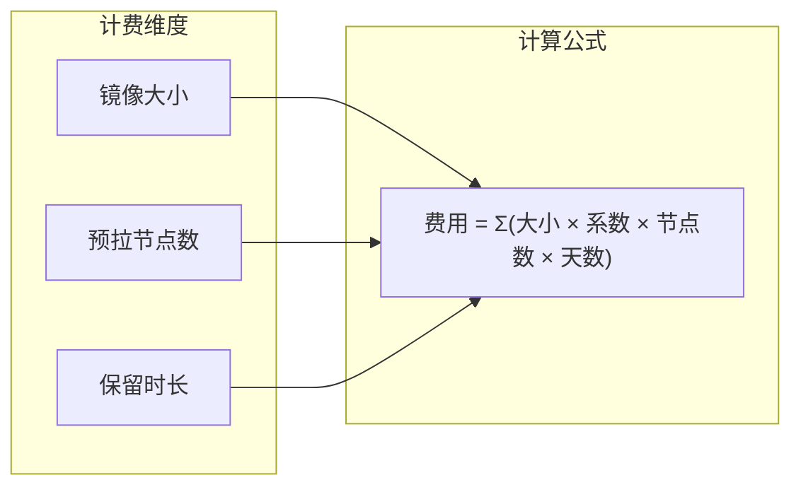
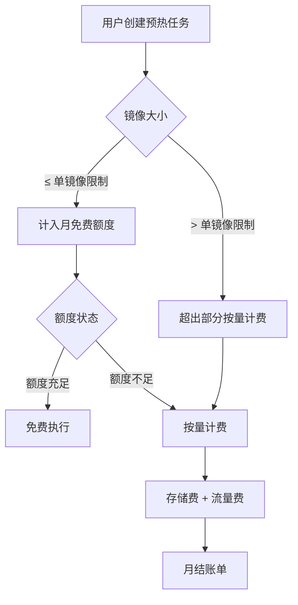
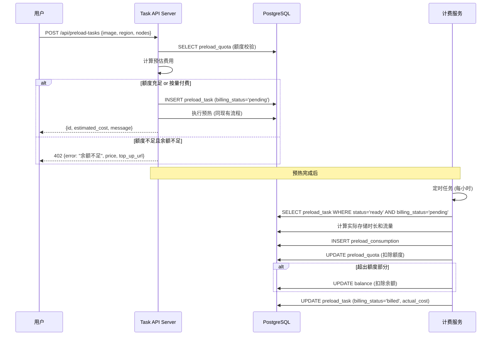
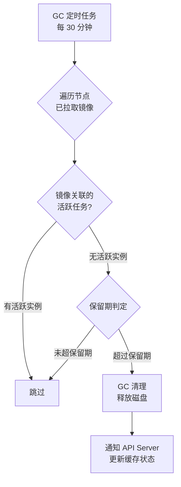
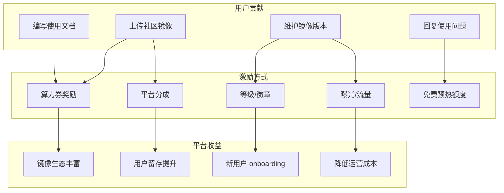
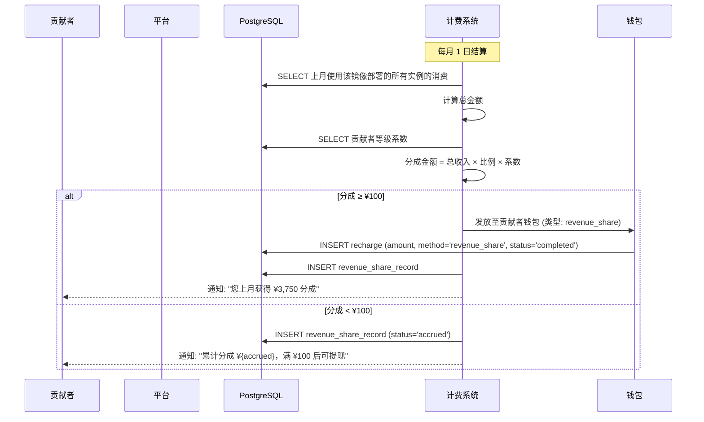
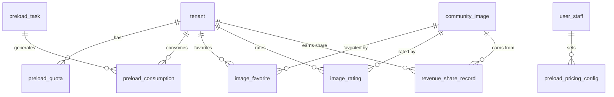

# 镜像预热商业化与社区激励方案

> 镜像预热占用节点磁盘空间并消耗网络流量，需设计商业模型覆盖成本；
> 社区镜像需设计激励机制吸引用户参与共建生态。
>
> **口径说明**：文中金额（如 ¥3,750、¥98K、¥5,725）与运营后台界面均为**测算示意与设计稿**，不构成收益承诺，不代表实际发放；分成比例与税务口径以正式政策为准。

---

## 第一部分：镜像预热商业化方案

### 1.1 成本分析

```
每笔预热任务成本构成
├── 存储成本 (持续占用)
│   ├── 镜像层文件占用的磁盘空间
│   └── 多节点副本 = 单副本大小 × 副本数
│
├── 网络成本 (一次性)
│   ├── 镜像仓库出流量
│   ├── 节点间分发流量 (P2P 场景)
│   └── 公网拉取 (非内部仓库时)
│
├── 管理成本
│   ├── 预热任务调度与管理
│   ├── 镜像 GC/过期清理
│   └── 失败重试与监控
│
└── 隐性成本
    ├── 预热期间占用的节点 I/O 影响已有任务
    └── 大镜像导致的节点磁盘碎片化
```

**典型成本估算示例**（单节点单镜像）：

| 镜像 | 大小 | 单节点存储月成本 | 单次拉取网络成本 |
|------|------|---------------|---------------|
| PyTorch 2.4 | ~8 GB | ¥0.8 (按 0.1 元/GB/月) | ¥0.08 (按 0.01 元/GB) |
| vLLM + model | ~25 GB | ¥2.5 | ¥0.25 |
| ComfyUI + models | ~15 GB | ¥1.5 | ¥0.15 |
| 训练镜像 + 数据集 | ~50 GB | ¥5.0 | ¥0.50 |

### 1.2 定价模型

#### 模型 A：按量计费（默认）



**定价表**：

| 计费项 | 单价 | 说明 |
|--------|------|------|
| 预热存储费 | ¥0.10 / GB / 节点 / 天 | 按镜像解压后实际大小计算 |
| 预热流量费 | ¥0.01 / GB / 节点 | 每节点首次拉取的流量（缓存命中免收） |
| 最低消费 | ¥0.50 / 任务 / 节点 | 不足按此计费 |

**示例计算**：
- 用户预拉一个 20 GB 的镜像到 3 个节点，保留 7 天
- 存储费：20 × 0.10 × 3 × 7 = ¥42.00
- 流量费：20 × 0.01 × 3 = ¥0.60
- **合计：¥42.60**

#### 模型 B：套餐制（**付费档含预热权益**；免费额度统一走 §1.3，不在此表）

| 套餐 | 月费 | 含预热权益（付费档） | 超量单价 |
|------|------|-----------|---------|
| **Starter** | ¥49 | 50 GB × 3 节点 × 7 天 | ¥0.15/GB/节点/天 |
| **Pro** | ¥199 | 200 GB × 5 节点 × 30 天 | ¥0.10/GB/节点/天 |
| **Enterprise** | 定制 | 不限 | 协商 |

**免费额度说明**（**唯一口径见 §1.3 等级月额度**，2026-10-06 统一）：
- 免费额度按 §1.3 等级表发放，单位统一 `GB·节点·天`：新用户（首月）**50**、普通用户 **10**、上月消费 ≥**¥50** 为 **50**、≥**¥500** 为 **200**
- 普通用户档 **10 GB·节点·天** 与 DDL `preload_quota.monthly_quota_gb_days DEFAULT 10`、后台配置 UI 显示一致
- 额度按自然月发放、不可累积；用完或过期后自动切换按量计费

#### 模型 C：与实例计费捆绑

| 计费模式 | 预热策略 | 费用 |
|---------|---------|------|
| **按量实例** | 每次部署自动预热，实例释放 1h 后镜像自动 GC | 含在实例单价中（+5% 溢价） |
| **包月/包周实例** | 租期内镜像保留在节点上 | 含在套餐价格中 |
| **Spot 实例** | 不自动预热，用户手动预热需单独付费 | 按模型 A 计费 |
| **裸金属** | 不自动预热，独占设备可自行管理镜像 | 免费（设备已独占） |

#### 模型 D：分层计费（推荐方案）

结合按量与套餐优势，采用分层结构：



```
月结计费示例：
用户本月预热的镜像总计：
  - 任务A: 8 GB × 2节点 × 5天 = 80 GB·节点·天 (8 GB ≤ 单镜像限制，全额计入月免费额度)
  - 任务B: 25 GB × 3节点 × 3天 = 225 GB·节点·天 (15 GB 超额 × 3节点 × 3天)

费用:
  基础额度已用完 (免费)
  超额部分: 15 × 3 × 3 × 0.10 = ¥13.50 (存储费)
            25 × 3 × 0.01 = ¥0.75 (流量费)
  合计: ¥14.25
```

### 1.3 免费额度设计（**唯一口径**）

| 用户等级 | 月免费额度 | 同时最大任务数 | 单镜像限制 |
|---------|-----------|--------------|-----------|
| 新用户 (首月) | 50 GB·节点·天 | 3 | 20 GB |
| 普通用户 | 10 GB·节点·天 | 2 | 10 GB |
| 上月消费 ≥¥50 | 50 GB·节点·天 | 5 | 50 GB |
| 上月消费 ≥¥500 | 200 GB·节点·天 | 10 | 100 GB |
| 企业用户 | 定制 | 不限 | 不限 |

> 2026-10-06 统一口径：本表为**免费额度唯一口径**，单位 `GB·节点·天`，与 DDL `monthly_quota_gb_days DEFAULT 10` 及后台配置 UI 一致；原「3 次 ≤10 GB」「每月 5 GB × 1 节点」两条旧说明已删除，套餐表 Free 行已移除（免费额度不走套餐），币种统一为元。

### 1.4 数据库扩展

```sql
-- 在 preload_task 表扩展计费字段
ALTER TABLE preload_task ADD COLUMN billable BOOLEAN NOT NULL DEFAULT true;
ALTER TABLE preload_task ADD COLUMN estimated_cost NUMERIC(15,4);    -- 预估费用
ALTER TABLE preload_task ADD COLUMN actual_cost NUMERIC(15,4);       -- 实际费用
ALTER TABLE preload_task ADD COLUMN billing_status VARCHAR(16) DEFAULT 'pending';
    -- pending / billed / waived (免单)
ALTER TABLE preload_task ADD COLUMN waived_reason VARCHAR(255);      -- 免单原因

-- 预热消费记录
CREATE TABLE preload_consumption (
    id              TEXT PRIMARY KEY,
    tenant_id       TEXT NOT NULL REFERENCES tenant(id),
    preload_task_id TEXT NOT NULL REFERENCES preload_task(id),
    node_name       VARCHAR(256) NOT NULL,
    image_ref       VARCHAR(512) NOT NULL,
    image_size_bytes BIGINT NOT NULL,                   -- 镜像大小 (解压后)
    storage_gb_days NUMERIC(15,4) NOT NULL,             -- 存储消耗 (GB·天)
    traffic_gb      NUMERIC(15,4) NOT NULL,             -- 流量消耗 (GB)
    storage_fee     NUMERIC(15,4) NOT NULL,             -- 存储费
    traffic_fee     NUMERIC(15,4) NOT NULL,             -- 流量费
    total_fee       NUMERIC(15,4) NOT NULL,             -- 总费用
    billed_at       TIMESTAMP,
    created_at      TIMESTAMP NOT NULL DEFAULT NOW()
);

CREATE INDEX preload_consumption_tenant_idx ON preload_consumption(tenant_id);
CREATE INDEX preload_consumption_task_idx ON preload_consumption(preload_task_id);

-- 用户月度预热额度表
CREATE TABLE preload_quota (
    id              TEXT PRIMARY KEY,
    tenant_id       TEXT NOT NULL REFERENCES tenant(id) UNIQUE,
    monthly_quota_gb_days NUMERIC(15,4) NOT NULL DEFAULT 10,  -- 月额度 (GB·节点·天)
    used_gb_days    NUMERIC(15,4) NOT NULL DEFAULT 0,         -- 已用额度
    quota_month     VARCHAR(7) NOT NULL,                       -- 额度月份 yyyy-MM
    max_concurrent  INTEGER NOT NULL DEFAULT 2,                -- 最大并发任务数
    max_image_gb    INTEGER NOT NULL DEFAULT 10,               -- 单镜像大小限制
    updated_at      TIMESTAMP NOT NULL DEFAULT NOW(),
    UNIQUE (tenant_id, quota_month)
);

-- 预热定价配置表 (运营可调)
CREATE TABLE preload_pricing_config (
    id              TEXT PRIMARY KEY,
    storage_price_per_gb_day NUMERIC(10,6) NOT NULL DEFAULT 0.10,  -- 存储单价 元/GB/天
    traffic_price_per_gb     NUMERIC(10,6) NOT NULL DEFAULT 0.01,  -- 流量单价 元/GB
    min_charge_per_task      NUMERIC(10,4) NOT NULL DEFAULT 0.50, -- 最低消费 元/任务
    free_quota_gb_days       NUMERIC(10,4) NOT NULL DEFAULT 10,   -- 默认免费额度
    effective_from           TIMESTAMP NOT NULL,
    effective_to             TIMESTAMP,
    created_by               TEXT REFERENCES user_staff(id),
    UNIQUE (effective_from)
);
```

### 1.5 计费与扣款流程



### 1.6 镜像 GC 策略

为控制存储成本，需设计镜像自动清理机制：



**保留期规则**：

| 场景 | 保留期 | 说明 |
|------|--------|------|
| 有运行中的实例使用该镜像 | 一直保留 | 实例释放后进入倒计时 |
| 手动预热的镜像 | 7 天 | 从预热完成开始计算 |
| 部署时自动预热的镜像 | 1 小时 | 实例释放后 1h 清理 |
| 热门镜像（7天内被≥3个租户使用） | 30 天 | 平台缓存，不计费 |
| 运营标记的保留镜像 | 自定义 | 平台基础镜像等 |

---

## 第二部分：社区镜像激励机制

### 2.1 激励模型总览



### 2.2 激励维度与积分体系

#### 贡献积分 (Contribution Points)

| 行为 | 积分 | 上限/月 | 说明 |
|------|------|---------|------|
| 提交社区镜像 | +50 | 2 次 | 首次提交奖励翻倍 |
| 镜像审核通过 | +100 | 不限 | 质量达标 |
| 镜像被收藏 | +5/次 | 500 | 去重，同用户限 1 次 |
| 镜像被部署 | +20/次 | 1000 | 每次使用该镜像部署 |
| 更新镜像版本 | +30 | 5 次 | 保持活跃 |
| 编写完善文档 | +40 | 3 次 | 包含使用说明和示例 |
| 回复使用问题 | +10/次 | 200 | 有效回复 |

#### 等级体系

| 等级 | 所需积分 | 特权 |
|------|---------|------|
| 🌱 **Contributor** | 0 | 基础：提交镜像 |
| 🥉 **Bronze** | 200 | 镜像获得"推荐"标签、月免费预热额度 ×2（基数 = §1.3 普通用户 10 GB·节点·天） |
| 🥈 **Silver** | 800 | 镜像上首页推荐、月免费预热额度 ×5（同上基数）、专属徽章 |
| 🥇 **Gold** | 2000 | 镜像部署量统计、参与平台运营决策投票、季度奖励 |
| 💎 **Diamond** | 5000 | 平台分成计划资格、专属客户经理、年度峰会邀请 |

### 2.3 算力券奖励

#### 一次性奖励

| 里程碑 | 奖励 | 条件 |
|--------|------|------|
| 首镜像审核通过 | ¥50 算力券 | 自动发放 |
| 镜像首次被 ≥10 个不同租户部署 | ¥100 算力券 | 自动发放 |
| 镜像累计部署 ≥100 次 | ¥500 算力券 | 自动发放 |
| 镜像获得 ≥50 收藏 | ¥200 算力券 | 自动发放 |

#### 月度排行奖励

每月按镜像部署量、收藏量、好评率综合评分，Top 10 获得奖励：

| 排名 | 奖励 | 额外 |
|------|------|------|
| 🥇 第 1 名 | ¥1000 算力券 + "本月最佳贡献者"徽章 | 首页 banner 推荐 |
| 🥈 第 2-3 名 | ¥500 算力券 | 社区首页展示 |
| 🥉 第 4-10 名 | ¥200 算力券 | - |

### 2.4 平台分成计划 (Revenue Share)

当社区镜像产生实际商业价值时，贡献者可获得分成：

#### 分成模式

```
分成 = 镜像产生的平台收入 × 分成比例 × 贡献者等级系数

镜像产生的平台收入 = 使用该镜像部署的所有实例的计费收入

分成比例:
  基础: 1%  (所有审核通过的镜像)
  优质镜像 (>100 次部署): 3%
  热门镜像 (>1000 次部署): 5%

等级系数:
  Contributor: ×1.0
  Bronze: ×1.1
  Silver: ×1.25
  Gold: ×1.5
  Diamond: ×2.0
```

**示例**：
- 贡献者的 LLM 推理镜像被 50 个用户部署
- 月产生平台收入 ¥100,000
- 贡献者是 Silver 等级，该镜像符合优质镜像标准
- 分成 = ¥100,000 × 3% × 1.25 = **¥3,750**

#### 分成实现流程



#### 分成记录表

```sql
CREATE TABLE revenue_share_record (
    id              TEXT PRIMARY KEY,
    contributor_id  TEXT NOT NULL REFERENCES tenant(id),
    image_id        TEXT NOT NULL REFERENCES community_image(id),
    period_month    VARCHAR(7) NOT NULL,              -- yyyy-MM
    total_platform_revenue NUMERIC(15,4) NOT NULL,    -- 该镜像产生总收入
    share_percent   NUMERIC(5,4) NOT NULL,            -- 分成比例
    contributor_level VARCHAR(16) NOT NULL,            -- 贡献者等级
    level_multiplier NUMERIC(5,4) NOT NULL,            -- 等级系数
    share_amount    NUMERIC(15,4) NOT NULL,            -- 分成金额
    status          VARCHAR(16) NOT NULL DEFAULT 'accrued',
        -- accrued / paid / cancelled
    paid_at         TIMESTAMP,
    recharge_id     TEXT REFERENCES recharge(id),
    created_at      TIMESTAMP NOT NULL DEFAULT NOW()
);

CREATE INDEX revenue_share_contributor_idx ON revenue_share_record(contributor_id);
CREATE INDEX revenue_share_image_idx ON revenue_share_record(image_id);
CREATE INDEX revenue_share_period_idx ON revenue_share_record(period_month);
```

### 2.5 非金钱激励

#### 曝光机制

| 曝光位 | 筛选规则 | 刷新频率 |
|--------|---------|---------|
| 首页 Banner | 月度 Top 3 镜像 + 运营推荐 | 每月 |
| 应用商店"推荐"栏 | Gold 以上贡献者的镜像 + 高部署量 | 每日 |
| 搜索优先排序 | 综合评分 = 部署量×0.4 + 收藏×0.3 + 评分×0.3 | 实时 |
| 分类"热门"标签 | 近 7 天部署量最多的 Top 10 | 每小时 |
| "新镜像"标签 | 审核通过 7 天内的镜像 | 实时 |

#### 徽章系统

| 徽章 | 获取条件 | 展示位置 |
|------|---------|---------|
| 🏆 **Verified Creator** | ≥3 个镜像审核通过 | 个人主页、镜像详情 |
| 📈 **Trending** | 近 7 天部署量增长 ≥200% | 镜像卡片角标 |
| 🎯 **Most Deployed** | 当月部署量 Top 10 | 排行榜 |
| 💡 **Helpful** | 有效回复 ≥50 次 | 评论区 |
| 🧹 **Well Maintained** | 30 天内更新版本 | 镜像详情 |
| 🎖️ **Eco Contributor** | 累计获得 ≥1000 积分 | 个人主页 |

### 2.6 社区镜像质量保障

为确保激励体系不被滥用，需配套质量管控：

#### 审核标准

```
社区镜像审核 Checklist:
□ 镜像功能完整，能正常启动
□ 不包含恶意代码、挖矿程序
□ 不违反法律法规 (合规审查)
□ 镜像描述完整 (用途、使用方式、端口)
□ 提供测试验证方式
□ 有明确的版本号和变更记录
□ (推荐) 提供 Dockerfile 或构建脚本
```

#### 质量评分

```sql
-- 扩展现有 community_image 表
ALTER TABLE community_image ADD COLUMN quality_score NUMERIC(3,2) DEFAULT 0;
    -- 质量评分 0-5.00
ALTER TABLE community_image ADD COLUMN deploy_count_7d INTEGER DEFAULT 0;
    -- 近 7 天部署数 (定时刷新)
ALTER TABLE community_image ADD COLUMN deploy_count_30d INTEGER DEFAULT 0;
    -- 近 30 天部署数
ALTER TABLE community_image ADD COLUMN favorite_count INTEGER DEFAULT 0;
    -- 收藏数
ALTER TABLE community_image ADD COLUMN report_count INTEGER DEFAULT 0;
    -- 被举报次数

-- 用户收藏记录
CREATE TABLE image_favorite (
    id              TEXT PRIMARY KEY,
    tenant_id       TEXT NOT NULL REFERENCES tenant(id),
    image_id        TEXT NOT NULL REFERENCES community_image(id),
    created_at      TIMESTAMP NOT NULL DEFAULT NOW(),
    UNIQUE (tenant_id, image_id)
);

-- 镜像评分记录
CREATE TABLE image_rating (
    id              TEXT PRIMARY KEY,
    tenant_id       TEXT NOT NULL REFERENCES tenant(id),
    image_id        TEXT NOT NULL REFERENCES community_image(id),
    rating          INTEGER NOT NULL CHECK (rating >= 1 AND rating <= 5),
    comment         TEXT,
    created_at      TIMESTAMP NOT NULL DEFAULT NOW(),
    UNIQUE (tenant_id, image_id)
);
```

#### 降权与处罚

| 违规行为 | 处罚 |
|---------|------|
| 镜像含恶意代码 | 立即下架，扣除 500 积分，冻结账号 30 天 |
| 虚假宣传/描述不符 | 下架，扣除 100 积分 |
| 刷部署量/收藏 | 扣除双倍所得积分，取消当月排行资格 |
| 长期不维护 (180 天无更新) | 标记为"无人维护"，搜索降权 |
| ≥5 次举报且核实 | 自动下架，人工复审 |

---

## 第三部分：数据库汇总

### 3.1 新增表一览

| 表名 | 所属域 | 用途 |
|------|--------|------|
| `preload_consumption` | gpus 消费者域 | 预热消费明细 |
| `preload_quota` | gpus 消费者域 | 用户月度预热额度 |
| `preload_pricing_config` | web 运营域 | 预热定价配置 |
| `revenue_share_record` | crm 财务域 | 社区镜像分成记录 |
| `image_favorite` | gpus 消费者域 | 用户收藏的社区镜像 |
| `image_rating` | gpus 消费者域 | 镜像评分与评价 |

### 3.2 现有表扩展

| 表名 | 新增字段 | 用途 |
|------|---------|------|
| `preload_task` | billable, estimated_cost, actual_cost, billing_status, waived_reason | 计费标记 |
| `community_image` | quality_score, deploy_count_7d, deploy_count_30d, favorite_count, report_count | 质量评估 |

### 3.3 关系总图



---

## 第四部分：前端 UI 调整

### 4.1 预热页面对话框

```
创建预加载任务
┌─────────────────────────────────────────────┐
│  镜像地址:  [pytorch/pytorch:2.4.0-cuda12.4] │
│  选择区域:  [US-WEST-01           ▼]        │
│                                             │
│  ┌── 计费预览 ──────────────────────────┐   │
│  │ 镜像大小: 8.2 GB                     │   │
│  │ 目标节点: 3 个                       │   │
│  │ 保留天数: 7 天                       │   │
│  │ ──────────────────────────────────   │   │
│  │ 存储费:  8.2 × 0.10 × 3 × 7 = ¥17.22 │   │
│  │ 流量费:  8.2 × 0.01 × 3 = ¥0.25     │   │
│  │ ──────────────────────────────────   │   │
│  │ 合计: ¥17.47                         │   │
│  │ 免费额度剩余: 10 GB·节点·天           │   │
│  │      可抵扣: ¥-2.10                  │   │
│  │ ──────────────────────────────────   │   │
│  │ 🔒 实际扣款: ¥15.37                  │   │
│  └──────────────────────────────────────┘   │
│                                             │
│         [取消]    [确认并创建]               │
└─────────────────────────────────────────────┘
```

### 4.2 社区镜像详情页

```
ComfyUI v3.0.1
━━━━━━━━━━━━━━━━━━━━━━━━━━━━━━━━━━━━━━━━━
🏆 Verified Creator  |  📈 Trending  |  🎖️ Eco Contributor

镜像: gpurun/comfyui:3.0.1
分类: 图像生成
使用量: 1,234 次部署  |  ★ 4.8 (89 评价)  |  ♥ 256 收藏

[部署此镜像]  [收藏]  [分享]

━━━━━━━━━━━━━━━━━━━━━━━━━━━━━━━━━━━━━━━━━
📝 描述
  图形化 Stable Diffusion 工作流，开箱即用。
  包含: ComfyUI + ControlNet + IP-Adapter

📦 使用说明
  - 默认端口: 8188
  - 最小 GPU: RTX 4090 24GB
  - 推荐启动命令: ...

📊 统计
  近 7 天部署: +328 次 (↑45%)
  近 30 天部署: 1,876 次
  贡献者等级: Silver
  最后更新: 2026-07-10

👤 贡献者: user_abc
    ────────────────
    📦 镜像 (5)  |  📄 文档 (3)  |  💬 回复 (27)
```

---

## 第五部分：运营后台

### 5.1 预热定价管理

```
┌──────────────────────────────────────────────────────────────┐
│  预热定价配置                               [新增定价版本]    │
├──────────────────────────────────────────────────────────────┤
│  当前生效 (2026-07-01 ~ )                                    │
│  ┌──────────────┬──────────┬──────────┬──────────┬─────────┐ │
│  │ 存储单价      │ 流量单价  │ 最低消费  │ 免费额度  │ 操作   │ │
│  ├──────────────┼──────────┼──────────┼──────────┼─────────┤ │
│  │ ¥0.10/GB/天  │ ¥0.01/GB │ ¥0.50   │ 10 GB·天 │ [编辑]  │ │
│  └──────────────┴──────────┴──────────┴──────────┴─────────┘ │
│  历史版本                                                     │
│  ┌──────────────────────────────────────────────────────┐    │
│  │ 2026-06-01 ~ 2026-06-30: ¥0.12/0.01/0.50/5           │    │
│  │ 2026-05-01 ~ 2026-05-31: ¥0.15/0.02/0.50/0           │    │
│  └──────────────────────────────────────────────────────┘    │
└──────────────────────────────────────────────────────────────┘
```

### 5.2 社区镜像月度结算

```
┌──────────────────────────────────────────────────────────────┐
│  2026-07 社区镜像分成结算                    [生成结算单]      │
├──────────────────────────────────────────────────────────────┤
│  ┌──────┬──────────┬────────┬──────┬──────┬──────┬─────────┐ │
│  │ 贡献者│ 镜像     │ 使用量  │ 收入  │ 比例  │ 分成  │ 状态   │ │
│  ├──────┼──────────┼────────┼──────┼──────┼──────┼─────────┤ │
│  │ A    │ ComfyUI  │ 1,876  │ ¥98K │ 3%   │¥3.6K │ ✅ 已发放│ │
│  │ B    │ vLLM     │ 892    │ ¥52K │ 3%   │¥1.9K │ ✅ 已发放│ │
│  │ C    │ Ollama   │ 345    │ ¥18K │ 1%   │¥225  │ ⏳ 待发放│ │
│  │ D    │ SD WebUI │ 123    │ ¥6K  │ 1%   │¥75   │ 📊 累计中│ │
│  └──────┴──────────┴────────┴──────┴──────┴──────┴─────────┘ │
│  总计发放: ¥5,725                   [批量发放]                 │
└──────────────────────────────────────────────────────────────┘
```

### 5.3 贡献者排行榜

```
┌──────────────────────────────────────────────────────────────┐
│  2026-07 贡献者排行榜                       [上月] [本月]     │
├──────────────────────────────────────────────────────────────┤
│  🥇  user_abc          │  1,234 部署  │  ★ 4.8  │ Silver   │
│  🥈  gpu_expert        │  892 部署    │  ★ 4.6  │ Silver   │
│  🥉  ml_dev            │  723 部署    │  ★ 4.9  │ Bronze   │
│  4.   model_hoster     │  512 部署    │  ★ 4.5  │ Bronze   │
│  5.   ai_enthusiast    │  345 部署    │  ★ 4.3  │ Bronze   │
└──────────────────────────────────────────────────────────────┘
```

---

## 第六部分：实施路线

### Phase 1 — MVP（基础计费 + 积分）

- 预热按量计费上线（模型 A 简化版，仅存储费）
- 免费额度系统上线
- 社区镜像积分系统上线
- 一次性算力券奖励上线

### Phase 2 — 增长（分成 + 等级）

- 平台分成计划上线
- 贡献者等级体系上线
- 月度排行奖励上线
- 徽章系统上线

### Phase 3 — 生态（高级激励）

- 自动 GC 策略及成本优化
- 套餐制上线（模型 B）
- 与实例计费捆绑（模型 C）
- 企业批量预热折扣
