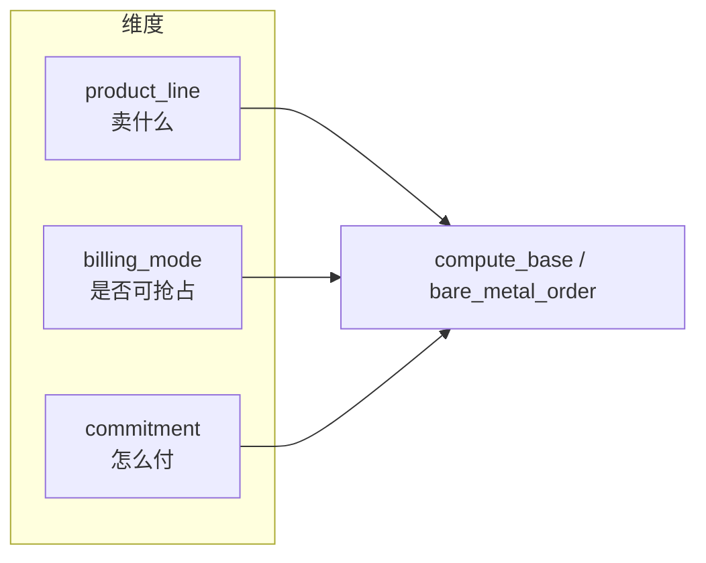

# 产品线与计费语义（权威定义）

> **状态**: ✅ 已采纳（2026-07-19，修订同日）  
> **效力**: 本文件为 `product_line` / `billing_mode` / `commitment` / 乘数 / 券类型的唯一定义。  
> 其他设计文档若与本文冲突，以本文为准并回写。  
> **不做历史错误数据兼容**：**目标态**库表与 API 一律按本文枚举落库，禁止保留 `elastic_service`、`product_line=spot`、`hours` 券类型等旧码。
> **对齐状态（2026-10-06）**：`PlatformProductLine` 仍含 `elastic_service`/`job`/`spot` 等旧码，`compute_base` 实际枚举与 §2 表格亦有差异——**本文为规范目标态，非现状快照**；未迁移清单见 `docs/design/audit/doc-contradictions.md`。

---

## 1. 三维正交模型



| 维度 | 字段 | 枚举 | 含义 |
|------|------|------|------|
| **产品线** | `product_line` | 见 §2 | 产品形态 |
| **计费模式** | `billing_mode` | `on_demand` \| `spot` | 是否可被系统回收 |
| **承诺周期** | `commitment` | 见 §4 | 按秒 / 包时 / 包日周月 |

定价表另用 `billing_unit`（与 commitment 对齐，见 §4.3）。

---

## 2. 产品线枚举

```typescript
type ProductLine =
  | 'cloud_vm'      // GPU 云服务器 / 开发机
  | 'serverless'   // 无状态 Web / 弹性服务
  | 'inference'    // LLM 推理
  | 'job'          // 批处理
  | 'bare_metal'   // 裸金属
```

| 编码 | 中文名 | 交付原语 | 入口示意 |
|------|--------|----------|----------|
| `cloud_vm` | GPU 云服务器 | Pod + PVC | `/server/*` |
| `serverless` | 弹性服务 | Deployment | `/serverless/*` |
| `inference` | LLM 推理 | Deployment(s) + Traefik | `/inference/*` |
| `job` | 批处理 | Job | `/tasks` |
| `bare_metal` | 裸金属 | 物理机 + SSH | `/metal/*` |

**禁止**写入：`elastic_service`、`spot`（作 product_line）、`serverless_inference`。

定价 UK：

```text
UNIQUE (gpu_card_type_id, product_line, billing_unit, effective_from)
-- product_line ∈ 上表；Spot 不占 product_line
```

---

## 3. 计费模式 `billing_mode`

```typescript
type BillingMode = 'on_demand' | 'spot'
```

| 值 | 含义 | 可抢占 | 价格 |
|----|------|--------|------|
| `on_demand` | 按需，系统不主动回收（余额不足停机除外） | 否 | 零售价 × 1.0 |
| `spot` | 闲时，系统可回收 | 是 | 零售价 × `spot_price_multiplier`（默认 0.60） |

### 3.1 准入矩阵（MVP）

| product_line | on_demand | spot |
|--------------|-----------|------|
| `job` | ✅ | ✅ |
| `cloud_vm` | ✅ | ❌ |
| `serverless` | ✅ | ❌ |
| `inference` | ✅ | ❌ |
| `bare_metal` | ✅ | ❌ |

用户侧 Spot **仅**出现在 Job 下单选项。详见 `../design/cloud/spot-preemption-design.md`。

### 3.2 Serverless 可中断调度（≠ Spot）

`product_line=serverless` 另有横切选项 **`interruptible`（是否允许中断并跨区调度）**，**默认 `true`**。

| 概念 | 字段 | 含义 |
|------|------|------|
| Spot | `billing_mode=spot` | 闲时廉价 + 可被回收；**仅 job** |
| 可中断 | `serverless_detail.interruptible` | 容量紧张/区域异常时允许调度到其他授权区域 |

- **禁止**将 Serverless 可中断建模为 `billing_mode=spot`。
- 完整语义、迁移 SLA、计费重叠期、商业化定稿见 `../design/cloud/serverless-implementation.md`。

### 3.3 Spot 单价

```text
spot_unit_price = on_demand_unit_price(...) × spot_price_multiplier
```

禁止 `product_line='spot'` 定价行。

Serverless 可中断/固定区价格乘数 —— **可中断 `0.90`（刊例 9 折）/ 固定区 `1.00`（不打折）**，见 `../design/cloud/serverless-implementation.md` §6 C11 与 §6.1，**不占用** `billing_mode`。

---

## 4. 承诺周期 `commitment`（权威）

```typescript
type Commitment =
  | 'on-demand'  // 按秒计费（计量精度秒，扣款窗口 5min）
  | 'hour'       // 按小时预付
  | 'daily'      // 包日预付
  | 'weekly'     // 包周预付
  | 'monthly'    // 包月预付
```

### 4.1 语义与扣款

| commitment | 计量 / 扣款 | 说明 |
|------------|-------------|------|
| **`on-demand`** | **按秒计费**；运行中每 5 分钟按实际秒数结算 | 非预付；对应「按量」 |
| **`hour`** | 创建时按 1 小时单价预付 | 包时；到期续费或停止 |
| **`daily`** | 创建时按日价预付 | 包日 |
| **`weekly`** | 创建时按周价预付 | 包周 |
| **`monthly`** | 创建时按月价预付 | 包月 |

> **关键**：`commitment='on-demand'` = **按秒计费**，不是「按小时计费」。  
> `commitment='hour'` = **按小时预付**。二者不可混淆。

### 4.2 与 `billing_mode` 组合

| billing_mode | 允许的 commitment |
|--------------|-------------------|
| `on_demand` | `on-demand` / `hour` / `daily` / `weekly` / `monthly`（按产品线裁剪） |
| `spot` | **仅** `on-demand`（按秒；禁止 hour/日/周/月预付） |

### 4.3 `billing_unit`（定价表 / 裸金属订单）

```typescript
type BillingUnit = 'hour' | 'day' | 'week' | 'month'
```

| commitment | 定价查询用 billing_unit |
|------------|-------------------------|
| `on-demand` | `hour`（存小时价，扣款时 ÷3600 × 实际秒数） |
| `hour` | `hour` |
| `daily` | `day` |
| `weekly` | `week` |
| `monthly` | `month` |

裸金属订单字段继续用 `billing_unit`；K8s 任务用 `commitment`。前端展示「按量」时映射 `commitment=on-demand`。

---

## 5. 价格乘数

```text
payable = list_or_sell_price × multiplier
```

| 字段 | 默认 | 含义 |
|------|------|------|
| `spot_price_multiplier` | `0.60` | Spot ≈ 刊例价六折（与价目表 H100 1.55/2.59≈60% 一致） |
| `off_peak_price_multiplier` | `1.00` | 闲时时段乘数 |
| `serverless_interruptible_price_multiplier` | `0.90` | Serverless **可中断**（允许跨区调度）≈ 刊例价九折；固定区 `pinned` = `1.00` 不打折，见 `../design/cloud/serverless-implementation.md` §6 |

校验：`0 < multiplier ≤ 1`。字段名统一用 `*_price_multiplier`，不用歧义的 `*_discount`。

---

## 6. 算力券类型

```typescript
type CouponType = 'fixed' | 'discount' | 'resource_pack'
```

| type | 抵扣 |
|------|------|
| `fixed` | `min(remaining_value, payable)` |
| `discount` | 按比例，可有上限 |
| `resource_pack` | 内部单价换算；卡时包：`pack_unit='gpu_hour'` |

禁止独立 type `hours`。

---

## 7. 计算任务字段（规范 DDL 节选）

```sql
-- compute_base
product_line   VARCHAR(32) NOT NULL
  CHECK (product_line IN ('cloud_vm','serverless','inference','job','bare_metal')),
billing_mode   VARCHAR(16) NOT NULL DEFAULT 'on_demand'
  CHECK (billing_mode IN ('on_demand','spot')),
commitment     VARCHAR(16) NOT NULL DEFAULT 'on-demand'
  CHECK (commitment IN ('on-demand','hour','daily','weekly','monthly')),
-- CHECK (billing_mode <> 'spot' OR (product_line = 'job' AND commitment = 'on-demand'))
```

Spot 运行时字段见 `../design/cloud/spot-preemption-design.md`。

---

## 8. 引用关系

| 文档 | 须遵守 |
|------|--------|
| `../design/cloud/spot-preemption-design.md` | Spot = job + billing_mode=spot + commitment=on-demand |
| `../design/cloud/serverless-implementation.md` | serverless `interruptible` 默认 true；≠ Spot |
| `../design/cloud/storage-quota-and-s3-volume.md` | 镜像限额、数据盘免费/扩容、S3 网络卷 |
| `../design/cloud/tenant-balance-unification.md` | 按秒扣款走 freeze / consume_reserved |
| `../design/cloud/compute-task-decoupling-analysis.md` | product_line / commitment 枚举对齐本文 |
| `../design/cloud/cloud-vm-implementation.md` §8 | cloud_vm 数据与镜像分离；构建主路径非 docker commit |
| `../design/cloud/00-overview.md` / `../design/cloud/database-design.md` / `container-*.md` | 全文对齐，无旧码 |
