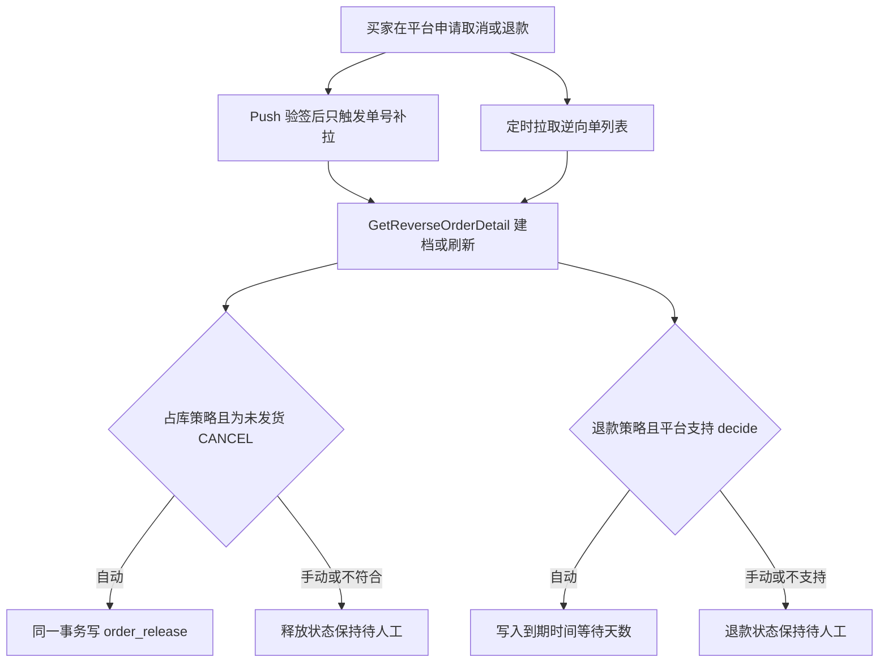

# 取消与退款：平台接入、占库释放与退款策略

> 状态：**已落地（2026-11-07），业务闭环**
> 范围：`/console/aftersale-cancels` 的 `CANCEL` / `ONLY_REFUND`。退货退款 `RETURN` 仍走 `/console/aftersale-returns`，不使用本文策略。
> 关联：[shop-module6-aftersale-trpc.md](shop-module6-aftersale-trpc.md)、[marketplace-inapp-cron-and-push.md](marketplace-inapp-cron-and-push.md)、[platform-apis/lazada/lazada-aftersales-api.md](platform-apis/lazada/lazada-aftersales-api.md)、[platform-apis/daraz/daraz-aftersales-api.md](platform-apis/daraz/daraz-aftersales-api.md)

## 已落地

- `shop_aftersale_policies` 表 + `reverse_orders` 决策列（migration 0011）。
- 设置页 `/console/settings/aftersale-policy`：占库释放手动/自动、退款手动/自动 + 等待天数；Daraz 自动退款禁用。
- 取消页拆分「占库释放」「退款决定」两列状态与动作（释放占库 / 同意退款 / 拒绝 / 改为人工）。
- `apps/api` 售后同步 cron + 到期退款决定 cron + `/api/v1/cron/reverse-sync`、`/reverse-refund-decide` 路由。
- marketplace connector 接口 `listReverseOrders` / `getReverseOrderDetail`（LazopConnectorBase，Lazada+Daraz 共用查询）/ `decideReverse`（仅 LazadaConnector；Daraz 公开文档无 seller decide，cron 标 unsupported）。
- Lazada adapter 实现：
  - `listReverseOrders` → `/reverse/getreverseordersforseller`，按 `ReverseOrderLineModifiedTimeRange` 增量。
  - `getReverseOrderDetail` → `/order/reverse/return/detail/list`，金额按站点归一化（VN 原值，其它 cent/100）。
  - `decideReverse`：CANCEL → `/order/reverse/cancel/seller/decide`；ONLY_REFUND → `/order/reverse/onlyrefund/seller/decide`（`agreeRefund`）。
- LAZOP Push 接到逆向单：webhook 检测 `data.reverse_order_id`，异步触发 `syncReverseOrder` 单号补拉建档。

## 待实测

- Daraz seller decide 接口实测通过后，在 LazadaConnector 之外为 DarazConnector 增补 `decideReverse`，并开放该店铺自动退款。
- Lazada Push 逆向消息的 `message_type` 实际枚举核对（当前以 `reverse_order_id` 字段存在性路由，不依赖枚举）。

买家在 Lazada / Daraz 发起取消或退款。本系统定时拉取（主路径）或被动接收通知后补拉（加速），幂等建档。占库释放和店铺退款是两条独立策略，在设置页分开配置。

`approveCancel`（模块 6 的「审核通过」一次动作）保留为向后兼容入口，但新链路将其拆成两个独立动作：`releaseReserved`（释放占库）与 `decideRefund`（同意/拒绝退款）。控制台取消页使用新动作；`approveCancel` 不再被新页面调用，仅保留给旧调用方过渡。

## 1. 两条策略

| 策略 | 设置项 | 默认 | 触发 |
| --- | --- | --- | --- |
| 未发货占库释放 | 手动 / 自动 | 手动 | 仅 `request_type = CANCEL`，且订单未发货、存在 active 占库 |
| 店铺退款 | 手动 / 自动，自动时等待天数（整数，≥ 0） | 手动，等待 1 天 | 平台仍待卖家同意，且该店铺平台提供 decide 接口 |

释放没有等待天数。设为自动时，逆向单第一次成功建档就释放，不等下一轮详情，也不等退款接口回执。

退款设为自动时，从平台申请时间 `platform_created_at` 起算，满 N 天后调用平台同意接口。N = 0 表示建档后的下一轮退款任务即可同意，仍与释放分开执行。天数单位为天。

`ONLY_REFUND` 不释放占库、不增加可用库存。已出库取消不冲销出库（沿用模块 6）。`RETURN` 不进入本策略。

## 2. 接入

调度放在 `apps/api`，不在 `apps/shop` 新增 cron。与订单同步共用进程内单飞；多实例用 Postgres advisory lock。



| 环节 | 规则 |
| --- | --- |
| 定时拉取 | 建议 `*/15 * * * *`。`GetReverseOrdersForSeller` 用 `ReverseOrderLineModifiedTimeRange*` 增量，游标写入 `integration_states`。列表无金额，新单或状态变化必须再调 `GetReverseOrderDetail`。 |
| Push | 沿用 `POST /api/v1/webhooks/lazop`：验签、写入 `marketplace_webhook_events`、立即返回，再异步拉该逆向单。Push 正文不作为金额和状态依据。Daraz 门户未公开 Push，LK 站以拉取为准。 |
| 幂等 | 头 `(shop_id, external_reverse_order_id)`，行 `(shop_id, external_reverse_line_id)`。 |
| 金额 | Lazada 除越南外按分换算。Daraz LK 与结算单核对前保留原始值和 `amount_unit`。 |
| 控制台登记 | `createCancel` 降为补录例外。列表来源是平台逆向单。 |

建档使用的那一次详情足够判断能否释放。释放不依赖「再拉一次确认退款已成功」。退款任务在调用 decide 之后，再拉详情，只用于把 `refunds.status` 从已提交改为已退款，不回头改库存。

## 3. 未发货占库释放

### 3.1 何时释放

同时满足才释放：

- 店铺策略为自动，或人工在取消详情点击「释放占库」
- `request_type = CANCEL`
- 关联订单存在，且履约状态不是已出库
- 该订单有 `status = active` 的 `inventory_reservations`（这是「尚未释放」的硬性闸门，已释放的单不会再有 active 占库）

以下情况跳过，并在取消单事件流记下原因：

| 情况 | 释放状态 |
| --- | --- |
| `ONLY_REFUND` / `RETURN` | `skipped`（仅退款/退货不释放占库） |
| 无关联订单或关联订单不存在 | `skipped` |
| 订单已出库 | `skipped`（本迭代不冲销出库） |
| 无 active 占库 | `skipped`（已释放或从未占库） |
| 策略为手动且无人点击 | `pending_manual` |

买家申请一进入 `REQUEST_INITIATE` 就按策略释放，不等卖家同意、也不等 `CANCEL_SUCCESS`。占库要立刻还给可售，避免等待退款期间继续超卖。

已按自动策略释放后，买家又撤销申请：不自动重新占库。取消单标记「已释放但申请已撤销」，由人工决定是否重新锁定。

### 3.2 怎么写库存

沿用模块 6 的流水，不静默改余额以外的字段：

- `inventory_movements.movement_type = order_release`
- `qty_delta = 0`，只减 `reserved`
- 幂等键 `ledger:aftersale_cancel_release:{externalReverseId}:{orderLineId}`
- 命中已有流水则跳过插入，仍把对应占库标为 `released`
- 占库行 `status = released`
- 未发货订单状态改为 `cancelled`（已是 `cancelled` 则不变）
- 重算相关 variant 的库存预警

同一张逆向单的释放与建档放在同一个 `db.transaction`。自动策略下，同步任务完成时占库已经释放。

## 4. 店铺退款

退款是卖家对平台的决定，钱由平台退给买家。本地 `refunds` 只记录决定和平台回执，不发起支付。

### 4.1 平台是否支持

| 平台 | 类型 | 同意接口 | 自动退款 |
| --- | --- | --- | --- |
| Lazada | `CANCEL` | `GET /order/reverse/cancel/seller/decide`，`agree_cancel = true` | 可开 |
| Lazada | `ONLY_REFUND` | `GET /order/reverse/onlyrefund/seller/decide`，`action = agreeRefund`（一次一行） | 可开 |
| Daraz | 查询、卖家代客取消 | 公开文档无 seller decide | 设置里不提供自动，只保留手动队列；接口实测通过后再开 |

拒绝前必须调用 `GetReverseOrderReasonList`，不写死原因码。

### 4.2 何时进入自动退款

同时满足才排期：

- 店铺退款策略为自动，且该平台支持对应类型的 decide
- 行状态仍为 `REQUEST_INITIATE`，卖家尚未决定
- 非争议（`dispute_in_progress` / `is_dispute` 为假）
- 金额单位已按店铺站点归一化

到期时间：

```text
due_at = platform_created_at + refund_wait_days
若存在 sla_at 且 due_at > sla_at - 2 小时：
  due_at = sla_at - 2 小时
  列表标记「因平台时限提前执行」
```

等待从买家申请时刻起算，不从同步到本地的时刻起算。晚到的同步单如果已经过了到期时间，下一轮退款任务立即执行。

调用 decide 之前再拉一次详情。若已不是 `REQUEST_INITIATE`、已争议、或买家已撤销，改为 `skipped`，不调用同意。调用成功只表示决定已提交；`refunds.status = refunded` 要等后续详情出现退款完成或 `CANCEL_SUCCESS`。失败写入 `integration_logs`，详情页可重试。

幂等由 `reverse_orders.refund_decision` 状态机保证：已 `agreed` / `rejected` 的单再次调用会直接报错「已同意/已拒绝，不可重复操作」，不会二次调用平台。`scheduled` 单在到期前可「改为人工」回退到 `pending_manual`。

平台在我们决定前已经退完款：只把本地退款记为已退款，不调用 decide。

## 5. 设置页

路由：`/console/settings/aftersale-policy`，加入 `SETTINGS_NAV`。按店铺切换，两块上下分开，互不影响。

```text
店铺  [ Daraz LK 主店 v ]

未发货占库释放
  ( ) 手动    同步后出现在取消列表，人工点击「释放占库」
  (•) 自动    买家取消入库后立即释放未发货占库

店铺退款
  (•) 手动    只建退款记录，人工同意或拒绝
  ( ) 自动    申请满 [ 1 ] 天后同意退款
  说明：当前店铺平台未提供同意退款接口时，自动选项不可选，并显示原因。
```

| 控件 | 规则 |
| --- | --- |
| 占库释放 | 只有手动 / 自动，没有天数 |
| 退款模式 | 手动 / 自动 |
| 等待天数 | 仅自动退款时显示。整数，最小 0，无上限以外的业务上限；空值按 1 天保存 |
| 平台不支持 decide | 自动退款禁用；已保存的自动值在读到不支持时按手动展示，不发起调用 |

策略挂在店铺。逆向单建档时把当时的模式、等待天数、计算后的 `refund_due_at` 快照到该单。之后修改设置只影响新单。已排期的退款保持原到期时间；已释放的占库不回滚。

## 6. 数据

新增 `shop_aftersale_policies`（`drizzle-kit generate`，不手改 `packages/db/drizzle/`）：

| 列 | 类型 | 说明 |
| --- | --- | --- |
| `id` | text | 主键 |
| `organization_id` | text | 租户 |
| `shop_id` | text | 唯一 |
| `inventory_release_mode` | varchar | `manual` / `auto`，默认 `manual` |
| `refund_mode` | varchar | `manual` / `auto`，默认 `manual` |
| `refund_wait_days` | integer | 默认 1，仅 `refund_mode = auto` 时使用 |

`reverse_orders` 增加决策列，供任务扫描，不塞进 `raw`：

| 列 | 说明 |
| --- | --- |
| `inventory_release_mode` | 建档快照 |
| `inventory_release_status` | `pending_manual` / `released` / `skipped` / `failed` |
| `inventory_released_at` | 释放时间 |
| `refund_mode` | 建档快照 |
| `refund_wait_days` | 建档快照 |
| `refund_decision` | `pending_manual` / `scheduled` / `deciding` / `agreed` / `rejected` / `skipped` / `unsupported` |
| `refund_due_at` | 自动退款到期时间 |

`refunds.status` 继续表示平台退款进度：`pending` → 决定已提交 → `refunded`。退款完成不写库存流水。

`integration_states` 增加 `last_reverse_sync_at`，作为下一轮 `ReverseOrderLineModifiedTimeRange` 的下界（减去 `MARKETPLACE_SYNC_REVERSE_OVERLAP_MINUTES` 防漏单）。无单独 cursor 列，时间戳即游标。每次运行写 `integration_logs(action = 'reverse.sync' | 'reverse.refund_decide')`。

## 7. 取消页

`/console/aftersale-cancels` 与详情分开显示两列状态：占库释放、退款决定。

| 动作 | 何时出现 |
| --- | --- |
| 释放占库 | 释放状态为 `pending_manual`，且满足 §3.1 的订单条件 |
| 立即退款 | 退款决定为 `pending_manual` 或 `scheduled`，且平台支持 decide |
| 拒绝退款 | 同上；先拉原因列表 |
| 改为人工 | 退款决定为 `scheduled` 且未到到期时间 |

不再用一次「审核通过」同时释放占库并记账退款。现有 `approveCancel` 在实现本文时拆成上述两个动作。

## 8. 实现说明

- `apps/shop` 的 `dataaccess/aftersale.ts` 不是 workspace 包，`apps/api` 无法跨包导入。因此建档逻辑存在两份等价实现：
  - `apps/shop/src/lib/server/dataaccess/aftersale.ts` 的 `ingestReverse` / `releaseReserved` / `decideRefund`（控制台 tRPC 调用）。
  - `apps/api/src/lib/marketplace/aftersale-cron.ts` 的 `ingestReverseViaApi` / `runDueRefundDecisions`（cron 调用）。
  - 两者行为一致：建档 → 按策略释放 / 排期。占库释放的库存流水统一走 `apps/shop` 的 `releaseReserved`（控制台触发）；`apps/api` cron 仅写决策状态，不直接改 `inventory_balances`，避免与 shop 事务逻辑分叉。
- `approveCancel` / `rejectCancel` 保留在 router 供旧调用方过渡；新页面使用 `releaseReserved` / `decideRefund` / `cancelScheduledRefund`。
- marketplace connector 的 `listReverseOrders` / `getReverseOrderDetail` 在 `LazopConnectorBase`（Lazada + Daraz 共用查询）；`decideReverse` 仅 `LazadaConnector` 实现，Daraz 不实现，cron 检测缺失时标 `unsupported`。
- 多实例部署时 cron 进程内单飞不跨实例；生产多副本需共享 Postgres advisory lock 或独立 worker（与订单同步同问题，沿用其方案）。

## 9. 环境变量

见根 `.env.example` 的「In-app cron + LAZOP push receiver」段。本轮新增：

```text
# 售后逆向单同步 cron（拉取建档 + 策略释放 / 排期）
MARKETPLACE_SYNC_REVERSE_CRON_ENABLED=true
MARKETPLACE_SYNC_REVERSE_CRON=*/15 * * * *
# 到期退款决定扫描 cron
MARKETPLACE_SYNC_REVERSE_DECIDE_CRON=*/10 * * * *
# 增量窗口与分页（可选，有默认）
MARKETPLACE_SYNC_REVERSE_BACKFILL_DAYS=7
MARKETPLACE_SYNC_REVERSE_OVERLAP_MINUTES=60
MARKETPLACE_SYNC_REVERSE_MAX_PAGES=5
MARKETPLACE_SYNC_REVERSE_PAGE_SIZE=50
MARKETPLACE_SYNC_REVERSE_DECIDE_LIMIT=50
```

手动触发：`POST /api/v1/cron/reverse-sync`、`POST /api/v1/cron/reverse-refund-decide`，`x-cron-secret` 或 `Authorization: Bearer $CRON_SECRET`，返回 `202`。

## 10. 落地顺序（已完成）

1. ✅ 策略表、逆向单决策列、设置页。默认全手动，行为与现在的人工处理一致。
2. ✅ `apps/api` 逆向单增量同步，建档。自动释放在建档事务内完成。
3. ✅ 取消列表改为平台单据，释放 / 退款动作拆开。
4. ✅ Lazada 到期退款任务调用 decide，再拉详情更新 `refunds`。
5. ⏳ Daraz decide 实测通过后，才允许该店铺打开自动退款。
6. ✅ Lazada Push 接到现有 webhook，按 `reverse_order_id` 字段触发单号补拉。
