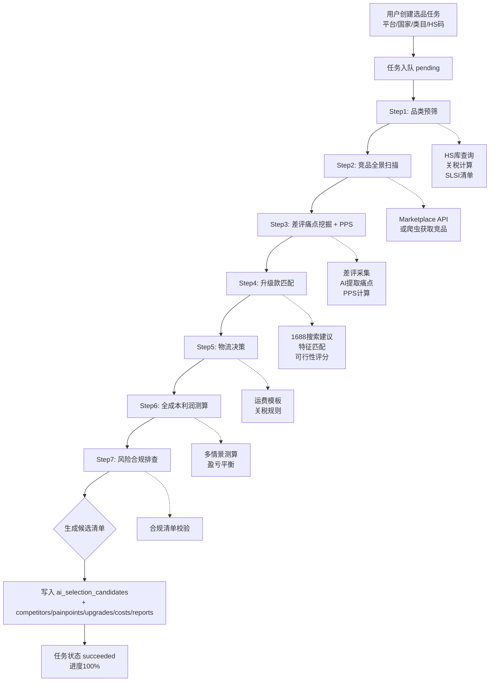

# AI选品实现方案

> 本文档基于方法论文档和现有代码库架构，给出 Open Shop 项目中 AI 选品（差异化选品）功能的落地实现方案。
> 
> @see docs/design/ai-candidates/斯里兰卡Daraz差异化选品方法论.html §七步选品法  
> @see docs/design/ai-candidates/高速吹风机Daraz选品分析.html §实测案例  
> @see AGENTS.md

## 1. 概述

### 1.1 目标和价值

基于《斯里兰卡Daraz差异化选品方法论》，AI选品的核心思路是 **"不卷价格，卷痛点"**。通过系统化地挖掘竞品差评、识别未满足痛点、匹配升级款产品、并结合关税、物流、全成本等因素进行量化评估，最终产出具有差异化竞争力且有合理利润的选品候选清单。

**核心价值：**
- **系统化选品**：将专家经验固化为可执行的"七步选品法"，减少主观决策
- **差异化导向**：从竞品差评中发现痛点，优先寻找"升级款"而不是"同款更便宜"
- **全链路量化**：整合关税、物流、平台费用、汇率等全成本，防止盲目选品
- **可落地验证**：借助现有的 `product_candidates` 表和 `/console/candidates` 页面，渐进式完善

### 1.2 产品目标与分阶段边界

**产品目标：让用户能够准确地计算成本，让 AI 获得足够且可追溯的数据进行选品，从而提升选品效率。**

本功能按两个连续阶段交付，二者都属于可运行的业务功能建设：

| 阶段 | 目标 | 交付内容 | 明确不做 |
|---|---|---|---|
| **阶段一：UED / 可交互验证** | 让真实用户试用流程、判断是否符合工作习惯 | 可操作的页面；使用显式标注的样例/模拟数据；候选证据与假设状态展示；成本计算器含空运 DDP、海运 LCL、海运 FCL 对比；中间分析数据结构与保存/复用交互可在 Demo 中演示 | 不把前端 Mock 声称为已持久化；不接业务 tRPC、生产任务队列或真实平台采集 |
| **阶段二：业务接入** | 将确认过的流程变成真实、可追溯的业务能力 | 接入 tRPC/domain/dataaccess；按组织隔离持久化任务、输入、来源、证据、分析、包装、运价/税率版本和成本快照；接入授权数据源与可复算计算引擎；为 AI 提供可复用结构化数据 | 未核实来源的数据不得变成默认税率、真实市场事实或自动上架结论 |

UED 阶段可以执行前端确定性计算以验证交互，但结果必须显示“演示计算/示例参数”，且不可误导用户认为已保存到数据库。第二阶段上线后，中间数据需可重新用于候选比较、重新测算和后续经营复盘。

### 1.3 现状分析

当前代码库已有雏形：
- **前端**: `apps/shop/src/app/[locale]/console/(ops)/candidates/` 已有候选列表页和详情页，使用 mock 数据（`@/lib/crossborder/mock-data`）
- **数据模型**: `packages/db/src/commerce-schema.ts` 中已存在 `productCandidates` 表（字段较简：`title`、`url`、`categoryHint`、`score`、`rationale`、`status`、`pendingActionId`）
- **市场数据**: `packages/marketplace` 已具备 Daraz（基于 LazOP）连接器能力

但距离文档中描述的完整"AI选品"流程（七步法、PPS评分、升级匹配、全成本测算等）还有较大差距，需要按架构规范扩展。

## 2. 方法论提炼

将两个文档的核心逻辑映射到系统实现：

| 方法论步骤 | 文档要点 | 系统化需求 | 对应实体 |
|-----------|---------|-----------|---------|
| **1. 品类预筛** | HS编码→关税计算（CID/PAL/VAT/SSCL）→SLSI合规→物流可行性 | HS码库、关税规则、合规清单、品类可行性评分 | `aiSelectionTasks`、`aiSelectionReports` |
| **2. 竞品全景** | Daraz SL前N名竞品、价格带、品牌格局、发货地、标题卖点 | 竞品采集（可基于marketplace API或爬取）、竞品快照、价格带分析 | `aiCandidateCompetitors` |
| **3. 痛点挖掘** | 差评收集→痛点分类→PPS = 频率×严重度×可解决度 | 仅对有来源的评论证据计算；假设单独标记，不冒充观测值 | `aiCandidatePainPoints` / OKF 证据 |
| **4. 升级匹配** | 痛点→特征→1688搜索验证→可见性/成本可控/一击致命 | 升级款候选库、特征映射、采购价预估、可行性验证 | `aiCandidateUpgrades` |
| **5. 物流决策** | 空运DDP vs 海运LCL vs 海运FCL、带电产品限制、时效权衡 | 三种方案均可比较；按各自计费规则计算、保留报价来源/有效期/未含费用；条件不足时标为待补数据，不给虚假精确值 | `freight_estimates` / 消费方成本快照 |
| **6. 全成本利润测算** | 采购+运费+关税+平台费+营销+退货+汇率，模拟多情景 | 成本模板、费用规则、汇率、利润测算引擎、多情景对比 | `aiCandidateCosts` |
| **7. 风险合规** | SLSI、TRCSL、IP侵权（外观）、插头、电压、带电物流 | 合规检查清单、风险评级、整改建议 | 纳入报告 |

### 核心量化指标

| 指标 | 计算方式 | 用途 |
|------|---------|------|
| **PPS（痛点优先级）** | `频率(1-5) × 严重度(1-5) × 可解决度(0.5-1.5)` | 与方法论 HTML 一致；可解决度越高代表越容易/成本越低。只对已核验评论计算；假设项显示“暂不评分”或单列假设分，不与实测排序混排 |
| **有效税率** | `GD + PAL + VAT + SSCL + CESS`（按 Daraz SL 规则；运费域/权威用 **GD**，本文早期案例中的 CID 即 GD 别名） | 品类门槛判断（文档案例：8516.31→29.8%） |
| **经营净利率** | `(售价 - 完整经营成本) / 售价 × 100%`；完整经营成本 = 到仓成本 + 平台/支付/营销/退货等明确计入项 | GO/HOLD/NO-GO 的主要利润指标；必须列出包含项/缺失项；未提供的费用不得默认为 0 且不标注 |
| **机会评分** | 明确方向：高分=机会更好；由需求证据、竞争空档、差异化可行性等分项组成 | 仅作排序辅助，不得用单一分数代替证据与人工决策 |
| **竞争强度** | 独立展示“竞争越强，数值越高”或“竞争越有利，数值越高”，产品内固定一种表达 | 不与“机会分”混用；Demo 暂采用“竞争压力：低/中/高”避免歧义 |
| **合规状态** | `已核实 / 有风险 / 未核实 / 不适用` | “低风险”不等于“8.5高分”；展示证据来源及核对日期 |

### 2.1 指标口径与证据状态（全产品统一）

**成本命名统一：**“到仓成本”必须包含明确标示的采购价、国际物流、进口税费和清关/派送等约定项目；如果输入仅有部分项目，应标“部分成本/尚未完整”，不得误称完整到仓成本。“经营总成本”再加平台佣金、支付、仓储、营销、退货等售价侧费用。成本详情需逐项显示金额、币种、是否已含于货代报价和来源。DDP 报价若包含关税，不能再次叠加同一进口税；未拆分的含税报价显示为打包费用并保留税项未拆分提示。

统一 PPS：频率 1–5 × 严重度 1–5 × 可解决度 0.5–1.5，范围 0.5–37.5。等级建议：S ≥20、A 10–<20、B 5–<10、C <5；上线前用真实样本校准阈值。不得沿用本方案早期草稿中的“可解决度 1–3”。

每个关键信息、评分和结论必须有证据状态：

| 状态 | 用户可见含义 | 可否用于自动评分/建议 |
|---|---|---|
| **已核实** | 有可检查来源、采集时间和具体证据 | 可纳入对应指标；显示样本范围 |
| **估算** | 有明确计算方法，但输入或参数不是实测值 | 可用于情景比较；显著标注估算和输入来源 |
| **假设/待验证** | 专家推测、AI推断或未经采集验证 | 不计入“实测”评分；仅列为待验证假设 |
| **未提供/过期** | 缺数据或来源已过有效期 | 阻止产生确定性结论，提示补数据/更新 |

AI 产出需分别存储原始证据引用、提取结果、置信度/人工复核状态、模型/提示版本和生成时间；AI 摘要不得覆盖原始来源。金额计算用可复算的确定性公式，模型不直接编造税率、报价或销量。

## 3. 架构设计

### 3.1 模块边界（遵循 AGENTS.md）

| 模块 | 职责 | 说明 |
|------|------|------|
| **`apps/shop`** | 租户端UI + 业务入口 | 阶段一先实现可交互 UED/示例数据；用户确认后阶段二接 tRPC/domain/dataaccess，提供组织隔离的持久化与候选工作台。|
| **`apps/web`** | 平台运营后台 | 平台侧可增加跨租户选品任务监控（只读）、AI选品规则配置（HS库、费用模板）等，默认受限。MVP可先不实现。 |
| **`apps/api`** | OpenAPI/MCP接入 | 若后续需对外暴露选品能力，共用domain服务，避免双套写路径。MVP可延后。 |
| **`packages/db`** | 数据模型 | 阶段二仅按现行跨境 schema/OKF 架构补齐业务所需索引、候选关联和成本快照；研究过程/知识正文不复制成固定七步数据库。 |
| **`packages/marketplace`** | 平台数据接入 | 扩展Daraz适配器，增加竞品列表、商品详情、差评等数据获取能力（可复用现有LazOP基类）。 |
| **`packages/auth`** | 权限 | 租户隔离沿用现有organization机制。 |
| **`packages/ui`** | 组件库 | 使用shadcn/ui组件构建选品页面。 |

### 3.2 依赖方向

符合AGENTS.md既定方向：
- `apps/shop` → `@workspace/{db,auth,marketplace,ui,shared-next,...}`
- `packages/marketplace` → `@workspace/db`
- `packages/db` → 不引用任何workspace包

### 3.3 服务层链路（标准）

```
UI (apps/shop/src/app/[locale]/console/(ops)/ai-selection/*)
  ↓ tRPC（apps/shop/src/server/routers/aiSelection.ts，或 apps/web 按需）
  mappers（可选，src/lib/server/mappers/aiSelection.ts）
  dataaccess（src/lib/server/dataaccess/aiSelection.ts）— 事务用 db.transaction
    ↓ Drizzle ORM
  @workspace/db（packages/db/src/schema/ai-selection.ts 或合并到 commerce-schema.ts）
    ↓ PostgreSQL
```

> 注意：AGENTS.md 指出 `apps/shop` 当前以 mock 展示，尚未接入业务 tRPC。AI选品是自然的首批接入场景，需按此链路补全。

## 4. 数据模型设计（阶段二旧草案/概念示例，非生产表清单）

阶段二的数据结构须先对照 `crossborder-database-design.md` 与权威 [haoshiyun-erp-database-schema.md](../haoshiyun-erp-database-schema.md)：复用 `product_candidates` 与 `skill_executions`/OKF 引用模式；不要照抄本节旧版“6张 AI 专属固定流程表”作为生产方案。成本/报价快照由独立运费域保存，AI 选品仅保存逻辑引用和消费方摘要。**证据分级列名以权威 `evidence_basis` 为准**（本节旧草案用 `evidence_status`，值域 `verified/estimated/assumption/unverified/stale` 一致）；**文件组织按权威原则**：在 `commerce-schema.ts` 按域分节扩展，不另建平行 schema 文件。

### 4.1 枚举定义

```typescript
// commerce-schema.ts 按域分节扩展（权威原则 #9；不另建 ai-selection-schema.ts）
export const aiSelectionTaskStatuses = ["pending", "running", "succeeded", "failed", "cancelled"] as const
export type AiSelectionTaskStatus = (typeof aiSelectionTaskStatuses)[number]

export const aiSelectionTaskTypes = ["full", "competitor_scan", "painpoint_mine"] as const
export type AiSelectionTaskType = (typeof aiSelectionTaskTypes)[number]

export const aiCandidateDecision = ["go", "hold", "no_go"] as const
export type AiCandidateDecision = (typeof aiCandidateDecision)[number]

export const aiCandidateSource = ["ai_recommend", "manual_import"] as const
export type AiCandidateSource = (typeof aiCandidateSource)[number]

export const logisticsModes = ["air_ddp", "sea_lcl", "sea_fcl"] as const
export type LogisticsMode = (typeof logisticsModes)[number]
```

### 4.2 核心表结构

#### `ai_selection_tasks` - 选品任务
记录用户发起的AI选品任务（"七步法"全流程或子任务）。

```typescript
export const aiSelectionTasks = pgTable(
  "ai_selection_tasks",
  {
    id: text("id").primaryKey().$defaultFn(() => createId()),
    organizationId: text("organization_id").notNull().references(() => organization.id),
    createdBy: text("created_by").notNull().references(() => user.id),
    type: varchar("type", { length: 32 }).notNull().$type<AiSelectionTaskType>(),
    status: varchar("status", { length: 32 }).notNull().default("pending").$type<AiSelectionTaskStatus>(),
    title: text("title").notNull(),
    // 输入参数
    platform: varchar("platform", { length: 32 }).notNull(), // daraz/lazada/...
    marketplaceCountry: varchar("marketplace_country", { length: 16 }).notNull(), // lk/my/...
    categoryKeyword: text("category_keyword"),
    hsCode: varchar("hs_code", { length: 20 }),
    priceRangeMin: numeric("price_range_min", { precision: 15, scale: 4 }),
    priceRangeMax: numeric("price_range_max", { precision: 15, scale: 4 }),
    targetMarginPct: numeric("target_margin_pct", { precision: 6, scale: 2 }),
    params: jsonb("params").$type<Record<string, unknown>>().default({}),
    // 进度与结果概览
    progress: integer("progress").default(0), // 0-100
    currentStep: varchar("current_step", { length: 32 }), // step1..step7
    resultSummary: jsonb("result_summary").$type<Record<string, unknown>>().default({}),
    error: text("error"),
    startedAt: timestamp("started_at", { withTimezone: true }),
    finishedAt: timestamp("finished_at", { withTimezone: true }),
    ...timestamps,
  },
  (t) => [
    index("ai_selection_tasks_org_idx").on(t.organizationId),
    index("ai_selection_tasks_status_idx").on(t.organizationId, t.status),
    index("ai_selection_tasks_created_idx").on(t.organizationId, t.createdAt),
  ],
)
```

#### `ai_selection_candidates` - 选品候选结果（扩展现有productCandidates）
扩展现有 `product_candidates` 表或新建更完整的表。鉴于现有表已存在且被前端使用，建议**扩展字段**而非替换，保持向后兼容。

**扩展字段建议（迁移）：**
```typescript
// 扩展 product_candidates
{
  taskId: text("task_id").references(() => aiSelectionTasks.id), // 关联任务
  source: varchar("source", { length: 16 }).default("ai_recommend").$type<AiCandidateSource>(),
  platform: varchar("platform", { length: 32 }),
  marketplaceCountry: varchar("marketplace_country", { length: 16 }),
  hsCode: varchar("hs_code", { length: 20 }),
  decision: varchar("decision", { length: 16 }).$type<AiCandidateDecision>(), // go/hold/no_go
  decisionReason: text("decision_reason"),
  landingPageUrl: text("landing_page_url"),
  imageUrl: text("image_url"),
  // 量化指标
  marketOpportunityScore: numeric("market_opportunity_score", { precision: 6, scale: 2 }),
  competitionIntensityScore: numeric("competition_intensity_score", { precision: 6, scale: 2 }),
  profitScore: numeric("profit_score", { precision: 6, scale: 2 }),
  complianceScore: numeric("compliance_score", { precision: 6, scale: 2 }),
  overallScore: numeric("overall_score", { precision: 6, scale: 2 }), // 综合评分 0-10
  // 快速摘要
  keySellingPoints: jsonb("key_selling_points").$type<string[]>().default([]),
  risks: jsonb("risks").$type<Array<{level: string, desc: string, mitigation: string}>>().default([]),
  updatedAt: timestamp("updated_at", { withTimezone: true }).defaultNow().$onUpdate(() => new Date()),
}
```

#### `ai_candidate_competitors` - 竞品快照
```typescript
export const aiCandidateCompetitors = pgTable(
  "ai_candidate_competitors",
  {
    id: text("id").primaryKey().$defaultFn(() => createId()),
    candidateId: text("candidate_id").notNull().references(() => productCandidates.id, { onDelete: "cascade" }),
    platform: varchar("platform", { length: 32 }).notNull(),
    externalProductId: text("external_product_id").notNull(),
    title: text("title").notNull(),
    price: numeric("price", { precision: 15, scale: 4 }),
    currency: varchar("currency", { length: 3 }).notNull(),
    rating: numeric("rating", { precision: 3, scale: 2 }),
    reviewCount: integer("review_count").default(0),
    salesEstimate: integer("sales_estimate"),
    imageUrl: text("image_url"),
    productUrl: text("product_url"),
    shopName: text("shop_name"),
    shippingInfo: jsonb("shipping_info").$type<Record<string, unknown>>().default({}),
    raw: jsonb("raw").$type<Record<string, unknown>>().default({}),
    snapshotAt: timestamp("snapshot_at", { withTimezone: true }).defaultNow().notNull(),
  },
  (t) => [
    index("ai_cand_comp_cand_idx").on(t.candidateId),
    index("ai_cand_comp_ext_idx").on(t.platform, t.externalProductId),
  ],
)
```

#### `ai_candidate_pain_points` - 差评痛点（PPS评分）
```typescript
export const aiCandidatePainPoints = pgTable(
  "ai_candidate_pain_points",
  {
    id: text("id").primaryKey().$defaultFn(() => createId()),
    candidateId: text("candidate_id").notNull().references(() => productCandidates.id, { onDelete: "cascade" }),
    category: varchar("category", { length: 64 }).notNull(), // performance/durability/design/service/other
    painPoint: text("pain_point").notNull(),
    evidence: jsonb("evidence").$type<Array<{reviewId: string, snippet: string, rating: number}>>().default([]),
    frequency: integer("frequency").notNull().default(1), // 1-5
    severity: integer("severity").notNull().default(1), // 1-5
  solvability: numeric("solvability", { precision: 3, scale: 1 }).notNull().default(1.0), // 0.5-1.5；仅证据充分时打分
    pps: numeric("pps", { precision: 8, scale: 2 }).notNull(), // frequency*severity*solvability
  evidenceStatus: varchar("evidence_status", { length: 16 }).notNull().default("unverified"), // verified|estimated|assumption|unverified|stale
  evidenceSourceRefs: jsonb("evidence_source_refs").$type<Array<{sourceType: string, sourceRef: string, observedAt?: string}>>().default([]),
  sampleSize: integer("sample_size"),
  confidence: numeric("confidence", { precision: 5, scale: 2 }),
  isCore: varchar("is_core", { length: 8 }).default("false"), // S/A/B/C；仅用于可评分证据
    suggestedFeature: text("suggested_feature"),
    ...timestamps,
  },
  (t) => [
    index("ai_cand_pain_cand_idx").on(t.candidateId),
    index("ai_cand_pain_pps_idx").on(t.candidateId, t.pps),
  ],
)
```

#### `ai_candidate_upgrades` - 升级款匹配
```typescript
export const aiCandidateUpgrades = pgTable(
  "ai_candidate_upgrades",
  {
    id: text("id").primaryKey().$defaultFn(() => createId()),
    candidateId: text("candidate_id").notNull().references(() => productCandidates.id, { onDelete: "cascade" }),
    sourcePlatform: varchar("source_platform", { length: 32 }), // 1688/alibaba/other
    sourceUrl: text("source_url"),
    productTitle: text("product_title").notNull(),
    supplier: text("supplier"),
    moq: integer("moq"),
    purchasePriceCny: numeric("purchase_price_cny", { precision: 15, scale: 4 }),
    purchasePriceMin: numeric("purchase_price_min", { precision: 15, scale: 4 }),
    purchasePriceMax: numeric("purchase_price_max", { precision: 15, scale: 4 }),
    features: jsonb("features").$type<string[]>().default([]),
    matchedPainPoints: jsonb("matched_pain_points").$type<string[]>().default([]),
    visibility: integer("visibility").default(3), // 1-5 主图可展示程度
    costControllable: integer("cost_controllable").default(3), // 1-5
    killShot: integer("kill_shot").default(3), // 1-5 一击致命
    overallFit: numeric("overall_fit", { precision: 6, scale: 2 }), // 综合匹配度
  evidenceStatus: varchar("evidence_status", { length: 16 }).notNull().default("assumption"), // verified|estimated|assumption|unverified|stale
  evidenceSourceRefs: jsonb("evidence_source_refs").$type<Array<{sourceType: string, sourceRef: string, observedAt?: string}>>().default([]),
  verifiedBy: text("verified_by").references(() => user.id),
  verifiedAt: timestamp("verified_at", { withTimezone: true }),
    notes: text("notes"),
    ...timestamps,
  },
  (t) => [
    index("ai_cand_upgrade_cand_idx").on(t.candidateId),
  ],
)
```

#### `ai_candidate_costs` - 全成本测算
```typescript
export const aiCandidateCosts = pgTable(
  "ai_candidate_costs",
  {
    id: text("id").primaryKey().$defaultFn(() => createId()),
    candidateId: text("candidate_id").notNull().references(() => productCandidates.id, { onDelete: "cascade" }),
    scenarioName: varchar("scenario_name", { length: 32 }).notNull(), // main/test/fcl/custom
    currency: varchar("currency", { length: 3 }).notNull().default("LKR"),
    fxRateCnyToLkr: numeric("fx_rate_cny_to_lkr", { precision: 10, scale: 4 }),
    // 成本明细
    purchasePriceCny: numeric("purchase_price_cny", { precision: 15, scale: 4 }),
    purchasePriceLkr: numeric("purchase_price_lkr", { precision: 15, scale: 4 }),
     freightCny: numeric("freight_cny", { precision: 15, scale: 4 }),
    freightLkr: numeric("freight_lkr", { precision: 15, scale: 4 }),
     logisticsMode: varchar("logistics_mode", { length: 16 }).$type<LogisticsMode>(), // sea_fcl|sea_lcl|air_ddp
     freightEstimateId: text("freight_estimate_id"), // 运费域快照逻辑引用；无跨模块 FK
     freightQuoteSource: text("freight_quote_source"),
     freightQuoteAt: timestamp("freight_quote_at", { withTimezone: true }),
     freightQuoteExpiresAt: timestamp("freight_quote_expires_at", { withTimezone: true }),
     exchangeRateSnapshot: jsonb("exchange_rate_snapshot").$type<Record<string, unknown>>().default({}),
     evidenceStatus: varchar("evidence_status", { length: 16 }).notNull().default("estimated"),
     excludedCostItems: jsonb("excluded_cost_items").$type<string[]>().default([]),
    // 关税
    hsCode: varchar("hs_code", { length: 20 }),
    cidRate: numeric("cid_rate", { precision: 6, scale: 4 }),
    palRate: numeric("pal_rate", { precision: 6, scale: 4 }),
    vatRate: numeric("vat_rate", { precision: 6, scale: 4 }),
    ssclRate: numeric("sscl_rate", { precision: 6, scale: 4 }),
    cessRate: numeric("cess_rate", { precision: 6, scale: 4 }),
    dutyTotalLkr: numeric("duty_total_lkr", { precision: 15, scale: 4 }),
    landedCostLkr: numeric("landed_cost_lkr", { precision: 15, scale: 4 }),
    // 平台/运营费用。净利口径必须明确包含项与排除项。
    commissionRate: numeric("commission_rate", { precision: 6, scale: 4 }), // daraz通常较高
    commissionLkr: numeric("commission_lkr", { precision: 15, scale: 4 }),
    paymentFeeLkr: numeric("payment_fee_lkr", { precision: 15, scale: 4 }),
    otherPlatformFeeLkr: numeric("other_platform_fee_lkr", { precision: 15, scale: 4 }),
    // 运营费用预留
    marketingRate: numeric("marketing_rate", { precision: 6, scale: 4 }),
    marketingLkr: numeric("marketing_lkr", { precision: 15, scale: 4 }),
    returnRate: numeric("return_rate", { precision: 6, scale: 4 }),
    returnLkr: numeric("return_lkr", { precision: 15, scale: 4 }),
    // 定价与利润
    suggestPriceLkr: numeric("suggest_price_lkr", { precision: 15, scale: 4 }),
    netProfitLkr: numeric("net_profit_lkr", { precision: 15, scale: 4 }),
    netMarginPct: numeric("net_margin_pct", { precision: 6, scale: 2 }), // 经营净利率，不等同于未扣平台费毛利率
    breakEvenPriceLkr: numeric("break_even_price_lkr", { precision: 15, scale: 4 }),
    // 明细
    breakdown: jsonb("breakdown").$type<Record<string, unknown>>().default({}),
    isRecommended: varchar("is_recommended", { length: 8 }).default("false"),
    ...timestamps,
  },
  (t) => [
    index("ai_cand_cost_cand_idx").on(t.candidateId),
  ],
)
```

#### `ai_selection_reports` - 分析报告（汇总七步结果）
```typescript
export const aiSelectionReports = pgTable(
  "ai_selection_reports",
  {
    id: text("id").primaryKey().$defaultFn(() => createId()),
    taskId: text("task_id").notNull().references(() => aiSelectionTasks.id, { onDelete: "cascade" }),
    candidateId: text("candidate_id").references(() => productCandidates.id, { onDelete: "cascade" }),
    organizationId: text("organization_id").notNull().references(() => organization.id),
    // 七步摘要
    step1Summary: jsonb("step1_summary").$type<Record<string, unknown>>().default({}),
    step2Summary: jsonb("step2_summary").$type<Record<string, unknown>>().default({}),
    step3Summary: jsonb("step3_summary").$type<Record<string, unknown>>().default({}),
    step4Summary: jsonb("step4_summary").$type<Record<string, unknown>>().default({}),
    step5Summary: jsonb("step5_summary").$type<Record<string, unknown>>().default({}),
    step6Summary: jsonb("step6_summary").$type<Record<string, unknown>>().default({}),
    step7Summary: jsonb("step7_summary").$type<Record<string, unknown>>().default({}),
    // 综合结论
    verdict: text("verdict"),
    actionPlan: jsonb("action_plan").$type<Array<{week: string, action: string, owner: string}>>().default([]),
    fullReport: jsonb("full_report").$type<Record<string, unknown>>().default({}), // 完整报告快照
    generatedAt: timestamp("generated_at", { withTimezone: true }).defaultNow().notNull(),
    ...timestamps,
  },
  (t) => [
    index("ai_sel_reports_task_idx").on(t.taskId),
    index("ai_sel_reports_cand_idx").on(t.candidateId),
    index("ai_sel_reports_org_idx").on(t.organizationId),
  ],
)
```

### 4.3 数据规范检查

- ✅ 所有业务表都有 `organization_id`（且 `NOT NULL`，除非确实是跨租户全局配置）
- ✅ 外部平台ID仅存在于映射表（`ai_candidate_competitors.externalProductId` 配合 `platform` 使用；未来如需shop级隔离可关联`shops`）
- ✅ 金额字段用 `numeric(precision, scale)`（采购价、运费、关税、利润等）
- ✅ 时间戳用 `timestamp(..., { withTimezone: true }).defaultNow()`，更新用 `$onUpdate`
- ✅ 枚举用 `varchar` + TypeScript `as const` 数组
- ✅ 扩展字段用 `jsonb`
- ✅ 索引覆盖组织隔离和常用查询（org+status、org+createdAt等）
- ✅ 使用 `cuid2` 主键
- ✅ 迁移由 `drizzle-kit generate` 生成，不手动编辑

> 注：`ai_selection_tasks.createdBy` 引用 `user.id`，需确认 `user` 表存在（auth-schema中应有）。

## 5. 接口设计（tRPC；阶段二草案，不在 UED 阶段实现）

### 5.1 Router结构

在 `apps/shop/src/server/` 下创建（若shop尚无server目录，需按项目风格组织）：

```
apps/shop/src/
├── server/
│   ├── trpc.ts          # tRPC初始化（context含session/organization）
│   ├── routers/
│   │   ├── index.ts
│   │   └── aiSelection.ts
│   └── dataaccess/
│       └── aiSelection.ts
└── lib/server/          # 也可复用现有lib/server模式
```

> AGENTS.md 提到 `apps/web/src/lib/server/routers/` 等模式。`apps/shop` 目前无tRPC，需新增基础设施。也可先在 `apps/web` 的跨租户视角实现，或在 `apps/shop` 新增。建议**优先在 `apps/shop`** 实现租户端选品工作台，符合模块边界。

### 5.2 Router定义

```typescript
// apps/shop/src/server/routers/aiSelection.ts
import { z } from "zod"
import { router, protectedProcedure } from "../trpc"
import { TRPCError } from "@trpc/server"
import * as dataaccess from "../dataaccess/aiSelection"

const paginationInput = z.object({
  page: z.number().int().min(1).default(1),
  pageSize: z.number().int().min(1).max(100).default(20),
})

export const aiSelectionRouter = router({
  // 任务
  createTask: protectedProcedure
    .input(z.object({
      type: z.enum(["full", "competitor_scan", "painpoint_mine"]).default("full"),
      title: z.string().min(1).max(200),
      platform: z.enum(["daraz", "lazada", "shopee", "tiktok_shop"]),
      marketplaceCountry: z.string().length(2), // lk, my...
      categoryKeyword: z.string().optional(),
      hsCode: z.string().optional(),
      priceRangeMin: z.number().optional(),
      priceRangeMax: z.number().optional(),
      targetMarginPct: z.number().min(0).max(100).optional(),
      params: z.record(z.unknown()).optional(),
    }))
    .mutation(async ({ ctx, input }) => {
      // 权限：必须有组织，且可创建选品任务
      if (!ctx.organizationId) throw new TRPCError({ code: "FORBIDDEN" })
      return dataaccess.createTask(ctx.organizationId, ctx.userId, input)
    }),

  listTasks: protectedProcedure
    .input(paginationInput.extend({
      status: z.enum(["pending", "running", "succeeded", "failed", "cancelled"]).optional(),
    }))
    .query(async ({ ctx, input }) => {
      if (!ctx.organizationId) throw new TRPCError({ code: "FORBIDDEN" })
      return dataaccess.listTasks(ctx.organizationId, input)
    }),

  getTask: protectedProcedure
    .input(z.object({ id: z.string().min(1) }))
    .query(async ({ ctx, input }) => {
      if (!ctx.organizationId) throw new TRPCError({ code: "FORBIDDEN" })
      return dataaccess.getTask(ctx.organizationId, input.id)
    }),

  // 候选
  listCandidates: protectedProcedure
    .input(paginationInput.extend({
      taskId: z.string().optional(),
      status: z.string().optional(),
      decision: z.enum(["go", "hold", "no_go"]).optional(),
      keyword: z.string().optional(),
      platform: z.string().optional(),
      marketplaceCountry: z.string().optional(),
    }))
    .query(async ({ ctx, input }) => {
      if (!ctx.organizationId) throw new TRPCError({ code: "FORBIDDEN" })
      return dataaccess.listCandidates(ctx.organizationId, input)
    }),

  getCandidateDetail: protectedProcedure
    .input(z.object({ id: z.string().min(1) }))
    .query(async ({ ctx, input }) => {
      if (!ctx.organizationId) throw new TRPCError({ code: "FORBIDDEN" })
      return dataaccess.getCandidateDetail(ctx.organizationId, input.id)
    }),

  // 操作
  updateCandidateDecision: protectedProcedure
    .input(z.object({
      id: z.string().min(1),
      decision: z.enum(["go", "hold", "no_go"]),
      decisionReason: z.string().optional(),
    }))
    .mutation(async ({ ctx, input }) => {
      if (!ctx.organizationId) throw new TRPCError({ code: "FORBIDDEN" })
      return dataaccess.updateCandidateDecision(ctx.organizationId, input)
    }),

  // 报告
  getReport: protectedProcedure
    .input(z.object({ candidateId: z.string().min(1) }))
    .query(async ({ ctx, input }) => {
      if (!ctx.organizationId) throw new TRPCError({ code: "FORBIDDEN" })
      return dataaccess.getReport(ctx.organizationId, input.candidateId)
    }),

  // 成本测算（手动调整参数重新计算）
  recalcCost: protectedProcedure
    .input(z.object({
      candidateId: z.string().min(1),
      scenarioName: z.string(),
      purchasePriceCny: z.number().positive(),
      logisticsMode: z.enum(["air_ddp", "sea_lcl", "sea_fcl"]),
      freightCny: z.number().nonnegative(),
      suggestPriceLkr: z.number().positive(),
      // 可选覆盖费率
      commissionRate: z.number().min(0).max(1).optional(),
      marketingRate: z.number().min(0).max(1).optional(),
      returnRate: z.number().min(0).max(1).optional(),
    }))
    .mutation(async ({ ctx, input }) => {
      if (!ctx.organizationId) throw new TRPCError({ code: "FORBIDDEN" })
      return dataaccess.recalcCost(ctx.organizationId, input)
    }),
})
```

> 以下 tRPC/DataAccess 代码仅说明**阶段二**可能的实现形态，不能在阶段一提前接入；落地前必须按 `crossborder-mvp-overview.md` 与 `crossborder-database-design.md` 的动态 Skill/OKF 设计校准，不直接照搬固定七步表结构。

### 5.3 DataAccess层（事务）

```typescript
// apps/shop/src/server/dataaccess/aiSelection.ts（示例）
import { db } from "@workspace/db" // 或按项目实际导出
import { aiSelectionTasks, productCandidates } from "@workspace/db/schema"
import { eq, and, desc } from "drizzle-orm"

export async function createTask(orgId: string, userId: string, input: any) {
  return db.transaction(async (tx) => {
    const [task] = await tx.insert(aiSelectionTasks).values({
      organizationId: orgId,
      createdBy: userId,
      type: input.type,
      title: input.title,
      platform: input.platform,
      marketplaceCountry: input.marketplaceCountry,
      categoryKeyword: input.categoryKeyword,
      hsCode: input.hsCode,
      priceRangeMin: input.priceRangeMin?.toString(),
      priceRangeMax: input.priceRangeMax?.toString(),
      targetMarginPct: input.targetMarginPct?.toString(),
      params: input.params ?? {},
      status: "pending",
      progress: 0,
    }).returning()
    
    // 可在此触发异步任务队列（如 BullMQ）开始执行七步流程
    // await enqueueAiSelectionTask(task.id)
    
    return task
  })
}
```

> 注意：AGENTS.md 强调"事务统一用 `db.transaction(async (tx) => { ... })`"。分页必须用 `count()` + `limit/offset`，禁止全量拉取再 slice。

### 5.4 DTO与映射

- **输入**：全部用 zod 校验
- **输出**：与 DB 模型分离，复杂映射放 `mappers/`（如 `apps/shop/src/lib/server/mappers/aiSelection.ts`）
- **权限**：所有 procedure 必须校验 `organizationId`，且查询时强制加 `eq(organizationId, ctx.organizationId)` 过滤

## 6. AI流程设计（Skills/Agent编排）

将文档中的七步法映射到系统化的技能编排。

### 6.1 整体流程图



**工作流实现原则：** 产品 UED 可以围绕选品分析展示清晰的引导步骤，但数据模型不得把固定七步当成 Skill 执行协议。按项目总览，Skill 执行/过程正文进入 OKF；数据库保存组织隔离的业务输入、候选、数据来源/证据索引、状态、计算快照及 OKF 引用。固定七步是该方法论/样例的呈现模板，不应限制未来 Skill 的步骤。

### 6.2 技能定义（Skills）

建议将每个步骤封装为独立技能，便于复用和调试：

| 技能 | 输入 | 输出 | 实现方式 |
|------|------|------|---------|
| `skill.preFilter` | `{platform, country, keyword, hsCode}` | `{feasible: boolean, hsInfo, tariff: {...}, compliance: {...}}` | 规则引擎（HS库、关税表、SLSI清单）先行，MVP可硬编码常用HS如8516.31 |
| `skill.scanCompetitors` | `{category, country, limit: 20}` | `competitor[]` | 优先用 `packages/marketplace` Daraz适配器获取；若API受限可降级为人工导入 |
| `skill.minePainPoints` | `{competitorIds[], reviews: []}` | `painPoint[]` with PPS | 可用LLM提取（结构化输出：category/painPoint/evidence/frequency/severity/solvability）+ 规则兜底 |
| `skill.matchUpgrades` | `{painPoints[], category}` | `upgradeCandidate[]` | 先用规则推荐（基于痛点关键词映射到特征），再结合1688搜索建议（MVP返回建议清单，由运营确认采购价） |
| `skill.decideLogistics` | `{weight, volume, qty, country, quotes[]}` | 各运输情景、计费输入、可比成本、时效、限制与证据状态 | 运费规则计算 + 有效货代报价；不足时返回缺失项，不凭空生成报价 |
| `skill.calcProfit` | `{costs: {...}, prices: {...}, rates: {...}}` | `scenarios[]` | 纯计算引擎（确定性），可单元测试 |
| `skill.checkCompliance` | `{hsCode, category}` | `risks[]` | 清单校验（SLSI、TRCSL、IP风险提示） |

### 6.3 执行方式

有两种思路：

**方案A：任务队列（推荐）**
- 使用 Redis/BullMQ（项目已有 `packages/redis`）
- `createTask` 写入DB后立即入队
- Worker 按步骤顺序执行，实时更新 `ai_selection_tasks.progress/currentStep/status`
- 前端轮询或订阅任务状态

**方案B：直接调用（MVP简化）**
- tRPC mutation 同步触发（但七步流程较长，可能超时）
- 建议至少用队列异步化，避免阻塞请求

按项目分阶段决议：阶段一 UED 以可交互样例验证，不接生产执行；阶段二才评估异步队列。七步数据采集/LLM分析通常耗时且外部依赖不稳定，不采用“同步执行全流程”的方案作为生产实现。

### 6.4 AI集成思路

- **结构化提取**：痛点挖掘用LLM将非结构化差评转为结构化（强制JSON Schema）
- **推理辅助**：差异化建议、卖点文案、风险分析等用LLM生成
- **规则优先**：关税计算、利润测算等确定性逻辑必须用代码实现，不要交给LLM
- **可配置**：模型、温度、提示词放配置，便于切换

## 7. 前端设计

### 7.1 页面结构（apps/shop）

现有结构：
```
apps/shop/src/app/[locale]/console/(ops)/candidates/
├── page.tsx        # 列表（已存在，mock）
└── [id]/
    └── page.tsx    # 详情（已存在）
```

建议扩展为完整工作台：

```
apps/shop/src/app/[locale]/console/(ops)/ai-selection/
├── page.tsx                    # 工作台首页：任务列表 + 快速创建
├── new/
│   └── page.tsx                # 创建选品任务（表单：平台/国家/类目/HS码等）
├── tasks/
│   ├── page.tsx                # 任务列表（分页）
│   └── [taskId]/
│       ├── page.tsx            # 任务详情：七步进度 + 候选结果
│       └── report/
│           └── page.tsx        # 任务汇总报告
└── candidates/
    ├── page.tsx                # 候选库（整合现有candidates，支持筛选分页）
    └── [id]/
        ├── page.tsx            # 候选详情总览
        ├── competitors/page.tsx
        ├── pain-points/page.tsx
        ├── upgrades/page.tsx
        ├── cost/page.tsx      # 成本测算（多情景对比）
        └── report/page.tsx
```

也可复用现有 `candidates/` 路径，新增 `ai-selection/` 作为新入口，两者渐进整合。

### 7.2 组件设计（shadcn/ui）

使用 `@workspace/ui` 组件，遵循规范：

| 组件 | 用途 | 建议 |
|------|------|------|
| `Card` | 分块容器（步骤卡片、概览卡片） | 标准用法 |
| `Tabs` | 候选详情页Tab切换（概览/竞品/痛点/升级款/成本/报告） | shadcn Tabs |
| `Table` | 列表、竞品表、痛点表、成本明细表 | 配合分页 |
| `Badge` | 状态（pending/running/succeeded）、决策（GO/HOLD/NO-GO） | 按状态配色 |
| `Button` | 操作（创建任务、更新决策、重新测算） | 主次区分 |
| `Form` + `Input` + `Select` + `Label` | 创建任务表单 | zod校验配合react-hook-form |
| `Progress` | 任务执行进度条 | 展示当前步骤 |
| `Alert`/`Callout` | 风险提示、合规警告 | 借鉴HTML文档样式但用组件实现 |
| `Sheet`/`Dialog` | 快速操作（更新决策理由） | 弹层 |
| `Skeleton` | 加载状态 | 体验优化 |

私有组件放 `apps/shop/src/app/[locale]/console/(ops)/ai-selection/_components/`，工具函数放 `_lib/`。

### 7.3 交互设计要点

- **URL可分享**：筛选、分页用 `searchParams`（列表页）
- **渐进展示**：任务执行中实时更新进度，完成后自动刷新候选列表
- **决策闭环**：候选详情页可直接操作 `GO/HOLD/NO-GO` 并填写理由，写入 `decision` 字段
- **成本对比**：统一工作台对比空运 DDP、海运 LCL、海运 FCL；显示单件/整批成本、计费依据、运输时效、报价有效期、税费口径、所缺数据和估算/核实状态。只有输入和报价可比时才标记“成本更低”，不得仅凭低报价宣称“推荐”。
- **证据标注**：竞品/评论/HS/合规/物流报价分别显示“已核实、估算、假设/待验证、未提供/过期”；结论引用证据，并可展开查看来源与采集日期。
- **样例标注**：吹风机报告所有非实测痛点、评分、供应商报价、物流报价、销量目标和备货量均标注“假设/示例”，不得渲染成实测或系统推荐。
- **报告可视化**：借鉴HTML文档的卡片、评分卡、时间轴，用shadcn组件复现关键信息
- **响应式**：桌面端为主（选品通常在PC操作）

### 7.4 与现有candidates整合

现有 `candidates/page.tsx` 使用 `MOCK_CANDIDATES`。建议：
1. 先接入 tRPC `aiSelection.listCandidates`，保留筛选逻辑
2. 增加"来源"标识（AI推荐 vs 手动导入）
3. 增加"任务"筛选（按 `taskId`）
4. 决策字段从现有 `goNoGo` 向 `decision` 迁移（可双写兼容）
5. 分析报告链接到知识库/执行结果，候选表只保留列表与业务决策需要的摘要；证据正文与动态分析进入 OKF，关键计算/输入/来源索引在业务库保存以便复用和审计。

### 7.5 UED 阶段验收：三种物流场景与中间数据

#### 三种物流场景必须在同一个工作台可试用

| 方案 | UED 输入 | 演示计算口径 | 结果必须说明 |
|---|---|---|---|
| **空运 DDP** | 计费重量、报价单位、件数、报价是否含税/清关/派送、币种、时效、有效期 | 按货代报价的计费重规则计算；按承运商约定取实重/材积重、最低收费/附加费。DDP 已含税时不得再重复加进口税；税额拆分未知则显示“报价含税，税项未拆分” | 报价来源、计费重、含税边界、限制（电池/液体等）、时效、有效期；无真实报价的示例值醒目标注“演示” |
| **海运 LCL 拼柜** | 箱规、件数、毛重、CBM、每 CBM/计费吨报价、最低收费、起运/目的港杂费、清关与派送、币种/汇率、时效 | 采用报价要求的计费规则（CBM、计费吨或 max），叠加明确列出的附加费用后按体积/重量/件数分摊；不能把整柜固定价套到拼柜 | 展示计费量、费率、最低收费、费用包含/不含、税费是否另计、来源/时间/有效期、分摊方式 |
| **海运 FCL 整柜** | 柜型、柜价、总 CBM、箱数/件数、港杂/清关/派送及汇率 | 整柜固定费用按所选分摊基准分配；超柜容时按多柜/补充方案计算或标记需重算，不静默按单柜 | 显示装载率、柜数、固定费用分摊、进口税费和费用边界、来源/时间/有效期 |

UED 的方案比较表至少包含：**单件完整成本、整批完整成本、预计时效、适用数量/装载率、税费是否包含、未计费用、数据状态、来源和假设**。在费用范围或报价时点不一致时，不显示唯一“最优方案”，而显示“暂不可比较”及需补信息。

#### 交互式中间数据与保存/复用

UED 必须演示以下数据如何进入、被 AI 使用并由人复核：

1. 用户建立研究/选品上下文，填写平台、国家、品类、目标价格/利润、预计采购量。
2. 导入或录入竞品与评论；每条记录保留平台链接/来源、采集日期、原文或摘要、星级、商品 ID、样本范围及授权/可用状态。
3. AI 提取痛点与卖点时，结果可点回原始评论；用户可确认、修改或标成错误。假设不能伪装成评论证据。
4. 供应商/升级款候选保留来源链接、规格、MOQ、报价币种、报价日期/有效期、报价人及证据状态。
5. 成本测算保留原始输入、包装快照、三种物流情景、税率/汇率/平台费率版本、费用明细、缺失项、警告与公式版本。改输入生成新版本，不覆盖旧结果。
6. 用户保存草稿、复制情景、复用历史数据、比较候选；复核后再形成业务候选。每个派生结论可追踪其输入来源。

阶段一可用浏览器本地状态/明确的 Demo mock 演示这些交互；“保存成功”只表示本次 Demo 内可继续使用，必须明确提示尚未写入业务数据库。阶段二通过服务端持久化实现跨设备、跨会话复用与组织隔离。长文本/知识证据正文按现行架构保存在 OKF；SQL 保留业务实体、权限/状态、输入版本/来源、计算快照和 OKF 引用，不重复建固定七步知识正文表。

### 7.6 上架建议与小批验证门槛

AI 的输出是“建议/研究结果”，不是自动决策。候选结论按 `建议继续验证 / 暂缓 / 不建议` 表示，并同时展示支持证据、反对证据、数据缺口、成本情景、库存资金风险和合规状态。

以下数值若来自示例报告，只能作为用户可编辑的测试目标，不是系统默认规则：采购价 ¥80、周销 50 台、100–200 台测款、2 万台整柜。产品不得据此自动得出必须备货/上架结论。阶段二可配置由运营确认的门槛，例如实际点击/转化、退货率、差评率、供应商样品验收、现金占用和最小利润；未建立真实销售数据前，报告应显示“尚未验证需求”。

## 8. 集成点

### 8.1 与 packages/marketplace（Daraz）

**现状**：`DarazConnector` 基于 `LazopBase`，具备签名、OAuth等基础能力。

**需扩展能力：**
```typescript
// packages/marketplace/src/adapters/daraz.ts 扩展
interface DarazDataProvider {
  searchProducts(params: { keyword: string, page: number, pageSize: number, country: string }): Promise<CompetitorProduct[]>
  getProductDetail(externalId: string): Promise<ProductDetail>
  getProductReviews(externalId: string, params: { page: number, pageSize: number }): Promise<Review[]>
}
```

**实现路径：**
1. 研究 Daraz Open Platform（LazOP）可用API：商品搜索、商品详情、评价列表
2. 在 `DarazConnector` 增加方法，遵循现有模式（认证、签名、错误处理）
3. `apps/shop` dataaccess 调用 marketplace 服务获取竞品数据
4. 考虑限流、缓存（Redis）避免频繁请求

> MVP可先用**手动导入**（CSV/JSON）竞品数据，跳过实时API抓取，降低复杂度。

### 8.2 与 packages/db

- 在 `packages/db/src/commerce-schema.ts` 按域分节扩展（权威原则 #9，不另建平行 schema 文件）
- 扩展 `productCandidates` 表（向后兼容，新增可空字段）
- 运行 `pnpm --filter @workspace/db db:generate` 生成迁移
- 在使用处通过 Drizzle 查询

### 8.3 权限与组织隔离

- **租户隔离**：所有表强制 `organizationId`，所有查询必须过滤 `organizationId = ctx.organizationId`
- **用户权限**：依赖 `better-auth` session，`ctx.userId`、`ctx.organizationId` 来自 context
- **跨租户操作**：`apps/shop` 是租户视角，只能操作本组织数据。`apps/web` 如需平台视角需额外校验
- **待审机制**：若后续涉及"上架刊登"等写操作，按AGENTS.md需进入待审队列（复用 `pendingActions`）

### 8.4 与现有业务流

- **选品→刊登**：`GO` 的候选可关联到 `products` 或直接发起刊登流程，走 `pendingActions`（kind: `listing_submit`）
- **成本关联**：可复用 `costs` 模块的成本计算思路；目标写路径见权威 [haoshiyun-erp-database-schema.md](../haoshiyun-erp-database-schema.md) §12——`sku_costs` / `cost_template_versions` / `order_fees`，运费走 `freight_estimates` 逻辑引用（旧 `cost_components` 为只读归档，代码中不存在 `productCosts` 表）
- **店铺上下文**：选品时可关联目标店铺（`shops`）用于费用模板定制

## 9. 实施计划

分阶段实施，MVP优先跑通核心流程。

### 阶段一：可交互 UED（先确认使用习惯）

| 任务 | 说明 |
|---|---|
| U1 | 选品工作台、候选列表/详情、证据来源/状态、痛点人工确认、情景保存/复制、决策复核流程均可交互 |
| U2 | 成本工作台包含 air_ddp、sea_lcl、sea_fcl 三个情景，单件/整批成本可对比；公式与缺失数据/费用边界可见 |
| U3 | 使用统一且明确的示例数据；吹风机分析里未核验内容一律标为假设/示例，不呈现“已实测”“强烈建议上架”等断言 |
| U4 | Demo 的保存/复用状态需解释为演示状态，不冒充数据库持久化；安排卖家/运营走查并记录不能完成的任务、误解项和需要字段 |
| U5 | UED 验收后冻结流程、必填数据、比较口径、缺失数据体验，再进入服务端实现 |

**UED 通过标准：** 目标用户能独立完成“导入/检查证据 → 形成候选 → 查看三种运输成本 → 发现数据缺口 → 保存/复制情景 → 作出暂缓/继续验证决定”；成本项及包含/不含边界能被用户正确复述；用户不会把假设当实测、运费报价当最终到仓成本，或把演示保存当已持久化。

### 阶段二：业务接入（UED 确认后）

实现前先对照 `crossborder-mvp-overview.md` 与 `crossborder-database-design.md`。AI Skill 步骤保持动态；运费作为独立能力由 `packages/freight` 提供，AI 选品消费结果并保存自己的关联/摘要。业务 API/ tRPC、导入、权限、异步执行和持久化按已确认架构落地，不以此文旧草案中的 AI 专属固定表覆盖 OKF + 业务索引的设计。

阶段二功能至少包括：

| 能力 | 要求 |
|---|---|
| 成本计算 | 纯函数、服务端复算；三种运输方式各按有效费率/附加费用及税费边界计算；缺失费率/HS/必要包装时返回待补字段，不套默认税率 |
| 数据持久化 | organization 隔离；保留用户输入、来源、采集时间、报价有效期、法规/税率/配置版本、公式版本、结果/分项快照；历史记录不可被新版本配置改写 |
| AI 使用 | 只向 AI 提供权限范围内、带来源/状态的结构化数据；记录 execution 与 OKF 引用、生成模型/版本及人工复核；原始证据可追溯 |
| 复用 | 同一候选/品类可复用竞品、评论、供应商报价、包装和测算情景；改动输入时生成新版本，可对比前后结果 |
| 人工决策 | AI 建议不直接上架/改价/下单；进入候选接受或刊登等高影响操作时沿用现有待审策略 |

### 9.1 阶段二历史实施草案（需按现行架构重新设计）

以下任务清单是初稿构想，并非已批准实现说明。特别是 AI 专属六张固定步骤表和 apps/shop 自建 tRPC 路由，仅可在 UED 验收后进行架构评审；生产实现优先遵循现行跨境数据库/OKF 与独立 `packages/freight` 方案。
| 任务 | 文件/位置 | 说明 |
|------|-----------|------|
| **1.1 Schema设计** | `packages/db/src/ai-selection-schema.ts` | 新增上述6张表 + 枚举，扩展 `productCandidates` |
| **1.2 导出Schema** | `packages/db/src/index.ts` | 导出新表和类型 |
| **1.3 生成迁移** | `packages/db/` | `pnpm --filter @workspace/db db:generate` |
| **1.4 tRPC基础（shop）** | `apps/shop/src/server/*` | 初始化trpc、context、router（若不存在需搭建最小框架） |
| **1.5 权限校验** | `apps/shop/src/server/trpc.ts` | protectedProcedure，校验session+organization |

### 阶段2：数据模型与API（仅阶段二；以现行跨境/OKF架构校准）
| 任务 | 文件/位置 | 说明 |
|------|-----------|------|
| **2.1 DataAccess** | `apps/shop/src/server/dataaccess/aiSelection.ts` | CRUD、分页、事务（createTask/listCandidates/getDetail） |
| **2.2 Router** | `apps/shop/src/server/routers/aiSelection.ts` | 按5.2设计实现，zod校验全覆盖 |
| **2.3 Mappers** | `apps/shop/src/lib/server/mappers/aiSelection.ts` | DTO转换，脱敏、格式化 |
| **2.4 合并Router** | `apps/shop/src/server/routers/index.ts` | 挂载 `aiSelection` |

### 阶段3：前端工作台（UED 阶段；实现 mock 后用户确认）
| 任务 | 文件/位置 | 说明 |
|------|-----------|------|
| **3.1 工作台首页** | `apps/shop/src/app/[locale]/console/(ops)/ai-selection/page.tsx` | 任务列表、创建入口、快捷统计 |
| **3.2 创建任务页** | `apps/shop/src/app/[locale]/console/(ops)/ai-selection/new/page.tsx` | 表单（平台/国家/类目/HS码/参数），提交到tRPC |
| **3.3 候选库页** | `apps/shop/src/app/[locale]/console/(ops)/ai-selection/candidates/page.tsx` | 分页+筛选（用searchParams），表格展示决策/评分/利润率 |
| **3.4 候选详情页** | `apps/shop/src/app/[locale]/console/(ops)/ai-selection/candidates/[id]/page.tsx` | Tabs：概览、竞品、痛点、升级款、成本、报告 |
| **3.5 成本测算页** | `apps/shop/src/app/[locale]/console/(ops)/ai-selection/candidates/[id]/cost/page.tsx` | 多情景对比表，支持 `recalcCost` |
| **3.6 组件** | `apps/shop/src/app/[locale]/console/(ops)/ai-selection/_components/*` | 步骤进度卡片、评分卡片、痛点表等 |

### 阶段4：AI流程引擎（阶段二；按动态 Skill execution / OKF 集成，不固定七步表）
| 任务 | 文件/位置 | 说明 |
|------|-----------|------|
| **4.1 技能框架** | `apps/shop/src/lib/server/ai-selection/skills/*` | 封装7个技能接口和基础实现 |
| **4.2 关税计算** | `apps/shop/src/lib/server/ai-selection/calculators/tariff.ts` | Daraz SL关税公式（CID/PAL/VAT/SSCL），可先硬编码8516.31案例 |
| **4.3 利润测算** | `apps/shop/src/lib/server/ai-selection/calculators/profit.ts` | 全成本计算+多情景，单元测试覆盖文档案例 |
| **4.4 PPS计算** | `apps/shop/src/lib/server/ai-selection/utils/pps.ts` | 频率×严重度×可解决度 |
| **4.5 流程编排** | `apps/shop/src/lib/server/ai-selection/orchestrator.ts` | 顺序执行7步，更新任务进度，写入各表 |
| **4.6 任务触发** | 阶段二接入已批准的 Skill execution/MCP 流程 | 按动态执行协议与 OKF 保存内容；非 tRPC mutation 同步跑完整七步 |

### 阶段5：市场数据集成（阶段二；需先验证平台授权和接口能力）
| 任务 | 文件/位置 | 说明 |
|------|-----------|------|
| **5.1 Marketplace扩展** | `packages/marketplace/src/adapters/daraz.ts` | 增加 `searchProducts`、`getReviews` 方法 |
| **5.2 数据适配** | `apps/shop/src/server/dataaccess/aiSelection.ts` | 将marketplace数据映射到schema |
| **5.3 手动导入兜底** | UI新增导入功能 | 支持CSV导入竞品，确保流程可跑通（不强依赖API） |

### 阶段6：整合与验证
| 任务 | 说明 |
|------|------|
| **6.1 与现有candidates整合** | 逐步替换mock，统一入口 |
| **6.2 导航入口** | 在 `apps/shop` 控制台侧边栏新增"AI选品"入口（参考现有导航） |
| **6.3 Lint/Typecheck** | `pnpm --filter shop lint && pnpm --filter shop typecheck` |
| **6.4 浏览器验证** | 创建任务→查看进度→浏览候选→查看详情→成本测算→更新决策 |
| **6.5 跨包验证** | 涉及db/marketplace改动时跑 `pnpm lint && pnpm typecheck` |

## 10. 验证要点

### 10.1 代码规范验证
- [ ] **模块边界**：依赖方向符合AGENTS.md
- [ ] **数据访问**：全走tRPC → dataaccess → Drizzle，事务用`db.transaction`
- [ ] **分页**：用`count()` + `limit().offset()`，接受`page/pageSize`（默认1/20，最大100）
- [ ] **Drizzle规范**：`numeric`金额、`timestamp withTimezone`、`varchar+union`、`jsonb`扩展、索引完整
- [ ] **组织隔离**：所有查询过滤`organizationId`
- [ ] **权限控制**：protectedProcedure校验
- [ ] **Next.js规范**：用App Router、`searchParams`分页筛选、不用`'use server'`、私有组件放`_components/`

### 10.2 阶段一 UED 验证
- [ ] 用户能走通候选/证据检查、缺数据提示、空运 DDP/LCL/FCL 成本比较、保存/复制演示情景和暂缓/继续验证决策
- [ ] 所有演示数据（含吹风机案例）显著标“示例/假设/待核实”；示例分数不进入实测 PPS
- [ ] PPS 展示统一使用 frequency(1-5) × severity(1-5) × solvability(0.5-1.5)，无来源评论不计算实测分
- [ ] 成本页能说明单件/整批、到仓成本/经营总成本、报价含税与未含项目；DDP 已含税不重复计算
- [ ] 三方案报价范围不一致时显示“暂不可比较”，不默认高亮“最佳”
- [ ] 用户确认 Demo 保存状态不是数据库持久化

### 10.3 阶段二业务验证（UED 通过后）
- [ ] 组织隔离的输入/来源/竞品/评论引用/供应商报价/成本快照可以持久化、复用和版本比较
- [ ] HS/关税/合规来源、运价报价、汇率、平台费率有来源和有效期；缺失时不静默套默认值
- [ ] 空运 DDP/LCL/FCL 三种方式按各自已核实的计费规则服务端复算，历史快照可复现
- [ ] AI 输出引用原始证据/计算快照，模型/版本/人工复核可追溯；Agent 建议不自动上架/下单
- [ ] 列表分页和权限符合跨境架构；候选转商品/刊登遵循 pending action 策略

### 10.3 工程验证
```bash
# shop相关
pnpm --filter shop lint
pnpm --filter shop typecheck

# db相关（如有schema变更）
pnpm --filter @workspace/db db:generate

# 跨包
pnpm lint
pnpm typecheck
```

### 10.4 浏览器验证流程
1. 登录 `apps/shop`，进入控制台
2. 进入 AI选品 → 新建任务（填入 Daraz Sri Lanka、类目关键词等）
3. 等待任务执行，观察进度条和当前步骤
4. 任务完成后查看候选列表，筛选/分页
5. 进入候选详情，查看概览、竞品、痛点（含PPS）、升级款、成本测算
6. 在成本页切换不同场景对比利润率
7. 更新决策为 GO 并填写理由
8. 查看分析报告页，确认七步摘要完整

## 11. 风险与对策

| 风险 | 等级 | 说明 | 对策 |
|------|------|------|------|
| **tRPC基础设施缺失（apps/shop）** | 高 | `apps/shop` 目前无tRPC，需从零搭建 | 参考 `apps/web` 的trpc模式最小化搭建，先实现核心procedure即可 |
| **Marketplace API限制** | 高 | Daraz API可能需要认证、权限、限流，实测难度大 | MVP用**手动导入**竞品数据，接口预留扩展点，后续再对接真实API |
| **AI成本** | 中 | 差评挖掘用LLM可能产生费用 | 规则优先、限制样本量（前N条差评）、结构化prompt、可配置开关（可先用规则模拟） |
| **数据量膨胀** | 中 | 竞品、差评快照会产生大量数据 | 按任务归档、定期清理、只存必要字段、jsonb合理使用 |
| **关税规则复杂** | 中 | 各国规则不同，Sri Lanka有PAL Gen/SG两档等细节 | 先硬编码常用规则（参考文档），做成配置表便于扩展 |
| **与现有mock冲突** | 低 | 现有candidates用mock数据 | 渐进迁移：先新增ai-selection路由，保留旧路由，逐步切换数据源 |
| **Schema迁移影响** | 低 | 扩展productCandidates需注意现有查询 | 只新增可空字段，避免破坏性变更 |

## 12. 参考

- @see docs/design/ai-candidates/斯里兰卡Daraz差异化选品方法论.html
- @see docs/design/ai-candidates/高速吹风机Daraz选品分析.html
- @see AGENTS.md（全局规范）
- @see packages/db/src/commerce-schema.ts（现有跨境schema）
- @see apps/shop/src/app/[locale]/console/(ops)/candidates/page.tsx（现有候选页）
- @see packages/marketplace/src/adapters/daraz.ts（Daraz连接器）

---

**文档版本**: v1.1  
**创建日期**: 2026-10-27  
**最后更新**: 2026-10-28  
**状态**: 设计方案；先做可交互 UED 和用户确认，再接入业务 tRPC/持久化/真实数据。PPS 与证据标记已统一；三种物流场景纳入 UED，费用规则/数据可用性需在实施前验证。
