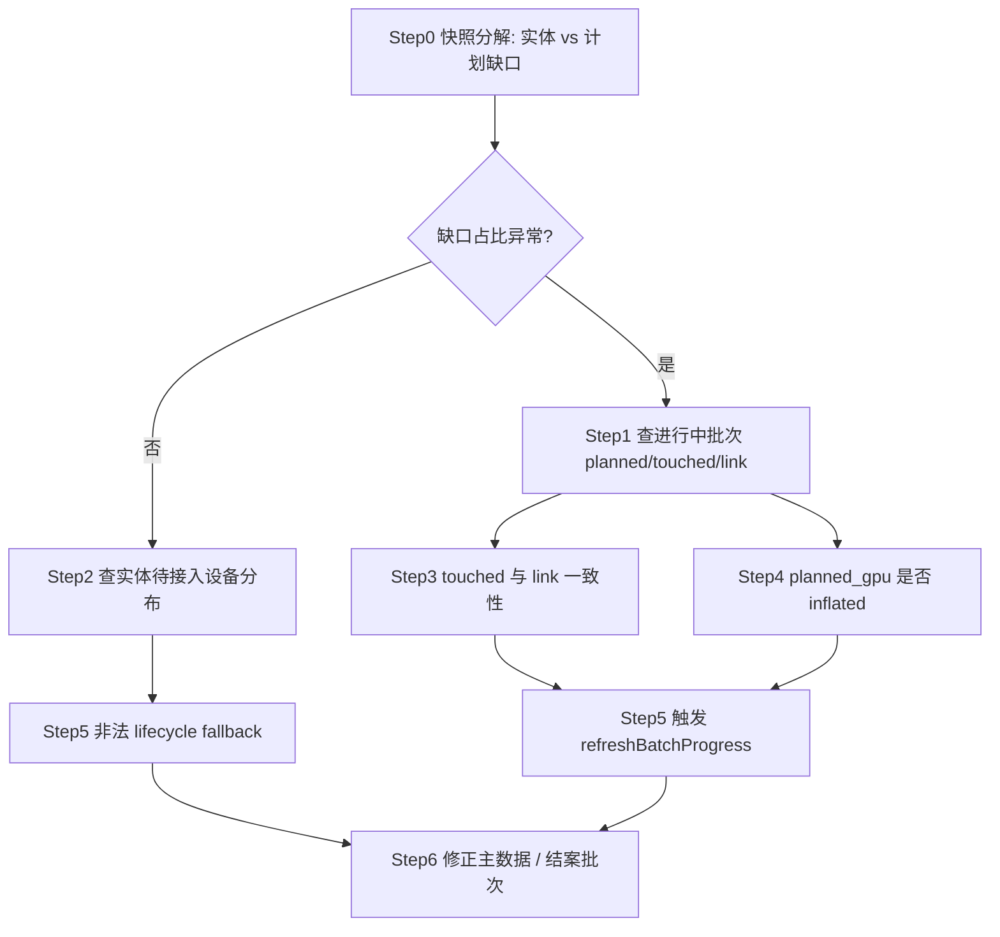

# 算力资源运营监控大盘 — 物理机生命周期漏斗「待接入」异常排查方案

> **已废止（2026-10-06）**：大盘报表（`/dashboard`、`/dashboard/global`）及其后端、DB 表已整体下线。本文仅作历史归档，**不再描述现网能力**。裁决见 [矛盾台账](../audit/doc-contradictions.md) §5。


> **适用页面**：`/dashboard/global` → 物理机生命周期漏斗  
> **数据 API**：`dashboard.globalOps.getSnapshot` → 内部调用 `supplier.overview.getStats`  
> **聚合代码**：`apps/web/src/lib/server/aggregation/overview-aggregation.ts` → `buildLifecycleFunnel`  
> **口径权威**：[global-dashboard-kpi-caliber-spec.md](global-dashboard-kpi-caliber-spec.md) §4.8、§5.1

---

## 1. 现象与是否真异常

### 1.1 常见「看起来像异常」的情况（先排除）

| 对比项 | 顶部 KPI | 漏斗「待接入」 | 说明 |
|--------|----------|----------------|------|
| GPU 总卡数 vs 漏斗各段之和 | 来自 `supplier_gpu_inventory.quantity`（L1 库存台账） | 来自 `supplier_device` 全量设备 + **计划虚拟缺口** | **口径不同，不可直接相加对比** |
| 在线设备台数 vs 漏斗「在线」台数 | KPI 排除 `infra` 卡型（CPU 管控机） | 漏斗统计全部 L2 物理设备 | 差值 ≈ 在线 infra 设备台数 |
| 待接入卡数 vs GPU 总卡数 | 库存台账总量 | 实体待接入 + **未入库的计划缺口** | 待接入 **可以大于** GPU 总卡数（计划尚未落库存） |

**结论**：漏斗五段之和 **不等于** GPU 总卡数，属于设计行为；排查应聚焦 **待接入自身是否被重复放大** 或 **批次进度缓存失真**。

### 1.2 待接入计算公式（Snapshot）

```
待接入.gpuCount   = 实体待接入 GPU + pipeline_pending.gpuCount
待接入.deviceCount = 实体待接入台数 + pipeline_pending.deviceCount

实体待接入 = Σ metricGpuCount(d) WHERE d.lifecycle_status = '待接入'
           （未知 lifecycle 值 fallback → '待接入'，见 normalizeLifecycleStage）

pipeline_pending = Σ 进行中接入批次 gap
  gap.deviceCount = max(0, planned_device_count − touched_device_count)
  gap.gpuCount    = max(0, planned_gpu − touched_pipeline_gpu)

进行中批次范围：
  batch_kind IN ('online', 'order_access')
  AND batch_status NOT IN ('已完成', '已取消', 'cancelled')
```

**防双计原则**（设计）：已 link 且 lifecycle=待接入 的设备计 **实体侧**；pipeline gap 用 `touched_device_count` 扣减，不再逐台重复。  
**风险点**：`touched_device_count` / `touched_pipeline_gpu` 若落后于实际 link 数，gap 会被 **放大**，表现为待接入虚高。

---

## 2. 排查流程（建议顺序）



---

## 3. SQL 公共片段

以下 SQL 假设 PostgreSQL，库表见 `packages/db/src/supply-schema.ts`。

### 3.1 GPU 有效卡数（对齐 `metricGpuCount`）

```sql
-- 在后续查询中复用此表达式
CASE
  WHEN gct.device_role = 'infra'
    OR LOWER(COALESCE(gct.name, '') || ' ' || COALESCE(gct.code, '')) LIKE '%cpu%'
  THEN 0
  ELSE GREATEST(sd.gpu_count, 0)
END AS metric_gpu
```

### 3.2 进行中接入批次基表

```sql
WITH active_access_batches AS (
  SELECT
    ob.id,
    ob.batch_code,
    ob.batch_kind,
    ob.batch_status,
    ob.supplier_id,
    ob.data_center_id,
    ob.online_reason,
    ob.planned_device_count,
    ob.planned_gpu_count,
    ob.planned_lines_json,
    ob.touched_device_count,
    ob.online_device_count,
    ob.planned_ready_at,
    ob.progress_synced_at,
    ob.progress_flags_json
  FROM onboarding_batch ob
  WHERE ob.batch_kind IN ('online', 'order_access')
    AND ob.batch_status NOT IN ('已完成', '已取消', 'cancelled')
)
SELECT * FROM active_access_batches;
```

---

## 4. Step 0 — 分解待接入：实体 vs 计划缺口

### 4.1 实体待接入（supplier_device）

```sql
SELECT
  sd.lifecycle_status,
  COUNT(*) AS device_count,
  SUM(
    CASE
      WHEN gct.device_role = 'infra'
        OR LOWER(COALESCE(gct.name, '') || ' ' || COALESCE(gct.code, '')) LIKE '%cpu%'
      THEN 0
      ELSE GREATEST(sd.gpu_count, 0)
    END
  ) AS gpu_count
FROM supplier_device sd
JOIN gpu_card_type gct ON gct.id = sd.gpu_card_type_id
WHERE sd.lifecycle_status = '待接入'
GROUP BY sd.lifecycle_status;
```

### 4.2 计划缺口汇总（对齐 aggregatePipelinePending）

```sql
WITH active_access_batches AS (
  SELECT *
  FROM onboarding_batch ob
  WHERE ob.batch_kind IN ('online', 'order_access')
    AND ob.batch_status NOT IN ('已完成', '已取消', 'cancelled')
),
link_gpu AS (
  SELECT
    l.business_onboarding_batch_id AS batch_id,
    COUNT(DISTINCT l.supplier_device_id) AS link_device_count,
    SUM(
      CASE
        WHEN gct.device_role = 'infra'
          OR LOWER(COALESCE(gct.name, '') || ' ' || COALESCE(gct.code, '')) LIKE '%cpu%'
        THEN 0
        ELSE GREATEST(sd.gpu_count, 0)
      END
    ) AS touched_pipeline_gpu
  FROM onboarding_batch_device_link l
  JOIN supplier_device sd ON sd.id = l.supplier_device_id
  JOIN gpu_card_type gct ON gct.id = sd.gpu_card_type_id
  GROUP BY l.business_onboarding_batch_id
),
batch_gap AS (
  SELECT
    b.id,
    b.batch_code,
    b.batch_kind,
    b.batch_status,
    b.planned_device_count,
    b.touched_device_count,
    b.planned_gpu_count,
    COALESCE(lg.link_device_count, 0) AS actual_link_devices,
    COALESCE(lg.touched_pipeline_gpu, 0) AS actual_touched_gpu,
    GREATEST(0, b.planned_device_count - b.touched_device_count) AS gap_devices_cached,
    GREATEST(
      0,
      CASE
        WHEN b.planned_gpu_count > 0 THEN b.planned_gpu_count
        ELSE b.planned_device_count * 8  -- DEFAULT_GPU_PER_DEVICE，无 plan_lines 时的 fallback
      END - COALESCE(lg.touched_pipeline_gpu, 0)
    ) AS gap_gpu_from_links
  FROM active_access_batches b
  LEFT JOIN link_gpu lg ON lg.batch_id = b.id
)
SELECT
  SUM(gap_devices_cached) AS pipeline_gap_devices,
  SUM(gap_gpu_from_links) AS pipeline_gap_gpu_approx
FROM batch_gap;
```

**判读**：

- 若 `pipeline_gap_*` 占待接入主体 → 优先查 **批次进度**（Step 1–4）。
- 若实体待接入主体 → 优先查 **设备 lifecycle 主数据**（Step 5–6）。

---

## 5. Step 1 — 逐批定位缺口来源（Top 贡献）

```sql
WITH active_access_batches AS (
  SELECT *
  FROM onboarding_batch ob
  WHERE ob.batch_kind IN ('online', 'order_access')
    AND ob.batch_status NOT IN ('已完成', '已取消', 'cancelled')
),
link_stats AS (
  SELECT
    l.business_onboarding_batch_id AS batch_id,
    COUNT(DISTINCT l.supplier_device_id) AS link_device_count,
    SUM(
      CASE
        WHEN gct.device_role = 'infra'
          OR LOWER(COALESCE(gct.name, '') || ' ' || COALESCE(gct.code, '')) LIKE '%cpu%'
        THEN 0
        ELSE GREATEST(sd.gpu_count, 0)
      END
    ) AS touched_pipeline_gpu
  FROM onboarding_batch_device_link l
  JOIN supplier_device sd ON sd.id = l.supplier_device_id
  JOIN gpu_card_type gct ON gct.id = sd.gpu_card_type_id
  GROUP BY l.business_onboarding_batch_id
)
SELECT
  b.batch_code,
  b.batch_kind,
  b.batch_status,
  b.data_center_id,
  b.planned_device_count,
  b.touched_device_count,
  b.planned_gpu_count,
  COALESCE(ls.link_device_count, 0) AS actual_link_devices,
  COALESCE(ls.touched_pipeline_gpu, 0) AS actual_touched_gpu,
  GREATEST(0, b.planned_device_count - b.touched_device_count) AS gap_devices,
  GREATEST(
    0,
    CASE WHEN b.planned_gpu_count > 0 THEN b.planned_gpu_count ELSE b.planned_device_count * 8 END
    - COALESCE(ls.touched_pipeline_gpu, 0)
  ) AS gap_gpu,
  b.planned_ready_at,
  b.progress_synced_at,
  b.progress_flags_json
FROM active_access_batches b
LEFT JOIN link_stats ls ON ls.batch_id = b.id
WHERE GREATEST(0, b.planned_device_count - b.touched_device_count) > 0
   OR GREATEST(
        0,
        CASE WHEN b.planned_gpu_count > 0 THEN b.planned_gpu_count ELSE b.planned_device_count * 8 END
        - COALESCE(ls.touched_pipeline_gpu, 0)
      ) > 0
ORDER BY gap_gpu DESC, gap_devices DESC
LIMIT 50;
```

---

## 6. Step 2 — touched 缓存 vs 实际 link 不一致（高频根因）

```sql
WITH active_access_batches AS (
  SELECT id, batch_code, touched_device_count, planned_device_count, batch_status
  FROM onboarding_batch
  WHERE batch_kind IN ('online', 'order_access')
    AND batch_status NOT IN ('已完成', '已取消', 'cancelled')
),
link_counts AS (
  SELECT business_onboarding_batch_id AS batch_id, COUNT(DISTINCT supplier_device_id) AS cnt
  FROM onboarding_batch_device_link
  GROUP BY business_onboarding_batch_id
)
SELECT
  b.batch_code,
  b.batch_status,
  b.planned_device_count,
  b.touched_device_count AS cached_touched,
  COALESCE(lc.cnt, 0) AS actual_link_count,
  COALESCE(lc.cnt, 0) - b.touched_device_count AS touched_lag,
  GREATEST(0, b.planned_device_count - b.touched_device_count) AS inflated_gap_devices
FROM active_access_batches b
LEFT JOIN link_counts lc ON lc.batch_id = b.id
WHERE COALESCE(lc.cnt, 0) <> b.touched_device_count
ORDER BY inflated_gap_devices DESC;
```

**修复动作**：

1. 在 CRM 批次详情页触发「同步进度」（调用 `refreshBatchProgress`）。
2. 若 `touched >= planned` 但批次仍为进行中 → 检查是否应自动结案（见 Step 4）。

---

## 7. Step 3 — 实体待接入设备是否已挂接批次（双计风险）

已 link 的设备应通过 `touched_device_count` 从 pipeline 侧扣减；若缓存未刷新，会出现 **实体 + 虚拟缺口同时偏大**。

```sql
SELECT
  sd.id,
  sd.sn,
  sd.lifecycle_status,
  sd.ops_status,
  sd.gpu_count,
  gct.name AS card_type,
  b.batch_code,
  b.batch_status,
  b.touched_device_count,
  b.planned_device_count
FROM supplier_device sd
JOIN gpu_card_type gct ON gct.id = sd.gpu_card_type_id
JOIN onboarding_batch_device_link l ON l.supplier_device_id = sd.id
JOIN onboarding_batch b ON b.id = l.business_onboarding_batch_id
WHERE sd.lifecycle_status = '待接入'
  AND b.batch_kind IN ('online', 'order_access')
  AND b.batch_status NOT IN ('已完成', '已取消', 'cancelled')
ORDER BY b.batch_code, sd.sn
LIMIT 200;
```

---

## 8. Step 4 — 应结案但仍「进行中」的批次

```sql
SELECT
  b.batch_code,
  b.batch_kind,
  b.batch_status,
  b.planned_device_count,
  b.touched_device_count,
  b.online_device_count,
  b.progress_synced_at,
  b.progress_flags_json
FROM onboarding_batch b
WHERE b.batch_kind IN ('online', 'order_access')
  AND b.batch_status NOT IN ('已完成', '已取消', 'cancelled')
  AND b.touched_device_count >= b.planned_device_count
  AND b.planned_device_count > 0
ORDER BY b.planned_ready_at NULLS LAST;
```

**修复动作**：触发 `refreshBatchProgress`；若仍不结案，查 `progress_flags_json` 是否标记 `needs_review`，人工确认后结案。

---

## 9. Step 5 — planned_gpu  inflated（默认 8 卡/台）

当 `planned_gpu_count = 0` 且无有效 `planned_lines_json` 时，系统用 `planned_device_count × 8` 估算，容易放大缺口。

```sql
SELECT
  batch_code,
  batch_kind,
  batch_status,
  planned_device_count,
  planned_gpu_count,
  planned_lines_json,
  touched_device_count,
  CASE
    WHEN planned_gpu_count > 0 THEN planned_gpu_count
    ELSE planned_device_count * 8
  END AS effective_planned_gpu
FROM onboarding_batch
WHERE batch_kind IN ('online', 'order_access')
  AND batch_status NOT IN ('已完成', '已取消', 'cancelled')
  AND (
    planned_gpu_count = 0
    OR planned_lines_json = '[]'::jsonb
    OR planned_lines_json IS NULL
  )
ORDER BY planned_device_count DESC;
```

**修复动作**：在批次上补全 `planned_lines_json` / `planned_gpu_count` 后重新同步进度。

---

## 10. Step 6 — 非法 lifecycle 被 fallback 到「待接入」

```sql
SELECT
  lifecycle_status,
  ops_status,
  COUNT(*) AS device_count,
  SUM(
    CASE
      WHEN gct.device_role = 'infra'
        OR LOWER(COALESCE(gct.name, '') || ' ' || COALESCE(gct.code, '')) LIKE '%cpu%'
      THEN 0
      ELSE GREATEST(sd.gpu_count, 0)
    END
  ) AS gpu_count
FROM supplier_device sd
JOIN gpu_card_type gct ON gct.id = sd.gpu_card_type_id
WHERE sd.lifecycle_status NOT IN ('待接入', '接入中', '在线', '维护中', '下线中')
GROUP BY sd.lifecycle_status, sd.ops_status
ORDER BY device_count DESC;
```

重点关注：`退订`、`离线`、空值、历史英文枚举等 — 代码会将未知值 **全部归入待接入**。

---

## 11. Step 7 — 在线台数 KPI vs 漏斗差异（辅助验证）

```sql
-- 漏斗「在线」台数（含 infra）
SELECT COUNT(*) AS funnel_online_devices
FROM supplier_device
WHERE lifecycle_status = '在线';

-- KPI「在线设备」台数（排除 infra，对齐 computeDevicesOnly）
SELECT COUNT(*) AS kpi_online_devices
FROM supplier_device sd
JOIN gpu_card_type gct ON gct.id = sd.gpu_card_type_id
WHERE sd.lifecycle_status = '在线'
  AND gct.device_role IS DISTINCT FROM 'infra'
  AND LOWER(COALESCE(gct.name, '') || ' ' || COALESCE(gct.code, '')) NOT LIKE '%cpu%';

-- 差值明细
SELECT sd.id, sd.sn, gct.name, gct.device_role, sd.gpu_count
FROM supplier_device sd
JOIN gpu_card_type gct ON gct.id = sd.gpu_card_type_id
WHERE sd.lifecycle_status = '在线'
  AND (
    gct.device_role = 'infra'
    OR LOWER(COALESCE(gct.name, '') || ' ' || COALESCE(gct.code, '')) LIKE '%cpu%'
  );
```

---

## 12. Step 8 — 与页面 API 交叉验证

大盘页数据来自 `supplierOverviewDataAccess.getStats`（无筛选时 `region/supplier/cardType/poolCode = all`）。

**建议**：

1. 浏览器 Network 抓取 `dashboard.globalOps.getSnapshot` 响应中的 `lifecycleFunnel` 与 `kpis.pendingAccess`。
2. 对比 SQL Step 0 结果：
   - `lifecycleFunnel[待接入].gpuCount` ≈ 实体 SQL + pipeline gap SQL
   - `kpis.pendingAccess.gpuCount` 应与漏斗待接入 **一致**（同一 merge 逻辑）

**代码注意点**（排查实现 bug 时参考）：

| 项 | 位置 | 风险 |
|----|------|------|
| 进行中批次 `.limit(20)` | `overview.ts` getStats | 批次 >20 时 **少计** pipeline（通常导致偏低，非本次偏高主因） |
| `touched_pipeline_gpu` | 实时 SUM link，非读缓存字段 | GPU gap 以 link 为准；台数 gap 读 `touched_device_count` 缓存 |
| 未知 lifecycle | `normalizeLifecycleStage` | 未知值 → 待接入，可能放大实体侧 |

---

## 13. 修复优先级建议

| 优先级 | 场景 | 动作 |
|--------|------|------|
| **P0** | **`lifecycle=退订` 被漏斗计入待接入**（见 §15） | **改 `buildLifecycleFunnel` 排除退订设备**（代码修复） |
| P0 | `touched_device_count` 明显小于 actual link | 批量 `refreshBatchProgress` |
| P0 | `touched >= planned` 仍进行中 | 自动/人工结案批次 |
| P1 | `planned_gpu_count=0` 大批次 | 补 plan_lines / planned_gpu_count |
| P1 | 其他非法 lifecycle（`离线` 等） | 修正 `supplier_device.lifecycle_status` 或扩展 fallback 规则 |
| P2 | 计划缺口本身合理但 UI 误解 | 产品说明：待接入含「未入库计划」，不必等于库存 |

---

## 15. 线上实测结论（2026-06-24）

### 15.1 各 Step 结果摘要

| Step | 结果 | 含义 |
|------|------|------|
| 3.2 进行中接入批次 | **空** | 无 `online` / `order_access` 进行中批次 |
| 4.1 实体待接入 | **5 台 · 32 卡** | 真实待接入规模很小 |
| 4.2 计划缺口汇总 | **全 NULL** | pipeline_pending = 0，**非批次缺口问题** |
| 5–9 | **空** | touched/link 不一致、应结案批次、planned  inflated 均不存在 |
| **10 非法 lifecycle** | **退订 · 已退订 · 186 台 · 1432 卡** | **根因** |
| 11 在线 infra 差值 | **15 台 CPU infra** | 解释 KPI 在线 146 台 vs 漏斗在线 161 台 |

### 15.2 数量对账（与大盘 UI 一致）

```
漏斗待接入台数 = 实体待接入 + 误计入的退订设备
              = 5 + 186 = 191 台  ✓

漏斗待接入卡数 = 32 + 1432 = 1464 卡  ✓

真实待接入（修复后预期）≈ 5 台 · 32 卡
```

### 15.3 根因：代码 bug，非数据问题

`buildLifecycleFunnel` 遍历 **全部** `supplier_device`，对不在 CRM 五段内的 `lifecycle_status` 调用 `normalizeLifecycleStage`，**一律 fallback → `待接入`**：

```341:346:apps/web/src/lib/server/aggregation/overview-aggregation.ts
export function normalizeLifecycleStage(status: string): (typeof LIFECYCLE_ORDER)[number] {
  if ((LIFECYCLE_ORDER as readonly string[]).includes(status)) {
    return status as (typeof LIFECYCLE_ORDER)[number]
  }
  return '待接入'
}
```

`退订` 不在 `LIFECYCLE_ORDER`（仅含待接入/接入中/在线/维护中/下线中），因此 **186 台已退订设备被错误计入待接入**。

**不一致点**：同文件已有 `isRetiredOverviewDevice`，KPI 总设备数、资源构成、库存同步均 **排除退订**，唯独漏斗未排除：

| 模块 | 退订设备处理 |
|------|-------------|
| `kpis.total.deviceCount` | `!isRetiredOverviewDevice(d)` 排除 |
| `resource-composition-aggregation` | 分母排除退订 |
| `gpu-inventory-sync` | 不参与库存聚合 |
| **`buildLifecycleFunnel`** | **未排除 → 误计待接入** |

### 15.4 验证 SQL（修复前后对比）

```sql
-- 修复前：漏斗「待接入」口径（含误计退订）
SELECT
  COUNT(*) AS funnel_pending_devices,
  SUM(
    CASE
      WHEN gct.device_role = 'infra'
        OR LOWER(COALESCE(gct.name, '') || ' ' || COALESCE(gct.code, '')) LIKE '%cpu%'
      THEN 0 ELSE GREATEST(sd.gpu_count, 0)
    END
  ) AS funnel_pending_gpu
FROM supplier_device sd
JOIN gpu_card_type gct ON gct.id = sd.gpu_card_type_id
WHERE sd.lifecycle_status = '待接入'
   OR sd.lifecycle_status NOT IN ('待接入', '接入中', '在线', '维护中', '下线中');

-- 修复后预期：仅真实待接入
SELECT
  COUNT(*) AS true_pending_devices,
  SUM(
    CASE
      WHEN gct.device_role = 'infra'
        OR LOWER(COALESCE(gct.name, '') || ' ' || COALESCE(gct.code, '')) LIKE '%cpu%'
      THEN 0 ELSE GREATEST(sd.gpu_count, 0)
    END
  ) AS true_pending_gpu
FROM supplier_device sd
JOIN gpu_card_type gct ON gct.id = sd.gpu_card_type_id
WHERE sd.lifecycle_status = '待接入';
-- 预期：5 台 · 32 卡
```

### 15.5 推荐修复（代码）

在 `buildLifecycleFunnel` 循环内 **跳过退订设备**，与资源构成 / KPI 对齐：

```typescript
for (const d of devices) {
  if (isRetiredOverviewDevice(d)) continue
  const key = normalizeLifecycleStage(d.lifecycleStatus)
  // ...
}
```

**无需改库**：186 台 `lifecycle=退订` + `ops=已退订` 是正确归档态；问题在聚合层。

**顺带说明 Step 11**：在线 161 − 146 = 15，即 15 台 `CPU AMD / infra` 在线设备被漏斗计入、被 KPI 在线台数排除，属口径差异，非 bug。

---

## 16. 相关文档与代码

- 口径：[global-dashboard-kpi-caliber-spec.md](global-dashboard-kpi-caliber-spec.md)（§5.1 漏斗应与非退订分母一致，见 resource-composition §4.1）
- 批次进度：`apps/web/src/lib/server/dataaccess/supplier/batch-progress.ts`
- 聚合：`apps/web/src/lib/server/aggregation/overview-aggregation.ts`
- 大盘入口：`apps/web/src/lib/server/dataaccess/dashboard/global-ops.ts`
