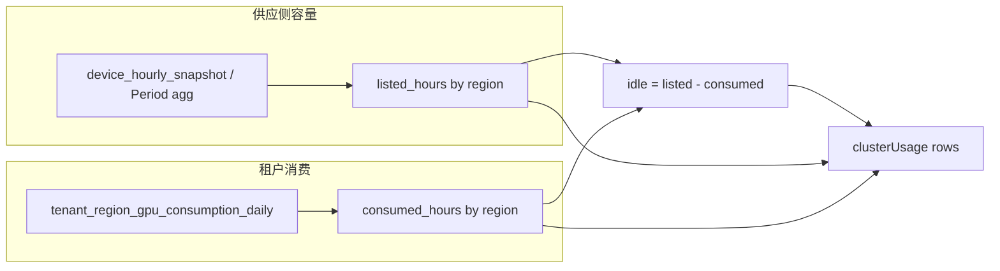

# 运营大盘 — 集群消耗分析图实现方案

> **已废止（2026-10-06）**：大盘报表（`/dashboard`、`/dashboard/global`）及其后端、DB 表已整体下线。本文仅作历史归档，**不再描述现网能力**。裁决见 [矛盾台账](../audit/doc-contradictions.md) §5。


**页面**：`/dashboard` — `ClusterAnalysisChart`  
**父文档**：[operational-dashboard-implementation-plan.md](operational-dashboard-implementation-plan.md)  
**关联设计**：[tenant-region-gpu-consumption-daily-monthly-design.md](../../../apps/web/content/design/tenant-region-gpu-consumption-daily-monthly-design.md)、[global-dashboard-period-composition-card-hours-design.md](global-dashboard-period-composition-card-hours-design.md)  
**版本**：v1.0（2026-06-23）

---

## 1. 现状

- 纵向堆叠柱：X 轴为集群名（Mock：`华北-A`、`华东-B` …）。
- 三类卡时图例：上架、消费、空置。
- 实际堆叠：**消费卡时**（下）+ **空置卡时**（上）；柱高 = **上架卡时**（消费 + 空置）。
- Tooltip 标题附带上架总量。
- 数据：`fetchClusterUsage` → `{ name, listedHours, consumedHours, idleHours }`。

---

## 2. 语义定义

| 指标 | 含义 | 与财务消费卡时关系 |
|------|------|-------------------|
| **上架卡时** | 区间内集群（机房区域）**可售/已上架 GPU 容量** 对时间的积分 | **供应侧**，非租户账单 |
| **消费卡时** | 区间内该集群上租户 **实际消耗** 的卡时 | 租户侧，≈ `tenant_region_gpu` 汇总 |
| **空置卡时** | `上架卡时 − 消费卡时`（≥ 0） | 派生 |

> **注意**：供应侧卡时 ≠ `/finance` 消费卡时（见 global 专篇 P6）。图标题「集群消耗分析」中「消费」指租户用量，「上架/空置」指容量利用。

### 2.1 集群（X 轴）映射

Mock `华北-A` 对应 **机房区域 / 容器实例区域**，非 CRM 抽象集群名。

| 展示名 `name` | 聚合键 | 来源 |
|---------------|--------|------|
| 建议用 `data_center_name` 或区域简称 | `region_code` 或 `data_center_id` | `data_center.container_instance_region` |

映射表：`region_code` → 运营展示名（可复用 `data_center` 表 `name` / `container_instance_region` 标签）。

---

## 3. 数据源与计算

### 3.1 消费卡时（租户侧，优先落地）

```sql
SELECT
  g.region_code,
  dc.name AS cluster_name,
  SUM(g.balance_card_hours + g.voucher_card_hours) AS consumed_hours
  -- 或 SUM(g.total_card_hours) 与财务 Raw 对齐
FROM tenant_region_gpu_consumption_daily g
LEFT JOIN data_center dc ON dc.id = g.data_center_id
WHERE g.usage_date BETWEEN :start AND :end
GROUP BY g.region_code, dc.name;
```

### 3.2 上架卡时（供应侧）

依赖 Period 设备状态时序（[global-dashboard-period-composition-card-hours-design.md](global-dashboard-period-composition-card-hours-design.md)）：

- 按 `region_code` / 机房聚合 **在架可售实体卡时**（互斥扇区：平台池在线、专用等，不含计划缺口）；
- 时间积分区间 `[periodStart, periodEnd]` 与大盘周期对齐；
- 读路径：`device_hourly_snapshot` / `aggregateCompositionCardHours`（复用 global Period 聚合，按机房 breakdown）。

若 M4 未就绪：**上架卡时 = 消费卡时 × 利用率系数** 仅作预览（需标注），或上架线暂用平台同步 `listed` 字段（若有）。

### 3.3 空置卡时

```text
idle_hours = max(0, listed_hours - consumed_hours)
```

---

## 4. 聚合流程



---

## 5. API

```typescript
type ClusterUsageRow = {
  name: string           // 展示用集群名
  regionCode: string     // 下钻键
  listedHours: number
  consumedHours: number
  idleHours: number
}

type ClusterUsageResponse = {
  rows: ClusterUsageRow[]
  listedHoursMode: 'supply_snapshot' | 'estimated' | 'unavailable'
  dataTier: 'published' | 'preview'
}
```

Procedure：`dashboard.ops.clusterUsage`。

`listedHoursMode !== 'supply_snapshot'` 时图例或 CardDescription 注明估算口径。

---

## 6. 前端改造

- 替换 `fetchClusterUsage`；保持堆叠顺序与图例三件套。
- Y 轴 `formatCardHours` 不变。
- 可选：点击集群跳转 `/dashboard/global` Period 视图并带 `region` 筛选（二期）。

---

## 7. 验收

| # | 场景 | 期望 |
|---|------|------|
| G1 | 消费卡时 | 与 `tenant_region_gpu` 按区域 SUM 一致 |
| G2 | 闭合 | `listed = consumed + idle`（每行） |
| G3 | 供应侧就绪后 | 上架来自 snapshot，与 global 同区域可比 |
| G4 | 空集群 | 不展示或展示 0 柱 |

---

## 8. 依赖与分期

| 阶段 | 内容 |
|------|------|
| **G-M1** | 仅消费卡时 + 上架=消费（idle=0）或隐藏空置 |
| **G-M2** | 租户表 + 供应侧上架，完整三指标 |

---

## 9. 非目标

- 不展示单卡型 breakdown（区域级即可）。
- 不混合台时与卡时（Y 轴固定卡时）。
