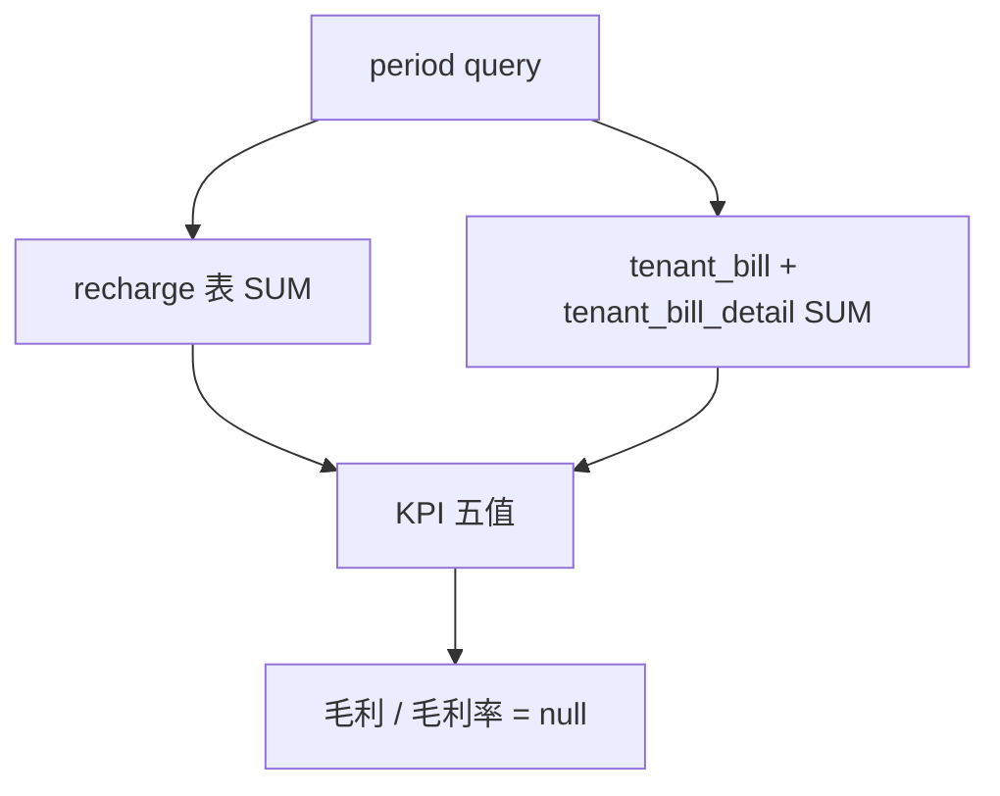

# 运营大盘 — KPI 五卡实现方案

> **已废止（2026-10-06）**：大盘报表（`/dashboard`、`/dashboard/global`）及其后端、DB 表已整体下线。本文仅作历史归档，**不再描述现网能力**。裁决见 [矛盾台账](../audit/doc-contradictions.md) §5。


**页面**：`/dashboard` — `DashboardKpiSection`  
**父文档**：[operational-dashboard-implementation-plan.md](operational-dashboard-implementation-plan.md)  
**版本**：v1.1（2026-06-23）

---

## 1. 现状

| 卡片 | Mock 字段 | 说明 |
|------|-----------|------|
| 充值 | `recharge` | 客户账户充值总额 |
| 余额消费 | `balanceConsumption` | 实付余额消费 |
| 算力券消费 | `voucherConsumption` | 算力券抵扣消费 |
| 毛利 | `grossProfit` | 扣除成本后毛利 |
| 毛利率 | `grossMargin` | 毛利 / 总消费 |

环比 `*Trend` 为 Mock 随机值；数据源 `fetchDashboardKpi(query)`。

---

## 2. 目标指标与口径

| KPI | 定义 | 数据源 |
|-----|------|--------|
| **充值** | 区间内净充值 `amount − refund_amount` | `recharge` |
| **余额消费** | 区间内余额/实付消费 | `tenant_bill_detail.balance_amount`（经 `tenant_bill` 关联） |
| **算力券消费** | 区间内算力券抵扣 | `tenant_bill_detail.coupon_amount`（经 `tenant_bill` 关联） |
| **毛利** | — | **暂不计算**，接口返回 `null` |
| **毛利率** | — | **暂不计算**，接口返回 `null` |

消费口径与 CRM 月度账单明细一致；`tenant_bill_detail` 字段语义见 `packages/db/src/crm-schema.ts`（`balance_amount` = 余额消费，`coupon_amount` = 券消费）。

### 2.1 过滤条件

| 规则 | 说明 |
|------|------|
| 充值 | `status = 'paid'`；时间 `coalesce(completed_at, created_at)` 落区间 |
| 消费 | 经 `tenant_bill.tenant_id` → `billing_tenant`；排除内部租户（`type = internal` 且在 `internal_effective_from/to` 与区间有交） |
| 消费时间 | `tenant_bill.bill_month`（`YYYY-MM`）落在查询区间所覆盖的自然月集合内 |
| 范围 | **全平台** B+C，非 CRM 范围 |

> **粒度说明**：`tenant_bill_detail` 为月度账单行级明细，非日粒度。预设「近 7 天」「本月」仅取区间涉及月份内已同步的 CRM 月度账单汇总，**不做按日 proration**；与充值（可按日精确）的时间粒度不一致，UI 可在预览态标注「账单月汇总」。

### 2.2 环比

对比区间见父文档 §2.2；环比 `percentChange = (current − compare) / compare × 100`；`compare = 0` 时返回 `null`，UI 显示「—」。毛利 / 毛利率环比同样返回 `null`。

---

## 3. 聚合逻辑

### 3.1 数据路径



不再区分「财务月结 / 平台同步」双路径；充值、消费均直接读 CRM 业务表。

### 3.2 消费 SQL 示意

```sql
SELECT
  COALESCE(SUM(d.balance_amount), 0) AS balance_consumption,
  COALESCE(SUM(d.coupon_amount), 0) AS voucher_consumption
FROM tenant_bill_detail d
JOIN tenant_bill b ON b.id = d.bill_id
JOIN billing_tenant t ON t.id = b.tenant_id
WHERE b.bill_month = ANY(:monthsInRange)   -- 区间覆盖的自然月，如 ['2026-06']
  AND NOT (t.type = 'internal' AND …);
```

`:monthsInRange` 由查询区间 `[start, end]`（东八区自然日）推导：取 `start` 至 `end` 之间所有 `YYYY-MM`。

### 3.3 充值

复用 CRM 工作台 `sumRechargeInRange` 逻辑，**去掉** `crmScope` 过滤；净充值口径补充 `refund_amount`：

```sql
SELECT SUM(amount - refund_amount)
FROM recharge r
JOIN billing_tenant t ON t.id = r.tenant_id
WHERE r.status = 'paid'
  AND coalesce(r.completed_at, r.created_at) >= :startUtc
  AND coalesce(r.completed_at, r.created_at) < :endExclusiveUtc
  AND NOT internal_tenant_excluded(…);
```

### 3.4 毛利 / 毛利率

首期 **不实现** 成本侧聚合；`grossProfit`、`grossMargin` 及其 `trends` 字段固定为 `null`。前端展示「待月结」或占位，不调用 `billing_period` / `platform_cost_monthly`。

---

## 4. API 响应类型

```typescript
type OperationalDashboardKpi = {
  recharge: number
  balanceConsumption: number
  voucherConsumption: number
  grossProfit: null              // 暂不计算
  grossMargin: null
  trends: {
    recharge: number | null
    balanceConsumption: number | null
    voucherConsumption: number | null
    grossProfit: null
    grossMargin: null
  }
}
```

移除 `dataTier` 字段（无 published / preview 分层）。

---

## 5. 前端改造要点

- `DashboardKpiSection`：`trpc.dashboard.ops.kpi.useQuery({ preset, customMonth })`。
- 毛利 / 毛利率卡：展示「待月结」文案，隐藏 TrendBadge 或置灰。
- 保持现有 5 卡布局与 `formatWan` / `formatPercent`。
- 可选：消费类卡片副文案注明「CRM 月度账单」以区别于充值的日级精度。

---

## 6. 验收

| # | 场景 | 期望 |
|---|------|------|
| A1 | 指定月 `2026-05` | 充值与 `recharge` 表区间 SUM 一致；余额 / 券消费与 `tenant_bill_detail`（`bill_month = 2026-05`）SUM 一致 |
| A2 | 本月 | 充值按日区间正确；消费取 `bill_month = 当月` 已同步账单明细汇总 |
| A3 | 近 7 天 | 充值与 7 日区间 SUM 一致；消费取当月 `tenant_bill_detail` 整月汇总（见 §2.1 粒度说明） |
| A4 | 环比 | 对比区间正确，无数据时不报错 |
| A5 | 毛利 / 毛利率 | 恒为「待月结」，不报错 |

---

## 7. 非目标

- KPI 不支持客群筛选（客群仅趋势图）。
- 不展示 B 端/C 端拆分（见月报副表，二期）。
- 毛利 / 毛利率计算（待成本域口径确认后单独立项）。
