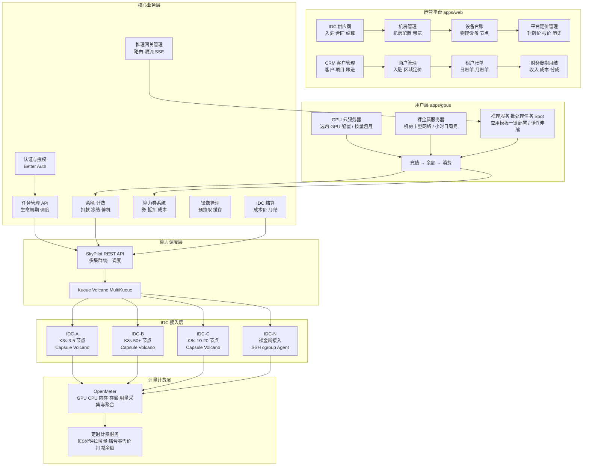
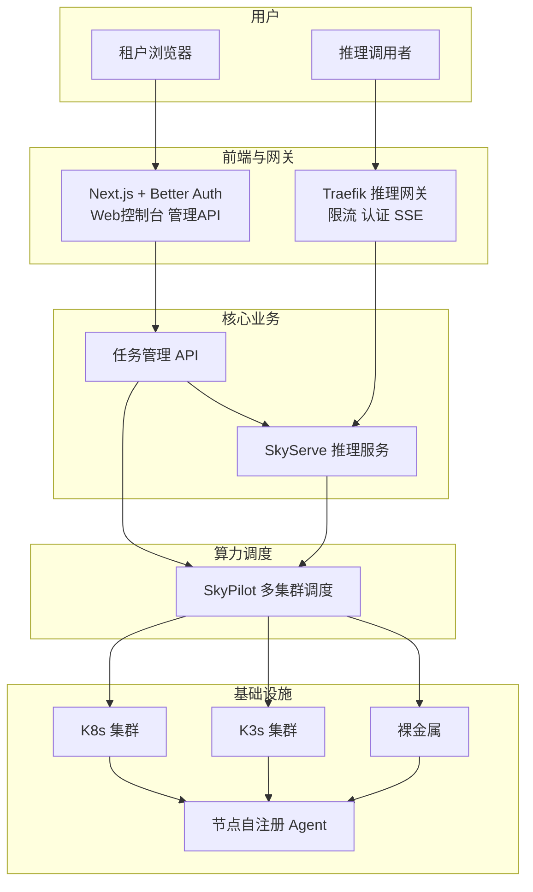
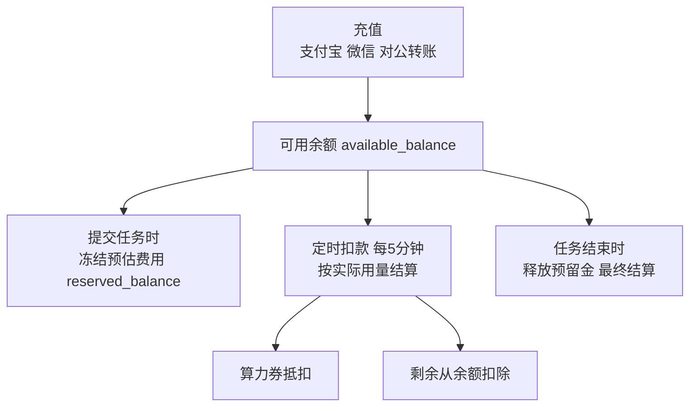

# 算力平台整体设计概览

## 1. 平台定位与背景

### 1.1 平台概述

本平台是一个闲时算力调度平台，通过统一控制面对接多个 IDC 机房的 GPU 资源，形成全局算力资源池，为最终用户提供以下算力产品形态：

| 产品线 | K8s 原语 | 定义 | 核心特征 |
|--------|----------|------|---------|
| **GPU 云服务器 (Cloud VM)** | Pod + PVC | 开发机 | 持久化存储、SSH、IDE、可频繁开关机 |
| **弹性服务 (Serverless)** | Deployment | Web 服务 | 滚动更新、零停机、自动扩缩容 |
| **LLM 推理 (Serverless Inference)** | Deployment(s) | LLM 推理 | 模型参数、多副本、API 端点、Token 计费 |
| **批处理任务 (Job)** | Job | 批处理 | 运行到完成、不可重启 |
| **批处理 Spot** | Job + `billing_mode=spot` | 闲时抢占 | 非独立产品线；刊例价六折（乘数 0.60），可被回收 |
| **裸金属服务器 (Bare Metal)** | 物理机 | 裸金属 | 整机租赁、SSH 直连 |

### 1.2 设计目标

| 目标 | 说明 |
|------|------|
| **统一调度** | 通过 SkyPilot 实现对多 IDC 机房 GPU 资源的统一调度与编排 |
| **多产品线** | 同时支持云服务器、裸金属、推理、批处理、抢占式多种算力产品 |
| **多 IDC 联邦** | 统一调度多个 IDC 机房的异构 GPU 资源（3-5 台至 50+ 台集群） |
| **多租户隔离** | Pod/设备级别的租户隔离，每个组织独立命名空间 |
| **精准计量计费** | Pod/设备级别的 GPU/CPU/内存/存储用量采集，按秒计费，每 5 分钟扣款 |
| **计费灵活性** | 零售价与 IDC 采购成本价独立管理，版本化历史可追溯 |
| **营销体系** | 算力券/优惠券平台，支持平台与 IDC 分担营销成本 |
| **余额管控** | 预付余额制，三层防超额机制（提交冻结 + 定时扣款 + 停机） |
| **推理网关** | 统一推理入口，API Key 认证、限流、SSE 流式支持 |
| **开源技术栈** | 全部基于开源项目构建（SkyPilot, Kueue, Volcano, Capsule 等） |

### 1.3 技术栈

| 层级 | 组件 | 用途 |
|------|------|------|
| **前端框架** | Next.js + shadcn/ui | WebUI 用户界面 |
| **身份认证** | Better Auth | 认证与多租户组织管理 |
| **统一调度** | SkyPilot (REST API) | 多集群 GPU 调度 |
| **队列管理** | Kueue | 作业排队与配额管理 |
| **批量调度** | Volcano | Gang Scheduling，All-or-Nothing |
| **训练编排** | Kubeflow Training Operator | 分布式训练 |
| **多租户隔离** | Capsule | Pod 级租户隔离 |
| **GPU 监控** | DCGM Exporter + Prometheus | GPU 指标采集与存储 |
| **分布式追踪** | Grafana Tempo | 请求追踪 |
| **日志聚合** | Grafana Loki | 日志采集与聚合 |
| **可视化** | Grafana | 统一 Dashboard |
| **计量计费** | OpenMeter | 用量采集与计费 |
| **推理网关** | Traefik | 推理服务入口，动态路由/认证/限流 |

---

## 2. 总体架构





### 2.1 核心数据流

- **认证流**: 浏览器 → Next.js (Better Auth session) → 请求头注入 `X-Org-Id` → 任务管理 API
- **任务提交流**: API Server → 余额检查/冻结 → 节点 Agent 镜像预拉取 → 镜像就绪 → SkyPilot 启动容器 (此时开始计费)
- **推理访问流**: 客户端 → Traefik → (ForwardAuth → API Server 校验凭证) → SkyServe 服务
- **计费流**: 资源采集器 → OpenMeter 事件 → 定时计费服务查询 → 扣减余额 (券先抵扣)
- **IDC 结算流**: 月定时任务 → OpenMeter 聚合 IDC 维度用量 → 匹配成本价 → 扣除 IDC 承担券补贴 → 生成结算单

---

## 3. 面向用户的产品形态 (apps/gpus)

### 3.1 产品导航

```
产品线                用户路径                         核心交互
─────────────────────────────────────────────────────────────────────
GPU 云服务器           /server/list → /server/deploy   选购 GPU 配置 → 部署
裸金属服务器           /metal/list → /metal/deploy      机房/卡型/网络 → 部署
弹性服务               /serverless/*                     Deployment 弹性服务
LLM 推理               /inference/* 或 /apps             Token / GPU 时长计费
批处理任务             /tasks                            提交脚本；可选 Spot
预加载镜像             /preloaded                        管理预拉取镜像
充值                  /recharge                          选择金额/方式 → 支付
账单                  /billing                           查余额/券/月账单
设置                  /settings                          语言/主题等偏好
```

> 语义权威定义见 `../../business/product-line-taxonomy.md`。Spot **不是**独立产品线，仅为 Job 的 `billing_mode`。  
> Serverless **可中断跨区**（`interruptible`，默认 true）≠ Spot，见 `serverless-implementation.md`。  
> 镜像限额 / 数据盘扩容 / S3 网络卷见 `storage-quota-and-s3-volume.md`。

### 3.2 计费模式与承诺周期

> 权威：`../../business/product-line-taxonomy.md`。`billing_mode`（是否可抢占）与 `commitment`（怎么付）正交。

| commitment | 含义 | 扣款 | 可与 Spot 组合 |
|------------|------|------|----------------|
| **`on-demand`** | **按秒计费** | 运行中每 5min 按实际秒数结算 | ✅（仅 Job） |
| **`hour`** | 按小时预付 | 创建时扣 1 小时价 | ❌ |
| **`daily` / `weekly` / `monthly`** | 包日/周/月预付 | 创建时预付 | ❌ |

| billing_mode | 适用 | 价格 |
|--------------|------|------|
| `on_demand` | 各产品线 | 零售价 × 1.0 |
| `spot` | **仅 Job** + `commitment=on-demand` | 零售价 × **0.60**（刊例六折）；抢占**必须通知租户**（见 `spot-preemption-design.md`） |

inference 另支持 Token/请求计费；详见对应专文。

### 3.3 用户资金流



---

## 4. 运营平台 (apps/web)

### 4.1 功能模块总览

```mermaid
flowchart TD
    subgraph 供应商与资源[供应商与算力资源]
        SUP[供应商管理<br/>入驻 合同 结算]
        ONB[入驻管理<br/>批次 导入 进度]
        DC[机房管理<br/>配置 带宽 网络]
        DEV[设备台账<br/>物理设备 节点 规格]
        COST[成本定价管理<br/>刊例价 成交价 分成]
    end
    SUP --> ONB --> DC --> DEV --> COST

    subgraph 平台定价[平台定价]
        PL[刊例价管理] --> PR[机房销售价]
        PR --> PH[历史版本]
        PH --> PE[价格生效时间线]
    end

    subgraph CRM[CRM 客户管理]
        CT[客户管理] --> PJ[项目管理]
        PJ --> CC[合同管理]
        CC --> CF[跟进 动态 日历]
    end

    subgraph 商户[商户管理]
        MI[商户入驻] --> MR[区域定价]
        MR --> MP[采购价]
        MP --> MB[账单 回款节点]
    end

    subgraph 租户计费[租户计费]
        BT[租户管理] --> BS[账单同步]
        BS --> BD[日账单]
        BD --> BM2[月账单 消费明细]
    end

    subgraph 财务月结[财务月结]
        FP[账期管理] --> FI[收入 成本]
        FI --> FA[成本分成]
        FA --> FC[提成计算]
        FC --> FR2[对账 报告]
    end

    subgraph 供应商供应链[供应商 → 机房 → 设备 → 定价]
        S[supplier<br/>基础信息 合同]
        CT2[contract<br/>定价模式 条款 有效期]
        D2[data_center<br/>位置 基础设施 库存]
        SD[supplier_device<br/>SN IP 运维状态 接入批次]
        CN[compute_node<br/>节点角色 集群归属]
        PRC[pricing<br/>刊例价 成交价 历史]
    end
    S --> CT2 --> D2 --> SD --> CN
    D2 --> PRC

    subgraph 平台定价体系[平台定价体系]
        L1[L1 刊例价<br/>卡型 产品线 基础价]
        L1R[L1 平台价<br/>产品线 计费单位 售价]
        L2[L1 机房级销售价<br/>机房 产品线 定价]
        HIST[价格历史<br/>调价操作审计]
    end
    L1 --> L1R --> L2
    L1R --> HIST
    L2 --> HIST
```



### 4.2 产品线编码

> 权威枚举见 `../../business/product-line-taxonomy.md`。已废弃：`elastic_service`、`product_line=spot`。

| 产品线编码 | 中文名 | 对应前端产品 | 计费单位 |
|-----------|-------|-------------|---------|
| `cloud_vm` | 云服务器 | GPU 云服务器 / 开发机 | hour/day/week/month |
| `serverless` | 弹性服务 | 无状态 Web / Deployment | hour |
| `inference` | LLM 推理 | Serverless Inference | token / hour |
| `job` | 批量任务 | 批处理（可 `billing_mode=spot`） | hour |
| `bare_metal` | 裸金属 | 裸金属服务器 | hour/day/week/month |

横切字段：`billing_mode = on_demand | spot`（Spot 仅允许 `job`）。

---

## 5. 多租户与认证

### 5.1 认证架构

使用 Next.js + Better Auth 实现统一用户认证与多租户组织管理。

**核心实体映射**:

| Better Auth | 平台扩展 |
|-------------|---------|
| `user` | `user_profiles` (default_org_id 等) |
| `organization` | `tenant_profiles` (配额/默认 IDC 标签等) |
| `member` | — (复用 Better Auth 角色权限) |

**认证流程**:
1. 用户登录 → Better Auth session → httpOnly cookie
2. 前端选择当前组织 → 组织 ID 传递至请求头
3. Next.js 中间件验证 session → 注入 `X-Org-Id`
4. API Server 信任该头 → 所有数据库操作按 `organization_id` 隔离

### 5.2 资源隔离

| 资源类型 | 隔离方式 |
|---------|---------|
| Kubernetes Pod | 组织 → Namespace + ResourceQuota + NetworkPolicy |
| 裸金属 | SSH 用户隔离 + cgroup 限制 |
| 数据库 | 所有查询强制带 `organization_id` 条件 |

---

## 6. 任务管理

### 6.1 任务类型

| 类型 | 说明 | 状态机 |
|------|------|--------|
| **Job** | 批处理训练任务 | Pending → ImagePulling → Running → Succeeded/Failed/Stopped |
| **Serve (Serverless)** | 弹性推理，按调用缩放 | Pending → ImagePulling → Running → Stopped |
| **Serve (Deployment)** | 固定副本推理服务 | Pending → ImagePulling → Running → Stopped |

### 6.2 任务生命周期

```
用户提交
    │
    ▼
余额检查 + 冻结预估费用
    │
    ▼ (状态: image_pulling)
节点 Agent 预拉取镜像 (docker pull)
    │
    ▼ (镜像就绪)
SkyPilot 调度 → 容器启动 → billing_started_at (计费开始)
    │
    ▼ (状态: running)
┌─────────────────────────────────┐
│ 每5分钟定时扣款 (实际用量)        │  ← 持续直到停止
└─────────────────────────────────┘
    │
    ▼ (用户停止 / 余额不足停机)
SkyPilot 取消 → 最终结算 → 释放预留金
```

### 6.3 镜像预拉取优化

1. 任务提交后先进入 `image_pulling` 状态
2. API Server 向候选节点发送拉取指令
3. 节点 Agent 异步 `docker pull`，完成后回调
4. 从镜像就绪的节点中选择一个调度
5. 镜像拉取期间不计费 (`billable=false`)

---

## 7. 计量计费 (OpenMeter)

### 7.1 事件模型

资源采集器每 60 秒发送标准化使用事件：

```
{
  "type": "resource_usage",
  "subject": "task-instance-xxx",
  "data": {
    "billable": true/false,        // 镜像拉取期间 false
    "organization_id": "org_xxx",
    "idc": "idc-1",
    "node": "gpu-node-5",
    "resources": {
      "cpu": 4,
      "memory_gb": 16,
      "gpu": {"type": "A100", "count": 1},
      "storage": [{"type": "local-ssd", "gb": 100}]
    }
  }
}
```

### 7.2 计费流程

```
OpenMeter 事件流
    │
    ▼
定时计费服务 (每5分钟)
    ├── 查询各租户增量用量（按秒聚合）
    ├── 匹配零售价 (含 spot_price_multiplier / off_peak_price_multiplier)
    ├── 算力券先抵扣
    └── 余额扣款（consume_reserved / deduct_available）
        │
        ├── 成功 → 继续运行
        └── 失败(余额不足) → 停机
```

> `commitment=on-demand`：费用 = `gpu_seconds × (hourly_price/3600) × multiplier`。

### 7.3 价格管理

**零售价 (Retail Pricing)**：面向用户的价格，支持多版本和历史追溯

| 字段 | 说明 |
|------|------|
| resource_type | cpu / memory / gpu / storage |
| resource_spec | GPU 型号等规格标识 |
| base_price | 基础单价 |
| off_peak_price_multiplier | 闲时价格乘数（默认 1.00；实付=原价×乘数） |
| spot_price_multiplier | Spot 价格乘数（默认 **0.60**，刊例六折；与 taxonomy §5 一致） |
| effective_from/to | 生效时间段 |

> 所有 `*_price_multiplier` 表示**价格乘数**（实付=原价×乘数），不是减免百分比。详见 `../../business/product-line-taxonomy.md` §5。

**采购成本价**：与 IDC 结算使用，单独管理

---

## 8. 余额与防超额

### 8.1 余额模型

> 权威定义见 `tenant-balance-unification.md`。表名 **`tenant_balance`**，主键 **`tenant_id`**；冗余 **`organization_id`**（一客户可多子租户，各自独立余额）。

```
tenant_balance (每个子租户一条)
├── tenant_id / organization_id(冗余)
├── available_balance: 可用余额 (可下单)
└── reserved_balance: 冻结金额 (commitment=on-demand 按秒任务预留)
```

### 8.2 三层防超额

| 层级 | 时机 | 动作 |
|------|------|------|
| L1 | 按秒任务提交 | 估算费用 → `freeze`（available→reserved） |
| L2 | 每5分钟 | 按**实际秒数** `consume_reserved` → 不足则补冻或停机 |
| L3 | 任务结束 | 尾差结算 → `unfreeze` 剩余预留 |

### 8.3 并发控制

所有余额操作用数据库行级锁（经 dataaccess 原语，禁止业务直写）：
```sql
SELECT available_balance, reserved_balance FROM tenant_balance
WHERE tenant_id = ? FOR UPDATE;
```

---

## 9. 算力券系统

### 9.1 券类型

| 类型 | 说明 | 示例 |
|------|------|------|
| `fixed` | 代金券，固定面值 | 满100减20 |
| `discount` | 折扣券，按比例 | 8折，上限100元 |
| `resource_pack` | 资源包（含原「小时券」：`pack_unit=gpu_hour`） | 1000 卡时包 |

### 9.2 券生命周期

```
创建券模板 (coupon_templates)
    │
    ▼
发放券实例 (coupons) → 分配给租户
    │
    ▼
使用抵扣 (coupon_usages) → 每笔扣款记录
    │
    ├── 平台承担成本 (cost_bearer=platform)
    └── IDC 承担成本 (cost_bearer=idc) → IDC 结算时扣除
```

### 9.3 抵扣优先级

1. 按过期时间优先（先过期先使用）
2. 代金券按剩余价值全额抵扣
3. 折扣券按比例计算抵扣额
4. 资源包按内部换算单价抵扣
5. 实付 = 原价 - 总抵扣额（若 > 0 则扣余额）

### 9.4 营销成本分配

每笔券使用记录生成 `marketing_cost_allocations`：
- `bearer=platform`: 平台承担，记为营销费用
- `bearer=idc` + `idc_provider_id`: IDC 承担，月结时从应付金额扣除

---

## 10. 推理网关 (Traefik)

### 10.1 架构

推理流量与 WebUI/管理 API 分离：
- **推理域名**: `inference.platform.com` → Traefik (边缘集群，LoadBalancer)
- **管理域名**: `console.platform.com` → Next.js (管理 API 代理)

### 10.2 动态路由

任务管理 API Server 在创建推理服务时：
1. 获取 SkyServe 内部端点
2. 生成对外路径 `/serve/<org_slug>/<serve_name>`
3. 通过 Traefik Provider (etcd/K8s CRD) 创建路由规则
4. 删除服务时移除对应路由

### 10.3 认证

使用 **ForwardAuth** 中间件委托认证：
- 客户端携带 `Authorization: Bearer <API_KEY>`
- Traefik 转发至 API Server `/auth/verify` 端点
- 校验 API Key 所属组织与 URL 路径匹配

### 10.4 限流与 SSE

- 每个路由独立 RateLimit (e.g. 100 req/s)
- SSE 流式透传默认支持，需调整 `readTimeout` 至 300s

---

## 11. IDC 结算

### 11.1 结算流程

```
每月1日定时任务
    │
    ├── OpenMeter 聚合上月 IDC 维度用量
    ├── 匹配成本价 (idc_cost_pricing) → 成本总额
    ├── 扣除 IDC 承担券补贴 (marketing_cost_allocations)
    ├── 生成结算单 (idc_settlements) + 明细
    └── 通知 IDC 对账 → 确认 → 付款
```

### 11.2 多价格版本

结算时若月内价格变动，按 `effective_from/to` 将用量分段计算。

---

## 12. 部署架构

```
┌────────────────────────────────────────────────────┐
│              中心 Kubernetes 集群                     │
│                                                     │
│  Next.js (WebUI)   │  任务管理 API Server           │
│  Traefik (可选)    │  OpenMeter (内嵌 PG/ClickHouse)  │
│  定时计费服务       │  数据库 (PostgreSQL)              │
│  SkyPilot Control  │  Redis (可选)                   │
└────────────────────────────────────────────────────┘
         │                    │
         ▼                    ▼
┌──────────────────┐  ┌──────────────────┐
│   IDC 边缘集群     │  │   IDC 边缘集群     │
│   K8s/K3s         │  │   K8s/K3s         │
│   Capsule         │  │   Capsule         │
│   Volcano         │  │   Volcano         │
│   DCGM Exporter   │  │   DCGM Exporter   │
└──────────────────┘  └──────────────────┘
```

所有组件容器化部署。数据库 (PostgreSQL) 集中存储业务数据，OpenMeter 使用内置或独立的 ClickHouse 存储时间序列用量数据。
