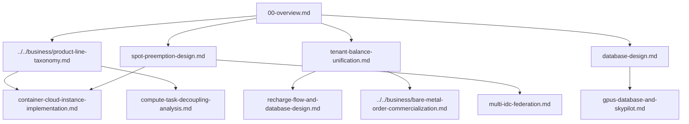
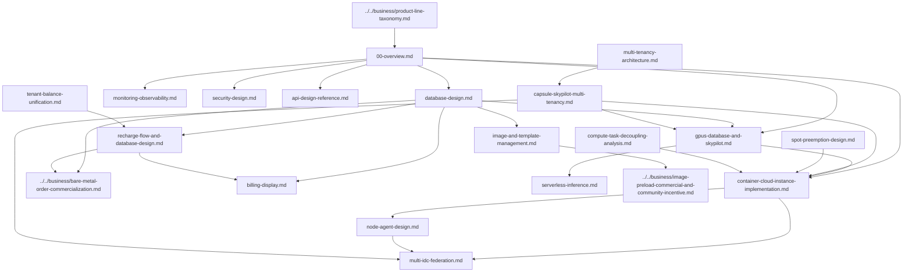

# 算力平台设计文档索引

> 统一入口，按角色推荐阅读顺序，支持关键词快速定位。

---

## 1. 文档清单

| # | 文件 | 标题 | 状态 |
|---|------|------|------|
| 1 | `00-overview.md` | 整体设计概览 | ✅ 已对齐 taxonomy |
| 2 | `../../business/product-line-taxonomy.md` | **产品线/计费语义权威** | ✅ 已采纳 |
| 3 | `tenant-balance-unification.md` | **余额模型权威** | ✅ 已采纳 |
| 4 | `spot-preemption-design.md` | **Spot 抢占与闲时回收** | ✅ 已采纳 |
| 5 | `database-design.md` | 数据库设计 | ✅ 已补充 |
| 6 | `../../../apps/gpus/content/design/gpus-database-and-skypilot.md` | 消费者域数据库与 SkyPilot | ✅ 完整 |
| 7 | `container-cloud-instance-implementation.md` | 容器云实例实现 | ✅ Spot 外置引用 |
| 8 | `compute-task-decoupling-analysis.md` | compute 分层解耦 | ✅ **已采纳** |
| 9 | `../../business/bare-metal-order-commercialization.md` | 裸金属订单设计 | ✅ 券类型已对齐 |
| 10 | `recharge-flow-and-database-design.md` | 充值流程与数据库 | ✅ 余额已对齐 |
| 11 | `billing-display.md` | 计费展示方案 | ✅ Spot 乘数已对齐 |
| 12 | `image-and-template-management.md` | 镜像与部署模板管理 | ✅ 完整 |
| 13 | `../../business/image-preload-commercial-and-community-incentive.md` | 镜像预热商业化与社区激励 | ✅ 完整 |
| 14 | `serverless-inference.md` | Serverless 推理服务 | ✅ 完整 |
| 15 | `monitoring-observability.md` | 监控与可观测性 | ✅ 新建 |
| 16 | `security-design.md` | 安全设计 | ✅ 新建 |
| 17 | `api-design-reference.md` | API 设计参考 | ✅ 新建 |
| 18 | `node-agent-design.md` | 节点 Agent 设计 | ✅ 新建 |
| 19 | `multi-idc-federation.md` | 多 IDC 联邦设计 | ✅ 新建 |
| 20 | `multi-tenancy-architecture.md` | 多角色、多租户实现方案 | ✅ 已补充 |
| 21 | `capsule-skypilot-multi-tenancy.md` | Capsule & SkyPilot 多租户映射 | ✅ 新建 |
| 22 | `cloud-vm-implementation.md` | Cloud VM 实现（含数据镜像分离 / Cog） | ✅ 已合并补充 |
| 23 | `serverless-implementation.md` | 弹性服务 Serverless（含可中断跨区定稿） | ✅ 已采纳 |
| 24 | `storage-quota-and-s3-volume.md` | 镜像限额 / 数据盘扩容 / S3 网络卷 | ✅ 已采纳 |
| 25 | `serverless-interruptible-scheduling.md` | （重定向）→ serverless-implementation | 🔀 已合并 |
| 26 | `cloud-vm-data-image-separation.md` | （重定向）→ cloud-vm-implementation §8 | 🔀 已合并 |
| 27 | `tenant-identity-verification-design.md` | **实名认证与客户延迟绑定** | ✅ 已采纳 |
| 28 | `INDEX.md` | 本文件 | ✅ 当前 |
| 29 | `waverless-provider-cost-and-customer-billing.md` | **Waverless 外采供应商成本记账与客户完整计费** | 📝 设计草案 |
| 30 | `waverless-region-provider-gateway-design.md` | **Waverless 区域资源、Provider 与统一网关设计** | 📝 设计草案 |

> `deployment-operations.md` 曾列入索引但仓库中缺失，已从清单移除；部署说明暂以 `docker/` 与运维相关章节为准。

---

## 1.1 语义权威（冲突时优先阅读）

```
../../business/product-line-taxonomy.md      ← product_line / billing_mode / commitment
                               （on-demand=按秒，hour=按小时预付；无历史码兼容）
                               （serverless interruptible ≠ Spot）
tenant-balance-unification.md ← tenant_balance(tenant_id PK, organization_id 冗余)
spot-preemption-design.md     ← Spot 仅 job；抢占必须通知租户
```

其他文档若与上述三份冲突，**以三份权威为准**并应回写。  
Serverless：`serverless-implementation.md`；Cloud VM 构建：`cloud-vm-implementation.md` §8；存储：`storage-quota-and-s3-volume.md`。
Waverless 外采 Serverless 的 supplier 成本账与租户收入账：`waverless-provider-cost-and-customer-billing.md`（草案；supplier 应付成本与 tenant 销售收入必须分账）。
Waverless Region/Provider/Gateway、Traefik/Caddy 选型、动态 backend pool 及 ACME wildcard 服务子域：`waverless-region-provider-gateway-design.md`（草案；客户入口与 Provider 控制面隔离）。
Waverless 多 Worker 用户 HTTP 服务统一反代、动态 backend pool：同一文档 §7.6；平台服务域名/ACME wildcard：§7.7；推荐 Traefik + 专用 Gateway Controller，不要求 Kubernetes。

---

## 2. 阅读顺序（按角色）

### 2.1 新开发者（首次接触）

```
1. 00-overview.md                    ← 平台全貌、技术栈、架构分层
2. ../../business/product-line-taxonomy.md          ← 产品线 / billing_mode / 券（必读）
3. tenant-balance-unification.md     ← 余额模型（必读）
4. database-design.md §1-2           ← 领域划分、供应商与资源域
5. multi-tenancy-architecture.md     ← 四层组织模型与权限体系
```

### 2.2 后端开发者（任务/调度/计费）

```
1. ../../business/product-line-taxonomy.md          ← 枚举冻结
2. tenant-balance-unification.md     ← 扣款原语
3. spot-preemption-design.md         ← 闲时 Spot（若做调度）
4. compute-task-decoupling-analysis.md ← compute_base 分层（已采纳）
5. container-cloud-instance-implementation.md  ← 实例实现
6. gpus-database-and-skypilot.md §2  ← SkyPilot交互流程
7. multi-tenancy-architecture.md     ← 多租户与权限体系
8. capsule-skypilot-multi-tenancy.md ← Capsule/SkyPilot租户映射
9. recharge-flow-and-database-design.md  ← 充值/支付
10. billing-display.md                ← 账单展示与OpenMeter
11. waverless-provider-cost-and-customer-billing.md ← 外采 Serverless 成本/收入双账
12. waverless-region-provider-gateway-design.md ← Region/Provider/统一网关
```

### 2.3 前端开发者（apps/gpus）

```
1. 00-overview.md                    ← 产品形态概览
2. container-cloud-instance-implementation.md §1  ← UED路由→后端映射
3. gpus-database-and-skypilot.md §1  ← 前端类型定义
4. image-and-template-management.md §8  ← 前端路由规划
5. serverless-inference.md §2        ← Inference 用户交互
5b. serverless-implementation.md      ← 弹性服务 + 可中断
5c. storage-quota-and-s3-volume.md     ← 磁盘与 S3 卷
6. ../../business/bare-metal-order-commercialization.md §5  ← 裸金属下单流程
```

### 2.4 运营/产品（apps/web）

```
1. 00-overview.md                    ← 产品形态与定价体系
2. database-design.md §3-6           ← CRM/商户/财务域
3. ../../business/bare-metal-order-commercialization.md §10  ← 运营页面设计
4. image-and-template-management.md §6  ← 运营管理功能
5. ../../business/image-preload-commercial-and-community-incentive.md  ← 预热计费+社区激励
6. recharge-flow-and-database-design.md §9  ← 运营后台
```

### 2.5 基础设施/SRE

```
1. 00-overview.md                    ← 架构分层
2. multi-idc-federation.md           ← 多IDC联邦架构
3. capsule-skypilot-multi-tenancy.md ← Capsule租户隔离与SkyPilot集成
4. node-agent-design.md              ← 节点Agent部署
5. spot-preemption-design.md         ← 闲时 Spot 与回收 SLA
6. node-agent-design.md              ← 节点Agent部署
7. monitoring-observability.md       ← 监控/告警/日志
8. security-design.md                ← 安全架构
9. docker/                           ← 部署配置（原 deployment-operations.md 待补）
```

---

## 3. 依赖关系图



> 完整依赖仍见下文；上图为 Phase 0 语义权威插入后的主干。



---

## 4. 关键词索引

### 4.1 产品与业务

| 关键词 | 文档 | 章节 |
|--------|------|------|
| GPU 云服务器 | `container-cloud-instance-implementation.md` | §3 |
| 裸金属 | `../../business/bare-metal-order-commercialization.md` | §1-11 |
| Serverless 推理 | `serverless-inference.md` | §1-8 |
| 批处理任务 | `container-cloud-instance-implementation.md` | §6 |
| Spot 实例 | `spot-preemption-design.md` | 全文 |
| Serverless 弹性服务 | `serverless-implementation.md` | 全文 |
| Serverless 可中断 / 跨区 | `serverless-implementation.md` | §2 / §5 / §6 |
| Cloud VM 数据镜像分离 / Cog | `cloud-vm-implementation.md` | §8 |
| 镜像限额 / 数据盘 / S3 卷 | `storage-quota-and-s3-volume.md` | 全文 |
| 产品线枚举 | `../../business/product-line-taxonomy.md` | 全文 |
| 余额冻结 | `tenant-balance-unification.md` | 全文 |
| 应用模板 | `image-and-template-management.md` | §3 |
| 预加载镜像 | `image-and-template-management.md` | §5.2 |

### 4.2 数据库与模型

| 关键词 | 文档 | 章节 |
|--------|------|------|
| 供应商 (supplier) | `database-design.md` | §2.1 |
| 机房 (data_center) | `database-design.md` | §2.1 |
| 设备 (supplier_device) | `../../../apps/gpus/content/design/gpus-database-and-skypilot.md` | §1.2 |
| GPU 卡型 | `../../../apps/gpus/content/design/gpus-database-and-skypilot.md` | §1.2 |
| 计算任务 (compute_task) | `container-cloud-instance-implementation.md` | §2.1 |
| 裸金属订单 | `../../business/bare-metal-order-commercialization.md` | §6 |
| 余额 (tenant_balance) | `tenant-balance-unification.md` | 全文 |
| 支付订单 (payment_order) | `recharge-flow-and-database-design.md` | §3.2 |
| 账单 (tenant_bill) | `billing-display.md` | §1 |
| 券 (coupon) | `../../business/bare-metal-order-commercialization.md` | §3 |
| 价格记录 | `database-design.md` | §3 |

### 4.3 调度与基础设施

| 关键词 | 文档 | 章节 |
|--------|------|------|
| SkyPilot | `../../../apps/gpus/content/design/gpus-database-and-skypilot.md` | §2 |
| Kueue / Volcano | `00-overview.md` | §1.3 |
| Capsule | `capsule-skypilot-multi-tenancy.md` | §3-4 |
| Traefik | `serverless-inference.md` | §1.3 |
| OpenMeter | `billing-display.md` | §1 |
| Node Agent | `node-agent-design.md` | §1-8 |
| 多 IDC 联邦 | `multi-idc-federation.md` | §1-8 |
| Capsule 多租户映射 | `capsule-skypilot-multi-tenancy.md` | §1-12 |
| SkyPilot 租户上下文 | `capsule-skypilot-multi-tenancy.md` | §5 |
| Capsule Sync Service | `capsule-skypilot-multi-tenancy.md` | §4 |

### 4.4 安全与运维

| 关键词 | 文档 | 章节 |
|--------|------|------|
| Better Auth | `security-design.md` | §2 |
| RBAC | `security-design.md` | §3 |
| 数据加密 | `security-design.md` | §4 |
| Prometheus | `monitoring-observability.md` | §2 |
| Grafana | `monitoring-observability.md` | §3 |
| DCGM | `monitoring-observability.md` | §4 |
| CI/CD | `deployment-operations.md` | §2 |
| 回滚策略 | `deployment-operations.md` | §3 |

### 4.5 计费与财务

| 关键词 | 文档 | 章节 |
|--------|------|------|
| 充值流程 | `recharge-flow-and-database-design.md` | §4-7 |
| 微信支付 | `recharge-flow-and-database-design.md` | §5 |
| 支付宝 | `recharge-flow-and-database-design.md` | §6 |
| 对公转账 | `recharge-flow-and-database-design.md` | §7 |
| 余额防超额 | `container-cloud-instance-implementation.md` | §8 |
| 算力券抵扣 | `../../business/bare-metal-order-commercialization.md` | §3 |
| 月度账单 | `billing-display.md` | §2 |
| IDC 结算 | `database-design.md` | §6 |
| Waverless 外采成本/客户收入双账 | `waverless-provider-cost-and-customer-billing.md` | 全文 |
| Waverless 区域资源/Provider/Gateway | `waverless-region-provider-gateway-design.md` | 全文 |

---

## 5. 共享交易层

> 跨域共享表，定义在 `database-design.md` §9 + `tenant-balance-unification.md`。

| 表 | 定义位置 | 裸金属域引用 | K8s 计算域引用 |
|---|---------|-------------|--------------|
| `tenant_balance` | `tenant-balance-unification.md` | 下单/续费 `deduct_available` | freeze / consume_reserved（按秒） |
| `balance_transaction` | `database-design.md` §9.1 + balance 权威 | 含 `organization_id` 冗余 | 同上 |
| `tenant_notification` | `spot-preemption-design.md` §5.4 | — | Spot 抢占必达通知 |
| `coupon_usage_log` | `database-design.md` §9.2 | bare-metal | compute 券抵扣 |

---

## 6. 文档交叉引用

| 文档 | 引用的其他文档 |
|------|---------------|
| `../../business/product-line-taxonomy.md` | （权威）被 overview / database / container / spot / serverless 引用 |
| `tenant-balance-unification.md` | （权威）被 recharge / bare-metal / overview 引用 |
| `spot-preemption-design.md` | taxonomy, multi-idc, decoupling |
| `serverless-implementation.md` | taxonomy, multi-idc, spot（通知复用）, storage |
| `storage-quota-and-s3-volume.md` | cloud-vm, serverless, job, balance |
| `cloud-vm-implementation.md` | storage, image-and-template |
| `00-overview.md` | 全部文档（总览）+ 三份权威 |
| `database-design.md` | `../../../apps/gpus/content/design/gpus-database-and-skypilot.md`, `tenant-balance-unification.md` |
| `compute-task-decoupling-analysis.md` | taxonomy, spot-preemption（已采纳） |
| `container-cloud-instance-implementation.md` | taxonomy, spot, balance, decoupling |
| `../../business/bare-metal-order-commercialization.md` | taxonomy §7, balance, database §9 |
| `recharge-flow-and-database-design.md` | balance 权威, database §9 |
| `billing-display.md` | taxonomy Spot 乘数 |
| `../../../apps/gpus/content/design/gpus-database-and-skypilot.md` | taxonomy product_line |
| `multi-tenancy-architecture.md` | `capsule-skypilot-multi-tenancy.md` |
| `capsule-skypilot-multi-tenancy.md` | multi-tenancy, container, multi-idc |

---

## 7. 统计

| 指标 | 数值 |
|------|------|
| 文档总数 | ~27（含本索引、重定向与 3 份语义权威） |
| 语义权威 | 3（taxonomy / balance / spot） |
| 已移除虚假索引 | `deployment-operations.md`（文件不存在） |
| 核心裁决 | Spot≠产品线；`on-demand`=按秒、`hour`=按时预付；`tenant_balance`+`organization_id`；抢占必达通知租户；serverless `interruptible`≠Spot；cloud_vm 数据镜像分离；镜像/数据盘/S3 配额 |
