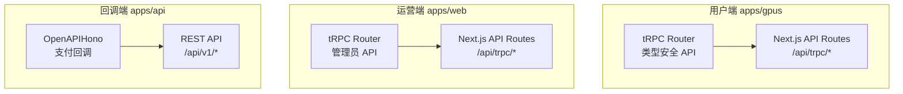

# API 设计参考

> 基于 tRPC + OpenAPIHono 的统一 API 设计规范，覆盖用户端 (apps/gpus) 和运营端 (apps/web)。

---

## 1. API 架构

### 1.1 API 分层



### 1.2 组件分工

| 组件 | 用途 | 认证方式 |
|------|------|---------|
| **tRPC (用户端)** | 前端类型安全 API | Better Auth Session |
| **tRPC (运营端)** | 管理后台 API | Better Auth + Admin Role |
| **OpenAPIHono** | 支付回调等外部接口 | 签名验证 |

---

## 2. tRPC 设计规范

### 2.1 Router 组织

```typescript
// apps/gpus/src/server/routers/
export const appRouter = createTRPCRouter({
  // 用户域
  account: accountRouter,        // 账户/充值/余额
  billing: billingRouter,        // 账单/消费
  task: taskRouter,              // 任务管理
  serverless: serverlessRouter,  // Serverless 推理
  metal: metalRouter,            // 裸金属

  // 管理域
  admin: adminRouter,            // 运营管理
})

// apps/web/src/server/routers/
export const adminRouter = createTRPCRouter({
  finance: financeRouter,        // 财务管理
  tenant: tenantRouter,          // 租户管理
  resource: resourceRouter,      // 资源管理
  crm: crmRouter,                // CRM
})
```

### 2.2 Procedure 定义

```typescript
// 公开接口
export const publicProcedure = t.procedure

// 认证接口
export const protectedProcedure = t.procedure.use(({ ctx, next }) => {
  if (!ctx.session) throw new TRPCError({ code: 'UNAUTHORIZED' })
  return next({ ctx: { ...ctx, user: ctx.session.user } })
})

// 管理员接口
export const adminProcedure = protectedProcedure.use(({ ctx, next }) => {
  if (!ctx.user.role.includes('admin')) {
    throw new TRPCError({ code: 'FORBIDDEN' })
  }
  return next({ ctx })
})

// 租户隔离接口
export const tenantProcedure = protectedProcedure.use(({ ctx, next }) => {
  const orgId = ctx.headers['x-org-id']
  if (!orgId) throw new TRPCError({ code: 'BAD_REQUEST', message: 'Missing org context' })
  return next({ ctx: { ...ctx, orgId } })
})
```

### 2.3 输入验证 (Zod)

```typescript
// 通用验证 schema
const paginationSchema = z.object({
  page: z.number().int().min(1).default(1),
  pageSize: z.number().int().min(1).max(50).default(20),
})

const dateRangeSchema = z.object({
  from: z.string().datetime(),
  to: z.string().datetime(),
})

// 业务验证 schema
const createTaskSchema = z.object({
  name: z.string().min(1).max(255),
  type: z.enum(['job', 'serve']),
  image: z.string().url(),
  resourceSpec: z.object({
    cpu: z.number().int().min(1),
    memoryGb: z.number().int().min(1),
    gpu: z.string().optional(),
  }),
  command: z.string().optional(),
})

// 使用示例
export const taskRouter = createTRPCRouter({
  create: tenantProcedure
    .input(createTaskSchema)
    .mutation(async ({ ctx, input }) => {
      return taskService.create(ctx.orgId, input)
    }),

  list: tenantProcedure
    .input(paginationSchema.extend({ status: z.string().optional() }))
    .query(async ({ ctx, input }) => {
      return taskService.list(ctx.orgId, input)
    }),
})
```

---

## 3. 错误处理

### 3.1 错误码定义

| 错误码 | HTTP 状态码 | 说明 |
|--------|------------|------|
| `UNAUTHORIZED` | 401 | 未认证 |
| `FORBIDDEN` | 403 | 无权限 |
| `NOT_FOUND` | 404 | 资源不存在 |
| `BAD_REQUEST` | 400 | 请求参数错误 |
| `CONFLICT` | 409 | 资源冲突 |
| `RATE_LIMITED` | 429 | 请求过于频繁 |
| `INTERNAL_SERVER_ERROR` | 500 | 服务器内部错误 |

### 3.2 错误响应格式

```typescript
// tRPC 错误响应
{
  "error": {
    "code": "NOT_FOUND",
    "message": "Task not found",
    "data": {
      "taskId": "xxx"
    }
  }
}

// 自定义业务错误
throw new TRPCError({
  code: 'BAD_REQUEST',
  message: 'Insufficient balance',
  cause: {
    required: 100,
    available: 50,
  },
})
```

---

## 4. 数据库查询规范

### 4.1 Drizzle ORM 使用

```typescript
// 查询示例
import { eq, and, desc, asc } from 'drizzle-orm'

// 单条查询
const task = await db.query.task.findFirst({
  where: and(
    eq(task.id, taskId),
    eq(task.organizationId, orgId)
  ),
})

// 列表查询（带分页）
const tasks = await db.query.task.findMany({
  where: and(
    eq(task.organizationId, orgId),
    eq(task.status, status)
  ),
  orderBy: [desc(task.createdAt)],
  limit: pageSize,
  offset: (page - 1) * pageSize,
})

// 关联查询
const taskWithDetails = await db.query.task.findFirst({
  where: eq(task.id, taskId),
  with: {
    instances: true,
    events: true,
  },
})
```

### 4.2 事务处理

```typescript
// 余额操作事务
async function deductBalance(orgId: string, amount: number) {
  return db.transaction(async (tx) => {
    // 行级锁查询
    const [tenant] = await tx
      .select()
      .from(tenant)
      .where(eq(tenant.id, orgId))
      .for('update')

    if (tenant.balance < amount) {
      throw new TRPCError({ code: 'BAD_REQUEST', message: 'Insufficient balance' })
    }

    // 更新余额
    const balanceBefore = tenant.balance
    const balanceAfter = balanceBefore - amount

    await tx.update(tenant)
      .set({ balance: balanceAfter })
      .where(eq(tenant.id, orgId))

    // 插入流水
    await tx.insert(balanceTransaction).values({
      id: generateId(),
      tenantId: orgId,
      type: 'deduction',
      amount: -amount,
      balanceBefore,
      balanceAfter,
    })

    return { balanceBefore, balanceAfter }
  })
}
```

---

## 5. 分页规范

### 5.1 请求格式

```typescript
// 分页请求
{
  page: 1,        // 页码，从 1 开始
  pageSize: 20,   // 每页数量，最大 50
}
```

### 5.2 响应格式

```typescript
// 分页响应
{
  data: [...],           // 数据列表
  pagination: {
    page: 1,             // 当前页码
    pageSize: 20,        // 每页数量
    total: 100,          // 总记录数
    totalPages: 5,       // 总页数
  }
}
```

---

## 6. 缓存策略

### 6.1 缓存层级

| 层级 | 位置 | TTL | 适用场景 |
|------|------|-----|---------|
| **L1** | 浏览器 | 5min | 静态资源、配置 |
| **L2** | CDN | 1h | 公开数据 |
| **L3** | Redis | 5min | 热点数据 |
| **L4** | 数据库 | - | 持久化存储 |

### 6.2 缓存失效

```typescript
// 缓存失效策略
const cacheInvalidation = {
  // 用户操作时失效相关缓存
  onTaskCreate: async (orgId: string) => {
    await redis.del(`tasks:${orgId}`)
    await redis.del(`balance:${orgId}`)
  },

  // 定时失效
  scheduled: async () => {
    // 每 5 分钟失效热点数据
    await redis.del('gpu-inventory:*')
  },
}
```

---

## 7. 限流设计

### 7.1 限流规则

| 接口类型 | 限流策略 | 阈值 |
|---------|---------|------|
| **公开接口** | IP 限流 | 100 req/min |
| **用户接口** | 用户限流 | 1000 req/min |
| **管理接口** | 角色限流 | 500 req/min |
| **支付回调** | IP 白名单 | 不限流 |

### 7.2 限流实现

```typescript
// Redis 限流
async function rateLimit(key: string, limit: number, window: number) {
  const now = Date.now()
  const windowStart = now - window * 1000

  // 滑动窗口计数
  const count = await redis.zcard(key)
  if (count >= limit) {
    throw new TRPCError({ code: 'RATE_LIMITED' })
  }

  // 添加当前请求
  await redis.zadd(key, now, `${now}`)
  await redis.expire(key, window)
}
```

---

## 8. 文档与测试

### 8.1 API 文档

```typescript
// OpenAPI 文档生成
import { generateOpenAPIDocument } from '@trpc/server/adapters/openapi'

const openApiDocument = generateOpenAPIDocument({
  router: appRouter,
  title: '算力平台 API',
  version: '1.0.0',
  baseUrl: 'https://api.platform.com',
})
```

### 8.2 测试规范

```typescript
// tRPC 测试
import { createCallerFactory } from '@trpc/server'
import { appRouter } from '../routers'

const createCaller = createCallerFactory(appRouter)

describe('taskRouter', () => {
  it('should create task', async () => {
    const caller = createCaller({ session: mockSession, orgId: 'org1' })
    const result = await caller.task.create({
      name: 'test-task',
      type: 'job',
      image: 'pytorch:latest',
      resourceSpec: { cpu: 4, memoryGb: 16 },
    })
    expect(result.id).toBeDefined()
  })
})
```

---

## 9. 版本管理

### 9.1 API 版本策略

| 版本 | 路径 | 说明 |
|------|------|------|
| v1 | `/api/trpc/*` | 当前版本 |
| v2 | `/api/v2/trpc/*` | 下一版本 |

### 9.2 破坏性变更处理

```typescript
// 版本兼容性处理
const versionedRouter = createTRPCRouter({
  v1: v1Router,
  v2: v2Router,
})

// 废弃接口标记
export const deprecatedProcedure = protectedProcedure
  .meta({ deprecated: true, since: '2026-06-01' })
  .query(async () => { ... })
```
