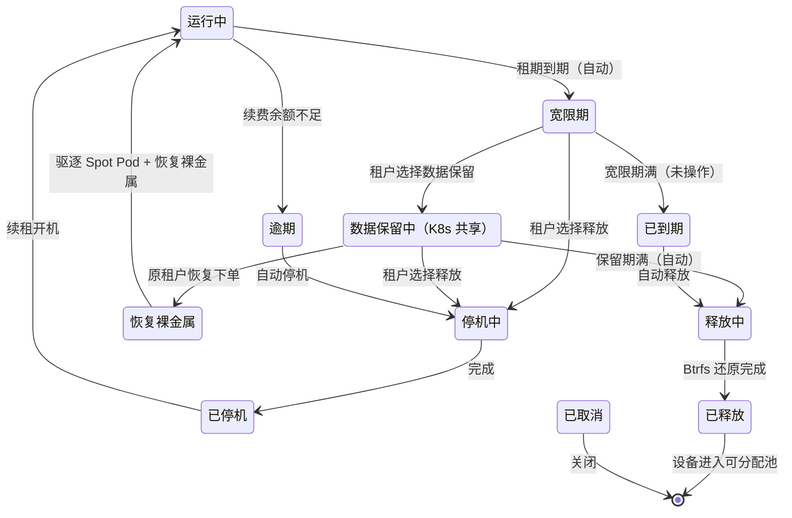
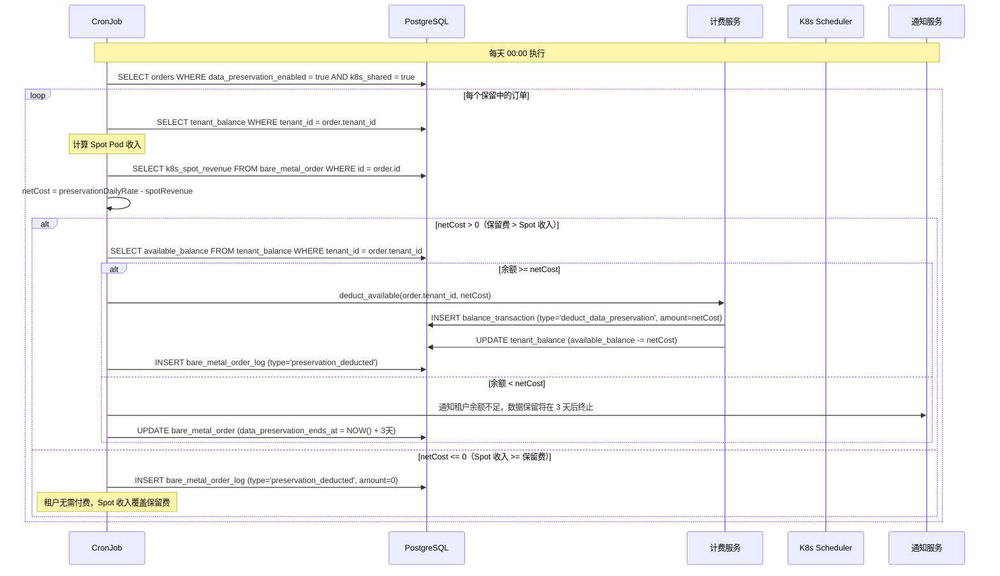
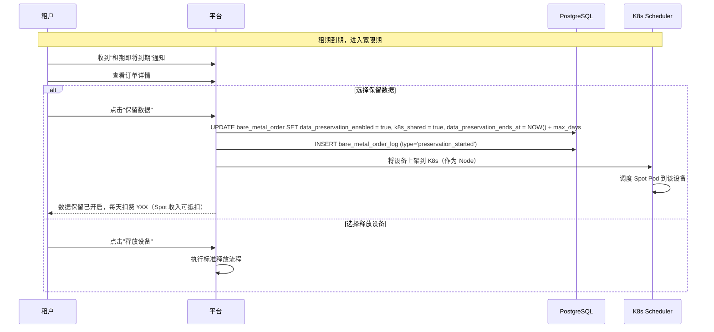
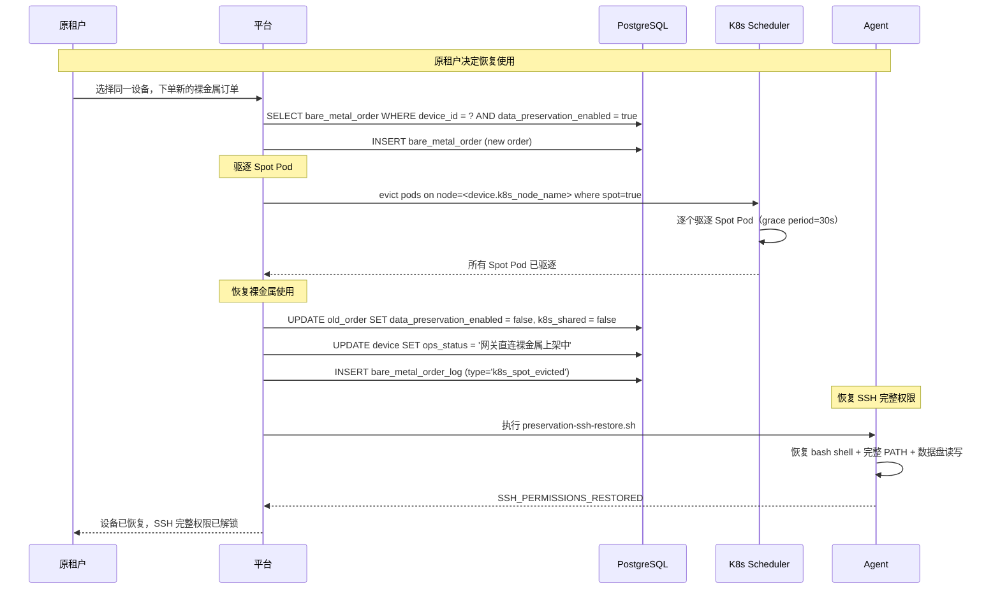

# 裸金属数据保留设计

> 租户可选择在租期结束后保留数据（额外收费），设备暂不释放。
> **保留期间设备上架到 K8s 运行可中断任务（Spot Pod），最大化设备利用率。**
> 原租户再次下单时，驱逐 K8s 任务，恢复裸金属使用。

---

## 1. 核心概念

### 1.1 什么是数据保留

租户在裸金属订单到期后，可以选择**保留数据而不释放设备**：
- Btrfs 子卷保持存活（不执行还原）
- 按天计费（数据保留服务费）
- 其他租户无法看到或访问该数据
- 有最大保留期限（超期自动释放）
- **SSH 权限受限**：仅可读取用户目录，不可编辑，不可访问其他目录

### 1.2 保留期间的设备共享

**核心原则：保留期间设备不闲置，上架到 K8s 运行可中断任务。**

```
裸金属设备保留期间的双重角色：
  │
  ├── 数据保留层（不可侵犯）
  │   ├── Btrfs @inst-{id} 子卷保持存活
  │   ├── 用户数据完整保留
  │   ├── SSH 凭据不变（原租户可随时恢复）
  │   ├── SSH 权限受限（仅读用户目录，不可编辑，不可访问其他目录）
  │   └── 其他租户不可见、不可访问
  │
  └── K8s 计算层（可中断）
      ├── 设备作为 K8s Node 上架
      ├── 运行 Spot Pod（可中断任务）
      ├── 使用 GPU 资源（不触及用户数据盘）
      ├── Spot Pod 可被随时驱逐
      └── 原租户恢复时自动驱逐所有 Spot Pod
```

### 1.3 设备状态流转

```
裸金属租期到期
  │
  ├── [默认] → 宽限期 → 停机 → 数据清理 → Btrfs 还原 → 释放设备
  │
  └── [选择保留] → 数据保留期
                    │
                    ├── Btrfs 子卷保持存活（用户数据）
                    ├── 设备上架到 K8s（运行 Spot Pod）
                    ├── 按天收取保留费
                    │
                    ├── [原租户恢复] → 驱逐 Spot Pod → 恢复裸金属使用
                    └── [保留期满] → 驱逐 Spot Pod → 数据清理 → 释放
```

### 1.4 使用场景

| 场景 | 说明 |
|------|------|
| 训练任务未完成 | 租户训练任务未跑完，需要保留中间结果 |
| 数据迁移中 | 租户需要时间将数据拷贝到其他存储 |
| 临时暂停 | 租户暂时不用 GPU，但后续还会继续训练 |
| 模型调试 | 模型还在调试阶段，需要保留训练数据 |
| **设备复用（新增）** | **保留期间设备运行 Spot Pod，为平台产生收入** |

---

## 2. 状态机扩展

在现有 `bare_metal_order` 状态机基础上增加 `preserving` 状态：



### 2.1 保留期间设备角色

| 状态 | 裸金属租户 SSH | K8s Spot Pod | Btrfs 子卷 |
|------|--------------|-------------|-----------|
| `running` | ✅ 完整权限 | ❌ 不上架 | ✅ 活跃 |
| `preserving` | 🔒 只读用户目录 | ✅ 运行可中断任务 | ✅ 保持存活 |
| `restoring` | ⏳ 恢复完整权限 | 🔄 驱逐中 | ✅ 活跃 |
| `releasing` | ❌ 已 revoke | ❌ 驱逐 | 🔄 还原中 |

---

## 3. 数据库 Schema 变更

### 3.1 bare_metal_order 新增字段

```sql
-- 数据保留相关字段
ALTER TABLE bare_metal_order ADD COLUMN data_preservation_enabled BOOLEAN NOT NULL DEFAULT false;
ALTER TABLE bare_metal_order ADD COLUMN data_preservation_ends_at TIMESTAMP;           -- 保留到期时间
ALTER TABLE bare_metal_order ADD COLUMN data_preservation_daily_rate NUMERIC(15,4);     -- 每日保留费率
ALTER TABLE bare_metal_order ADD COLUMN data_preservation_max_days INTEGER NOT NULL DEFAULT 30; -- 最大保留天数
ALTER TABLE bare_metal_order ADD COLUMN data_preservation_voucher_id TEXT;              -- 保留期使用的券
ALTER TABLE bare_metal_order ADD COLUMN data_preservation_voucher_deduction NUMERIC(15,4); -- 券抵扣金额

-- K8s 共享相关字段
ALTER TABLE bare_metal_order ADD COLUMN k8s_shared BOOLEAN NOT NULL DEFAULT false;     -- 保留期间是否上架到 K8s
ALTER TABLE bare_metal_order ADD COLUMN k8s_node_name VARCHAR(128);                    -- K8s Node 名称
ALTER TABLE bare_metal_order ADD COLUMN k8s_spot_enabled BOOLEAN NOT NULL DEFAULT true; -- 是否允许运行 Spot Pod
ALTER TABLE bare_metal_order ADD COLUMN k8s_spot_eviction_count INTEGER NOT NULL DEFAULT 0; -- 驱逐次数
ALTER TABLE bare_metal_order ADD COLUMN k8s_spot_revenue NUMERIC(15,4) NOT NULL DEFAULT 0; -- Spot Pod 产生的收入
```

### 3.2 设备表扩展

```sql
-- supplier_device 新增字段
ALTER TABLE supplier_device ADD COLUMN preservation_k8s_capable BOOLEAN NOT NULL DEFAULT true; -- 是否支持保留期间上架 K8s
ALTER TABLE supplier_device ADD COLUMN preservation_k8s_node TEXT;                             -- 关联的 K8s Node 名称
```

### 3.3 deploy_config 扩展

```json
{
  "envTemplateId": "pytorch-cuda12",
  "sshEnabled": true,
  "sshKey": "ssh-rsa AAAA...",
  "ports": "22",
  "autoRenew": false,
  "dataPreservationEnabled": true,
  "dataPreservationMaxDays": 30,
  "k8sSharedDuringPreservation": true,
  "k8sSpotEnabled": true
}
```

### 3.4 bare_metal_order_log 扩展

新增日志类型：

```typescript
type LogType =
  | 'created' | 'delivered' | 'started' | 'stopped'
  | 'renewed' | 'overdue' | 'released' | 'cleanup'
  | 'preservation_started'    // 开始数据保留
  | 'preservation_extended'   // 延长保留期
  | 'preservation_cancelled'  // 取消保留，立即释放
  | 'preservation_expired'    // 保留期满，自动释放
  | 'k8s_shared_on'           // 上架到 K8s（保留期间）
  | 'k8s_shared_off'          // 从 K8s 下架
  | 'k8s_spot_evicted'        // Spot Pod 被驱逐（原租户恢复）
  | 'k8s_spot_revenue'        // Spot Pod 产生收入
```

### 3.5 balance_transaction 扩展

新增交易类型：

```typescript
type TransactionType =
  | 'deduct_available' | 'deduct_reserved' | 'recharge_available'
  | 'recharge_resource_pack' | 'refund'
  | 'deduct_data_preservation'  // 数据保留扣款
  | 'earn_spot_revenue'         // Spot Pod 收入（抵扣保留费）
```

---

## 4. 计费设计

### 4.1 数据保留费率

```
数据保留日费用 = 设备日租价 × 保留系数
Spot Pod 日收入 = GPU 使用量 × Spot 单价
净保留成本 = 数据保留日费用 - Spot Pod 日收入
```

| 设备类型 | 日租价 | 保留系数 | 保留日费 | Spot 日收入(估) | 净成本 |
|---------|--------|---------|---------|----------------|--------|
| H100 80GB | ¥800/天 | 0.3 | ¥240/天 | ¥150/天 | ¥90/天 |
| A100 80GB | ¥600/天 | 0.3 | ¥180/天 | ¥120/天 | ¥60/天 |
| A100 40GB | ¥400/天 | 0.3 | ¥120/天 | ¥80/天 | ¥40/天 |
| V100 32GB | ¥200/天 | 0.3 | ¥60/天 | ¥40/天 | ¥20/天 |

> **Spot Pod 收入归平台**，用于抵消设备占用成本。原租户仅支付净保留成本（保留费 - Spot 收入）。
> 
> 如果 Spot Pod 收入 >= 保留费，原租户**无需额外付费**（净成本为 0）。

### 4.2 计费流程



### 4.3 Spot Pod 收入计算

```typescript
// 每小时统计 Spot Pod 使用量
async function calculateSpotPodRevenue(orderId: string): Promise<number> {
  const order = await getOrder(orderId)
  const device = await getDevice(order.deviceId)
  
  // 查询该设备上所有 Spot Pod 的 GPU 使用时长
  const spotPods = await k8sClient.listPods({
    labelSelector: `bare-metal-order-id=${orderId},spot=true`,
    fieldSelector: `spec.nodeName=${device.k8sNodeName}`
  })
  
  let totalGpuHours = 0
  for (const pod of spotPods) {
    const gpuRequest = pod.spec.containers.reduce(
      (sum, c) => sum + (c.resources?.requests?.['nvidia.com/gpu'] || 0), 0
    )
    const hours = (Date.now() - pod.status.startTime.getTime()) / (1000 * 60 * 60)
    totalGpuHours += gpuRequest * hours
  }
  
  // Spot 单价 = 正常单价 × Spot 折扣系数（如 0.5）
  const spotPrice = device.gpuHourPrice * SPOT_DISCOUNT
  return totalGpuHours * spotPrice
}
```

### 4.4 余额不足处理

```
数据保留期间余额不足（净成本 > 0 且余额不足）
  │
  ├── Day 1: 通知租户余额不足，需要充值
  ├── Day 2: 再次通知，警告即将终止保留
  ├── Day 3: 保留期终止
  │   ├── 驱逐所有 Spot Pod
  │   ├── 从 K8s 下架设备
  │   ├── 执行数据清理脚本
  │   ├── Btrfs 还原
  │   └── 设备进入可分配池
  └── 记录日志 (preservation_expired)
```

---

## 5. 租户操作流程

### 5.1 下单时选择数据保留

```
租户下单页面
  │
  ├── 选择设备类型、租期
  ├── [可选] 勾选"租期到期后保留数据"
  │   ├── 显示：数据保留费率（¥XX/天）
  │   ├── 显示：Spot Pod 收入抵扣说明
  │   ├── 显示：最大保留天数（30 天）
  │   └── 显示：预计净保留成本（保留费 - Spot 收入）
  └── 提交订单
```

### 5.2 租期到期时选择保留



### 5.3 原租户恢复下单



### 5.4 保留期间延长保留

```
租户保留数据期间
  │
  ├── 查看保留状态（剩余天数、已扣费用、Spot 收入）
  ├── [可选] 延长保留期（最多到 max_days）
  ├── [可选] 取消保留，立即释放设备
  └── 充值（余额不足时）
```

---

## 6. 保留期管理 CronJob

### 6.1 保留期到期检测

```typescript
// apps/cronjobs/bare-metal-data-preservation.ts

async function scanDataPreservationExpiry() {
  const orders = await db
    .select()
    .from(bareMetalOrder)
    .where(and(
      eq(bareMetalOrder.dataPreservationEnabled, true),
      lte(bareMetalOrder.dataPreservationEndsAt, new Date()),
      ne(bareMetalOrder.status, 'released')
    ))

  for (const order of orders) {
    await db.transaction(async (tx) => {
      // 1. 驱逐该设备上所有 Spot Pod
      await evictSpotPods(order)

      // 2. 从 K8s 下架设备
      await removeNodeFromK8s(order)

      // 3. 标记订单状态
      await tx.update(bareMetalOrder)
        .set({ 
          status: 'releasing',
          dataPreservationEnabled: false,
          k8sShared: false
        })
        .where(eq(bareMetalOrder.id, order.id))

      // 4. 记录日志
      await tx.insert(bareMetalOrderLog).values({
        orderId: order.id,
        type: 'preservation_expired',
        content: { 
          preservedDays: calculatePreservedDays(order),
          spotRevenue: order.k8sSpotRevenue
        }
      })

      // 5. 触发设备释放
      await triggerDeviceRelease(order)
    })
  }
}
```

### 6.2 K8s 共享管理

```typescript
// 将保留期设备上架到 K8s
async function shareDeviceToK8s(order: BareMetalOrder) {
  const device = await getDevice(order.deviceId)
  
  // 1. 设备加入 K8s 集群（作为 Node）
  await k8sClient.addNode({
    nodeName: `preserved-${order.id}`,
    ip: device.managementIp,
    labels: {
      'bare-metal-order-id': order.id,
      'bare-metal-preservation': 'true',
      'gpu-type': device.gpuType,
      'gpu-count': String(device.gpuCount)
    },
    taints: [
      {
        key: 'bare-metal-preservation',
        value: 'true',
        effect: 'NoSchedule'  // 只允许 Spot Pod，不允许普通 Pod
      }
    ]
  })

  // 2. 更新订单状态
  await db.update(bareMetalOrder)
    .set({ k8sShared: true, k8sNodeName: `preserved-${order.id}` })
    .where(eq(bareMetalOrder.id, order.id))

  // 3. 记录日志
  await db.insert(bareMetalOrderLog).values({
    orderId: order.id,
    type: 'k8s_shared_on',
    content: { nodeName: `preserved-${order.id}` }
  })
}

// 驱逐 Spot Pod（原租户恢复时）
async function evictSpotPods(order: BareMetalOrder) {
  const pods = await k8sClient.listPods({
    labelSelector: `bare-metal-order-id=${order.id},spot=true`,
    fieldSelector: `spec.nodeName=${order.k8sNodeName}`
  })

  for (const pod of pods) {
    await k8sClient.evictPod(pod.metadata.name, pod.metadata.namespace, {
      gracePeriodSeconds: 30,
      reason: 'Bare metal tenant resuming'
    })
  }

  // 记录驱逐日志
  await db.insert(bareMetalOrderLog).values({
    orderId: order.id,
    type: 'k8s_spot_evicted',
    content: { podCount: pods.length }
  })
}
```

### 6.3 Spot Pod 收入统计

```typescript
// 每小时统计 Spot Pod 收入
async function calculateSpotPodRevenue(orderId: string): Promise<number> {
  const order = await getOrder(orderId)
  const device = await getDevice(order.deviceId)
  
  // 查询该设备上所有 Spot Pod 的 GPU 使用时长
  const spotPods = await k8sClient.listPods({
    labelSelector: `bare-metal-order-id=${orderId},spot=true`,
    fieldSelector: `spec.nodeName=${order.k8sNodeName}`
  })
  
  let totalGpuHours = 0
  for (const pod of spotPods) {
    const gpuRequest = pod.spec.containers.reduce(
      (sum, c) => sum + (c.resources?.requests?.['nvidia.com/gpu'] || 0), 0
    )
    const hours = (Date.now() - pod.status.startTime.getTime()) / (1000 * 60 * 60)
    totalGpuHours += gpuRequest * hours
  }
  
  // Spot 单价 = 正常单价 × Spot 折扣系数（如 0.5）
  const spotPrice = device.gpuHourPrice * SPOT_DISCOUNT
  const revenue = totalGpuHours * spotPrice

  // 更新订单收入
  await db.update(bareMetalOrder)
    .set({ k8sSpotRevenue: sql`${bareMetalOrder.k8sSpotRevenue} + ${revenue}` })
    .where(eq(bareMetalOrder.id, orderId))

  // 记录收入日志
  await db.insert(bareMetalOrderLog).values({
    orderId,
    type: 'k8s_spot_revenue',
    content: { gpuHours: totalGpuHours, revenue }
  })

  return revenue
}
```

### 6.4 余额不足检测

```typescript
async function scanDataPreservationInsufficientBalance() {
  const orders = await db
    .select()
    .from(bareMetalOrder)
    .where(and(
      eq(bareMetalOrder.dataPreservationEnabled, true),
      gt(bareMetalOrder.dataPreservationEndsAt, new Date())
    ))

  for (const order of orders) {
    const [balance] = await db
      .select()
      .from(tenantBalance)
      .where(eq(tenantBalance.tenantId, order.tenantId))

    const dailyRate = order.dataPreservationDailyRate
    const spotRevenue = order.k8sSpotRevenue
    const netCost = dailyRate - (spotRevenue / calculatePreservedDays(order))
    const daysRemaining = Math.ceil(
      (order.dataPreservationEndsAt.getTime() - Date.now()) / (1000 * 60 * 60 * 24)
    )

    // 净成本 > 0 且余额不足 3 天
    if (netCost > 0 && balance.availableBalance < netCost * 3) {
      await notifyInsufficientBalance(order, daysRemaining, netCost)
      
      // 如果余额不足 1 天，立即终止保留
      if (balance.availableBalance < netCost) {
        await terminateDataPreservation(order)
      }
    }
  }
}
```

---

## 7. API 接口

### 7.1 消费者端（apps/gpus）

```typescript
// 开启数据保留
trpc.metalOrder.startDataPreservation.mutate({
  orderId: 'xxx',
  maxDays: 30,
  k8sShared: true,  // 允许保留期间上架到 K8s
  voucherId: 'optional-voucher-id'
})

// 延长保留期
trpc.metalOrder.extendDataPreservation.mutate({
  orderId: 'xxx',
  additionalDays: 7
})

// 取消保留，立即释放
trpc.metalOrder.cancelDataPreservation.mutate({
  orderId: 'xxx'
})

// 查询保留状态
trpc.metalOrder.getDataPreservationStatus.query({
  orderId: 'xxx'
})
// 返回: { enabled, endsAt, dailyRate, daysRemaining, totalCost, k8sShared, spotRevenue, netCost }

// 恢复裸金属使用（驱逐 Spot Pod）
trpc.metalOrder.resumeBareMetal.mutate({
  deviceId: 'sd-xxx'  // 选择要恢复的设备
})
```

### 7.2 运营后台（apps/web）

```typescript
// 查看所有保留中的订单
trpc.bareMetal.getDataPreservationOrders.query({
  page: 1,
  pageSize: 20,
  status: 'preserving'
})

// 手动终止保留
trpc.bareMetal.terminateDataPreservation.mutate({
  orderId: 'xxx',
  reason: '租户违规'
})

// 调整保留费率（平台配置）
trpc.bareMetal.updateDataPreservationConfig.mutate({
  retentionCoefficient: 0.25,
  maxDays: 60,
  spotDiscount: 0.5
})

// 查看 Spot Pod 收入统计
trpc.bareMetal.getSpotRevenueStats.query({
  startDate: '2026-01-01',
  endDate: '2026-01-31'
})
```

---

## 8. 数据隔离保障

### 8.1 Btrfs 子卷隔离

```
/dev/nvme0n1 (系统盘 1TB NVMe)
└─ btrfs 单设备卷
   ├─ @base                  # 基础系统
   ├─ @snap_pytorch          # 模板快照
   ├─ @snap_miniconda        # 模板快照
   ├─ @inst-<order-A>        # 订单 A 实例（保留中）
   ├─ @inst-<order-B>        # 订单 B 实例（保留中）
   └─ @inst-<order-C>        # 订单 C 实例（已释放）
```

### 8.2 隔离机制

| 隔离层 | 机制 | 说明 |
|--------|------|------|
| **文件系统** | Btrfs subvolume | 每个订单独立子卷，互不可见 |
| **SSH** | SSH 网关 + 独立凭据 | 每个订单独立 SSH 密码/密钥 |
| **网络** | iptables 规则 | 用户网络隔离 |
| **GPU** | NVIDIA MIG 或 vGPU | GPU 资源隔离（可选） |
| **K8s Node Taint** | NoSchedule taint | Spot Pod 专用，普通 Pod 不调度到保留设备 |
| **K8s Volume** | hostPath 限制 | Spot Pod 仅挂载 /tmp，不挂载用户数据盘 |

### 8.3 保留期间的 K8s 隔离

```
保留期间设备的磁盘挂载：
  │
  ├── /dev/nvme0n1p1 (系统盘, Btrfs)
  │   └─ @inst-{id} → /mnt/instance  （用户数据，Spot Pod 不可访问）
  │
  ├── /dev/nvme1n1 (数据盘, ext4)
  │   └─ /data  （用户数据，Spot Pod 不可访问）
  │
  └─ Spot Pod 挂载：
      ├── /tmp → hostPath（临时计算空间）
      └─ /dev/nvidia* → GPU 设备（计算用）
```

### 8.4 其他租户可见性

```
其他租户查看裸金属列表时：
  │
  ├── [保留中的设备] → 显示为"占用中（数据保留 + K8s 共享）"
  ├── [设备详情] → 不显示保留租户信息
  ├── [设备日志] → 不显示保留租户操作记录
  ├── [设备还原] → 保留期间不执行还原
  └── [Spot Pod] → 其他租户可提交 Spot Pod 使用该设备 GPU
```

### 8.5 保留期间 SSH 权限限制

**核心原则：保留期间租户 SSH 只能读取用户目录，不可编辑，不可访问其他目录，确保 Spot Pod 安全。**

#### 8.5.1 权限模型

```
保留期间 SSH 权限矩阵：
  │
  ├── 用户目录 /home/user/  →  ✅ 可读（ls, cat, head, tail）
  ├── 用户目录 /home/user/  →  ❌ 不可写（vi, nano, echo, rm）
  ├── 用户数据盘 /data/     →  ✅ 可读（只读挂载）
  ├── 用户数据盘 /data/     →  ❌ 不可写
  ├── 系统目录 /etc/, /var/ →  ❌ 不可访问
  ├── GPU 设备 /dev/nvidia* →  ❌ 不可操作
  ├── K8s 相关目录          →  ❌ 不可访问
  └── 其他用户目录          →  ❌ 不可访问
```

#### 8.5.2 实现方案

**方案 A：受限 Shell（推荐）**

使用 `rbash`（restricted bash）+ 符号链接限制：

```bash
# 1. 创建受限用户
useradd -m -s /bin/rbash user
passwd user  # 使用原 SSH 密码

# 2. 设置 PATH 仅包含只读命令
echo 'PATH=/usr/local/bin:/usr/bin:/bin' > /home/user/.bashrc
echo 'export PATH' >> /home/user/.bashrc

# 3. 创建用户目录符号链接（只读）
ln -s /mnt/instance/home/user /home/user/workspace
chmod 555 /home/user/workspace

# 4. 数据盘只读挂载
mount -o ro /dev/nvme1n1 /mnt/instance/data

# 5. 禁用 SSH 端口转发和隧道
# /etc/ssh/sshd_config
PermitTTY no
AllowTcpForwarding no
X11Forwarding no
PermitTunnel no
```

**方案 B：Bwrap 沙箱（更强隔离）**

使用 bubblewrap 创建隔离环境：

```bash
# 安装 bubblewrap
apt-get install -y bubblewrap

# 创建沙箱脚本
cat > /usr/local/bin/preservation-shell << 'EOF'
#!/bin/bash
bwrap \
  --ro-bind /mnt/instance/home/user /home/user \
  --ro-bind /mnt/instance/data /data \
  --dev /dev \
  --proc /proc \
  --tmpfs /tmp \
  --unshare-all \
  --die-with-parent \
  /bin/rbash "$@"
EOF
chmod +x /usr/local/bin/preservation-shell

# 设置用户 shell
usermod -s /usr/local/bin/preservation-shell user
```

#### 8.5.3 SSH 配置

```bash
# /etc/ssh/sshd_config（保留期间配置）

# 限制用户只能使用特定命令
AllowUsers user
PermitRootLogin no

# 禁用所有隧道和转发
AllowTcpForwarding no
X11Forwarding no
PermitTunnel no
GatewayPorts no

# 限制环境变量
PermitUserEnvironment no

# 限制认证方式（仅密码，禁用密钥）
PasswordAuthentication yes
PubkeyAuthentication no

# 限制登录 shell
ForceCommand /usr/local/bin/preservation-shell
```

#### 8.5.4 Agent 执行脚本

```bash
#!/bin/bash
# preservation-ssh-restrict.sh
# 保留期间 SSH 权限限制

ORDER_ID=$1
INSTANCE_ID=$2
MNT="/mnt/instance"

# Phase 1: 切换到受限 shell
usermod -s /bin/rbash user
chmod 555 /home/user
chmod 500 /home/user/.ssh 2>/dev/null || true

# Phase 2: 设置只读 PATH
cat > /home/user/.bashrc << 'BASHRC'
PATH=/usr/local/bin:/usr/bin:/bin
export PATH
BASHRC

# Phase 3: 数据盘只读挂载
umount /data 2>/dev/null || true
mount -o ro /dev/nvme1n1 ${MNT}/data

# Phase 4: 禁用 SSH 转发
sed -i 's/^AllowTcpForwarding yes/AllowTcpForwarding no/' /etc/ssh/ssmd_config
sed -i 's/^X11Forwarding yes/X11Forwarding no/' /etc/ssh/sshd_config
sed -i 's/^PermitTunnel yes/PermitTunnel no/' /etc/ssh/sshd_config
systemctl restart sshd

echo "SSH_RESTRICTION_ENABLED"
```

#### 8.5.5 恢复完整权限

```bash
#!/bin/bash
# preservation-ssh-restore.sh
# 原租户恢复时，解除 SSH 权限限制

ORDER_ID=$1
INSTANCE_ID=$2
MNT="/mnt/instance"

# Phase 1: 恢复 bash shell
usermod -s /bin/bash user
chmod 755 /home/user

# Phase 2: 恢复完整 PATH
cat > /home/user/.bashrc << 'BASHRC'
PATH=/usr/local/sbin:/usr/local/bin:/usr/sbin:/usr/bin:/sbin:/bin
export PATH
BASHRC

# Phase 3: 数据盘读写挂载
umount /data 2>/dev/null || true
mount -o rw /dev/nvme1n1 ${MNT}/data

# Phase 4: 恢复 SSH 转发（如果原租户需要）
sed -i 's/^AllowTcpForwarding no/AllowTcpForwarding yes/' /etc/ssh/sshd_config
sed -i 's/^X11Forwarding no/X11Forwarding yes/' /etc/ssh/sshd_config
systemctl restart sshd

echo "SSH_PERMISSIONS_RESTORED"
```

#### 8.5.6 权限状态流转

```
裸金属租期到期 → 选择保留
  │
  ├── Agent 执行 preservation-ssh-restrict.sh
  ├── SSH 权限受限（只读用户目录）
  ├── 用户仍可 SSH 登录查看数据
  └── Spot Pod 安全运行
  │
  ├── [用户恢复下单] → Agent 执行 preservation-ssh-restore.sh
  │   └── SSH 权限恢复完整
  │
  └── [保留期满] → SSH revoke → 数据清理 → 释放
```

---

## 9. 保留期到期后的自动释放

### 9.1 释放流程

```
保留期到期
  │
  ├── 1. 驱逐该设备上所有 Spot Pod
  │   └── kubectl drain <node> --ignore-daemonsets --delete-emptydir-data
  │
  ├── 2. 从 K8s 集群下架设备
  │   └── kubectl delete node <preserved-{id}>
  │
  ├── 3. 平台标记订单状态 → 'releasing'
  ├── 4. 通知租户（保留期已到期，设备即将释放）
  ├── 5. 等待 24 小时通知期
  │
  ├── 6. 通知期满，执行释放
  │   ├── SSH 网关 revoke
  │   ├── Agent device_stop（如在线）
  │   ├── 执行数据清理脚本
  │   ├── Btrfs 还原（@inst-{id} → @snap_template）
  │   ├── 凭据轮换
  │   └── 设备进入可分配池
  │
  └── 7. 记录日志 (preservation_expired → released)
```

### 9.2 数据清理脚本（保留期到期）

```bash
#!/bin/bash
# 保留期到期后的数据清理
# 与普通释放不同，保留期到期需要彻底清理所有数据

INSTANCE_ID=$1
MNT="/mnt/instance"
SNAP_DIR="/mnt/system"

# Phase 1: 确保所有 Spot Pod 已驱逐
kubectl drain preserved-${INSTANCE_ID} --ignore-daemonsets --delete-emptydir-data --force 2>/dev/null || true
kubectl delete node preserved-${INSTANCE_ID} 2>/dev/null || true

# Phase 2: 停止所有用户进程
pkill -u user 2>/dev/null || true
sleep 5

# Phase 3: 卸载实例子卷
umount "${MNT}" 2>/dev/null || true

# Phase 4: 删除实例子卷（彻底删除用户数据）
btrfs subvolume delete "${SNAP_DIR}/@inst-${INSTANCE_ID}"

# Phase 5: 重建空白实例
TEMPLATE="pytorch-cuda12"
btrfs subvolume snapshot "${SNAP_DIR}/@snap_${TEMPLATE}" "${SNAP_DIR}/@inst-${INSTANCE_ID}"
mount -o subvol=@inst-${INSTANCE_ID},compress=zstd "${SYSTEM_DISK}" "${MNT}"

# Phase 6: 凭据轮换
NEW_PASSWORD=$(openssl rand -base64 32 | tr -d '=/+' | head -c 24)
echo "root:${NEW_PASSWORD}" | chpasswd
rm -f /etc/ssh/ssh_host_* && ssh-keygen -A 2>/dev/null

echo "DATA_PRESERVATION_EXPIRED_CLEANUP_COMPLETE"
echo "NEW_PASSWORD=${NEW_PASSWORD}"
```

---

## 10. 实现优先级

| 优先级 | 功能 | 工作量 | 依赖 |
|--------|------|--------|------|
| **P0** | 数据库 Schema 新增字段 | 1 天 | 无 |
| **P0** | 保留期到期检测 CronJob | 2 天 | Schema |
| **P0** | 租户选择保留（下单 + 宽限期） | 3 天 | Schema |
| **P0** | K8s 共享管理（上架/下架） | 3 天 | Schema |
| **P0** | SSH 权限受限（保留期间） | 2 天 | Schema |
| **P1** | 数据保留计费（净成本计算） | 2 天 | Schema |
| **P1** | 保留期间延长/取消 | 2 天 | Schema |
| **P1** | 保留期到期自动释放 | 2 天 | CronJob |
| **P1** | Spot Pod 收入统计 | 2 天 | K8s 共享 |
| **P1** | SSH 权限恢复（原租户恢复） | 1 天 | SSH 受限 |
| **P2** | 运营后台管理 | 2 天 | Schema |
| **P2** | 余额不足通知 | 1 天 | 计费 |
| **P2** | 数据隔离验证 | 1 天 | 全部 |
| **P2** | 原租户恢复下单流程 | 2 天 | K8s 共享 |
| **P3** | 保留费率配置化 | 1 天 | 运营后台 |
| **P3** | Spot Pod 收入报表 | 2 天 | 运营后台 |
| **P3** | 保留期统计报表 | 2 天 | 运营后台 |

---

## 11. 注意事项

1. **保留期不能无限长**：最大保留天数由平台配置（默认 30 天），防止设备长期被占用
2. **Spot Pod 可被随时驱逐**：原租户恢复下单时，所有 Spot Pod 在 30 秒内被驱逐
3. **Spot Pod 不访问用户数据**：仅挂载 /tmp 和 GPU 设备，用户数据盘不挂载
4. **保留期间不产生 GPU 使用费**：仅收取数据保留服务费（存储占用费），Spot Pod 收入可抵扣
5. **保留费率可按设备类型配置**：不同 GPU 类型的存储成本不同
6. **保留期与自动续费互斥**：选择保留数据时，自动续费暂停
7. **保留期间可随时取消**：取消后立即释放设备，不退还已扣保留费
8. **Spot Pod 收入归平台**：用于抵消设备占用成本，降低租户净保留成本
9. **K8s Node Taint 保护**：保留设备添加 NoSchedule taint，只有 Spot Pod 能调度
10. **驱逐时优雅关闭**：Spot Pod 有 30 秒优雅关闭时间，确保任务状态保存
11. **SSH 权限受限**：保留期间租户 SSH 只能读取用户目录，不可编辑，确保 Spot Pod 安全
12. **SSH 恢复条件**：仅原租户恢复下单后，SSH 权限才恢复完整（驱逐 Spot Pod + 解除限制）
