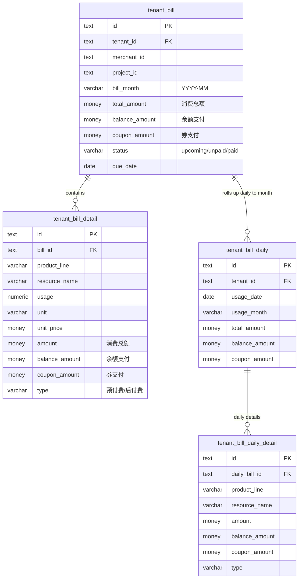
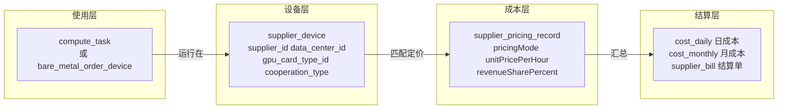
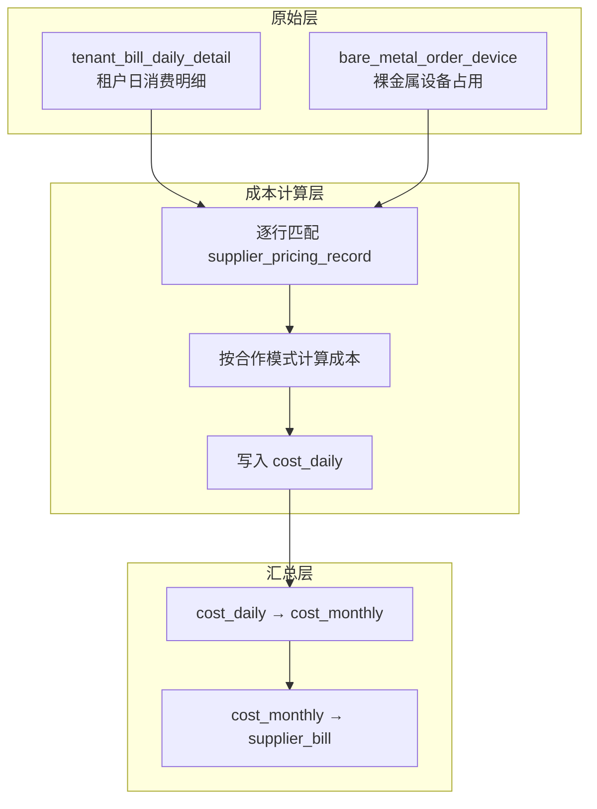
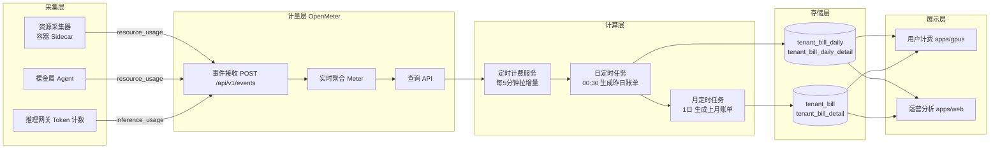
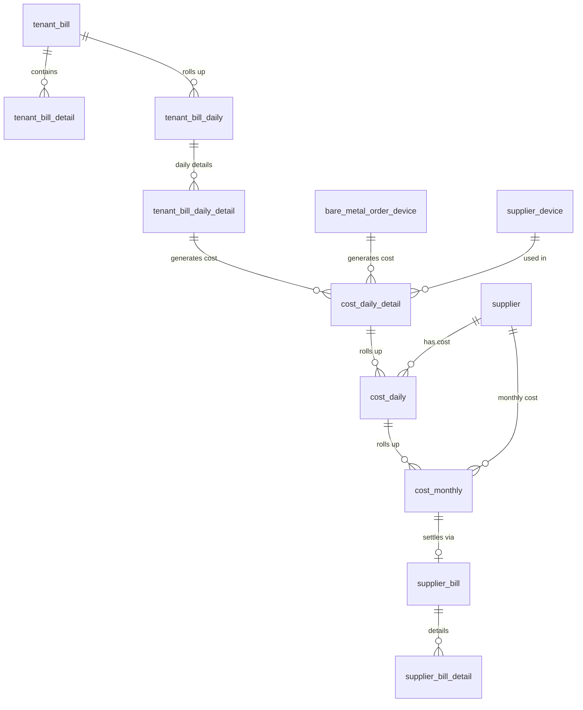
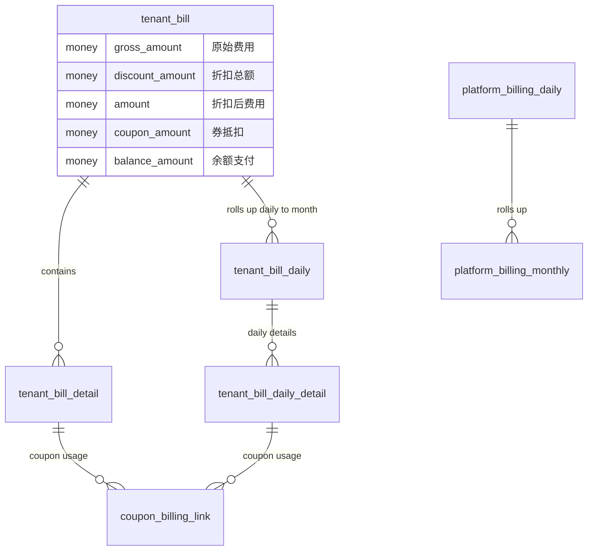
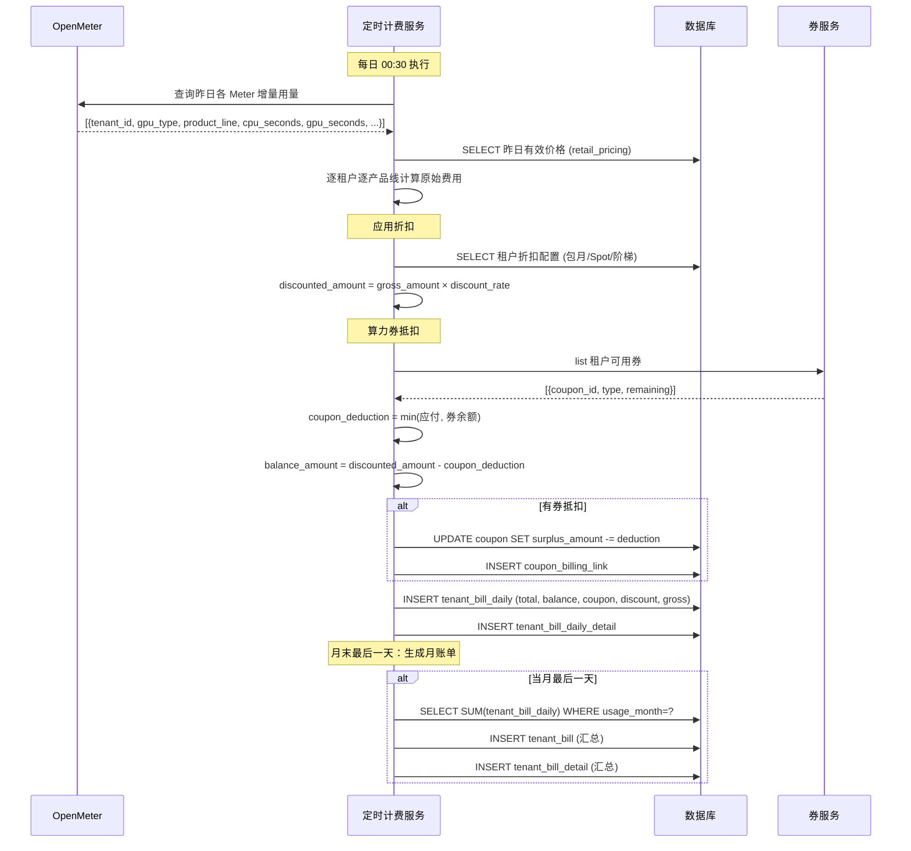

# 计费展示方案

> 基于 OpenMeter 的事件驱动计费体系，覆盖用户账单体验与运营平台经营分析。
> 复用现有 `tenant_bill` / `tenant_bill_detail` / `tenant_bill_daily` / `tenant_bill_daily_detail` 表，
> 按需扩展折扣与 GPU 维度字段，整合算力券抵扣。

---

## 1. 现有表分析

### 1.1 四张账单表



### 1.2 复用分析

| 现有表 | 可复用能力 | 不足 | 扩展方案 |
|--------|-----------|------|---------|
| `tenant_bill` | ✅ 月账单主表：`totalAmount`/`balanceAmount`/`couponAmount` 已拆分余额和券支付 | ❌ 无法定位 GPU 维度消费；无折扣跟踪 | 补充字段（见 §3） |
| `tenant_bill_detail` | ✅ 产品线明细：`unitPrice`/`usage`/`unit` 定价信息完备；`balanceAmount`/`couponAmount` 拆分 | ❌ 无 `gpu_card_type_id`；无 `region_id`；无 GPU 时长 | 补充字段 |
| `tenant_bill_daily` | ✅ 日汇总：按 `usageDate` 查询、`balanceAmount`/`couponAmount` 拆分 | ❌ 同月账单 | 补充字段 |
| `tenant_bill_daily_detail` | ✅ 日产品线明细：可每日查看各产品线消费 | ❌ 无 GPU 维度 | 补充字段 |

**结论**：复用现有 4 张表，不做大改，按需扩展字段。不新建 `bill_item` / `billing_summary_daily` / `billing_summary_monthly`。

---

### 1.3 合作模式与成本模型

```
合作模式 (cooperation_type on supplier_device)
├── idle_time (闲时合作)
│   ├── 卡时价 (card_hour): 按 GPU 卡使用小时 × 固定单价
│   │   成本 = gpu_hours × supplier_pricing_record.unitPricePerHour
│   └── 分成 (revenue_share): 平台收入的约定百分比
│       成本 = 租户实付 × supplier_pricing_record.revenueSharePercent
│
└── whole_rent (整租)
    └── 月租 (monthly): 每台设备固定月租金
        成本 = 月租 ÷ 当月天数 × 占用天数
        月租 = supplier_pricing_record.unitPrice / cardsPerMachine
```

### 1.4 设备级成本追踪

每次计费需记录使用的物理设备，关联到成本定价：



**各场景关联链路**：

| 场景 | 使用表 | 关联设备方式 | 成本计算依据 |
|------|--------|-------------|-------------|
| 云服务器/任务 | `compute_task` | `compute_task.supplier_device_id` → `supplier_device` | `supplier_pricing_record` by `supplier_id+dc_id+card_type` |
| 裸金属 | `bare_metal_order_device` | `bare_metal_order_device.supplier_device_id` → `supplier_device` | `supplier_pricing_record` |
| Serverless | `serve_endpoint` | `serve_endpoint.region_id` → `data_center.supplier_id` | 按机房加权平均成本 |

### 1.5 日/月成本聚合链路



## 2. 计费数据管道

### 2.1 端到端流



### 2.2 OpenMeter Meter 定义

```yaml
meters:
  - slug: cpu_core_seconds
    eventType: resource_usage
    valueProperty: $.data.resources.cpu
    groupBy:
      tenant_id: $.data.tenant_id
      product_line: $.data.product_line
      gpu_type: $.data.resources.gpu.type
      region: $.data.idc
    filter: $.data.billable == true
    windowSize: 1m

  - slug: gpu_count_seconds
    eventType: resource_usage
    valueProperty: $.data.resources.gpu.count
    groupBy:
      tenant_id: $.data.tenant_id
      gpu_type: $.data.resources.gpu.type
      product_line: $.data.product_line
    filter: $.data.billable == true
    windowSize: 1m

  - slug: inference_tokens
    eventType: inference_usage
    valueProperty: $.data.total_tokens
    groupBy:
      tenant_id: $.data.tenant_id
      model: $.data.model
    windowSize: 1m
```

### 2.3 费用计算逻辑（含折扣与券）

```mermaid
flowchart TD
    A[OpenMeter 查询用量] --> B[匹配价目表]
    B --> C[计算原始费用]
    C --> D[应用折扣]
    D --> E{是否有券?}
    E -->|是| F[算力券抵扣]
    E -->|否| G[余额扣款]

    D --> H{折扣类型}
    H -->|包月折扣 8折| I[原始费用 × 0.8]
    H -->|Spot 折扣 30%| J[原始费用 × 0.3]
    H -->|阶梯折扣| K[按阶梯价位计算]
    H -->|无折扣| L[原始费用]

    F --> M{券类型}
    M -->|fixed 代金券| N[min(券余额, 应付)]
    M -->|discount 折扣券| O[应付 × 折扣比例]
    M -->|resource_pack| P[按资源包换算]

    N & O & P --> Q[实际扣款 = 应付 - 券抵扣]
    Q --> R[写入账单: balanceAmount / couponAmount 拆分]
```

**账务拆分原则**：

```
原始费用 (原始 OpenMeter 用量 × 单价)
    ↓ 应用折扣 (包月/Spot/阶梯)
折扣后费用 (discounted_amount)
    ↓ 算力券抵扣 (coupon_deduction ≤ discounted_amount)
余额支付 (balance_amount = discounted_amount - coupon_deduction)

账单记录:
  amount         = discounted_amount   (消费总额 ≈ 折扣后)
  balance_amount = balance_amount       (余额支付)
  coupon_amount  = coupon_deduction     (券支付)
  total_amount   = amount               (与 tenant_bill.totalAmount 一致)
```

---

## 3. 数据库扩展

### 3.1 现有表扩展字段

```sql
-- ============================================
-- tenant_bill — 月账单：补充折扣信息
-- ============================================
ALTER TABLE tenant_bill ADD COLUMN IF NOT EXISTS discount_amount NUMERIC(15,4) DEFAULT 0;
  -- 折扣总额（原始费用 - 折扣后费用）
ALTER TABLE tenant_bill ADD COLUMN IF NOT EXISTS gross_amount NUMERIC(15,4);
  -- 原始费用（折扣+券+余额 的总和，不含券=amount）
COMMENT ON COLUMN tenant_bill.gross_amount IS '原始费用（折扣前），用于对账';
COMMENT ON COLUMN tenant_bill.discount_amount IS '折扣总额 = gross_amount - amount';
COMMENT ON COLUMN tenant_bill.amount IS '折扣后费用（含券扣减前）';
COMMENT ON COLUMN tenant_bill.balance_amount IS '最终余额支付 = amount - coupon_amount';
COMMENT ON COLUMN tenant_bill.coupon_amount IS '券抵扣金额';

-- ============================================
-- tenant_bill_detail — 月账单明细：补充 GPU 维度与折扣
-- ============================================
ALTER TABLE tenant_bill_detail ADD COLUMN IF NOT EXISTS gpu_card_type_id TEXT REFERENCES gpu_card_type(id);
ALTER TABLE tenant_bill_detail ADD COLUMN IF NOT EXISTS region_id TEXT REFERENCES data_center(id);
ALTER TABLE tenant_bill_detail ADD COLUMN IF NOT EXISTS gpu_hours NUMERIC(12,3);
  -- GPU 使用时长（小时）
ALTER TABLE tenant_bill_detail ADD COLUMN IF NOT EXISTS discount_rate NUMERIC(5,4) DEFAULT 1.0;
  -- 折扣率 (1.0=无折扣, 0.8=8折)
ALTER TABLE tenant_bill_detail ADD COLUMN IF NOT EXISTS discount_amount NUMERIC(15,4) DEFAULT 0;
  -- 折扣金额
ALTER TABLE tenant_bill_detail ADD COLUMN IF NOT EXISTS gross_amount NUMERIC(15,4);
  -- 原始费用（折扣前）

-- ============================================
-- tenant_bill_daily — 日账单：补充折扣信息
-- ============================================
ALTER TABLE tenant_bill_daily ADD COLUMN IF NOT EXISTS discount_amount NUMERIC(15,4) DEFAULT 0;
ALTER TABLE tenant_bill_daily ADD COLUMN IF NOT EXISTS gross_amount NUMERIC(15,4);

-- ============================================
-- tenant_bill_daily_detail — 日账单明细：补充 GPU 维度
-- ============================================
ALTER TABLE tenant_bill_daily_detail ADD COLUMN IF NOT EXISTS gpu_card_type_id TEXT REFERENCES gpu_card_type(id);
ALTER TABLE tenant_bill_daily_detail ADD COLUMN IF NOT EXISTS region_id TEXT REFERENCES data_center(id);
ALTER TABLE tenant_bill_daily_detail ADD COLUMN IF NOT EXISTS gpu_hours NUMERIC(12,3);
ALTER TABLE tenant_bill_daily_detail ADD COLUMN IF NOT EXISTS discount_rate NUMERIC(5,4) DEFAULT 1.0;
ALTER TABLE tenant_bill_daily_detail ADD COLUMN IF NOT EXISTS discount_amount NUMERIC(15,4) DEFAULT 0;
ALTER TABLE tenant_bill_daily_detail ADD COLUMN IF NOT EXISTS gross_amount NUMERIC(15,4);
```

### 3.2 字段含义

```
gross_amount      原始费用 (折扣前) = OpenMeter用量 × 刊例单价
discount_amount   折扣金额 = gross_amount - amount
amount            折扣后费用 (含券扣减前)
coupon_amount     券抵扣金额
balance_amount    余额支付 = amount - coupon_amount

费用构成关系:
  gross_amount - discount_amount = amount
  amount - coupon_amount = balance_amount
  total_amount = amount
```

### 3.3 供应商成本表

#### cost_daily — 供应商日成本

```sql
CREATE TABLE cost_daily (
    id                  TEXT PRIMARY KEY,
    supplier_id         TEXT NOT NULL REFERENCES supplier(id),
    data_center_id      TEXT NOT NULL REFERENCES data_center(id),
    cost_date           DATE NOT NULL,

    -- 按合作模式拆分
    cooperation_type    VARCHAR(32) NOT NULL,            -- idle_time / whole_rent
    pricing_mode        VARCHAR(32),                     -- card_hour / revenue_share / monthly

    -- idle_time 相关
    gpu_hours           NUMERIC(12,3) DEFAULT 0,         -- GPU 使用小时
    unit_cost           NUMERIC(10,6),                   -- 单位成本 (卡时价/分成比例)
    gpu_card_type_id    TEXT REFERENCES gpu_card_type(id),

    -- whole_rent 相关
    device_count        INTEGER DEFAULT 0,                -- 占用设备数
    monthly_rent        NUMERIC(15,4),                    -- 单设备月租

    -- 收入关联（分成模式需要）
    tenant_revenue      NUMERIC(15,4) DEFAULT 0,          -- 关联租户收入

    -- 金额
    cost_amount         NUMERIC(15,4) NOT NULL,           -- 成本金额
    currency            VARCHAR(8) DEFAULT 'CNY',

    -- 来源
    source_type         VARCHAR(16) NOT NULL,             -- compute_task / bare_metal / serverless
    source_count        INTEGER DEFAULT 0,                -- 来源记录数

    created_at          TIMESTAMP NOT NULL DEFAULT NOW(),

    UNIQUE (supplier_id, data_center_id, cost_date, cooperation_type, gpu_card_type_id)
);

CREATE INDEX cd_supplier_date_idx ON cost_daily(supplier_id, cost_date);
CREATE INDEX cd_date_idx ON cost_daily(cost_date);
CREATE INDEX cd_coop_idx ON cost_daily(cooperation_type);
```

#### cost_daily_detail — 供应商日成本明细（设备级）

```sql
CREATE TABLE cost_daily_detail (
    id                  TEXT PRIMARY KEY,
    cost_daily_id       TEXT NOT NULL REFERENCES cost_daily(id) ON DELETE CASCADE,
    supplier_id         TEXT NOT NULL REFERENCES supplier(id),

    -- 设备与使用
    supplier_device_id  TEXT REFERENCES supplier_device(id),
    gpu_card_type_id    TEXT REFERENCES gpu_card_type(id),
    gpu_hours           NUMERIC(12,3) DEFAULT 0,

    -- 来源
    source_type         VARCHAR(16) NOT NULL,             -- compute_task / bare_metal_order
    source_id           TEXT NOT NULL,                    -- compute_task.id / bare_metal_order_device.id
    tenant_id           TEXT REFERENCES tenant(id),       -- 使用该设备的租户

    -- 成本
    cooperation_type    VARCHAR(32) NOT NULL,
    pricing_mode        VARCHAR(32),
    unit_cost           NUMERIC(10,6),                   -- 匹配到的单价
    cost_amount         NUMERIC(15,4) NOT NULL,           -- 该设备贡献的成本

    -- 收入参考（分成模式）
    tenant_payment      NUMERIC(15,4),                    -- 租户为该设备支付的金额

    created_at          TIMESTAMP NOT NULL DEFAULT NOW()
);

CREATE INDEX cdd_supplier_date_idx ON cost_daily_detail(supplier_id, cost_daily_id);
CREATE INDEX cdd_device_idx ON cost_daily_detail(supplier_device_id);
CREATE INDEX cdd_source_idx ON cost_daily_detail(source_type, source_id);
```

#### cost_monthly — 供应商月成本汇总

```sql
CREATE TABLE cost_monthly (
    id                  TEXT PRIMARY KEY,
    supplier_id         TEXT NOT NULL REFERENCES supplier(id),
    bill_month          VARCHAR(7) NOT NULL,

    -- idle_time 汇总
    total_gpu_hours     NUMERIC(12,3) DEFAULT 0,
    idle_time_cost      NUMERIC(15,4) DEFAULT 0,

    -- whole_rent 汇总
    total_device_days   INTEGER DEFAULT 0,                -- 设备占用天数
    whole_rent_cost     NUMERIC(15,4) DEFAULT 0,

    -- 总成本
    total_cost          NUMERIC(15,4) NOT NULL,

    -- 关联结算单
    supplier_bill_id    TEXT REFERENCES supplier_bill(id),
    status              VARCHAR(16) DEFAULT 'draft',       -- draft / settled / paid

    created_at          TIMESTAMP NOT NULL DEFAULT NOW(),

    UNIQUE (supplier_id, bill_month)
);

CREATE INDEX cm_supplier_month_idx ON cost_monthly(supplier_id, bill_month);
```

### 3.4 整体 ER 关系



### 3.5 算力券使用明细表

已有 `coupon_usage`（或 CRM 域 `coupon` 表），补充账单关联：

```sql
-- 若不存在，新建券使用与账单的关联
CREATE TABLE IF NOT EXISTS coupon_billing_link (
    id                  TEXT PRIMARY KEY,
    coupon_id           TEXT NOT NULL REFERENCES coupon(id),
    bill_detail_id      TEXT REFERENCES tenant_bill_detail(id),
    daily_detail_id     TEXT REFERENCES tenant_bill_daily_detail(id),
    amount              NUMERIC(15,4) NOT NULL,         -- 本次抵扣金额
    billed_at           TIMESTAMP NOT NULL DEFAULT NOW()
);

CREATE INDEX cbl_coupon_idx ON coupon_billing_link(coupon_id);
CREATE INDEX cbl_bill_idx ON coupon_billing_link(bill_detail_id);
```

### 3.6 平台经营表

```sql
-- 平台每日经营数据（新增）
CREATE TABLE platform_billing_daily (
    id                  TEXT PRIMARY KEY,
    bill_date           DATE NOT NULL UNIQUE,
    total_revenue       NUMERIC(15,4) NOT NULL,         -- 总收入 = SUM(tenant_bill_daily.balanceAmount)
    total_discount      NUMERIC(15,4) DEFAULT 0,        -- 总折扣
    total_coupon        NUMERIC(15,4) DEFAULT 0,        -- 总券抵扣
    net_revenue         NUMERIC(15,4) NOT NULL,          -- 净收入 = total_revenue
    total_cost          NUMERIC(15,4) NOT NULL,          -- 总成本（供应商结算）
    gross_profit        NUMERIC(15,4),
    gross_margin        NUMERIC(5,4),
    active_tenants      INTEGER DEFAULT 0,
    active_orders       INTEGER DEFAULT 0,
    total_gpu_hours     NUMERIC(12,3) DEFAULT 0,
    new_tenants         INTEGER DEFAULT 0,
    recharge_amount     NUMERIC(15,4) DEFAULT 0,
    created_at          TIMESTAMP NOT NULL DEFAULT NOW()
);

-- 平台月度经营数据
CREATE TABLE platform_billing_monthly (
    id                  TEXT PRIMARY KEY,
    bill_month          VARCHAR(7) NOT NULL UNIQUE,
    total_revenue       NUMERIC(15,4) NOT NULL,
    total_discount      NUMERIC(15,4) DEFAULT 0,
    total_coupon        NUMERIC(15,4) DEFAULT 0,
    total_cost          NUMERIC(15,4) NOT NULL,
    gross_profit        NUMERIC(15,4),
    gross_margin        NUMERIC(5,4),
    revenue_by_product  JSONB,
    top10_revenue_pct   NUMERIC(5,2),
    arpu                NUMERIC(15,4),
    active_tenant_count INTEGER,
    new_tenant_count    INTEGER,
    churn_rate          NUMERIC(5,4),
    status              VARCHAR(16) DEFAULT 'draft',
    created_at          TIMESTAMP NOT NULL DEFAULT NOW()
);
```

### 3.5 ER 关系



---

## 4. 日账单生成流程



---

## 5. 折扣体系

### 5.1 折扣类型

| 折扣类型 | 适用产品 | 折扣幅度 | 数据来源 |
|---------|---------|---------|---------|
| **按量 (无折扣)** | 云服务器/裸金属/任务 | 无 | `platform_card_price_record.sell_price` |
| **包日折扣** | 云服务器/裸金属 | 5%~10% | `platform_card_price_record` × `billing_unit=day` 对比 hour 折算 |
| **包周折扣** | 云服务器/裸金属 | 10%~20% | 同上 |
| **包月折扣** | 云服务器/裸金属 | 20%~40% | 同上 |
| **Spot** | **仅 Job（MVP）** | 刊例价**六折**（乘数 0.60） | `billing_mode=spot`；单价 = On-Demand × `spot_price_multiplier`；见 `spot-preemption-design.md` / `../../business/product-line-taxonomy.md` |
| **阶梯折扣** | 大客户 | 协商折扣 | `supplier_datacenter_sell_price` |

### 5.2 折扣计算示例

```
场景：用户租用 A100 × 1，按量单价 ¥3.2/h
      选择了包月 ¥2,500（等效 ¥3.42/h 原价，包月价 ¥2,000）
      使用了 ¥50 算力券

  gross_amount    = 744h × ¥3.42 = ¥2,544 (按刊例价计算)
  discount_amount = 744h × (¥3.42 - ¥2.69) = ¥544 (包月折扣)
  amount          = ¥2,544 - ¥544 = ¥2,000 (折扣后)
  coupon_amount   = min(¥50, ¥2,000) = ¥50 (券抵扣)
  balance_amount  = ¥2,000 - ¥50 = ¥1,950 (余额支付)

账单记录:
  tenant_bill_detail.amount         = 2000
  tenant_bill_detail.balance_amount = 1950
  tenant_bill_detail.coupon_amount  = 50
  tenant_bill_detail.discount_amount = 544
  tenant_bill_detail.gross_amount   = 2544
  tenant_bill_detail.discount_rate  = 0.786 (¥2,000/¥2,544)
```

---

## 6. 用户计费展示 (apps/gpus)

### 6.1 计费总览

```typescript
// tRPC 接口
export const billingRouter = createTRPCRouter({
  // 计费总览
  getOverview: protectedProcedure
    .query(async ({ ctx }) => {
      const tenantId = ctx.user.tenantId
      const now = new Date()
      const month = `${now.getFullYear()}-${String(now.getMonth() + 1).padStart(2, '0')}`

      // 本月消费
      const monthBill = await db.query.tenantBill.findFirst({
        where: and(eq(tenantBill.tenantId, tenantId), eq(tenantBill.billMonth, month)),
      })

      // 上月消费
      const prevMonth = getPrevMonth(month)
      const prevBill = await db.query.tenantBill.findFirst({
        where: and(eq(tenantBill.tenantId, tenantId), eq(tenantBill.billMonth, prevMonth)),
      })

      // 昨日消费
      const yesterday = formatDate(subDays(now, 1))
      const daily = await db.query.tenantBillDaily.findFirst({
        where: and(eq(tenantBillDaily.tenantId, tenantId), eq(tenantBillDaily.usageDate, yesterday)),
      })

      // 本月每日趋势
      const dailyTrend = await db.query.tenantBillDaily.findMany({
        where: and(eq(tenantBillDaily.tenantId, tenantId), eq(tenantBillDaily.usageMonth, month)),
        orderBy: asc(tenantBillDaily.usageDate),
      })

      // 余额与券
      const { balance } = await getBalance(tenantId)
      const coupons = await getAvailableCoupons(tenantId)

      return {
        balance,
        monthCost: { total: monthBill?.amount ?? 0, balance: monthBill?.balanceAmount ?? 0, coupon: monthBill?.couponAmount ?? 0 },
        prevMonthCost: prevBill?.amount ?? 0,
        yesterdayCost: daily?.amount ?? 0,
        dailyTrend: dailyTrend.map(d => ({ date: d.usageDate, amount: d.amount })),
        couponCount: coupons.length,
      }
    }),

  // 月账单详情
  getMonthlyBill: protectedProcedure
    .input(z.object({ billMonth: z.string() }))
    .query(async ({ ctx, input }) => {
      const bill = await db.query.tenantBill.findFirst({
        where: and(eq(tenantBill.tenantId, ctx.user.tenantId), eq(tenantBill.billMonth, input.billMonth)),
      })
      if (!bill) return null

      const details = await db.query.tenantBillDetail.findMany({
        where: eq(tenantBillDetail.billId, bill.id),
      })

      return {
        bill,
        details: details.map(d => ({
          productLine: d.productLine,
          resourceName: d.resourceName,
          usage: d.usage,
          unit: d.unit,
          unitPrice: d.unitPrice,
          grossAmount: d.grossAmount,
          discountRate: d.discountRate,
          discountAmount: d.discountAmount,
          amount: d.amount,
          couponAmount: d.couponAmount,
          balanceAmount: d.balanceAmount,
          gpuHours: d.gpuHours,
        })),
      }
    }),
})
```

### 6.2 计费总览页

```
计费总览
━━━━━━━━━━━━━━━━━━━━━━━━━━━━━━━━━━━━━━━━━━━━━━━━━━━━━━━

┌── 余额 ────────────────────────────────────────────┐
│  💰 可用余额                                        │
│  ¥ 12,345.67                                       │
│  [充值]  [设置自动充值]                               │
└────────────────────────────────────────────────────┘

┌── 本月消费 ─────────────────────────────────────────┐
│  本月: ¥2,345.00  │  券抵扣: -¥150.00  │  实付: ¥2,195.00  │
│  上月: ¥3,210.00  │  同比: -31.7%                      │
│  昨日: ¥78.50     │                                    │
│                                                     │
│  📊 每日消费趋势                                      │
│  ┌────────────────────────────────────────────┐     │
│  │ ██          ████     ██████                 │     │
│  │ ██████  ████████████████████████            │     │
│  │ 07/01  07/05  07/10  07/15  07/16           │     │
│  └────────────────────────────────────────┘     │
└────────────────────────────────────────────────────┘

┌── 本月账单分解 ────────────────────────────────────┐
│  产品线      │ 用量    │ 折扣后    │ 券抵扣  │ 实付  │
│  ├──────────┼────────┼─────────┼────────┼────────┤
│  云服务器    │ 124h    │ ¥1,200  │ -¥50   │ ¥1,150 │
│  裸金属      │ 480h    │ ¥800    │ -¥100  │ ¥700   │
│  Serverless  │ 12K req │ ¥200    │ ¥0     │ ¥200   │
│  任务        │ 8h      │ ¥145    │ ¥0     │ ¥145   │
│  ───────────┼────────┼─────────┼────────┼────────┤
│  合计       │         │ ¥2,345  │ -¥150  │ ¥2,195 │
└────────────────────────────────────────────────────┘
```

### 6.3 月账单详情页

```
月账单 — 2026-07
━━━━━━━━━━━━━━━━━━━━━━━━━━━━━━━━━━━━━━━━━━━━━━━━━━━━━━━

费用概览
┌──────────────────────────────┬──────────────────────┐
│ 原始费用 (折扣前) ¥2,880      │ 折扣: -¥535 (81.4%)  │
│ 折扣后费用 ¥2,345              │ 券抵扣: -¥150        │
│ 余额支付 ¥2,195                │ 状态: ✅ 已支付       │
└──────────────────────────────┴──────────────────────┘

按产品线明细
┌────────┬──────────┬──────┬──────┬──────┬──────┬────────┬────────┐
│ 产品    │ 资源     │ 用量  │ 单价  │ 原价  │ 折扣率│ 实付   │ 券抵扣 │
├────────┼──────────┼──────┼──────┼──────┼──────┼────────┼────────┤
│ 云服务器│ A100×1  │ 124h │ ¥3.2 │¥1,500│ 0.8  │ ¥1,150 │ ¥50   │
│ 裸金属  │ A100×2  │ 480h │ ¥1.2 │¥1,200│ 0.67 │ ¥700   │ ¥100  │
│ Server  │ Token    │ 12K  │ ¥3/M │¥36   │ 1.0  │ ¥200   │ ¥0    │
│ 任务    │ A100×1  │ 8h   │ ¥2.5 │¥144  │ 1.0  │ ¥145   │ ¥0    │
├────────┼──────────┼──────┼──────┼──────┼──────┼────────┼────────┤
│ 合计   │          │      │      │¥2,880│ 81.4%│ ¥2,195 │ ¥150  │
└────────┴──────────┴──────┴──────┴──────┴──────┴────────┴────────┘

💰 扣款明细
┌──────────┬──────────┬──────────┬──────────┐
│ 日期     │ 金额     │ 方式     │ 状态     │
├──────────┼──────────┼──────────┼──────────┤
│ 07-16    │ ¥78.50   │ 自动续费  │ ✅ 成功  │
│ 07-15    │ ¥82.30   │ 自动续费  │ ✅ 成功  │
│ ...      │          │          │          │
└──────────┴──────────┴──────────┴──────────┘

[下载 PDF] [申请发票]
```

### 6.4 算力券使用明细

```
算力券使用记录
━━━━━━━━━━━━━━━━━━━━━━━━━━━━━━━━━━━━━━━━━━━━━━━━━━━━━━━

┌────────┬──────────┬──────────┬────────┬──────────┬────────┐
│ 券名称  │ 类型     │ 面值     │ 已用   │ 剩余    │ 过期   │
├────────┼──────────┼──────────┼────────┼──────────┼────────┤
│ 新人券  │ 代金券   │ ¥50     │ ¥50    │ ¥0      │ 已用完 │
│ 包月券  │ 折扣8折  │ —       │ —      │ —       │ 07/31  │
└────────┴──────────┴──────────┴────────┴──────────┴────────┘

使用明细 — 新人券
┌──────────┬──────────┬──────────┬──────────┐
│ 日期     │ 关联账单  │ 抵扣金额  │ 剩余    │
├──────────┼──────────┼──────────┼──────────┤
│ 07-16    │ 云服务器  │ ¥10      │ ¥40     │
│ 07-15    │ 云服务器  │ ¥10      │ ¥50     │
│ 07-14    │ 裸金属   │ ¥30      │ ¥60     │
│ 07-10    │ 发放      │ —        │ ¥100    │
└──────────┴──────────┴──────────┴──────────┘
```

---

## 7. 运营分析 (apps/web)

### 7.1 经营概览

```
经营概览                                    2026-07-16
━━━━━━━━━━━━━━━━━━━━━━━━━━━━━━━━━━━━━━━━━━━━━━━━━━━━━━━

┌──────────┬──────────┬──────────┬──────────┬──────────┐
│ 今日收入  │ 本月收入  │ 本月折扣  │ 本月券   │ 净收入   │
│ ¥45,200  │ ¥892,300 │ ¥-89,230 │ ¥-22,400│ ¥892,300 │
│          │ 环比+12% │          │          │          │
├──────────┼──────────┼──────────┼──────────┼──────────┤
│ 本月成本  │ 毛利     │ 毛利率   │ 活跃租户  │ GPU 时  │
│ ¥534,200 │ ¥358,100 │ 40.1%   │ 1,234    │ 8,950h  │
│          │          │          │ 新增 28   │         │
├──────────┼──────────┼──────────┼──────────┼──────────┤
│ ARPU     │ 折扣占比  │ 券占比   │ 充值     │ 审核待办 │
│ ¥723     │ 10.0%   │ 2.5%    │ ¥45.6万 │ 3 笔    │
└──────────┴──────────┴──────────┴──────────┴──────────┘

📊 收入/成本/利润趋势
```

### 7.3 数据来源

| KPI | 计算 SQL |
|-----|---------|
| 今日收入 | `SELECT SUM(balance_amount) FROM tenant_bill_daily WHERE usage_date=CURDATE()` |
| 本月收入 | `SELECT SUM(amount) FROM tenant_bill WHERE bill_month=?` |
| 本月折扣 | `SELECT SUM(discount_amount) FROM tenant_bill WHERE bill_month=?` |
| 本月券 | `SELECT SUM(coupon_amount) FROM tenant_bill WHERE bill_month=?` |
| 活跃租户 | `SELECT COUNT(DISTINCT tenant_id) FROM tenant_bill_daily WHERE usage_date=CURDATE() AND amount>0` |
| GPU 时 | `SELECT SUM(gpu_hours) FROM tenant_bill_daily_detail WHERE usage_date=CURDATE()` |
| ARPU | `本月收入 / 活跃租户` |

---

### 7.2 供应商成本分析

```
供应商成本分析                                  2026年7月
━━━━━━━━━━━━━━━━━━━━━━━━━━━━━━━━━━━━━━━━━━━━━━━━━━━━━━━

┌── 月度成本总览 ──────────────────────────────────────┐
│  本月总成本: ¥534,200  │  上月: ¥489,000  ↑ 9.2%     │
│  闲时合作成本: ¥412,300 (77.2%)                       │
│    ├── 卡时价: ¥368,500 (89.4%)                       │
│    └── 分成:  ¥43,800  (10.6%)                        │
│  整租成本:    ¥121,900 (22.8%)                        │
└────────────────────────────────────────────────────┘

┌── 按供应商 ─────────────────────────────────────────┐
│ 供应商   │ 模式    │ GPU 时  │ 单价   │ 成本    │ 占比  │
├─────────┼────────┼─────────┼────────┼────────┼───────┤
│ supp_a  │ 卡时价  │ 2,400h  │ ¥45/h │¥108,000│ 20.2% │
│ supp_a  │ 整租    │ —       │ —      │ ¥30,000│  5.6% │
│ supp_b  │ 分成    │ 1,800h  │ 15%    │ ¥52,000│  9.7% │
│ supp_b  │ 卡时价  │ 3,200h  │ ¥38/h │¥121,600│ 22.8% │
│ supp_c  │ 整租    │ —       │ —      │ ¥91,900│ 17.2% │
├─────────┼────────┼─────────┼────────┼────────┼───────┤
│ 合计    │        │ 7,400h  │        │¥534,200│ 100%  │
└─────────┴────────┴─────────┴────────┴────────┴───────┘

┌── 收入 vs 成本 ─────────────────────────────────────┐
│ 供应商   │ 平台收入  │ 成本     │ 毛利    │ 毛利率  │
├─────────┼──────────┼─────────┼─────────┼────────┤
│ supp_a  │ ¥356,000  │¥138,000 │ ¥218,000│ 61.2%  │
│ supp_b  │ ¥267,000  │¥173,600 │ ¥93,400 │ 35.0%  │
│ supp_c  │ ¥178,000  │¥91,900  │ ¥86,100 │ 48.4%  │
│ supp_d  │ ¥91,300   │¥130,700 │ ¥-39,400│ -43.1% │ ← 亏损
└─────────┴──────────┴─────────┴─────────┴────────┘
```

### 7.3 整租设备占用分析

```
整租设备占用概览                                2026-07
━━━━━━━━━━━━━━━━━━━━━━━━━━━━━━━━━━━━━━━━━━━━━━━━━━━━━━━

┌── 月度占用量 ───────────────────────────────────────┐
│  整租设备总数: 85 台                                  │
│  本月占用: 1,890 设备·天 (平均 63 台/天)              │
│  闲置: 570 设备·天 (平均 19 台/天, 闲置率 23.2%)     │
│  整租总成本: ¥121,900                                 │
└────────────────────────────────────────────────────┘

┌── 按供应商 ─────────────────────────────────────────┐
│ 供应商   │ 设备数 │ 占用天 │ 闲置天 │ 月租/台 │ 成本  │
├─────────┼───────┼────────┼────────┼─────────┼───────┤
│ supp_a  │ 12     │ 340天  │ 20天   │ ¥2,500  │¥30,000│
│ supp_c  │ 40     │ 1,020天│ 180天  │ ¥2,300  │¥91,900│
│ supp_e  │ 33     │ 530天  │ 370天  │ ¥2,600  │ —     │

---

## 8. 定时任务

### 8.1 日账单生成（每日 00:30）

```sql
-- 1. 查询昨日 OpenMeter 聚合用量（示例）
-- 假设 OpenMeter 已实时聚合，只需写入账单表

-- 2. 计算费用并写入 tenant_bill_daily 和 tenant_bill_daily_detail
INSERT INTO tenant_bill_daily (
  id, tenant_id, usage_date, usage_month,
  total_amount, balance_amount, coupon_amount,
  discount_amount, gross_amount
)
SELECT
  gen_random_uuid()::text,
  om.tenant_id,
  CURRENT_DATE - 1,
  to_char(CURRENT_DATE - 1, 'YYYY-MM'),
  SUM(om.amount),                    -- total_amount = 折扣后
  SUM(om.amount) - SUM(om.coupon),   -- balance_amount
  SUM(om.coupon),                   -- coupon_amount
  SUM(om.gross) - SUM(om.amount),    -- discount_amount
  SUM(om.gross)                      -- gross_amount
FROM openmeter_daily_aggregation om
WHERE om.usage_date = CURRENT_DATE - 1
GROUP BY om.tenant_id
ON CONFLICT (tenant_id, usage_date)
DO UPDATE SET total_amount = EXCLUDED.total_amount, ...;
```

### 8.2 月账单生成（每月 1 日 02:00）

```sql
INSERT INTO tenant_bill (
  id, tenant_id, bill_month,
  total_amount, balance_amount, coupon_amount,
  discount_amount, gross_amount,
  status, due_date
)
SELECT
  gen_random_uuid()::text,
  d.tenant_id,
  to_char(CURRENT_DATE - 1, 'YYYY-MM'),
  SUM(d.total_amount),
  SUM(d.balance_amount),
  SUM(d.coupon_amount),
  SUM(d.discount_amount),
  SUM(d.gross_amount),
  'unpaid',
  CURRENT_DATE + INTERVAL '15 days'
FROM tenant_bill_daily d
WHERE d.usage_month = to_char(CURRENT_DATE - 1, 'YYYY-MM')
GROUP BY d.tenant_id
ON CONFLICT (tenant_id, bill_month)
DO UPDATE SET total_amount = EXCLUDED.total_amount, ...;
```

### 8.3 平台经营数据

```sql
INSERT INTO platform_billing_daily (bill_date, total_revenue, total_cost, ...)
SELECT
  CURRENT_DATE - 1,
  (SELECT SUM(balance_amount) FROM tenant_bill_daily WHERE usage_date = CURRENT_DATE - 1),
  (SELECT SUM(cost_amount) FROM supplier_cost_daily WHERE cost_date = CURRENT_DATE - 1),
  ...
ON CONFLICT (bill_date) DO UPDATE SET ...;
```

---

## 9. 复用总结

| 功能 | 复用表 | 扩展字段 |
|------|--------|---------|
| 月账单列表 | `tenant_bill` | + `gross_amount`, `discount_amount` |
| 月账单明细（含 GPU 维度） | `tenant_bill_detail` | + `gpu_card_type_id`, `region_id`, `gpu_hours`, `discount_rate`, `discount_amount`, `gross_amount` |
| 日账单汇总 | `tenant_bill_daily` | + `gross_amount`, `discount_amount` |
| 日账单明细（含 GPU 维度） | `tenant_bill_daily_detail` | + `gpu_card_type_id`, `region_id`, `gpu_hours`, `discount_rate`, `discount_amount`, `gross_amount` |
| 券使用明细 | `coupon_billing_link` (新增) | 关联 `coupon` → `tenant_bill_detail` / `tenant_bill_daily_detail` |
| 平台经营 | `platform_billing_daily` / `platform_billing_monthly` (新增) | 独立经营分析 |
