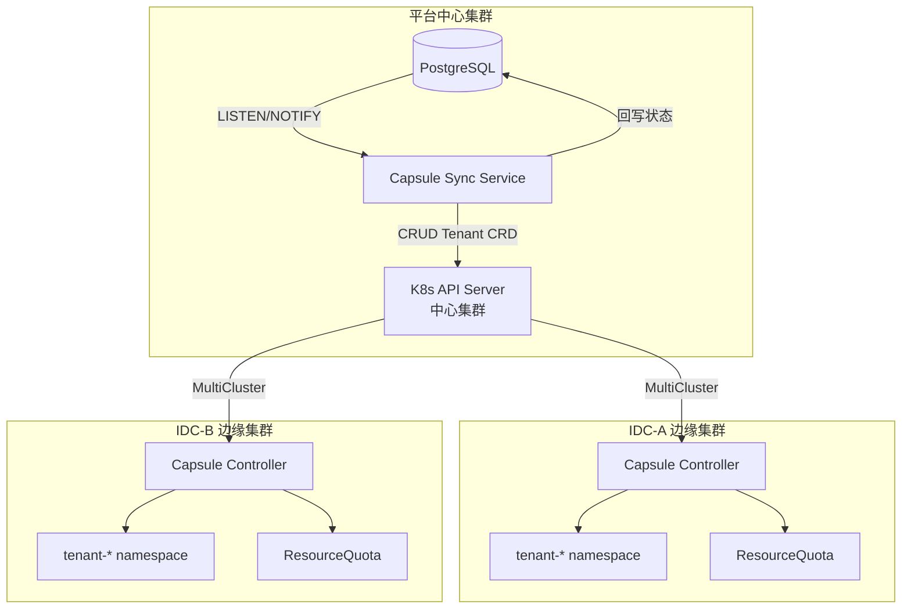
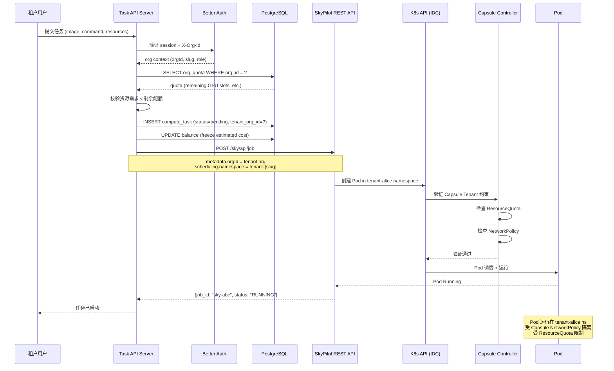

# Capsule & SkyPilot 多租户映射设计

> 定义平台业务层租户（organization.orgType=tenant）与基础设施层 Capsule 租户、SkyPilot 任务上下文的对应关系，实现从认证到调度的完整租户隔离链路。

---

## 1. 设计目标

| 目标 | 说明 |
|------|------|
| **懒加载隔离** | 租户首次提交任务时才创建 K8s Namespace + Capsule Tenant，减少空租户资源浪费 |
| **业务→基础设施映射** | 平台 tenant org 按需同步为 K8s Capsule Tenant，无需手动运维 |
| **资源配额联动** | 平台余额/配额变更实时同步到 Capsule ResourceQuota |
| **网络隔离** | 租户间 Pod 网络默认隔离，仅允许平台服务与同租户通信 |
| **调度上下文透传** | SkyPilot 任务提交时携带租户身份，确保调度与计费闭环 |
| **多 IDC 一致性** | 每个 IDC 边缘集群维护独立的 Capsule Tenant，配置保持同步 |

---

## 2. 架构总览

```mermaid
flowchart TD
    subgraph 业务层[业务层 - 平台中心]
        ORG[organization<br/>orgType=tenant]
        QUOTA[org_quota<br/>compute_hours / task_slots]
        BALANCE[balance<br/>available / reserved]
    end

    subgraph 调度层[调度层 - Task API Server]
        API[Task API Server]
        CHECK{capsuleNamespaceReady?}
        ENSURE[ensureTenantNamespace<br/>首次任务时触发]
    end

    subgraph 适配层[适配层 - Capsule Sync Service]
        SYNC[Capsule Sync Service<br/>按需创建 Capsule Tenant]
        NS[Namespace 管理<br/>tenant-{slug}]
        RQ[ResourceQuota 管理<br/>GPU / CPU / Memory]
        NP[NetworkPolicy 管理<br/>租户隔离]
    end

    subgraph 基础设施层[基础设施层 - IDC 边缘集群]
        subgraph IDC-A[IDC-A 北京 K8s]
            CT_A[Capsule Tenant A]
            NS_A[ns: tenant-alice]
            RQ_A[Quota: 4 GPU / 32 CPU]
        end
        subgraph IDC-B[IDC-B 上海 K3s]
            CT_B[Capsule Tenant A]
            NS_B[ns: tenant-alice]
            RQ_B[Quota: 4 GPU / 32 CPU]
        end
    end

    subgraph 调度执行[调度执行 - SkyPilot]
        SP[SkyPilot REST API]
        JOB[SkyPilot Job<br/>metadata.orgId]
    end

    API --> CHECK
    CHECK -->|false 首次| ENSURE
    CHECK -->|true 已就绪| SP
    ENSURE --> SYNC
    SYNC --> NS
    SYNC --> RQ
    SYNC --> NP
    NS --> CT_A
    NS --> CT_B
    RQ --> RQ_A
    RQ --> RQ_B
    NP --> CT_A
    NP --> CT_B

    SP -->|POST /sky/api/job<br/>+ orgId + namespace| JOB
    JOB -.->|运行在| NS_A
    JOB -.->|运行在| NS_B
```

---

## 3. 平台租户 → Capsule Tenant 映射

### 3.1 映射规则

| 平台概念 | Capsule 概念 | 映射方式 |
|---------|-------------|---------|
| `organization` (orgType=tenant) | Capsule `Tenant` CRD | 一对一 |
| `organization.slug` | Namespace 名称 | `tenant-{slug}` |
| `org_quota` (GPU/CPU/Memory) | `ResourceQuota` | 实时同步 |
| 平台余额 | `ResourceQuota` 动态上限 | 定时同步 |
| `compute_task.image` | Pod `image` | SkyPilot 透传 |
| `compute_task.resource_spec` | Pod `resources` | Capsule LimitRange 兜底 |

### 3.2 Capsule Tenant CRD 定义

```yaml
apiVersion: capsule.clastix.io/v1beta2
kind: Tenant
metadata:
  name: tenant-alice               # 对应 organization.slug
  annotations:
    platform.org-id: "org_abc123"  # 对应 organization.id
    platform.org-slug: "alice"
    platform.org-type: "tenant"
    platform.merchant-id: "org_def456"   # 所属经销商（如有）
    platform.billing-mode: "prepaid"     # prepaid / postpaid
  labels:
    platform.managed-by: "GPURun"
    platform.idc: "idc-a"
spec:
  owner:
    kind: User
    name: tenant-alice-admin       # 租户 owner 用户名
  namespaceOptions:
    quota: 5                       # 最大命名空间数
  networkPolicies:
    enabled: true
    deniedPorts:
      - 22                         # 禁止 SSH 跨租户
  resourceQuotas:
    scope: PerNamespace
  limitRanges:
    enabled: true
  additionalRoleBindings:
    - kind: ClusterRole
      name: tenant-viewer
      subjects:
        - kind: Group
          name: tenant-alice-viewers
  images:
    allowed: "*"                   # 镜像白名单（可收紧）
  storageClasses:
    allowed:
      - local-ssd
      - network-storage
  ingress:
    hostnameRegex: "alice-.*\\.platform\\.com"
```

### 3.3 Namespace 命名规范

```
tenant-{orgSlug}              # 主命名空间（默认）
tenant-{slug}-job-{jobId}     # 批处理任务命名空间（可选，Job 级隔离时使用）
```

### 3.4 ResourceQuota 定义

```yaml
apiVersion: v1
kind: ResourceQuota
metadata:
  name: tenant-quota
  namespace: tenant-alice
  labels:
    platform.managed-by: "GPURun"
    platform.org-id: "org_abc123"
spec:
  hard:
    # GPU 配额（对应 org_quota metric=task_slots × GPU 型号权重）
    requests.nvidia.com/gpu: "4"
    limits.nvidia.com/gpu: "4"
    # CPU 配额
    requests.cpu: "32"
    limits.cpu: "64"
    # 内存配额
    requests.memory: "128Gi"
    limits.memory: "256Gi"
    # 存储配额
    requests.storage: "500Gi"
    # Pod 数量
    pods: "20"
    # 持久卷
    persistentvolumeclaims: "10"
```

### 3.5 NetworkPolicy 定义

```yaml
apiVersion: networking.k8s.io/v1
kind: NetworkPolicy
metadata:
  name: tenant-isolation
  namespace: tenant-alice
  labels:
    platform.managed-by: "GPURun"
spec:
  podSelector: {}
  policyTypes:
    - Ingress
    - Egress
  ingress:
    # 允许同租户 Pod 互通
    - from:
        - namespaceSelector:
            matchLabels:
              kubernetes.io/metadata.name: tenant-alice
    # 允许平台监控/日志组件访问
    - from:
        - namespaceSelector:
            matchLabels:
              platform.service: "monitoring"
      ports:
        - port: 9090    # Prometheus metrics
          protocol: TCP
        - port: 3100    # Loki log tail
          protocol: TCP
    # 允许 Traefik 推理网关访问（推理服务）
    - from:
        - namespaceSelector:
            matchLabels:
              platform.service: "traefik"
      ports:
        - port: 8080
          protocol: TCP
  egress:
    # 允许同租户 Pod 互通
    - to:
        - namespaceSelector:
            matchLabels:
              kubernetes.io/metadata.name: tenant-alice
    # 允许 DNS 解析
    - to:
        - namespaceSelector: {}
      ports:
        - port: 53
          protocol: UDP
        - port: 53
          protocol: TCP
    # 允许访问外网（镜像拉取、S3 存储等）
    - to:
        - ipBlock:
            cidr: 0.0.0.0/0
      ports:
        - port: 443
          protocol: TCP
        - port: 80
          protocol: TCP
```

---

## 4. Capsule Sync Service 设计

### 4.1 职责

Capsule Sync Service 是平台适配层的核心组件，负责：

1. **按需创建 Capsule Tenant** — Task API Server 在租户首次提交任务时调用
2. **同步 ResourceQuota** — 余额或配额变更时更新 ResourceQuota
3. **状态回写** — 将 Capsule 资源状态同步回平台数据库
4. **租户生命周期管理** — 挂起/删除时清理 Capsule 资源

### 4.2 架构



### 4.3 同步流程

#### 4.3.1 租户首次提交任务（懒加载 Namespace）

```
1. 租户用户提交 compute_task（status=pending）
   ↓
2. Task API Server 检查 organization.capsuleNamespaceReady
   ├── true → 跳到步骤 6（namespace 已就绪）
   └── false → 进入步骤 3
   ↓
3. Task API Server 调用 Capsule Sync Service:
   - ensureTenantNamespace(orgId, slug)
   ↓
4. Sync Service 为每个 IDC 集群创建 Capsule Tenant CRD:
   - name: tenant-{slug}
   - annotations: platform.org-id, org-slug, merchant-id
   - owner: tenant_owner 用户
   - networkPolicies: enabled
   ↓
5. Capsule Controller 自动:
   - 创建 namespace: tenant-{slug}
   - 创建 ResourceQuota: 按 org_quota 初始值
   - 创建 LimitRange: 默认资源限制
   - 创建 NetworkPolicy: 租户隔离
   ↓
6. Sync Service 回写 organization:
   - capsuleNamespaceReady: true
   - capsuleSyncStatus: 'synced'
   - capsuleSyncedAt: NOW()
   ↓
7. Task API Server 继续正常调度流程
```

> **设计理由**：平台可能存在大量注册但未使用算力的租户。懒加载避免为每个注册租户预创建 Namespace + Capsule Tenant，显著降低 K8s 集群管理开销。首次提交时的额外延迟（<5s）可接受。

#### 4.3.2 配额变更

```
1. 平台更新 org_quota (GPU 从 2 → 4)
   ↓
2. Capsule Sync Service 收到 DB event
   ↓
3. 更新每个 IDC 集群的 ResourceQuota:
   - requests.nvidia.com/gpu: "4"
   - limits.nvidia.com/gpu: "4"
   ↓
4. Capsule Controller 应用变更
   ↓
5. 租户后续 Pod 自动受新配额约束
```

#### 4.3.3 租户挂起/删除

```
挂起:
1. 平台设置 organization.status = 'suspended'
2. Sync Service 设置 Capsule Tenant 的 annotation: platform.suspended=true
3. Capsule NetworkPolicy 拒绝所有 egress → 租户 Pod 无法运行新任务
4. 已运行 Pod 继续（直到余额耗尽或手动停止）

删除:
1. 平台设置 organization.status = 'archived'
2. Sync Service 标记 Capsule Tenant deletionTimestamp
3. Capsule 按 Finalizer 流程清理:
   - 等待所有 Pod 终止
   - 删除 namespace
   - 删除 Capsule Tenant CRD
4. Sync Service 回写状态
```

### 4.4 同步策略

| 场景 | 触发方式 | 延迟要求 |
|------|---------|---------|
| Namespace 懒加载 | 租户首次提交任务 → Task API 主动调用 | < 5s（首次任务） |
| 配额变更 | DB event → Sync | < 10s |
| 余额变更 | 定时同步（5 分钟） | ≤ 5 min |
| 租户挂起 | DB event → Sync | < 10s |
| 租户删除 | DB event → Sync | < 30s |
| 状态回写 | 轮询 + event | < 60s |

---

## 5. SkyPilot 租户上下文设计

### 5.1 问题

SkyPilot 本身不提供多租户隔离。任务提交到 SkyPilot 后，需要确保：
1. 任务运行在正确的 Capsule 租户命名空间中
2. 任务的资源消耗归属到正确的租户
3. 租户无法访问其他租户的 SkyPilot 任务

### 5.2 解决方案：任务提交时注入租户上下文

```typescript
// SkyPilot 任务提交请求体扩展
interface SkyPilotJobRequest {
  // 原有字段
  name: string
  resources: {
    gpu: string
    cpu: number
    memory_gb: number
  }
  image: string
  entrypoint: string

  // 租户上下文字段（平台注入，用户不可覆盖）
  metadata: {
    orgId: string          // platform tenant org ID
    orgSlug: string        // namespace 名称依据
    taskId: string         // platform compute_task.id
    merchantOrgId?: string // 经销商 ID（如有）
  }

  // K8s 调度约束（平台注入）
  scheduling: {
    namespace: string      // tenant-{slug}
    nodeSelector?: Record<string, string>
    tolerations?: Array<{
      key: string
      operator: string
      value: string
      effect: string
    }>
  }
}
```

### 5.3 调度链路完整流程



### 5.4 SkyPilot 任务元数据规范

```json
{
  "name": "train-alice-001",
  "resources": {
    "gpu": "A100:2",
    "cpu": 16,
    "memory_gb": 64
  },
  "image": "pytorch:2.0-cuda12.1",
  "entrypoint": "bash -c 'python train.py'",
  "metadata": {
    "platform.org-id": "org_abc123",
    "platform.org-slug": "alice",
    "platform.task-id": "task_xyz789",
    "platform.merchant-id": "org_def456",
    "platform.billing-mode": "prepaid",
    "platform.idc": "idc-a"
  },
  "scheduling": {
    "namespace": "tenant-alice",
    "nodeSelector": {
      "gpu-type": "a100",
      "platform.tenant": "alice"
    },
    "tolerations": [
      {
        "key": "platform/tenant",
        "operator": "Equal",
        "value": "alice",
        "effect": "NoSchedule"
      }
    ]
  }
}
```

### 5.5 SkyPilot 任务状态扩展

```typescript
// SkyPilot 状态响应中的租户字段
interface SkyPilotJobStatus {
  job_id: string
  status: 'PENDING' | 'RUNNING' | 'SUCCEEDED' | 'FAILED' | 'CANCELLED'
  cluster: string

  // 租户上下文（回写到 compute_task）
  metadata?: {
    'platform.org-id'?: string
    'platform.task-id'?: string
  }

  // 资源使用（用于计费）
  resources_info?: {
    gpu: string
    cpu: number
    memory_gb: number
  }
}
```

---

## 6. 配额联动机制

### 6.1 配额层级

```
平台 org_quota (GPU slots, compute_hours)
    ↓ 映射为
Capsule ResourceQuota (nvidia.com/gpu, cpu, memory)
    ↓ 约束
Pod resources.requests / resources.limits
```

### 6.2 GPU 配额换算

| 平台 org_quota metric | Capsule ResourceQuota | 换算规则 |
|----------------------|----------------------|---------|
| `task_slots` (GPU 数量) | `requests.nvidia.com/gpu: N` | 直接映射 |
| `compute_hours` | 不直接映射 | 通过余额控制 |
| `concurrent_tasks` | `pods: N` | 直接映射 |

### 6.3 余额驱动的动态配额

```
定期任务（每 5 分钟）:
  1. 查询 balance.available_balance
  2. 若 balance > 0:
     - ResourceQuota 保持 org_quota 定义值
  3. 若 balance ≤ 0 且无 frozen tasks:
     - 更新 Capsule Tenant annotation: platform.quota-paused=true
     - NetworkPolicy egress 限制为仅 DNS
     - 新任务无法创建
  4. 若 balance ≤ 0 但有 frozen tasks:
     - 保持当前配额，等待任务完成结算
```

### 6.4 配额同步 API

```typescript
// Capsule Sync Service 内部 API
interface CapsuleSyncService {
  // 租户管理
  createTenant(orgId: string): Promise<void>
  deleteTenant(orgId: string): Promise<void>
  suspendTenant(orgId: string): Promise<void>

  // 配额管理
  updateQuota(orgId: string, quota: TenantQuota): Promise<void>
  syncBalance(orgId: string, balance: number): Promise<void>

  // 状态查询
  getTenantStatus(orgId: string): Promise<CapsuleTenantStatus>
  listTenants(): Promise<CapsuleTenantStatus[]>
}

interface TenantQuota {
  gpuSlots: number
  cpuCores: number
  memoryGb: number
  storageGb: number
  podCount: number
}

interface CapsuleTenantStatus {
  orgId: string
  synced: boolean
  syncedAt: Date
  namespaces: string[]
  resourceQuotas: Record<string, string>
  networkPolicyEnabled: boolean
}
```

---

## 7. 多 IDC 一致性

### 7.1 问题

每个 IDC 边缘集群独立部署 Capsule Controller。平台 tenant 创建/变更需要同步到所有集群。

### 7.2 解决方案

```mermaid
flowchart TD
    DB[(PostgreSQL<br/>中心)] --> SYNC[Capsule Sync Service<br/>中心集群]

    SYNC -->|KubeConfig A| K8S_A[K8s API IDC-A]
    SYNC -->|KubeConfig B| K8S_B[K8s API IDC-B]
    SYNC -->|KubeConfig C| K8s API IDC-C]

    K8S_A --> CAPS_A[Capsule IDC-A]
    K8S_B --> CAPS_B[Capsule IDC-B]
    K8S_C --> CAPS_C[Capsule IDC-C]

    CAPS_A --> NS_A[tenant-alice ns]
    CAPS_B --> NS_B[tenant-alice ns]
    CAPS_C --> NS_C[tenant-alice ns]
```

### 7.3 集群级配额差异

不同 IDC 可能有不同的资源上限。Sync Service 支持集群级配额覆盖：

```typescript
// 集群级配额覆盖
interface ClusterQuotaOverride {
  clusterId: string
  idc: string
  maxGpuPerTenant: number    // 该 IDC 单租户最大 GPU 数
  maxCpuPerTenant: number    // 该 IDC 单租户最大 CPU 核数
  enabled: boolean           // 是否为该租户启用此 IDC
}
```

### 7.4 部分同步处理

```
场景: IDC-A 同步成功，IDC-B 网络超时

1. Sync Service 记录每个集群的同步状态
2. IDC-A: capsule_sync_status = 'synced'
3. IDC-B: capsule_sync_status = 'pending_retry'
4. Sync Service 后台重试（指数退避）
5. 重试成功 → 状态更新为 'synced'
6. 重试超过阈值 → 告警通知运维
```

---

## 8. 与现有架构的集成点

### 8.1 tRPC 中间件集成

```typescript
// 在 resolveTenantOrgContext 中增加 Capsule 状态检查
export const resolveTenantOrgContext = async (ctx) => {
  // ... 原有校验 ...

  // 新增: 检查 Capsule 同步状态
  const capsuleStatus = await db.query.organization.findFirst({
    where: eq(organization.id, tenantOrgId),
    columns: { capsuleSyncStatus: true }
  })

  if (capsuleStatus?.capsuleSyncStatus !== 'synced') {
    throw new TRPCError({
      code: 'SERVICE_UNAVAILABLE',
      message: '租户资源尚未就绪，请稍后重试'
    })
  }

  return { tenantOrgId, org, membership, ... }
}
```

### 8.2 compute_task 表扩展

```typescript
// 新增 Capsule/SkyPilot 相关字段
computeTask: {
  // ... 原有字段 ...

  // Capsule 集成
  capsuleNamespace: text('capsule_namespace'),      // tenant-{slug}
  capsuleClusterId: text('capsule_cluster_id'),     // 运行的 IDC 集群

  // SkyPilot 集成
  skyClusterName: text('sky_cluster_name'),         // SkyPilot 集群名
  skyNodeId: text('sky_node_id'),                   // SkyPilot 分配的节点
}
```

### 8.3 organization 表扩展

```typescript
// 新增 Capsule 同步状态字段
organization: {
  // ... 原有字段 ...

  // Capsule 同步状态
  capsuleSyncStatus: varchar('capsule_sync_status', { length: 20 })
    .default('pending'),
    // 'pending' | 'syncing' | 'synced' | 'failed' | 'suspended'
  capsuleSyncedAt: timestamp('capsule_synced_at'),
  capsuleSyncError: text('capsule_sync_error'),
}
```

### 8.4 计费集成

```
OpenMeter 采集事件中已包含 organization_id
    ↓
定时计费服务按 organization_id 聚合
    ↓
余额扣减触发 Capsule Sync Service
    ↓
Sync Service 更新 ResourceQuota
    ↓
Capsule Controller 生效
```

---

## 9. SkyPilot 多租户隔离增强

### 9.1 SkyPilot 集群级隔离

SkyPilot 本身不提供租户隔离，但可以通过以下方式增强：

| 隔离维度 | 实现方式 | 说明 |
|---------|---------|------|
| **命名空间隔离** | Capsule Namespace | 每个租户独立 namespace |
| **网络隔离** | Capsule NetworkPolicy | 租户间网络隔离 |
| **资源隔离** | Capsule ResourceQuota | GPU/CPU/Memory 上限 |
| **任务隔离** | SkyPilot metadata.orgId | 任务归属标识 |
| **节点亲和** | SkyPilot nodeAffinity | 优先调度到同租户节点 |
| **存储隔离** | Capsule StorageClass 白名单 | 禁止访问其他租户 PV |

### 9.2 SkyPilot 任务归属验证

```typescript
// Task API Server 在查询 SkyPilot 状态时验证归属
async function getJobStatus(jobId: string, orgId: string) {
  const skyJob = await skyPilotClient.getJob(jobId)

  // 验证任务归属
  if (skyJob.metadata?.['platform.org-id'] !== orgId) {
    throw new Error('Access denied: job belongs to another tenant')
  }

  return skyJob
}
```

### 9.3 防止租户逃逸

| 风险 | 防护措施 |
|------|---------|
| Pod 逃逸到其他 namespace | Capsule LimitRange + admission webhook |
| 读取其他租户 PV | StorageClass 白名单 + PV 权限控制 |
| 网络探测其他租户 | NetworkPolicy 默认 DENY ALL |
| 滥用 SkyPilot API | API Server 层强制 orgId 校验 |
| GPU 显存泄漏 | nvidia-device-plugin MIG 隔离 |

---

## 10. 部署拓扑

```
┌─────────────────────────────────────────────────────┐
│              中心 Kubernetes 集群                      │
│                                                       │
│  ┌─────────────────┐  ┌─────────────────────────┐    │
│  │ Capsule Sync     │  │ Task API Server          │    │
│  │ Service          │  │ (认证+配额+调度+懒加载)   │    │
│  │ (按需→CRD)       │  │                          │    │
│  └─────────────────┘  └─────────────────────────┘    │
│                                                       │
│  ┌─────────────────┐  ┌─────────────────────────┐    │
│  │ SkyPilot Control │  │ PostgreSQL               │    │
│  │ (多集群调度)     │  │ (业务数据库)              │    │
│  └─────────────────┘  └─────────────────────────┘    │
└─────────────────────────────────────────────────────┘
         │ KubeConfig × N
         ▼
┌──────────────────┐  ┌──────────────────┐  ┌──────────────────┐
│  IDC-A 边缘集群    │  │  IDC-B 边缘集群    │  │  IDC-C 边缘集群    │
│                   │  │                   │  │                   │
│  Capsule Ctrl     │  │  Capsule Ctrl     │  │  Capsule Ctrl     │
│  (按需创建 ns)     │  │  (按需创建 ns)     │  │  (按需创建 ns)     │
│                   │  │                   │  │                   │
│  Node Agent       │  │  Node Agent       │  │  Node Agent       │
│  DCGM Exporter    │  │  DCGM Exporter    │  │  DCGM Exporter    │
└──────────────────┘  └──────────────────┘  └──────────────────┘
```

> **懒加载说明**：Capsule Tenant + Namespace 仅在租户首次提交任务时创建。未使用算力的注册租户不会占用 K8s 集群资源。

---

## 11. 故障场景与处理

| 场景 | 检测方式 | 处理策略 |
|------|---------|---------|
| Sync Service 崩溃 | 心跳超时 | 自动重启 + 重新同步所有租户 |
| Capsule Controller 异常 | K8s event 监控 | 告警 + 手动介入 |
| 集群网络中断 | 同步状态 pending | 指数退避重试 + 本地缓存 |
| ResourceQuota 冲突 | K8s admission 拒绝 | Sync Service 重新计算并同步 |
| 租户 Pod 资源超限 | OOMKilled / Evicted | 余额不足→停机 / 配额不足→拒绝新任务 |

---

## 12. 实施路线图

### Phase 1: Capsule 基础集成（2 周）

1. 部署 Capsule Controller 到每个 IDC 集群
2. 实现 Capsule Sync Service 核心逻辑（按需创建/删除/同步租户）
3. organization 表增加 capsuleNamespaceReady + capsule_sync_status 字段
4. Task API Server 首次任务时调用 ensureTenantNamespace
5. 基本 Namespace + ResourceQuota + NetworkPolicy 创建

### Phase 2: 配额联动（1.5 周）

1. 实现 org_quota → ResourceQuota 映射
2. 余额变更 → 配额暂停/恢复
3. 集群级配额覆盖
4. 配额同步状态监控

### Phase 3: SkyPilot 上下文集成（1.5 周）

1. Task API Server 在 SkyPilot 任务提交时注入租户 metadata
2. SkyPilot 任务状态回写时校验租户归属
3. compute_task 表增加 Capsule/SkyPilot 字段
4. 调度链路端到端测试

### Phase 4: 多 IDC 一致性与监控（1 周）

1. Sync Service 多集群同步逻辑
2. 同步状态监控与告警
3. 故障场景测试与恢复验证
4. 文档与运维手册

**预计总工期：6 周**

---

## 附录：关键文件索引

| 类别 | 路径 |
|------|------|
| 多租户架构（业务层） | `multi-tenancy-architecture.md` |
| 容器云实例实现 | `container-cloud-instance-implementation.md` |
| SkyPilot 交互设计 | `../../../apps/gpus/content/design/gpus-database-and-skypilot.md` §2 |
| 多 IDC 联邦 | `multi-idc-federation.md` |
| 节点 Agent 设计 | `node-agent-design.md` |
| 安全设计 | `security-design.md` |
| 数据库设计 | `database-design.md` |
| 整体架构 | `00-overview.md` |
