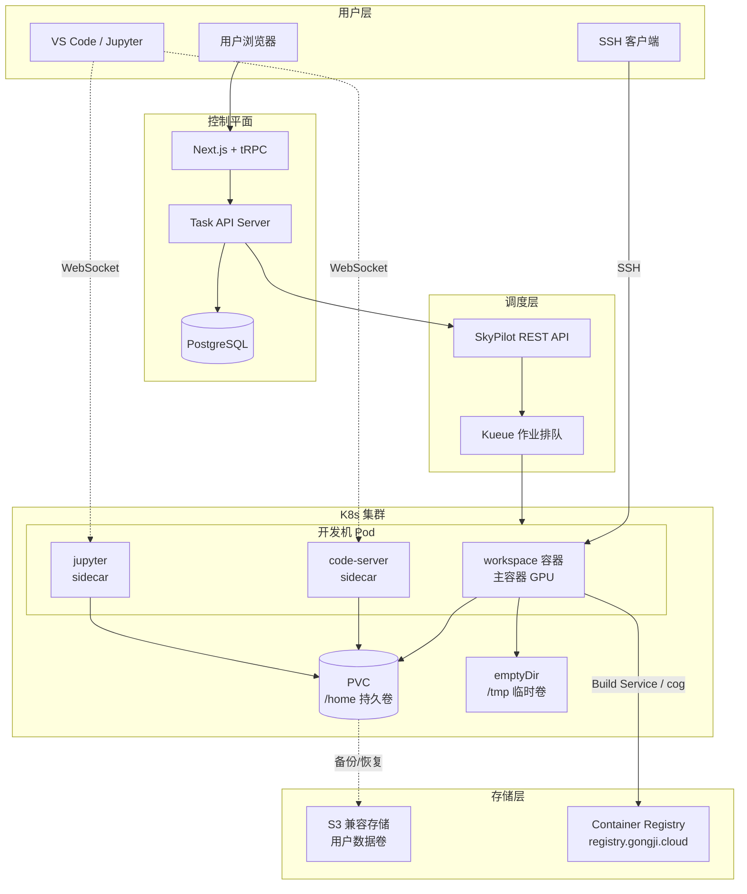
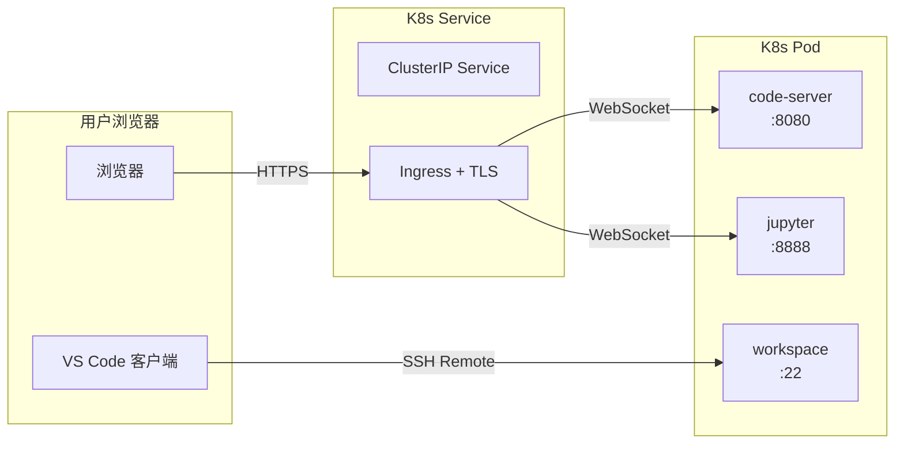
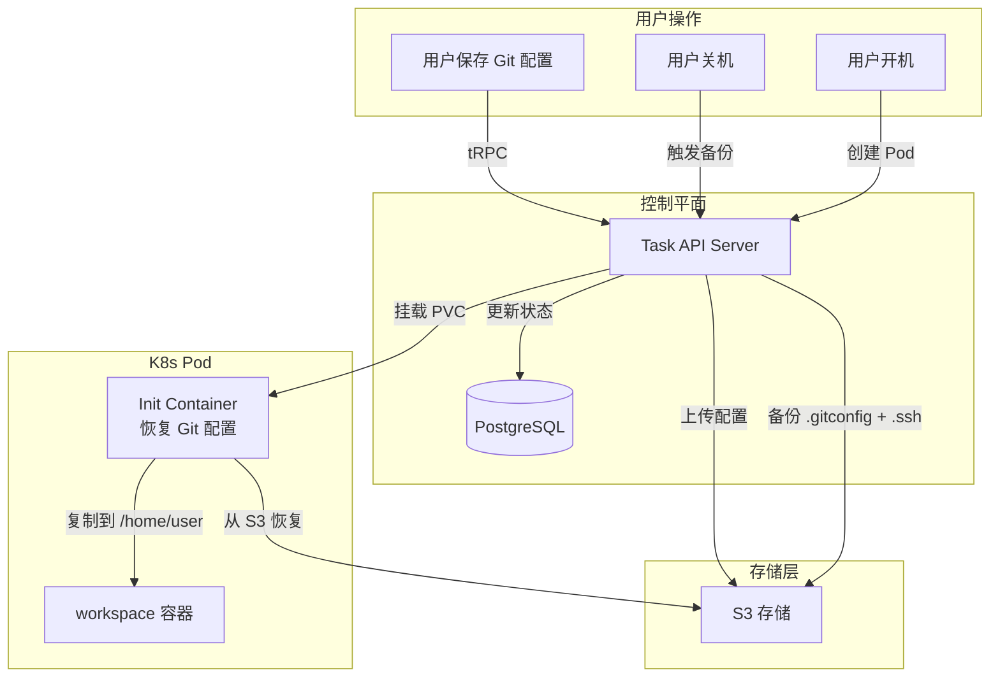
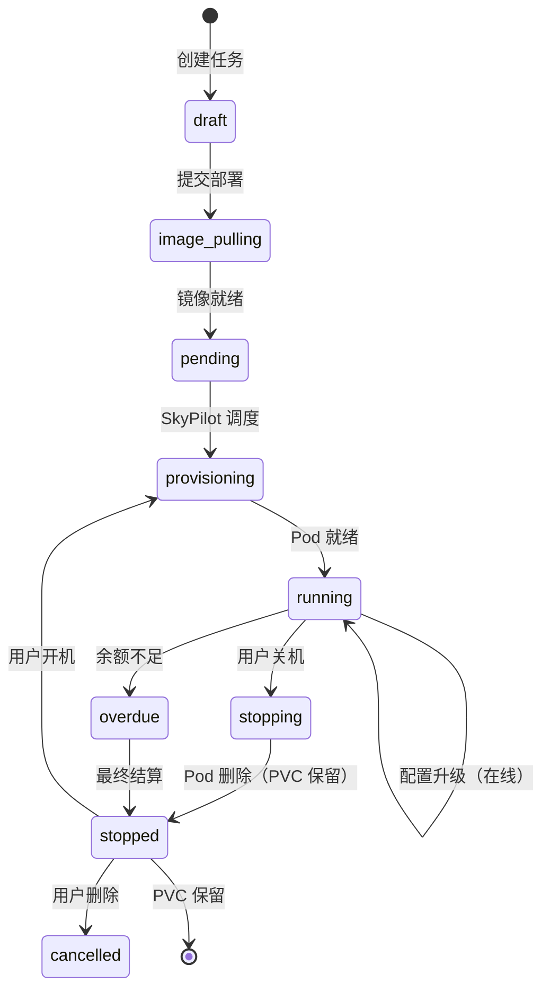
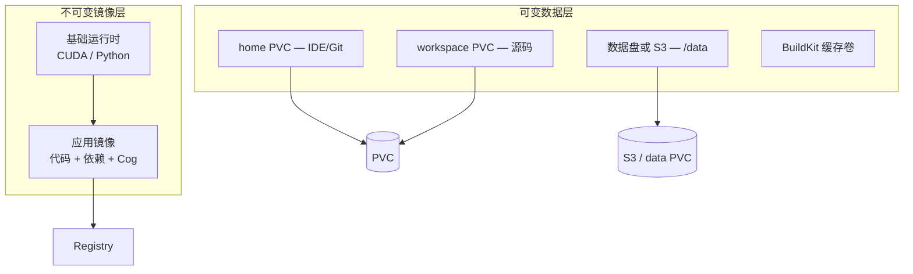
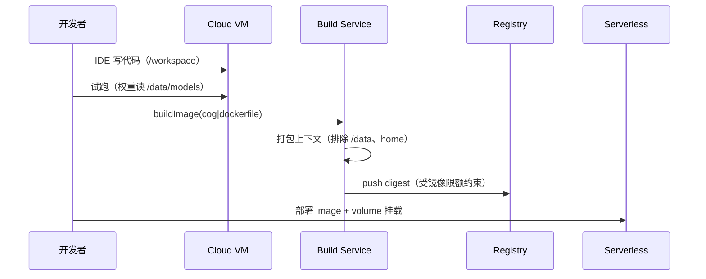

# GPU 云主机 (Cloud VM) 实现方案

> 基于 K8s Pod 的持久化开发机，支持频繁开机/关机、状态保持、IDE 集成、**数据与镜像分离**的 Cog/Dockerfile 可复现构建。
> 产品线：`cloud_vm`，隶属于 `compute_task` 统一模型。
> **存储配额 / S3 网络卷**：见 `storage-quota-and-s3-volume.md`。

**版本**: v1.2（2026-07-19）— 合并原 `cloud-vm-data-image-separation.md`

---

## 目录

1. [产品定位与核心能力](#1-产品定位与核心能力)
2. [架构总览](#2-架构总览)
3. [数据库设计](#3-数据库设计)
4. [状态持久化方案](#4-状态持久化方案)
5. [IDE 集成方案](#5-ide-集成方案)
6. [Git 配置同步方案](#6-git-配置同步方案)
7. [开机/关机生命周期](#7-开机关机生命周期)
8. [数据与镜像分离 / Cog 构建](#8-数据与镜像分离--cog-构建)
9. [SkyPilot 调度集成](#9-skypilot-调度集成)
10. [tRPC API 设计](#10-trpc-api-设计)
11. [前端交互设计](#11-前端交互设计)
12. [实施路线图](#12-实施路线图)

---

## 1. 产品定位与核心能力

### 1.1 与 Serverless 的区别

| 维度 | Cloud VM (开发机) | Serverless (推理) |
|------|------------------|------------------|
| 交互方式 | SSH / IDE 远程连接 | API 调用 |
| 状态模型 | **持久化** — 关机保留所有状态 | **无状态** — 缩容到零完全销毁 |
| 计费模式 | 按需/包时（开机才计费） | 按调用/Token/时长 |
| GPU 分配 | 独占 | 共享（请求级） |
| 适用场景 | 模型训练、代码开发、调试 | 在线推理、API 服务 |
| 用户操作 | 完全控制（安装软件、配置环境） | 仅 API 调用 |

### 1.2 核心能力矩阵

| 能力 | 描述 | 优先级 |
|------|------|--------|
| **状态持久化** | 关机后保留所有文件、安装的软件、配置 | P0 |
| **频繁开关机** | 支持用户每日多次开机/关机，秒级恢复 | P0 |
| **IDE 集成** | 浏览器内 VS Code (code-server) + Jupyter | P0 |
| **SSH 访问** | 原生 SSH 连接，支持密钥认证 | P0 |
| **Git 配置同步** | 关机/开机自动同步 .gitconfig、SSH 密钥 | P1 |
| **镜像导出** | 可复现构建（Cog/Dockerfile）；emergency commit 降级 | P0 / P2 |
| **存储卷挂载** | S3/`/data` 与 workspace 分离，数据不进镜像 | P0 |
| **Docker 构建** | Build Service + BuildKit（本章 §8） | P0 |
| **GPU 监控** | 实时 GPU 利用率、显存监控 | P1 |

---

## 2. 架构总览



### 2.1 组件分工

| 组件 | 职责 | 部署位置 |
|------|------|---------|
| **Next.js (apps/gpus)** | Web 控制台、实例管理、IDE 入口 | 云平台 |
| **Task API Server** | 任务生命周期、调度编排、计费 | 云平台 |
| **SkyPilot** | 多集群 GPU 调度、容器编排 | 云平台 |
| **workspace 容器** | 用户工作空间（主容器，含 GPU） | K8s Pod |
| **code-server** | 浏览器内 VS Code | K8s Pod sidecar |
| **Jupyter** | Jupyter Notebook 服务 | K8s Pod sidecar |
| **PVC** | 持久化存储（/home 目录） | K8s StorageClass |
| **Node Agent** | 节点自注册、健康检查、资源上报 | K8s DaemonSet |

---

## 3. 数据库设计

### 3.1 compute_task 扩展字段（cloud_vm 专属）

在现有 `compute_task` 表基础上，增加 `cloud_vm_config` JSONB 字段：

```sql
ALTER TABLE compute_task ADD COLUMN cloud_vm_config JSONB;

-- cloud_vm_config 结构定义
COMMENT ON COLUMN compute_task.cloud_vm_config IS '
{
  // === 状态持久化 ===
  "persistence": {
    "home_pvc_name": "pvc-coder-home-xxx",       // /home 持久卷
    "home_pvc_size_gb": 50,                        // 持久卷大小
    "home_storage_class": "gp3-retain",            // StorageClass
    "last_backup_s3_key": "backups/xxx/home.tar.gz", // 最近一次备份 S3 路径
    "backup_enabled": true,                        // 是否启用自动备份
    "backup_schedule": "0 */6 * * *"               // 备份 cron（每 6 小时）
  },

  // === IDE 配置 ===
  "ide": {
    "code_server_enabled": true,                   // 启用 code-server
    "code_server_port": 8080,                      // code-server 端口
    "code_server_password_hash": "bcrypt_xxx",     // code-server 密码哈希
    "jupyter_enabled": true,                       // 启用 Jupyter
    "jupyter_port": 8888,                          // Jupyter 端口
    "jupyter_token_hash": "bcrypt_xxx",            // Jupyter token 哈希
    "default_ide": "code-server"                   // 默认 IDE
  },

  // === Git 配置 ===
  "git": {
    "git_config_sync_enabled": true,               // Git 配置同步
    "git_config_s3_key": "git-config/xxx/.gitconfig", // .gitconfig S3 路径
    "ssh_keys_s3_prefix": "git-config/xxx/ssh/",   // SSH 密钥 S3 前缀
    "dotfiles_repo": "https://github.com/user/dotfiles", // dotfiles 仓库
    "dotfiles_install_cmd": "bash install.sh"       // dotfiles 安装命令
  },

  // === 文件系统布局（数据与镜像分离）===
  "filesystem_layout": {
    "home_mount": "/home/user",
    "workspace_mount": "/workspace",
    "data_mount": "/data",
    "data_volume_id": null,
    "build_cache_pvc": null
  },

  // === 构建 ===
  "build": {
    "default_builder": "cog",
    "default_context": "/workspace",
    "forbid_emergency_commit": true,
    "max_context_bytes": 524288000
  },

  // === Docker 配置（可选 DinD；生产构建走 Build Service）===
  "docker": {
    "docker_enabled": false,
    "runtime": "sysbox",
    "docker_storage_gb": 20
  },

  // === 端口映射 ===
  "exposed_services": [
    {"name": "code-server", "port": 8080, "protocol": "http", "path": "/ide"},
    {"name": "jupyter", "port": 8888, "protocol": "http", "path": "/jupyter"},
    {"name": "ssh", "port": 22, "protocol": "tcp"},
    {"name": "tensorboard", "port": 6006, "protocol": "http", "path": "/tensorboard"}
  ]
}'
```

### 3.2 compute_task_event 扩展（新增事件类型）

```sql
-- 新增 cloud_vm 专属事件类型
ALTER TYPE compute_task_event_type ADD VALUE 'home_volume_mounted';
ALTER TYPE compute_task_event_type ADD VALUE 'home_volume_restored';
ALTER TYPE compute_task_event_type ADD VALUE 'ide_started';
ALTER TYPE compute_task_event_type ADD VALUE 'git_config_synced';
ALTER TYPE compute_task_event_type ADD VALUE 'environment_snapshot_saved';
```

### 3.3 user_git_config 表（Git 配置持久化）

```sql
CREATE TABLE user_git_config (
    id                  TEXT PRIMARY KEY DEFAULT gen_random_uuid()::text,
    tenant_id           TEXT NOT NULL REFERENCES tenant(id),

    -- Git 身份
    git_user_name       VARCHAR(255),
    git_user_email      VARCHAR(255),

    -- SSH 密钥（加密存储）
    ssh_public_key      TEXT,                    -- 公钥（明文，用于展示）
    ssh_private_key_enc TEXT,                    -- 私钥（AES-256 加密）
    ssh_key_name        VARCHAR(128),            -- 密钥名称
    ssh_key_fingerprint VARCHAR(128),            -- 指纹

    -- GPG 密钥（可选）
    gpg_key_id          VARCHAR(128),
    gpg_public_key      TEXT,
    gpg_private_key_enc TEXT,

    -- S3 存储路径
    s3_bucket           VARCHAR(255) NOT NULL,
    s3_prefix           VARCHAR(512) NOT NULL,   -- e.g. git-config/{tenant_id}/

    -- 同步状态
    last_synced_at      TIMESTAMPTZ,
    sync_status         VARCHAR(16) DEFAULT 'pending', -- pending/synced/error

    created_at          TIMESTAMPTZ DEFAULT NOW(),
    updated_at          TIMESTAMPTZ DEFAULT NOW(),

    UNIQUE(tenant_id, ssh_key_fingerprint)
);

CREATE INDEX idx_user_git_config_tenant ON user_git_config(tenant_id);
```

### 3.4 compute_task_snapshot 表（环境快照）

```sql
CREATE TABLE compute_task_snapshot (
    id                  TEXT PRIMARY KEY DEFAULT gen_random_uuid()::text,
    task_id             TEXT NOT NULL REFERENCES compute_task(id),
    tenant_id           TEXT NOT NULL REFERENCES tenant(id),

    -- 快照信息
    snapshot_type       VARCHAR(32) NOT NULL,    -- manual / auto_backup / pre_stop
    image_ref           VARCHAR(512) NOT NULL,   -- 完整镜像引用 (registry/org/tag)
    image_digest        VARCHAR(255),
    image_size_bytes    BIGINT,

    -- 备份内容
    home_dir_size_bytes BIGINT,                  -- /home 目录大小
    included_paths      JSONB,                   -- ["~/.gitconfig", "~/.ssh", "~/.local/share/code-server"]

    -- S3 备份路径（可选，用于跨区域恢复）
    s3_backup_key       VARCHAR(512),
    s3_backup_size_bytes BIGINT,

    -- 状态
    status              VARCHAR(16) NOT NULL,    -- creating/ready/failed/deleted
    error_message       TEXT,

    -- 关联
    source_event_id     TEXT,                    -- 触发事件 ID
    parent_snapshot_id  TEXT,                    -- 父快照（增量备份）

    created_at          TIMESTAMPTZ DEFAULT NOW(),
    expires_at          TIMESTAMPTZ              -- 自动清理时间
);

CREATE INDEX idx_snapshot_task ON compute_task_snapshot(task_id);
CREATE INDEX idx_snapshot_tenant ON compute_task_snapshot(tenant_id);
CREATE INDEX idx_snapshot_status ON compute_task_snapshot(status, created_at);
```

---

## 4. 状态持久化方案

### 4.1 核心设计：PVC + Home 目录持久化

```
┌─────────────────────────────────────────────────────────────┐
│                        开发机 Pod                            │
│                                                              │
│  ┌──────────────────┐  ┌──────────────────┐                 │
│  │ workspace 容器    │  │ code-server 容器  │                 │
│  │ (GPU 主容器)      │  │ (sidecar)        │                 │
│  │                  │  │                  │                 │
│  │ /home/user  ─────┼──┼── PVC (持久)     │                 │
│  │ /tmp        ─────┼──┼── emptyDir (临时) │                 │
│  │ /workspace  ─────┼──┼── PVC (持久)     │                 │
│  └──────────────────┘  └──────────────────┘                 │
│                                                              │
│  ┌──────────────────┐                                        │
│  │ jupyter 容器      │                                        │
│  │ (sidecar)        │                                        │
│  │                  │                                        │
│  │ /home/user  ─────┼── 共享 PVC                              │
│  └──────────────────┘                                        │
└─────────────────────────────────────────────────────────────┘
         │
         │ PersistentVolumeClaim
         ▼
┌─────────────────────────────────────────────────────────────┐
│  PVC: pvc-cloud-vm-{task_id}                                │
│  StorageClass: gp3-retain (支持在线扩容)                      │
│  ReclaimPolicy: Retain (防误删)                               │
│  AccessMode: RWO (单节点读写)                                 │
│                                                              │
│  目录结构:                                                    │
│  /home/user/                  ← 用户主目录 (持久化)           │
│    ├── .gitconfig             ← Git 配置                     │
│    ├── .ssh/                  ← SSH 密钥                     │
│    ├── .local/share/code-server/  ← VS Code 扩展和设置       │
│    ├── .jupyter/              ← Jupyter 配置                 │
│    ├── projects/              ← 用户项目代码                  │
│    ├── .bashrc                ← Shell 配置                   │
│    └── .conda/                ← Conda 环境                   │
│  /workspace/                  ← 源码工作区 (持久化，可进构建)   │
│  /data/                       ← 数据盘或 S3（不进镜像）        │
│    ├── datasets/                                              │
│    ├── checkpoints/                                           │
│    └── models/                                                │
│  /tmp/                        ← 临时目录 (emptyDir)            │
└─────────────────────────────────────────────────────────────┘
```

### 4.2 StorageClass 配置

```yaml
# 生产环境 StorageClass
apiVersion: storage.k8s.io/v1
kind: StorageClass
metadata:
  name: gp3-retain
provisioner: ebs.csi.aws.com  # 或其他 CSI 驱动
parameters:
  type: gp3
  iops: "3000"
  throughput: "125"
  encrypted: "true"           # 静态加密
allowVolumeExpansion: true    # 支持在线扩容
reclaimPolicy: Retain         # 保留策略（防误删）
volumeBindingMode: WaitForFirstConsumer
mountOptions:
  - noatime                   # 减少元数据写入，提升性能
```

### 4.3 Pod Spec 模板

```yaml
apiVersion: v1
kind: Pod
metadata:
  name: cloud-vm-{task_id}
  labels:
    app: cloud-vm
    task-id: {task_id}
    tenant-id: {tenant_id}
    product-line: cloud_vm
  annotations:
    # SkyPilot 注解
    skypilot.io/job-id: {sky_job_id}
    # Node Agent 注解
    node-agent.io/gpu-request: "1"
    node-agent.io/ide-ports: "8080,8888"
spec:
  # 节点亲和性（调度到已预拉取镜像的节点）
  affinity:
    nodeAffinity:
      requiredDuringSchedulingIgnoredDuringExecution:
        nodeSelectorTerms:
          - matchExpressions:
              - key: kubernetes.io/hostname
                operator: In
                values: [{node_name}]

  # GPU RuntimeClass
  runtimeClassName: nvidia

  containers:
    # === 主容器：用户工作空间 ===
    - name: workspace
      image: {image_ref}
      command: ["/bin/bash", "-c"]
      args:
        - |
          # 1. 恢复 Git 配置（从 S3）
          if [ -f /home/user/.gitconfig.restore ]; then
            cp /home/user/.gitconfig.restore /home/user/.gitconfig
          fi

          # 2. 启动 SSH 服务
          /usr/sbin/sshd

          # 3. 启动用户自定义命令（如果有）
          exec {start_command:-/bin/bash}
      ports:
        - containerPort: 22
          name: ssh
          protocol: TCP
        - containerPort: 6006
          name: tensorboard
          protocol: TCP
      env:
        - name: NVIDIA_VISIBLE_DEVICES
          value: all
        - name: NVIDIA_DRIVER_CAPABILITIES
          value: compute,utility,display
        - name: HOME
          value: /home/user
        - name: USER
          value: user
        - name: CODE_SERVER_PASSWORD
          valueFrom:
            secretKeyRef:
              name: cloud-vm-{task_id}-secrets
              key: code-server-password
        - name: JUPYTER_TOKEN
          valueFrom:
            secretKeyRef:
              name: cloud-vm-{task_id}-secrets
              key: jupyter-token
      resources:
        requests:
          cpu: "4"
          memory: "16Gi"
          nvidia.com/gpu: "1"
          ephemeral-storage: "10Gi"
        limits:
          cpu: "16"
          memory: "64Gi"
          nvidia.com/gpu: "1"
          ephemeral-storage: "20Gi"
      volumeMounts:
        - name: home-pvc
          mountPath: /home/user
          subPath: home
        - name: workspace-pvc
          mountPath: /workspace
        - name: tmp-volume
          mountPath: /tmp
        - name: docker-socket
          mountPath: /var/run/docker.sock

    # === Sidecar：code-server ===
    - name: code-server
      image: codercom/code-server:latest
      ports:
        - containerPort: 8080
          name: code-server
      args:
        - --bind-addr=0.0.0.0:8080
        - --auth=password
        - --hashed-password={code_server_password_hash}
        - --user-data-dir=/home/user/.local/share/code-server
        - --extensions-dir=/home/user/.local/share/code-server/extensions
        - --workspace=/workspace
      env:
        - name: HOME
          value: /home/user
      resources:
        requests:
          cpu: "1"
          memory: "2Gi"
        limits:
          cpu: "2"
          memory: "4Gi"
      volumeMounts:
        - name: home-pvc
          mountPath: /home/user
          subPath: home

    # === Sidecar：Jupyter ===
    - name: jupyter
      image: jupyter/scipy-notebook:latest
      ports:
        - containerPort: 8888
          name: jupyter
      args:
        - jupyter
        - lab
        - --ip=0.0.0.0
        - --port=8888
        - --no-browser
        - --NotebookApp.token={jupyter_token}
        - --notebook-dir=/home/user/projects
      env:
        - name: HOME
          value: /home/user
      resources:
        requests:
          cpu: "1"
          memory: "2Gi"
        limits:
          cpu: "2"
          memory: "4Gi"
      volumeMounts:
        - name: home-pvc
          mountPath: /home/user
          subPath: home

  volumes:
    - name: home-pvc
      persistentVolumeClaim:
        claimName: pvc-cloud-vm-{task_id}
    - name: workspace-pvc
      persistentVolumeClaim:
        claimName: pvc-cloud-vm-{task_id}-workspace
    - name: tmp-volume
      emptyDir:
        sizeLimit: 10Gi
    - name: docker-socket
      emptyDir: {}

  # Pod 级别安全上下文
  securityContext:
    runAsUser: 1000
    runAsGroup: 1000
    fsGroup: 1000
    supplementalGroups: [999]  # docker 组
```

### 4.4 PVC 创建流程

```typescript
// Task API Server 中的 PVC 创建逻辑
async function createWorkspacePVC(taskId: string, config: CloudVMConfig) {
  const pvcName = `pvc-cloud-vm-${taskId}`;
  
  const pvc = {
    apiVersion: 'v1',
    kind: 'PersistentVolumeClaim',
    metadata: {
      name: pvcName,
      labels: {
        'app': 'cloud-vm',
        'task-id': taskId,
        'tenant-id': config.tenantId,
      },
      annotations: {
        'pv.kubernetes.io/provisioned-by': 'ebs.csi.aws.com',
      },
    },
    spec: {
      accessModes: ['ReadWriteOnce'],
      storageClassName: config.persistence.homeStorageClass || 'gp3-retain',
      resources: {
        requests: {
          storage: `${config.persistence.homePvcSizeGb}Gi`,
        },
      },
    },
  };

  // 创建 PVC
  await k8sClient.coreV1.createNamespacedPersistentVolumeClaim(config.namespace, pvc);

  // 等待 PVC 就绪
  await waitForPVCReady(config.namespace, pvcName, 60000); // 60s 超时

  return pvcName;
}

// PVC 在线扩容（用户升级磁盘时）
async function expandPVC(taskId: string, newSizeGb: number) {
  const pvcName = `pvc-cloud-vm-${taskId}`;
  
  // patch PVC 的 storage 请求
  await k8sClient.coreV1.patchNamespacedPersistentVolumeClaim(
    pvcName,
    config.namespace,
    { spec: { resources: { requests: { storage: `${newSizeGb}Gi` } } } }
  );

  // PVC 扩容由 CSI 驱动自动完成（需要 StorageClass 支持 allowVolumeExpansion）
}
```

---

## 5. IDE 集成方案

### 5.1 架构设计



### 5.2 code-server 部署配置

```typescript
// 生成 code-server 启动参数
function generateCodeServerConfig(config: CloudVMConfig) {
  return {
    // 认证配置
    auth: 'password',
    hashedPassword: config.ide.codeServerPasswordHash,
    
    // 数据目录（持久化在 PVC）
    userDataDir: '/home/user/.local/share/code-server',
    extensionsDir: '/home/user/.local/share/code-server/extensions',
    
    // 工作区
    workspace: '/workspace',
    
    // 端口
    bindAddr: '0.0.0.0:8080',
    
    // 性能优化
    disableTelemetry: true,
    disableUpdateCheck: true,
    
    // 扩展预装
    extensions: [
      'ms-python.python',
      'ms-python.vscode-pylance',
      'ms-toolsai.jupyter',
      'ms-vscode.cpptools',
      'github.copilot',
      'eamodio.gitlens',
    ],
  };
}
```

### 5.3 Jupyter 部署配置

```typescript
// 生成 Jupyter 启动参数
function generateJupyterConfig(config: CloudVMConfig) {
  return {
    // 认证
    token: config.ide.jupyterToken,
    
    // 目录
    notebookDir: '/home/user/projects',
    
    // 扩展
    extensions: [
      '@jupyterlab/git',
      'jupyterlab-code-formatter',
      'jupyterlab_tensorboard',
    ],
    
    // GPU 支持（CUDA 内核）
    kernels: [
      { name: 'python3', displayName: 'Python 3 (GPU)', spec: { cuda: true } },
      { name: 'r', displayName: 'R', spec: {} },
    ],
  };
}
```

### 5.4 IDE 入口 URL 生成

```typescript
// 为用户生成 IDE 访问 URL
function generateIDEUrls(task: ComputeTask) {
  const baseUrl = process.env.IDE_BASE_URL; // e.g. https://ide.gpucloud.dev
  
  return {
    codeServer: `${baseUrl}/ide/${task.id}/code-server/`,
    jupyter: `${baseUrl}/ide/${task.id}/jupyter/`,
    ssh: `ssh user@${task.nodeName} -p ${task.sshPort}`,
    
    // WebSocket 代理地址
    codeServerWs: `${baseUrl.replace('https', 'wss')}/ws/ide/${task.id}/code-server/`,
    jupyterWs: `${baseUrl.replace('https', 'wss')}/ws/ide/${task.id}/jupyter/`,
  };
}
```

### 5.5 Ingress 配置

```yaml
# IDE Ingress 路由规则
apiVersion: networking.k8s.io/v1
kind: Ingress
metadata:
  name: cloud-vm-ide-{task_id}
  annotations:
    nginx.ingress.kubernetes.io/proxy-read-timeout: "3600"
    nginx.ingress.kubernetes.io/proxy-send-timeout: "3600"
    nginx.ingress.kubernetes.io/websocket-services: "code-server,jupyter"
    cert-manager.io/cluster-issuer: "letsencrypt-prod"
spec:
  tls:
    - hosts:
        - ide.gpucloud.dev
      secretName: ide-tls
  rules:
    - host: ide.gpucloud.dev
      http:
        paths:
          # code-server 路由
          - path: /ide/{task_id}/code-server
            pathType: Prefix
            backend:
              service:
                name: cloud-vm-{task_id}
                port:
                  number: 8080
          # Jupyter 路由
          - path: /ide/{task_id}/jupyter
            pathType: Prefix
            backend:
              service:
                name: cloud-vm-{task_id}
                port:
                  number: 8888
```

---

## 6. Git 配置同步方案

### 6.1 同步架构



### 6.2 Git 配置保存 API

```typescript
// tRPC: 保存用户的 Git 配置
const saveGitConfig = protectedProcedure
  .input(z.object({
    taskId: z.string(),
    gitUserName: z.string().optional(),
    gitUserEmail: z.string().optional(),
    sshPublicKey: z.string().optional(),
    sshPrivateKey: z.string().optional(),  // 仅传输，不存储明文
    sshKeyName: z.string().optional(),
  }))
  .mutation(async ({ ctx, input }) => {
    const task = await getTaskOrThrow(ctx.user, input.taskId);
    
    // 1. 加密私钥
    const encryptedPrivateKey = input.sshPrivateKey
      ? await encryptWithTenantKey(ctx.user.tenantId, input.sshPrivateKey)
      : undefined;

    // 2. 计算 SSH 指纹
    const fingerprint = input.sshPublicKey
      ? await calculateSSHFingerprint(input.sshPublicKey)
      : undefined;

    // 3. 生成 .gitconfig 内容
    const gitconfig = `
[user]
    name = ${input.gitUserName}
    email = ${input.gitUserEmail}
[core]
    editor = vim
[init]
    defaultBranch = main
`.trim();

    // 4. 上传到 S3
    const s3Bucket = process.env.GIT_CONFIG_S3_BUCKET;
    const s3Prefix = `git-config/${ctx.user.tenantId}/${input.taskId}/`;
    
    await s3Client.putObject({
      Bucket: s3Bucket,
      Key: `${s3Prefix}.gitconfig`,
      Body: gitconfig,
    });

    if (input.sshPublicKey) {
      await s3Client.putObject({
        Bucket: s3Bucket,
        Key: `${s3Prefix}ssh/id_rsa.pub`,
        Body: input.sshPublicKey,
      });
    }

    if (encryptedPrivateKey) {
      await s3Client.putObject({
        Bucket: s3Bucket,
        Key: `${s3Prefix}ssh/id_rsa.enc`,
        Body: encryptedPrivateKey,
        ServerSideEncryption: 'aws:kms',
      });
    }

    // 5. 更新数据库
    await db.update(userGitConfig)
      .set({
        gitUserName: input.gitUserName,
        gitUserEmail: input.gitUserEmail,
        sshPublicKey: input.sshPublicKey,
        sshPrivateKeyEnc: encryptedPrivateKey,
        sshKeyName: input.sshKeyName,
        sshKeyFingerprint: fingerprint,
        s3Bucket,
        s3Prefix,
        lastSyncedAt: new Date(),
        syncStatus: 'synced',
      })
      .where(eq(userGitConfig.tenantId, ctx.user.tenantId));

    // 6. 如果实例正在运行，触发同步
    if (task.status === 'running') {
      await triggerGitConfigSync(task, s3Prefix);
    }

    return { success: true };
  });
```

### 6.3 Init Container 恢复逻辑

```bash
#!/bin/bash
# init-git-sync.sh — 在 Pod 启动时执行

set -euo pipefail

S3_BUCKET="${GIT_CONFIG_S3_BUCKET}"
S3_PREFIX="${GIT_CONFIG_S3_PREFIX}"
HOME_DIR="/home/user"

echo "[git-sync] 开始恢复 Git 配置..."

# 1. 恢复 .gitconfig
if aws s3 cp "s3://${S3_BUCKET}/${S3_PREFIX}.gitconfig" "${HOME_DIR}/.gitconfig" 2>/dev/null; then
    echo "[git-sync] .gitconfig 恢复成功"
else
    echo "[git-sync] .gitconfig 不存在，跳过"
fi

# 2. 恢复 SSH 密钥
mkdir -p "${HOME_DIR}/.ssh"
chmod 700 "${HOME_DIR}/.ssh"

# 恢复公钥
if aws s3 cp "s3://${S3_BUCKET}/${S3_PREFIX}ssh/id_rsa.pub" "${HOME_DIR}/.ssh/id_rsa.pub" 2>/dev/null; then
    echo "[git-sync] SSH 公钥恢复成功"
    chmod 644 "${HOME_DIR}/.ssh/id_rsa.pub"
fi

# 恢复私钥（需要解密）
if aws s3 cp "s3://${S3_BUCKET}/${S3_PREFIX}ssh/id_rsa.enc" "/tmp/id_rsa.enc" 2>/dev/null; then
    # 使用 KMS 解密
    aws kms decrypt --ciphertext-blob fileb:///tmp/id_rsa.enc \
        --key-id "${KMS_KEY_ID}" \
        --output text --plaintext | base64 -d > "${HOME_DIR}/.ssh/id_rsa"
    chmod 600 "${HOME_DIR}/.ssh/id_rsa"
    echo "[git-sync] SSH 私钥恢复成功"
    rm -f /tmp/id_rsa.enc
fi

# 3. 恢复 known_hosts（可选）
if aws s3 cp "s3://${S3_BUCKET}/${S3_PREFIX}ssh/known_hosts" "${HOME_DIR}/.ssh/known_hosts" 2>/dev/null; then
    chmod 644 "${HOME_DIR}/.ssh/known_hosts"
fi

# 4. 设置正确的所有者
chown -R 1000:1000 "${HOME_DIR}/.gitconfig" "${HOME_DIR}/.ssh"

echo "[git-sync] Git 配置恢复完成"
```

### 6.4 关机前备份逻辑

```typescript
// 在关机流程中触发 Git 配置备份
async function backupGitConfigBeforeStop(task: ComputeTask) {
  const podName = `cloud-vm-${task.id}`;
  const namespace = getNamespace(task);
  const config = task.cloudVmConfig;

  // 1. 执行备份脚本（通过 kubectl exec）
  const backupScript = `
    #!/bin/bash
    set -euo pipefail
    
    S3_BUCKET="${config.persistence.s3Bucket}"
    S3_PREFIX="git-config/${task.tenantId}/${task.id}/"
    HOME_DIR="/home/user"
    
    # 上传 .gitconfig
    aws s3 cp "\${HOME_DIR}/.gitconfig" "s3://\${S3_BUCKET}/\${S3_PREFIX}.gitconfig" 2>/dev/null || true
    
    # 上传 SSH 密钥（公钥明文，私钥加密后上传）
    aws s3 cp "\${HOME_DIR}/.ssh/id_rsa.pub" "s3://\${S3_BUCKET}/\${S3_PREFIX}ssh/id_rsa.pub" 2>/dev/null || true
    
    # 上传 known_hosts
    aws s3 cp "\${HOME_DIR}/.ssh/known_hosts" "s3://\${S3_BUCKET}/\${S3_PREFIX}ssh/known_hosts" 2>/dev/null || true
    
    # 上传 Git hooks（如果存在）
    for repo in \${HOME_DIR}/projects/*/; do
      if [ -d "\${repo}.git/hooks" ]; then
        aws s3 sync "\${repo}.git/hooks" "s3://\${S3_BUCKET}/\${S3_PREFIX}git-hooks/\$(basename \${repo})/" 2>/dev/null || true
      fi
    done
    
    echo "Git config backup completed"
  `;

  await k8sClient.execInPod(namespace, podName, 'workspace', backupScript);

  // 2. 更新数据库
  await db.update(userGitConfig)
    .set({ lastSyncedAt: new Date(), syncStatus: 'synced' })
    .where(eq(userGitConfig.tenantId, task.tenantId));
}
```

---

## 7. 开机/关机生命周期

### 7.1 状态机



### 7.2 开机流程

```typescript
// tRPC: 启动云主机
const startCloudVM = protectedProcedure
  .input(z.object({ taskId: z.string() }))
  .mutation(async ({ ctx, input }) => {
    const task = await getTaskOrThrow(ctx.user, input.taskId);
    
    // 1. 验证状态
    if (task.status !== 'stopped') {
      throw new TRPCError({
        code: 'BAD_REQUEST',
        message: `当前状态 ${task.status} 不允许开机，需要 stopped 状态`,
      });
    }

    // 2. 检查余额
    const balance = await getTenantBalance(ctx.user.tenantId);
    if (balance <= 0) {
      throw new TRPCError({
        code: 'BAD_REQUEST',
        message: '余额不足，请先充值',
      });
    }

    // 3. 冻结开机保证金
    const deposit = calculateDeposit(task);
    await freezeDeposit(ctx.user.tenantId, task.id, deposit);

    // 4. 更新状态
    await db.update(computeTask)
      .set({ status: 'provisioning' })
      .where(eq(computeTask.id, task.id));

    // 5. 提交 SkyPilot Job（恢复到原节点或新节点）
    const skyJob = await skyPilotClient.submitJob({
      name: `cloud-vm-${task.id}`,
      resources: {
        gpu: `${task.gpuCardTypeId}:${task.gpuCount}`,
        cpu: task.vcpuCount,
        memoryGb: task.memoryGb,
        diskSizeGb: task.systemDiskGb + task.dataDiskGb + task.extraDiskGb,
        // 尝试调度到原节点（PVC 所在节点）
        nodeAffinity: task.cloudVmConfig?.persistence?.lastNodeName
          ? { nodeName: task.cloudVmConfig.persistence.lastNodeName }
          : undefined,
      },
      image: task.imageId,
      storage: {
        mounts: [
          // 挂载已存在的 PVC
          { pvcName: `pvc-cloud-vm-${task.id}`, mountPath: '/home/user', subPath: 'home' },
          { pvcName: `pvc-cloud-vm-${task.id}-workspace`, mountPath: '/workspace' },
        ],
      },
      // 使用已有的 PVC（不创建新的）
      reuseExistingPVC: true,
    });

    // 6. 更新任务
    await db.update(computeTask)
      .set({
        skyJobId: skyJob.jobId,
        status: 'running',
        billingStartedAt: new Date(),
      })
      .where(eq(computeTask.id, task.id));

    // 7. 记录事件
    await recordEvent(task.id, 'started', {
      trigger: 'user',
      skyJobId: skyJob.jobId,
      reusedPVC: true,
    });

    return { skyJobId: skyJob.jobId };
  });
```

### 7.3 关机流程

```typescript
// tRPC: 关闭云主机
const stopCloudVM = protectedProcedure
  .input(z.object({
    taskId: z.string(),
    force: z.boolean().default(false),
    createSnapshot: z.boolean().default(true),  // 是否创建快照
  }))
  .mutation(async ({ ctx, input }) => {
    const task = await getTaskOrThrow(ctx.user, input.taskId);
    
    // 1. 验证状态
    if (task.status !== 'running') {
      throw new TRPCError({
        code: 'BAD_REQUEST',
        message: `当前状态 ${task.status} 不允许关机`,
      });
    }

    // 2. 更新状态
    await db.update(computeTask)
      .set({ status: 'stopping' })
      .where(eq(computeTask.id, task.id));

    // 3. 备份 Git 配置（如果启用）
    if (task.cloudVmConfig?.git?.gitConfigSyncEnabled) {
      await backupGitConfigBeforeStop(task);
    }

    // 4. 创建环境快照（可选）
    if (input.createSnapshot && task.cloudVmConfig?.persistence?.backupEnabled) {
      await createEnvironmentSnapshot(task, 'pre_stop');
    }

    // 5. 取消 SkyPilot Job（PVC 会自动保留）
    await skyPilotClient.cancelJob(task.skyJobId);

    // 6. 等待 Pod 终止
    await waitForPodTerminated(`cloud-vm-${task.id}`, getNamespace(task), 60000);

    // 7. 最终计费结算
    const billingResult = await settleBilling(ctx.user.tenantId, task.id);

    // 8. 更新状态
    await db.update(computeTask)
      .set({
        status: 'stopped',
        stoppedAt: new Date(),
        // 记录 PVC 所在节点（开机时尝试恢复到同一节点）
        cloudVmConfig: {
          ...task.cloudVmConfig,
          persistence: {
            ...task.cloudVmConfig?.persistence,
            lastNodeName: task.nodeName,
          },
        },
      })
      .where(eq(computeTask.id, task.id));

    // 9. 记录事件
    await recordEvent(task.id, 'stopped', {
      trigger: 'user',
      force: input.force,
      billingSettled: true,
      billingAmount: billingResult.amount,
    });

    return { success: true, billingAmount: billingResult.amount };
  });
```

### 7.4 关键保证：PVC 跨重启保留

```
开机 → Pod 创建 → 挂载已有 PVC → 读取所有状态 → 继续工作
关机 → Pod 删除 → PVC 保留 → 状态保存在 PVC 中
开机 → 新 Pod 创建 → 挂载同一 PVC → 完全恢复上次状态
```

**为什么 PVC 能跨重启保留？**

1. **PVC 生命周期独立于 Pod** — PVC 是 K8s 资源，Pod 删除不会删除 PVC
2. **ReclaimPolicy: Retain** — 即使 PVC 被删除，底层 PV 仍保留
3. **nodeAffinity 亲和性** — 尽量调度到 PVC 所在节点，避免跨节点迁移

---

## 8. 数据与镜像分离 / Cog 构建

> **定稿原则**：镜像只含「如何跑」；数据只含「跑什么」。生产构建主路径为 **Cog / Dockerfile + BuildKit**。  
> `docker commit` 仅作 **emergency snapshot**（二次确认），默认 UI 不暴露。  
> 镜像大小限额、数据盘免费额度/扩容、S3 挂载见 `storage-quota-and-s3-volume.md`。

### 8.1 分层模型



### 8.2 目录约定

```text
/home/user              # home PVC — 不进构建上下文
/workspace              # workspace PVC — Cog 项目根
/data                   # 本地数据盘或 S3 — 永不进镜像
/data/datasets
/data/checkpoints
/data/models
/tmp                    # emptyDir
```

| 路径 | 进构建上下文 | 进最终镜像 |
|------|-------------|-----------|
| `/workspace` 源码、cog.yaml、requirements | ✅ | ✅（产物） |
| `/home/user` IDE/SSH | ❌ | ❌ |
| `/data/**`、权重、大压缩包 | ❌ | ❌ |

平台注入默认 `.dockerignore`（排除 `.git`、`.venv`、`/data`、`*.safetensors`、`*.gguf`、`*.pt` 等）。

### 8.3 开发 → 构建 → 部署



推荐 Cog 骨架：`/workspace/my-predictor/{cog.yaml,predict.py,requirements.txt,.dockerignore}`；`MODEL_PATH=/data/models` 运行时注入。

### 8.4 Build Service

| 模式 | 说明 |
|------|------|
| A. 节点旁路 BuildKit | 同节点缓存命中高 |
| B. 独立 Build Pool（默认） | 与用户 GPU 计费隔离 |

```sql
CREATE TABLE image_build_job (
    id TEXT PRIMARY KEY DEFAULT gen_random_uuid()::text,
    tenant_id TEXT NOT NULL,
    source_task_id TEXT REFERENCES compute_base(id),
    builder VARCHAR(32) NOT NULL,  -- cog | dockerfile
    context_path VARCHAR(512) NOT NULL,
    status VARCHAR(32) NOT NULL DEFAULT 'queued',
    image_ref VARCHAR(512),
    image_digest VARCHAR(255),
    size_bytes BIGINT,
    cache_hit_ratio NUMERIC(5,4),
    billing_seconds INT,
    error_message TEXT,
    metadata JSONB,
    created_at TIMESTAMPTZ DEFAULT NOW(),
    started_at TIMESTAMPTZ,
    finished_at TIMESTAMPTZ
);
```

`custom_image` 扩展：`build_job_id`、`contains_weights`（默认 false，禁止 bake）、`recommended_data_mount`。

### 8.5 体积与速度

| 目标 | 手段 |
|------|------|
| 体积最小 | 多阶段构建、runtime 基础镜像、权重外置、扫拒大文件 |
| 速度最快 | BuildKit cache mount、registry cache、租户缓存 PVC、依赖/代码分层 |

SLO：仅改 `predict.py` 增量构建 P50≤90s；应用镜像相对基础增量 P50≤1.5GB（不含权重）。

### 8.6 API

```typescript
buildImageFromWorkspace: protectedProcedure.input(z.object({
  taskId: z.string(),
  builder: z.enum(['cog','dockerfile']).default('cog'),
  contextPath: z.string().default('/workspace'),
  tagName: z.string(),
  cogYamlPath: z.string().optional(),
  dockerfilePath: z.string().optional(),
}))

// 应急快照（高级选项，二次确认）
saveImageEmergency: // docker commit；默认 forbid
```

### 8.7 emergency commit（附录级）

仅当 `forbid_emergency_commit=false` 且用户确认：Node Agent `docker commit` + push；**默认不包含 `/data`**；不推荐用于生产交付。

---

## 9. SkyPilot 调度集成

### 9.1 SkyPilot Job Payload

```typescript
// 构建 SkyPilot Job 请求
function buildSkyPilotJob(task: ComputeTask): SkyPilotJobRequest {
  const config = task.cloudVmConfig;

  return {
    name: `cloud-vm-${task.id}`,
    resources: {
      gpu: `${getGpuTypeName(task.gpuCardTypeId)}:${task.gpuCount}`,
      cpu: task.vcpuCount,
      memoryGb: task.memoryGb,
      diskSizeGb: task.systemDiskGb + task.dataDiskGb + task.extraDiskGb,
      // 节点亲和性
      nodeAffinity: config?.persistence?.lastNodeName
        ? { nodeName: config.persistence.lastNodeName }
        : undefined,
    },
    image: task.imageId,
    storage: {
      mounts: [
        // PVC 挂载（已有卷，不会创建新卷）
        {
          pvcName: `pvc-cloud-vm-${task.id}`,
          mountPath: '/home/user',
          subPath: 'home',
          readOnly: false,
        },
        {
          pvcName: `pvc-cloud-vm-${task.id}-workspace`,
          mountPath: '/workspace',
          readOnly: false,
        },
      ],
      // S3 挂载（可选）
      s3Mounts: task.volumeId
        ? [{ bucket: task.volumeId, mountPath: task.volumeMountPath || '/data', readOnly: false }]
        : [],
    },
    // 环境变量
    envs: {
      ...task.envVars,
      NVIDIA_VISIBLE_DEVICES: 'all',
      NVIDIA_DRIVER_CAPABILITIES: 'compute,utility,display',
    },
    // 启动命令
    entrypoint: buildEntrypoint(task),
    // 超时
    timeout: task.commitment === 'on-demand' ? undefined : calculateTimeout(task),
    // 重试
    retry: 0,
  };
}

// 构建启动命令
function buildEntrypoint(task: ComputeTask): string {
  const parts: string[] = [
    '#!/bin/bash',
    'set -euo pipefail',
    '',
    '# 1. 恢复 Git 配置',
    'if [ -f /home/user/.gitconfig.restore ]; then',
    '  cp /home/user/.gitconfig.restore /home/user/.gitconfig',
    'fi',
    '',
    '# 2. 启动 SSH 服务',
    '/usr/sbin/sshd',
    '',
    '# 3. 启动 code-server（如果启用）',
  ];

  if (task.cloudVmConfig?.ide?.codeServerEnabled) {
    parts.push(
      'code-server --bind-addr=0.0.0.0:8080 --auth=password \\',
      `  --hashed-password="${task.cloudVmConfig.ide.codeServerPasswordHash}" \\`,
      '  --user-data-dir=/home/user/.local/share/code-server \\',
      '  --extensions-dir=/home/user/.local/share/code-server/extensions \\',
      '  --workspace=/workspace &',
      ''
    );
  }

  parts.push('# 4. 启动 Jupyter（如果启用）');

  if (task.cloudVmConfig?.ide?.jupyterEnabled) {
    parts.push(
      'jupyter lab --ip=0.0.0.0 --port=8888 --no-browser \\',
      `  --NotebookApp.token="${task.cloudVmConfig.ide.jupyterToken}" \\`,
      '  --notebook-dir=/home/user/projects &',
      ''
    );
  }

  parts.push(
    '# 5. 执行用户自定义命令',
    `exec ${task.startCommand || '/bin/bash'}`,
  );

  return parts.join('\n');
}
```

### 9.2 节点亲和性策略

```typescript
// SkyPilot 调度时的节点亲和性
interface NodeAffinityConfig {
  // 首选：PVC 所在节点（避免跨节点迁移）
  preferredNodeName?: string;
  
  // 必须：有足够 GPU 的节点
  requiredGpuType: string;
  requiredGpuCount: number;
  
  // 可选：特定区域
  preferredRegion?: string;
}

function calculateNodeAffinity(config: NodeAffinityConfig): SkyPilotNodeAffinity {
  return {
    // 必须满足：GPU 类型和数量
    requiredDuringSchedulingIgnoredDuringExecution: {
      nodeSelectorTerms: [{
        matchExpressions: [{
          key: `nvidia.com/gpu.product`,
          operator: 'In',
          values: [config.requiredGpuType],
        }],
      }],
    },
    
    // 优选：PVC 所在节点
    preferredDuringSchedulingIgnoredDuringExecution: config.preferredNodeName
      ? [{
          weight: 100,
          preference: {
            matchExpressions: [{
              key: 'kubernetes.io/hostname',
              operator: 'In',
              values: [config.preferredNodeName],
            }],
          },
        }]
      : [],
  };
}
```

---

## 10. tRPC API 设计

### 10.1 computeRouter 扩展

```typescript
// apps/gpus/src/lib/server/routers/compute.ts

export const cloudVMRouter = router({
  // === 实例生命周期 ===
  createCloudVM: protectedProcedure
    .input(createCloudVMSchema)
    .mutation(({ ctx, input }) => cloudVMService.create(ctx.user, input)),

  startCloudVM: protectedProcedure
    .input(z.object({ taskId: z.string() }))
    .mutation(({ ctx, input }) => cloudVMService.start(ctx.user, input.taskId)),

  stopCloudVM: protectedProcedure
    .input(z.object({
      taskId: z.string(),
      force: z.boolean().default(false),
      createSnapshot: z.boolean().default(true),
    }))
    .mutation(({ ctx, input }) => cloudVMService.stop(ctx.user, input)),

  deleteCloudVM: protectedProcedure
    .input(z.object({ taskId: z.string() }))
    .mutation(({ ctx, input }) => cloudVMService.delete(ctx.user, input.taskId)),

  // === IDE 管理 ===
  getIDEUrls: protectedProcedure
    .input(z.object({ taskId: z.string() }))
    .query(({ ctx, input }) => cloudVMService.getIDEUrls(ctx.user, input.taskId)),

  // === Git 配置 ===
  saveGitConfig: protectedProcedure
    .input(saveGitConfigSchema)
    .mutation(({ ctx, input }) => cloudVMService.saveGitConfig(ctx.user, input)),

  getGitConfig: protectedProcedure
    .input(z.object({ taskId: z.string() }))
    .query(({ ctx, input }) => cloudVMService.getGitConfig(ctx.user, input.taskId)),

  // === 镜像管理 ===
  saveImage: protectedProcedure
    .input(z.object({
      taskId: z.string(),
      tagName: z.string(),
      includeHomeDir: z.boolean().default(true),
    }))
    .mutation(({ ctx, input }) => cloudVMService.saveImage(ctx.user, input)),

  listSnapshots: protectedProcedure
    .input(z.object({ taskId: z.string() }))
    .query(({ ctx, input }) => cloudVMService.listSnapshots(ctx.user, input.taskId)),

  // === 存储管理 ===
  expandDisk: protectedProcedure
    .input(z.object({
      taskId: z.string(),
      extraDiskGb: z.number().min(0).max(2000),
    }))
    .mutation(({ ctx, input }) => cloudVMService.expandDisk(ctx.user, input)),

  // === 监控 ===
  getGPUStats: protectedProcedure
    .input(z.object({ taskId: z.string() }))
    .query(({ ctx, input }) => cloudVMService.getGPUStats(ctx.user, input.taskId)),

  getContainerLogs: protectedProcedure
    .input(z.object({
      taskId: z.string(),
      container: z.enum(['workspace', 'code-server', 'jupyter']),
      tail: z.number().default(100),
    }))
    .query(({ ctx, input }) => cloudVMService.getContainerLogs(ctx.user, input)),
});
```

### 10.2 API 汇总

| 操作 | tRPC 方法 | 说明 |
|------|----------|------|
| 创建实例 | `compute.createCloudVM` | 创建新的云主机 |
| 开机 | `compute.startCloudVM` | 启动已停止的实例 |
| 关机 | `compute.stopCloudVM` | 停止运行中的实例 |
| 删除 | `compute.deleteCloudVM` | 删除实例（释放 PVC） |
| 获取 IDE URL | `compute.getIDEUrls` | 获取 code-server/Jupyter 访问地址 |
| 保存 Git 配置 | `compute.saveGitConfig` | 保存用户 Git 身份和密钥 |
| 获取 Git 配置 | `compute.getGitConfig` | 获取已保存的 Git 配置 |
| 保存镜像 | `compute.saveImage` | 将当前环境保存为 Docker 镜像 |
| 列出快照 | `compute.listSnapshots` | 查看环境快照历史 |
| 扩容磁盘 | `compute.expandDisk` | 在线扩容 PVC |
| GPU 监控 | `compute.getGPUStats` | 获取实时 GPU 利用率 |
| 容器日志 | `compute.getContainerLogs` | 获取容器 stdout/stderr |

---

## 11. 前端交互设计

### 11.1 实例详情页新增 Tab

```
实例: my-dev-machine
━━━━━━━━━━━━━━━━━━━━━━━━━━━━━━━━━━━━━━━━━━━━━━━━━━━━━━

Tab: [概览] [IDE] [Git] [快照] [日志] [设置]

┌── IDE ──────────────────────────────────────────────┐
│                                                      │
│  code-server:  https://ide.gpucloud.dev/ide/xxx/...  │
│  [在新窗口打开]                                        │
│                                                      │
│  Jupyter:     https://ide.gpucloud.dev/ide/xxx/...  │
│  [在新窗口打开]                                        │
│                                                      │
│  SSH:         ssh user@gpu-node-5 -p 2222            │
│  [复制命令]                                            │
│                                                      │
│  状态: code-server 🟢运行 | Jupyter 🟢运行            │
└──────────────────────────────────────────────────────┘

┌── Git 配置 ─────────────────────────────────────────┐
│                                                      │
│  用户名:  John Doe                                    │
│  邮箱:   john@example.com                             │
│  SSH 密钥: id_rsa (已同步, 上次同步: 2h 前)           │
│                                                      │
│  [编辑配置]  [同步到此实例]                             │
│                                                      │
│  dotfiles 仓库: https://github.com/john/dotfiles     │
│  [安装 dotfiles]                                      │
└──────────────────────────────────────────────────────┘

┌── 快照 ─────────────────────────────────────────────┐
│                                                      │
│  最近快照:                                            │
│  ┌──────┬──────────┬──────────┬──────────┬────────┐ │
│  │ 名称  │ 类型     │ 大小     │ 时间     │ 操作   │ │
│  ├──────┼──────────┼──────────┼──────────┼────────┤ │
│  │ v1.2 │ 手动     │ 15.2 GB  │ 2h 前   │ [部署] │ │
│  │ auto │ 自动备份 │ 14.8 GB  │ 6h 前   │ [部署] │ │
│  └──────┴──────────┴──────────┴──────────┴────────┘ │
│                                                      │
│  [保存当前环境为快照]                                   │
└──────────────────────────────────────────────────────┘
```

### 11.2 开关机交互

```
┌── 操作栏 ──────────────────────────────────────────────┐
│                                                          │
│  状态: 🟢 运行中 (已运行 2h 15m)                          │
│                                                          │
│  [⏹ 关机]  [🔄 重启]  [💾 保存镜像]  [⚙ 配置]           │
│                                                          │
│  关机后将保留所有状态，下次开机完全恢复。                     │
│                                                          │
└──────────────────────────────────────────────────────────┘
```

---

## 12. 实施路线图

### Phase 1: 核心持久化 (2 周)

| 任务 | 工作量 | 交付物 |
|------|--------|--------|
| PVC 创建/挂载/扩容 | 3d | K8s PVC 管理模块 |
| 开机/关机流程 | 4d | SkyPilot 调度集成 |
| 状态恢复验证 | 3d | E2E 测试 |

### Phase 2: IDE 集成 (2 周)

| 任务 | 工作量 | 交付物 |
|------|--------|--------|
| code-server 部署 | 3d | Sidecar 容器配置 |
| Jupyter 部署 | 2d | Sidecar 容器配置 |
| Ingress 路由 | 2d | IDE 访问 URL 生成 |
| 认证集成 | 3d | 密码/token 认证 |

### Phase 3: Git 配置同步 (1 周)

| 任务 | 工作量 | 交付物 |
|------|--------|--------|
| Git 配置保存 API | 2d | tRPC 路由 |
| Init Container 恢复 | 2d | 脚本 + 镜像 |
| 关机前备份 | 1d | 自动备份逻辑 |

### Phase 4: 可复现构建与数据分离 (2 周)

| 任务 | 工作量 | 交付物 |
|------|--------|--------|
| `/data` 挂载 + ignore 模板 | 2d | 布局与扫描拒大文件 |
| Build Service + cog/dockerfile | 5d | `image_build_job` |
| registry cache / 缓存 PVC | 2d | 增量构建 SLO |
| 应急 commit 藏高级入口 | 1d | UI 降级 |

### Phase 5: 商业化加固 (1 周)

| 任务 | 工作量 | 交付物 |
|------|--------|--------|
| 计费集成 | 2d | 开关机计费 |
| 监控告警 | 2d | GPU/磁盘监控 |
| 运营后台 | 1d | 实例管理页面 |

**总工期：7 周**

---

## 附录

### A. 目录结构对比

| 路径 | 持久化 | 说明 |
|------|--------|------|
| `/home/user/` | ✅ PVC | 用户主目录（Git 配置、IDE 设置、项目） |
| `/home/user/.gitconfig` | ✅ PVC | Git 配置 |
| `/home/user/.ssh/` | ✅ PVC | SSH 密钥 |
| `/home/user/.local/share/code-server/` | ✅ PVC | VS Code 扩展和设置 |
| `/home/user/projects/` | ✅ PVC | 用户项目代码 |
| `/workspace/` | ✅ PVC | 源码（可进构建） |
| `/data/` | ✅ 数据盘或 S3 | 数据集/权重（不进镜像） |
| `/tmp/` | ❌ emptyDir | 临时 |
| `/var/log/` | ❌ emptyDir | 系统日志（临时） |

### B. 性能指标

| 指标 | 目标值 | 说明 |
|------|--------|------|
| 开机时间 | < 30s | 从点击开机到 Pod 就绪 |
| 关机时间 | < 15s | 从点击关机到 Pod 终止 |
| 状态恢复完整性 | 100% | 所有文件、软件、配置完全恢复 |
| IDE 启动时间 | < 5s | Pod 就绪后 code-server 可访问 |
| Git 配置同步延迟 | < 10s | 从保存到实例生效 |
| 增量构建（仅改代码） | P50 ≤ 90s | BuildKit 缓存命中 |
| 镜像推送（增量层 <100MB） | P50 ≤ 60s | 同区域 registry |
